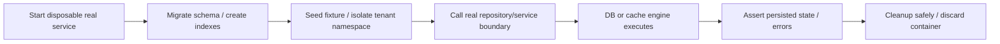
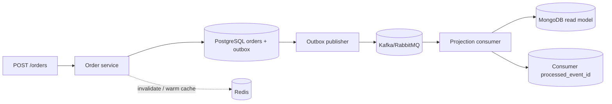

# Kiểm thử JDBC, JPA, R2DBC, Redis hoặc MongoDB với dịch vụ thực tế

> **Chương:** Kiểm thử tích hợp  
> **Module:** SPRING_BOOT_INTEGRATION — tổ chức tích hợp hệ thống Spring Boot qua HTTP client, cơ sở dữ liệu, cache, broker thông điệp và các adapter Spring Integration. Bài học tập trung vào cấu hình, hợp đồng dữ liệu, giao dịch, lỗi, xử lý trùng lặp, kiểm thử và quan sát các luồng tích hợp thực tế.

## 1. Vì sao phải kiểm thử với database/cache thực?

Một unit test có thể mock `JdbcTemplate.update(...)` trả về `1`, mock `JpaRepository.save(...)` trả một entity, hoặc mock `StringRedisTemplate.opsForValue()` trả giá trị đã đặt trước. Các test này kiểm tra **logic gọi API**, nhưng không kiểm chứng hành vi của PostgreSQL, Redis hay MongoDB khi hệ thống thực sự chạy:

- SQL có đúng cú pháp PostgreSQL và đúng kiểu cột `NUMERIC/JSONB/TIMESTAMPTZ` không?
- Unique constraint có ngăn hai request đồng thời tạo cùng đơn hàng không?
- Transaction JDBC/JPA rollback có bao gồm tất cả SQL trong service không?
- `@Version` của Hibernate có phát hiện cập nhật cạnh tranh khi flush không?
- R2DBC publisher có tham gia transaction trong **Reactor Context** sau khi subscribe không?
- Redis `SET NX EX`, TTL và serializer có đúng với server thật không?
- MongoDB có tạo unique index không, và truy vấn theo `ObjectId`/document mapping có đúng không?
- Ứng dụng có thực sự đọc đúng host/port/credentials từ Spring Boot configuration không?

**Kiểm thử tích hợp với dịch vụ thực tế** ở đây có nghĩa là chạy **một phiên bản database/cache/broker thật, độc lập và có thể tạo lại** (ví dụ qua Testcontainers), không phải kết nối vào PostgreSQL/Redis/MongoDB production để chạy test.

### 1.1. Một ví dụ lỗi mà mock không thấy

```java
// Unit test kiểu mock: không có database thật.
when(repository.save(any(OrderEntity.class)))
        .thenAnswer(invocation -> invocation.getArgument(0));

OrderEntity saved = service.createOrder(command);
assertThat(saved.getId()).isEqualTo("order-42");
```

Test này có thể pass ngay cả khi:

1. Bảng database thiếu cột, migration chưa chạy.
2. PostgreSQL không có unique index trên `request_key`.
3. Entity mapping `@Column(name = "request_key")` bị sai.
4. Transaction manager trỏ sang datasource khác.
5. Giao dịch đã commit một phần khi exception xảy ra giữa hai thao tác.

Mock vẫn có giá trị cho **business rule** và edge cases khó dựng, nhưng không nên thay thế kiểm thử với chính engine mà ứng dụng phụ thuộc.

### 1.2. Mục tiêu học tập

Sau bài này, bạn có thể:

1. Chọn đúng cấp độ test cho JDBC, JPA, R2DBC, Redis và MongoDB.
2. Khởi động dịch vụ thật bằng Testcontainers và cấp connection properties cho Spring Boot qua `@ServiceConnection` hoặc `@DynamicPropertySource`.
3. Kiểm chứng SQL schema, constraint, transaction/rollback, JPA flush, optimistic locking và reactive subscription.
4. Kiểm chứng Redis TTL/atomic operations và MongoDB mapping/unique index, không dựa vào giả lập thiếu semantics.
5. Quản lý migration, test fixtures, dữ liệu cô lập, parallel tests và container lifecycle.
6. Mô phỏng lỗi connection/timeout/commit không rõ kết quả và kiểm thử idempotency/outbox khi phối hợp nhiều resources.
7. Xây dựng test suite đáng tin cậy trên CI, có logs/diagnostics và không đụng tới production.

## 2. Chọn công cụ theo mục tiêu, không theo sở thích

| Mục tiêu | Unit test/mock | Slice test + engine thật | `@SpringBootTest` + engine thật | End-to-end nhiều services |
| --- | --- | --- | --- | --- |
| Rule chuyển DTO → entity | Rất phù hợp | Không cần thiết | Có thể nhưng tốn chi phí | Không cần |
| PostgreSQL SQL, constraint, JDBC mapper | Không đủ | **Phù hợp** với `@JdbcTest` | Phù hợp | Tùy workflow |
| JPA entity mapping, query, `@Version` | Không đủ | **`@DataJpaTest`** | Phù hợp | Ít khi cần |
| R2DBC SQL và reactive transaction | Không đủ | `@DataR2dbcTest` với server thật | **Phù hợp** cho service boundary | Khi có event/outbox |
| Redis serializer, key TTL, atomic SET NX | Không đủ | `@DataRedisTest` + Redis thật | Phù hợp | Khi có DB + Redis |
| MongoDB document mapping, indexes | Không đủ | `@DataMongoTest` + mongod thật | Phù hợp | Khi có DB + Mongo |
| HTTP → DB → broker end-to-end | Mock giúp cô lập | Không đủ | Một phần | **Cần** nhiều resources |

**Slice test** chỉ khởi tạo các bean liên quan đến một công nghệ, chạy nhanh hơn full context. Tuy nhiên bean nghiệp vụ có `@Service` thường **không được tự scan vào slice**. Nếu muốn test transaction boundary của application service, dùng `@SpringBootTest` hoặc import một service cụ thể theo chủ đích và bảo đảm manager/proxy đúng.

### 2.1. “H2 pass” không chứng minh “PostgreSQL pass”

Database nhúng H2 hữu ích cho test nhanh, nhưng khác PostgreSQL ở:

- Kiểu dữ liệu như `JSONB`, array, timezone, collation và generated columns.
- SQL dialect, syntax `ON CONFLICT`, khóa, index và constraints.
- Locking, isolation và hiện tượng deadlock/concurrency.
- Transactional DDL, sequence, optimistic locking và driver behavior.
- Quy tắc nhận giá trị `NULL`, ép kiểu ngày/số hoặc giới hạn độ dài.

Nếu production dùng PostgreSQL, **các test quyết định correctness của SQL và transaction nên chạy với PostgreSQL thật**. H2 không có khả năng đảm bảo parity bằng cách bật “PostgreSQL mode”.

### 2.2. “Dịch vụ thật” không đồng nghĩa gọi shared staging

Nên dùng môi trường **ephemeral**: Testcontainers khởi động PostgreSQL/Redis/MongoDB riêng, tạo schema và seed dữ liệu theo test, rồi hủy sau khi test hoàn tất. Shared staging database gây flaky tests do dữ liệu thay đổi, dependency downtime, credentials và nguy cơ xóa nhầm dữ liệu của người khác.

Không chạy test `TRUNCATE`, `DROP DATABASE`, `FLUSHALL` hay xóa collection trên **dịch vụ dùng chung** chỉ để “dọn dữ liệu test”. Mọi lệnh cleanup phải chỉ tới **ephemeral test resources** đã xác minh.

## 3. Testcontainers và Spring Boot 3.x: cấu hình nền tảng

Ví dụ nhắm **Java 17+, Spring Boot 3.2–3.5, Spring Framework 6.x, Testcontainers tương thích BOM**. Khi dùng Boot 4.x/Testcontainers 2.x, kiểm tra lại module coordinates, container API, service connection factories và các test slice annotation theo tài liệu của dòng đang dùng.

### 3.1. Chỉ thêm dependencies cho stack đang kiểm thử

```groovy
// build.gradle — ví dụ dependency management bằng Spring Boot BOM.
dependencies {
    testImplementation 'org.springframework.boot:spring-boot-starter-test'
    testImplementation 'org.springframework.boot:spring-boot-testcontainers'
    testImplementation 'org.testcontainers:junit-jupiter'
    testImplementation 'org.testcontainers:postgresql'
    testImplementation 'org.testcontainers:mongodb'

    // Chọn những starter / driver thực sự ứng dụng dùng:
    implementation 'org.springframework.boot:spring-boot-starter-jdbc'
    runtimeOnly 'org.postgresql:postgresql'

    // Nếu là JPA project, thay/bổ sung khi phù hợp:
    // implementation 'org.springframework.boot:spring-boot-starter-data-jpa'

    // Nếu là R2DBC project:
    // implementation 'org.springframework.boot:spring-boot-starter-data-r2dbc'
    // runtimeOnly 'org.postgresql:r2dbc-postgresql'

    // Nếu là Redis hoặc MongoDB project:
    // implementation 'org.springframework.boot:spring-boot-starter-data-redis'
    // implementation 'org.springframework.boot:spring-boot-starter-data-mongodb'
}
```

Các lựa chọn sau `//` **không bắt buộc cài tất cả vào một ứng dụng**. Một project chỉ dùng JPA nên có JPA starter + JDBC driver; một project reactive SQL chỉ dùng R2DBC cần R2DBC driver; Redis và MongoDB cần starter tương ứng. Trong monolith có cả JDBC và R2DBC, auto-configuration có điều kiện phức tạp hơn; xác định rõ `DataSource`, `ConnectionFactory` và transaction manager thay vì suy rằng cả hai được Boot tự cấu hình đầy đủ.

### 3.2. Ba cách kết nối test tới container

| Cách | Khi dùng | Điểm quan trọng |
| --- | --- | --- |
| `@Container` + `@ServiceConnection` | Boot hỗ trợ `ConnectionDetails` cho loại container, ví dụ PostgreSQL/MongoDB | Boot tự lấy connection data cho bean phù hợp |
| `@Container` + `@DynamicPropertySource` | Container generic/custom service hoặc muốn cấu hình chi tiết | Khai báo supplier host/mapped port đúng và riêng |
| Container như Spring `@Bean` + `@ServiceConnection` | Quản lý lifecycle qua ApplicationContext/boot test config | Test configuration phải được import đúng; kiểm soát reuse |

**Không hard-code `localhost:5432` hoặc `localhost:6379`** trong test dùng Testcontainers: Docker port bên host thường được gán **động**. Dùng `container.getHost()`, `getMappedPort(...)`, `getJdbcUrl()` hoặc service connection do Boot cung cấp.

### 3.3. PostgreSQL container ở cấp test class

```java
import org.junit.jupiter.api.Test;
import org.springframework.boot.testcontainers.service.connection.ServiceConnection;
import org.testcontainers.containers.PostgreSQLContainer;
import org.testcontainers.junit.jupiter.Container;
import org.testcontainers.junit.jupiter.Testcontainers;

@Testcontainers
class PostgreSQLContainerSmokeTest {
    @Container
    @ServiceConnection
    static final PostgreSQLContainer<?> postgres =
            new PostgreSQLContainer<>("postgres:16-alpine");

    @Test
    void containerStarts() {
        // Với @SpringBootTest / @JdbcTest / @DataJpaTest
        // ở ví dụ tiếp theo, Boot sẽ cung cấp connection details.
    }
}
```

Đây là **skeleton**, chưa mở Spring ApplicationContext nên `@ServiceConnection` một mình không kiểm chứng datasource. `@Testcontainers` do JUnit Jupiter extension quản lý lifecycle của `@Container`. Static container thường được dùng lại **trong class** thay vì khởi động lại ở mỗi test method.

### 3.4. @ServiceConnection làm và không làm gì?

Với một loại container được Spring Boot nhận diện, annotation giúp tạo connection details từ container, để cấu hình `spring.datasource.*`, `spring.r2dbc.*` hoặc `spring.data.mongodb.*` phù hợp mà không cần tự tìm port.

Nó **không**:

- Tạo schema nghiệp vụ hoặc migration chính xác.
- Biến database thành in-memory fake.
- Tạo automatic rollback cho một service không có transaction boundary.
- Tự tạo unique index hoặc đảm bảo concurrency.
- Khởi động container khi thiếu Docker runtime.
- Tự xác nhận test đang dùng đúng datasource nếu app có nhiều datasources tự khai báo.

Trong full-context test, có thể in **database product name/version, connection URL đã mask secrets** hoặc chạy một câu SQL xác nhận dữ liệu trên container. Tránh chỉ kiểm tra context loads rồi cho rằng migration và repository đã đúng.

### 3.5. @DynamicPropertySource cho dịch vụ không có container type chuyên biệt

```java
import org.springframework.test.context.DynamicPropertyRegistry;
import org.springframework.test.context.DynamicPropertySource;
import org.testcontainers.containers.GenericContainer;
import org.testcontainers.utility.DockerImageName;

// Fragment static fields/method trong một @SpringBootTest class:
static final GenericContainer<?> redis =
        new GenericContainer<>(DockerImageName.parse("redis:7.4-alpine"))
                .withExposedPorts(6379);

@DynamicPropertySource
static void redisProperties(DynamicPropertyRegistry registry) {
    registry.add("spring.data.redis.host", redis::getHost);
    registry.add("spring.data.redis.port",
            () -> redis.getMappedPort(6379));
}
```

Khi đưa fragment vào class thực, thêm `@Testcontainers` trên class và `@Container` trên static field `redis`, rồi đảm bảo Testcontainers khởi động Redis trước khi Spring sử dụng dynamic properties. Nếu không dùng JUnit extension, bạn phải chủ động gọi `start()/stop()` trong lifecycle phù hợp.

Ở Spring Boot 3.x, Redis properties sử dụng namespace `spring.data.redis.*`. Với một version/framework khác, kiểm tra lại chính xác property và client configuration; tránh ghép cả `spring.redis.*` cũ với `spring.data.redis.*` mới.

## 4. Quy trình viết một integration test đáng tin cậy

### 4.1. Arrange → Act → Assert trên trạng thái bền vững



Test tốt không chỉ assert method trả object; nó **đọc lại từ resource thật** hoặc kiểm tra constraint/transaction sau method call. Với lỗi rollback, kiểm tra bằng **transaction mới**, không dùng cùng JPA persistence context cache.

### 4.2. Chọn dữ liệu độc lập

Ví dụ mỗi test có business ID riêng:

```java
String orderId = "it-" + UUID.randomUUID();
String requestKey = "request-" + UUID.randomUUID();
```

Định danh ngẫu nhiên có thể giúp tránh collisions khi tests chạy song song, nhưng không thay cleanup, unique constraints hay test isolation. Khi cần reproducibility, cố định payload/seed rồi dùng schema, database, Redis prefix hoặc container riêng cho nhóm test.

### 4.3. Đừng để test framework che bug transaction

Các annotations như `@DataJpaTest` hoặc `@JdbcTest` có thể mặc định chạy mỗi test trong **test-managed transaction và rollback khi kết thúc**. Điều này rất tiện cho repository tests, nhưng không chứng minh service tự mở transaction đúng.

Nếu cần kiểm chứng hai SQL operations commit/rollback qua **service boundary**:

1. Dùng Spring-managed service bean được gọi qua proxy.
2. Không gắn `@Transactional` trên chính test method.
3. Gọi service, buộc một lỗi có chủ đích ở giữa.
4. Sau khi service return/throw, đọc lại DB bằng connection/transaction khác.
5. Assert các bản ghi đã commit hoặc rollback theo hợp đồng.

### 4.4. Phân loại nguồn thất bại của test

| Loại failure | Ví dụ | Nơi cần sửa |
| --- | --- | --- |
| Infrastructure/test environment | Docker không chạy, image pull thất bại | CI agent / test runtime |
| Schema/migration | Table hoặc index thiếu | Flyway/Liquibase/migration |
| Mapping/serialization | Column name sai, JSON codec lỗi | Repository/DTO/codec |
| Transaction | Một thao tác commit dù service ném exception | Proxy/transaction manager/resource |
| Contract | Hợp đồng thiếu field, enum/currency sai | Adapter/validation |
| Concurrency/idempotency | Hai requests tạo trùng cùng business key | Unique constraint + logic nghiệp vụ |
| Performance/flakiness | Sleep theo thời gian khiến test chập chờn | Đồng bộ theo condition/clock/test isolation |

Không giải quyết lỗi integration test bằng cách mock phần đang hỏng: như vậy chỉ **ẩn lỗi** cần phát hiện trên engine thật.

## 5. JDBC + PostgreSQL thật: SQL, unique constraint và rollback

Với `JdbcTemplate`, nên kiểm tra **SQL thực** và kết quả sau transaction commit/rollback. Đặc biệt, một unit test mock `jdbc.update(...)` không biết câu `UPDATE ... WHERE balance >= ?` có đúng semantics trên PostgreSQL hay không.

### 5.1. Schema minh họa

```sql
-- Đây là schema NGHIỆP VỤ mẫu, không phải bảng metadata Spring Batch.
CREATE TABLE account_balance (
    account_id VARCHAR(80) PRIMARY KEY,
    balance NUMERIC(19, 2) NOT NULL CHECK (balance >= 0)
);

CREATE TABLE transfer_audit (
    transfer_id VARCHAR(100) PRIMARY KEY,
    from_account VARCHAR(80) NOT NULL,
    to_account VARCHAR(80) NOT NULL,
    amount NUMERIC(19, 2) NOT NULL CHECK (amount > 0)
);
```

Trong production và suite đầy đủ, tạo bảng qua **Flyway/Liquibase migration** giống production. Đoạn DDL là hợp đồng của ví dụ; không tạo bảng bằng `hibernate.hbm2ddl.auto=update` rồi coi như đã kiểm thử migration.

### 5.2. Service JDBC có ba thao tác chung transaction

```java
// JdbcTransferService.java
import java.math.BigDecimal;
import org.springframework.jdbc.core.JdbcTemplate;
import org.springframework.stereotype.Service;
import org.springframework.transaction.annotation.Transactional;

@Service
public class JdbcTransferService {
    private final JdbcTemplate jdbc;

    public JdbcTransferService(JdbcTemplate jdbc) {
        this.jdbc = jdbc;
    }

    @Transactional
    public void transfer(
            String transferId, String from, String to,
            BigDecimal amount) {
        if (from.equals(to) || amount == null
                || amount.signum() <= 0) {
            throw new IllegalArgumentException(
                    "Invalid transfer request");
        }

        int debited = jdbc.update("""
                UPDATE account_balance
                   SET balance = balance - ?
                 WHERE account_id = ? AND balance >= ?
                """, amount, from, amount);
        if (debited != 1) {
            throw new IllegalStateException(
                    "Source account missing or insufficient funds");
        }

        int credited = jdbc.update("""
                UPDATE account_balance
                   SET balance = balance + ?
                 WHERE account_id = ?
                """, amount, to);
        if (credited != 1) {
            throw new IllegalStateException(
                    "Destination account missing");
        }

        jdbc.update("""
                INSERT INTO transfer_audit
                    (transfer_id, from_account, to_account, amount)
                VALUES (?, ?, ?, ?)
                """, transferId, from, to, amount);
    }
}
```

Ba lời gọi `jdbc.update(...)` cùng tham gia transaction khi Spring proxy kích hoạt `@Transactional`, manager trỏ đúng datasource và JDBC truy cập qua Spring-managed connection. Một lỗi ở credit phải rollback debit, audit không được insert. Đây là bài tập transaction boundary, **không** phải mô hình chuyển tiền ngân hàng hoàn chỉnh: production còn cần idempotency transferId, concurrency, authorization và reconciliation.

### 5.3. @SpringBootTest + PostgreSQLContainer

```java
// JdbcTransferIntegrationTest.java
import java.math.BigDecimal;
import org.junit.jupiter.api.BeforeEach;
import org.junit.jupiter.api.Test;
import org.springframework.beans.factory.annotation.Autowired;
import org.springframework.boot.test.context.SpringBootTest;
import org.springframework.boot.testcontainers.service.connection.ServiceConnection;
import org.springframework.dao.DataIntegrityViolationException;
import org.springframework.jdbc.core.JdbcTemplate;
import org.testcontainers.containers.PostgreSQLContainer;
import org.testcontainers.junit.jupiter.Container;
import org.testcontainers.junit.jupiter.Testcontainers;

import static org.assertj.core.api.Assertions.assertThat;
import static org.assertj.core.api.Assertions.assertThatThrownBy;

@Testcontainers
@SpringBootTest
class JdbcTransferIntegrationTest {
    @Container
    @ServiceConnection
    static final PostgreSQLContainer<?> postgres =
            new PostgreSQLContainer<>("postgres:16-alpine");

    @Autowired JdbcTransferService service;
    @Autowired JdbcTemplate jdbc;

    @BeforeEach
    void prepare() {
        // Chỉ minh họa test độc lập với migration;
        // production phải dùng migration chính thức.
        jdbc.execute("""
                CREATE TABLE IF NOT EXISTS account_balance (
                    account_id VARCHAR(80) PRIMARY KEY,
                    balance NUMERIC(19,2) NOT NULL
                )
                """);
        jdbc.execute("""
                CREATE TABLE IF NOT EXISTS transfer_audit (
                    transfer_id VARCHAR(100) PRIMARY KEY,
                    from_account VARCHAR(80) NOT NULL,
                    to_account VARCHAR(80) NOT NULL,
                    amount NUMERIC(19,2) NOT NULL
                )
                """);
        jdbc.update("DELETE FROM transfer_audit");
        jdbc.update("DELETE FROM account_balance");
        jdbc.update(
                "INSERT INTO account_balance VALUES (?, ?)",
                "A", new BigDecimal("100.00"));
    }

    @Test
    void rollsBackDebitWhenCreditFails() {
        assertThatThrownBy(() -> service.transfer(
                "tx-rollback", "A", "missing",
                new BigDecimal("20.00")))
                .isInstanceOf(IllegalStateException.class);

        BigDecimal balance = jdbc.queryForObject(
                "SELECT balance FROM account_balance WHERE account_id = ?",
                BigDecimal.class, "A");
        assertThat(balance).isEqualByComparingTo("100.00");
        assertThat(jdbc.queryForObject(
                "SELECT COUNT(*) FROM transfer_audit", Long.class))
                .isZero();
    }

    @Test
    void rejectsDuplicateTransferId() {
        jdbc.update(
                "INSERT INTO account_balance VALUES (?, ?)",
                "B", new BigDecimal("0.00"));

        service.transfer(
                "tx-same", "A", "B", new BigDecimal("10.00"));

        assertThatThrownBy(() -> service.transfer(
                "tx-same", "A", "B", new BigDecimal("10.00")))
                .isInstanceOf(DataIntegrityViolationException.class);

        assertThat(jdbc.queryForObject(
                "SELECT balance FROM account_balance WHERE account_id = ?",
                BigDecimal.class, "A"))
                .isEqualByComparingTo("90.00");
        assertThat(jdbc.queryForObject(
                "SELECT balance FROM account_balance WHERE account_id = ?",
                BigDecimal.class, "B"))
                .isEqualByComparingTo("10.00");
    }
}
```

**Điều kiện chạy:** Spring Boot test context scan được `JdbcTransferService`, có đúng JDBC `DataSource`/`PlatformTransactionManager` trỏ tới PostgreSQL container; test class **không có `@Transactional`**. Trong dự án có nhiều managers, đặt qualifier manager rõ ràng; nếu service dùng datasource khác, rollback assertion sẽ phơi bày sai lệch.

Test thứ hai kiểm tra PostgreSQL **PRIMARY KEY** thực: transaction thứ hai phải rollback cả debit/credit khi insert audit trùng transfer ID. Nó minh họa constraint và atomicity, **chưa triển khai idempotent replay trả kết quả cũ**. Một workflow production phải phân biệt retry cùng payload hợp lệ với chuyển tiền mới hoặc requestKey đã dùng cho payload khác.

Trong code thật, nên dùng migrations thay vì `CREATE TABLE IF NOT EXISTS` ở `@BeforeEach`; dùng schema riêng, database riêng hoặc cleanup có kiểm soát để tránh hai classes có bảng cùng tên tranh chấp dữ liệu khi chạy song song.

### 5.4. Khi chỉ cần test JdbcTemplate/RowMapper

```java
import org.springframework.boot.test.autoconfigure.jdbc.JdbcTest;
import org.springframework.boot.test.autoconfigure.jdbc.AutoConfigureTestDatabase;

@JdbcTest
@AutoConfigureTestDatabase(replace =
        AutoConfigureTestDatabase.Replace.NONE)
class OrderJdbcMapperTest {
    // Khai báo @Container @ServiceConnection PostgreSQL như ở trên.
    // @Autowired JdbcTemplate jdbc;
    // Test SQL, row mapping, unique constraints trên DB thật.
}
```

`@JdbcTest` là **slice test**: chỉ tạo context JDBC liên quan, thường hỗ trợ test-managed rollback. Đây là lựa chọn tốt khi chỉ cần chứng minh SQL/mapper/constraint mà không muốn load toàn application. Khi đã có `@ServiceConnection`, dùng `Replace.NONE` để rõ ràng **không thay container PostgreSQL bằng H2 nhúng**.

## 6. JPA/Hibernate + PostgreSQL: mapping, flush và optimistic locking

JPA không hoạt động giống `JdbcTemplate`: entity đang ở **persistence context** có thể chưa phát SQL ngay khi gọi setter hoặc `save(...)`. Vì vậy test phải quan sát đúng `flush`, `clear`, transaction commit và optimistic locking.

### 6.1. Entity và repository

```java
// PurchaseOrder.java
import jakarta.persistence.Column;
import jakarta.persistence.Entity;
import jakarta.persistence.Id;
import jakarta.persistence.Table;
import jakarta.persistence.Version;
import java.math.BigDecimal;

@Entity
@Table(name = "purchase_orders")
public class PurchaseOrder {
    @Id
    private String id;

    @Column(nullable = false)
    private String state;

    @Column(nullable = false)
    private BigDecimal amount;

    @Version
    private Long version;

    protected PurchaseOrder() {}

    public PurchaseOrder(
            String id, String state, BigDecimal amount) {
        this.id = id;
        this.state = state;
        this.amount = amount;
    }

    public String getId() { return id; }
    public String getState() { return state; }
    public Long getVersion() { return version; }
    public void setState(String state) { this.state = state; }
}
```

```java
// PurchaseOrderRepository.java
import org.springframework.data.jpa.repository.JpaRepository;

public interface PurchaseOrderRepository
        extends JpaRepository<PurchaseOrder, String> {
}
```

Migration tương ứng:

```sql
CREATE TABLE purchase_orders (
    id VARCHAR(80) PRIMARY KEY,
    state VARCHAR(40) NOT NULL,
    amount NUMERIC(19, 2) NOT NULL,
    version BIGINT
);
```

Ở JPA/Hibernate, `@Version` hỗ trợ optimistic locking: khi hai transactions cùng dựa trên version cũ, update sau có thể thất bại thay vì âm thầm ghi đè. Kiểm tra thực tế cần tạo hai persistence contexts độc lập; một unit test đặt sẵn version trong mock repository **không chứng minh optimistic locking**.

### 6.2. @DataJpaTest không được lặng lẽ dùng H2

```java
import java.math.BigDecimal;
import org.junit.jupiter.api.Test;
import org.springframework.beans.factory.annotation.Autowired;
import org.springframework.boot.test.autoconfigure.jdbc.AutoConfigureTestDatabase;
import org.springframework.boot.test.autoconfigure.orm.jpa.DataJpaTest;
import org.springframework.boot.testcontainers.service.connection.ServiceConnection;
import org.springframework.boot.test.autoconfigure.orm.jpa.TestEntityManager;
import org.testcontainers.containers.PostgreSQLContainer;
import org.testcontainers.junit.jupiter.Container;
import org.testcontainers.junit.jupiter.Testcontainers;

import static org.assertj.core.api.Assertions.assertThat;

@DataJpaTest(properties = "spring.jpa.hibernate.ddl-auto=validate")
@AutoConfigureTestDatabase(replace =
        AutoConfigureTestDatabase.Replace.NONE)
@Testcontainers
class PurchaseOrderRepositoryTest {
    @Container
    @ServiceConnection
    static final PostgreSQLContainer<?> postgres =
            new PostgreSQLContainer<>("postgres:16-alpine");

    @Autowired PurchaseOrderRepository orders;
    @Autowired TestEntityManager entityManager;

    @Test
    void persistsThenReloadsAfterClearingPersistenceContext() {
        orders.saveAndFlush(new PurchaseOrder(
                "jpa-order-1", "NEW", new BigDecimal("19.90")));

        entityManager.clear();

        PurchaseOrder loaded =
                orders.findById("jpa-order-1").orElseThrow();
        assertThat(loaded.getState()).isEqualTo("NEW");
        assertThat(loaded.getVersion()).isNotNull();
    }
}
```

**Quan trọng:** với `ddl-auto=validate`, bảng phải được tạo **trước test** bằng Flyway/Liquibase migration (hoặc script SQL riêng trong môi trường test); đây là **điều kiện bắt buộc để skeleton chạy**, không phải ví dụ tự tạo schema. Nếu chưa có migration, test fail là kết quả hữu ích cho pipeline.

Test `@DataJpaTest` được Spring quản lý transaction/rollback sau test theo mặc định. Gọi `entityManager.clear()` trước khi đọc lại giúp loại trừ việc assertion chỉ nhìn entity cache cấp một. Nhưng test này vẫn **không chứng minh đã commit bền vững** vì test transaction sẽ rollback khi kết thúc. Để kiểm chứng transaction của service, cần test không bao ngoài service bằng test-managed transaction.

### 6.3. JPA flush xong rồi lỗi vẫn rollback

```java
import jakarta.persistence.EntityManager;
import org.springframework.stereotype.Service;
import org.springframework.transaction.annotation.Transactional;

@Service
public class JpaOrderWorkflow {
    private final PurchaseOrderRepository repository;
    private final EntityManager entityManager;

    public JpaOrderWorkflow(
            PurchaseOrderRepository repository,
            EntityManager entityManager) {
        this.repository = repository;
        this.entityManager = entityManager;
    }

    @Transactional
    public void changeThenFail(String id) {
        PurchaseOrder order =
                repository.findById(id).orElseThrow();
        order.setState("CONFIRMED");
        entityManager.flush(); // Gửi UPDATE, CHƯA commit.
        throw new IllegalStateException(
                "Failure after JPA flush");
    }
}
```

Với `@SpringBootTest` không `@Transactional` ở test method, bạn có thể insert đơn trước, gọi `changeThenFail(...)` qua Spring proxy, assert exception, sau đó đọc lại bằng **transaction khác** và xác minh `state` vẫn là `NEW`. Nếu code gọi `this.changeThenFail(...)` trong cùng bean, proxy advice có thể bị bypass — test service boundary phải dùng bean từ ApplicationContext.

### 6.4. Test optimistic locking thực sự cần hai transactions

Scenario chính xác:

```text
T1: load order(id=42, version=0)
T2: load order(id=42, version=0)
T1: set CONFIRMED; flush/commit -> version=1
T2: set CANCELLED; flush/commit
Expected: optimistic lock conflict on T2
DB after: state CONFIRMED, version=1
```

Để tạo hai transaction độc lập trong test, dùng hai service invocations khác transactions hoặc `TransactionTemplate` với boundary rõ; tránh gọi hai repository saves trong **cùng test transaction** rồi nghĩ đó là concurrency. Tùy Hibernate/DB, lỗi xuất hiện ở `flush()` hoặc `commit`; assert class thuộc nhóm optimistic locking/concurrency error theo tầng Spring và xem state sau commit.

### 6.5. Những pitfall JPA cần test với engine thật

- `LazyInitializationException` khi DTO mapper truy cập association sau khi transaction đóng.
- N+1 query hoặc EAGER fetch quá lớn khi load page; bật SQL statistics ở môi trường test/profile có giới hạn.
- `saveAndFlush()` **không** đồng nghĩa transaction đã commit.
- `@Version` conflict, unique constraint và isolation ở PostgreSQL.
- Entity field có default từ database, timezone và numeric precision.
- Native query/JPQL dialect, pagination/sort stability khi dữ liệu đang thay đổi.
- Ứng dụng dùng `spring.jpa.open-in-view` trong web layer có thể che lazy-loading lỗi; test service boundary nên kiểm tra behavior với transaction đóng.

## 7. R2DBC + PostgreSQL thật: publisher, Reactor Context và transaction

R2DBC truy cập database theo cách **reactive**. Một method trả `Mono` thường chỉ mô tả thao tác; SQL thực thi khi có subscription. Giao dịch R2DBC được Spring gắn với **Reactor Context của subscription**, không dùng `ThreadLocal` JDBC truyền qua mọi thread.

### 7.1. Cấu hình môi trường R2DBC test

```groovy
dependencies {
    implementation 'org.springframework.boot:spring-boot-starter-data-r2dbc'
    runtimeOnly 'org.postgresql:r2dbc-postgresql'

    testImplementation 'org.springframework.boot:spring-boot-starter-test'
    testImplementation 'org.springframework.boot:spring-boot-testcontainers'
    testImplementation 'org.testcontainers:junit-jupiter'
    testImplementation 'org.testcontainers:postgresql'
    testImplementation 'io.projectreactor:reactor-test'
}
```

Khi Spring Boot/Testcontainers cung cấp **`R2dbcConnectionDetails`** từ `PostgreSQLContainer` và ứng dụng có R2DBC driver trên classpath, `DatabaseClient` sử dụng kết nối R2DBC tới **server PostgreSQL thật**, không phải một JDBC mock. Nếu cũng có JDBC/JPA dependencies, phải kiểm tra auto-configuration và manager thực; ví dụ dưới đây giả định một ứng dụng/test context **R2DBC-focused**.

### 7.2. TransactionalOperator bao toàn bộ reactive pipeline

```java
// ReactiveTransferService.java
import java.math.BigDecimal;
import org.springframework.r2dbc.core.DatabaseClient;
import org.springframework.stereotype.Service;
import org.springframework.transaction.reactive.TransactionalOperator;
import reactor.core.publisher.Mono;

@Service
public class ReactiveTransferService {
    private final DatabaseClient db;
    private final TransactionalOperator tx;

    public ReactiveTransferService(
            DatabaseClient db, TransactionalOperator tx) {
        this.db = db;
        this.tx = tx;
    }

    public Mono<Void> transfer(
            String from, String to, BigDecimal amount) {
        if (amount == null || amount.signum() <= 0) {
            return Mono.error(
                    new IllegalArgumentException("Invalid amount"));
        }

        Mono<Long> debit = db.sql("""
                UPDATE account_balance
                   SET balance = balance - :amount
                 WHERE account_id = :source
                   AND balance >= :amount
                """)
                .bind("amount", amount)
                .bind("source", from)
                .fetch().rowsUpdated();

        Mono<Long> credit = db.sql("""
                UPDATE account_balance
                   SET balance = balance + :amount
                 WHERE account_id = :destination
                """)
                .bind("amount", amount)
                .bind("destination", to)
                .fetch().rowsUpdated();

        return debit
                .flatMap(n -> n == 1
                        ? Mono.just(n)
                        : Mono.error(new IllegalStateException(
                                "Source account invalid")))
                .then(credit)
                .flatMap(n -> n == 1
                        ? Mono.just(n)
                        : Mono.error(new IllegalStateException(
                                "Destination account invalid")))
                .then()
                .as(tx::transactional);
    }
}
```

Hai lệnh SQL được nối **tuần tự**, không tự gọi `subscribe()` hay `block()` bên trong service. Nếu credit trả 0 rows, pipeline phát `onError` và `TransactionalOperator` rollback debit. Chỉ cần gọi method `transfer(...)` tạo `Mono<Void>` **không tự bắt đầu transaction**.

Một bean operator cần được tạo từ **reactive manager**:

```java
import org.springframework.context.annotation.Bean;
import org.springframework.context.annotation.Configuration;
import org.springframework.transaction.ReactiveTransactionManager;
import org.springframework.transaction.reactive.TransactionalOperator;

@Configuration(proxyBeanMethods = false)
class ReactiveTxConfig {
    @Bean
    TransactionalOperator transactionalOperator(
            ReactiveTransactionManager manager) {
        return TransactionalOperator.create(manager);
    }
}
```

Ví dụ giả định Spring Boot đã tạo `R2dbcTransactionManager` phù hợp từ `ConnectionFactory`. Nếu có nhiều reactive managers, dùng qualifier thay vì chọn ngẫu nhiên. **Không** truyền `JdbcTransactionManager`/`JpaTransactionManager` vào operator này: chúng thuộc imperative transaction infrastructure.

### 7.3. Integration test với StepVerifier

```java
// ReactiveTransferIntegrationTest.java
import java.math.BigDecimal;
import org.junit.jupiter.api.BeforeEach;
import org.junit.jupiter.api.Test;
import org.springframework.beans.factory.annotation.Autowired;
import org.springframework.boot.test.context.SpringBootTest;
import org.springframework.boot.testcontainers.service.connection.ServiceConnection;
import org.springframework.r2dbc.core.DatabaseClient;
import org.testcontainers.containers.PostgreSQLContainer;
import org.testcontainers.junit.jupiter.Container;
import org.testcontainers.junit.jupiter.Testcontainers;
import reactor.core.publisher.Mono;
import reactor.test.StepVerifier;

import static org.assertj.core.api.Assertions.assertThat;

@Testcontainers
@SpringBootTest
class ReactiveTransferIntegrationTest {
    @Container
    @ServiceConnection
    static final PostgreSQLContainer<?> postgres =
            new PostgreSQLContainer<>("postgres:16-alpine");

    @Autowired DatabaseClient db;
    @Autowired ReactiveTransferService service;

    @BeforeEach
    void prepare() {
        Mono<Void> setup = db.sql("""
                CREATE TABLE IF NOT EXISTS account_balance (
                    account_id VARCHAR(80) PRIMARY KEY,
                    balance NUMERIC(19,2) NOT NULL
                )
                """).then()
                .then(db.sql("TRUNCATE TABLE account_balance").then())
                .then(db.sql("""
                        INSERT INTO account_balance
                            (account_id, balance)
                        VALUES (:id, :balance)
                        """)
                        .bind("id", "A")
                        .bind("balance", new BigDecimal("100.00"))
                        .then());

        StepVerifier.create(setup).verifyComplete();
    }

    @Test
    void rollsBackReactiveDebitOnError() {
        StepVerifier.create(service.transfer(
                "A", "missing", new BigDecimal("20.00")))
                .expectError(IllegalStateException.class)
                .verify();

        StepVerifier.create(db.sql("""
                SELECT balance FROM account_balance
                 WHERE account_id = :id
                """)
                .bind("id", "A")
                .map((row, meta) ->
                        row.get("balance", BigDecimal.class))
                .one())
                .assertNext(balance -> assertThat(balance)
                        .isEqualByComparingTo("100.00"))
                .verifyComplete();
    }

    @Test
    void commitsReactiveTransferWhenBothAccountsExist() {
        StepVerifier.create(db.sql("""
                INSERT INTO account_balance
                    (account_id, balance)
                VALUES (:id, :balance)
                """)
                .bind("id", "B")
                .bind("balance", new BigDecimal("0.00"))
                .then()).verifyComplete();

        StepVerifier.create(service.transfer(
                "A", "B", new BigDecimal("20.00")))
                .verifyComplete();

        StepVerifier.create(db.sql("""
                SELECT balance FROM account_balance
                 WHERE account_id = :id
                """)
                .bind("id", "B")
                .map((row, meta) ->
                        row.get("balance", BigDecimal.class))
                .one())
                .assertNext(balance -> assertThat(balance)
                        .isEqualByComparingTo("20.00"))
                .verifyComplete();
    }
}
```

Đây là test integration theo **API R2DBC thực**. `StepVerifier` là subscriber tạo thực thi và chờ terminal signal; test đọc lại database bằng một subscription riêng sau khi transaction đã kết thúc. Cấu hình SQL DDL trong `@BeforeEach` chỉ giúp ví dụ tự chạy trên test container; khi có Flyway/Liquibase thật, dùng migration tương ứng.

**Không đặt `@Transactional` imperative lên JUnit method rồi coi nó bảo vệ reactive SQL**: transaction thread-bound của test không tự đi theo subscription. Dùng `TransactionalOperator` hoặc `@Transactional` gắn reactive manager trên reactive service, và kiểm tra dữ liệu thật sau commit/rollback.

### 7.4. R2DBC slice test

```java
import org.springframework.boot.test.autoconfigure.data.r2dbc.DataR2dbcTest;

@DataR2dbcTest
class ReactiveOrderRepositorySliceTest {
    // @Container @ServiceConnection PostgreSQL + R2DBC driver.
    // Kiểm tra reactive repository, mapping và SQL trên server thật.
}
```

Slice này không thay thế `@SpringBootTest` khi cần kiểm tra service transaction, publisher subscription, security hoặc workflow gồm HTTP/Kafka. Hãy xác minh Spring Boot version, reactive datasource và `ConnectionFactory` trong context slice.

### 7.5. Cancellation, timeout và event loop

Ngoài `onError`, test ứng dụng reactive còn cần đánh giá:

- Client hủy subscription khi HTTP request bị cancel; database operation nào đã chạy/commit?
- `timeout(...)` gây cancellation ở pipeline; external side effects có bị bỏ dở không?
- Code dùng `publishOn(...)` có giữ Reactor Context trong **cùng subscription** không?
- Có gọi blocking `JdbcTemplate`/JPA trên Reactor Netty event loop không?
- Có gọi `.subscribe()` trong service khiến công việc thoát khỏi transaction operator không?

Với lỗi hạ tầng thực, đừng dựa vào `Thread.sleep(...)` để tạo timing tình cờ. Có thể dùng Toxiproxy/controlled faults khi test deadline/cancellation và luôn phân biệt **transaction rollback** với một HTTP/Kafka side effect không thể rollback.

## 8. Redis thật: serialization, TTL và atomic operations

Redis thường được dùng làm cache, idempotency marker, rate limit hoặc ephemeral coordination. Một fake `Map<String,String>` không mô phỏng đầy đủ TTL, Redis command atomicity, key expiration, serialization hoặc lỗi kết nối.

### 8.1. GenericContainer cho Redis

Testcontainers có thể chạy Redis qua `GenericContainer`; không cần giả định luôn có một `RedisContainer` chính thức thuộc module Testcontainers core:

```java
// RedisIdempotencyIntegrationTest.java — phần khung.
import org.springframework.boot.test.autoconfigure.data.redis.DataRedisTest;
import org.springframework.context.annotation.Import;
import org.springframework.test.context.DynamicPropertyRegistry;
import org.springframework.test.context.DynamicPropertySource;
import org.testcontainers.containers.GenericContainer;
import org.testcontainers.junit.jupiter.Container;
import org.testcontainers.junit.jupiter.Testcontainers;
import org.testcontainers.utility.DockerImageName;

@Testcontainers
@DataRedisTest
@Import(RedisIdempotencyGate.class)
class RedisIdempotencyIntegrationTest {
    @Container
    static final GenericContainer<?> redis =
            new GenericContainer<>(
                    DockerImageName.parse("redis:7.4-alpine"))
                    .withExposedPorts(6379);

    @DynamicPropertySource
    static void configureRedis(
            DynamicPropertyRegistry properties) {
        properties.add("spring.data.redis.host",
                redis::getHost);
        properties.add("spring.data.redis.port",
                () -> redis.getMappedPort(6379));
    }

    // Test methods ở mục sau là thành phần của class này.
}
```

`@DataRedisTest` khởi tạo Redis-related slice thay vì toàn ứng dụng; `@Import(RedisIdempotencyGate.class)` đưa business component cần test vào context. Với ứng dụng có Spring Security/custom Redis configuration, full-context `@SpringBootTest` có thể cần thiết.

### 8.2. Một idempotency marker dựa trên SET NX và TTL

```java
// RedisIdempotencyGate.java
import java.time.Duration;
import org.springframework.data.redis.core.StringRedisTemplate;
import org.springframework.stereotype.Component;

@Component
public class RedisIdempotencyGate {
    private final StringRedisTemplate redis;

    public RedisIdempotencyGate(StringRedisTemplate redis) {
        this.redis = redis;
    }

    public boolean tryClaim(
            String requestKey, String owner, Duration lease) {
        if (lease == null || lease.isNegative()
                || lease.isZero()) {
            throw new IllegalArgumentException(
                    "lease must be positive");
        }
        String redisKey = "itest:idem:" + requestKey;
        Boolean inserted = redis.opsForValue()
                .setIfAbsent(redisKey, owner, lease);
        return Boolean.TRUE.equals(inserted);
    }
}
```

`setIfAbsent(key, value, timeout)` ánh xạ thao tác Redis có ý nghĩa **chỉ tạo khi chưa tồn tại, gắn TTL trong cùng operation** khi driver/library hỗ trợ lệnh phù hợp. Đây là nền tảng cho lock/claim tạm thời, nhưng **không tự bảo đảm exactly-once end-to-end** với PostgreSQL/HTTP payment.

### 8.3. Test hai lần claim và TTL

Chèn các test methods sau **vào class ở mục 8.1**:

```java
import java.time.Duration;
import java.util.UUID;
import java.util.concurrent.TimeUnit;
import org.junit.jupiter.api.Test;
import org.springframework.beans.factory.annotation.Autowired;
import org.springframework.data.redis.core.StringRedisTemplate;

import static org.assertj.core.api.Assertions.assertThat;

@Autowired RedisIdempotencyGate gate;
@Autowired StringRedisTemplate redisTemplate;

@Test
void onlyFirstClaimWinsAndTtlIsPresent() {
    String key = "order-" + UUID.randomUUID();
    String redisKey = "itest:idem:" + key;

    assertThat(gate.tryClaim(
            key, "worker-A", Duration.ofSeconds(60)))
            .isTrue();
    assertThat(gate.tryClaim(
            key, "worker-B", Duration.ofSeconds(60)))
            .isFalse();
    assertThat(redisTemplate.opsForValue()
            .get(redisKey)).isEqualTo("worker-A");

    Long ttl = redisTemplate.getExpire(
            redisKey, TimeUnit.SECONDS);
    assertThat(ttl).isNotNull().isBetween(1L, 60L);

    redisTemplate.delete(redisKey);
}
```

Test không dùng `Thread.sleep(60_000)` để đợi key hết hạn: nó tốn thời gian và dễ flaky do scheduler/CI load. Kiểm tra TTL được đặt và nằm trong biên hợp lý; khi cần xác minh expiration semantics, dùng thời hạn ngắn, **đợi điều kiện có timeout** qua Awaitility hoặc cơ chế đồng bộ tương ứng, không dùng sleep mù.

Test xóa **đúng key của nó**, không gọi `FLUSHALL` trên một Redis không được chứng minh là ephemeral. Với Testcontainers Redis độc lập, có thể dùng namespace/prefix riêng cho mỗi test thay vì cleanup toàn DB.

### 8.4. Test serializer và cấu trúc key/value

Nếu application lưu JSON object qua `RedisTemplate<String, OrderCacheDto>`:

1. Dùng đúng serializer/configuration production (ví dụ Jackson JSON, string key).
2. Ghi object bằng repository/cache adapter thật.
3. Dùng cùng adapter đọc lại object, so sánh kiểu và dữ liệu.
4. Kiểm tra TTL, version key, khả năng đọc dữ liệu cũ sau deploy.
5. Nếu Redis chia sẻ giữa services, tránh dùng Java native serialization chứa class name và version coupling khi không có lý do.

Một mock `RedisTemplate` không phát hiện lỗi “test ghi bằng StringRedisTemplate nhưng production đọc bằng JDK serializer”. Integration test cần chạy **cùng cấu hình codec/key prefix** với deployment mục tiêu.

### 8.5. Redis claim không thay database unique constraint

```text
T0   worker-A SET NX idem:42 = owner-A (TTL=60s)
T1   worker-A bắt đầu gọi HTTP partner (chậm 70s)
T60  Redis key hết TTL
T61  worker-B SET NX idem:42 = owner-B → thành công
T70  worker-A vẫn đang thực thi side effect

Result: cả A và B có thể cùng xử lý request logic.
```

Nếu dùng Redis làm lock/lease, cần lease renewal/fencing token và giải pháp chống duplicate ở **resource đích**. Với payment/order, database unique business key hoặc provider idempotency key mới là hàng rào quyết định; Redis marker chỉ giúp giảm tải hoặc điều phối tạm thời.

### 8.6. Các lỗi Redis cần kiểm thử

- Key bị expire trước khi worker hoàn tất.
- Kết nối Redis mất trong lúc `SET NX`: application có thể không biết lệnh đã được áp dụng chưa.
- Redis eviction/memory pressure khiến cache mất dữ liệu.
- Serialize/deserialize sai encoding hoặc schema evolution.
- Concurrent writers cùng key và ownership/fencing khi release.
- TTL được gắn lại không mong muốn do `SET` mới, hoặc lệnh update làm mất TTL theo semantics.

Đừng coi Redis outage là “cache miss” khi Redis giữ **quyết định idempotency hoặc quyền truy cập**. Chọn fail-open/fail-closed theo business risk, với test explicit.

## 9. MongoDB thật: document mapping, unique index và transaction assumptions

MongoDB là document database. Test với một fake `Map<String,Document>` sẽ bỏ qua nhiều khác biệt của MongoDB:

- Mapping `@Id` tới `_id` và cách chuyển `ObjectId/String`.
- Index `unique`, compound index, TTL và điều kiện truy vấn.
- Kiểu số tiền `Decimal128`, nested arrays/documents.
- Atomicity **trong một document** so với transactions **nhiều documents**.
- Retryable writes, write concern, read preference và replication behavior.
- Điều kiện để dùng sessions, transactions và change streams.

### 9.1. Model document có business key duy nhất

```java
// PaymentDocument.java
import java.math.BigDecimal;
import org.springframework.data.annotation.Id;
import org.springframework.data.mongodb.core.mapping.Document;
import org.springframework.data.mongodb.core.mapping.Field;
import org.springframework.data.mongodb.core.mapping.FieldType;
import org.springframework.data.mongodb.core.index.Indexed;

@Document(collection = "payment_receipts")
public class PaymentDocument {
    @Id
    private String id;

    @Indexed(unique = true)
    private String requestKey;

    private String state;

    @Field(targetType = FieldType.DECIMAL128)
    private BigDecimal amount;

    protected PaymentDocument() {}

    public PaymentDocument(
            String requestKey, String state,
            BigDecimal amount) {
        this.requestKey = requestKey;
        this.state = state;
        this.amount = amount;
    }

    public String getId() { return id; }
    public String getRequestKey() { return requestKey; }
    public String getState() { return state; }
    public BigDecimal getAmount() { return amount; }
}
```

```java
// PaymentDocumentRepository.java
import java.util.Optional;
import org.springframework.data.mongodb.repository.MongoRepository;

public interface PaymentDocumentRepository
        extends MongoRepository<PaymentDocument, String> {
    Optional<PaymentDocument> findByRequestKey(String requestKey);
}
```

**Cần hiểu `@Indexed(unique = true)`:** annotation là **khai báo**, không chứng minh MongoDB đã tạo index. Trong nhiều cấu hình Spring Data MongoDB hiện đại, **auto-index creation không bật mặc định**; production nên quản lý indexes bằng migration/provisioning có kiểm soát. Test cũng phải xác minh index tồn tại trước khi khẳng định đã chống trùng.

`Decimal128` giúp lưu số thập phân chính xác theo giới hạn MongoDB Decimal128; vẫn cần business validation về currency, scale, rounding và range. Không mặc định mọi Java `BigDecimal` bất kỳ có thể serialize vào Decimal128 mà không gặp giới hạn.

### 9.2. MongoDBContainer + @DataMongoTest

```java
// PaymentDocumentRepositoryTest.java
import java.math.BigDecimal;
import java.util.UUID;
import org.junit.jupiter.api.BeforeEach;
import org.junit.jupiter.api.Test;
import org.springframework.beans.factory.annotation.Autowired;
import org.springframework.boot.test.autoconfigure.data.mongo.DataMongoTest;
import org.springframework.boot.testcontainers.service.connection.ServiceConnection;
import org.springframework.dao.DuplicateKeyException;
import org.springframework.data.domain.Sort;
import org.springframework.data.mongodb.core.MongoTemplate;
import org.springframework.data.mongodb.core.index.Index;
import org.testcontainers.containers.MongoDBContainer;
import org.testcontainers.junit.jupiter.Container;
import org.testcontainers.junit.jupiter.Testcontainers;

import static org.assertj.core.api.Assertions.assertThat;
import static org.assertj.core.api.Assertions.assertThatThrownBy;

@Testcontainers
@DataMongoTest
class PaymentDocumentRepositoryTest {
    @Container
    @ServiceConnection
    static final MongoDBContainer mongo =
            new MongoDBContainer("mongo:7.0");

    @Autowired PaymentDocumentRepository repository;
    @Autowired MongoTemplate mongoTemplate;

    @BeforeEach
    void ensureUniqueIndex() {
        mongoTemplate.indexOps(PaymentDocument.class)
                .ensureIndex(new Index()
                        .on("requestKey", Sort.Direction.ASC)
                        .unique());
    }

    @Test
    void mapsDecimal128AndPersistsDocument() {
        String key = "pay-" + UUID.randomUUID();
        repository.save(new PaymentDocument(
                key, "SETTLED", new BigDecimal("125.50")));

        PaymentDocument loaded =
                repository.findByRequestKey(key).orElseThrow();
        assertThat(loaded.getState()).isEqualTo("SETTLED");
        assertThat(loaded.getAmount())
                .isEqualByComparingTo("125.50");
    }

    @Test
    void rejectsTwoDocumentsWithSameBusinessKey() {
        String key = "request-" + UUID.randomUUID();
        repository.save(new PaymentDocument(
                key, "PENDING", new BigDecimal("10.00")));

        assertThatThrownBy(() -> repository.save(
                new PaymentDocument(
                        key, "SETTLED", new BigDecimal("20.00"))))
                .isInstanceOf(DuplicateKeyException.class);

        assertThat(repository.findByRequestKey(key))
                .isPresent()
                .get()
                .extracting(PaymentDocument::getState)
                .isEqualTo("PENDING");
    }
}
```

Test sử dụng **mongod thật** qua Testcontainers, không phải MongoDB fake. Cần test slice nhận đúng connection details từ `@ServiceConnection` và cấu hình index thực sự được tạo trước test. Khi có custom `MongoClient` bean, kiểm tra Boot auto-config có bị thay thế không.

**Chú ý cơ chế JUnit transaction:** `@DataMongoTest` không tự tạo rollback trên MongoDB giống `@DataJpaTest` của JPA. Nếu muốn isolation, tạo ID namespace riêng như ví dụ, xóa đúng collection test trong disposable container hoặc tạo DB riêng cho mỗi suite. Không giả định database Mongo sẽ trở về trạng thái cũ sau mỗi `@Test`.

### 9.3. Atomicity của một document không phải multi-document transaction

MongoDB bảo đảm atomic update ở cấp **một document**. Khi logic cần ghi hai documents cùng nguyên tử, cần một transaction MongoDB hợp lệ và hạ tầng deployment hỗ trợ:

- Replica set/sharded cluster cấu hình phù hợp cho transaction.
- `MongoTransactionManager` hoặc reactive transaction manager nếu dùng Reactive MongoDB.
- Session/transaction options và write concern đúng môi trường.
- Test lỗi giữa hai writes, kiểm tra rollback với context transaction thật.

Không kết luận transaction Mongo hoạt động chỉ từ việc gọi `mongoTemplate.save(...)` hai lần. Một MongoDB server standalone có thể hỗ trợ single-document atomic writes nhưng không có đầy đủ semantics multi-document transactions. Dùng MongoDB Testcontainers với cấu hình replica set phù hợp nếu test cần transaction/change stream.

### 9.4. Test index, projection và query semantics

Ngoài duplicate-key test:

1. Kiểm tra index đang tồn tại qua `mongoTemplate.indexOps(PaymentDocument.class).getIndexInfo()`.
2. Kiểm tra compound indexes theo tenant + requestKey khi multi-tenant.
3. Kiểm tra query sort ổn định và pagination khi collection lớn.
4. Kiểm tra cách mapping Java field name ↔ Mongo document field name.
5. Kiểm tra document chứa enum/status mới, field thiếu/null và schema evolution.
6. Kiểm tra `Decimal128`/timestamp/timezone và nested documents trên dữ liệu thật.
7. Nếu dùng TTL index, không assert document biến mất **ngay lập tức** sau TTL: MongoDB TTL background monitor xử lý bất đồng bộ.

### 9.5. Không trộn MongoDB server và Redis behavior

Redis chủ yếu chạy key/value operations, TTL và data structures trong event loop; MongoDB có document collection, index planner, sessions và truy vấn document. Cả hai đều có TTL nhưng **thời điểm xóa, query visibility, atomicity và transaction semantics khác nhau**. Kiểm thử TTL trên fake cache hoặc Mongo document không chứng minh behavior của Redis, và ngược lại.

## 10. Migration, index, seed và xác minh môi trường test

Khi nói “test với service thực tế”, việc database khởi động mới chỉ là điều kiện đầu tiên. **Schema phải giống hợp đồng triển khai**.

### 10.1. SQL: ưu tiên chạy migration như production

Với PostgreSQL JDBC/JPA, chọn Flyway/Liquibase migration phù hợp với phiên bản ứng dụng:

```text
Application starts:
  1. Testcontainers PostgreSQL server ready
  2. Spring Boot obtains JDBC connection details
  3. Migration tool validates/applies SQL migrations
  4. Spring context creates repositories/services
  5. Integration tests read/write actual tables
```

Nếu Flyway/Liquibase đã là thành phần production, **không tắt migration trong integration test** chỉ để context startup nhanh hơn. Test không chạy migration sẽ bỏ lỡ lỗi thiếu column, index, SQL dialect, lệnh DDL hoặc migration order.

Với `spring.jpa.hibernate.ddl-auto=validate`, Hibernate kiểm tra entity mapping so với schema hiện có thay vì tự ý tạo schema. Khi dùng Spring Boot 3.x với Flyway version mới, PostgreSQL có thể cần module database-specific tương ứng; hãy để BOM và migration tool quản lý dependencies đúng version.

### 10.2. MongoDB: index là một phần của schema contract

Mongo không yêu cầu một bảng cố định trước khi lưu document, nhưng production vẫn có **schema logic**:

- Unique indexes, compound indexes, sparse/partial indexes.
- TTL indexes cho retention.
- Collection validators nếu được cấu hình.
- Collation và case-sensitive/case-insensitive query semantics.
- Shard key/tenant isolation và read/write concerns.

Đừng bật Mongo auto-index-creation trong test rồi production tắt và ngầm tin unique constraint đang tồn tại. Nên có một migration/provisioning bước tạo index dùng được cho cả hai môi trường, và test verify index thực.

### 10.3. Redis: key schema và serializer là contract

Redis không có SQL migration, nhưng vẫn có conventions phải giữ tương thích:

```text
Key:   idem:payments:v2:{tenant}:{requestKey}
Value: {"owner":"worker-7","state":"IN_PROGRESS"}
TTL:   5 minutes
Codec: UTF-8 keys, JSON values
```

Nếu một deployment thay schema key/TTL/serializer, consumer/version cũ có thể không đọc đúng. Test nên kiểm tra **key prefix, TTL, encoding, backward compatibility** và không giả định `FLUSHALL` khi deploy.

### 10.4. Test data lifecycle

| Loại fixture | Gợi ý | Điều cần tránh |
| --- | --- | --- |
| SQL rows | Migration seed hoặc `JdbcTemplate` trong test-specific schema | Cùng business ID giữa tests chạy song song |
| JPA entities | Repository/EntityManager + `flush/clear` | Assert từ persistence cache thay vì DB |
| R2DBC rows | `DatabaseClient` + `StepVerifier` trong setup | Publisher chưa subscribe nhưng test vẫn pass |
| Redis keys | Prefix/UUID riêng, TTL ngắn có kiểm soát | Global `FLUSHALL` trên service không xác minh ephemeral |
| Mongo documents | Unique request keys/tenant IDs; ensure indexes | Giả định rollback tự động như JPA |
| File CSV/JSON | `@TempDir` và fixture versioned | File dùng chung bị sửa sau checkpoint |
| Message events | Stable business eventId/attemptId riêng | UUID mới mỗi retry khiến consumer không dedup |

**Quy tắc dữ liệu:** một test phải có dữ liệu nó tự tạo hoặc nguồn fixture được xác định rõ. Một test không được dựa vào việc test khác chạy trước để tạo database state.

## 11. Kiểm thử nhiều resources: PostgreSQL + Redis/Mongo không cùng transaction

Một ứng dụng tích hợp thường dùng PostgreSQL làm nguồn dữ liệu chính, Redis làm cache/idempotency gate và MongoDB làm read model. Đây là điểm mà unit test “mọi mock đều success” dễ che mất vấn đề nhất quán dữ liệu.

### 11.1. Sơ đồ một luồng tích hợp thực tế



Trong sơ đồ này:

- PostgreSQL transaction chỉ bảo đảm atomicity đối với records **trong cùng SQL database và manager**.
- Redis write không tự rollback khi PostgreSQL rollback.
- Mongo read model có thể cập nhật trễ theo broker, không có distributed transaction tự động.
- Consumer có thể nhận event trùng khi publisher retry hoặc broker redelivery.
- Test phải kiểm tra state **trước/sau commit, sau khi consumer xử lý, và khi có retry/crash**.

### 11.2. Một full-context test dùng hai containers

```java
// OrdersAndCacheIntegrationTest.java — khung Spring Boot.
import org.springframework.boot.test.context.SpringBootTest;
import org.springframework.boot.testcontainers.service.connection.ServiceConnection;
import org.springframework.test.context.DynamicPropertyRegistry;
import org.springframework.test.context.DynamicPropertySource;
import org.testcontainers.containers.GenericContainer;
import org.testcontainers.containers.PostgreSQLContainer;
import org.testcontainers.junit.jupiter.Container;
import org.testcontainers.junit.jupiter.Testcontainers;
import org.testcontainers.utility.DockerImageName;

@Testcontainers
@SpringBootTest
class OrdersAndCacheIntegrationTest {
    @Container
    @ServiceConnection
    static final PostgreSQLContainer<?> postgres =
            new PostgreSQLContainer<>("postgres:16-alpine");

    @Container
    static final GenericContainer<?> redis =
            new GenericContainer<>(
                    DockerImageName.parse("redis:7.4-alpine"))
                    .withExposedPorts(6379);

    @DynamicPropertySource
    static void configureRedis(DynamicPropertyRegistry properties) {
        properties.add("spring.data.redis.host",
                redis::getHost);
        properties.add("spring.data.redis.port",
                () -> redis.getMappedPort(6379));
    }

    // @Autowired OrderService orderService;
    // @Autowired JdbcTemplate jdbc;
    // @Autowired StringRedisTemplate redisTemplate;
    // Test atomic SQL commit, cache invalidation/rebuild,
    // Redis outage và outbox recovery theo domain service thực.
}
```

Khung này minh họa **cấu hình nhiều services**, chưa phải test nghiệp vụ hoàn chỉnh vì `OrderService` và assertions phụ thuộc ứng dụng. Để có test thực, tạo cụ thể một service và bắt các failure points: DB commit thành công/cache invalidation thất bại; Redis claim thành công/DB rollback; broker ACK thất lạc; consumer Mongo duplicate event.

### 11.3. Những invariant cần test giữa PostgreSQL và Redis

| Failure point | Kết quả có thể xảy ra | Test nên assert |
| --- | --- | --- |
| Redis claim thành công, DB insert thất bại | Redis giữ marker nhưng order chưa có | Có TTL/release policy và recovery, không mất order mãi |
| DB commit, Redis delete/invalidate lỗi | Cache có dữ liệu cũ | Cache TTL/version/rebuild, không dùng stale state cho payment |
| Redis key hết hạn sớm | Hai workers cùng xử lý | PostgreSQL unique key ngăn duplicate business row |
| Redis mất kết nối | Cache/idempotency gate không trả kết quả | Fail-open/fail-closed theo business contract |
| DB commit nhưng cache update trước commit | Cache thấy dữ liệu chưa bền vững | Invalidate after commit hoặc event-driven repair |

**Không có một `@Transactional` duy nhất bảo vệ cả JDBC và Redis** theo cơ chế mặc định. Transaction Redis nếu được bật cũng không biến nó thành XA cùng PostgreSQL. Test phải phơi bày và xác nhận **recovery semantics**.

### 11.4. PostgreSQL → MongoDB projection và duplicate events

Khi một event `OrderCreated(eventId="evt-42")` được consumer ghi vào Mongo:

1. Consumer có thể ghi document thành công rồi chết trước broker ACK.
2. Broker redeliver cùng event.
3. Nếu consumer cứ `insert` document mới với random `_id`, có thể tạo hai read models.
4. Nếu consumer dùng aggregate ID/version và unique event inbox/upsert semantics, bản lặp có thể không tạo side effect thêm.

Test end-to-end nên gửi **cùng eventId hai lần**, đợi consumer hoàn tất (có timeout), rồi assert MongoDB chỉ có trạng thái hợp lệ tương ứng. Khi cần bảo đảm inbox và read model commit cùng lúc, chúng phải dùng một transaction MongoDB phù hợp và replica set; không được ghi inbox ở PostgreSQL rồi mong Mongo commit nguyên tử.

### 11.5. Transactional outbox cần được kiểm chứng bằng lỗi có chủ đích

Test quan trọng:

```text
1. PostgreSQL BEGIN
2. INSERT orders(id=order-42)
3. INSERT outbox(eventId=evt-42, state=PENDING)
4. COMMIT
5. Worker publishes to broker, receives ACK
6. Worker crashes BEFORE marking outbox SENT
7. Worker restarts and republishes SAME eventId
8. Consumer dedup rejects duplicate business effect
```

Một integration test chỉ assert `orders.count()==1` chưa đủ. Cần assert **outbox row, retry attempts, event ID không đổi, consumer inbox và business read model**. Đó là kiểm thử tính nhất quán qua ranh giới, không chỉ kiểm thử driver.

## 12. Fault injection: kiểm thử lỗi mà production thật sự gặp

Một integration test chỉ chạy happy path dễ tạo cảm giác an toàn giả. Trường hợp quan trọng hơn là **hệ thống thất bại ở đâu, điều gì đã commit và kết quả còn có thể xác định hay không**.

### 12.1. Ma trận lỗi theo công nghệ

| Resource | Lỗi cần mô phỏng | Invariant cần bảo vệ |
| --- | --- | --- |
| JDBC/PostgreSQL | Exception giữa hai SQL updates | Transaction rollback tất cả writes cùng resource |
| JDBC/PostgreSQL | Hai concurrent inserts cùng business key | Unique constraint chỉ cho một bản ghi logic |
| JPA/Hibernate | Flush xong rồi exception | SQL chưa commit phải rollback |
| JPA/Hibernate | Hai transactions cùng cập nhật version cũ | Optimistic locking ngăn lost update |
| R2DBC/PostgreSQL | `onError` giữa hai reactive updates | Transaction rollback theo Reactor Context |
| R2DBC/PostgreSQL | Publisher không subscribe | Không có query/transaction nào thực thi |
| Redis | SET NX trước đó đã tồn tại | Chỉ một claim được tạo; TTL và owner không bị ghi đè |
| Redis | Key hết TTL khi worker còn sống | Không được coi Redis lock là bảo đảm exactly-once |
| MongoDB | Duplicate requestKey | Unique index từ server thật từ chối |
| MongoDB | Schema field/Decimal128 không tương thích | Mapping/validation từ chối hoặc chuyển đúng theo contract |
| Multi-resource | DB commit nhưng Redis/broker unavailable | Recovery/repair, không mất business state |
| Multi-resource | Broker ACK mất sau publish | Replay cùng eventId, consumer dedup |

### 12.2. Phân biệt connection loss trước và sau commit

Với PostgreSQL:

```text
CASE A
  SQL UPDATE fails before COMMIT
  transaction manager rolls back
  client sees failure
  DB state should remain unchanged

CASE B
  COMMIT succeeds on server
  connection fails before client receives success
  client sees I/O/transaction exception
  commit outcome may be UNKNOWN to client
```

Không được viết test “mất kết nối sau commit ⇒ chắc chắn rollback”. Trong case B, **đọc lại theo business key/transaction ID** trước khi retry; retry với ID mới có thể tạo duplicate. Đây là lý do idempotency và reconciliation quan trọng ngay cả khi sử dụng một database ACID.

### 12.3. Dùng Toxiproxy hoặc proxy fault injection đúng nơi

Khi cần mô phỏng mạng thật:

- Dùng Toxiproxy hoặc network proxy chuyên dụng giữa application và container database/cache.
- Tạo lỗi có kiểm soát: latency, connection reset, network cut hoặc bandwidth limit.
- Ghi rõ thời điểm fault: trước query, sau insert, trước COMMIT, sau COMMIT hoặc trong response.
- Thu logs/traces để xác định kết quả, không suy từ exception name duy nhất.
- Phục hồi proxy và kiểm tra reconnect/pool recovery, không chỉ assert “có exception”.

Toxiproxy là **công cụ kiểm thử tùy chọn**, không tự được chạy khi thêm `spring-boot-testcontainers`. Không dùng docker network kill hoặc restart broker thật trên môi trường production để chứng minh bài test.

### 12.4. Giao dịch và lỗi nghiệp vụ phải được phân biệt

Một exception do domain validation có thể được ném **trước** khi mở transaction; một exception do unique constraint xảy ra khi JDBC/JPA thực sự flush/commit; timeout do mạng có thể đến sau khi server đã xử lý lệnh. Nếu test chỉ `assertThrows(Exception.class)`, nó không cho biết:

1. Lỗi có đúng nguyên nhân expected không?
2. Transaction đã rollback hay một phần dữ liệu còn lại?
3. Retry có phải nguyên nhân tạo lỗi khác không?
4. Kết quả có thực sự không xác định do ACK/response thất lạc không?

Viết assertion cả **exception category và persisted state**. Với lỗi cần đối soát, assert state `UNKNOWN/PENDING_RECONCILIATION` được lưu bền vững, không trả thành công giả.

## 13. Kiểm thử concurrency và idempotency không dựa vào Thread.sleep

### 13.1. Race condition không thấy trong test tuần tự

Giả sử code:

```java
if (!repository.existsByRequestKey(requestKey)) {
    repository.save(new OrderEntity(requestKey, payload));
}
```

Hai requests song song có thể cùng thấy `exists=false` rồi cùng insert. Một test tuần tự **không chứng minh** code an toàn. Unique constraint ở database là hàng rào cuối cùng; nếu logic cần trả kết quả idempotent, code phải xử lý duplicate-key rồi đọc lại record và xác minh payload hash.

### 13.2. Tạo concurrency có thể lặp lại

Đối với JDBC/JPA:

1. Tạo hai connections/transactions riêng từ Spring-managed manager.
2. Dùng `CountDownLatch`/`CyclicBarrier` để cả hai đến đúng điểm trước insert/update.
3. Cho hai workers commit cạnh tranh.
4. Đọc lại từ transaction khác.
5. Assert chỉ một business record logic tồn tại hoặc optimistic lock conflict phát sinh như thiết kế.

```java
// Fragment test concurrency, không phải một service hoàn chỉnh.
import java.util.concurrent.CountDownLatch;
import java.util.concurrent.TimeUnit;

CountDownLatch ready = new CountDownLatch(2);
CountDownLatch release = new CountDownLatch(1);

Runnable worker = () -> {
    ready.countDown();
    try {
        if (!release.await(5, TimeUnit.SECONDS)) {
            throw new AssertionError("Workers not released");
        }
        // Gọi một Spring service bean khác để mở transaction riêng.
        // Không gọi method @Transactional qua this.selfInvocation().
    } catch (InterruptedException interrupted) {
        Thread.currentThread().interrupt();
        throw new RuntimeException(interrupted);
    }
};
```

Test thật phải tạo/start hai threads (hoặc dùng ExecutorService), đợi `ready.await(...)` với timeout, gọi `release.countDown()` rồi join futures và assert outcome. Fragment này chỉ minh họa **synchronization primitives**; tránh `Thread.sleep(50)` như một bảo đảm rằng hai transactions sẽ giao nhau đúng thời điểm.

### 13.3. Test timeout/TTL bằng điều kiện và clock

Đối với code tính toán hạn retry/lease **trong Java**, inject `Clock` và dùng fixed clock trong unit tests; không cần server thật cho phép tính thời gian thuần.

Đối với TTL **của Redis/MongoDB**, server quyết định expiration:

- Redis: assert `TTL > 0` và nhỏ hơn/không vượt TTL đặt; test expiration khi cần với bounded waiting.
- MongoDB TTL index: background monitor xóa không nhất thiết tức thì khi qua thời điểm TTL; dùng eventual assertion có deadline đủ lớn, hoặc chỉ kiểm tra index definition nếu mục tiêu là schema.
- SQL transaction deadline: kiểm tra driver/database timeout riêng, không suy từ Java `Clock`.

Không đặt test timeout quá sát mức lý tưởng trên máy dev; CI có CPU, disk và scheduling variance.

### 13.4. Kiểm thử idempotency qua restart

```text
Attempt 1:
  requestKey=order-42
  PostgreSQL inserts order, commits
  application crashes before HTTP response

Attempt 2:
  requestKey=order-42 (same payload)
  database unique index rejects duplicate insert
  application reloads existing order and returns prior result

Attempt 3:
  requestKey=order-42 (different payload)
  application returns business conflict, not old result as if accepted
```

Test nên assert cả **replay cùng payload** và **conflict khác payload**. Một integration test chỉ đếm records = 1 không chứng minh behavior đúng nếu code nuốt mọi duplicate-key rồi trả 200 cho dữ liệu khác.

## 14. Dữ liệu test, parallelism và container lifecycle

### 14.1. Container static và JUnit test class

Một `static @Container` được quản lý bởi JUnit Jupiter extension và thường được dùng lại cho các test methods **trong cùng class**. Điều này giảm chi phí khởi động nhưng khiến dữ liệu từ method trước có thể tồn tại ở method sau.

| Cách cô lập | Ưu điểm | Nhược điểm |
| --- | --- | --- |
| Mỗi test method một container | Isolation mạnh | Khởi động chậm, tốn CPU/RAM |
| Static container + cleanup | Nhanh hơn trong class | Cleanup phải an toàn, không xung đột parallel |
| Schema/database riêng theo test | Tránh đụng dữ liệu | Quản lý migration/config phức tạp hơn |
| Unique ID / tenant namespace | Dễ parallel và theo dõi | Cần xóa hết dữ liệu test hoặc container dispose |
| `@Transactional` test rollback (JDBC/JPA slice) | Đơn giản cho repository tests | Có thể che bug service transaction; không rollback Redis/Mongo/HTTP |

**Không giả định static @Container dùng được an toàn cho mọi Spring context cache**: nếu ApplicationContext được cache qua nhiều classes nhưng JUnit extension dừng một container sau class trước, context cache có thể giữ datasource trỏ đến container đã dừng. Khi chia sẻ context giữa classes, quản lý container lifecycle nhất quán hoặc dùng Spring-managed Testcontainers configuration phù hợp.

### 14.2. @DirtiesContext là công cụ nặng

`@DirtiesContext` buộc Spring TestContext bỏ ApplicationContext cache. Nó có ích khi test thực sự thay bean state/context configuration, nhưng không phải cách mặc định xóa:

- PostgreSQL rows.
- Redis keys.
- MongoDB documents.
- Messages trong broker queue.

Khởi tạo lại context **không bảo đảm** database ngoài process được dọn. Dùng cleanup data, namespace/schema hoặc disposable container đúng phạm vi.

### 14.3. Không làm test khác hỏng qua global state

Các anti-pattern:

- Dùng một Redis key `lock:test` chung cho mọi tests.
- MongoDB `deleteAll()` trên collection dùng chung với class khác đang chạy song song.
- PostgreSQL `TRUNCATE orders CASCADE` khi test khác vẫn đang ghi.
- Ghi đè `System.setProperty(...)` global rồi không trả lại.
- Sử dụng một broker queue chung cho nhiều tests và consumer cạnh tranh.
- Dựa vào thứ tự tên method `@TestMethodOrder` để test B “nhận dữ liệu” từ test A.

Nếu test cần tuần tự vì một resource shared, ghi rõ constraint và tắt parallel đúng phạm vi. Giải pháp bền vững hơn vẫn là **mỗi test sở hữu dữ liệu và namespace của mình**.

### 14.4. Test fixtures phải biểu diễn hợp đồng, không phải dữ liệu ngẫu nhiên

Một fixture CSV/JSON/SQL có ích khi biểu diễn cả:

- Trường bắt buộc, null, Unicode, timezone, decimal scale.
- Tên cột/field mapping và sort order.
- Business ID trùng, payload khác.
- Schema version cũ và mới.
- TTL/expiration policy.
- Concurrency conflict.
- Rollback một operation sau thao tác thứ nhất.

Khi schema API/DB thay đổi, fixture cần được review cùng code và migration. Không chỉ thêm field tùy ý để test pass mà bỏ qua backward compatibility.

## 15. CI và hiệu năng của integration suite

### 15.1. Môi trường chạy test

CI agent cần:

1. Docker/compatible container runtime được cấu hình và cho phép.
2. Quyền pull images từ registry được chọn, proxy/mirror nếu môi trường hạn chế mạng.
3. Đủ CPU, RAM và disk cho PostgreSQL + Redis + MongoDB đồng thời.
4. Cơ chế cleanup containers/volumes khi job bị hủy.
5. Không mở kết nối tới production từ network test.
6. Test runner có timeout hợp lý, lưu logs/chẩn đoán khi container startup thất bại.

Không disable cơ chế cleanup của Testcontainers hoặc bật reuse vô điều kiện trên shared CI agents. Chế độ reusable containers chỉ phù hợp với mục tiêu tối ưu **phát triển cục bộ** khi chấp nhận lifecycle và data isolation implications.

### 15.2. Cố định phiên bản dịch vụ phù hợp production

```text
PostgreSQL 16.x → test image postgres:16-alpine (hoặc pinned digest)
Redis      7.x  → test image redis:7.4-alpine (hoặc pinned digest)
MongoDB    7.x  → test image mongo:7.0 (hoặc pinned digest)
```

Các tags là ví dụ; chọn **major/minor được production thực sự dùng** và quy trình patch/version pin phù hợp. Không dùng `latest` cho test image nếu mục tiêu là reproducible builds. Khi nâng server/driver, chạy lại integration suite và migration compatibility tests.

### 15.3. Tối ưu mà không bỏ semantics

| Chiến lược | Lợi ích | Cảnh báo |
| --- | --- | --- |
| Slice tests cho JDBC/JPA/Redis/Mongo | Context nhỏ, nhanh | Không chứng minh full service orchestration |
| Static container trong class | Ít lần start | Quản lý cleanup/test data |
| Chạy migrations một lần/context | Giảm overhead | Không bỏ migration correctness |
| Tag tests `integration` | Tách local fast loop và CI verification | Không bỏ test thật khỏi pipeline phát hành |
| Unique fixtures + parallel hợp lý | Tăng throughput | Cẩn thận DB locks/collection cleanup |
| Container logs chỉ lưu khi fail | Giảm noise | Cần giữ đủ evidence tìm lỗi |
| Test network failures ở suite riêng | Bảo vệ timing ổn định | Không để chaos test phá pipeline chính |

**Không tạo “fast integration test” bằng cách đổi PostgreSQL thành H2, Redis thành Map và MongoDB thành fake rồi vẫn đặt tên như cũ.** Tốt hơn là phân loại test rõ: unit, slice-with-real-service, full integration, end-to-end/chaos.

### 15.4. Phân nhóm trong pipeline

Một chiến lược:

```text
Pull request:
  - Unit tests
  - JDBC/JPA/R2DBC/Redis/Mongo focused integration tests
  - Schema migration validation

Main branch / pre-release:
  - Full SpringBootTest workflows
  - Outbox/inbox and broker recovery
  - HTTP partner contract tests

Nightly / dedicated environment:
  - Concurrency stress
  - Network fault injection
  - Replica-set / failover tests
  - Performance and restart behavior
```

Lịch trình là gợi ý theo độ tốn kém; với hệ thống giao dịch quan trọng, một số end-to-end recovery tests có thể phải trở thành **release gate bắt buộc**. Đừng đánh đổi correctness để giảm CI time mà không có rủi ro đã được chấp thuận.

## 16. Observability và runbook khi integration test thất bại

Một integration test thất bại vì PostgreSQL chưa ready khác hoàn toàn test thất bại vì service không rollback. Test suite nên báo rõ **môi trường nào đang chạy, operation nào sai và persisted state ra sao** mà không rò rỉ credentials.

### 16.1. Ghi nhận thông tin nào?

| Signal | Giá trị cho chẩn đoán | Điều không nên log |
| --- | --- | --- |
| Container image/tag | Biết engine major version và sự tương thích | Registry token |
| Container health/startup result | Phân biệt Docker và application failure | Docker daemon secrets |
| JDBC URL đã mask, DB product/version | Xác nhận đúng PostgreSQL | Username/password đầy đủ |
| SQLSTATE/constraint name | Phân biệt unique violation, deadlock, serialization | SQL bind values chứa PII |
| JPA flush/transaction outcome | Phát hiện stale context/rollback bug | Toàn bộ entity có PII |
| R2DBC onComplete/onError/Cancel | Phân biệt subscriber lifecycle | Raw reactive payload chứa secret |
| Redis command/TTL/prefix | Phát hiện serializer hoặc timeout | Token/key chứa customer ID raw |
| MongoDB index list/error code | Xác minh unique/TTL index | Document đầy đủ chứa PII |
| Correlation/event ID trong audit store | Tìm replay/duplicate | EventId làm metric label high-cardinality |
| Retry count và deadline | Nhận biết retry amplification | Toàn bộ stacktrace lặp quá nhiều |

Chỉ bật SQL statement logging chi tiết khi không phát tán bind parameters nhạy cảm; cần kiểm soát retention của CI artifacts và container logs. Các logs từ database đôi khi chứa SQL text, tên bảng hoặc values được ghi trong error; không public toàn bộ logs nếu chúng có thể lộ dữ liệu thật.

### 16.2. Ma trận chẩn đoán nhanh

| Triệu chứng | Nguyên nhân thường gặp | Điều tra/khắc phục |
| --- | --- | --- |
| Docker unavailable | CI runner không có container runtime/quyền | Kiểm tra Docker daemon/network; không đổi sang mock để che vấn đề |
| PostgreSQL container ready nhưng app nối H2 | Test DB replacement hoặc datasource custom | `@ServiceConnection`, `@AutoConfigureTestDatabase(replace=NONE)`, JDBC URL |
| JDBC SQL fail trên `ON CONFLICT` | H2/Dialect/SQL schema khác | Chạy PostgreSQL thật và migration đúng |
| JPA test pass dù service thiếu `@Transactional` | Test-managed transaction đang che bug | Test service qua Spring proxy, test method không `@Transactional` |
| JPA thấy dữ liệu cũ sau native update | Persistence context cache | `flush/clear/refresh` theo nhu cầu và boundary |
| `@Version` không phát hiện conflict | Hai writes cùng transaction hoặc version mapping sai | Test hai independent transactions + flush/commit |
| R2DBC test không có SQL | Publisher chưa subscribe | `StepVerifier.create(...).verify...` và test data |
| R2DBC rollback không xảy ra | Reactive manager sai, `subscribe()` rời pipeline | `TransactionalOperator`, cùng connection factory/context |
| Redis connect refused | Port 6379 hard-code thay vì mapped port | `getHost()/getMappedPort(6379)` hoặc service connection đúng |
| Redis key không expire | SET overwrite TTL, lỗi serializer/TTL config | Redis TTL command, test key chính xác |
| Redis lock trùng khi timeout | Lease expire trước khi worker xong | Fencing/renewal + DB unique business key |
| Mongo duplicate vẫn được lưu | Unique index chưa được tạo | `getIndexInfo()`, ensure index/migration |
| Mongo Decimal128 sai kiểu | Codec/`@Field(targetType=DECIMAL128)`/scale | Kiểm tra BSON type và round-trip |
| Mongo transaction không hoạt động | Standalone topology, thiếu transaction manager | Replica set, session, manager và transaction tests |
| Test đôi khi fail trên CI | Shared fixture, parallel race, sleep timing | Test isolation, latches/await conditions, resource limits |
| Service test nối vào staging DB | Property profile/config bị override | Xác minh network target trước destructive setup |
| DB commit nhưng cache/broker chưa cập nhật | Không có distributed transaction | Outbox, eventual consistency, retry/reconciliation |

### 16.3. Runbook tối thiểu khi một test đỏ

1. **Xác định tầng:** container startup, Spring context, schema migration, test setup, method dưới test hay assertion.
2. **Kiểm tra endpoint thực:** DB engine/version, host/port đã được map, database/schema name và profile Spring đang dùng.
3. **Xác minh migration:** bảng/index có tồn tại không, thứ tự migration, DDL mode JPA có tự chỉnh schema ngoài ý muốn không.
4. **Chạy lại một test có cô lập:** xem lỗi có phụ thuộc thứ tự tests hoặc parallel execution không.
5. **Đọc persisted state từ resource thật:** SQL query, Redis TTL/value, Mongo document/index, không dựa vào mock verification.
6. **Phân biệt lỗi nghiệp vụ với hạ tầng:** unique violation có thể là chính sách đúng; timeout sau COMMIT có thể là outcome unknown.
7. **Xác định transaction boundary:** thread-bound JDBC/JPA, Reactor Context R2DBC, Mongo session và các side effects ngoài DB.
8. **Thu logs được sanitize:** SQLSTATE, container logs, trace correlation và retry count.
9. **Sửa nguyên nhân trong code/config/migration:** không chỉ tăng timeout hoặc thêm `Thread.sleep(...)` để test chuyển xanh.
10. **Thêm regression test:** bao gồm happy path, failure path, duplicate/retry và trường hợp sau restart.

### 16.4. Vì sao cần quan sát test như một hệ thống?

Khi cùng một nhóm tests bắt đầu chậm dần:

- PostgreSQL connection pool có thể bị leak do không đóng resource.
- MongoDB hoặc Redis đang giữ quá nhiều fixtures từ các methods trước.
- Container image pull và khởi tạo database chiếm phần lớn CI time.
- TestContext caching có thể tạo/dừng containers không cùng lifecycle.
- Một integration test có network retry không budget khiến suite bị treo.

Theo dõi **startup duration, execution duration theo class, retry/flaky rate, container resource usage và số test bị skip**. Một build xanh vì toàn bộ integration tests bị skip do thiếu Docker không phải tín hiệu chất lượng giống build xanh đã chạy thật.

## 17. Bài tập tổng hợp: kiểm thử workflow đặt hàng

### 17.1. Bối cảnh

Một ứng dụng Spring Boot có:

- PostgreSQL lưu đơn hàng, transfer/audit và transactional outbox.
- JPA quản lý entity đơn hàng với optimistic locking.
- R2DBC dùng trong một integration adapter reactive độc lập.
- Redis cache trạng thái đơn và hỗ trợ idempotency marker có TTL.
- MongoDB giữ read model phục vụ tìm kiếm/truy vấn.
- HTTP client nhận sự kiện/đối soát với hệ thống đối tác.
- Broker chuyển `OrderCreated` tới projection consumer.

Bạn không nhất thiết đưa cả JDBC, JPA, R2DBC, Redis và MongoDB vào một Spring context; hãy chia test slices/ứng dụng phù hợp, đảm bảo mọi resource có manager và contract rõ.

### 17.2. Yêu cầu triển khai

1. Dùng Testcontainers khởi động PostgreSQL, Redis, MongoDB ở các test suites riêng; không dùng server shared.
2. PostgreSQL JDBC: thực thi transaction có hai SQL updates, gây lỗi ở update thứ hai và assert rollback.
3. PostgreSQL JDBC: gửi hai requests dùng cùng business key, xác minh unique constraint ngăn duplicate.
4. JPA: lưu entity, `flush/clear` rồi đọc lại; kiểm tra `@Version` khi có conflict ở hai transactions.
5. R2DBC: dùng `TransactionalOperator`, `StepVerifier` và PostgreSQL thật; test commit khi cả hai updates thành công, rollback khi có `onError`.
6. Redis: dùng `GenericContainer`, kiểm tra `SET NX`, TTL, serializer và key prefix. Không dùng `FLUSHALL` trên server không rõ nguồn.
7. MongoDB: bảo đảm unique index tồn tại, test duplicate requestKey bị từ chối; kiểm tra `Decimal128` round-trip.
8. Dùng migration tạo SQL schema như production; JPA chạy `ddl-auto=validate` để không che schema drift.
9. Dùng input/fixture ổn định, test IDs riêng và test isolation an toàn khi parallel.
10. Mô phỏng DB commit thành công nhưng Redis invalidation thất bại; kiểm tra cache recovery strategy.
11. Mô phỏng broker ACK thất lạc sau outbox publish; retry cùng eventId, assert consumer chỉ apply một effect.
12. Với Mongo read model, gửi trùng eventId để xác minh idempotent projection.
13. Dùng fault injection kiểm tra connection reset, nhưng không dùng sleep timing ngẫu nhiên.
14. Gắn CI labels và lưu container logs khi fail, có cảnh báo nếu Docker missing khiến tests bị skip.

### 17.3. Tiêu chí nghiệm thu

| Tiêu chí | Bằng chứng có thể review |
| --- | --- |
| Test kết nối database/cache thật | Container startup, connection details và read/write query thật |
| Migration đúng | Schema/index được tạo/validate bằng tool production |
| JDBC transaction atomic | Không có partial debit/audit sau lỗi |
| JPA correctness | Flush/clear test, optimistic conflict ở hai transactions |
| Reactive correctness | StepVerifier subscribe, rollback onError và DB state sau transaction |
| Redis semantics | SET NX chỉ một winner, TTL tồn tại, codec đúng |
| Mongo correctness | Unique index thực, duplicate key rejected, Decimal128 mapping |
| Multi-resource recovery | DB/outbox, cache repair, duplicate event consumer dedup |
| CI reproducibility | Image versions, data isolation, không dựa shared services |
| Observability | Logs, counts, trace/operation ID an toàn, failure runbook |

### 17.4. Checklist code review

- [ ] Dùng đúng image và engine version cho PostgreSQL, Redis, MongoDB theo production?
- [ ] Có `@ServiceConnection` hoặc `@DynamicPropertySource` chính xác, không hard-code host ports?
- [ ] Test không kết nối hoặc dọn dữ liệu ở production/shared staging?
- [ ] JDBC/JPA tests có migration/schema và constraints như production?
- [ ] `@JdbcTest`/`@DataJpaTest` không vô tình bị thay datasource bằng H2?
- [ ] Khi kiểm tra service rollback, test method không bị test-managed transaction che bug?
- [ ] JPA test dùng `flush/clear`/transaction mới khi cần xác nhận state database?
- [ ] R2DBC tests thật sự subscribe publisher và dùng đúng reactive transaction manager?
- [ ] Không chạy JDBC/JPA blocking trên Reactor Netty event loop?
- [ ] Redis test kiểm chứng TTL, codec, atomic command, không dùng in-memory fake để khẳng định behavior?
- [ ] Redis lock/idempotency marker không bị xem là hàng rào duy nhất chống duplicate?
- [ ] MongoDB test tạo/verify indexes thật, không dựa trên annotation khi auto-index bị tắt?
- [ ] Mongo multi-document transaction chỉ được test khi topology và manager hỗ trợ?
- [ ] Có test duplicate business key, payload conflict, transaction rollback và commit outcome unknown?
- [ ] Mỗi test sở hữu dữ liệu/namespace của mình, không phụ thuộc thứ tự chạy?
- [ ] Có test restart/retry sau crash, outbox/inbox và consumer dedup khi workflow có broker?
- [ ] Có timeout/latches thay vì `Thread.sleep(...)` gây flaky concurrency test?
- [ ] Test suite ghi nhận engine version, schema failure, SQLSTATE và diagnostic logs đã sanitize?
- [ ] CI fail rõ khi infrastructure thiết yếu thiếu, không lặng lẽ skip integration tests?

### 17.5. Câu hỏi tự kiểm tra

1. Tại sao mock `JdbcTemplate.update()` không chứng minh SQL chạy đúng trên PostgreSQL?
2. `@ServiceConnection` giúp kết nối Testcontainers với Spring Boot nhưng **không** tự tạo những gì?
3. Khi nào nên dùng `@JdbcTest` thay vì `@SpringBootTest`?
4. Vì sao `@DataJpaTest` rollback cuối test có thể che lỗi `@Transactional` của service?
5. `entityManager.flush()` có nghĩa JPA transaction đã commit chưa?
6. Cần những điều kiện nào để kiểm thử optimistic locking `@Version` thật sự?
7. Tại sao gọi `Mono<Void> transfer(...)` chưa có nghĩa R2DBC đã mở transaction?
8. `TransactionalOperator` duy trì transaction theo Reactor Context khác JDBC thread-bound như thế nào?
9. Redis `SET NX` và TTL có đảm bảo hai workers không bao giờ xử lý cùng một request không? Vì sao?
10. Tại sao không nên dùng `FLUSHALL` để cleanup test Redis trên một service chưa xác minh ephemeral?
11. `@Indexed(unique=true)` có luôn tự tạo unique index trên MongoDB production không?
12. MongoDB một-document atomicity khác multi-document transaction ra sao?
13. Vì sao MongoDB TTL document có thể chưa biến mất ngay tại thời điểm TTL hết?
14. Khi DB commit rồi connection mất trước response, application biết chắc commit thất bại không?
15. Nếu PostgreSQL commit thành công nhưng Redis cache invalidation lỗi, `@Transactional` có rollback Redis được không?
16. Khi broker redeliver event vào Mongo projection, dùng gì để tránh tạo duplicate document?
17. Vì sao static Testcontainers ở class trước có thể gây vấn đề khi ApplicationContext được cache qua classes khác?
18. Có nên thay PostgreSQL bằng H2 để làm test chạy nhanh mà vẫn gọi là production-parity integration test không?
19. Testcontainers có thể kiểm chứng những semantics nào mà mock repository không thể?
20. Một pipeline CI xanh nhưng đã skip toàn bộ container tests vì không có Docker có được coi là đã kiểm chứng integration không?

**Ghi nhớ:** kiểm thử tích hợp đáng tin cậy cần chạy **engine thật** với **schema, indexes, serialization, transaction và topology** gần production; xác nhận **persisted state sau commit/rollback** chứ không chỉ verify method calls. JDBC/JPA, R2DBC, Redis và MongoDB khác nhau về lifecycle, atomicity, transaction context và TTL. Khi chúng phối hợp qua HTTP/broker, phải kiểm thử **unique keys, idempotency, outbox/inbox, retry, reconciliation và failure windows**; một annotation `@Transactional` không biến nhiều resources thành một distributed transaction.

### Tài liệu tham khảo

- [Spring Boot 3.5 — Testcontainers](https://docs.spring.io/spring-boot/3.5/reference/testing/testcontainers.html)
- [Spring Boot 3.5 — Testing Spring Boot Applications](https://docs.spring.io/spring-boot/3.5/reference/testing/spring-boot-applications.html)
- [Spring Boot 3.5 — SQL Databases](https://docs.spring.io/spring-boot/3.5/reference/data/sql.html)
- [Spring Framework — Testing](https://docs.spring.io/spring-framework/reference/testing.html)
- [Spring Framework — JDBC](https://docs.spring.io/spring-framework/reference/data-access/jdbc.html)
- [Spring Framework — Transaction Management](https://docs.spring.io/spring-framework/reference/data-access/transaction.html)
- [Spring Framework — R2DBC](https://docs.spring.io/spring-framework/reference/data-access/r2dbc.html)
- [Spring Data JPA — Reference](https://docs.spring.io/spring-data/jpa/reference/)
- [Spring Data R2DBC — Reference](https://docs.spring.io/spring-data/relational/reference/r2dbc.html)
- [Spring Data Redis — Reference](https://docs.spring.io/spring-data/redis/reference/)
- [Spring Data MongoDB — Reference](https://docs.spring.io/spring-data/mongodb/reference/)
- [Testcontainers Java — Documentation](https://java.testcontainers.org/)
- [Testcontainers Java — JUnit 5](https://java.testcontainers.org/test_framework_integration/junit_5/)
- [MongoDB — Transactions](https://www.mongodb.com/docs/manual/core/transactions/)
- [Redis — SET Command (NX and EX)](https://redis.io/docs/latest/commands/set/)
