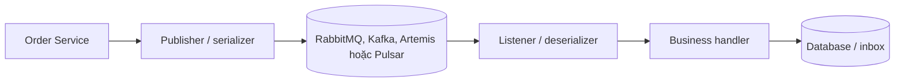
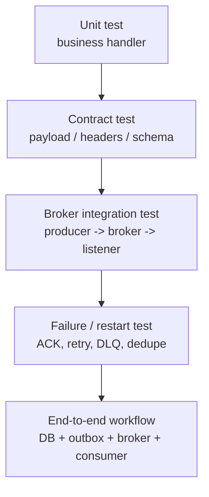
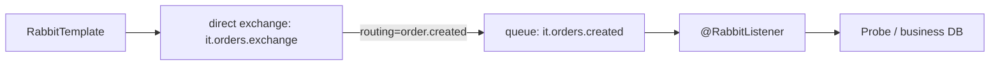
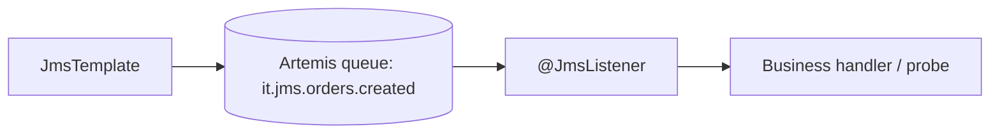
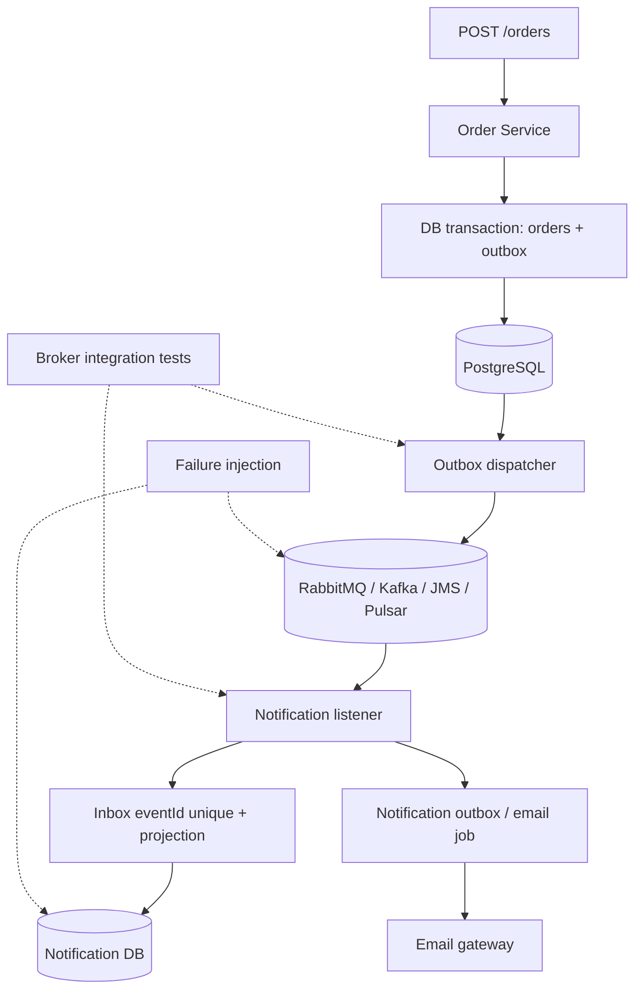

# Kiểm thử RabbitMQ, Kafka, JMS hoặc Pulsar qua broker thử nghiệm

## 1. Vì sao integration test phải đi qua broker?

Trong mô-đun **SPRING_BOOT_INTEGRATION**, một Spring Boot service kết nối HTTP client, cơ sở dữ liệu, Redis cache, message broker và các adapter của Spring Integration. Với RabbitMQ, Apache Kafka, JMS/ActiveMQ Artemis hay Apache Pulsar, ta thường truyền sự kiện/command **bất đồng bộ** giữa các tiến trình.

Giả sử Order Service lưu đơn hàng và phát `OrderCreated`, Notification Service nghe event rồi ghi kết quả vào database:



Unit test chỉ gọi thẳng `handler.handle(event)` có thể kiểm tra một business rule, nhưng **không phát hiện** được các sai sót như:

- Sai exchange, routing key, queue binding hoặc topic/subscription.
- Producer sử dụng JSON nhưng consumer chờ String hoặc DTO có type header không đáng tin.
- Consumer group không nhận được vì offset, subscription hoặc listener container chưa sẵn sàng.
- Publisher được ACK nhưng không message nào tới queue mong đợi.
- Một lỗi khiến listener retry vô hạn, broker redeliver hoặc message bị đưa vào DLQ.
- Consumer xử lý database thành công nhưng chết trước ACK, dẫn tới xử lý trùng.
- Broker restart làm mất message vì delivery mode/durable queue không đúng.
- Test qua mock thành công nhưng connection factory, credentials, TLS hay broker topology ở môi trường thật không tương thích.

Vì vậy bài **“Kiểm thử RabbitMQ, Kafka, JMS hoặc Pulsar qua broker thử nghiệm”** thuộc chương **Kiểm thử tích hợp** tập trung vào *kiểm thử một hệ thống qua broker có hành vi transport thực*, đồng thời giữ cho test cô lập, lặp lại được và đủ nhanh cho CI.



**Phạm vi ví dụ:** Java 17+, Spring Boot 3.x, JUnit Jupiter, Spring AMQP, Spring Kafka, Spring JMS dùng **Jakarta JMS**, Spring for Apache Pulsar và Testcontainers 1.20/1.21.x. Testcontainers 2.x đã đổi tên một số Maven modules/packages; kiểm tra BOM và API của dự án trước khi copy nguyên imports. Không dùng các ví dụ Boot 4/Testcontainers 2.x để suy rằng Boot 3.x có cấu trúc y hệt.

## 2. Bốn công nghệ không có cùng delivery model

| Công nghệ | Đơn vị routing | Consumer nhận bằng | Tín hiệu hoàn tất | Đặc trưng cần test |
| --- | --- | --- | --- | --- |
| **RabbitMQ/AMQP 0-9-1** | Exchange, routing key, queue, binding | `@RabbitListener` | Consumer ACK/NACK, broker redelivery | Routing, publisher confirms/returns, DLX |
| **Apache Kafka** | Topic, partition, record key, consumer group | `@KafkaListener` | Offset commit theo listener policy | Partition ordering, lag, retries, rebalances |
| **JMS/Artemis** | Queue hoặc Topic, selector, JMS headers | `@JmsListener` | Session acknowledge/transaction | Jakarta JMS semantics, redelivery, selectors, DLQ |
| **Apache Pulsar** | Topic, subscription, key | `@PulsarListener` | Individual/cumulative ACK theo subscription | Subscription modes, schema, redelivery, DLQ |

Đừng viết một test rồi giả định mọi broker sẽ cùng một semantics của `ACK`. Ví dụ Kafka không xóa record khi một consumer group commit offset; RabbitMQ có thể xóa message khỏi queue khi ACK; Pulsar phụ thuộc subscription mode, retention và acknowledgment. JMS là **API/standard**, Artemis là **một broker implementation**: kiểm thử JMS với Artemis không tự chứng minh ActiveMQ Classic hay IBM MQ sẽ có mọi extension giống nhau.

### 2.1. Xác nhận ở ba tầng khác nhau

1. **Producer API hoàn tất:** method send/`Future` trả success.
2. **Broker nhận/giữ/định tuyến:** publisher confirm, Kafka send result, Pulsar message ID, JMS send return theo semantics cụ thể.
3. **Consumer business effect hoàn tất:** listener giải mã và commit local database/outbox/inbox.

Một test `assertDoesNotThrow(() -> template.send(...))` chỉ cho biết tầng rất nông. Để kiểm thử business outcome, phải quan sát **kết quả sau consumer**, không chỉ số lần gọi publish.

### 2.2. At-least-once không giống exactly-once

Một broker có thể redeliver sau consumer crash hoặc timeout. Producer retries cũng có thể tạo transport duplicates. Dù Kafka có idempotent producer hay transaction và Pulsar có tính năng deduplication, **business side effect trên HTTP/SQL/email không tự được thực hiện exactly once**. Integration test cần xác nhận idempotency ở consumer, hoặc outbox/inbox/unique constraint khi yêu cầu đáng tin cậy.

## 3. Chọn mock, embedded broker hay broker container

| Lựa chọn | Kiểm tra tốt | Không kiểm tra được | Khi nào dùng |
| --- | --- | --- | --- |
| Mock `RabbitTemplate`/`KafkaTemplate` | Producer gọi đúng API/arguments | Network, routing, serializers thực, broker ACK | Unit test nhanh |
| `TestRabbitTemplate` | Gọi listener logic Spring AMQP mà không cần broker | Queue/exchange binding, broker persistence/redelivery | Test listener slice |
| `@EmbeddedKafka` | Kafka producer/consumer với broker embedded | Mọi vấn đề Docker/network/cluster production | Spring Kafka tests chạy nhanh |
| Embedded Artemis | JMS broker trong JVM (khi configured) | External TCP/TLS/network topology | JMS smoke test nhẹ |
| **Testcontainers** | Broker thật trong container, TCP ports thật, client codecs/listeners | Cluster multi-node/security/upgrade nếu chỉ chạy 1 container | Integration test tiêu chuẩn |
| Shared staging broker | ACL/TLS/topology gần production | Test isolation, reproducibility | Staging/contract/system test |
| Fault-injected/cluster test | Failover, split-brain, partition/rebalance | Tốn thời gian/chi phí | Reliability suite chọn lọc |

**Khuyến nghị chung:** dùng unit/contract tests cho phần lớn logic; dùng Testcontainers để kiểm tra kết nối và hành vi delivery thực; dành một bộ test chuyên biệt cho broker cluster, auth/TLS, schema registry và chaos. Không cố biến mọi unit test thành container test.

### 3.1. Container thật vẫn chỉ là topology thử nghiệm

Một RabbitMQContainer một node không tự mô phỏng quorum queues/cluster failover. Một KafkaContainer một broker với replication factor 1 không chứng minh durability trên production cluster. Pulsar standalone không thay cluster BookKeeper/broker failover. Artemis chạy một JVM không xác nhận high availability replication/shared-store.

**Điều test có thể khẳng định phải tương ứng topology đã dựng.**

## 4. Chuẩn bị Maven, Docker và version matrix

Một ứng dụng có thể chỉ cần **một** trong bốn broker; không thêm cả bốn starters nếu hệ thống không sử dụng chúng.

Dependencies chung cho test:

```xml
<dependency>
  <groupId>org.springframework.boot</groupId>
  <artifactId>spring-boot-starter-test</artifactId>
  <scope>test</scope>
</dependency>
<dependency>
  <groupId>org.springframework.boot</groupId>
  <artifactId>spring-boot-testcontainers</artifactId>
  <scope>test</scope>
</dependency>
<dependency>
  <groupId>org.testcontainers</groupId>
  <artifactId>junit-jupiter</artifactId>
  <scope>test</scope>
</dependency>
<dependency>
  <groupId>org.awaitility</groupId>
  <artifactId>awaitility</artifactId>
  <scope>test</scope>
</dependency>
```

Đây là tọa độ **Testcontainers 1.x**; với 2.x, các artifact names như `testcontainers-junit-jupiter` và module-prefixed names thay đổi. Chọn một BOM được Spring Boot/project hỗ trợ, giữ các Testcontainers dependencies đồng phiên bản. Không ghép tùy ý `junit-jupiter:1.x` với module `testcontainers-kafka:2.x` chỉ vì ví dụ trên mạng.

Tùy broker:

```xml
<!-- Chọn starter tương ứng với broker thật sự được dùng. -->
<dependency>
  <groupId>org.springframework.boot</groupId>
  <artifactId>spring-boot-starter-amqp</artifactId>
</dependency>
<!-- hoặc -->
<dependency>
  <groupId>org.springframework.kafka</groupId>
  <artifactId>spring-kafka</artifactId>
</dependency>
<!-- hoặc -->
<dependency>
  <groupId>org.springframework.boot</groupId>
  <artifactId>spring-boot-starter-artemis</artifactId>
</dependency>
<!-- hoặc -->
<dependency>
  <groupId>org.springframework.boot</groupId>
  <artifactId>spring-boot-starter-pulsar</artifactId>
</dependency>
```

Testcontainers 1.x modules (chỉ thêm module tương ứng):

```xml
<dependency>
  <groupId>org.testcontainers</groupId>
  <artifactId>rabbitmq</artifactId>
  <scope>test</scope>
</dependency>
<dependency>
  <groupId>org.testcontainers</groupId>
  <artifactId>kafka</artifactId>
  <scope>test</scope>
</dependency>
<dependency>
  <groupId>org.testcontainers</groupId>
  <artifactId>activemq</artifactId>
  <scope>test</scope>
</dependency>
<dependency>
  <groupId>org.testcontainers</groupId>
  <artifactId>pulsar</artifactId>
  <scope>test</scope>
</dependency>
```

Kiểm tra sự tương thích của Spring Boot BOM, Spring AMQP/Kafka/Pulsar và image broker thay vì nâng một package độc lập làm lệch driver. Các container images cụ thể trong ví dụ là **minh họa để pin version**, không phải khuyến nghị rằng đó là bản mới nhất.

### 4.1. Prerequisites của CI

- Docker Engine hoặc Docker-compatible runtime được Testcontainers hỗ trợ.
- Image pull từ registry nội bộ/công khai theo policy; kiểm tra rate limit và mạng.
- Có quyền tạo container, map port và cleanup; không phải runner nào cũng hỗ trợ Docker-in-Docker.
- Không hard-code port 5672/9092/61616/6650 ở host khi dùng mapped port.
- Có thời gian/CPU/RAM cho broker startup, nhất là Pulsar và Kafka.
- Không được vô hiệu hóa Docker resource cleanup bừa bãi chỉ để test “đỡ chậm”.

### 4.2. @ServiceConnection và @DynamicPropertySource

Spring Boot 3.1+ hỗ trợ `@ServiceConnection` với Testcontainers được nhận diện. Ví dụ:

```java
@Container
@ServiceConnection
static RabbitMQContainer rabbit =
    new RabbitMQContainer("rabbitmq:3.13-management");
```

Spring Boot tự tạo `ConnectionDetails` cho RabbitMQ khi có `spring-boot-testcontainers` trên test classpath. Với container/custom image không được nhận diện hoặc cần tự chỉ rõ property, dùng `@DynamicPropertySource`:

```java
@DynamicPropertySource
static void rabbitProperties(DynamicPropertyRegistry properties) {
    properties.add("spring.rabbitmq.host", rabbit::getHost);
    properties.add("spring.rabbitmq.port", rabbit::getAmqpPort);
    properties.add("spring.rabbitmq.username",
        rabbit::getAdminUsername);
    properties.add("spring.rabbitmq.password",
        rabbit::getAdminPassword);
}
```

Hai lựa chọn được dùng **thay thế**, không nên cấu hình cả hai theo cách tạo giá trị mâu thuẫn. Nếu dùng `@ServiceConnection` ở nhiều broker types, xác minh mỗi bean đã kết nối đúng container và không để profile khác override.

## 5. Một event contract đơn giản để tái sử dụng giữa các test

Để tập trung vào broker, ví dụ ban đầu gửi JSON **dưới dạng String**. Một event:

```json
{
  "eventId": "evt-test-001",
  "eventType": "OrderCreated",
  "schemaVersion": 1,
  "occurredAt": "2026-11-21T04:00:00Z",
  "data": {
    "orderId": "ord-test-001",
    "tenantId": "tenant-17"
  }
}
```

Chọn String payload giúp tránh nhập nhằng giữa Spring message conversion và transport, nhưng **không thay kiểm thử JSON serialization thực**. Sau khi smoke test kết nối/routing thành công, nên bổ sung test DTO → byte[]/JSON → DTO qua đúng converter/schema registry của production.

### 5.1. Danh tính trong test

| ID | Dùng để kiểm thử |
| --- | --- |
| `eventId` | Dedupe của logical event, không đổi qua retry |
| `orderId` | Liên kết business entity |
| `tenantId` | Xác minh scope và không rò cross-tenant |
| `correlationId` | Tracing/query logs, không thay event ID |
| Kafka key / Pulsar key | Thứ tự/partition-routing semantics |
| JMSCorrelationID | Header cho request/reply/correlation |
| RabbitMQ messageId | AMQP metadata; phải xác minh do producer cấp |

Trong test chạy song song, dùng `UUID.randomUUID()` tạo payload mỗi lần hoặc topic/queue namespace riêng, tránh kết quả cũ của một test khác khiến false positive. Nhưng **đối với retry cùng logical operation**, giữ nguyên event ID để kiểm tra idempotency.

## 6. Mô hình assertion cho message bất đồng bộ

Không nên gửi rồi lập tức `assertThat(database.count()).isEqualTo(1)` vì listener chạy trong thread khác. Hai cách phổ biến:

1. **BlockingQueue test probe:** listener đẩy outcome vào một queue thread-safe, test chờ có timeout.
2. **Awaitility:** poll một **durable business outcome** trong DB/inbox/outbox cho đến khi đúng, có deadline hữu hạn.

Probe đơn giản:

```java
package example.integration.testing;

import java.util.concurrent.BlockingQueue;
import java.util.concurrent.LinkedBlockingQueue;

public final class EventProbe {

    private final BlockingQueue<String> received =
        new LinkedBlockingQueue<>();

    public void record(String payload) {
        received.offer(payload);
    }

    public BlockingQueue<String> received() {
        return received;
    }
}
```

Dùng trong test:

```java
String payload = probe.received()
    .poll(10, java.util.concurrent.TimeUnit.SECONDS);

assertThat(payload).contains("evt-test-001");
```

**Không dùng `Thread.sleep(500)` rồi hy vọng consumer đã chạy:** JVM scheduler, broker startup và CI load không có bound nhỏ cố định. `poll(timeout)` chờ tối đa theo deadline; `Awaitility` có thể retry assertion condition.

### 6.1. Sử dụng Awaitility cho business effect

```java
import static org.awaitility.Awaitility.await;
import static org.assertj.core.api.Assertions.assertThat;
import java.time.Duration;

await()
    .atMost(Duration.ofSeconds(15))
    .pollInterval(Duration.ofMillis(100))
    .untilAsserted(() ->
        assertThat(orderProjectionRepository
            .countByLastEventId(eventId))
            .isEqualTo(1)
    );
```

`orderProjectionRepository` là repository application minh họa, không phải class có sẵn. Một test có thể có `assertThat` đúng sớm nhưng transaction chưa commit? Hãy đọc từ connection riêng sau commit theo isolation phù hợp, không chỉ nhìn in-memory probe.

### 6.2. Một lần nhận chưa chứng minh “không nhận trùng”

Test muốn chứng minh dedupe không thể chỉ assert đã nhận một event rồi kết thúc. Phải gửi/replay cùng logical event **nhiều lần**, chờ đủ thời gian có ý nghĩa hoặc kiểm tra durable unique inbox/side-effect count; có thể fault-inject ACK loss. Việc chờ 500 ms rồi không thấy duplicate **không phải bằng chứng toán học của exactly-once**.

## 7. Cô lập test: broker state, listener lifecycle và parallel execution

Broker là một hệ thống có **state**. Các yếu tố thường gây test flaky:

- Queue/topic được giữ từ test trước.
- Kafka consumer group đã commit offset cuối.
- RabbitMQ consumer trong test khác lấy mất message vì dùng chung queue.
- JMS listener chạy trước khi test cài probe, làm biến mất message.
- Pulsar subscription có cursor/vị trí khởi tạo không giống mong đợi.
- Container còn sống nhưng listener chưa có assignment/subscription.
- Spring context cache tái dùng bean với old test state.
- Test chạy song song, dùng cùng topic/queue/group/subscription và tranh chấp.

Chiến lược:

| Đối tượng | Chính sách test |
| --- | --- |
| Queue RabbitMQ/JMS | Tên riêng theo test class, hoặc purge có xác nhận khi không có consumer khác |
| Kafka topic | Topic riêng theo test suite/class, key/eventId riêng |
| Kafka group | Group ID riêng hoặc reset offset được kiểm soát |
| Pulsar topic/subscription | Namespace/subscription riêng theo test |
| Event payload | Event ID duy nhất cho test độc lập |
| Listener probe | Clear trước mỗi test, không dùng static collection chung tùy ý |
| Docker container | Lifecycle do JUnit/Testcontainers quản lý, context cache phù hợp |
| Test parallel | Tách broker state hoặc tắt parallel cho integration suite thiếu isolation |
| Cleanup | Không xóa resource shared by concurrent tests |
| Readiness | Chờ listener assignment/subscription khi cần, không chỉ broker port open |

### 7.1. Startup readiness có nhiều tầng

`container.isRunning()` nghĩa là process/container chạy; không chắc queue binding đã được declare, Kafka group đã được assign partitions, Pulsar subscription đã active hoặc JMS listener đã kết nối. Với test nhạy race, đợi listener container running và/hoặc dùng probe “ready/handshake message” trước khi gửi event business.

### 7.2. Không giả định mỗi test có một broker mới

Một `static @Container` thường chia sẻ broker trong cả test class. Testcontainers reusability/context caching có chính sách riêng. Nếu Spring context được cache nhưng container trước đó đã stop, bean connection có thể stale. Cần thiết kế test class lifecycle và `@DirtiesContext` khi thực sự cần; không bật `@DirtiesContext` vô tội vạ cho mọi test vì nó làm suite chậm.

## 8. RabbitMQ: thiết kế broker test với Spring AMQP

RabbitMQ gồm **producer → exchange → binding → queue → consumer**. Test cần kiểm tra tối thiểu hai hợp đồng:

- **Routing:** publish tới exchange/routing key nào, queue mong đợi có binding đúng?
- **Conversion:** payload/headers/message properties có được listener đọc đúng không?



### 8.1. Topology được khai báo bởi Spring

```java
package example.integration.rabbit;

import org.springframework.amqp.core.Binding;
import org.springframework.amqp.core.BindingBuilder;
import org.springframework.amqp.core.DirectExchange;
import org.springframework.amqp.core.Queue;
import org.springframework.context.annotation.Bean;
import org.springframework.context.annotation.Configuration;

@Configuration
public class RabbitTopology {

    public static final String EXCHANGE = "it.orders.exchange";
    public static final String QUEUE = "it.orders.created";
    public static final String KEY = "order.created";

    @Bean
    DirectExchange ordersExchange() {
        return new DirectExchange(EXCHANGE, true, false);
    }

    @Bean
    Queue ordersQueue() {
        return new Queue(QUEUE, true);
    }

    @Bean
    Binding orderCreatedBinding(
            Queue ordersQueue,
            DirectExchange ordersExchange) {
        return BindingBuilder.bind(ordersQueue)
            .to(ordersExchange)
            .with(KEY);
    }
}
```

Đây là topology đơn giản cho happy path. Queue/exchange durable không đồng nghĩa message đã persistent, và **không** thay thế publisher confirms, returns, quorum queue policy hay consumer idempotency. Với shared development RabbitMQ, đặt names riêng để tránh thay đổi topology của ứng dụng khác.

## 9. RabbitMQ Testcontainers: gửi qua exchange và nhận bằng @RabbitListener

Đây là **broker integration test** đúng nghĩa: Java test gửi qua `RabbitTemplate`, broker thực định tuyến theo binding, listener của Spring nhận message.

Với Testcontainers **1.x**, sử dụng `org.testcontainers.containers.RabbitMQContainer`.

### 9.1. Listener probe

```java
package example.integration.rabbit;

import java.util.concurrent.BlockingQueue;
import java.util.concurrent.LinkedBlockingQueue;

import org.springframework.amqp.rabbit.annotation.RabbitListener;

public class RabbitProbe {

    private final BlockingQueue<String> events =
        new LinkedBlockingQueue<>();

    @RabbitListener(queues = RabbitTopology.QUEUE)
    public void onOrderCreated(String json) {
        events.offer(json);
    }

    public BlockingQueue<String> events() {
        return events;
    }
}
```

Dùng `BlockingQueue` thay vì một `ArrayList` không đồng bộ, vì listener chạy trên thread khác. Test này sẽ chỉ chứng minh message đã được listener nhận; muốn chứng minh business state commit cần thay probe bằng DB assertion.

### 9.2. @SpringBootTest, container và producer

```java
package example.integration.rabbit;

import static org.assertj.core.api.Assertions.assertThat;

import java.util.UUID;
import java.util.concurrent.TimeUnit;

import org.junit.jupiter.api.Test;
import org.springframework.amqp.rabbit.annotation.EnableRabbit;
import org.springframework.amqp.rabbit.core.RabbitTemplate;
import org.springframework.beans.factory.annotation.Autowired;
import org.springframework.boot.SpringBootConfiguration;
import org.springframework.boot.autoconfigure.EnableAutoConfiguration;
import org.springframework.boot.test.context.SpringBootTest;
import org.springframework.boot.testcontainers.service.connection.ServiceConnection;
import org.springframework.context.annotation.Bean;
import org.springframework.context.annotation.Import;
import org.testcontainers.containers.RabbitMQContainer;
import org.testcontainers.junit.jupiter.Container;
import org.testcontainers.junit.jupiter.Testcontainers;

@SpringBootTest(classes = RabbitBrokerIT.TestApplication.class)
@Testcontainers
class RabbitBrokerIT {

    @Container
    @ServiceConnection
    static RabbitMQContainer rabbit =
        new RabbitMQContainer("rabbitmq:3.13-management");

    @SpringBootConfiguration
    @EnableAutoConfiguration
    @EnableRabbit
    @Import(RabbitTopology.class)
    static class TestApplication {

        @Bean
        RabbitProbe rabbitProbe() {
            return new RabbitProbe();
        }
    }

    @Autowired RabbitTemplate rabbitTemplate;
    @Autowired RabbitProbe probe;

    @Test
    void routesMessageThroughRealExchangeAndQueue()
            throws Exception {

        String eventId = UUID.randomUUID().toString();
        String json = """
            {"eventId":"%s","eventType":"OrderCreated"}
            """.formatted(eventId).trim();

        rabbitTemplate.convertAndSend(
            RabbitTopology.EXCHANGE,
            RabbitTopology.KEY,
            json
        );

        String received =
            probe.events().poll(10, TimeUnit.SECONDS);

        assertThat(received).isNotNull();
        assertThat(received).contains(eventId);
        assertThat(received).contains("OrderCreated");
    }
}
```

Điều kiện chạy: Maven có `spring-boot-starter-amqp`, `spring-boot-starter-test`, `spring-boot-testcontainers`, `org.testcontainers:rabbitmq`, `junit-jupiter` và Docker runtime. `RabbitTopology` ở mục 8, `RabbitProbe` ở mục 9.1.

Test xác minh:

1. Broker đã start bằng Testcontainers.
2. `@ServiceConnection` cấp RabbitMQ connection details cho Boot.
3. Spring AMQP khai báo exchange, queue, binding.
4. `RabbitTemplate` thực gửi message qua TCP tới broker.
5. Broker route theo exchange + key.
6. `@RabbitListener` thực consume, convert và gọi method.
7. Probe nhận payload trong deadline.

**Giới hạn:** test không chứng minh DLQ, publisher confirms, persistence sau restart, manual ACK hay consumer DB commit. Chúng là những test độc lập bên dưới.

### 9.3. Vì sao không gọi trực tiếp RabbitProbe.onOrderCreated?

`probe.onOrderCreated(json)` chỉ test method Java. Nó bỏ qua conversion, routing, queue topology, connection, listener container và broker ACK. Một integration test cần đi qua `RabbitTemplate`/broker nếu mục tiêu là kiểm tra transport.

### 9.4. Không dùng receive() cùng queue với listener

Một số tests gọi:

```java
rabbitTemplate.receiveAndConvert(RabbitTopology.QUEUE);
```

trong khi `@RabbitListener` cũng đang consume chính queue. Khi đó test code và listener là **hai consumers cạnh tranh**, rất dễ flaky: message có thể bị listener lấy trước nên `receiveAndConvert` trả null. Chọn một chiến lược rõ:

- Test listener → assert probe/DB effect.
- Test raw queue routing → **không chạy competing listener** trên queue đó.
- Test DLQ → có thể dùng `receiveAndConvert(DLQ, timeout)` khi không có listener riêng đang đọc DLQ.

## 10. RabbitMQ: publisher confirms, returns và unroutable messages

Producer được broker ACK chưa chắc message đến queue business:

- **Publisher confirm ACK:** broker nhận/xử lý publish theo semantics của broker.
- **Publisher return:** khi `mandatory` bật và routing không tìm được queue, broker có thể trả message về publisher.
- **Consumer ACK:** listener xử lý xong theo ack mode và container policy.

Vì vậy nếu cần test routing failure, cấu hình trong application-test profile:

```yaml
spring:
  rabbitmq:
    publisher-confirm-type: correlated
    publisher-returns: true
    template:
      mandatory: true
```

Ví dụ kiểm thử confirm callback của một publish (đã cấu hình correlated confirms):

```java
import java.util.concurrent.TimeUnit;
import org.springframework.amqp.rabbit.connection.CorrelationData;

CorrelationData correlation =
    new CorrelationData("publish-attempt-1");

rabbitTemplate.convertAndSend(
    RabbitTopology.EXCHANGE,
    RabbitTopology.KEY,
    "{\"eventId\":\"evt-confirm\"}",
    correlation
);

CorrelationData.Confirm confirm =
    correlation.getFuture().get(10, TimeUnit.SECONDS);

assertThat(confirm.isAck()).isTrue();
```

Khi test một publish có routing key không có binding, **không chỉ** assert confirm NACK. Broker có thể ACK publish vào exchange nhưng **return** message vì không route được. Có thể đăng ký `RabbitTemplate.ReturnsCallback` để kiểm tra `replyCode`/`replyText`/`exchange`/`routingKey`; callback gắn với template có thể chịu race khi chạy tests song song nên phải cô lập hoặc correlate theo `messageId`/attempt ID và reset đúng lifecycle.

### 10.1. Test topology thay vì chỉ kiểm tra send không throw

| Test | Expected |
| --- | --- |
| Exchange tồn tại + binding đúng | Message đến queue |
| Exchange tồn tại nhưng key sai, mandatory true | Publisher return có thể được ghi nhận |
| Exchange không tồn tại | Publish có channel/exception/confirm outcome phù hợp |
| Queue durable + persistent message | Trụ qua broker restart theo cấu hình và môi trường |
| Listener ném transient exception | Retry/redelivery theo container policy |
| Listener ném permanent exception | Reject/quarantine/DLQ thay vì retry vô hạn |

Một broker container đơn lẻ không mô phỏng đầy đủ quorum queue replication hoặc production policy, nên durability test cần ghi rõ môi trường đã dựng.

## 11. RabbitMQ: retry, dead-letter exchange và lỗi conversion

Một test lỗi có ý nghĩa cần kiểm tra cả **xử lý** và **nơi message đi sau thất bại**.

Ví dụ topology đơn giản cho DLQ:

```java
package example.integration.rabbit;

import org.springframework.amqp.core.*;
import org.springframework.context.annotation.Bean;
import org.springframework.context.annotation.Configuration;

@Configuration
class RabbitDlqTopology {

    static final String MAIN = "it.orders.process";
    static final String DLX = "it.orders.dlx";
    static final String DEAD = "it.orders.dead";

    @Bean
    DirectExchange deadExchange() {
        return new DirectExchange(DLX);
    }

    @Bean
    Queue mainQueue() {
        return QueueBuilder.durable(MAIN)
            .deadLetterExchange(DLX)
            .deadLetterRoutingKey("order.failed")
            .build();
    }

    @Bean
    Queue deadQueue() {
        return QueueBuilder.durable(DEAD).build();
    }

    @Bean
    Binding deadBinding(
            Queue deadQueue, DirectExchange deadExchange) {
        return BindingBuilder.bind(deadQueue)
            .to(deadExchange)
            .with("order.failed");
    }
}
```

Listener minh họa ném lỗi không requeue:

```java
import org.springframework.amqp.AmqpRejectAndDontRequeueException;
import org.springframework.amqp.rabbit.annotation.RabbitListener;

@RabbitListener(queues = RabbitDlqTopology.MAIN)
public void process(String payload) {
    if (payload.contains("poison")) {
        throw new AmqpRejectAndDontRequeueException(
            "Permanent invalid event"
        );
    }

    businessHandler(payload);
}
```

`businessHandler` là method ứng dụng giả định. Khi message từ chối không requeue, với DLX binding đúng và broker hỗ trợ policy, message có thể được dead-letter. Có thể kiểm tra trên queue `DEAD` **nếu không có listener DLQ cạnh tranh**:

```java
rabbitTemplate.convertAndSend(
    "",
    RabbitDlqTopology.MAIN,
    "{\"eventId\":\"evt-poison\",\"type\":\"poison\"}"
);

Object dead = rabbitTemplate.receiveAndConvert(
    RabbitDlqTopology.DEAD,
    10_000
);

assertThat(dead).isNotNull();
assertThat(dead.toString()).contains("evt-poison");
```

**Điều kiện:** test context phải import cả `RabbitDlqTopology` và listener test. Không bật một `RetryInterceptor` có policy khác rồi kỳ vọng dead-letter lập tức; nếu dùng retries có backoff, deadline test phải bao gồm budget đó.

### 11.1. Lỗi trước listener cần được test riêng

Nếu JSON deserializer/converter ném exception **trước khi** `@RabbitListener` được gọi, handler try/catch không chạy. Kiểm thử payload sai schema/type headers không đáng tin, error handler, DLX và poison-message behavior tại listener container, không chỉ ném exception từ một service mock.

### 11.2. Không requeue mãi poison message

Với `defaultRequeueRejected=true` và không có bounded retries/error classification, một poison message có thể quay vòng vô hạn. Test phải có timeout, counters/attempt bounds và DLQ/quarantine policy. Không dùng “đợi đủ lâu rồi thấy listener không chạy nữa” như bằng chứng; quan sát queue state và DLQ message ID.

## 12. Kafka: embedded broker và Testcontainers khác nhau

Spring Kafka cung cấp `spring-kafka-test` và `@EmbeddedKafka`, còn Testcontainers sử dụng image Apache Kafka/Confluent Kafka thật. Chọn theo nhu cầu:

| Tiêu chí | @EmbeddedKafka | KafkaContainer |
| --- | --- | --- |
| Docker | Không bắt buộc | Bắt buộc |
| Broker startup | Thường nhanh hơn | Chịu image pull/startup |
| Client network | Broker embedded trong test environment | Kết nối mapped TCP listener |
| Offset/partition behavior | Có thể test | Có thể test |
| External dependencies gần production | Hạn chế | Gần hơn |
| Cluster failover/multi-broker | Cần cấu hình đặc thù | Cần dựng topology riêng |
| Phù hợp | Kafka listener/serializer integration | End-to-end broker/network/CI |

Embedded test Maven:

```xml
<dependency>
  <groupId>org.springframework.kafka</groupId>
  <artifactId>spring-kafka-test</artifactId>
  <scope>test</scope>
</dependency>
```

Ví dụ rất ngắn:

```java
import org.springframework.boot.test.context.SpringBootTest;
import org.springframework.kafka.test.context.EmbeddedKafka;

@SpringBootTest
@EmbeddedKafka(
    topics = "it.embedded.orders",
    partitions = 1,
    bootstrapServersProperty = "spring.kafka.bootstrap-servers"
)
class EmbeddedKafkaOrdersIT {
    // @Autowired KafkaTemplate<String,String>
    // @KafkaListener hoặc test Consumer tương ứng
}
```

Spring Kafka 3.0.10+ thường đã mặc định ánh xạ bootstrap property cho Spring Boot, nhưng khai báo tường minh giúp bài dễ đọc và tránh nhầm trên các phiên bản. Tránh chạy **global embedded Kafka** và per-test `@EmbeddedKafka` cùng lúc nếu chúng ghi cùng system properties; test context cache và lifecycle có thể tạo race khi broker đã shutdown nhưng application vẫn tái dùng connection.

## 13. Kafka Testcontainers: producer, broker, consumer group

Với Testcontainers 1.20/1.21.x, loại `KafkaContainer` cho image `apache/kafka` nằm trong `org.testcontainers.kafka.KafkaContainer`.

### 13.1. Probe listener và topic configuration

```java
package example.integration.kafka;

import java.util.concurrent.BlockingQueue;
import java.util.concurrent.LinkedBlockingQueue;

import org.springframework.kafka.annotation.KafkaListener;

public class KafkaProbe {

    private final BlockingQueue<String> events =
        new LinkedBlockingQueue<>();

    @KafkaListener(
        topics = "it.kafka.orders.created",
        groupId = "it-kafka-order-consumer"
    )
    public void onOrder(String payload) {
        events.offer(payload);
    }

    public BlockingQueue<String> events() {
        return events;
    }
}
```

Topic bean (phù hợp cho test single-broker, replication factor 1):

```java
package example.integration.kafka;

import org.apache.kafka.clients.admin.NewTopic;
import org.springframework.context.annotation.Bean;
import org.springframework.context.annotation.Configuration;
import org.springframework.kafka.config.TopicBuilder;

@Configuration
class KafkaTestTopology {

    static final String TOPIC = "it.kafka.orders.created";

    @Bean
    NewTopic ordersTopic() {
        return TopicBuilder.name(TOPIC)
            .partitions(1)
            .replicas(1)
            .build();
    }
}
```

Trong broker production replication factor thường lớn hơn 1 và availability requirements phức tạp hơn. **Không dùng replication factor 3 trên container chỉ có một broker** rồi kết luận integration code lỗi khi topic creation fail.

### 13.2. Test KafkaTemplate gửi record và @KafkaListener nhận

```java
package example.integration.kafka;

import static org.assertj.core.api.Assertions.assertThat;

import java.util.UUID;
import java.util.concurrent.TimeUnit;

import org.junit.jupiter.api.Test;
import org.springframework.beans.factory.annotation.Autowired;
import org.springframework.boot.SpringBootConfiguration;
import org.springframework.boot.autoconfigure.EnableAutoConfiguration;
import org.springframework.boot.test.context.SpringBootTest;
import org.springframework.boot.testcontainers.service.connection.ServiceConnection;
import org.springframework.context.annotation.Bean;
import org.springframework.context.annotation.Import;
import org.springframework.kafka.annotation.EnableKafka;
import org.springframework.kafka.core.KafkaTemplate;
import org.testcontainers.junit.jupiter.Container;
import org.testcontainers.junit.jupiter.Testcontainers;
import org.testcontainers.kafka.KafkaContainer;

@SpringBootTest(
    classes = KafkaBrokerIT.TestApplication.class,
    properties = {
      "spring.kafka.producer.key-serializer="
        + "org.apache.kafka.common.serialization.StringSerializer",
      "spring.kafka.producer.value-serializer="
        + "org.apache.kafka.common.serialization.StringSerializer",
      "spring.kafka.consumer.key-deserializer="
        + "org.apache.kafka.common.serialization.StringDeserializer",
      "spring.kafka.consumer.value-deserializer="
        + "org.apache.kafka.common.serialization.StringDeserializer",
      "spring.kafka.consumer.auto-offset-reset=earliest"
    }
)
@Testcontainers
class KafkaBrokerIT {

    @Container
    @ServiceConnection
    static KafkaContainer kafka =
        new KafkaContainer("apache/kafka:3.8.1");

    @SpringBootConfiguration
    @EnableAutoConfiguration
    @EnableKafka
    @Import(KafkaTestTopology.class)
    static class TestApplication {

        @Bean
        KafkaProbe kafkaProbe() {
            return new KafkaProbe();
        }
    }

    @Autowired KafkaTemplate<String, String> template;
    @Autowired KafkaProbe probe;

    @Test
    void sendsRecordAndConsumerProcessesIt()
            throws Exception {

        String eventId = UUID.randomUUID().toString();
        String body = """
            {"eventId":"%s","type":"OrderCreated"}
            """.formatted(eventId).trim();

        var sent = template.send(
            KafkaTestTopology.TOPIC,
            "ord-1024",
            body
        ).get(10, TimeUnit.SECONDS);

        assertThat(sent.getRecordMetadata().topic())
            .isEqualTo(KafkaTestTopology.TOPIC);

        String received =
            probe.events().poll(15, TimeUnit.SECONDS);

        assertThat(received).isNotNull();
        assertThat(received).contains(eventId);
    }
}
```

Test nói trên kiểm tra producer serializer, topic, broker, consumer deserializer, group listener và payload end-to-end. `send(...).get(...)` chứng minh broker send result/ack theo producer configuration, **không** chứng minh consumer DB transaction đã commit. Probe `poll` là assertion bổ sung về listener reception.

### 13.3. Test listener assignment/readiness

Trong một số môi trường, consumer group chưa được assign khi producer gửi event. Nếu `auto.offset.reset=earliest` và group mới chưa có offset, consumer thường đọc được record cũ. Nhưng nếu broker/group đã có committed offset hoặc production dùng `latest`, startup race có thể khiến message không được test listener thấy.

Với test quan trọng, dùng `KafkaListenerEndpointRegistry` lấy listener container và chờ partition assignment qua `ContainerTestUtils.waitForAssignment(...)` từ `spring-kafka-test`, hoặc kiểm tra state/consumer readiness bằng cơ chế phù hợp. Tránh dựa vào `Thread.sleep(2000)`.

### 13.4. Test key/partition/headers

Có những assertions ngoài payload:

- Kafka record **key** có bằng `orderId` không?
- Hai events của cùng key có đi cùng partition trong topic partitioned không?
- `headers` có `schemaVersion`/`eventId` theo đúng converter?
- Nếu cần ordering, listener có xử lý theo partition order hay tạo concurrency làm thay đổi completion order?
- Offset commit thực sự xảy ra **sau** business DB commit theo container ack mode?
- Khi application restart với cùng group ID, record đã commit offset có được skip theo hợp đồng?

Kafka chỉ đảm bảo thứ tự records **trong một partition** theo điều kiện phù hợp, không có global ordering trên nhiều partitions. Test một topic một partition không đủ để phát hiện lỗi thiết kế ở topic production 12 partitions.

## 14. Kafka: test retry, dead-letter topic, offset và replay

Kafka lưu records trong log. Khi listener lỗi, Spring Kafka `DefaultErrorHandler` và listener container quyết định seek/retry/skip/recover theo cấu hình; **không** mặc định mọi exception sẽ được DLQ hoặc tự retry đến khi thành công.

### 14.1. Error handler có retry budget

Ví dụ tạo handler gửi sau retries đến dead-letter topic:

```java
package example.integration.kafka;

import org.springframework.context.annotation.Bean;
import org.springframework.context.annotation.Configuration;
import org.springframework.kafka.core.KafkaTemplate;
import org.springframework.kafka.listener.DefaultErrorHandler;
import org.springframework.kafka.listener.DeadLetterPublishingRecoverer;
import org.springframework.util.backoff.FixedBackOff;

@Configuration
class KafkaErrorConfiguration {

    @Bean
    DefaultErrorHandler defaultErrorHandler(
            KafkaTemplate<String, String> recoveryTemplate) {

        DeadLetterPublishingRecoverer recoverer =
            new DeadLetterPublishingRecoverer(
                recoveryTemplate
            );

        // Initial delivery + 2 retries, then recover.
        return new DefaultErrorHandler(
            recoverer,
            new FixedBackOff(100L, 2L)
        );
    }
}
```

**Đây là minh họa cho listener dùng String payload:** `recoveryTemplate` phải có serializer phù hợp với dữ liệu DLT, có thể dùng raw byte[] hoặc String/JSON theo lỗi xảy ra trước hay sau deserialization. Một bean `DefaultErrorHandler` có được auto-wired vào listener factory thế nào phụ thuộc cấu hình Boot/Spring Kafka; test phải xác minh error handler thực sự được container sử dụng. Với lỗi conversion trước khi tới listener, cần `ErrorHandlingDeserializer` và converter/recoverer policy, không đơn giản throw từ handler.

Mặc định `DeadLetterPublishingRecoverer` thường định tuyến sang topic tên gốc cộng suffix `.DLT` và partition tương ứng; topic DLT cần tồn tại với **đủ partitions** hoặc định tuyến custom để tránh lỗi publish.

### 14.2. Ma trận Kafka failure test

| Failure | Điều cần assert |
| --- | --- |
| Handler ném lỗi transient rồi thành công | Số attempts bounded, eventual business commit |
| Permanent validation error | Không retry vô hạn; record đến DLT/quarantine |
| Deserializer lỗi | Error handler xử lý raw bytes/exception headers đúng |
| DLT publish thất bại | Không commit/skip record mất dữ liệu ngoài ý muốn |
| Consumer chết sau DB commit trước offset commit | Redelivery có thể xảy ra, inbox chặn trùng |
| Offset commit thành công nhưng external API chưa xong | Test phát hiện business effect bị mất |
| Consumer group rebalance | Xử lý lại theo retry/idempotency policy |
| Multiple partitions | Thứ tự theo key/partition, không khẳng định global order |
| Producer retried publish | Không nhân đôi logical order/event side effects |
| Tombstone/null payload | Không bị decoder/npe làm crash consumer vô hạn |

### 14.3. Kafka offsets không phải business transaction

`KafkaTemplate.send(...).get(...)` nhận metadata topic/partition/offset khi broker ACK. `@KafkaListener` xử lý record, sau đó offset commit có thể xảy ra theo `AckMode`/error handler configuration. Điều này khác với transaction cập nhật PostgreSQL.

Tình huống cần kiểm thử:

```text
Kafka record offset 51 delivered
consumer INSERT order_projection + inbox, COMMIT DB
consumer chết trước offset commit
Kafka delivers offset 51 again
inbox unique(event_id) => không áp business effect lần hai
consumer commit offset theo policy
```

Một Kafka transaction có thể phối hợp **Kafka offsets và Kafka outputs** trong phạm vi phù hợp; nó không tự làm transaction của HTTP partner/JDBC database trở thành exactly-once side effect. Khi kết hợp DB, broker và consumer, dùng idempotency/outbox/inbox hoặc transaction synchronization được đánh giá failure windows cẩn thận.

### 14.4. Kiểm thử manual ACK có yêu cầu cụ thể

Nếu dùng manual ack:

```java
@KafkaListener(
    topics = "it.kafka.orders.created",
    containerFactory = "manualAckKafkaFactory"
)
public void listen(
        org.apache.kafka.clients.consumer.ConsumerRecord<String, String>
            record,
        org.springframework.kafka.support.Acknowledgment ack) {

    applicationService.process(record.value());
    ack.acknowledge();
}
```

Chỉ đúng khi `manualAckKafkaFactory` thiết lập `ContainerProperties.AckMode.MANUAL`/`MANUAL_IMMEDIATE` theo semantics mong muốn và `process` **đã durable complete** trước `ack.acknowledge()`. Nếu process trả `Mono<Void>`, gọi mà không subscribe/chờ không đồng nghĩa đã commit; cần framework integration phù hợp và test broker-to-DB real.

Không gọi `ack.acknowledge()` trong `finally` khi business write thất bại, vì điều đó có thể skip record không được xử lý.

## 15. JMS: kiểm thử ActiveMQ Artemis bằng broker container

**JMS** là API nhắn tin chuẩn của Jakarta; Spring Boot 3.x sử dụng `jakarta.jms.*` (không phải `javax.jms.*` của Java EE cũ). Trong bài này chọn **ActiveMQ Artemis** làm JMS provider để kiểm thử `JmsTemplate`/`@JmsListener` qua broker TCP thật.



### 15.1. Spring Boot kết nối đến broker

Cấu hình thủ công khi không dùng `@ServiceConnection`:

```yaml
spring:
  artemis:
    mode: native
    broker-url: ${ARTEMIS_BROKER_URL:tcp://localhost:61616}
    user: ${ARTEMIS_USER:artemis}
    password: ${ARTEMIS_PASSWORD:artemis}
```

Trong container test, port được **map động**, không hard-code `localhost:61616` nếu chạy nhiều tests/CI. Có thể dùng typed `ArtemisContainer` và `@ServiceConnection` (Boot có `ArtemisConnectionDetails`), hoặc `@DynamicPropertySource` cấp URL/user/password từ container.

Với Testcontainers 1.x, `ArtemisContainer` thuộc package `org.testcontainers.containers`; Testcontainers 2.x chuyển các typed container classes sang packages/module mới như `org.testcontainers.activemq`. Nên chọn đúng import theo version.

### 15.2. JMS listener probe

```java
package example.integration.jms;

import java.util.concurrent.BlockingQueue;
import java.util.concurrent.LinkedBlockingQueue;

import org.springframework.jms.annotation.JmsListener;

public class JmsProbe {

    private final BlockingQueue<String> messages =
        new LinkedBlockingQueue<>();

    @JmsListener(destination = "it.jms.orders.created")
    public void onMessage(String text) {
        messages.offer(text);
    }

    public BlockingQueue<String> messages() {
        return messages;
    }
}
```

### 15.3. ArtemisContainer test

```java
package example.integration.jms;

import static org.assertj.core.api.Assertions.assertThat;

import java.util.UUID;
import java.util.concurrent.TimeUnit;

import org.junit.jupiter.api.Test;
import org.springframework.beans.factory.annotation.Autowired;
import org.springframework.boot.SpringBootConfiguration;
import org.springframework.boot.autoconfigure.EnableAutoConfiguration;
import org.springframework.boot.test.context.SpringBootTest;
import org.springframework.boot.testcontainers.service.connection.ServiceConnection;
import org.springframework.context.annotation.Bean;
import org.springframework.jms.annotation.EnableJms;
import org.springframework.jms.core.JmsTemplate;
import org.testcontainers.containers.ArtemisContainer;
import org.testcontainers.junit.jupiter.Container;
import org.testcontainers.junit.jupiter.Testcontainers;

@SpringBootTest(
    classes = ArtemisJmsIT.TestApplication.class,
    properties = "spring.artemis.mode=native"
)
@Testcontainers
class ArtemisJmsIT {

    @Container
    @ServiceConnection
    static ArtemisContainer artemis =
        new ArtemisContainer(
            "apache/activemq-artemis:2.32.0-alpine"
        );

    @SpringBootConfiguration
    @EnableAutoConfiguration
    @EnableJms
    static class TestApplication {

        @Bean
        JmsProbe jmsProbe() {
            return new JmsProbe();
        }
    }

    @Autowired JmsTemplate jmsTemplate;
    @Autowired JmsProbe probe;

    @Test
    void sendsJmsTextMessageAndListenerReceives()
            throws Exception {

        String eventId = UUID.randomUUID().toString();
        String text = """
            {"eventId":"%s","eventType":"OrderCreated"}
            """.formatted(eventId).trim();

        jmsTemplate.convertAndSend(
            "it.jms.orders.created",
            text
        );

        String received =
            probe.messages().poll(15, TimeUnit.SECONDS);

        assertThat(received).isNotNull();
        assertThat(received).contains(eventId);
    }
}
```

Test dùng **một JMS queue** với default point-to-point semantics. Nếu chuyển sang **JMS Topic**, phải điều chỉnh `pubSubDomain`/listener factory và subscription type; không giả định `@JmsListener(destination="...")` tự chọn Topic khi producer/consumer dùng cùng tên.

### 15.4. Assertion quan trọng riêng của JMS

JMS có các message headers/properties như:

- `JMSMessageID`: ID do provider/JMS API cấp, không thay thế business event ID.
- `JMSCorrelationID`: liên hệ request/reply theo contract.
- `JMSRedelivered` và `JMSXDeliveryCount` (nếu provider hỗ trợ): dấu hiệu giao lại.
- `JMSPriority`/`JMSExpiration`: phụ thuộc producer flags, server, TTL.
- Custom string/int properties, selector filters.

Ví dụ inspect `jakarta.jms.Message` từ listener:

```java
@JmsListener(destination = "it.jms.inspect")
public void inspect(jakarta.jms.Message message)
        throws jakarta.jms.JMSException {

    String correlationId = message.getJMSCorrelationID();
    boolean redelivered = message.getJMSRedelivered();

    // Ghi test probe/audit metadata; không log raw PII.
}
```

Để test correlation, producer cần đặt `JMSCorrelationID`, chẳng hạn với `MessagePostProcessor` của `JmsTemplate`; listener kiểm tra đúng ID đó. Kiểm tra selectors hoặc delivery modes yêu cầu queue/topic và provider policy được setup như production.

### 15.5. JMS transaction và ACK

Một listener có thể dùng session-transacted, client-acknowledge hoặc auto-acknowledge. `@JmsListener` trở về không tự chứng minh DB transaction cùng commit với broker session. Với listener lỗi:

- Nếu JMS session transaction rollback, broker có thể redeliver.
- Nếu listener tự ACK trước khi database commit, side effect có thể mất.
- Với broker redelivery, durable inbox/business operation key bảo vệ xử lý trùng.
- Poison message cần giới hạn attempts và DLQ policy của Artemis/consumer.

Hãy viết một integration test ném lỗi có kiểm soát, đếm delivery attempts, đọc DLQ và xác minh database state; không chỉ gọi `assertThrows` quanh producer send, vì exception xảy ra ở listener thread.

### 15.6. Embedded Artemis khác container Artemis

Spring Boot có thể chạy embedded Artemis khi classpath/config cho phép. Điều này hữu ích với slice tests nhưng dễ làm test “vô tình thành công” vì connect vào broker embedded thay vì external broker container. Khi kiểm thử network JMS, đặt `spring.artemis.mode=native` và xác minh broker URL thực sự xuất phát từ Testcontainers. Nếu test server không có Docker, embedded mode là lựa chọn khác, nhưng không bảo đảm TLS/port/network behavior giống runtime production.

## 16. Pulsar: kiểm thử topic và subscription với PulsarContainer

Spring for Apache Pulsar tích hợp `PulsarTemplate` và `@PulsarListener`. Một Pulsar topic có thể có nhiều subscriptions, mỗi subscription có loại `Exclusive`, `Shared`, `Failover` hoặc `Key_Shared` với semantics riêng.

### 16.1. Probe listener

```java
package example.integration.pulsar;

import java.util.concurrent.BlockingQueue;
import java.util.concurrent.LinkedBlockingQueue;

import org.springframework.pulsar.annotation.PulsarListener;

public class PulsarProbe {

    private final BlockingQueue<String> events =
        new LinkedBlockingQueue<>();

    @PulsarListener(
        topics = "persistent://public/default/it-pulsar-orders",
        subscriptionName = "it-pulsar-orders-sub"
    )
    public void onMessage(String text) {
        events.offer(text);
    }

    public BlockingQueue<String> events() {
        return events;
    }
}
```

String payload dùng schema inference thông thường. Với Avro/JSON DTO/protobuf/KeyValue, phải kiểm thử schema type, serializer và consumer compatibility tường minh; không mặc định mọi Java DTO đều có wire format giống nhau.

### 16.2. Pulsar Testcontainers test

```java
package example.integration.pulsar;

import static org.assertj.core.api.Assertions.assertThat;

import java.util.UUID;
import java.util.concurrent.TimeUnit;

import org.junit.jupiter.api.Test;
import org.springframework.beans.factory.annotation.Autowired;
import org.springframework.boot.SpringBootConfiguration;
import org.springframework.boot.autoconfigure.EnableAutoConfiguration;
import org.springframework.boot.test.context.SpringBootTest;
import org.springframework.boot.testcontainers.service.connection.ServiceConnection;
import org.springframework.context.annotation.Bean;
import org.springframework.pulsar.core.PulsarTemplate;
import org.testcontainers.containers.PulsarContainer;
import org.testcontainers.junit.jupiter.Container;
import org.testcontainers.junit.jupiter.Testcontainers;

@SpringBootTest(classes = PulsarBrokerIT.TestApplication.class)
@Testcontainers
class PulsarBrokerIT {

    static final String TOPIC =
        "persistent://public/default/it-pulsar-orders";

    @Container
    @ServiceConnection
    static PulsarContainer pulsar =
        new PulsarContainer("apachepulsar/pulsar:3.0.0");

    @SpringBootConfiguration
    @EnableAutoConfiguration
    static class TestApplication {

        @Bean
        PulsarProbe pulsarProbe() {
            return new PulsarProbe();
        }
    }

    @Autowired PulsarTemplate<String> template;
    @Autowired PulsarProbe probe;

    @Test
    void publishesAndConsumesStringMessage()
            throws Exception {

        String eventId = UUID.randomUUID().toString();
        String body = """
            {"eventId":"%s","eventType":"OrderCreated"}
            """.formatted(eventId).trim();

        var publishedMessageId =
            template.send(TOPIC, body);

        assertThat(publishedMessageId).isNotNull();

        String received =
            probe.events().poll(20, TimeUnit.SECONDS);

        assertThat(received).isNotNull();
        assertThat(received).contains(eventId);
    }
}
```

Với Spring Boot 3.x và `spring-boot-starter-pulsar` phù hợp, auto-configuration cấp `PulsarClient`/`PulsarTemplate`/listener infrastructure; test `@ServiceConnection` dùng typed container để cung cấp connection details. Nếu project không dùng service connections hoặc cần admin API riêng, cấu hình:

```java
@DynamicPropertySource
static void pulsarProperties(DynamicPropertyRegistry registry) {
    registry.add(
        "spring.pulsar.client.service-url",
        pulsar::getPulsarBrokerUrl
    );
    registry.add(
        "spring.pulsar.admin.service-url",
        pulsar::getHttpServiceUrl
    );
}
```

Khai báo `@DynamicPropertySource` ở trên là **phương án thay thế** cho service connection nếu muốn chỉ định properties. Đừng cấu hình hai nguồn mâu thuẫn. Pulsar standalone trong container có thể bật auto topic creation tùy image/config; nếu test requires topic admin/setup, tạo topic bằng `PulsarAdministration` hoặc test fixture có explicit admin URL trước khi publish.

### 16.3. Kiểm thử subscription của Pulsar

Khác Kafka consumer group, Pulsar có **subscription cursor** và subscription type:

| Subscription | Ý nghĩa cần test |
| --- | --- |
| Exclusive | Một active consumer của subscription |
| Shared | Các consumers phân phối messages, không có ordering toàn cục |
| Failover | Consumer active/standby, takeover khi lỗi |
| Key_Shared | Messages cùng key được nhóm xử lý theo constraints |
| Durable | Subscription/cursor giữ state theo broker policy |
| Non-durable | Vòng đời nhận khác durable subscription |

Với `Shared`, không test rằng global order luôn giữ nguyên. Với `Key_Shared`, kiểm tra ordering/key semantics cụ thể và batching/producer configuration. Khi dùng **message key** để giữ thứ tự một order, test trên topic nhiều partitions/consumers, không chỉ một single consumer.

### 16.4. ACK, redelivery và negative acknowledgment

Spring Pulsar listener có ack mode và error handling/negative acknowledgment/redelivery policy. Muốn test poison message:

1. Cài subscription/consumer retry policy có số attempts rõ.
2. Publish message bị lỗi conversion hoặc business validation.
3. Xác minh listener được gọi số lần mong đợi (có thể thuộc nhiều attempts).
4. Xác minh eventual DLQ/quarantine hoặc durable failure state.
5. Đảm bảo không phát `OrderCompleted` nếu business effect chưa commit.

Pulsar `MessageId` là broker identifier, **không phải stable business event ID**; một logical event republish có thể có MessageId mới. Khi test duplicate, dùng `eventId` trong payload/metadata để kiểm tra idempotency.

### 16.5. Pulsar transactions không tạo transaction xuyên database

Pulsar có cơ chế transactions khi được bật trên server/client và Spring integration phù hợp, nhưng nó không tự bao phủ PostgreSQL, HTTP payment hoặc Redis. Tương tự Kafka/RabbitMQ, nếu business state được commit vào SQL, dùng outbox/inbox hoặc một orchestration policy có thể phục hồi; đừng suy từ `PulsarTemplate.send(...)` trả MessageId rằng tất cả consumer effects đã hoàn tất.

## 17. Một contract test chung cho cả bốn broker

Ta có thể tái sử dụng **hợp đồng sự kiện** bất kể transport:

```java
package example.integration.contracts;

import java.time.Instant;

public record OrderCreatedV1(
    String eventId,
    int schemaVersion,
    String orderId,
    String tenantId,
    Instant occurredAt
) {
    public OrderCreatedV1 {
        if (eventId == null || eventId.isBlank()
                || schemaVersion != 1
                || orderId == null || orderId.isBlank()
                || tenantId == null || tenantId.isBlank()
                || occurredAt == null) {
            throw new IllegalArgumentException(
                "Invalid OrderCreatedV1 contract"
            );
        }
    }
}
```

**Không đưa persistence entity trực tiếp** vào converter broker. HTTP/DB/Jackson mapping có thể khác: JPA proxy, MongoDB ObjectId, Jackson Java time module, enum rename và JSON Number precision đều có thể thay đổi wire contract.

Ma trận test schema:

| Case | Kỳ vọng |
| --- | --- |
| Valid v1 event | Serializer/consumer round-trip |
| Thiếu `eventId` | Reject/quarantine |
| `schemaVersion=2` nhưng consumer chỉ hiểu v1 | Version policy explicit |
| Thêm optional field | Consumer v1 xử lý theo compatibility policy |
| Enum không biết | Fail hoặc mapped UNKNOWN theo contract |
| Timestamp ISO-8601/UTC | Round-trip không lệch timezone |
| Money decimal | Không mất precision |
| Unicode tên khách hàng | UTF-8 đúng |
| Payload lớn hơn broker limit | Producer/transport báo lỗi, không silently truncate |
| Header giá trị ngoài allowlist | Không forward bí mật |
| Cùng eventId, payload khác | Business conflict được phát hiện |
| Same eventId republish | Consumer dedupe stable logical event |

### 17.1. Kiểm thử bytes trên wire, không chỉ object equality

Một test `objectMapper.writeValueAsString(dto)` có thể pass nhưng producer thực dùng `SimpleMessageConverter` hoặc Avro serializer. Hãy đọc **raw message** từ queue/topic bằng consumer test riêng, assert `contentType`, headers, key, schema registry ID và bytes decoded theo đúng format, sau đó test listener end-to-end.

### 17.2. Không để schema registry test trỏ production

Kafka/Pulsar có thể dùng schema registry/metadata service. Khi chạy integration test, mọi external schema endpoints phải là test-local hoặc mocked **có chủ đích**, không lấy credentials/URLs từ production environment. Nếu test schema compatibility, hãy tạo isolated subject/topic schema versions và kiểm tra “đọc v1 sau khi producer v2 deploy”.

## 18. Retry, DLQ và lỗi trước listener: ma trận liên công nghệ

| Loại failure | RabbitMQ | Kafka | JMS/Artemis | Pulsar |
| --- | --- | --- | --- | --- |
| Invalid JSON | Converter/container error | Deserializer/error handler | Message converter error | Schema/consumer conversion error |
| Retry | Listener container/requeue/interceptor | DefaultErrorHandler/backoff | Session rollback/provider redelivery | Negative ACK/redelivery |
| Parking place | Dead-letter queue | DLT topic | Broker DLQ | DLQ topic |
| Acknowledgment | ACK/NACK delivery | Offset commit | JMS session ACK/transaction | Subscription ACK |
| Producer confirmation | Publisher confirm/return | Send result/acks | Provider send return/transaction | MessageId/send result |
| Duplicate test key | `eventId` in body/header | Business `eventId`, not offset | Business `eventId`, not JMSMessageID | Business `eventId`, not Pulsar MessageId |
| Ordering scope | Queue/consumer configuration | Partition/key | Queue/topic/provider semantics | Subscription type/key/partition |

Cần ít nhất ba test lỗi độc lập:

1. **Permanent poison message** (schema không hợp lệ): không retry vô hạn và có quarantine.
2. **Transient downstream error** (DB unavailable): có retry bounded/backoff hoặc durable retry job, eventual success khi dependency hồi phục.
3. **Crash window** (business commit trước ACK): redelivery có thể xảy ra nhưng durable side effect không nhân đôi.

**Lỗi conversion xảy ra trước khi listener method chạy**, nên một `try/catch` đặt trong `@RabbitListener`/`@KafkaListener`/`@JmsListener`/`@PulsarListener` không nhất thiết bắt được nó. Kiểm tra error handler và dead-letter path **thực tế của container**.

## 19. Kiểm thử idempotency với database và broker cùng lúc

Một consumer “xử lý message” có thể gọi nhiều side effects: ghi DB, cache Redis và gửi event/email mới. Một unit test không chứng minh **giao dịch/duplicate behavior** qua broker.

### 19.1. Inbox unique key

Giả sử consumer có bảng inbox:

```sql
CREATE TABLE integration_inbox (
    consumer_name VARCHAR(80) NOT NULL,
    event_id VARCHAR(80) NOT NULL,
    processed_at TIMESTAMP WITH TIME ZONE NOT NULL,
    PRIMARY KEY (consumer_name, event_id)
);
```

Business update và insert inbox trong **cùng local DB transaction** khi cần atomic dedupe. Một test tích hợp:

```text
Given:
  eventId = evt-dup-42
  broker topic/queue đã cấu hình
When:
  publish cùng logical event 2 lần
Then:
  raw broker có thể deliver 2 lần
  durable inbox chỉ có 1 row
  business projection chỉ cập nhật 1 lần
  consumer ACK/offset phù hợp sau commit
```

Nếu test listener method count = 2 nhưng business row count = 1, đó thường là **hành vi đúng** với at-least-once delivery. Không phải mọi duplicate delivery đều là test failure; business effect lặp mới là điều cần ngăn.

### 19.2. Không dùng consumer ack làm proof về external API

Nếu consumer gọi Payment Provider sau khi insert inbox rồi API timeout, một inbox row có thể tồn tại nhưng payment chưa chắc đã thu tiền. Dùng idempotency key của provider, durable saga/job state và reconciliation. Integration test phải mô phỏng provider “commit rồi mất response” và thử lại với **cùng** business operation key.

### 19.3. Broker + Postgres Testcontainers

Một end-to-end test thường dựng **hai containers**: broker và Postgres. Ví dụ cấu trúc:

```text
@Testcontainers / @SpringBootTest
  RabbitMQContainer/KafkaContainer/ArtemisContainer/PulsarContainer
  PostgreSQLContainer
  Spring Boot listener + repository + transaction manager
  Input event -> real broker -> listener -> real DB
  Awaitility -> assert projection/inbox/outbox
```

Khi test side effect ở DB, không cần một probe-only listener chạy cạnh tranh cùng topic/queue với consumer business: **assert database state** sau consumer xử lý. Với Kafka có thể dùng hai consumers ở hai group khác nhau để quan sát stream; với RabbitMQ/JMS queue thêm competing consumer sẽ thay đổi delivery distribution.

## 20. Outbox, publish acknowledgment và các cửa sổ lỗi khó kiểm thử

Giả sử Order Service có transaction:

```text
BEGIN PostgreSQL transaction
  INSERT orders
  INSERT integration_outbox(eventId, payload, status='PENDING')
COMMIT

Outbox dispatcher
  read PENDING event
  publish to broker
  receive broker confirmation
  mark event SENT
```

Một test chỉ gửi thông điệp trực tiếp bằng `RabbitTemplate`/`KafkaTemplate` sẽ **không kiểm tra outbox**, vì nó bỏ qua database commit và dispatcher. Cần viết test cấp workflow với hai resources.

### 20.1. Ma trận fault injection

| Thời điểm failure | State có thể có | Assertion quan trọng |
| --- | --- | --- |
| Trước Order DB commit | Chưa có order/outbox | Không phát event “ma” |
| Sau Order commit, trước dispatcher | Order + PENDING outbox | Restart dispatcher vẫn publish |
| Broker down khi dispatch | Outbox PENDING/RETRY | Không đánh dấu SENT sai |
| Broker nhận publish, confirmation thất lạc | Publish có thể được retry | Cùng `eventId`, consumer dedupe |
| Outbox đánh dấu SENT, broker consumer chưa xử lý | Event pending ở broker | Consumer eventually process hoặc alert |
| Consumer business DB commit, ACK thất lạc | Broker redelivery | Inbox duy nhất, business effect duy nhất |
| Consumer schema error | Message poison | DLQ/quarantine có metadata |
| DB update thành công, Redis update thất bại | Cache stale | TTL/version-aware invalidation/retry |
| Outbox worker crash giữa batch | Một số events đang claim | Lease expiration/recovery |

### 20.2. Kiểm thử retry cần bảo toàn event ID

Sai:

```java
// Sai nếu mỗi retry lại dựng event business mới:
retry(() -> publish(
    new OrderCreatedEvent(UUID.randomUUID(), orderId)
));
```

Đúng về ý tưởng:

```java
String stableEventId = storedOutbox.eventId();
String storedPayload = storedOutbox.payloadJson();

retry(() -> publish(stableEventId, storedPayload));
```

Trong production, `retry` ở trên là một hàm/policy minh họa; không phải API Java/Spring có sẵn. Publisher phải giữ payload/schema version và logical event ID theo outbox record, có backoff/attempt budget và phân loại lỗi.

### 20.3. Broker ACK không chứng minh consumer completion

Với RabbitMQ publisher confirm hoặc Kafka send future, broker xác nhận receipt theo semantics của nó. Event có thể vẫn chưa được consumer xử lý. Test end-to-end phải chờ:

1. Source DB order đã commit.
2. Outbox được dispatcher publish theo policy.
3. Consumer business DB/inbox đã commit.
4. Eventual business state trở thành expected.
5. Không có unexpected side effects khi replay.

Định nghĩa SLO theo **business completion latency**, không chỉ broker publish time.

### 20.4. Toxiproxy hoặc container pause/kill

Khi cần mô phỏng network partition hoặc broker outage, có thể dùng Toxiproxy Testcontainers, dừng broker hoặc đưa container vào trạng thái không sẵn sàng. Nhưng phải cô lập test:

- Không ảnh hưởng test khác dùng chung broker.
- Không giả định client luôn ném cùng loại exception.
- Không sleep tùy ý mà đợi readiness/unavailability qua deadline.
- Khởi động lại broker cần kiểm tra volume/persistence policy; một container mới chưa chắc còn dữ liệu cũ.
- Test cluster failover cần nhiều nodes, không thay bằng một `container.stop()` rồi suy kết luận production.

## 21. Cách tổ chức test suite để tránh false positives

Một chiến lược khả thi:

```text
src/test/java
  .../unit/
    EventValidationTest
    OrderHandlerTest
  .../contract/
    OrderCreatedJsonContractTest
    MessageHeaderContractTest
  .../broker/
    RabbitBrokerIT
    KafkaBrokerIT
    ArtemisJmsIT
    PulsarBrokerIT
  .../workflow/
    OrderOutboxToNotificationIT
    DuplicateEventIdempotencyIT
  .../resilience/
    BrokerOutageRecoveryIT
    ConsumerAckLossIT
```

Đây là cơ cấu tổ chức *gợi ý*, không yêu cầu tất cả service hỗ trợ bốn brokers. Mỗi application chỉ có một vài connectors thực sự dùng.

### 21.1. Test data setup và cleanup

Giữ fixture ownership:

- Queue/topic/binding có version prefix hoặc tên riêng, không đụng production.
- Dọn records inbox/outbox theo test ID trong test DB, không gọi `DELETE` toàn bảng nếu tests parallel.
- Khi dùng broker shared/class-level, dùng unique event ID để lọc output.
- Không cần purge queue nếu mỗi test sở hữu queue/topic riêng và container bị dispose sau suite.
- Với Kafka/Pulsar, một topic/subscription có cursor nên cleanup phức tạp hơn xóa một Java collection.
- Cấu hình retention và topic/queue deletion để suite dài không phình dữ liệu.

### 21.2. Không tiêu thụ cùng queue bằng probe và business listener

RabbitMQ/JMS queue phân phối một message cho một trong các competing consumers theo transport policy. Nếu tạo thêm test consumer để kiểm tra raw payload trong cùng queue, business listener có thể **không nhận** message. Cần chia rõ:

- Listener test: gửi, đợi **effect** của listener.
- Raw contract test: không tạo listener khác tranh queue.
- Monitoring/test tap: dùng topic/fanout/binding riêng hoặc broker mechanism phù hợp.
- Kafka/Pulsar: chọn group/subscription mới nếu muốn quan sát độc lập.

### 21.3. Test context cache và lifecycle

`@SpringBootTest` tốn thời gian khởi tạo context; Testcontainers cũng cần startup. Chia sẻ context có kiểm soát giúp nhanh hơn, nhưng cần đảm bảo container chưa stop khi context còn cache. Cẩn thận với JUnit test instance lifecycle, static container fields, `@DirtiesContext` và parallel runner. Khi thay container image/property giữa hai classes, không mặc định Spring context cache tự nhận đây là broker khác.

### 21.4. Pin images và dependency versions

Nên có một **version matrix** ghi rõ:

| Thành phần | Ví dụ baseline cần pin |
| --- | --- |
| Java | 17 hoặc 21 theo runtime app |
| Spring Boot | Một version 3.x cụ thể của project |
| Spring Kafka/AMQP/Pulsar | Versions do Boot BOM quản lý |
| Testcontainers | 1.20/1.21 hoặc 2.x theo BOM, không trộn |
| RabbitMQ image | Phiên bản RabbitMQ dùng production-compatible |
| Kafka image | Apache/Confluent Kafka image tương ứng |
| Artemis image | Artemis version có Jakarta JMS support |
| Pulsar image | Pulsar image phù hợp client |
| PostgreSQL/MySQL/MongoDB | Version schema/transaction tương ứng |

**Không dùng `latest` cho container image trong CI**, vì nó khiến cùng commit có thể pass hôm nay và fail tuần sau do broker upgrade. Cập nhật image qua PR riêng, có changelog và test tương thích.

## 22. Chạy trên CI: hiệu suất và tính tái lập

Một integration suite chậm hoặc flaky làm người phát triển bỏ qua các tests quan trọng. Để test tin cậy:

1. **Tách pipeline:** unit/contract tests chạy nhanh; broker integration tests chạy khi PR/release; chaos/failover suite chạy định kỳ hoặc trước deploy.
2. **Reuse có kiểm soát:** start một broker cho một class/fixture khi tests dùng chung topology an toàn; không reuse environment state giữa jobs ngẫu nhiên.
3. **Tài nguyên:** đảm bảo RAM/CPU đủ cho Kafka/Pulsar, disk cho container layers, host ephemeral ports.
4. **Readiness:** broker port open chưa đủ, tạo topic/queue và chờ listener assignment/subscription.
5. **Timeout bounded:** mỗi async assertion có max duration; không tạo test treo vô hạn khi broker unavailable.
6. **Logs khi fail:** collect container logs, Spring listener errors, queue/topic names, event IDs (không secrets), DB state.
7. **Không phụ thuộc Internet runtime:** cache/mirror images theo policy; test không cần gọi external production broker/schema registry.
8. **Parallel isolation:** nếu chạy nhiều test classes cùng lúc, topic/queue/group IDs và DB schemas phải tách biệt.
9. **Deterministic retries:** nếu test cần redelivery, kích hoạt lỗi bằng fixture có kiểm soát thay vì dựa vào timing may rủi.
10. **Fail fast với infrastructure:** không swallow `DockerUnavailableException` thành test pass; nếu không có Docker, báo explicit skip/blocker trong CI policy.

### 22.1. Maven Surefire và Failsafe

Một convention phổ biến:

- `*Test.java`: unit tests chạy bằng Surefire tại phase `test`.
- `*IT.java`: broker integration tests chạy bằng Failsafe tại `integration-test`/`verify`.

Không nhất thiết phải dùng tên này, nhưng team nên quy định rõ test type để local/CI có thể chạy phạm vi phù hợp. Đừng đưa container test vào `mvn test` mà không kiểm tra CI có Docker, rồi để workflow fail ngẫu nhiên.

### 22.2. Flaky test thường là lỗi contract/timing, không nên chỉ tăng sleep

Ví dụ:

```text
Expected: listener nhận event trong 10s
Actual: timeout 1/30 lần trên CI
```

Thay vì tăng `Thread.sleep(1000)` lên `Thread.sleep(5000)`, hãy kiểm tra:

- Kafka group đã partition assignment trước publish chưa?
- Pulsar subscription tạo xong chưa?
- Queue binding có được Spring declare thành công không?
- Kafka auto-offset-reset có đang bỏ record vì group mới lấy `latest` không?
- Broker startup readiness/health check có đúng không?
- Consumer bị lỗi deserializer và message đang retry không?
- Context/test state cũ đang được reuse không?
- Một listener khác có cạnh tranh queue không?
- Outbox dispatcher có chạy/trễ và cần chờ business state chứ không chờ publish callback không?

**Một test không tái lập được có thể là dấu hiệu hệ thống thật cũng có race.**

## 23. Runbook lỗi thường gặp theo broker

| Triệu chứng | Khả năng cao | Cần kiểm tra |
| --- | --- | --- |
| Rabbit producer send không lỗi nhưng listener không nhận | Exchange/routing/binding sai, message unroutable | RabbitAdmin topology, mandatory returns |
| Rabbit DLQ rỗng dù listener throw | Requeue policy hoặc retry interceptor khác | Container config, DLX binding |
| Rabbit receiveAndConvert null | Competing consumer đã nhận | Tách raw probe queue và listener |
| Kafka send future trả metadata nhưng listener không nhận | Group offset, topic mismatch, subscription/assignment | Group ID, auto-offset-reset, topic |
| Kafka DLT không có record | Recovery serializer/topic/partition sai | Error handler, DLT topology |
| Kafka test pass local fail CI | Startup race, parallel test shares group/topic | Assignment readiness, isolation |
| JMS test dùng sai provider | Embedded Artemis được tự bật | `spring.artemis.mode=native`, URL |
| JMS message không tới listener | Topic vs queue mismatch, selector | pubSubDomain, destination, selector |
| JMS duplicate handling sai | Session transaction/ACK policy | JMSRedelivered, inbox, DLQ |
| Pulsar publish success nhưng listener không nhận | Subscription chưa ready, topic/schema mismatch | subscriptionName, admin/topic |
| Pulsar nhận sai thứ tự | Shared subscription hoặc partitions | Key/subscription type |
| Pulsar test không khởi động | Image/resource/admin endpoint | Container logs, mapped URLs |
| Cả bốn broker test tự connect localhost | Test properties không được inject | ServiceConnection/DynamicPropertySource |
| Tests treo lâu | Không có bounded await, broker retries vô hạn | Timeouts, backoff, error handlers |
| Tests pass dù không có broker | Mock/test binder vẫn đang được sử dụng | Verify real container + actual socket |
| Chỉ lỗi sau suite dài | Context cache, stale listener, uncleaned state | Lifecycle, topic/queue uniqueness |
| Duplicate event gây duplicate DB row | Thiếu business inbox/unique constraint | Stable eventId + transactional dedupe |
| Event schema cũ fail sau deploy | Consumer không backward-compatible | Contract fixtures, serializer versions |

### 23.1. Cách xác minh test thật sự đi qua broker

Đối với một test được gọi là **broker integration**:

1. Test phải khai báo/container-start broker hoặc kết nối đến test broker có kiểm soát.
2. Spring application client connection factory phải trỏ đến **địa chỉ broker test**, không production hay stub.
3. Producer gửi qua Spring client/transport; không gọi listener method trực tiếp.
4. Assert consumer effect hoặc raw broker delivery phù hợp.
5. Lỗi khi broker bị ngắt phải được quan sát theo expected recovery.
6. Test failure phải cho biết event/topic/queue/group ID và logs/DB state có thể debug.

Có thể cố tình dừng broker trong một resilience test đã cô lập; nó phải khiến send/consume/retry path thay đổi. Không làm vậy với shared broker đang phục vụ tests khác.

## 24. Case study: OrderCreated, outbox và Notification consumer

Giả sử hệ thống cần đảm bảo một sự kiện `OrderCreated` từ PostgreSQL của Order Service được publish tới broker, Notification Service ghi read model và không gửi email trùng khi broker redeliver.



### 24.1. Contract

```json
{
  "eventId": "evt-20261121-001",
  "eventType": "OrderCreated",
  "schemaVersion": 1,
  "occurredAt": "2026-11-21T04:00:00Z",
  "data": {
    "orderId": "ord-1024",
    "tenantId": "tenant-17",
    "customerId": "cus-51"
  }
}
```

Giữ event ID không đổi trong outbox retries. Notification consumer có unique inbox (`consumerName`, `eventId`). Consumer **không** gửi email trực tiếp trước khi commit inbox/job state rồi hy vọng không có redelivery; dùng email outbox/job với idempotency hoặc provider-specific send dedupe nếu cần.

### 24.2. Những tests tối thiểu

| Test | Khi thực thi | Kỳ vọng |
| --- | --- | --- |
| Producer→broker→listener | Gửi event hợp lệ | Listener/DB state đúng |
| Schema v1 contract | Serialize và deserialize real bytes | Event ID/version/payload đúng |
| Routing/topic | Gửi đúng và sai destination | Đúng binding/topic, wrong route detected |
| Business duplicate | Gửi cùng eventId hai lần | Inbox 1 row, email job 1 |
| Poison JSON | Gửi malformed payload | DLT/DLQ và không ghi DB sai |
| Transient DB failure | Consumer DB unavailable ngắn | Retry bounded, eventual commit |
| Crash after DB commit | ACK/offset thất lạc | Redelivery nhưng không lặp effect |
| Outbox recovery | Broker unavailable lúc publish | DB vẫn PENDING, publish sau hồi phục |
| Consumer restart | Restart listener với same subscription/group | Offset/cursor/queue state đúng |
| Late event replay | Reprocess event version cũ | Schema/version/unique behavior đúng |
| Mixed tenants | Cùng orderId ở hai tenants | Không lẫn dữ liệu hoặc dedupe sai |
| Deadline exceeded | Broker lag dài | Alert, reconciliation, không silent success |

### 24.3. Chọn assertion có ý nghĩa

Không đủ:

```java
verify(notificationHandler).handle(any());
```

Tốt hơn trong full integration test:

```java
await().atMost(Duration.ofSeconds(20))
    .untilAsserted(() -> {
        assertThat(inboxRepository.countByEventId(eventId))
            .isEqualTo(1);
        assertThat(notificationJobRepository
                .countByOrderId(orderId))
            .isEqualTo(1);
    });
```

`inboxRepository` và `notificationJobRepository` là interfaces ứng dụng giả định. Nếu email gateway được gọi sau DB job state, kiểm thử nó bằng một HTTP mock server riêng để **không gửi email thật**, và vẫn giữ broker + database thật trong test.

### 24.4. Kết luận business không dựa vào broker metric

Kafka consumer lag = 0, RabbitMQ ready = 0 hoặc Pulsar backlog = 0 chưa chắc Notification đã ghi được DB hoặc gửi email. Nếu outbox publisher bị kẹt, broker có thể rỗng dù business work tồn đọng. Hãy đo **outbox oldest age, consumer DB completion, inbox duplicate count, job error status** và dùng chúng trong test/assertion khi phù hợp.

## 25. Checklist, bài tập và tài liệu đối chiếu

### 25.1. Checklist trước khi merge broker integration tests

- [ ] Đã chỉ rõ broker nào thuộc service: RabbitMQ, Kafka, JMS/Artemis hay Pulsar?
- [ ] Có test với broker thật/container, không chỉ mock producer?
- [ ] Spring Boot/driver/Testcontainers versions và container images được pin/align?
- [ ] `@ServiceConnection` hoặc `@DynamicPropertySource` trỏ tới broker test?
- [ ] Không test trên production broker/schema registry/credentials?
- [ ] Queue/exchange/routing, topic/partition/group/subscription đúng contract?
- [ ] Producer serializer và consumer deserializer/converter được test trên wire?
- [ ] Có test JSON schema/required/nullability/enum/time/ID/header version?
- [ ] Async assertions có deadline bounded, không `Thread.sleep` đoán mò?
- [ ] Listener readiness và startup race được kiểm soát?
- [ ] Test data isolation đủ cho parallel/context cache?
- [ ] Không có competing consumer làm mất message của listener test?
- [ ] Publisher ACK/confirm được phân biệt với broker routing và consumer completion?
- [ ] Retry/DLQ/poison message được test qua error handler thật?
- [ ] Broker redelivery và duplicate `eventId` không tạo business side effect lặp?
- [ ] Consumer ACK/offset commit phù hợp với durable database transaction?
- [ ] Outbox/broker/consumer crash windows đã được mô phỏng khi business yêu cầu?
- [ ] Với Kafka, đã test partition key, group offsets và rebalance nếu cần?
- [ ] Với JMS, đã test queue/topic/selector/session semantics?
- [ ] Với Pulsar, đã test subscription type/schema/redelivery?
- [ ] CI có tài nguyên, image mirror, cleanup và log artifacts khi test fail?
- [ ] Metrics/logs/traces không lộ PII, credentials hoặc high-cardinality tags?
- [ ] Các assertion đo **business outcome**, không chỉ lần gọi producer?

### 25.2. Bài thực hành

**Bài 1 — RabbitMQ routing:** tạo direct exchange, hai queues với routing keys khác nhau. Publish vào key đúng/sai; assert queue nào nhận, thử mandatory returns.

**Bài 2 — Kafka consumer group:** tạo topic hai partitions, gửi 20 events có hai keys. Assert record key/partition, listener group behavior và giới hạn của ordering.

**Bài 3 — JMS Artemis:** bật listener dùng transacted session. Cho handler fail lần đầu, thành công lần hai; assert redelivery/ACK policy và inbox dedupe.

**Bài 4 — Pulsar subscription:** so sánh Exclusive với Shared/Key_Shared trên topic thử nghiệm, ghi lại ordering và delivery distribution.

**Bài 5 — Schema compatibility:** giữ golden JSON fixture v1, thêm optional field v2 và xác minh consumer v1 có thể/không thể đọc theo contract đã chọn.

**Bài 6 — Outbox recovery:** dừng broker sau DB commit. Assert outbox giữ PENDING, khởi động lại broker, dispatcher publish cùng eventId và consumer chỉ tạo một business effect.

**Bài 7 — CI flakiness:** cố tình cho listener startup chậm, loại bỏ `Thread.sleep` và thay bằng readiness + bounded await; xác minh test ổn định trong các lần chạy lặp.

### 25.3. Tài liệu chính thức để đối chiếu

- [Spring Boot — Testcontainers và service connections](https://docs.spring.io/spring-boot/3.5/reference/testing/testcontainers.html)
- [Spring Boot — Apache Kafka](https://docs.spring.io/spring-boot/reference/messaging/kafka.html)
- [Spring Kafka — Testing applications](https://docs.spring.io/spring-kafka/reference/testing.html)
- [Spring AMQP — Testing support](https://docs.spring.io/spring-amqp/reference/testing.html)
- [Spring Boot — JMS/ActiveMQ Artemis](https://docs.spring.io/spring-boot/reference/messaging/jms.html)
- [Spring Boot — Apache Pulsar](https://docs.spring.io/spring-boot/reference/messaging/pulsar.html)
- [Spring Pulsar — Testing applications](https://docs.spring.io/spring-pulsar/reference/reference/testing-applications.html)
- [Testcontainers Java — Kafka](https://java.testcontainers.org/modules/kafka/)
- [Testcontainers Java — RabbitMQ](https://java.testcontainers.org/modules/rabbitmq/)
- [Testcontainers Java — ActiveMQ/Artemis](https://java.testcontainers.org/modules/activemq/)
- [Testcontainers Java — Pulsar](https://java.testcontainers.org/modules/pulsar/)

**Kết luận:** Kiểm thử broker trong Spring Boot Integration cần đi xa hơn một mock producer hay assertion `send()` không ném exception. Một **broker integration test** phải kết nối tới RabbitMQ, Kafka, Artemis/JMS hoặc Pulsar thử nghiệm bằng client thật, đi qua topology và serialization thực, chờ consumer theo deadline hữu hạn và kiểm chứng kết quả nghiệp vụ. Vì mỗi broker có routing, offset/subscription và ACK/redelivery semantics riêng, retry, DLQ, duplicate, schema evolution và broker outage cần test theo đúng transport.

Khi tích hợp thêm database, Redis, HTTP hoặc Spring Integration adapters, **broker confirmation không phải distributed transaction**. Kết hợp transactional outbox, durable inbox, idempotency keys, hợp đồng dữ liệu có phiên bản, test isolation, observability và các ca lỗi sau commit để hệ thống có thể phục hồi mà không mất hoặc nhân đôi business effect.
