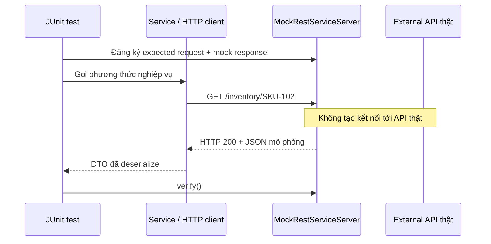
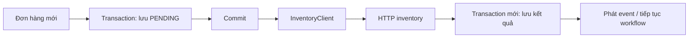

# MockRestServiceServer cho client HTTP đồng bộ phù hợp

## 1. Vì sao cần kiểm thử HTTP client ở ranh giới tích hợp?

Trong module **SPRING_BOOT_INTEGRATION**, Spring Boot kết nối hệ thống qua HTTP client, cơ sở dữ liệu, cache, broker thông điệp và các adapter của Spring Integration. Một service gọi HTTP thường phải bảo đảm đúng URL, phương thức, headers, JSON body, thời gian chờ và cách diễn giải lỗi. Nếu chỉ mock lớp service đối tác bằng Mockito, nhiều lỗi tại ranh giới HTTP sẽ bị bỏ sót: truyền sai path variable, thiếu header xác thực, serialize sai JSON hoặc xử lý nhầm mã trạng thái.

**`MockRestServiceServer`** trong module `spring-test` của Spring Framework giúp kiểm tra lời gọi do **HTTP client đồng bộ của Spring** phát ra mà không cần máy chủ HTTP thật. Test đăng ký các request mong đợi và response mô phỏng; client thực thi phần mã xây dựng request, rồi nhận response đã định nghĩa.

Ví dụ: ứng dụng bán hàng phải tra tồn kho trước khi đặt hàng. Ta muốn xác minh rằng ứng dụng thực sự gửi:

```http
GET /inventory/SKU-102 HTTP/1.1
Host: inventory.example.test
Accept: application/json
```

và biến JSON response thành DTO:

```json
{
  "sku": "SKU-102",
  "available": 12
}
```

Có hai điều cần kiểm tra riêng biệt:

1. **Hợp đồng phía client:** ứng dụng phát request đúng và đọc response đúng, kể cả lỗi `4xx`, `5xx` hoặc kết nối bị gián đoạn.
2. **Tính tương thích với server thật:** đường truyền HTTP/TLS, xác thực thật, cấu hình proxy, load balancer và dữ liệu phía đối tác.

`MockRestServiceServer` tập trung vào điều thứ nhất; nó không thay thế test với HTTP server giả lập trên cổng thật hoặc môi trường tích hợp.

## 2. Chọn đúng công cụ theo loại client

| Client trong ứng dụng | Có phù hợp với `MockRestServiceServer`? | Giải thích / lựa chọn |
| --- | --- | --- |
| `RestTemplate` | **Có** | Bind trực tiếp vào đúng instance `RestTemplate`; request được chặn ở `ClientHttpRequestFactory`. |
| `RestClient` (Spring Framework 6.1+) | **Có** | Bind vào `RestClient.Builder` **trước khi** gọi `build()`. Đây cũng là client HTTP đồng bộ. |
| HTTP interface `@HttpExchange` dùng `RestClientAdapter` | **Có**, gián tiếp | Bind vào builder của `RestClient` đứng dưới proxy HTTP interface; test kiểm tra request proxy tạo ra. |
| `WebClient`, Reactor Netty | **Không trực tiếp** | `WebClient` dùng giao diện `ExchangeFunction` / `ClientHttpConnector` khác; cân nhắc WireMock, MockWebServer hoặc kiểm thử qua connector thích hợp. |
| OpenFeign hoặc HTTP client bên thứ ba không dựa trên `RestTemplate`/`RestClient` | **Không trực tiếp** | Dùng khả năng test dành riêng cho client hoặc HTTP test server như WireMock/MockWebServer. |
| Controller server-side Spring MVC | **Không phải mục đích chính** | Dùng `MockMvc` để test request **đi vào** controller; không nhầm với request **đi ra** đối tác. |

Tên `RestClient` dễ gây nhầm với `WebClient`. `RestClient` cung cấp API fluent nhưng hoạt động **đồng bộ**; `WebClient` là client reactive. Cách sử dụng `MockRestServiceServer` cho hai lớp này không giống nhau.

### Cơ chế của mock server



Bên dưới, Spring tạo một `ClientHttpRequestFactory` kiểm thử và gắn nó vào client được bind. Khi client tạo request, factory này chuyển request đến mock server để so khớp expectation và trả response. Điều này giúp kiểm thử cả serialization, request headers, status handling và message converters đang được cấu hình trên client; nó **không** thực hiện DNS, TCP, TLS hoặc gửi gói mạng thật.

## 3. Dependency và phiên bản

Ví dụ sau sử dụng Java 17+, JUnit Jupiter, AssertJ, Spring Framework **6.1+** và `RestClient`, tương ứng với các dòng Spring Boot bắt đầu hỗ trợ `RestClient` (Spring Boot 3.2+). Nếu dự án dùng `RestTemplate` trên dòng Spring cũ hơn, có thể áp dụng mẫu `bindTo(restTemplate)` ở phần sau.

Trong ứng dụng Spring Boot có web starter và test starter, các thành phần thường đã sẵn có:

```xml
<dependencies>
    <dependency>
        <groupId>org.springframework.boot</groupId>
        <artifactId>spring-boot-starter-web</artifactId>
    </dependency>
    <dependency>
        <groupId>org.springframework.boot</groupId>
        <artifactId>spring-boot-starter-test</artifactId>
        <scope>test</scope>
    </dependency>
</dependencies>
```

`spring-boot-starter-test` cung cấp `spring-test`, JUnit và AssertJ. `MockRestServiceServer` nằm ở package `org.springframework.test.web.client`; các request matcher nằm trong `MockRestRequestMatchers`; response creator nằm trong `MockRestResponseCreators`. Với dự án không dùng starter, bổ sung dependency tương đương theo bộ version mà dự án đang quản lý.

Test kiểu này chạy thuần JUnit, **không cần** `@SpringBootTest` nếu chủ thể cần kiểm tra chỉ là một HTTP client/service nhỏ. Khởi động toàn bộ ứng dụng có thể cần thiết khi muốn kiểm tra auto-configuration, bean wiring hoặc security filter thực tế, nhưng không phải mặc định cho mọi bài kiểm thử outbound HTTP.

## 4. Ví dụ đầy đủ với RestClient

Giả sử ứng dụng đặt hàng gọi dịch vụ inventory. Ta muốn test cả thao tác **đọc tồn kho** và **giữ tồn kho**, có kiểm tra mã idempotency khi giữ hàng.

### 4.1. Client sử dụng trong production

```java
package example.integration.inventory;

import java.util.Objects;
import org.springframework.http.MediaType;
import org.springframework.web.client.RestClient;

public final class InventoryClient {
    private final RestClient restClient;

    public InventoryClient(RestClient restClient) {
        this.restClient = restClient;
    }

    public Availability getAvailability(String sku) {
        Availability result = restClient.get()
                .uri("/inventory/{sku}", sku)
                .accept(MediaType.APPLICATION_JSON)
                .retrieve()
                .body(Availability.class);

        return Objects.requireNonNull(result, "Inventory response rỗng");
    }

    public Reservation reserve(ReserveRequest request) {
        Reservation result = restClient.post()
                .uri("/reservations")
                .contentType(MediaType.APPLICATION_JSON)
                .accept(MediaType.APPLICATION_JSON)
                .header("Idempotency-Key", request.orderId())
                .body(request)
                .retrieve()
                .body(Reservation.class);

        return Objects.requireNonNull(result, "Reservation response rỗng");
    }

    public record Availability(String sku, int available) {}

    public record ReserveRequest(String orderId, String sku, int quantity) {}

    public record Reservation(String reservationId, String status) {}
}
```

Ở môi trường thật, `RestClient` được tạo bằng builder đã gắn base URL, authentication, interceptor, timeout và các message converter phù hợp. Constructor injection giúp test truyền đúng client cần kiểm tra. Không để service gọi `RestClient.create("https://...")` bên trong mỗi lần thực thi, vì test sẽ không thể gắn mock vào những client tự phát sinh đó một cách rõ ràng.

### 4.2. Test thành công: đúng GET, headers và JSON response

```java
package example.integration.inventory;

import static org.assertj.core.api.Assertions.assertThat;
import static org.springframework.test.web.client.match.MockRestRequestMatchers.*;
import static org.springframework.test.web.client.response.MockRestResponseCreators.*;

import org.junit.jupiter.api.BeforeEach;
import org.junit.jupiter.api.Test;
import org.springframework.http.HttpHeaders;
import org.springframework.http.HttpMethod;
import org.springframework.http.MediaType;
import org.springframework.test.web.client.MockRestServiceServer;
import org.springframework.web.client.RestClient;

class InventoryClientTest {

    private MockRestServiceServer server;
    private InventoryClient inventoryClient;

    @BeforeEach
    void setUp() {
        RestClient.Builder builder = RestClient.builder()
                .baseUrl("https://inventory.example.test");

        // Phải bind vào builder trước khi tạo RestClient.
        server = MockRestServiceServer.bindTo(builder).build();

        inventoryClient = new InventoryClient(builder.build());
    }

    @Test
    void getAvailability_matchesRequestAndReadsJsonResponse() {
        server.expect(requestTo(
                    "https://inventory.example.test/inventory/SKU-102"))
                .andExpect(method(HttpMethod.GET))
                .andExpect(header(HttpHeaders.ACCEPT,
                        MediaType.APPLICATION_JSON_VALUE))
                .andRespond(withSuccess(
                        """
                        {"sku":"SKU-102","available":12}
                        """,
                        MediaType.APPLICATION_JSON));

        InventoryClient.Availability result =
                inventoryClient.getAvailability("SKU-102");

        assertThat(result.sku()).isEqualTo("SKU-102");
        assertThat(result.available()).isEqualTo(12);

        // Đảm bảo request đã được thực hiện theo expectation.
        server.verify();
    }

    @Test
    void reserve_sendsJsonBodyAndIdempotencyKey() {
        server.expect(requestTo(
                    "https://inventory.example.test/reservations"))
                .andExpect(method(HttpMethod.POST))
                .andExpect(header(HttpHeaders.CONTENT_TYPE,
                        MediaType.APPLICATION_JSON_VALUE))
                .andExpect(header("Idempotency-Key", "ORDER-42"))
                .andExpect(content().json(
                        """
                        {
                          "orderId":"ORDER-42",
                          "sku":"SKU-102",
                          "quantity":2
                        }
                        """))
                .andRespond(withSuccess(
                        """
                        {
                          "reservationId":"RSV-9",
                          "status":"RESERVED"
                        }
                        """,
                        MediaType.APPLICATION_JSON));

        var request = new InventoryClient.ReserveRequest(
                "ORDER-42", "SKU-102", 2);

        InventoryClient.Reservation result =
                inventoryClient.reserve(request);

        assertThat(result.reservationId()).isEqualTo("RSV-9");
        assertThat(result.status()).isEqualTo("RESERVED");
        server.verify();
    }
}
```

Điểm quan trọng của ví dụ:

- `requestTo(...)` so khớp URI **đầy đủ**, gồm scheme, host, path và query string nếu có. Dùng URI thực tế mà code tạo ra; với query parameter có encoding hoặc thứ tự biến đổi, có thể kết hợp `requestToUriTemplate(...)`, `queryParam(...)` hoặc matcher phù hợp thay vì so chuỗi một cách giòn.
- `method(HttpMethod.GET/POST)` phát hiện nhầm HTTP method.
- `header(...)` phát hiện thiếu `Accept`, `Content-Type`, idempotency key hoặc các header nghiệp vụ. Tránh assert giá trị token bí mật thật.
- `content().json(...)` kiểm tra nội dung JSON theo cấu trúc; hữu ích hơn so sánh nguyên chuỗi khi thứ tự property hoặc khoảng trắng thay đổi.
- `withSuccess(body, MediaType.APPLICATION_JSON)` cung cấp status 200, response body và content type để chạy qua converter như trong client.
- `server.verify()` xác minh những request mong đợi đã xuất hiện. Mỗi test tạo server và client mới trong `@BeforeEach` để expectation không rò rỉ giữa các test.

Cấu hình JSON của ví dụ giả định có Jackson phù hợp trên classpath. Nếu DTO dùng naming strategy, custom module, enum mapping hoặc date-time converter, nên khởi tạo client bằng cấu hình tương ứng với production để bài test thực sự bắt được lỗi chuyển đổi.

### 4.3. Lỗi 404/503 không phải response thành công

Với `retrieve()` và không đăng ký custom status handler, `RestClient` mặc định phát sinh ngoại lệ thuộc `RestClientResponseException` khi nhận `4xx` hoặc `5xx`.

```java
import static org.assertj.core.api.Assertions.assertThatThrownBy;
import static org.springframework.test.web.client.match.MockRestRequestMatchers.*;
import static org.springframework.test.web.client.response.MockRestResponseCreators.*;

import org.junit.jupiter.api.Test;
import org.springframework.http.HttpStatus;
import org.springframework.web.client.HttpServerErrorException;

@Test
void getAvailability_503_isNotConvertedIntoSuccess() {
    server.expect(requestTo(
                "https://inventory.example.test/inventory/SKU-503"))
            .andExpect(method(HttpMethod.GET))
            .andRespond(withStatus(HttpStatus.SERVICE_UNAVAILABLE)
                    .contentType(MediaType.APPLICATION_JSON)
                    .body("""
                          {"code":"INVENTORY_UNAVAILABLE"}
                          """));

    assertThatThrownBy(() ->
            inventoryClient.getAvailability("SKU-503"))
            .isInstanceOf(HttpServerErrorException.class)
            .hasMessageContaining("503");

    server.verify();
}
```

Đoạn trên là **phương thức test bổ sung** bên trong `InventoryClientTest`, với các import tương ứng. Nếu ứng dụng muốn ánh xạ 404 thành `ItemNotFoundException`, 429 thành lỗi có retry và 503 thành lỗi downstream tạm thời, hãy hiện thực `onStatus(...)` trong client hoặc tầng error handler, sau đó test **exception nghiệp vụ thực tế**. Đừng sửa expectation cho khớp giả định; mỗi bài test phải thể hiện hợp đồng lỗi mà client được yêu cầu cung cấp.

### 4.4. Mô phỏng sự cố I/O để thử nhánh khôi phục

Ngoài HTTP status, `MockRestServiceServer` có thể phát sinh lỗi I/O mô phỏng:

```java
import java.net.SocketTimeoutException;
import org.springframework.web.client.ResourceAccessException;

@Test
void getAvailability_whenTransportFails_throwsAccessException() {
    server.expect(requestTo(
                "https://inventory.example.test/inventory/SKU-ERR"))
            .andRespond(withException(
                    new SocketTimeoutException("simulated read timeout")));

    assertThatThrownBy(() ->
            inventoryClient.getAvailability("SKU-ERR"))
            .isInstanceOf(ResourceAccessException.class);

    server.verify();
}
```

Test này kiểm tra **nhánh xử lý khi client nhận I/O exception**. Nó **không đo hoặc chứng minh** cấu hình socket timeout 2 giây hay 5 giây có hiệu lực với driver HTTP thật. Để thử timeout thực, connection pool, retry ở network layer, TLS hay connection reuse, cần HTTP stub server trên loopback hoặc test môi trường thực.

## 5. Trường hợp sử dụng RestTemplate

Một codebase Spring Boot cũ có thể vẫn dùng `RestTemplate`. `MockRestServiceServer` đã hỗ trợ kiểu này từ lâu và có thể bind trực tiếp vào đúng instance:

```java
import static org.assertj.core.api.Assertions.assertThat;
import static org.springframework.test.web.client.match.MockRestRequestMatchers.*;
import static org.springframework.test.web.client.response.MockRestResponseCreators.*;

import org.junit.jupiter.api.Test;
import org.springframework.http.HttpMethod;
import org.springframework.http.MediaType;
import org.springframework.test.web.client.MockRestServiceServer;
import org.springframework.web.client.RestTemplate;

class InventoryRestTemplateTest {

    @Test
    void readsInventoryWithRestTemplate() {
        RestTemplate restTemplate = new RestTemplate();
        MockRestServiceServer server =
                MockRestServiceServer.bindTo(restTemplate).build();

        server.expect(requestTo(
                    "https://inventory.example.test/inventory/SKU-1"))
                .andExpect(method(HttpMethod.GET))
                .andRespond(withSuccess(
                        """
                        {"sku":"SKU-1","available":5}
                        """,
                        MediaType.APPLICATION_JSON));

        InventoryClient.Availability result =
                restTemplate.getForObject(
                        "https://inventory.example.test/inventory/{sku}",
                        InventoryClient.Availability.class,
                        "SKU-1");

        assertThat(result.available()).isEqualTo(5);
        server.verify();
    }
}
```

Khác biệt chủ yếu ở **đối tượng được bind**:

```java
// RestTemplate: bind vào instance đã tồn tại.
MockRestServiceServer.bindTo(restTemplate).build();

// RestClient: bind vào builder trước khi gọi builder.build().
MockRestServiceServer.bindTo(restClientBuilder).build();
RestClient client = restClientBuilder.build();
```

Nếu production dùng một `RestTemplate` được tạo từ `RestTemplateBuilder` của Spring Boot (có interceptor, authentication, timeout), test phải truyền **đúng instance cấu hình đó** vào class đang kiểm thử. Tạo một `new RestTemplate()` khác trong test chỉ chứng minh test client ấy hoạt động, không chứng minh client trong ứng dụng đã được cấu hình chính xác.

## 6. Dùng test slice Spring Boot khi cần cấu hình ứng dụng

Trong ứng dụng thật, HTTP client thường là bean nhận cấu hình từ properties, interceptor, token provider hoặc custom message converter. Khi muốn kiểm tra **wiring** ở mức Spring context nhưng vẫn không cần khởi động server HTTP, cân nhắc `@RestClientTest`.

Ví dụ cấu hình production tạo client bằng builder do Spring Boot cung cấp:

```java
import org.springframework.context.annotation.Bean;
import org.springframework.context.annotation.Configuration;
import org.springframework.web.client.RestClient;

@Configuration(proxyBeanMethods = false)
public class InventoryHttpConfiguration {

    @Bean
    InventoryClient inventoryClient(RestClient.Builder builder) {
        RestClient client = builder
                .baseUrl("https://inventory.example.test")
                .build();
        return new InventoryClient(client);
    }
}
```

Test slice có thể đưa đúng cấu hình này vào context:

```java
import static org.assertj.core.api.Assertions.assertThat;
import static org.springframework.test.web.client.match.MockRestRequestMatchers.*;
import static org.springframework.test.web.client.response.MockRestResponseCreators.*;

import org.junit.jupiter.api.Test;
import org.springframework.beans.factory.annotation.Autowired;
import org.springframework.boot.test.autoconfigure.web.client.RestClientTest;
import org.springframework.context.annotation.Import;
import org.springframework.http.MediaType;
import org.springframework.test.web.client.MockRestServiceServer;

@RestClientTest
@Import(InventoryHttpConfiguration.class)
class InventoryClientSliceTest {

    @Autowired
    InventoryClient client;

    @Autowired
    MockRestServiceServer server;

    @Test
    void springConfiguredClientCanUseMockServer() {
        server.expect(requestTo(
                    "https://inventory.example.test/inventory/SKU-2"))
                .andRespond(withSuccess(
                        """
                        {"sku":"SKU-2","available":7}
                        """,
                        MediaType.APPLICATION_JSON));

        assertThat(client.getAvailability("SKU-2").available())
                .isEqualTo(7);

        server.verify();
    }
}
```

Với các phiên bản Spring Boot có hỗ trợ `RestClient.Builder` trong `@RestClientTest`, test slice sẽ auto-configure HTTP client test support cùng `MockRestServiceServer`. Để auto-binding hoạt động, bean của ứng dụng phải xây dựng client bằng **builder được context quản lý**. Nếu class tự gọi `RestClient.create()`, dùng builder tự tạo hoặc thay request factory sau khi mock đã bind, request có thể đi ngoài mock server.

Giữ test slice nhỏ: nó chủ yếu kiểm tra client và những thành phần cần thiết để tạo request. Nếu ứng dụng cần thêm bean mapper hoặc customizer, dùng `@Import` hoặc `@TestConfiguration` ở phạm vi test. Khi wiring phức tạp hoặc phải kiểm tra nhiều layer cùng lúc, cân nhắc `@SpringBootTest` với bean mock hoặc một stub HTTP server tùy mục tiêu kiểm thử.

Lưu ý cú pháp import/autoconfiguration có thể thay đổi giữa các dòng major của Spring Boot; chọn ví dụ `@RestClientTest` tương ứng với version đang dùng. Một test thuần JUnit bind tường minh như phần 4 cho khả năng kiểm soát ổn định nhất.

## 7. Kiểm thử retry, nhiều request và thứ tự

Nếu ứng dụng gọi API nhiều lần, có thể chỉ định số lần mong đợi bằng `ExpectedCount`:

```java
import org.springframework.test.web.client.ExpectedCount;

server.expect(ExpectedCount.times(2), requestTo(
            "https://inventory.example.test/inventory/SKU-9"))
        .andExpect(method(HttpMethod.GET))
        .andRespond(withSuccess(
                """
                {"sku":"SKU-9","available":9}
                """,
                MediaType.APPLICATION_JSON));

// Chỉ ví dụ: gọi cả hai lần theo logic của client.
inventoryClient.getAvailability("SKU-9");
inventoryClient.getAvailability("SKU-9");
server.verify();
```

Khi kiểm tra **retry sau lỗi**, thường cần đăng ký response khác nhau theo thứ tự:

```java
server.expect(requestTo(
            "https://inventory.example.test/inventory/SKU-9"))
        .andRespond(withServerError());

server.expect(requestTo(
            "https://inventory.example.test/inventory/SKU-9"))
        .andRespond(withSuccess(
                """
                {"sku":"SKU-9","available":9}
                """,
                MediaType.APPLICATION_JSON));

// Gọi một phương thức ở tầng ứng dụng có retry, ví dụ
// retryingInventoryService.getAvailability("SKU-9").
// Chỉ kiểm tra hai response nếu code thực sự có retry được cấu hình.
```

Không tự gắn mặc định retry cho `RestClient` hoặc `RestTemplate`: hai client này **không tự động retry mọi lỗi 5xx**. Nếu ứng dụng có Spring Retry hoặc Resilience4j, cần test thành phần đang sở hữu retry và kiểm tra chính xác số lần gọi. Với thao tác POST tạo side effect, không retry mù sau timeout; cần idempotency key, trạng thái chưa xác định và khả năng đối soát.

Theo mặc định mock server dùng expectation theo thứ tự đăng ký. Khi thứ tự không phải một phần của hợp đồng và test thực sự có nhiều request có thể đảo thứ tự, dùng builder cho phép bỏ kiểm tra thứ tự:

```java
MockRestServiceServer server = MockRestServiceServer
        .bindTo(restClientBuilder)
        .ignoreExpectOrder(true)
        .build();
```

Chỉ bỏ kiểm tra thứ tự khi nghiệp vụ không yêu cầu thứ tự. Không nên làm test dễ qua hơn bằng cách vô hiệu hóa matcher quan trọng. Cũng không chia sẻ `MockRestServiceServer` mutable giữa những test chạy song song mà không cách ly.

## 8. Những lỗi kiểm thử thường gặp

| Hiện tượng | Nguyên nhân thường gặp | Cách sửa |
| --- | --- | --- |
| Expectation không được dùng, request thật vẫn đi ra mạng | Mock bind vào `RestClient.Builder`/`RestTemplate` khác với instance ứng dụng dùng | Constructor injection; bind **trước** `build()`; xác minh client được tạo từ builder đã bind |
| Bài test qua dù không gọi downstream | Thiếu `server.verify()` hoặc expectation quá lỏng | Kiểm tra output **và** xác minh request đã gọi; dùng matcher method, URI, headers, body |
| Test thất bại chỉ vì JSON đổi thứ tự property | So sánh JSON bằng chuỗi chính xác | Dùng `content().json(...)` và assert trường nghiệp vụ cần thiết |
| Test flaky khi chạy theo lô | Dùng chung mock server/expectation giữa nhiều test | Khởi tạo per-test, không chia sẻ state không an toàn |
| Test thành công nhưng production lỗi TLS/proxy/pool | Mock server không tạo kết nối thật | Thêm test với WireMock/MockWebServer, Testcontainers hoặc môi trường tích hợp |
| Response giả lập không được deserialize | Thiếu JSON converter hoặc client được tạo khác cấu hình production | Bổ sung Jackson/module thích hợp và dùng config client đúng |
| 404/500 bị hiểu là thành công | Test chỉ trả 200; không kiểm tra status handler | Thêm các case 4xx/5xx; assert ngoại lệ hoặc mapping nghiệp vụ |
| Retry tạo trùng đơn hàng/giao dịch | Test chỉ kiểm tra số request, bỏ qua idempotency | Kiểm tra header khóa nghiệp vụ, kiểm tra state DB, tách test phục hồi |
| `@RestClientTest` không tìm thấy bean client | Test slice cố ý không load toàn bộ ứng dụng | Import cấu hình/bean cần thiết, tránh đưa cả application vào test |
| Kiểm thử giả lập timeout nhưng cho rằng đã đo timeout thật | `withException(...)` ném lỗi ngay, không đo đồng hồ mạng | Kiểm thử cấu hình timeout qua HTTP test server thật |

Với trace/metrics và interceptor, mock server vẫn có thể giúp kiểm tra request được tạo sau các biến đổi nếu test xây dựng client bằng cấu hình tương đương production. Tuy nhiên không được lấy kết quả mock làm bằng chứng về hoạt động kết nối vật lý hoặc quy mô tải.

## 9. Liên hệ với transaction, outbox và luồng tích hợp

Trong Spring Boot Integration, một lời gọi REST thường xuất hiện **bên cạnh** thao tác database hoặc phát broker message. Chẳng hạn:



`MockRestServiceServer` phù hợp để test **đường request/response tại `InventoryClient`**: đúng URI, JSON và xử lý lỗi upstream. Nó không chứng minh rằng transaction DB đã commit trước khi outbound HTTP bắt đầu, cũng không tự kiểm tra message broker, rollback, outbox hay khả năng xử lý trùng. Những điều đó cần test bổ sung ở ranh giới tương ứng:

- **DB transaction và lock:** dùng test tích hợp với database thật hoặc Testcontainers; xác minh ranh giới commit và cập nhật trạng thái.
- **Outbox/broker:** kiểm tra sự kiện được lưu bền vững, retry và idempotent consumer; có thể dùng broker test container.
- **HTTP contract giữa các hệ thống:** dùng stub HTTP server như WireMock/MockWebServer nếu cần xác minh hành vi khi có kết nối thật; dùng contract testing nếu hai nhóm phát triển độc lập.
- **Toàn luồng nghiệp vụ:** kết hợp HTTP mock/stub, DB và broker theo mức cô lập đủ để kiểm tra các thời điểm crash và phục hồi.

Ví dụ quy trình thanh toán có thể dùng `MockRestServiceServer` để mô phỏng API gateway trả timeout. Test cần đảm bảo ứng dụng ghi trạng thái `UNKNOWN`, dùng cùng operation ID khi đối soát và không gọi lại POST gây side effect vô điều kiện. Nhưng kiểm tra **không giữ transaction DB trong lúc chờ HTTP** phải dựa vào quan sát transaction và dữ liệu thật ở một test phù hợp, không thể chỉ nhìn `server.verify()`.

## 10. Bảng tình huống kiểm thử gợi ý

| Tình huống | HTTP response / kích thích | Kỳ vọng tại client |
| --- | --- | --- |
| Đọc thành công | 200 + JSON hợp lệ | Deserialize đúng DTO; không bỏ sót field quan trọng |
| Tạo bản ghi | 201 + body + Location | Dùng đúng method, body, idempotency header; đọc kết quả đúng |
| Không tìm thấy | 404 | Ánh xạ ngoại lệ hoặc kết quả nghiệp vụ theo hợp đồng |
| Chưa được cấp quyền | 401/403 | Không tự coi là retryable vô hạn; ghi nhận lỗi auth |
| Bị giới hạn lưu lượng | 429 + Retry-After | Phân loại rate limit; tôn trọng chính sách retry nếu client hỗ trợ |
| Downstream lỗi | 500/503 | Trả lỗi có ngữ cảnh hoặc fallback có kiểm soát |
| Body không hợp lệ | 200 + JSON sai schema | Không coi như response hợp lệ; kiểm tra lỗi parse |
| I/O exception | `withException(IOException)` | Chuyển thành lỗi truy cập/UNKNOWN phù hợp, không khẳng định side effect thất bại |
| Gọi trùng | Hai request cùng khóa nghiệp vụ | Giữ nguyên idempotency key; xác minh số lần request dự kiến |
| Thiếu header bắt buộc | Matcher `header(...)` | Test fail ngay khi client thay đổi sai hợp đồng |

Nên có **test ngắn và tập trung** cho mỗi hành vi quan trọng. Không cần kiểm tra mọi header do thư viện tự sinh nếu chúng không thuộc hợp đồng của ứng dụng. Khi test chỉ quan tâm field JSON, dùng matcher có ý nghĩa; khi field bất ngờ là nguy hiểm (ví dụ dữ liệu nhạy cảm), thêm expectation chặt hoặc custom matcher thích hợp.

## 11. Checklist khi áp dụng

1. Xác nhận client thực sự là **`RestClient` hoặc `RestTemplate` đồng bộ**; nếu là `WebClient`, chọn công cụ khác.
2. Bind vào **đúng instance/builder** mà code cần kiểm tra dùng; với `RestClient`, bind trước `builder.build()`.
3. Định nghĩa request expectation cho URI, method, headers và body thực sự quan trọng đối với hợp đồng.
4. Dùng `MockRestResponseCreators` để trả 2xx, 4xx, 5xx hoặc lỗi I/O; assert cả dữ liệu trả về lẫn exception/mapping nghiệp vụ.
5. Gọi `server.verify()` sau khi thực thi; khởi tạo trạng thái mock riêng cho từng test.
6. Test retry, idempotency và response đến muộn ở đúng tầng quản lý chúng; không mặc định HTTP client tự retry.
7. Bổ sung HTTP stub server hoặc integration test khi cần đánh giá timeout thật, TLS, connection pooling, xác thực với server và các tác dụng phụ liên quan đến DB/broker.

**Điều cần nhớ:** `MockRestServiceServer` kiểm tra việc một client Spring đồng bộ **tạo request HTTP đúng và xử lý response đúng** trong phạm vi xác định. Chọn công cụ này khi muốn feedback nhanh, test ổn định và kiểm tra hợp đồng client; dùng các lớp kiểm thử khác khi mục tiêu là đường truyền mạng, server thật hoặc giao dịch tích hợp qua nhiều hệ thống.

### Tài liệu tham khảo

- [Spring Framework Javadoc — MockRestServiceServer](https://docs.spring.io/spring-framework/docs/current/javadoc-api/org/springframework/test/web/client/MockRestServiceServer.html).
- [Spring Framework Reference — REST Clients](https://docs.spring.io/spring-framework/reference/integration/rest-clients.html).
- [Spring Boot Reference — Testing Spring Boot Applications](https://docs.spring.io/spring-boot/reference/testing/spring-boot-applications.html).
