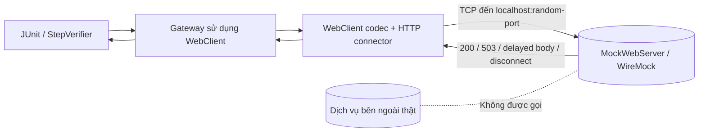
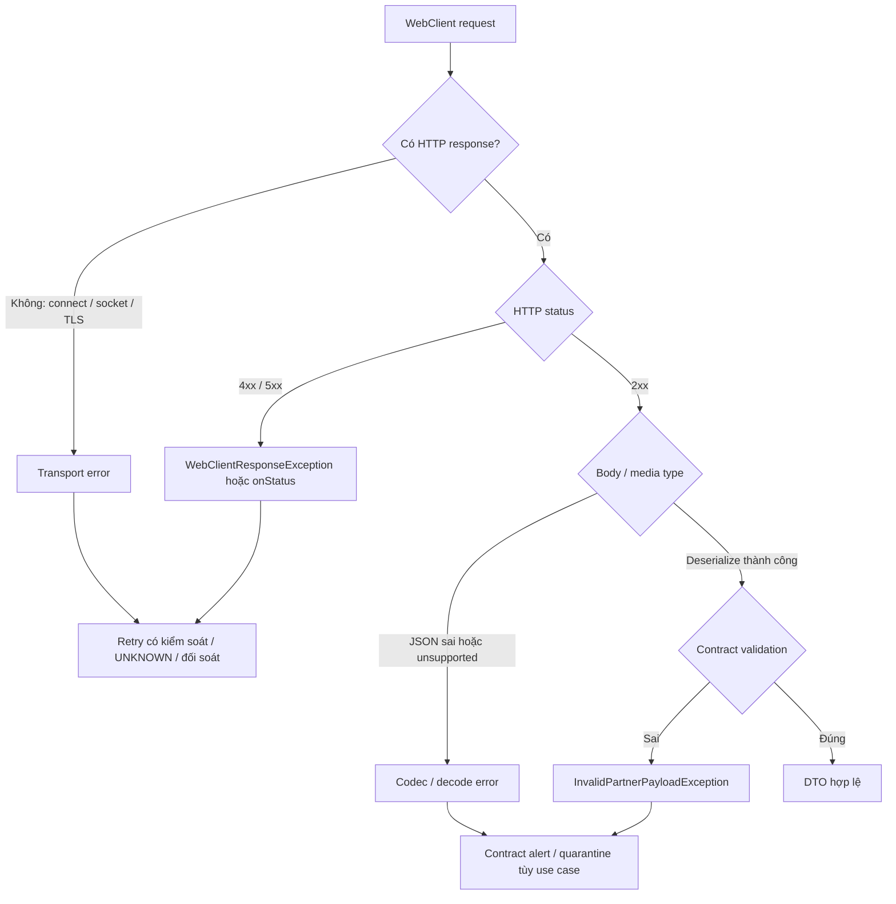
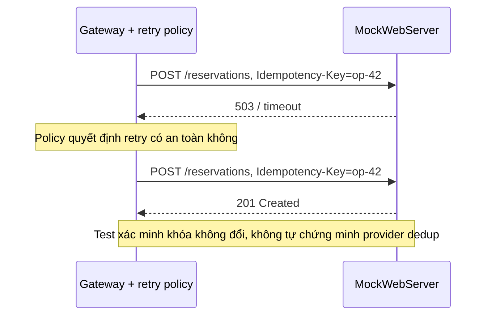
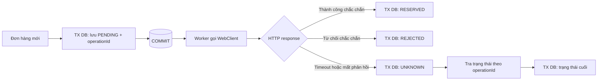

# Máy chủ HTTP giả lập cho WebClient, timeout và phản hồi không hợp lệ

## 1. Vì sao cần máy chủ HTTP giả lập khi kiểm thử WebClient?

Trong **SPRING_BOOT_INTEGRATION**, Spring Boot thường gọi dịch vụ ngoài để tra cứu tồn kho, nhận giá vận chuyển, gửi yêu cầu thanh toán, đồng bộ dữ liệu hoặc nhận trạng thái từ các hệ thống đối tác. Những luồng tích hợp này phụ thuộc cả **hợp đồng HTTP** lẫn các hành vi khó dự đoán của mạng: downstream phản hồi chậm, đóng kết nối giữa chừng, trả lỗi `503` hoặc trả JSON sai định dạng mặc dù status là `200`.

`WebClient` của Spring WebFlux là HTTP client **reactive**, thường trả `Mono<T>` hoặc `Flux<T>`. Có thể dùng nó trong ứng dụng Spring MVC, nhưng cách thực thi, xử lý lỗi và kiểm thử khác với `RestTemplate`/`RestClient` đồng bộ.

Nếu chỉ dùng Mockito để giả lập toàn bộ `WebClient` hoặc mock trực tiếp gateway, test có thể bỏ sót lỗi thật ở ranh giới HTTP:

- URI hoặc query parameter được encode sai.
- Method `GET`/`POST`, `Accept`, `Content-Type` hoặc idempotency key không đúng.
- Codec Jackson không đọc được JSON hoặc không được chọn vì response `Content-Type` sai.
- `retrieve()` biến `4xx`/`5xx` thành lỗi khác với mong muốn của nghiệp vụ.
- Đường xử lý khi socket timeout, response bị cắt hoặc connection đứt chưa được kiểm tra.
- Retry vô tình gửi lặp thao tác có side effect.

**Máy chủ HTTP giả lập** (*HTTP stub server*) như **OkHttp MockWebServer** hoặc **WireMock** lắng nghe trên một cổng cục bộ, nhận request do `WebClient` thật phát ra rồi trả response do test kiểm soát. Client vẫn đi qua HTTP transport, serialization/deserialization và reactive operators; bài test không phụ thuộc Internet hoặc dịch vụ đối tác thật.



**Mục tiêu bài học:** chọn máy chủ giả lập phù hợp, khởi tạo `WebClient` trỏ vào máy chủ ấy, kiểm tra request và kết quả `Mono`/`Flux`, sau đó tạo có kiểm soát những phản hồi bất thường để xác minh timeout, phân loại lỗi và hành vi phục hồi.

## 2. Phân biệt các công cụ kiểm thử HTTP

| Công cụ | Lớp phù hợp | Có mở cổng HTTP thật? | Khi nên dùng |
| --- | --- | --- | --- |
| `MockWebServer` (OkHttp) | Outbound `WebClient` hoặc client HTTP khác | Có, tại localhost | Test theo từng request, kiểm tra method/headers/body, response chậm, ngắt kết nối, status và body |
| `WireMock` | Outbound HTTP client | Có; cũng có thể dùng embedded | Nhiều stub theo URL/header/body, stateful scenarios, fault injection, gần contract test |
| `MockRestServiceServer` | `RestTemplate`, `RestClient` đồng bộ | Không | Bind vào request factory của các client đồng bộ do Spring hỗ trợ |
| `WebTestClient` | Controller/handler **inbound** của WebFlux; cũng có thể gọi server HTTP | Tùy chế độ | Test API mà **ứng dụng cung cấp**, không phải mặc định để giả lập dịch vụ do WebClient gọi |
| Mock `ExchangeFunction` | Unit test lớp dùng `WebClient` | Không | Kiểm tra nhanh logic xử lý `ClientResponse` mà không cần HTTP transport |
| Testcontainers + dịch vụ thực | Kiểm thử tích hợp nhiều thành phần | Có | Kiểm tra thực tế DB, broker, proxy hoặc downstream cần runtime riêng |

Không dùng `MockRestServiceServer.bindTo(...)` cho `WebClient` như với `RestTemplate`. `WebClient` sử dụng `ExchangeFunction`/`ClientHttpConnector` và thường chạy qua Reactor Netty; một HTTP stub server trên localhost là lựa chọn rõ ràng khi muốn kiểm tra trọn đường request/response.

`MockWebServer` thường thuận tiện khi một test cần xếp lần lượt vài response vào hàng đợi và lấy `RecordedRequest` để assert. `WireMock` phù hợp khi nhiều endpoint cần stub theo điều kiện, kiểm tra retry theo scenario hoặc chia sẻ các mapping phức tạp. Hai công cụ kiểm thử cùng một loại ranh giới, không có yêu cầu phải dùng đồng thời.

### Test bằng localhost chứng minh được điều gì?

Máy chủ giả lập **có** socket HTTP cục bộ, vì vậy nó giúp quan sát phần nào behavior của connector: kết nối, HTTP framing, đọc body và hủy request. Tuy nhiên kết quả đó **không chứng minh** DNS công cộng, Internet latency, TLS/truststore production, proxy, load balancer, firewall hoặc giới hạn của đối tác thật đều hoạt động. Khi cần những đặc tính này, thêm kiểm thử môi trường tích hợp hoặc contract/e2e phù hợp.

## 3. Chuẩn bị ví dụ chạy được với MockWebServer

Các ví dụ dưới đây dùng **Java 17+, Spring Boot 3.x, Spring WebFlux/Reactor và MockWebServer 4.12.x**. Ở dòng MockWebServer 5.x, một số package/API của module thử nghiệm có thể khác; nếu dùng 5.x, cần chỉnh import theo tài liệu của chính phiên bản đó.

Các dependency Maven minh họa:

```xml
<dependencies>
    <dependency>
        <groupId>org.springframework.boot</groupId>
        <artifactId>spring-boot-starter-webflux</artifactId>
    </dependency>

    <dependency>
        <groupId>org.springframework.boot</groupId>
        <artifactId>spring-boot-starter-test</artifactId>
        <scope>test</scope>
    </dependency>

    <dependency>
        <groupId>io.projectreactor</groupId>
        <artifactId>reactor-test</artifactId>
        <scope>test</scope>
    </dependency>

    <dependency>
        <groupId>com.squareup.okhttp3</groupId>
        <artifactId>mockwebserver</artifactId>
        <version>4.12.0</version>
        <scope>test</scope>
    </dependency>
</dependencies>
```

Với Gradle cũng cần các thành phần tương ứng, đặc biệt `reactor-test` cung cấp `StepVerifier`. Version MockWebServer ở trên khớp với các ví dụ API 4.x; trong dự án thật phải chọn phiên bản tương thích, cập nhật bản vá bảo mật và quản lý version tập trung.

`MockWebServer` có thể cấp cổng động, tránh đụng cổng khi chạy test song song:

```java
MockWebServer server = new MockWebServer();
server.start();

String baseUrl = server.url("/").toString();
// Ví dụ trong một lần chạy: http://localhost:52543/

WebClient webClient = WebClient.builder()
        .baseUrl(baseUrl)
        .build();

// server.shutdown() trong @AfterEach / finally.
```

Không hard-code `http://localhost:8080`. Test nên tự mở, tự đóng server và khởi tạo lại hàng đợi response trong mỗi lần chạy. Cũng không nên để base URL production được cố định bên trong class gọi đối tác; hãy inject `WebClient`/`WebClient.Builder` hoặc đọc từ cấu hình, để test thay đổi điểm đích mà không đổi mã nguồn nghiệp vụ.

## 4. Client nghiệp vụ làm đối tượng kiểm thử

Giả sử hệ thống gọi endpoint `GET /inventory/{sku}`. Hợp đồng trả response JSON:

```json
{
  "sku": "SKU-100",
  "available": 8
}
```

Khi `404`, gateway chuyển thành `InventoryNotFoundException`; khi `5xx` chưa được xử lý riêng, `retrieve()` giữ behavior mặc định của `WebClient`. Response `200` nhưng thiếu `sku`, `available`, trả số âm hoặc body rỗng phải được coi là lỗi hợp đồng.

Một adapter/gateway đơn giản:

```java
package example.integration.inventory;

import org.springframework.http.MediaType;
import org.springframework.web.reactive.function.client.WebClient;
import reactor.core.publisher.Mono;

public final class InventoryGateway {

    private final WebClient client;

    public InventoryGateway(WebClient client) {
        this.client = client;
    }

    public Mono<Availability> findAvailability(String sku) {
        return client.get()
                .uri("/inventory/{sku}", sku)
                .accept(MediaType.APPLICATION_JSON)
                .retrieve()
                .onStatus(
                        status -> status.value() == 404,
                        response -> response.bodyToMono(String.class)
                                .defaultIfEmpty("")
                                .map(body ->
                                        new InventoryNotFoundException(
                                                "SKU không tồn tại: " + sku)))
                .bodyToMono(Availability.class)
                .switchIfEmpty(Mono.error(
                        new InvalidPartnerPayloadException(
                                "Inventory API trả body rỗng")))
                .map(result -> validate(result, sku));
    }

    private Availability validate(Availability result, String requestedSku) {
        if (result.sku() == null
                || !requestedSku.equals(result.sku())
                || result.available() == null
                || result.available() < 0) {
            throw new InvalidPartnerPayloadException(
                    "Inventory API trả dữ liệu sai hợp đồng");
        }
        return result;
    }

    public record Availability(String sku, Integer available) {}

    public static final class InventoryNotFoundException
            extends RuntimeException {
        public InventoryNotFoundException(String message) {
            super(message);
        }
    }

    public static final class InvalidPartnerPayloadException
            extends RuntimeException {
        public InvalidPartnerPayloadException(String message) {
            super(message);
        }
    }
}
```

Những điểm đáng chú ý:

- `bodyToMono(Availability.class)` dùng codec phù hợp để deserialize response; mặc định thường là Jackson khi có dependency JSON.
- `Integer` thay vì `int` giúp nhận diện JSON **thiếu trường**. `int` có thể mang giá trị mặc định `0`, khiến dữ liệu không hợp lệ trông giống “hết hàng”.
- `switchIfEmpty(...)` phát hiện body rỗng, chẳng hạn downstream vô tình trả `204 No Content` cho endpoint đòi hỏi JSON.
- `validate(...)` bảo vệ hợp đồng nghiệp vụ. **Deserialize được JSON không đồng nghĩa JSON hợp lệ về mặt nghiệp vụ.**
- `onStatus(...)` ánh xạ một HTTP status cụ thể thành exception nghiệp vụ; callback trả `Mono<? extends Throwable>`. Ở đây đã đọc body bằng `bodyToMono(String.class)` trước khi trả exception để tránh để body chưa được xử lý.
- Với `5xx`, `retrieve()` mặc định phát sinh `WebClientResponseException` (thường có status, headers và body để chẩn đoán). Không coi mọi lỗi là `null` rồi để service hiểu nhầm thành không có tồn kho.
- Gateway trả `Mono` để giữ tính chất reactive. Trong luồng WebFlux, không gọi `block()` trên event-loop; dùng `StepVerifier` để kiểm tra kết quả trong test.

## 5. Test hoàn chỉnh: HTTP 200, request thực và deserialize JSON

Test khởi tạo một server và một gateway riêng ở mỗi test:

```java
package example.integration.inventory;

import static org.assertj.core.api.Assertions.assertThat;

import java.io.IOException;
import java.time.Duration;
import java.util.concurrent.TimeUnit;

import okhttp3.mockwebserver.MockResponse;
import okhttp3.mockwebserver.MockWebServer;
import okhttp3.mockwebserver.RecordedRequest;

import org.junit.jupiter.api.AfterEach;
import org.junit.jupiter.api.BeforeEach;
import org.junit.jupiter.api.Test;
import org.springframework.http.MediaType;
import org.springframework.web.reactive.function.client.WebClient;

import reactor.test.StepVerifier;

class InventoryGatewayHttpTest {

    private MockWebServer server;
    private InventoryGateway gateway;

    @BeforeEach
    void setUp() throws IOException {
        server = new MockWebServer();
        server.start();

        WebClient client = WebClient.builder()
                .baseUrl(server.url("/").toString())
                .build();

        gateway = new InventoryGateway(client);
    }

    @AfterEach
    void tearDown() throws IOException {
        server.shutdown();
    }

    @Test
    void readsAvailabilityFromHttpResponse() throws InterruptedException {
        server.enqueue(new MockResponse()
                .setResponseCode(200)
                .addHeader("Content-Type", "application/json")
                .setBody("""
                        {"sku":"SKU-100","available":8}
                        """));

        StepVerifier.create(gateway.findAvailability("SKU-100"))
                .assertNext(value -> {
                    assertThat(value.sku()).isEqualTo("SKU-100");
                    assertThat(value.available()).isEqualTo(8);
                })
                .expectComplete()
                .verify(Duration.ofSeconds(3));

        RecordedRequest request =
                server.takeRequest(1, TimeUnit.SECONDS);

        assertThat(request).isNotNull();
        assertThat(request.getMethod()).isEqualTo("GET");
        assertThat(request.getPath()).isEqualTo("/inventory/SKU-100");
        assertThat(request.getHeader("Accept"))
                .contains(MediaType.APPLICATION_JSON_VALUE);
        assertThat(server.getRequestCount()).isEqualTo(1);
    }
}
```

Ví dụ code sử dụng `StepVerifier.verify(Duration)` để giới hạn thời gian test, tránh việc kiểm thử treo vô hạn khi response bị chặn. `server.takeRequest(timeout, unit)` cũng có thời hạn, thay cho `takeRequest()` đợi mãi nếu không có request.

**Thứ tự quan trọng:** `gateway.findAvailability(...)` tạo một publisher **lazy**; chỉ tạo `Mono` chưa chắc request đã được gửi. `StepVerifier` subscribe vào publisher và kích hoạt HTTP call. Vì vậy, phải subscribe/verify **trước khi** lấy `RecordedRequest`, trừ khi chủ động kích hoạt theo cách khác.

### Kiểm tra POST và idempotency key

Khi luồng tích hợp có thao tác side effect như đặt chỗ, cần assert body và khóa chống xử lý trùng:

```java
public record ReserveCommand(
        String operationId, String sku, int quantity) {}

public record ReserveResult(
        String reservationId, String status) {}

public Mono<ReserveResult> reserve(ReserveCommand command) {
    return client.post()
            .uri("/reservations")
            .contentType(MediaType.APPLICATION_JSON)
            .accept(MediaType.APPLICATION_JSON)
            .header("Idempotency-Key", command.operationId())
            .bodyValue(command)
            .retrieve()
            .bodyToMono(ReserveResult.class);
}
```

Đây là **phương thức bổ sung minh họa** trong một gateway có field `client` kiểu `WebClient`. Test có thể enqueue JSON response, gọi `reserve(...)`, rồi kiểm tra `RecordedRequest`:

```java
RecordedRequest request =
        server.takeRequest(1, TimeUnit.SECONDS);

assertThat(request).isNotNull();
assertThat(request.getMethod()).isEqualTo("POST");
assertThat(request.getPath()).isEqualTo("/reservations");
assertThat(request.getHeader("Idempotency-Key"))
        .isEqualTo("operation-42");
assertThat(request.getHeader("Content-Type"))
        .contains("application/json");
assertThat(request.getBody().readUtf8())
        .contains("\"sku\":\"SKU-100\"");
```

Đoạn assert ở trên cần được thực hiện **sau khi** test đã subscribe và hoàn tất `reserve(...)`, trong một test được thiết lập cùng `MockWebServer`. Chỉ xác minh có header không đảm bảo hệ thống ngoài thực sự áp dụng idempotency; đó là hợp đồng của provider và cần test riêng nếu quan trọng.

## 6. HTTP 4xx/5xx: phân loại lỗi rõ ràng

Một response HTTP có status lỗi **không phải** là response JSON sai định dạng. Nó là một kết quả HTTP mà `retrieve()` có quy tắc xử lý riêng.

### 6.1. Test 404 được map thành exception nghiệp vụ

Thêm test sau vào `InventoryGatewayHttpTest`:

```java
@Test
void maps404ToInventoryNotFound() {
    server.enqueue(new MockResponse()
            .setResponseCode(404)
            .addHeader("Content-Type", "application/json")
            .setBody("""
                    {"error":"SKU_NOT_FOUND"}
                    """));

    StepVerifier.create(gateway.findAvailability("MISSING"))
            .expectError(
                    InventoryGateway.InventoryNotFoundException.class)
            .verify(Duration.ofSeconds(3));

    assertThat(server.getRequestCount()).isEqualTo(1);
}
```

`onStatus(...)` trong gateway đọc error body, tạo exception và dừng nhánh deserialize thành `Availability`. Nếu ứng dụng muốn trả một kết quả `Optional.empty()` thay vì lỗi, cần thể hiện hợp đồng đó có chủ đích, không gộp mọi lỗi thành “không tìm thấy”.

### 6.2. Test 503 giữ thông tin status

```java
import org.springframework.web.reactive.function.client.WebClientResponseException;

@Test
void keeps503AsHttpError() {
    server.enqueue(new MockResponse()
            .setResponseCode(503)
            .addHeader("Content-Type", "application/json")
            .setBody("""
                    {"error":"SERVICE_UNAVAILABLE"}
                    """));

    StepVerifier.create(gateway.findAvailability("SKU-100"))
            .expectErrorMatches(error ->
                    error instanceof WebClientResponseException ex
                            && ex.getStatusCode().value() == 503
                            && ex.getResponseBodyAsString()
                                    .contains("SERVICE_UNAVAILABLE"))
            .verify(Duration.ofSeconds(3));
}
```

Dạng matcher này kiểm tra những thuộc tính nghiệp vụ thật sự quan trọng thay vì phụ thuộc vào tên một subclass cụ thể của exception giữa các phiên bản thư viện.

### 6.3. 429, Retry-After và retry budget

Status `429 Too Many Requests` có thể có `Retry-After` theo **số giây hoặc HTTP-date**; không nên mặc định parse thành số nguyên. Khi kiểm thử chiến lược retry, cần xác nhận:

- Số lần request thực tế đến stub server.
- Backoff/retry budget có giới hạn, không tạo vòng lặp vô hạn.
- Chỉ retry lỗi được phân loại tạm thời, không retry tất cả `4xx`.
- POST/PUT có side effect phải bảo đảm thao tác lặp an toàn theo hợp đồng idempotency hoặc đối soát.

`MockWebServer` dùng hàng đợi `enqueue(...)`; có thể xếp `429` rồi `200` để mô phỏng lần retry thứ hai:

```java
server.enqueue(new MockResponse()
        .setResponseCode(429)
        .addHeader("Retry-After", "1"));

server.enqueue(new MockResponse()
        .setResponseCode(200)
        .addHeader("Content-Type", "application/json")
        .setBody("""
                {"sku":"SKU-100","available":8}
                """));

// Chỉ gọi một method THỰC SỰ đã có retryWhen/Resilience4j.
StepVerifier.create(retryingGateway.findAvailability("SKU-100"))
        .expectNextMatches(value -> value.available() == 8)
        .verifyComplete();

assertThat(server.getRequestCount()).isEqualTo(2);
```

`retryingGateway` trong snippet này là **giả định một gateway đã cấu hình retry**, không phải `InventoryGateway` mẫu ở phần 4. `WebClient` không tự động retry mọi response `429`/`503`. Test cũng nên có giới hạn thời gian phù hợp với backoff; tránh dùng `verifyComplete()` không timeout trong test có nguy cơ kẹt. Có thể viết `expectComplete().verify(Duration.ofSeconds(...))` theo ngân sách thực tế.

## 7. Phản hồi không hợp lệ: phân loại trước khi viết test

“Response không hợp lệ” có thể chỉ các tình huống hoàn toàn khác nhau:

| Loại phản hồi | Ví dụ | Hành vi cần kiểm tra |
| --- | --- | --- |
| **Status lỗi nhưng body hợp lệ** | `503` và JSON `{"error":"DOWN"}` | `retrieve()` phát lỗi HTTP; xử lý/retry dựa vào status |
| **JSON cú pháp hỏng** | `200 application/json` nhưng thiếu dấu `}` | Jackson decoder thất bại; không biến thành dữ liệu thành công |
| **JSON hợp cú pháp nhưng sai hợp đồng** | `{"sku":"SKU-100"}` thiếu `available` | Validation DTO phát lỗi nghiệp vụ rõ ràng |
| **Content-Type sai** | Body JSON nhưng `text/html` | Không giả định JSON decoder được chọn; xử lý theo hợp đồng |
| **Body rỗng** | `204` nhưng API cam kết trả DTO | Phân biệt absence với dữ liệu hợp lệ |
| **Body bị cắt giữa đường** | `Content-Length` lớn hơn bytes nhận được; socket đóng | Lỗi transport/đọc body; không ghi kết quả như thành công |
| **HTTP protocol không hợp lệ** | Status line hoặc header sai HTTP framing | Parser/connector có thể từ chối; cần công cụ phát raw bytes nếu muốn test chính xác |
| **JSON quá lớn hoặc cấu trúc quá sâu** | Response vượt giới hạn codec/bộ nhớ | Giới hạn kích thước, tránh cạn memory hoặc ngắt tiến trình |
| **Charset/encoding không đúng** | Header hoặc bytes không khớp encoding | Xác định chính sách decoder/validation, không nuốt lỗi |

Các test cần assert **loại lỗi ở lớp đang chịu trách nhiệm**, tránh giả định mọi trường hợp sẽ cùng phát một exception.

### 7.1. JSON sai cú pháp gây lỗi decode

```java
import org.springframework.core.codec.DecodingException;

@Test
void malformedJsonDoesNotBecomeSuccessfulDto() {
    server.enqueue(new MockResponse()
            .setResponseCode(200)
            .addHeader("Content-Type", "application/json")
            .setBody("""
                    {"sku":"SKU-100","available":
                    """));

    StepVerifier.create(gateway.findAvailability("SKU-100"))
            .expectError(DecodingException.class)
            .verify(Duration.ofSeconds(3));
}
```

Vì status là `200`, lỗi nằm ở bước `bodyToMono(Availability.class)`, không phải do `onStatus`. Trong nhiều cấu hình Jackson, lỗi parse được Spring bọc thành `DecodingException`; nếu phiên bản codec hoặc mapper riêng dùng exception khác, nên assert quan hệ cause/nhóm lỗi decode theo contract của project.

### 7.2. JSON hợp cú pháp nhưng thiếu dữ liệu nghiệp vụ

```java
@Test
void syntacticallyValidButIncompleteJsonIsRejected() {
    server.enqueue(new MockResponse()
            .setResponseCode(200)
            .addHeader("Content-Type", "application/json")
            .setBody("""
                    {"sku":"SKU-100"}
                    """));

    StepVerifier.create(gateway.findAvailability("SKU-100"))
            .expectError(
                    InventoryGateway.InvalidPartnerPayloadException.class)
            .verify(Duration.ofSeconds(3));
}
```

Đây là lý do `Availability.available` dùng `Integer` và gateway kiểm tra null. Nếu chỉ kiểm tra “Jackson đọc được JSON”, một payload thiếu dữ liệu có thể đi qua các bước nghiệp vụ phía sau với giá trị mặc định nguy hiểm.

### 7.3. Body rỗng không được coi là tồn kho bằng 0

```java
@Test
void emptyBodyDoesNotBecomeAvailabilityZero() {
    server.enqueue(new MockResponse().setResponseCode(204));

    StepVerifier.create(gateway.findAvailability("SKU-100"))
            .expectError(
                    InventoryGateway.InvalidPartnerPayloadException.class)
            .verify(Duration.ofSeconds(3));
}
```

`204 No Content` là HTTP status thành công nhưng không có body. Nếu endpoint quy định `204` là kết quả có ý nghĩa, có thể đổi contract của gateway sang dạng phù hợp, chẳng hạn `Mono<Void>`/`Mono<Optional<...>>` hoặc response phân biệt trạng thái; đừng tự tạo DTO giả `available=0` khi chưa có cam kết nghiệp vụ.

### 7.4. Content-Type sai cần được kiểm tra riêng

```java
@Test
void htmlContentCannotBeReadAsInventoryDto() {
    server.enqueue(new MockResponse()
            .setResponseCode(200)
            .addHeader("Content-Type", "text/html")
            .setBody("<html>maintenance</html>"));

    StepVerifier.create(gateway.findAvailability("SKU-100"))
            .expectError()
            .verify(Duration.ofSeconds(3));
}
```

Ở đây cố ý không gắn chặt assertion vào một exception cụ thể: tùy danh sách `HttpMessageReader`/codec của ứng dụng, kết quả có thể là lỗi media type hoặc lỗi decode. Mấu chốt là body HTML **không được giải thích thành** một DTO tồn kho thành công. Nếu gateway cần trả một lỗi nghiệp vụ thống nhất, hãy chủ động map lỗi codec/unsupported media type rồi test mapping đó.

### 7.5. Body bị ngắt giữa đường

MockWebServer 4.x hỗ trợ `SocketPolicy` để chủ động ngắt kết nối. Một test mô phỏng HTTP body bị truyền dở:

```java
import okhttp3.mockwebserver.SocketPolicy;

@Test
void interruptedResponseBodyIsNotAccepted() {
    server.enqueue(new MockResponse()
            .setResponseCode(200)
            .addHeader("Content-Type", "application/json")
            .setBody("""
                    {"sku":"SKU-100","available":8}
                    """)
            .setSocketPolicy(
                    SocketPolicy.DISCONNECT_DURING_RESPONSE_BODY));

    StepVerifier.create(gateway.findAvailability("SKU-100"))
            .expectError()
            .verify(Duration.ofSeconds(5));
}
```

Với response nhỏ, cách cắt bytes và việc đóng socket tùy chính sách MockWebServer/connector. Nếu test không tạo lỗi như dự kiến, tăng kích thước body hoặc dùng `Dispatcher`/server kiểm soát stream chính xác; đừng “sửa” test bằng cách bỏ assertion. Trong production, kiểu lỗi này có thể đến sau khi đã nhận status `200`, nên chỉ nhìn status sẽ không đủ để kết luận response thành công.

Nếu cần test **HTTP status line không hợp lệ, header framing sai, chunked framing hỏng ở cấp byte**, MockWebServer chủ yếu phát response HTTP có cấu trúc và một số socket fault. Dùng raw socket test server hoặc công cụ điều khiển bytes/chunk cụ thể khi đó mới là mục tiêu; lỗi tùy parser HTTP của Reactor Netty và phiên bản HTTP.

## 8. Timeout: cần phân biệt nhiều loại

Một thao tác `WebClient` có thể bị chặn ở nhiều giai đoạn khác nhau:

```mermaid
flowchart LR
    A[Subscribe Mono] --> B[Resolve DNS / pool acquire]
    B --> C[TCP connect / TLS]
    C --> D[Send request]
    D --> E[Wait headers]
    E --> F[Read body]
    F --> G[Decode / business mapping]
    H[Mono.timeout] -. Có thể giới hạn toàn pipeline sau subscribe .-> A
    I[Connect timeout] -. Giới hạn TCP connect .-> C
    J[Response timeout] -. Giới hạn hoạt động đọc response theo connector .-> E
    J -. .-> F
```

| Cơ chế | Phạm vi chính | Dấu hiệu thường thấy |
| --- | --- | --- |
| `Mono.timeout(Duration)` / `Flux.timeout(...)` | Thời gian từ subscribe đến signal theo quy tắc operator (với Flux thường giữa các signal) | `TimeoutException` do Reactor operator phát sinh |
| Reactor Netty `responseTimeout(...)` | Timeout liên quan đến đọc response trong HTTP client | Lỗi I/O, thường có `ReadTimeoutException` trong cause chain |
| Netty connect timeout | Thiết lập kết nối TCP | Connect timeout hoặc lỗi `WebClientRequestException` |
| Pool acquire timeout | Đợi lấy connection từ pool | Acquire timeout nếu pool quá tải |
| TLS handshake timeout | Bắt tay TLS | Lỗi handshake/trust/certificate, phụ thuộc cấu hình |
| Timeout của proxy/load balancer | Hạ tầng trung gian | Có thể xuất hiện như 502/504 hoặc ngắt socket |

**Không có một timeout duy nhất tự động bảo vệ mọi giai đoạn.** `responseTimeout` của Reactor Netty không tương đương một deadline tổng của toàn nghiệp vụ, nhất là khi có retry/backoff hoặc nhiều request nối tiếp. Ngược lại, `Mono.timeout` đặt sau toàn pipeline sẽ đo thời gian theo ranh giới operator và có thể hủy subscription khi hết hạn, nhưng không thay thế cấu hình socket/pool ở client.

### 8.1. Test timeout của Reactor operator bằng response trễ

`MockWebServer` có thể trì hoãn headers để gateway không nhận được kết quả trước deadline:

```java
import java.util.concurrent.TimeoutException;

@Test
void timeoutOperatorFailsWhenServerStaysSilent() {
    server.enqueue(new MockResponse()
            .setResponseCode(200)
            .setHeadersDelay(2, TimeUnit.SECONDS)
            .addHeader("Content-Type", "application/json")
            .setBody("""
                    {"sku":"SKU-100","available":8}
                    """));

    StepVerifier.create(
                    gateway.findAvailability("SKU-100")
                            .timeout(Duration.ofMillis(250)))
            .expectError(TimeoutException.class)
            .verify(Duration.ofSeconds(4));
}
```

Test này chứng minh **operator `timeout`** phát lỗi khi không có signal trong ngân sách. Nó không đo connect timeout hoặc read timeout của Reactor Netty. Khi cancellation xảy ra, socket phía client có thể bị đóng; stub server có thể vẫn đang chờ để gửi response trễ. Vì thế test cần đóng server tại `@AfterEach`.

Để giảm flaky trong CI, chọn khoảng cách rõ giữa delay giả lập và deadline; `250 ms`/`2 s` chỉ minh họa. Không nên dùng test delay sát deadline như `100 ms`/`110 ms` để kiểm tra chính xác hệ thống lập lịch trên máy chia sẻ tài nguyên.

### 8.2. Cấu hình connect và response timeout của Reactor Netty

Khi sử dụng Reactor Netty làm HTTP connector, có thể cấu hình:

```java
import java.time.Duration;

import io.netty.channel.ChannelOption;
import reactor.netty.http.client.HttpClient;

import org.springframework.http.client.reactive.ReactorClientHttpConnector;
import org.springframework.web.reactive.function.client.WebClient;

HttpClient httpClient = HttpClient.create()
        .option(ChannelOption.CONNECT_TIMEOUT_MILLIS, 1_000)
        .responseTimeout(Duration.ofMillis(500));

WebClient clientWithNetworkTimeouts = WebClient.builder()
        .baseUrl(server.url("/").toString())
        .clientConnector(new ReactorClientHttpConnector(httpClient))
        .build();
```

Đây là cấu hình **client dành riêng cho test minh họa**. Trong production, đặt timeout theo ngân sách thời gian của upstream/downstream và kiểm tra request factory/connector thực tế của ứng dụng; không hard-code cùng một timeout cho mọi đối tác. Có thể cần thêm giới hạn chờ connection pool, TLS và deadline tổng.

Muốn test `responseTimeout`, cho server gửi headers/body chậm hơn timeout; subscribe bằng `StepVerifier` rồi xác minh **lỗi transport**, đồng thời kiểm tra cause chain phù hợp phiên bản connector. Khác với `Mono.timeout`, lỗi do transport có thể được bọc trong `WebClientRequestException` và có nguyên nhân Netty như `ReadTimeoutException`. Không nên assert thời gian wall-clock đúng từng mili giây hoặc phụ thuộc tuyệt đối vào chuỗi exception message.

### 8.3. Test timeout mà không chờ thời gian thực bằng virtual time?

`StepVerifier.withVirtualTime(...)` hữu ích khi muốn kiểm tra các operator sử dụng Reactor scheduler, ví dụ `delayElements`, `timeout` trong một pipeline thuần reactive được xây bằng publisher giả. Nó **không tua nhanh** hoạt động TCP, TLS, hàng đợi socket và đồng hồ của HTTP server thật.

Vì vậy:

- Test logic retry/backoff hoặc `timeout` operator ở **unit level** có thể dùng virtual time, nếu publisher và scheduler được tạo đúng bên trong supplier cho StepVerifier.
- Test timeout ở **network/connector level** cần dùng stub HTTP server với delay/connection fault thật; thời gian kiểm thử phải được giới hạn và ngân sách phù hợp.
- Không trộn virtual scheduler với MockWebServer thật rồi suy ra 10 giây network delay đã được kiểm chứng trong vài mili giây.

## 9. WebClient lỗi ở giai đoạn nào, xử lý ở giai đoạn ấy

Một luồng HTTP có thể phát lỗi ở các lớp khác nhau:



### Không gộp tất cả lỗi thành một fallback thành công

Ví dụ nguy hiểm:

```java
return gateway.findAvailability(sku)
        .onErrorReturn(new Availability(sku, 0));
```

Cách này biến mọi lỗi (timeout, JSON hỏng, DNS, lỗi xác thực hoặc 503) thành “hết hàng”. Nếu hệ thống sau đó dùng giá trị này cho quyết định nghiệp vụ, sự khác biệt giữa dữ liệu thật và sự cố tích hợp bị xóa.

Một policy tốt hơn phân loại:

| Lỗi | Quyết định điển hình | Có nên retry? |
| --- | --- | --- |
| `404` hợp đồng quy định “không có SKU” | Trả lỗi nghiệp vụ rõ ràng | Thường không |
| `401/403` | Cảnh báo cấu hình quyền hoặc token, không lặp vô hạn | Chỉ sau refresh/khắc phục xác thực |
| `429` | Điều tiết, dùng Retry-After và budget | Có điều kiện |
| `503/502/504` | Downstream tạm thời bất khả dụng | Có điều kiện, backoff |
| Connect/read timeout với `GET` idempotent | Retry có giới hạn hoặc fallback dữ liệu cũ nếu SLA cho phép | Có thể |
| Timeout sau `POST` thu tiền | Trạng thái kết quả **chưa biết**; đối soát với operationId | Không retry mù |
| `200` nhưng JSON/schema sai | Lỗi hợp đồng downstream, quan sát và alert | Thường không nên retry vô hạn |
| Body bị cắt | Lỗi transport/đọc dữ liệu chưa trọn vẹn | Tùy idempotency của operation |

Tùy hệ thống, một lỗi `404` cũng có thể retry nếu dữ liệu đang lan truyền bất đồng bộ và hợp đồng cho phép. Không dùng một bảng chung để thay thế hợp đồng đã thỏa thuận với đối tác.

### Tránh giữ tài nguyên của ClientResponse chưa được xử lý

Khi dùng `retrieve()`, các operator mặc định xử lý status và body theo cơ chế Spring. Nếu dùng `exchangeToMono(...)` để kiểm soát status thấp hơn, phải trả một publisher **đọc/release body đúng cách**. Ví dụ:

```java
public Mono<String> fetchRawStatus(String sku) {
    return client.get()
            .uri("/inventory/{sku}", sku)
            .exchangeToMono(response -> {
                if (response.statusCode().is2xxSuccessful()) {
                    return response.bodyToMono(String.class);
                }
                return response.createException()
                        .flatMap(Mono::error);
            });
}
```

Ở đây `response.createException()` đọc error response cần thiết để tạo exception; `bodyToMono(...)` tiêu thụ body thành công. Không giữ `ClientResponse` hay `DataBuffer` sang một công việc khác mà quên vòng đời; trong pipeline streaming, phải xử lý cancellation, giới hạn dung lượng và backpressure phù hợp.

## 10. Kiểm thử retry và side effect bằng một server có trạng thái

Một test retry chỉ assert “cuối cùng trả 200” là chưa đủ. Hãy kiểm tra số lần gọi HTTP và nội dung từng request, nhất là với POST:



Trong một test giả lập có retry được chủ động cấu hình:

1. Enqueue response lỗi tạm thời và response thành công, hoặc dùng WireMock scenario dựa trên số lần gọi.
2. Subscribe vào `Mono` qua `StepVerifier`; dùng timeout tổng của test.
3. Assert `server.getRequestCount()` và lấy từng `RecordedRequest`.
4. Assert cùng `Idempotency-Key` hoặc operation ID trong mọi request của **một thao tác**.
5. Nếu đã vượt số lần retry, assert một lỗi có thể quan sát; không biến thành thành công giả.
6. Nếu downstream có thể đã thực hiện side effect dù response bị mất, kiểm tra quy trình **đối soát** thay vì phát thao tác mới vô điều kiện.

`MockWebServer.enqueue(...)` trả response theo **thứ tự request**; nó không tự map response theo URL. Khi gateway chạy nhiều request song song, response xếp hàng có thể bị request khác nhận trước. Với concurrency hoặc nhiều endpoint, dùng `MockWebServer.setDispatcher(...)` để chọn response dựa vào `RecordedRequest`, hoặc dùng WireMock stub mapping theo path/header. Đừng dựa vào thứ tự ngẫu nhiên trong test song song.

## 11. Ví dụ dùng WireMock khi cần nhiều luật và fault injection

WireMock cũng tạo HTTP server giả lập, nhưng cho phép khai báo các stub có matcher và response khác nhau theo endpoint. Mẫu khái niệm cho API tồn kho:

```java
import static com.github.tomakehurst.wiremock.client.WireMock.*;

WireMockServer wireMock = new WireMockServer(
        options().dynamicPort());

wireMock.start();

try {
    wireMock.stubFor(get(urlEqualTo("/inventory/SKU-100"))
            .willReturn(aResponse()
                    .withStatus(200)
                    .withHeader("Content-Type", "application/json")
                    .withBody("""
                            {"sku":"SKU-100","available":8}
                            """)));

    WebClient client = WebClient.builder()
            .baseUrl(wireMock.baseUrl())
            .build();

    // Tạo gateway, subscribe qua StepVerifier, assert response.
    // Dùng wireMock.verify(...) để kiểm tra request đã xảy ra.
} finally {
    wireMock.stop();
}
```

Đoạn code là ví dụ cho phong cách API WireMock 2.x/3.x phổ biến; phải thêm dependency WireMock test đúng dòng version và điều chỉnh import phù hợp. Đây là **lựa chọn thay thế MockWebServer**, không thêm vào các test chỉ cần hàng đợi response đơn giản.

WireMock hỗ trợ delay, fault injection, scenario và response templating tùy phiên bản/cấu hình. Khi cần mô phỏng phân trang, token sai, nhiều endpoint, stateful retry hay stub API dùng chung cho nhiều test class, WireMock thường giúp bộ test dễ bảo trì hơn. Khi test yêu cầu chủ động đóng socket ở đúng điểm truyền body, kiểm tra khả năng của từng phiên bản WireMock và xác nhận lỗi thật ở client.

## 12. Xây dựng bộ test có ý nghĩa cho luồng tích hợp

Một bộ test nên được tổ chức theo **hợp đồng** và **rủi ro**, thay vì chỉ tăng số lượng trường hợp giả lập.

| Kịch bản | Stub server tạo gì? | Điều cần assert trong ứng dụng |
| --- | --- | --- |
| Đọc thành công | `200` + JSON hợp lệ | Method, URI, headers, DTO, một request |
| Query/path encoding | Request chứa ký tự đặc biệt | `RecordedRequest.getPath()` đúng và không làm sai URI |
| Không tìm thấy | `404` + error body | Exception nghiệp vụ hoặc kết quả rõ ràng |
| Rate limit | `429` + `Retry-After` | Backoff, giới hạn retry, không retry vô hạn |
| Downstream unavailable | `503` hoặc ngắt kết nối | Phân loại lỗi, retry/fallback có kiểm soát |
| JSON hỏng | `200 application/json` + body sai cú pháp | Lỗi decode, không ghi giá trị giả vào database/cache |
| JSON sai hợp đồng | `200` + thiếu trường bắt buộc | Lỗi validation nghiệp vụ |
| Content-Type sai | `text/html` thay vì JSON | Lỗi codec/media type hoặc xử lý hợp đồng rõ ràng |
| Body rỗng | `204` hoặc `200` không body | Không nhầm với DTO hợp lệ |
| Header chậm | `setHeadersDelay` | Kiểm tra timeout operator hoặc response timeout tùy cấu hình |
| Body chậm | `setBodyDelay` | Kiểm tra timeout đọc body và cancellation |
| Kết nối bị cắt | Socket policy hoặc fault | Không coi response dở dang là thành công |
| Retry POST | Hai phản hồi theo thứ tự | Operation ID/idempotency key ổn định; kiểm tra số request |
| Concurrent requests | Dispatcher theo path/headers | Response được ghép đúng request; không phụ thuộc thứ tự |
| Payload quá lớn | Response vượt giới hạn codec định sẵn | Lỗi tài nguyên có kiểm soát, không tăng memory vô hạn |

### Test không nên kiểm chứng những thứ mà stub server không mô phỏng

- MockWebServer trả `200` không xác nhận dịch vụ **thật** tuân thủ hợp đồng JSON.
- Thử `responseTimeout` trên localhost không thay thế đo latency, DNS, TLS hay connection pool trong môi trường production.
- Stub trả “accepted” không chứng minh broker/email/payment provider đã thực hiện side effect hoặc bảo đảm exactly-once.
- Test một client chỉ đọc DTO không chứng minh transaction DB được commit/rollback đúng.
- Unit test một `Mono` giả không chứng minh Reactor Netty vận chuyển request đúng.

Với tích hợp có DB/broker/cache, có thể kết hợp **HTTP stub server + Testcontainers** và chỉ kiểm tra một số luồng quan trọng end-to-end: lưu bản ghi, commit, gọi HTTP, lưu trạng thái kết quả, retry sau crash hoặc loại bỏ message trùng. Trong thử nghiệm với `@Transactional` của JPA/JDBC, không giữ transaction DB mở suốt thời gian chờ HTTP để tránh lock và connection pool bị chiếm quá lâu.

## 13. Một luồng thực tế: đối soát tồn kho sau HTTP timeout

Xét luồng đặt hàng: ứng dụng lưu yêu cầu giữ tồn kho với `operationId`, sau đó gọi Inventory API bằng `WebClient`.



Khi mock server giữ response quá lâu, điều test phải kiểm tra không chỉ là `Mono` phát lỗi, mà còn là việc **lớp điều phối** phân loại lỗi đúng:

- Timeout từ HTTP response không nói chắc Inventory API đã hoặc chưa giữ hàng.
- Trạng thái `UNKNOWN` cần được lưu bền vững để đối soát sau restart.
- Nếu gọi lại thao tác có side effect, dùng cùng operation ID/idempotency key theo hợp đồng đối tác.
- Một phản hồi đến muộn không được ghi đè trạng thái mới hơn; sử dụng version hoặc cập nhật DB có điều kiện.
- Nếu gửi công việc qua Kafka/RabbitMQ hoặc Spring Integration adapter, consumer cần idempotent và có retry/backoff.
- Cache tồn kho có thể hiển thị dữ liệu tạm thời, nhưng quyết định giữ hàng cuối cùng phải dựa trên nguồn dữ liệu có thẩm quyền.

`MockWebServer` kiểm tra **HTTP behavior** tại adapter; một test tích hợp có DB thật mới kiểm tra được các mốc commit, rollback, idempotency và khả năng khôi phục.

## 14. Những lỗi test WebClient thường gặp

| Cách làm | Hệ quả | Cách sửa |
| --- | --- | --- |
| Dựng `WebClient` với URL production trong test | Test gọi ra mạng thật hoặc trở nên phụ thuộc đối tác | Inject base URL/connector, dùng `server.url("/")` |
| Chỉ tạo `Mono` rồi gọi `server.takeRequest()` | Không có request vì publisher chưa subscribe | Subscribe bằng `StepVerifier` hoặc cách thích hợp |
| Quên `server.shutdown()` | Rò rỉ socket/thread, ảnh hưởng test sau | Quản lý server theo `@BeforeEach`/`@AfterEach` hoặc try/finally |
| Hard-code cổng | Đụng cổng khi CI chạy song song | Dùng dynamic port |
| `expectNext(...)` nhưng không đặt deadline | Test có thể treo khi response không đến | `verify(Duration)` hoặc timeout test có kiểm soát |
| Test JSON lỗi nhưng server trả 500 | Chỉ kiểm tra HTTP status handler, không kiểm tra decoder | Trả `200 application/json` với body JSON hỏng |
| Test 200 hợp lệ nhưng DTO có field mặc định | Không phát hiện thiếu trường quan trọng | Dùng nullable wrapper + validation rõ ràng |
| Dùng `Mono.timeout` rồi kết luận connect timeout đúng | Operator timeout khác transport timeout | Cấu hình và test Reactor Netty riêng |
| Dùng virtual time để giả lập socket delay | Virtual scheduler không làm HTTP server chạy nhanh hơn | Test socket thật với delay, giới hạn thời gian |
| Enqueue response mà không assert request | Sai URL/method có thể vẫn nhận response đúng hàng đợi | Lấy `RecordedRequest` và assert method/path/headers/body |
| Gộp mọi exception thành `onErrorReturn(default)` | Che giấu lỗi hợp đồng/transport | Phân loại status, decode, I/O và lỗi nghiệp vụ |
| Retry POST sau timeout với ID mới | Có nguy cơ tạo side effect trùng | Idempotency key ổn định, đối soát |
| Mọi test phụ thuộc `Thread.sleep` | Flaky và chậm | Dùng `StepVerifier`, latch, virtual time đúng phạm vi |
| Không giới hạn payload/kích thước codec | Response lớn có thể làm mất kiểm soát bộ nhớ | Thiết lập giới hạn và test phản hồi oversized |

## 15. Checklist trước khi hoàn thành kiểm thử

1. Xác nhận lớp gọi ra ngoài dùng **`WebClient`**; dùng MockWebServer/WireMock hoặc stub phù hợp với HTTP connector.
2. Cho test **toàn quyền kiểm soát base URL** và sử dụng cổng động localhost; tránh gọi đối tác thật.
3. Tạo client với codec, authentication và request customization đủ gần production để kiểm tra đúng hợp đồng.
4. Subscribe vào publisher bằng `StepVerifier`; đặt deadline cho test và cho việc lấy `RecordedRequest`.
5. Assert method, path/query, headers, body và số lần request, không chỉ assert kết quả cuối cùng.
6. Mô phỏng riêng `4xx/5xx`, JSON sai cú pháp, JSON sai hợp đồng, body rỗng, content type sai và socket fault.
7. Phân biệt **Reactor operator timeout**, **Reactor Netty response/connect timeout** và **deadline nghiệp vụ tổng**.
8. Kiểm tra cả trạng thái lỗi lẫn retry/backoff; không tự động retry POST gây side effect khi kết quả chưa xác định.
9. Với luồng có DB/cache/broker, bổ sung test transaction, outbox và idempotency; mock HTTP chỉ chứng minh phần client.
10. Theo dõi test flaky, đảm bảo close server, tránh chia sẻ hàng đợi/stub mutable giữa các test chạy song song.

**Điều cần nhớ:** máy chủ HTTP giả lập giúp kiểm tra `WebClient` với **HTTP thực trên localhost nhưng response được điều khiển hoàn toàn**. Nó rất hữu ích để phát hiện lỗi URL, headers, codec, timeout, response sai và retry trước khi triển khai. Để luồng Spring Boot Integration tin cậy trong production, kết hợp kết quả test này với kiểm thử ranh giới transaction, trạng thái bền vững, idempotency và hành vi của những hệ thống ngoài thực tế.

### Tài liệu tham khảo

- [Spring Framework Reference — WebClient](https://docs.spring.io/spring-framework/reference/web/webflux-webclient.html): API, response handling, codec và error handling.
- [Spring Framework Reference — WebClient Configuration](https://docs.spring.io/spring-framework/reference/web/webflux-webclient/client-builder.html): cấu hình builder, connector và codec.
- [Reactor Core Reference — Testing with StepVerifier](https://projectreactor.io/docs/core/release/reference/testing.html): kiểm thử publisher và virtual time.
- [Reactor Netty Reference — HTTP Client](https://projectreactor.io/docs/netty/release/reference/http-client.html): connect/response timeout và network configuration.
- [OkHttp — MockWebServer](https://square.github.io/okhttp/features/mockwebserver/): server stub, response queue và RecordedRequest.
- [WireMock Documentation](https://wiremock.org/docs/): stub mapping, delay, fault injection và request verification.
