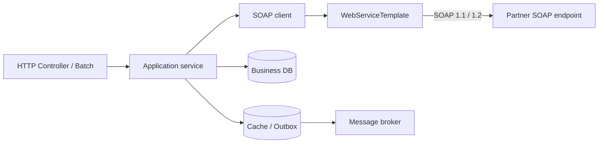
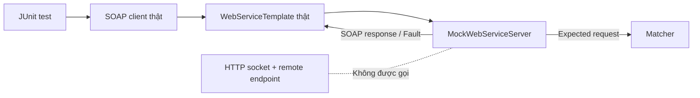
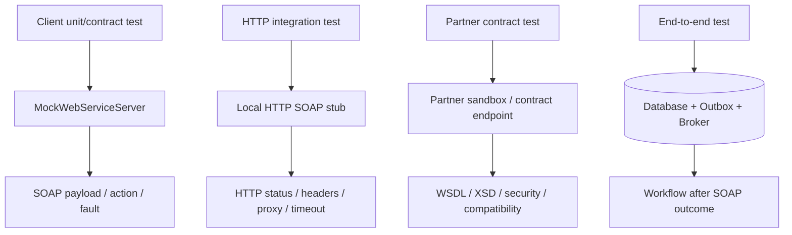
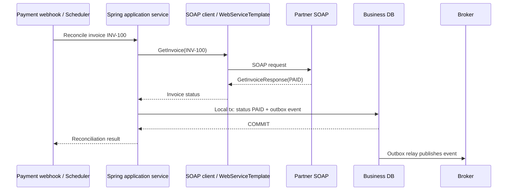

# MockWebServiceServer cho lời gọi SOAP

Một ứng dụng Spring Boot có thể gọi hệ thống ERP hoặc đối tác bảo hiểm qua **SOAP** để tra cứu hóa đơn, gửi chứng từ, xác nhận giao dịch rồi cập nhật cơ sở dữ liệu, cache hoặc phát sự kiện sang broker. Khi viết kiểm thử, gọi thẳng SOAP endpoint thật thường chậm, phụ thuộc tài khoản tích hợp, dữ liệu của đối tác và độ ổn định của mạng. Mock HTTP đơn thuần cũng có thể bỏ sót nội dung XML hoặc SOAP Fault mà client thực sự phải xử lý.

**`MockWebServiceServer`** của Spring Web Services (Spring-WS) cho phép mô phỏng **phía dịch vụ SOAP ở ranh giới `WebServiceTemplate`**, định nghĩa request được mong đợi và reply tương ứng ngay trong bộ nhớ. Nhờ đó có thể kiểm thử request payload, `SOAPAction`, SOAP Fault, chuyển đổi XML và cách client xử lý kết quả mà không cần khởi động một SOAP server hoặc gửi request ra Internet.

Bài thuộc chương **Kiểm thử tích hợp** của mô-đun `SPRING_BOOT_INTEGRATION`. Trọng tâm là sử dụng đúng công cụ, thiết lập môi trường Spring Boot, kiểm tra hợp đồng request/reply, xử lý lỗi, làm rõ giới hạn của mock so với kiểm thử transport thật và kết nối kết quả SOAP với giao dịch cơ sở dữ liệu, cache, broker, idempotency và khả năng quan sát.

## 1. SOAP client trong kiến trúc tích hợp Spring Boot

Một luồng phổ biến:



Client gửi một **SOAP Envelope** qua HTTP (hoặc transport khác), có thể chứa:

- **Envelope:** phần bao ngoài, xác định phiên bản SOAP qua namespace.
- **Header:** metadata giao thức, WS-Security, thông tin tương quan, định tuyến hoặc các extension đã thỏa thuận.
- **Body:** payload nghiệp vụ dưới dạng XML, ví dụ `GetInvoiceRequest`.
- **Fault:** biểu diễn lỗi ở cấp SOAP với fault code, fault string/reason và có thể có detail.

Ví dụ SOAP 1.1 request:

```xml
<soapenv:Envelope
    xmlns:soapenv="http://schemas.xmlsoap.org/soap/envelope/"
    xmlns:inv="urn:example:invoice:v1">
  <soapenv:Header/>
  <soapenv:Body>
    <inv:GetInvoiceRequest>
      <inv:invoiceId>INV-100</inv:invoiceId>
    </inv:GetInvoiceRequest>
  </soapenv:Body>
</soapenv:Envelope>
```

Ví dụ SOAP 1.1 response:

```xml
<soapenv:Envelope
    xmlns:soapenv="http://schemas.xmlsoap.org/soap/envelope/"
    xmlns:inv="urn:example:invoice:v1">
  <soapenv:Body>
    <inv:GetInvoiceResponse>
      <inv:invoiceId>INV-100</inv:invoiceId>
      <inv:status>PAID</inv:status>
    </inv:GetInvoiceResponse>
  </soapenv:Body>
</soapenv:Envelope>
```

Trong hầu hết các test với `MockWebServiceServer`, matcher `payload(...)` kiểm tra **phần tử payload ở SOAP Body**, không cần cung cấp toàn bộ Envelope ở ví dụ response. Đây là điểm khác với nhiều công cụ HTTP mock kiểm tra nguyên body của HTTP request.

### 1.1. Đâu là boundary đang được giả lập?



Mock server không phải SOAP service chạy tại `localhost:8080`. Nó liên kết với `WebServiceTemplate` cụ thể và thay ranh giới giao tiếp của template để kiểm soát request/response. Vì thế test chạy nhanh, ổn định và có thể kiểm chứng client-side XML processing, nhưng **không chứng minh được DNS, TCP, TLS, proxy, connection pool, HTTP timeout hay độ sẵn sàng của endpoint thật**.

## 2. MockWebServiceServer khác những công cụ kiểm thử khác thế nào?

| Công cụ | Ranh giới giả lập | Phù hợp kiểm chứng | Không nên suy ra |
| --- | --- | --- | --- |
| **`MockWebServiceServer`** | `WebServiceTemplate` phía client Spring-WS | SOAP payload, SOAPAction, SOAP Fault, marshalling/unmarshalling, mã xử lý client | Hành vi HTTP socket/TLS/timeout thực |
| Spring-WS `MockWebServiceClient` | Endpoint SOAP phía server của ứng dụng | Endpoint nhận SOAP request, response, validation, interceptor | SOAP client outbound đã hoạt động |
| `MockRestServiceServer` | Spring REST client (`RestTemplate`/`RestClient`) | HTTP/REST JSON, headers, status | Tự động hiểu SOAP Fault hoặc Spring-WS client |
| WireMock/MockWebServer | HTTP server giả chạy thật | HTTP status/headers, transport, redirect, timeout/chunking tùy khả năng | Hợp đồng SOAP được kiểm tra tự động nếu không tự khai báo |
| SOAP stub/server thực hoặc môi trường đối tác | Giao tiếp đầy đủ theo endpoint/WSDL thật | TLS, auth, gateway, networking, namespace, khả năng tương thích | Tính ổn định tuyệt đối của dữ liệu test |
| Testcontainers DB/broker | Hạ tầng thật có kiểm soát | Transaction, outbox, deduplication, delivery/redelivery | Cấu trúc payload SOAP chính xác nếu SOAP client chưa được test |

**`MockWebServiceServer`** giải quyết đúng câu hỏi: *Spring-WS client đã tạo đúng SOAP request và xử lý SOAP reply/fault đúng hợp đồng chưa?* Với các yêu cầu về timeout và lỗi kết nối thực, bổ sung test ở tầng transport khác.

### 2.1. Không nhầm với `MockWebServiceClient`

Tên hai công cụ dễ gây nhầm:

- `org.springframework.ws.test.client.MockWebServiceServer`: đóng vai **SOAP server giả**, dùng để **test client** gửi SOAP đi.
- `org.springframework.ws.test.server.MockWebServiceClient`: đóng vai **SOAP client giả**, dùng để **test server endpoint** do ứng dụng Spring-WS cung cấp.

Khi service của bạn **gọi SOAP đối tác**, hãy chọn `MockWebServiceServer`. Khi bạn **triển khai `@Endpoint` nhận SOAP từ đối tác**, hãy chọn `MockWebServiceClient`.

## 3. Dependency và các thành phần cần có

Ví dụ Gradle cho ứng dụng Spring Boot dùng Spring Web Services:

```gradle
dependencies {
    implementation 'org.springframework.boot:spring-boot-starter-web-services'
    testImplementation 'org.springframework.boot:spring-boot-starter-test'
    testImplementation 'org.springframework.ws:spring-ws-test'
}
```

`spring-ws-test` cung cấp `MockWebServiceServer`, `RequestMatchers` và `ResponseCreators`. Với ứng dụng tạo SOAP DTO từ WSDL/XSD, cần thêm JAXB runtime hoặc plugin sinh mã phù hợp với Java/Spring Boot hiện tại. Nếu dùng `Jaxb2Marshaller`, phải bảo đảm các class JAXB và namespace khớp WSDL của đối tác.

Các phiên bản Spring Web Services, Spring Framework và Spring Boot cần tương thích (đặc biệt khi dùng hệ sinh thái Jakarta). Nên dùng dependency management của Spring Boot/BOM phù hợp thay vì tự ghép những phiên bản không tương thích. Bài học sử dụng API `WebServiceTemplate`, `StringSource`, `StringResult` và các test API Spring-WS; cấu hình cụ thể của SOAP transport có thể khác theo phiên bản.

| Thành phần | Vai trò |
| --- | --- |
| `WebServiceTemplate` | Tạo request SOAP, gửi qua message sender, xử lý response/fault |
| `WebServiceGatewaySupport` | Base class tiện dụng cho client SOAP dùng `WebServiceTemplate` |
| `SaajSoapMessageFactory` | Tạo SOAP message, hỗ trợ lựa chọn SOAP version phù hợp |
| `Jaxb2Marshaller` | Chuyển Java object ↔ XML theo JAXB contract |
| `SoapActionCallback` | Đặt SOAPAction cho request theo hợp đồng SOAP |
| `MockWebServiceServer` | Gắn các expectation và reply giả vào template đang test |
| `RequestMatchers` | Matcher như `payload(...)` hoặc `soapAction(...)` |
| `ResponseCreators` | Sinh response SOAP như `withPayload(...)` hoặc SOAP Fault |

Để kiểm tra gắn đúng mock server, dùng **chính `WebServiceTemplate` mà client dưới test sẽ gọi**. Tạo mock trên một template khác sẽ không chặn request của client và có thể khiến test vô tình gọi endpoint thật.

## 4. Client SOAP tối giản, không cần WSDL code generation

Ví dụ sau dùng XML `Source` để tập trung vào ranh giới request/reply. Ứng dụng thực tế có thể thay bằng DTO/JAXB khi hợp đồng phức tạp.

```java
package example.integration.soap;

import java.util.regex.Pattern;
import org.springframework.ws.client.core.WebServiceTemplate;
import org.springframework.ws.soap.client.core.SoapActionCallback;
import org.springframework.xml.transform.StringResult;
import org.springframework.xml.transform.StringSource;

public final class InvoiceSoapClient {
    private static final Pattern VALID_ID =
            Pattern.compile("[A-Za-z0-9_-]{1,64}");

    private final WebServiceTemplate template;

    public InvoiceSoapClient(WebServiceTemplate template) {
        this.template = template;
    }

    public String getInvoiceXml(String invoiceId) {
        if (invoiceId == null ||
                !VALID_ID.matcher(invoiceId).matches()) {
            throw new IllegalArgumentException("Invalid invoiceId");
        }

        String requestXml = """
                <inv:GetInvoiceRequest xmlns:inv="urn:example:invoice:v1">
                  <inv:invoiceId>%s</inv:invoiceId>
                </inv:GetInvoiceRequest>
                """.formatted(invoiceId);

        StringResult response = new StringResult();
        boolean received = template.sendSourceAndReceiveToResult(
                new StringSource(requestXml),
                new SoapActionCallback("urn:invoice:get"),
                response);

        if (!received) {
            throw new IllegalStateException("SOAP reply body is missing");
        }
        return response.toString();
    }
}
```

Điểm thiết kế:

1. `InvoiceSoapClient` được inject một `WebServiceTemplate` thay vì tự tạo template bên trong method. Test có thể gắn mock vào **đúng instance**.
2. Ví dụ giới hạn `invoiceId` bằng ký tự ASCII cho phép để tránh nối tùy tiện nội dung không tin cậy vào XML. Với dữ liệu tổng quát, dùng JAXB/DOM/XML writer có escaping đúng thay vì `String.formatted(...)`.
3. `SoapActionCallback` đặt action theo hợp đồng đối tác, không mặc định mọi SOAP endpoint đều yêu cầu cùng action.
4. `sendSourceAndReceiveToResult` lấy phần payload của response vào `StringResult`. Đối với nghiệp vụ thật, nên parse có schema validation/DTO thay vì dựa vào `String.contains(...)`.
5. Khi response là SOAP Fault, `WebServiceTemplate` thường sử dụng fault resolver để phát sinh exception; xử lý chính sách lỗi ở tầng client/application service.

Bean Spring Boot cho ví dụ:

```java
@Configuration(proxyBeanMethods = false)
public class InvoiceSoapConfig {

    @Bean
    WebServiceTemplate invoiceWebServiceTemplate() {
        WebServiceTemplate template = new WebServiceTemplate();
        template.setDefaultUri(
                "https://partner.example.test/soap/invoices");
        return template;
    }

    @Bean
    InvoiceSoapClient invoiceSoapClient(
            WebServiceTemplate invoiceWebServiceTemplate) {
        return new InvoiceSoapClient(invoiceWebServiceTemplate);
    }
}
```

URL chỉ để minh họa; **test với mock server không cần và không nên kết nối endpoint đó**. Cấu hình production cần URI từ `@ConfigurationProperties`, xác thực, proxy, TLS, timeout, pool kết nối và observability phù hợp. Các ví dụ bài học không chạy Gradle hoặc gọi service thật; mục tiêu trước mắt là mô tả chính xác một test SOAP outbound.

## 5. Kiểm thử đầu tiên: mock SOAP response thành công

Một test có giá trị phải sử dụng **client thật**, đặt expectation cho request client tạo ra, cung cấp reply giả và kiểm tra kết quả ứng dụng nhận được. Ví dụ JUnit 5:

```java
package example.integration.soap;

import org.junit.jupiter.api.BeforeEach;
import org.junit.jupiter.api.Test;
import org.springframework.ws.client.core.WebServiceTemplate;
import org.springframework.ws.test.client.MockWebServiceServer;
import org.springframework.xml.transform.StringSource;

import static org.assertj.core.api.Assertions.assertThat;
import static org.springframework.ws.test.client.RequestMatchers.payload;
import static org.springframework.ws.test.client.ResponseCreators.withPayload;

class InvoiceSoapClientTest {
    private InvoiceSoapClient client;
    private MockWebServiceServer server;

    @BeforeEach
    void setUp() {
        WebServiceTemplate template = new WebServiceTemplate();
        template.setDefaultUri(
                "https://partner.example.test/soap/invoices");

        client = new InvoiceSoapClient(template);
        server = MockWebServiceServer.createServer(template);
    }

    @Test
    void shouldSendInvoiceRequestAndReadPaidResponse() {
        StringSource expectedRequest = new StringSource("""
                <inv:GetInvoiceRequest xmlns:inv="urn:example:invoice:v1">
                  <inv:invoiceId>INV-100</inv:invoiceId>
                </inv:GetInvoiceRequest>
                """);

        StringSource responsePayload = new StringSource("""
                <inv:GetInvoiceResponse xmlns:inv="urn:example:invoice:v1">
                  <inv:invoiceId>INV-100</inv:invoiceId>
                  <inv:status>PAID</inv:status>
                </inv:GetInvoiceResponse>
                """);

        server.expect(payload(expectedRequest))
                .andRespond(withPayload(responsePayload));

        String responseXml = client.getInvoiceXml("INV-100");

        assertThat(responseXml).contains("INV-100", "PAID");
        server.verify();
    }
}
```

Các bước:

1. Tạo một `WebServiceTemplate` thật nhưng không dùng network sender thật ở test sau khi mock được gắn.
2. Khởi tạo client với template đó.
3. Gọi `MockWebServiceServer.createServer(template)` để liên kết server giả với template.
4. `server.expect(payload(...))` khai báo SOAP body payload mà client phải gửi; `andRespond(withPayload(...))` trả về nội dung SOAP body giả.
5. Gọi method của client; đó là **code cần kiểm thử**.
6. Kiểm tra kết quả và gọi **`server.verify()`** để xác minh các expectation đã được thực hiện.

Nếu không gọi `server.verify()`, một số trường hợp expectation còn thiếu có thể không bị phát hiện như mong muốn. Nếu test chỉ trực tiếp gọi matcher hoặc tự đọc fixture XML mà không gọi `InvoiceSoapClient`, nó không kiểm tra luồng gửi thực của client.

### 5.1. Vì sao expectation thường dùng payload, không phải toàn Envelope?

`WebServiceTemplate` cùng `SoapMessageFactory` đóng gói payload vào SOAP Envelope theo phiên bản SOAP đang cấu hình. Test phía trên dùng:

```xml
<inv:GetInvoiceRequest xmlns:inv="urn:example:invoice:v1">
  <inv:invoiceId>INV-100</inv:invoiceId>
</inv:GetInvoiceRequest>
```

không phải chuỗi `<soapenv:Envelope>...`. Matcher `payload(...)` là matcher ở mức **XML payload của SOAP Body**. Việc chỉ so sánh payload không chứng minh thông tin trong SOAP Header, HTTP headers hoặc chi tiết HTTP wire. Khi hợp đồng yêu cầu `SOAPAction` hoặc WS-Security header, thêm matcher/kiểm thử thích hợp thay vì suy luận từ payload.

### 5.2. Xác nhận SOAPAction

Client `InvoiceSoapClient` sử dụng `new SoapActionCallback("urn:invoice:get")`. Một test độc lập có thể xác nhận action:

```java
import static org.springframework.ws.test.client.RequestMatchers.soapAction;
import static org.springframework.ws.test.client.ResponseCreators.withPayload;

@Test
void shouldSetPartnerSoapAction() {
    server.expect(soapAction("urn:invoice:get"))
            .andRespond(withPayload(new StringSource("""
                    <inv:GetInvoiceResponse
                        xmlns:inv="urn:example:invoice:v1">
                      <inv:invoiceId>INV-100</inv:invoiceId>
                      <inv:status>PAID</inv:status>
                    </inv:GetInvoiceResponse>
                    """)));

    client.getInvoiceXml("INV-100");
    server.verify();
}
```

Đây là **method khác trong cùng lớp test ở mục 5**, không phải class độc lập. Nó dùng một expectation cho một request và xác minh `SOAPAction` đúng giá trị contract; test đầu tiên vẫn kiểm tra XML payload. Nếu muốn kiểm tra nhiều điều kiện trên cùng request, có thể sử dụng cách kết hợp các `RequestMatcher` do API đang dùng hỗ trợ hoặc tạo một matcher tùy biến, thay vì đặt hai `server.expect(...)` riêng rồi vô tình yêu cầu client phải gửi hai request.

Trong SOAP 1.1, action thường liên hệ với HTTP `SOAPAction` header. SOAP 1.2 có semantics action qua media type `application/soap+xml` và các khác biệt ở HTTP binding. Vì vậy cần kiểm tra SOAP version/transport trong test hạ tầng tương ứng, không chỉ kiểm tra chuỗi action.

## 6. SOAP Fault: mô phỏng lỗi ở cấp hợp đồng

Đối tác có thể trả **SOAP Fault** dù HTTP status, header và body tuân theo cách binding khác nhau. Với `MockWebServiceServer`, nên mô phỏng Fault ở lớp SOAP để test cách `WebServiceTemplate` và application service phân loại lỗi, thay vì chỉ trả một chuỗi JSON lỗi như REST.

Ví dụ test lỗi phía server SOAP:

```java
import java.util.Locale;
import org.springframework.ws.soap.client.SoapFaultClientException;

import static org.assertj.core.api.Assertions.assertThatThrownBy;
import static org.springframework.ws.test.client.RequestMatchers.payload;
import static org.springframework.ws.test.client.ResponseCreators.withServerOrReceiverFault;

@Test
void shouldPropagatePartnerSoapFault() {
    server.expect(payload(new StringSource("""
                    <inv:GetInvoiceRequest xmlns:inv="urn:example:invoice:v1">
                      <inv:invoiceId>INV-100</inv:invoiceId>
                    </inv:GetInvoiceRequest>
                    """)))
            .andRespond(withServerOrReceiverFault(
                    "Partner temporarily unavailable",
                    Locale.ENGLISH));

    assertThatThrownBy(() -> client.getInvoiceXml("INV-100"))
            .isInstanceOf(SoapFaultClientException.class);

    server.verify();
}
```

`withServerOrReceiverFault` tạo Fault với nhóm mã lỗi tương ứng SOAP 1.1 **Server** hoặc SOAP 1.2 **Receiver** dựa trên SOAP message factory. Spring-WS thường dùng `SoapFaultMessageResolver` mặc định để biến SOAP Fault thành `SoapFaultClientException`; nếu client cấu hình `FaultMessageResolver` khác, expectation của test phải đổi theo hợp đồng ứng dụng.

Phân loại lỗi cần dựa trên **fault code, detail và contract**, không chỉ vào từ “Server”:

| Loại lỗi | Nguyên nhân có thể gặp | Chính sách thử lại |
| --- | --- | --- |
| SOAP Sender/Client Fault | XML sai schema, thiếu tham số, nội dung không hợp lệ | Thường không retry với cùng payload |
| SOAP Receiver/Server Fault | Hạ tầng SOAP đối tác tạm không phục vụ | Có thể retry có giới hạn nếu thao tác idempotent |
| Business Fault trong `detail` | Hóa đơn không tồn tại, đơn bị khóa, quyền xử lý không hợp lệ | Theo mã nghiệp vụ và khả năng sửa dữ liệu |
| HTTP 401/403 từ gateway | Thiếu credential/scope hoặc proxy/gateway chặn | Sửa quyền/token; không retry mù quáng |
| HTTP 503/timeout mạng | Service hoặc gateway không sẵn sàng | Retry/backoff, chú ý trạng thái kết quả không chắc chắn |
| XML unmarshal failure | Reply không khớp schema/JAXB class | Lỗi hợp đồng cần điều tra; tránh retry vô hạn |

### 6.1. Test Sender/Client Fault và Receiver/Server Fault có mục tiêu khác nhau

Một test bổ sung:

```java
import static org.springframework.ws.test.client.ResponseCreators.withClientOrSenderFault;

@Test
void invalidRequestShouldProduceClientFault() {
    server.expect(payload(new StringSource("""
                    <inv:GetInvoiceRequest xmlns:inv="urn:example:invoice:v1">
                      <inv:invoiceId>INV-100</inv:invoiceId>
                    </inv:GetInvoiceRequest>
                    """)))
            .andRespond(withClientOrSenderFault(
                    "Invalid invoice identifier",
                    Locale.ENGLISH));

    assertThatThrownBy(() -> client.getInvoiceXml("INV-100"))
            .isInstanceOf(SoapFaultClientException.class);

    server.verify();
}
```

Test này giả lập **đối tác từ chối request** theo hợp đồng, chứ không yêu cầu client cố ý gửi `invoiceId` không hợp lệ ở tầng local validation. Nếu local validation từ chối input trước khi template gửi request, test có thể kiểm tra không có lời gọi SOAP, không cần định nghĩa mock response.

### 6.2. Không xem mọi SOAP Fault đều được phép retry

Một `POST` SOAP có thể tạo giao dịch, yêu cầu thanh toán hoặc đặt hàng. Nếu client nhận timeout, phía đối tác **có thể đã commit**. Retry khi không có idempotency key/operation ID có thể thực hiện side effect hai lần. Với service tích hợp quan trọng:

1. Cấp operation ID ổn định trước khi gọi SOAP.
2. Truyền ID theo đúng hợp đồng (payload/header đã được đối tác chấp thuận).
3. Khi timeout, hỏi trạng thái giao dịch theo operation ID hoặc đối soát với đối tác nếu API hỗ trợ.
4. Chỉ retry với cùng ID/payload trong phạm vi SLA và policy đã định.
5. Lưu trạng thái pending/failed/unknown trong DB, không tự tuyên bố lỗi = chưa xử lý.

`MockWebServiceServer` kiểm thử được việc xử lý **SOAP reply/fault cụ thể**; nó không tự tạo bảo đảm idempotency end-to-end.

## 7. Test SOAP XML: namespace, schema và field quan trọng

Một XML hợp lệ về cú pháp chưa chắc hợp lệ theo WSDL/XSD. Các chi tiết hay gây lỗi với SOAP:

- QName của root element và child element: cùng local name nhưng namespace khác là hai phần tử khác nhau.
- Sự khác nhau giữa missing element, empty element và `xsi:nil="true"`.
- Thứ tự phần tử theo `xsd:sequence`, danh sách và min/max occurrences.
- Kiểu dữ liệu ngày giờ, timezone, decimal, mã tiền tệ và giới hạn field.
- Envelope SOAP 1.1 vs SOAP 1.2, SOAP Header và WS-Security.
- XML encoding và canonicalization khi dùng chữ ký số.

Ví dụ **hai request không tương đương** về QName:

```xml
<!-- Root thuộc namespace invoice:v1 -->
<GetInvoiceRequest xmlns="urn:example:invoice:v1">
  <invoiceId>INV-100</invoiceId>
</GetInvoiceRequest>

<!-- Root cùng local name nhưng namespace khác: invoice:v2 -->
<GetInvoiceRequest xmlns="urn:example:invoice:v2">
  <invoiceId>INV-100</invoiceId>
</GetInvoiceRequest>
```

Test payload nên dùng namespace thực từ hợp đồng, không chỉ `contains("<GetInvoiceRequest>")`. Với integration test phức tạp, dùng XML assertion hoặc schema validation có khả năng xử lý namespace để tránh brittle test theo whitespace/prefix nhưng vẫn bắt lỗi QName.

### 7.1. Khi nào kiểm tra schema?

Nếu service đối tác cung cấp XSD/WSDL ổn định, có thể:

- Sinh JAXB classes từ schema và dùng `Jaxb2Marshaller` để phát hiện khác biệt JAXB mapping.
- Validate XML request/response với XSD trong test contract độc lập, nhất là khi dùng raw `StringSource`.
- Kiểm tra các field required, enum và namespace trong fixtures.
- Kiểm tra schema version cũ/mới khi triển khai rolling update.

Lưu ý: `MockWebServiceServer` không tự tải WSDL và xác thực toàn bộ schema chỉ vì đã khai báo `payload(...)`. Khi cần schema validation, thêm cấu hình/validator chuyên biệt và fixture từ contract phù hợp; không tự suy ra kiểm thử đã bao phủ đầy đủ WSDL.

### 7.2. SOAP Header, WS-Security và chữ ký số

Nhiều đối tác yêu cầu WS-Security UsernameToken, timestamp, certificate-based signature hoặc custom SOAP header. Matcher `payload(...)` **không chứng minh header được tạo đúng**, và StringSource body-only không đủ để kiểm tra chứng thư hay chữ ký.

Nên chia:

1. **Test client mapping:** request body và business fields bằng MockWebServiceServer.
2. **Test message callback/interceptor:** xác minh action/custom header và cách đính kèm security token.
3. **Test security integration:** dùng test certificate, SOAP stack và server có khả năng xác minh signature/timestamp để kiểm tra thực tế.
4. **Test vận hành:** TLS, mTLS, truststore, proxy và credential rotation trong môi trường hạ tầng được kiểm soát.

Không đưa mật khẩu thật hoặc private key thật vào XML fixtures. Đừng “sửa test” bằng cách tắt XML signature verification hoặc TLS hostname validation trong cấu hình production.

## 8. Kiểm thử SOAP client dùng JAXB và WSDL-generated classes

Ở hệ thống thực tế, tự nối XML bằng string khó mở rộng. Spring-WS thường kết hợp `WebServiceTemplate` với `Jaxb2Marshaller` để gửi object sinh từ WSDL/XSD và nhận DTO đã unmarshal. `MockWebServiceServer` vẫn chặn message **sau khi đã được marshal**, vì vậy có thể kiểm tra XML SOAP thật mà ứng dụng tạo từ DTO.

Ví dụ giả định đã sinh các class JAXB trong package `example.generated.invoice` từ schema đối tác:

```java
@Configuration(proxyBeanMethods = false)
public class PartnerSoapConfiguration {

    @Bean
    Jaxb2Marshaller partnerInvoiceMarshaller() {
        Jaxb2Marshaller marshaller = new Jaxb2Marshaller();
        marshaller.setContextPath("example.generated.invoice");
        return marshaller;
    }

    @Bean("partnerInvoiceTemplate")
    WebServiceTemplate partnerInvoiceTemplate(
            Jaxb2Marshaller partnerInvoiceMarshaller) {
        WebServiceTemplate template = new WebServiceTemplate();
        template.setMarshaller(partnerInvoiceMarshaller);
        template.setUnmarshaller(partnerInvoiceMarshaller);
        template.setDefaultUri(
                "https://partner.example.test/soap/invoices");
        return template;
    }
}
```

Các import: `org.springframework.oxm.jaxb.Jaxb2Marshaller`, `org.springframework.ws.client.core.WebServiceTemplate`, `org.springframework.context.annotation.Configuration`, `org.springframework.context.annotation.Bean`. `setContextPath(...)` yêu cầu JAXB context có thể tìm thấy các class hoặc `ObjectFactory` tương ứng. Nếu generated classes dùng `JAXBElement` wrapper, cách gọi và ép kiểu response phải phù hợp với code được sinh; không giả định mọi JAXB response là direct POJO.

Client kiểu DTO (minh họa với class đã sinh):

```java
public final class PartnerInvoiceGateway {
    private final WebServiceTemplate template;

    public PartnerInvoiceGateway(WebServiceTemplate template) {
        this.template = template;
    }

    public GetInvoiceResponse lookup(GetInvoiceRequest request) {
        Object reply = template.marshalSendAndReceive(
                request, new SoapActionCallback("urn:invoice:get"));

        if (!(reply instanceof GetInvoiceResponse response)) {
            throw new IllegalStateException(
                    "Unexpected SOAP response object type");
        }
        return response;
    }
}
```

`GetInvoiceRequest` và `GetInvoiceResponse` không phải class Spring-WS dựng sẵn mà là **kiểu generated/application** theo WSDL. Code giả định JAXB map chúng trực tiếp; nếu schema sinh `JAXBElement<GetInvoiceResponse>`, cần unwrap đúng wrapper. Đây là lý do phải dùng test với JAXB schema cụ thể của project, không chỉ copy method và hy vọng tất cả đối tác dùng cùng XML root.

### 8.1. Test cần khớp XML mà marshaller sinh ra

Một quy trình hợp lý:

1. Tạo `Jaxb2Marshaller` thật với generated classes và namespace từ WSDL.
2. Tạo `WebServiceTemplate` thật với marshaller/unmarshaller.
3. Tạo gateway thật với template đó.
4. Gắn `MockWebServiceServer` vào template **sau khi cấu hình xong**.
5. `expect(payload(...))` với payload XML đúng QName, field và giá trị.
6. `andRespond(withPayload(...))` với XML response để unmarshaller xử lý.
7. Kiểm tra các field trong object kết quả; gọi `server.verify()`.

Ví dụ ý tưởng:

```java
// Request/response là JAXB-generated classes theo WSDL của dự án.
GetInvoiceRequest request = new GetInvoiceRequest();
request.setInvoiceId("INV-100");

server.expect(payload(new StringSource("""
                <inv:GetInvoiceRequest xmlns:inv="urn:example:invoice:v1">
                  <inv:invoiceId>INV-100</inv:invoiceId>
                </inv:GetInvoiceRequest>
                """)))
        .andRespond(withPayload(new StringSource("""
                <inv:GetInvoiceResponse xmlns:inv="urn:example:invoice:v1">
                  <inv:invoiceId>INV-100</inv:invoiceId>
                  <inv:status>PAID</inv:status>
                </inv:GetInvoiceResponse>
                """)));

GetInvoiceResponse reply = gateway.lookup(request);
assertThat(reply.getStatus()).isEqualTo("PAID");
server.verify();
```

Đây là **đoạn phương thức test** để đặt trong một test class đã khởi tạo `gateway` và `server` từ cùng `WebServiceTemplate`. Nếu các JAXB class sinh ra có root element wrapping, namespace/schema hoặc enum khác, phải điều chỉnh request/response type đúng contract; test sẽ giúp phát hiện khác biệt đó.

### 8.2. Cẩn trọng khi DTO/formatter làm thay đổi giá trị

Với SOAP và JAXB, các khác biệt thường bị bỏ sót:

- `BigDecimal` có scale khác hoặc được serialize thành chuỗi thập phân không đúng quy ước đối tác.
- Date-time dùng UTC hay local timezone, `XMLGregorianCalendar` và timezone offset.
- Danh sách rỗng khác với field absent hoặc `xsi:nil`.
- Element default namespace khác namespace của package generated.
- Enum unknown/value mở rộng làm unmarshal lỗi.
- Namespace prefix thay đổi dù QName vẫn đúng; đừng dựa vào kiểm tra text thuần quá chặt với prefix không quan trọng.

Đối với contract cần version, có thể giữ bộ fixtures cho nhiều schema versions và kiểm tra backward/forward compatibility khi triển khai consumer/provider mới.

## 9. Dùng MockWebServiceServer trong Spring Boot integration test

Ví dụ mục 5 là test độc lập với Spring context. Khi cần kiểm chứng **wiring thật** của cấu hình ứng dụng (bean, marshaller, interceptor, gateway), có thể khởi động context và gắn mock vào template thật:

```java
@SpringBootTest
class InvoiceSoapWiringTest {
    @Autowired
    @Qualifier("partnerInvoiceTemplate")
    WebServiceTemplate template;

    @Autowired
    PartnerInvoiceGateway gateway;

    private MockWebServiceServer server;

    @BeforeEach
    void createSoapMock() {
        server = MockWebServiceServer.createServer(template);
    }

    @Test
    void wiringShouldSendExpectedPayload() {
        // Dùng JAXB fixture tương ứng WSDL thật của ứng dụng.
        GetInvoiceRequest request = invoiceRequest("INV-100");

        server.expect(payload(new StringSource("""
                        <inv:GetInvoiceRequest
                            xmlns:inv="urn:example:invoice:v1">
                          <inv:invoiceId>INV-100</inv:invoiceId>
                        </inv:GetInvoiceRequest>
                        """)))
                .andRespond(withPayload(new StringSource("""
                        <inv:GetInvoiceResponse
                            xmlns:inv="urn:example:invoice:v1">
                          <inv:invoiceId>INV-100</inv:invoiceId>
                          <inv:status>PAID</inv:status>
                        </inv:GetInvoiceResponse>
                        """)));

        GetInvoiceResponse response = gateway.lookup(request);
        assertThat(response.getStatus()).isEqualTo("PAID");
        server.verify();
    }
}
```

`invoiceRequest(...)` là test fixture do dự án khai báo; `PartnerInvoiceGateway` phải được đăng ký thành bean trong context nếu chọn kiểu constructor thông thường ở mục 8. Ví dụ không tự sinh JAXB classes hoặc khai báo đầy đủ bean; nhiệm vụ của nó là minh họa test wiring với những thành phần đã tồn tại trong một dự án SOAP thật.

**Điểm dễ sai khi Spring Boot có nhiều HTTP/SOAP client:** nếu test inject một `WebServiceTemplate` mới không phải template mà `PartnerInvoiceGateway` đang dùng, request có thể đi ra mạng hoặc expectations không được thực hiện. Ưu tiên named bean `@Qualifier`, instance chia sẻ đúng và test dùng injection thật.

### 9.1. Vòng đời mock server và parallel tests

Server giả lưu trạng thái expectations. Không nên:

- Đặt mock server trong một static field dùng chung cho nhiều test chạy song song.
- Tạo expectations ở một test rồi để test khác vô tình dùng lại template với sender đã bị thay đổi.
- Chỉ gọi `verify()` khi test thành công, khiến expectation bị bỏ qua nếu assertion giữa chừng thất bại.
- Giả định Spring test context cache sẽ tự khôi phục mọi đối tượng `WebServiceTemplate` đã bị test sửa.

Với test context dùng chung, nên tạo mock theo từng test method, kiểm tra thay đổi transport và cách reset/recreate sender trong phiên bản library đang dùng. Khi cần isolation mạnh hoặc test thay đổi bean/transport state đáng kể, tạo context riêng hoặc áp dụng cơ chế làm sạch phù hợp; tránh bật parallel execution cho những test sửa cùng template singleton.

Một mẫu test với một request có thể đặt `server.verify()` trong `@AfterEach`, nhưng nếu setup fail hoặc không đặt expectation, hãy thiết kế teardown để lỗi test gốc không bị che bởi exception khác. Tập trung làm cho mỗi test tự đủ setup/verify và không phụ thuộc thứ tự JUnit chạy.

## 10. SOAP Fault và mapping lỗi sang ngữ nghĩa nghiệp vụ

Trong production, một application service thường không muốn expose trực tiếp `SoapFaultClientException` lên HTTP controller. Nên có adapter/gateway chuyển lỗi transport/SOAP thành lỗi có ý nghĩa:

```text
WebServiceTemplate
    |-- GetInvoiceResponse ----> InvoiceStatus(PAID/PENDING/...)
    |-- SOAP Sender Fault -----> PartnerContractException (non-retryable)
    |-- SOAP Receiver Fault ---> PartnerUnavailableException (retryable theo policy)
    |-- HTTP/TLS error -------> PartnerConnectivityException
    |-- Unmarshal error ------> PartnerResponseContractException
```

Những exception domain ở sơ đồ là kiểu do dự án định nghĩa. Có thể viết mapper trong SOAP adapter:

```java
public InvoiceStatus queryStatus(String id) {
    try {
        GetInvoiceResponse soap = gateway.lookup(
                buildInvoiceRequest(id));
        return mapToDomain(soap);
    } catch (SoapFaultClientException fault) {
        throw mapPartnerFault(fault);
    } catch (WebServiceTransportException connectionError) {
        throw new PartnerConnectivityException(
                "SOAP partner transport failed", connectionError);
    }
}
```

`buildInvoiceRequest`, `mapToDomain`, `mapPartnerFault` và `PartnerConnectivityException` là các phương thức/lớp nghiệp vụ giả định. `WebServiceTransportException` thuộc Spring-WS và cách exception được ném phụ thuộc message sender và transport. Đoạn code chỉ thể hiện vị trí **phân loại lỗi**, không tuyên bố mọi lỗi HTTP đều là cùng exception.

Các tình huống cần test riêng:

| Tín hiệu từ SOAP/gateway | Hành vi ứng dụng mong muốn |
| --- | --- |
| Reply hợp lệ trạng thái PAID | Lưu trạng thái được phép và trả kết quả phù hợp |
| SOAP Sender/Client Fault | Không retry tự động khi payload không đổi; đưa lỗi contract tới người xử lý |
| SOAP Receiver/Server Fault | Thử lại có giới hạn nếu operation idempotent, nếu không thì đối soát |
| Fault `detail` cho biết “invoice not found” | Map sang not-found theo hợp đồng, không mặc định coi là 503 |
| XML body không đúng schema | Ném lỗi response contract; log correlation ID, không lưu body nhạy cảm |
| HTTP 401/403 ngoài SOAP envelope | Kiểm tra token, credential hoặc quyền; không retry vô hạn |
| Timeout sau một lệnh tạo thanh toán | Kết quả không xác định; dùng operation ID tra trạng thái |

**`MockWebServiceServer`** tạo được những SOAP message/fault có tính quyết định. Để mô phỏng việc remote service đã commit nhưng client bị cắt TCP trước khi thấy response, phải dùng test hạ tầng/fault injection phù hợp; mock in-memory không tái tạo đầy đủ race condition của mạng.

### 10.1. Kiểm tra retry không tạo side effect trùng

Nếu SOAP chỉ thực hiện truy vấn `GetInvoice`, retry có kiểm soát thường ít rủi ro hơn lệnh `CreatePayment`. Với lệnh tạo side effect, test cần chứng minh:

1. Cùng một **idempotency key/operation ID** được giữ qua mọi attempt.
2. Request body không tự thay đổi theo từng attempt.
3. Khi nhận response không rõ kết quả, adapter tra cứu trạng thái hoặc trả trạng thái `UNKNOWN/PENDING_RECONCILIATION`.
4. Không gọi lại `CreatePayment` vô hạn khi fault/timeout.
5. Lưu trạng thái workflow theo business ID bền vững nếu cần retry sau restart.

Test mock có thể kỳ vọng hai lần gửi để kiểm tra số attempts, nhưng đừng thiết kế một test chỉ chứng minh “gửi hai lần” rồi kết luận đã đạt exactly-once. Cần kiểm tra ràng buộc ở DB và hợp đồng idempotency của đối tác bằng integration/contract tests.

## 11. SOAP 1.1, SOAP 1.2, transport và giới hạn mock

SOAP 1.1 và SOAP 1.2 không đơn giản khác nhau ở namespace XML. Chúng có các quy tắc binding, media type, SOAPAction và định dạng Fault khác nhau. Một mock trả response hợp lệ ở SOAP 1.1 chưa bảo đảm client gọi được endpoint chỉ chấp nhận SOAP 1.2.

| Khía cạnh | SOAP 1.1 | SOAP 1.2 |
| --- | --- | --- |
| Envelope namespace | `http://schemas.xmlsoap.org/soap/envelope/` | `http://www.w3.org/2003/05/soap-envelope` |
| HTTP Content-Type thông dụng | `text/xml` | `application/soap+xml` |
| Action | Thường qua HTTP `SOAPAction` | Có thể qua tham số `action` trong Content-Type, tùy binding |
| Fault code khái quát | `Client` / `Server` | `Sender` / `Receiver` |
| Payload contract | WSDL/XSD và SOAP binding cụ thể | WSDL/XSD và SOAP binding cụ thể |

Ví dụ cấu hình SOAP 1.2 khi đối tác thực sự yêu cầu:

```java
@Bean
SaajSoapMessageFactory partnerSoap12MessageFactory() {
    SaajSoapMessageFactory factory = new SaajSoapMessageFactory();
    factory.setSoapVersion(SoapVersion.SOAP_12);
    return factory;
}

@Bean
WebServiceTemplate soap12WebServiceTemplate(
        SaajSoapMessageFactory partnerSoap12MessageFactory) {
    WebServiceTemplate template =
            new WebServiceTemplate(partnerSoap12MessageFactory);
    template.setDefaultUri("https://partner.example.test/soap12");
    return template;
}
```

Imports chính: `org.springframework.ws.soap.saaj.SaajSoapMessageFactory` và `org.springframework.ws.soap.SoapVersion`. Đây là **cách cấu hình thay thế** cho template SOAP mặc định, không nên đăng ký đồng thời nhiều bean `WebServiceTemplate` không có tên/qualifier rồi dựa vào autowiring mơ hồ. Với SAAJ message factory trong Spring, vòng đời bean sẽ thực hiện khởi tạo tương ứng; cần có SAAJ implementation phù hợp trong classpath.

### 11.1. Kiểm thử thực tế ở những tầng nào?



Đề xuất tầng kiểm thử:

- **Nhanh, chạy thường xuyên:** `MockWebServiceServer` kiểm tra client mapping và fault handling.
- **Chạy trên CI integration suite:** HTTP SOAP stub (WireMock/MockWebServer hoặc SOAP server test) kiểm tra status code, transport, kết nối, timeout, SOAPAction ở HTTP wire, proxy khi cần.
- **Contract/sandbox:** kiểm tra compatibility với WSDL/XSD và security thật của đối tác trong môi trường thử nghiệm được cấp quyền.
- **End-to-end:** kết quả gọi SOAP đi qua business transaction, cache, outbox và consumer/broker với khả năng lỗi và redelivery.

Không sử dụng `MockWebServiceServer` như bằng chứng duy nhất rằng TLS certificate, Basic/Bearer auth, WS-Security signature hoặc connection timeout của môi trường production đã hoạt động đúng.

## 12. Thiết kế test theo hợp đồng nghiệp vụ của SOAP

Ví dụ nghiệp vụ: sau khi nhận callback thanh toán, hệ thống tra SOAP đối tác để xác minh hóa đơn. Khi đối tác trả `PAID` hợp lệ, service cập nhật PostgreSQL và tạo outbox event `InvoicePaid`. Khi đối tác trả `PENDING`, service không xác nhận đã thanh toán; khi SOAP Fault/timeout, workflow giữ trạng thái chưa xác định để retry hoặc đối soát.



Trong test `MockWebServiceServer`, **Partner SOAP** được thay bằng mock; application service, SOAP adapter và transaction DB có thể giữ nguyên nếu tích hợp thêm Testcontainers/JDBC. Những invariant cần kiểm tra:

1. Không có hóa đơn PAID khi SOAP trả PENDING, SOAP Fault hoặc dữ liệu sai schema.
2. Cập nhật trạng thái và ghi outbox được commit **cùng transaction DB**.
3. Một invoice/event ID được xử lý lặp không tạo hai payment record hoặc hai business events; phải dùng unique constraint/idempotency đúng scope.
4. Khi mạng lỗi sau một SOAP command có side effect, client không tự replay mù quáng, mà dùng operation ID và trạng thái trung gian.
5. SOAP adapter không giữ transaction DB mở trong thời gian chờ đối tác nếu kiến trúc có thể tách tra cứu và ghi DB.

### 12.1. Không nên để mock kiểm tra thay cho DB transaction

Một test như:

```java
server.expect(payload(expectedRequest))
        .andRespond(withPayload(paidResponse));
service.reconcile("INV-100");
server.verify();
```

chỉ chứng minh service đã gửi SOAP request đúng và mock reply được trả. Để chứng minh dữ liệu và outbox nhất quán, phải truy vấn **database thực trong test** sau khi transaction đã commit, gồm cả trường hợp lỗi được bơm vào giữa hai lần ghi.

Ví dụ bản thiết kế test tích hợp (các helper do dự án cung cấp):

```java
@Test
void soapPaidResponsePersistsStatusAndOutboxAtomically() {
    arrangeInvoice("INV-100", "PENDING");
    expectSoapPaidResponse("INV-100"); // Wrapper quanh mockServer.

    reconciliationService.reconcile("INV-100");

    assertThat(invoiceRepository.statusOf("INV-100"))
            .isEqualTo("PAID");
    assertThat(outboxRepository.countByBusinessKey(
            "invoice-paid:INV-100")).isEqualTo(1);
    server.verify();
}
```

Test này là khung ý tưởng, yêu cầu `arrangeInvoice`, `expectSoapPaidResponse` và các repository thật trong test project. Với PostgreSQL, dùng Testcontainers hoặc database test tương đương. Quan trọng hơn việc mock mỗi dependency là đảm bảo Spring wiring, transaction và ràng buộc DB được thử tại nơi chúng hoạt động.

### 12.2. Dùng mock để kiểm tra chính sách không retry sai

Giả sử đối tác trả SOAP Fault do invoiceId không hợp lệ. Ứng dụng không được lặp vô hạn cùng request. Test có thể thiết lập **một** expectation, gọi service và xác minh lỗi được phân loại là không retryable. Nếu code tự retry không đúng, request SOAP thứ hai không có expectation tương ứng sẽ làm test thất bại.

Đối với lỗi tạm thời, có thể thiết lập các lần trả khác nhau theo thứ tự kỳ vọng để xác minh retry policy, nhưng cần loại bỏ sleep thật bằng scheduler/clock kiểm soát được khi có backoff. Test nhanh chỉ cần chứng minh số attempt và quyết định cuối, còn test timeout/thời gian thực chuyển sang suite hạ tầng.

## 13. Tình huống khó: attachment, security và các hợp đồng thay đổi

SOAP nhiều khi không chỉ là XML text nhỏ. Các trường hợp cần kiểm thử bổ sung gồm:

### 13.1. SOAP with Attachments / MTOM

SOAP có thể mang attachment dưới dạng MIME multipart hoặc MTOM/XOP. Matcher `payload(...)` chỉ kiểm tra XML payload, không mặc nhiên kiểm tra bytes của attachment, content type, size hoặc transfer encoding. Với trường hợp này cần:

- Test serializer và cách ánh xạ file/attachment của client.
- Test giới hạn dung lượng, streaming và cleanup resource.
- Test HTTP server stub hoặc SOAP endpoint test đủ khả năng nhận multipart/MTOM.
- Test lỗi I/O và retry có idempotency cho upload có side effect.

Đừng nhét toàn bộ attachment lớn vào `StringSource` và kết luận test đã bao phủ file upload thực.

### 13.2. WS-Security

Nếu client dùng interceptor ký SOAP message hoặc thêm UsernameToken, cần kiểm tra cả **nội dung Header**, thuật toán/chứng chỉ, timestamp clock skew và phía server thực sự xác thực được. Test với mock có thể xác minh interceptor được gọi và message chứa header thích hợp; test security thật phải có verifier độc lập và key/certificate thử nghiệm.

Không dùng test credential thật hoặc chấp nhận mọi chữ ký chỉ để tránh cấu hình test keystore. Với thông tin nhạy cảm trong SOAP Fault/detail, log cần redact trước khi xuất ra CI artifacts.

### 13.3. Partner nâng version WSDL/XSD

Khi schema thay đổi:

1. Lấy contract được phê duyệt và cập nhật JAXB generated classes theo version.
2. Giữ fixtures request/response cho version được hỗ trợ.
3. Test namespace, root QName, optional/required fields, SOAPAction và semantics Fault.
4. Test một phần trong môi trường đối tác để phát hiện transport/security khác mock.
5. Chọn chiến lược chuyển đổi khi cùng lúc có producer hoặc đối tác nhiều phiên bản.

Nếu WSDL thay đổi chỉ ở namespace mà payload local name giữ nguyên, test so sánh chuỗi tên element có thể vẫn “xanh”; `payload(...)` với expected QName/schema đúng sẽ giúp phát hiện sai hợp đồng.

### 13.4. SOAP response rỗng hoặc không mong đợi

Không giả định luôn có `GetInvoiceResponse`:

- HTTP trả response không có SOAP body hợp lệ.
- SOAP response chứa Fault thay cho normal payload.
- Reply có empty payload hoặc một kiểu message `one-way` không có reply.
- XML parse được nhưng nghiệp vụ trả unknown status.
- Partner trả response đúng schema nhưng invoiceId không khớp request.

Client phải có hợp đồng rõ ràng cho từng trường hợp. Test nên kiểm tra **sai invoiceId**, response không đủ field và trạng thái lạ thay vì chỉ happy path.

## 14. Ma trận kiểm thử khuyến nghị

Một bộ test SOAP client đáng tin cậy không cần hàng trăm test giống nhau, nhưng phải có các ranh giới dễ xảy ra lỗi thực tế:

| Nhóm | Kịch bản | Công cụ phù hợp | Điều phải chứng minh |
| --- | --- | --- | --- |
| Request | Gửi một payload hợp lệ | `MockWebServiceServer` | Root QName, namespace, ID và field bắt buộc đúng |
| Request | Đặt `SOAPAction` | `MockWebServiceServer` | Action đúng hợp đồng; không thiếu callback |
| Request | ID chứa ký tự không hợp lệ | Unit/client test | Không gửi request hoặc encode đúng theo contract |
| Request | Sử dụng JAXB-generated DTO | Mock + JAXB thật | XML được marshal đúng; response unmarshal đúng |
| Response | Reply PAID | Mock SOAP reply | Mapper trả domain status PAID |
| Response | Reply PENDING | Mock SOAP reply | Không cập nhật dữ liệu như đã hoàn tất |
| Response | Invoice ID không khớp | Mock SOAP reply | Phát hiện response business contract sai |
| Fault | SOAP Sender/Client | Mock SOAP Fault | Không retry vô hạn dữ liệu sai |
| Fault | SOAP Receiver/Server | Mock SOAP Fault | Phân loại lỗi tạm thời và chính sách retry phù hợp |
| Fault | Fault detail với mã nghiệp vụ | Mock Fault có detail theo contract hoặc SOAP fixture | Mapper phân biệt business fault với lỗi hạ tầng |
| Transport | HTTP 401/403, proxy 407 | HTTP stub/proxy test | Auth/routing và xử lý lỗi chính xác |
| Transport | Connect/read timeout | HTTP stub có delay/fault injection | Timeout/connection pool thực sự hoạt động |
| Transport | HTTPS/mTLS/WS-Security | HTTPS SOAP stub hoặc partner sandbox | Hostname, truststore, chữ ký và chứng thư được xác minh |
| Schema | Namespace v1/v2 khác nhau | XML matcher + XSD/JAXB tests | Không chấp nhận nhầm QName/field version |
| Message | SOAP 1.1 vs SOAP 1.2 | Mock factory + HTTP stub | Envelope, content type và Fault semantics phù hợp |
| Transaction | SOAP PAID rồi DB insert lỗi | DB integration + SOAP mock | Không commit nửa vời; outbox rollback cùng business state |
| Duplicate | Cùng callback/invoice xử lý lại | DB integration | Unique constraint/idempotency ngăn hiệu ứng trùng |
| Downstream | Outbox relay publish lại | Broker integration/Testcontainers | Consumer nhận duplicate vẫn an toàn |
| Operations | Partner SOAP outage | Fault injection + scheduler/worker | Workflow ghi trạng thái, retry có hạn, cảnh báo |

### 14.1. Ranh giới của mỗi assertion

Khi test đang dùng `MockWebServiceServer` và pass, kết luận hợp lệ là:

> Trong điều kiện SOAP request/response/fault được mô phỏng, client thật đã tạo request phù hợp expectation và xử lý reply theo logic kiểm thử.

Không nên viết kết luận “SOAP endpoint production hoạt động” chỉ từ test ấy. Nếu test chỉ có DB mock, cũng không nên kết luận transaction thật đã rollback cùng outbox. Mỗi lớp test cần có mục tiêu, dependency và mức bảo đảm cụ thể.

### 14.2. Kiểm tra không gọi SOAP khi local validation thất bại

Với client ở mục 4, input chứa ký tự nằm ngoài hợp đồng bị từ chối trước khi tạo request:

```java
@Test
void invalidIdMustNotTriggerSoapCall() {
    assertThatThrownBy(() ->
            client.getInvoiceXml("../other-service"))
            .isInstanceOf(IllegalArgumentException.class);

    // Không đặt expectation nào; request bất ngờ tới mock
    // sẽ không phù hợp với setup của bài test.
    server.verify();
}
```

Test này giúp ngăn request đi ra đối tác với dữ liệu không hợp lệ. Trong hệ thống thực, không nên chỉ dựa vào regex đơn giản làm bảo vệ SSRF; URL endpoint/redirect phải được kiểm tra riêng và không được nối trực tiếp từ input không tin cậy.

## 15. Các lỗi thường gặp khi dùng MockWebServiceServer

| Triệu chứng | Nguyên nhân có thể | Cách khắc phục |
| --- | --- | --- |
| Test vẫn cố kết nối ra Internet | Mock gắn sai `WebServiceTemplate` instance | Inject đúng template client đang dùng và tạo mock trên instance đó |
| Matcher báo payload khác dù text nhìn giống | Namespace, QName, thứ tự element hoặc nil/default khác | So sánh XML theo namespace/contract, kiểm tra JAXB mapping |
| Test yêu cầu hai message nhưng client chỉ gửi một | Đặt hai `server.expect(...)` thay vì kết hợp matcher cho một request | Mỗi expectation ứng với số request dự kiến; thiết kế matcher phù hợp |
| SOAPAction không như mong đợi | Quên `SoapActionCallback` hoặc dùng binding SOAP khác | Xác minh callback, SOAP version, WSDL binding và HTTP wire khi cần |
| Test XML pass nhưng partner trả HTTP 415 | Sai Content-Type hoặc SOAP 1.1/1.2 | Cấu hình message factory và test HTTP transport |
| Fault response không thành domain exception | Chưa cấu hình `FaultMessageResolver`/mapper đúng | Test SOAP Fault có code/detail và phân loại ở adapter |
| JAXB ném exception khi unmarshal | Namespace/class/schema mismatch hoặc thiếu generated class | Kiểm tra `Jaxb2Marshaller`, context path, JAXB runtime và XSD |
| Test pass nhưng timeout production | Mock không sử dụng socket thật | Bổ sung HTTP stub có delay, timeout và pool metrics |
| Test pass nhưng WS-Security bị đối tác từ chối | Chỉ kiểm tra Body, bỏ qua Header/signature/TLS | Test interceptor và xác minh security bởi endpoint độc lập |
| Test chạy riêng pass, chạy cả suite fail | Dùng chung template/mock state giữa tests hoặc chạy song song | Isolate test state, reset sender phù hợp, tránh shared singleton mutation |
| Controller trả 500 khi SOAP Sender Fault | Exception SOAP bị lộ lên tầng HTTP không qua mapper | Map lỗi partner sang domain/API error contract |
| Retry tạo hai giao dịch ở đối tác | SOAP command không idempotent, timeout bị hiểu là chưa xử lý | Operation ID, tra trạng thái, retry có giới hạn và đối soát |

### 15.1. Điều tra một test fail theo thứ tự

1. **Đúng instance?** Xác định `WebServiceTemplate` mà gateway thật dùng; kiểm tra nó đã được gắn mock trước lời gọi chưa.
2. **Đúng contract?** Đọc QName của request payload, namespace, SOAPAction, SOAP version và schema version; không nhìn mỗi XML prefix.
3. **Đúng response?** Kiểm tra response fixture có SOAP payload hợp lệ và tương thích unmarshaller hiện tại.
4. **Đúng fault behavior?** Xác nhận `WebServiceTemplate` dùng fault resolver nào; xem exception cần bắt ở service hay gateway.
5. **Đúng số request?** Xác minh logic có retry, interceptor hoặc callback khiến client gửi thêm message không.
6. **Đúng phạm vi kiểm thử?** Nếu lỗi nằm ở TLS, HTTP proxy hoặc socket timeout, chuyển sang integration test ở tầng transport.

### 15.2. Debug có kiểm soát, không ghi lộ SOAP payload

SOAP có thể chứa thông tin thanh toán, chứng từ hoặc thông tin cá nhân. Khi test thất bại, không nên bật wire logging toàn bộ XML trên CI production-like rồi để secret trong artifact. Thay vào đó ghi nhận:

- `correlationId`, `operationId`, SOAP operation/action và version.
- QName của payload, schema version, thời gian marshal/send/receive.
- Fault code/category và mã business detail đã redact.
- Thời gian tổng, attempt count, trạng thái workflow/retry.
- Mã định danh fixture của test, không cần nội dung secret thật.

Nếu cần giữ XML để chẩn đoán, dùng dữ liệu giả và kho test artifact có quyền truy cập/retention phù hợp. Không đặt token, mật khẩu hoặc private key vào test source.

## 16. Checklist khi viết test SOAP outbound trong Spring Boot

1. **Đúng công cụ:** đang test `WebServiceTemplate` gọi ra ngoài thì dùng `MockWebServiceServer`, không nhầm với `MockWebServiceClient`?
2. **Đúng template:** mock server đã gắn vào **cùng instance** mà SOAP gateway dùng? Có tránh lộ request ra network khi chạy test không?
3. **Request:** đã kiểm tra body QName/namespace, mandatory fields, SOAPAction và các trường có ảnh hưởng nghiệp vụ?
4. **Response:** đã dùng reply fixture hợp lệ, kiểm tra cả status bình thường, thiếu field, sai invoice ID và schema version?
5. **Fault:** đã kiểm tra Sender/Client Fault, Receiver/Server Fault và cách map business fault sang lỗi ứng dụng?
6. **JAXB:** marshaller/unmarshaller cùng generated classes từ WSDL thực; có phân biệt direct POJO và `JAXBElement` wrapper?
7. **SOAP security:** Header, WS-Security, mTLS và TLS có test bổ sung ở tầng đúng, không dùng mock body-only để thay thế?
8. **Network:** có HTTP stub/integration test riêng cho timeout, proxy, HTTP status, content type và connection failure?
9. **Transaction:** SOAP outcome được lưu vào DB bằng transaction ngắn và outbox đúng ranh giới; lỗi không tạo dữ liệu nửa vời?
10. **Idempotency:** command SOAP có side effect giữ nguyên operation ID qua retry; consumer/broker redelivery không tạo side effect lặp?
11. **Test isolation:** có tạo expectation mới mỗi test, `verify()`, tránh shared mock state và parallel race?
12. **Vận hành:** correlation ID, fault category, attempt count, latency và trạng thái đối soát có thể quan sát nhưng không lộ dữ liệu nhạy cảm?

**Kết luận:** `MockWebServiceServer` là công cụ chủ lực để kiểm chứng **SOAP request/reply/fault của client Spring-WS** mà không phụ thuộc vào đối tác thật. Giá trị của nó cao nhất khi dùng đúng `WebServiceTemplate`, matcher theo hợp đồng XML và assertion về hành vi ứng dụng. Để một luồng tích hợp Spring Boot an toàn khi chạy thực tế, hãy kết hợp test SOAP này với kiểm thử HTTP/TLS, transaction DB, outbox, idempotency, broker và các tình huống lỗi phục hồi — **mỗi loại kiểm thử chứng minh một ranh giới riêng, không thể thay thế lẫn nhau**.
