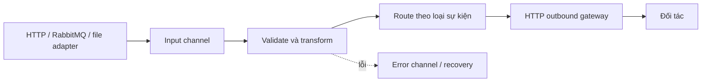

# Spring Integration Test và thay thế endpoint trong flow

## 1. Vì sao phải kiểm thử luồng tích hợp và khi nào cần thay endpoint?

Trong module **SPRING_BOOT_INTEGRATION**, một flow có thể nhận HTTP request hoặc thông điệp từ broker, biến đổi hợp đồng dữ liệu, tra cứu database/cache, gọi HTTP client và gửi kết quả qua các adapter của Spring Integration. Việc unit test riêng từng Java method chưa đủ để khẳng định rằng **message thực sự đi đúng channel, đúng handler, đúng thứ tự, đúng điều kiện lọc và đúng nhánh xử lý lỗi**.

Ví dụ một luồng đồng bộ đơn hàng:



Muốn thử logic transform và route, ta không nhất thiết phải gọi đối tác thật. **Thay endpoint trong flow** giúp giữ phần lớn wiring Spring Integration đang chạy thật trong ApplicationContext, nhưng đổi một handler hoặc trigger được chọn thành đối tượng test có thể điều khiển và kiểm chứng.

Một bài kiểm thử có giá trị cần trả lời:

1. Message đi từ input channel đến đúng endpoint, kèm payload và headers mong đợi?
2. Các nhánh lọc, routing, transformation, aggregation và error flow có hoạt động như cấu hình?
3. Khi endpoint bên ngoài lỗi, luồng có retry, error reply, dead letter hoặc checkpoint đúng hợp đồng?
4. Những phần nào được thay thế (mock) và những phần nào phải dùng tài nguyên thật/ephemeral để bảo đảm độ tin cậy?

**Phân biệt:** `Spring Integration Test` là bộ công cụ hỗ trợ kiểm thử các thành phần và flow Spring Integration. `@SpringBootTest` khởi tạo môi trường ứng dụng Spring Boot. Chúng có thể dùng cùng nhau nhưng không thay thế nhau.

## 2. Khái niệm endpoint, handler, channel và trigger

| Thành phần | Vai trò trong flow | Điều thường cần kiểm thử |
|---|---|---|
| `Message<?>` | Payload cùng headers mang ngữ cảnh tích hợp | Nội dung, correlation ID, routing key, kiểu dữ liệu, idempotency key |
| `MessageChannel` | Điểm giao nhận giữa các bước | Wiring và cách chuyển giao đồng bộ/bất đồng bộ |
| `MessageHandler` | Xử lý một message tại endpoint | Được gọi đúng lần, đúng payload, phản hồi hoặc ngoại lệ |
| `MessageSource<?>` | Sinh message từ nguồn được poll | Lọc, nhận dữ liệu, checkpoint và lịch nhận |
| `MessageProducer` | Chủ động phát message từ nguồn sự kiện | Vòng đời, subscriptions, nguồn ngoài và lỗi |
| `Endpoint` | Thành phần nối handler/source với channel và quản lý lifecycle | Start/stop, endpoint ID, polling/consumption |
| `Trigger` | Xác định lịch chạy poller | Kiểm soát thời điểm poll, tránh test phụ thuộc đồng hồ |
| `ErrorChannel` | Đường xử lý lỗi trong luồng bất đồng bộ hoặc error flow được cấu hình | ErrorMessage, nguyên nhân, retry và hành vi recover |

Một `DirectChannel` gọi subscriber đồng bộ theo thread gửi message trong nhiều trường hợp; `ExecutorChannel` đặt ranh giới bất đồng bộ; `QueueChannel` đệm message cho consumer nhận. Do đó, cùng một assertion có thể đúng với `DirectChannel` nhưng sai hoặc flaky với `ExecutorChannel` nếu kiểm tra trước khi handler chạy xong.

**Endpoint ID khác channel name.** Khi thay handler bằng `MockIntegrationContext`, cần đưa ID của **endpoint được quản lý bởi Spring Integration**, thường được đặt tường minh bằng DSL `.id("...")`. Truyền nhầm tên channel hoặc tên bean business service có thể khiến thay thế thất bại hoặc không ảnh hưởng đoạn flow dự định.

## 3. Các công cụ trong hệ sinh thái kiểm thử

| Công cụ | Dùng để làm gì | Giới hạn |
|---|---|---|
| `spring-integration-test` | Hỗ trợ `@SpringIntegrationTest` và `MockIntegrationContext`, thay handler/trigger trên endpoint | Không tự giả lập mọi giao thức và không tự cấp database/broker |
| `spring-integration-test-support` | Utility, matcher và một số test helper độc lập | Không tự dựng application context đầy đủ |
| `spring-boot-starter-test` | JUnit Jupiter, Spring Test, Mockito và các tiện ích kiểm thử tùy phiên bản | Không tự khởi động các adapter ngoài nếu thiếu dependency/config |
| `@SpringBootTest` | Nạp cấu hình, bean và wiring Spring Boot | Có thể chậm, có side effect nếu không chặn nguồn ngoài |
| `@SpringIntegrationTest` | Bổ sung hạ tầng test cho Spring Integration; hỗ trợ cấu hình endpoint không tự start | Không thay thế lệnh kiểm thử hoặc assertion |
| `MockIntegrationContext` | Thay message handler hoặc trigger của endpoint trong test context | Chỉ phù hợp với endpoint được Spring Integration quản lý và hỗ trợ thay thế |
| Mockito / `MockIntegration` | Mock, stub, verify handler | Không khẳng định adapter giao tiếp với server thật |
| `QueueChannel` / test probe | Nhận message đầu ra để assert với timeout | Nếu là in-memory queue, không chứng minh delivery/durability của broker |
| Testcontainers / WireMock | Dựng broker, DB, endpoint HTTP cô lập | Phải tự cấu hình lifecycle, image/runtime và dữ liệu test |

Các artifact và package API phải tương thích với phiên bản Spring Boot, Spring Integration, Spring Framework và Java của dự án. Thông thường cần thêm `org.springframework.integration:spring-integration-test` vào phạm vi test bên cạnh các module Spring Integration được dùng trong ứng dụng.

Ví dụ dependency Gradle:

```groovy
dependencies {
    implementation 'org.springframework.boot:spring-boot-starter-integration'
    testImplementation 'org.springframework.boot:spring-boot-starter-test'
    testImplementation 'org.springframework.integration:spring-integration-test'
}
```

Nếu Spring Boot đang quản lý dependency versions qua BOM/plugin, để BOM chọn các phiên bản tương thích. Nếu cần adapter HTTP, AMQP, Kafka, SFTP, JDBC hoặc XML, thêm các dependency tương ứng; các module đó không tự xuất hiện chỉ vì thêm `spring-integration-test`.

## 4. Chọn phạm vi kiểm thử trước khi mock

Không nên thay toàn bộ flow bằng mock và gọi đó là integration test. Nên xác định rõ **điểm kiểm soát** và **ranh giới cần giữ thật**.

| Mục tiêu | Phạm vi đề xuất | Thứ nên giả lập |
|---|---|---|
| Kiểm tra một transformer thuần Java | Unit test | Không cần Spring context |
| Kiểm tra routing/filter/wiring của một IntegrationFlow | Spring Integration flow test | Endpoint gọi hệ thống ngoài, trigger mang tính thời gian |
| Kiểm tra HTTP client và hợp đồng dữ liệu | Integration test với WireMock/MockWebServer | Server đối tác, giữ HTTP adapter thật |
| Kiểm tra delivery và ack của RabbitMQ | Testcontainers RabbitMQ, listener thật | Service phụ thuộc tiếp theo nếu cần |
| Kiểm tra schema, transaction/outbox | PostgreSQL Testcontainers, migration thật | HTTP đối tác hoặc một số adapter ngoài |
| Kiểm tra vận hành liên hệ nhiều adapter | End-to-end trong môi trường test độc lập | Chỉ những dịch vụ không thể dựng sandbox phù hợp |

Một bài test thay `httpOutboundEndpoint` bằng mock **không kiểm tra** URL, TLS, timeout, codec hoặc HTTP status handling của adapter thật; điều đó phải được kiểm thử riêng với fake HTTP server hoặc môi trường sandbox. Ngược lại, dựng broker thật cho mỗi test routing đơn giản có thể khiến bài test nặng mà không tăng độ tin cậy tương xứng.

## 5. Ví dụ flow Spring Integration có endpoint có thể thay

Giả sử một service Spring Boot nhận mã đơn từ input channel, chuẩn hóa ký tự, bỏ qua giá trị rỗng và gửi sang client đối tác. Những phần xử lý nội bộ chạy thật, còn endpoint gọi đối tác có thể được thay trong test.

```java
@Configuration
class OrderIntegrationConfiguration {

    @Bean
    MessageChannel orderInput() {
        return new DirectChannel();
    }

    @Bean
    MessageHandler partnerOrderHandler(PartnerOrderClient client) {
        return message -> client.sendOrder((String) message.getPayload());
    }

    @Bean
    IntegrationFlow orderFlow(
            @Qualifier("orderInput") MessageChannel orderInput,
            @Qualifier("partnerOrderHandler") MessageHandler partnerOrderHandler) {

        return IntegrationFlow.from(orderInput)
                .transform(String.class, String::trim)
                .filter(String.class, value -> !value.isBlank())
                .handle(partnerOrderHandler,
                        endpoint -> endpoint.id("partnerOrderEndpoint"))
                .get();
    }
}
```

Giả định ứng dụng cung cấp interface `PartnerOrderClient` có method `void sendOrder(String orderCode)`; ví dụ cần các import từ Spring Integration DSL, messaging, Java và Spring configuration tương ứng. Tên `partnerOrderEndpoint` được đặt trên **consumer endpoint** nối handler với channel. Đây là ID test dùng để thay handler.

Trong ví dụ, `DirectChannel` giúp đường xử lý đồng bộ và dễ assert; production có thể dùng executor/broker và cần bài test riêng cho concurrency, retry hoặc bảo toàn message.

Không bắt buộc thiết kế toàn bộ production flow nhằm hỗ trợ test. Tuy nhiên, **đặt tên endpoint ổn định, rõ trách nhiệm** giúp quản lý lifecycle, điều tra lỗi và thay phần phụ thuộc trong kiểm thử.

## 6. Thay handler bằng `MockIntegrationContext`

### 6.1. Bài test thay endpoint ra ngoài

`@SpringIntegrationTest` kết hợp `@SpringBootTest` tạo context có flow thật và cung cấp `MockIntegrationContext`. Trong test, ta thay handler của `partnerOrderEndpoint` trước khi gửi message:

```java
@SpringBootTest
@SpringIntegrationTest
class OrderIntegrationFlowTest {

    @Autowired
    MockIntegrationContext mockIntegrationContext;

    @Autowired
    @Qualifier("orderInput")
    MessageChannel orderInput;

    @Test
    void normalizesPayloadAndDeliversToPartnerEndpoint() {
        MessageHandler replacement = Mockito.mock(MessageHandler.class);

        mockIntegrationContext.substituteMessageHandlerFor(
                "partnerOrderEndpoint", replacement);

        try {
            boolean accepted = orderInput.send(
                    MessageBuilder.withPayload("  ORD-42  ")
                            .setHeader("correlationId", "test-42")
                            .build()
            );

            assertThat(accepted).isTrue();

            Mockito.verify(replacement, Mockito.times(1))
                    .handleMessage(Mockito.argThat(message ->
                            "ORD-42".equals(message.getPayload())
                            && "test-42".equals(
                                    message.getHeaders().get("correlationId"))
                    ));
        } finally {
            mockIntegrationContext.resetBeans();
        }
    }
}
```

Cần import JUnit Jupiter, Spring Boot Test, Spring Integration Test, Spring Messaging, AssertJ và Mockito tương ứng. Ví dụ giả định context chứa configuration ở phần trước, các dependency cần thiết được đăng ký và ứng dụng Spring Boot có entrypoint hợp lệ.

Điểm quan trọng:

1. `substituteMessageHandlerFor("partnerOrderEndpoint", replacement)` tác động đến handler của **endpoint có ID đó**, thay cho phần xử lý gọi `PartnerOrderClient`.
2. Transformer, filter, channel và việc đóng gói `Message<?>` vẫn chạy theo wiring thật; assertions kiểm tra đúng payload/headers tới ranh giới.
3. Vì đây là `DirectChannel` và handler mock đồng bộ, sau `send()` có thể verify ngay. Với flow bất đồng bộ phải chờ tín hiệu có giới hạn thời gian.
4. `resetBeans()` giúp khôi phục các bean đã được thay, tránh test khác cùng reuse Spring context quan sát handler giả. Cơ chế test listener có thể hỗ trợ dọn theo phiên bản, nhưng thể hiện trách nhiệm reset rõ ràng giúp bài học dễ hiểu.
5. Test này **không kiểm tra** mạng HTTP thật, độ bền message, transaction, publisher confirm hoặc retry bên ngoài handler thay thế.

Nếu method handler thực tế tạo reply, cần mock/stub có hành vi trả reply phù hợp thay vì thay bằng handler chỉ nhận message; nếu không, flow có thể fail hoặc dừng sớm do thiếu reply. Hãy thiết kế replacement dựa trên hợp đồng one-way gateway hay request-reply.

### 6.2. Sử dụng mock handler có phản hồi

Khi cần kiểm tra biến đổi trước và sau một endpoint request-reply, có thể dùng test helper từ `MockIntegration` để tạo handler phản hồi được định trước, hoặc thay bean/service ở ranh giới phụ thuộc và giữ handler thật. Về mặt hợp đồng:

```text
input -> transform -> [request-reply endpoint được thay]
      -> transform kết quả -> output channel
```

Replacement phải phát ra reply đúng kiểu mà downstream mong đợi, cùng những headers/correlation cần giữ. Nếu nó luôn trả `null`, flow có thể kết thúc mà không phát output; đó là lỗi setup test, không nhất thiết là lỗi routing.

Với nhiều endpoint, nên thay **chỉ những ranh giới gây side effect ngoài phạm vi test**. Nếu mock cả validator, router, transformer và outbound, test chỉ đang xác nhận Mockito gọi Mockito, không cung cấp bằng chứng về luồng tích hợp.

### 6.3. Khi cần thay dependency thay vì thay endpoint

Nếu muốn kiểm tra mapping HTTP adapter, exception mapping, retry tại adapter hoặc correlation, giữ adapter và thay **HTTP server** bằng WireMock. Nếu chỉ muốn ngăn side effect của `PartnerOrderClient`, có thể thay bean client bằng mock qua cơ chế Spring Test (ví dụ `@MockitoBean` ở phiên bản hỗ trợ, `@MockBean` ở các phiên bản Spring Boot cũ hơn).

Khác biệt:

- Thay endpoint: đoạn handler và network call được bỏ qua, test tập trung ở wiring trước/sau điểm thay.
- Thay bean phụ thuộc: handler/adapter vẫn chạy, chỉ call đến client giả; test bao phủ thêm logic của handler.
- Thay server ngoài: client, HTTP adapter, serialization và các interceptor vẫn chạy; test gần với tích hợp thật hơn.

## 7. Không cho inbound adapter tự chạy khi dựng context

Các adapter polling hoặc message-driven có thể khởi động ngay khi Spring context sẵn sàng. Điều này làm bài test không kiểm soát được thời điểm nhận file, đọc DB, consume broker hay gọi API.

`@SpringIntegrationTest` có tùy chọn `noAutoStartup` để chỉ định endpoint không tự start trong ngữ cảnh test:

```java
@SpringBootTest
@SpringIntegrationTest(noAutoStartup = {
        "fileInboundEndpoint",
        "scheduledInboundEndpoint"
})
class ImportFlowTest {
    // Chủ động thay trigger/start nguồn sau khi đã chuẩn bị fixture.
}
```

Các tên phải khớp endpoint bean IDs được quản lý. Ví dụ DSL có thể đặt ID rõ ràng ở `.from(..., spec -> spec.id("fileInboundEndpoint"))`; không điền path thư mục hoặc tên channel vào `noAutoStartup`.

Lợi ích:

- Không tạo side effect trước khi mock được gắn.
- Test có thể chuẩn bị fixture, database và stub HTTP trước khi kích hoạt nguồn.
- Tránh chạy poller định kỳ trong lúc test chưa bắt đầu hoặc khi test đã hoàn tất.
- Hạn chế cạnh tranh giữa các test dùng chung một context.

**Không bật lại toàn bộ endpoint chỉ để chạy một case** nếu có thể gửi test message trực tiếp vào channel sau adapter. Nếu mục tiêu là kiểm thử adapter/poller, hãy khởi động endpoint đó có kiểm soát, theo dõi kết quả và stop ở cleanup.

## 8. Thay trigger để kiểm soát polling

`MockIntegrationContext` còn hỗ trợ thay `Trigger` cho endpoint polling thích hợp, giúp kiểm soát lịch thay vì phụ thuộc vào interval production. Tùy phiên bản Spring Integration, API có dạng:

```java
@Autowired
MockIntegrationContext mockIntegrationContext;

void configurePollingForTest() {
    Trigger fastTestTrigger = new PeriodicTrigger(
            Duration.ofMillis(200));

    mockIntegrationContext.substituteTriggerFor(
            "fileInboundEndpoint", fastTestTrigger);
}
```

`PeriodicTrigger` là một ví dụ; các constructor và overload cụ thể phụ thuộc phiên bản Spring Framework. Nếu ứng dụng dùng `CronTrigger` hoặc lịch lệ thuộc timezone, hãy chọn trigger tương ứng hoặc một trigger test xác định. Đây là ví dụ minh họa về thao tác thay trigger; endpoint phải thực sự có poller hỗ trợ và cần được start để polling diễn ra.

Không nhất thiết dùng polling thật để test logic sau source. Với bài test transformer/router, **gửi message trực tiếp vào input channel** thường đơn giản, nhanh và xác định hơn.

Tránh dùng `Thread.sleep(...)` rồi giả định sau đúng 200ms poller luôn chạy. Executor scheduling, CI load và external I/O có thể làm test flaky. Dùng `QueueChannel.receive(timeout)`, `CountDownLatch` hoặc thư viện chờ theo điều kiện như Awaitility với deadline hữu hạn.

## 9. Kiểm tra đầu ra và các flow bất đồng bộ

### 9.1. Output probe bằng `QueueChannel`

Khi cần xác nhận output message của một flow, có thể cấu hình output channel dạng queue trong test:

```java
@Bean
QueueChannel testResults() {
    return new QueueChannel();
}
```

Sau đó flow gửi message vào `testResults` và test nhận:

```java
@Autowired
@Qualifier("testResults")
PollableChannel testResults;

@Test
void emitsExpectedPayload() {
    // Chủ động gửi test message vào input channel của flow.
    Message<?> reply = testResults.receive(5_000);

    assertThat(reply).isNotNull();
    assertThat(reply.getPayload()).isEqualTo("EXPECTED");
}
```

Ví dụ này giả định flow đã được wiring tới `testResults`, và test đã gửi message trước khi gọi `receive`. Với `QueueChannel`, đừng để message cũ từ case khác tồn đọng; mỗi test phải cô lập dữ liệu, reset context/queue khi cần hoặc sử dụng test channel riêng.

`QueueChannel` là bộ đệm message ở cấp ứng dụng; **không thể thay thế test RabbitMQ/Kafka** nếu muốn xác minh persistence, ack, dead-letter và redelivery của broker thật.

### 9.2. Biên giới bất đồng bộ và timeout

Khi flow chứa `ExecutorChannel`, `publishSubscribeChannel` có executor, `splitter`, `aggregator`, scheduler, HTTP callback hoặc adapter message-driven, nhiều bước có thể hoàn thành sau khi phương thức gửi đã trả về.

Phương pháp test đáng tin cậy:

1. Cài đặt stub và fixture trước khi gửi message.
2. Gửi một sự kiện với ID thử nghiệm duy nhất.
3. Chờ kết quả cuối hoặc điều kiện nghiệp vụ bằng deadline hữu hạn.
4. Kiểm tra số message, headers, trạng thái DB và endpoint được gọi đúng số lần.
5. Dừng nguồn, drain task và dọn dữ liệu/consumer khi test kết thúc.

Không chỉ assert `send() == true`: điều đó thường chỉ có nghĩa channel chấp nhận message ở thời điểm gửi, chưa chứng minh handler bất đồng bộ chạy thành công.

### 9.3. Correlation, splitter và aggregator

Đối với split/aggregate, tạo các message có `correlationId`, `sequenceNumber`, `sequenceSize` đúng hợp đồng. Test cả trường hợp:

- Đủ tất cả phần tử → aggregator phát đúng một kết quả.
- Một phần tử đến muộn/không đến → timeout hoặc partial-result policy có hiệu lực.
- Message duplicate → idempotency hoặc release policy tránh kết quả trùng.
- Nhiều nhóm song song → không trộn correlation ID giữa hai đơn.

Các nhóm cần dùng ID duy nhất giữa các test; nếu aggregator dùng persistent message store, dọn dữ liệu theo scope test và tránh tái sử dụng group ID gây nhiễu.

## 10. Kiểm thử lỗi, retry và giao dịch với endpoint được thay

### 10.1. Mô phỏng lỗi ở ranh giới thích hợp

Thay outbound handler bằng mock ném ngoại lệ có thể xác minh một phần đường lỗi:

```java
MessageHandler failingHandler = message -> {
    throw new MessagingException(message, "Partner temporarily unavailable");
};

mockIntegrationContext.substituteMessageHandlerFor(
        "partnerOrderEndpoint", failingHandler);
```

Với `DirectChannel`, ngoại lệ có thể truyền ngược đến caller. Với `ExecutorChannel` hoặc inbound adapter bất đồng bộ, lỗi có thể được đưa vào `errorChannel`/cơ chế xử lý lỗi đã cấu hình; kiểm tra hành vi đúng theo topology. Việc tạo bean `errorChannel` không tự bảo đảm mọi exception đồng bộ luôn chuyển thành `ErrorMessage`.

Nếu mục tiêu kiểm tra retry advice đặt **trên chính handler bị thay**, việc thay endpoint có thể làm thay đổi ranh giới advice và đường lỗi; cần kiểm chứng cấu trúc endpoint hoặc giữ handler thật, mock dependency ở bên trong. Test retry phải làm rõ số lần gọi, loại exception được retry, backoff, recoverer và trạng thái sau khi retry hết hạn.

### 10.2. Mock không tạo transaction xuyên hệ thống

Một test thay HTTP gateway không thể chứng minh:

- Transaction JDBC và broker commit cùng lúc.
- Message đã được đối tác nhận bền vững.
- Ack/offset được commit theo đúng thứ tự.
- Retry sau crash không gây side effect trùng lặp.

Trong hệ thống thực tế, nên có bài test riêng dùng database và broker thử nghiệm để mô phỏng crash giữa DB commit, broker publish và ack; kiểm tra **outbox/inbox, unique constraint, idempotency key, DLQ và replay**. Với HTTP adapter, dùng fake HTTP server trả `500`, `503`, timeout, body sai hợp đồng và response không mong đợi.

### 10.3. Kiểm tra bất biến nghiệp vụ

Thay vì chỉ `verify(mock, times(1))`, nên assert kết quả cuối của luồng:

| Kịch bản | Điều cần assert |
|---|---|
| Payload hợp lệ | Mapping đúng trường, đúng endpoint và business key |
| Payload thiếu trường | Không gửi outbound; có lỗi validate theo hợp đồng |
| Route khác nhau | Message đi đúng một hoặc nhiều nhánh mong đợi |
| Lỗi HTTP tạm thời | Retry giới hạn, không khóa vô hạn, trạng thái có thể phục hồi |
| Duplicate event | Chỉ một side effect nghiệp vụ được chấp nhận |
| Timeout | Có bounded wait, error signal và chính sách retry/recovery |
| Stop/restart | Job/message còn lại được drain hoặc replay an toàn |

## 11. Giữ test độc lập, tái lập và tránh side effect

### 11.1. Cô lập tài nguyên thử nghiệm

Một test dùng `@SpringBootTest` có thể tải nhiều bean cùng context: poller đọc thư mục thật, Rabbit listener consume queue, scheduler chạy job hoặc HTTP adapter gọi endpoint ngoài. Cần:

- Dùng profile `test` có endpoint/database/broker sandbox riêng; secret test không có quyền ghi production.
- Vô hiệu hóa auto-start đối với source không thuộc bài test, hoặc dùng `noAutoStartup` và cấu hình startup phù hợp.
- Dùng Testcontainers cho database/broker và mock server cho HTTP; gắn endpoint test qua properties, không hardcode production URL.
- Đặt các ID/queue/file fixture riêng cho test chạy song song; giới hạn quyền và dọn tài nguyên.
- Làm cho kết quả độc lập thời điểm hệ thống: clock/trigger có thể điều khiển, chờ theo điều kiện và deadline rõ ràng.

`@ActiveProfiles("test")` không tự chặn kết nối production nếu môi trường CI ghi đè connection string hoặc cấp production credentials. Phải bảo vệ bằng phân quyền mạng, tài khoản và quy tắc cấu hình.

### 11.2. Tránh test tác động lẫn nhau

Việc thay endpoint thường sửa wiring của **ApplicationContext dùng chung** giữa các case. Hai test song song dùng cùng context có thể cùng thay một endpoint và làm sai kết quả của nhau. Cần chủ động quản lý:

- Reset replacement khi kết thúc case bằng API phù hợp (ví dụ `resetBeans()`) hoặc cơ chế của test infrastructure đúng phiên bản.
- Không chạy song song các case mutate cùng endpoint/context, trừ khi mỗi case có context riêng.
- Đừng dùng `@DirtiesContext` vô điều kiện cho mọi test; nó làm tải context lại và tăng thời gian test. Dùng khi state khó reset hoặc cấu trúc context thực sự thay đổi.
- Dọn `QueueChannel`, persistent message store, cache, file, outbox, DB fixture theo ownership của test.

### 11.3. Không khẳng định behavior ngoài ranh giới mock

Nếu mock outbound HTTP handler, ta chỉ biết message **được giao tới vị trí mà outbound handler lẽ ra xử lý**. Chưa xác minh kết nối TCP, TLS, serialization, response code hoặc việc đối tác commit. Khi báo cáo kết quả kiểm thử, cần nêu rõ ranh giới đã giữ thật và ranh giới đã thay.

## 12. Quan sát luồng kiểm thử

Một flow test đầy đủ nên lưu lại thông tin cần cho chẩn đoán khi CI fail:

- **Correlation/trace ID:** nối input message, router, transformation, outbound boundary và error path; tránh đưa ID tùy ý vào metrics tags cardinality cao.
- **Message metadata:** kiểu payload, nguồn, destination, số lần retry, độ trễ, trạng thái cuối.
- **Thời gian:** processing duration từng endpoint, thời gian chờ queue và end-to-end; các điểm đo khác nhau phải được định nghĩa rõ.
- **Lỗi:** lỗi business, lỗi mapping, timeout, lỗi broker/client; tránh ghi password và payload nhạy cảm.
- **Bằng chứng:** assertion của DB/broker, request nhận ở HTTP stub, mock invocations và vị trí file thử nghiệm.

Spring Boot Actuator/Micrometer có thể quan sát HTTP client, listener và các bước Spring Integration khi bật instrument phù hợp. Tracing bị sampling vẫn phải để lại metrics và test assertions có thể kiểm chứng; việc có trace không đồng nghĩa công việc nghiệp vụ đã hoàn tất.

Khi test thất bại bất đồng bộ, ưu tiên mô tả **điểm cuối không đạt** (reply chưa đến, DB chưa commit, DLQ sai, retry quá số lần) cùng mốc timeout. Một log “message sent” ở input thường không đủ phân tích.

## 13. Quy trình làm một bài test thay endpoint

1. **Vẽ tuyến message:** input channel, transformer/filter/router, endpoint ngoài, output/error channel, điểm giao dịch và bất đồng bộ.
2. **Chọn mục tiêu:** một hành vi cụ thể như “sau chuẩn hóa, đơn hợp lệ đi đến endpoint đối tác đúng một lần”.
3. **Đặt endpoint ID ổn định:** dùng ID của endpoint, không nhầm với channel hoặc bean service.
4. **Nạp context và kiểm soát nguồn:** dùng `@SpringBootTest` + `@SpringIntegrationTest`; tắt adapter tự động ngoài phạm vi.
5. **Thay handler/trigger:** dùng `MockIntegrationContext` chỉ ở boundary cần thay; stub reply hoặc lỗi phù hợp với hợp đồng.
6. **Phát input và chờ:** gửi test message có ID duy nhất; đồng bộ thì verify trực tiếp, bất đồng bộ dùng timeout.
7. **Assert kết quả:** payload/headers/correlation, điều kiện routing, số lần gọi, trạng thái nghiệp vụ và error handling.
8. **Khôi phục và dọn:** reset mock/replacement, stop endpoint test nếu đã start, dọn fixture và message store.
9. **Bổ sung bài test với adapter thật:** WireMock/Testcontainers/contract test để xác minh những phần đã mock bỏ qua.

### Checklist trước khi chấp nhận bài test

- [ ] Mục tiêu và boundary của test được mô tả rõ.
- [ ] Endpoint được thay có ID tường minh và nằm trong Spring Integration context.
- [ ] Không có inbound adapter ngoài phạm vi tự chạy ngoài kiểm soát.
- [ ] Mock phù hợp với hợp đồng one-way hoặc request-reply.
- [ ] Assertions kiểm tra payload, headers, số lần và outcome; không chỉ kiểm tra `send()`.
- [ ] Với flow async, chờ bằng điều kiện và timeout hữu hạn.
- [ ] Có ca lỗi, retry, duplicate hoặc invalid payload khi hợp đồng yêu cầu.
- [ ] Replacement được reset; state giữa các test được cô lập.
- [ ] Adapter được mock có test riêng với tài nguyên thử nghiệm thực tế.
- [ ] Mọi secret, endpoint và dữ liệu test tách khỏi production.

## 14. Những lỗi dễ mắc

**“`@SpringIntegrationTest` tự mock mọi outbound adapter.”** Không. Annotation bổ sung hạ tầng kiểm thử; phải chỉ rõ endpoint cần thay, kiểm soát nguồn tự khởi động và cấu hình test environment.

**“Truyền tên channel vào `substituteMessageHandlerFor(...)` cũng được.”** Không nhất thiết. API yêu cầu endpoint ID hợp lệ; cần đặt ID trên endpoint bằng DSL hoặc configuration.

**“Mock handler luôn thích hợp cho request-reply.”** Sai nếu handler giả không gửi reply phù hợp với downstream. Chọn replacement có cùng hợp đồng hoặc mock dependency bên trong handler thật.

**“Nếu `verify(mock)` thành công thì HTTP adapter đã hoạt động đúng.”** Không. Mock loại bỏ adapter thật; kiểm thử HTTP/serialization/timeout bằng fake server hoặc sandbox riêng.

**“Chỉ cần `Thread.sleep(1000)` cho listener async.”** CI và executor scheduling không có deadline chính xác như vậy. Hãy chờ tín hiệu hoặc điều kiện nghiệp vụ với timeout hữu hạn.

**“`@Transactional` sẽ rollback mọi thứ trong flow.”** Transaction test không tự bao phủ broker publish, HTTP call, file I/O hoặc thread bất đồng bộ khác. Cần test riêng boundaries và khả năng xử lý trùng lặp.

**“Có thể chạy song song mọi test khi dùng cùng ApplicationContext.”** Replacement là state dùng chung, có thể xảy ra race. Tách context hoặc tuần tự hóa các case mutate endpoint.

**“Có `noAutoStartup` thì không cần kiểm tra side effect.”** Tham số chỉ tác động các endpoint Spring Integration được chỉ định; scheduler, external listener hoặc bean khác vẫn có thể chạy. Cần kiểm kê toàn bộ nguồn phát bên ngoài.

## 15. Kết luận

Ở chương **Kiểm thử tích hợp**, `Spring Integration Test` cho phép tập trung vào tính đúng đắn của **message flow** mà vẫn dùng wiring thật của Spring Boot. `@SpringIntegrationTest` và `MockIntegrationContext` giúp kiểm soát lifecycle, thay message handler hoặc trigger ở endpoint cụ thể để kiểm thử transformation, routing và error handling theo cách tái lập được. Với hệ thống kết hợp HTTP client, cơ sở dữ liệu, cache, broker thông điệp và adapter Spring Integration, chiến lược đáng tin cậy là **test flow với endpoint thay thế cho các ranh giới có side effect**, đồng thời có bài test riêng với adapter/broker/database thật trong môi trường cô lập để kiểm chứng transaction, retry, idempotency, hợp đồng dữ liệu và quan sát luồng tích hợp thực tế.
