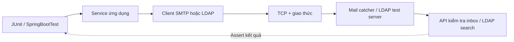
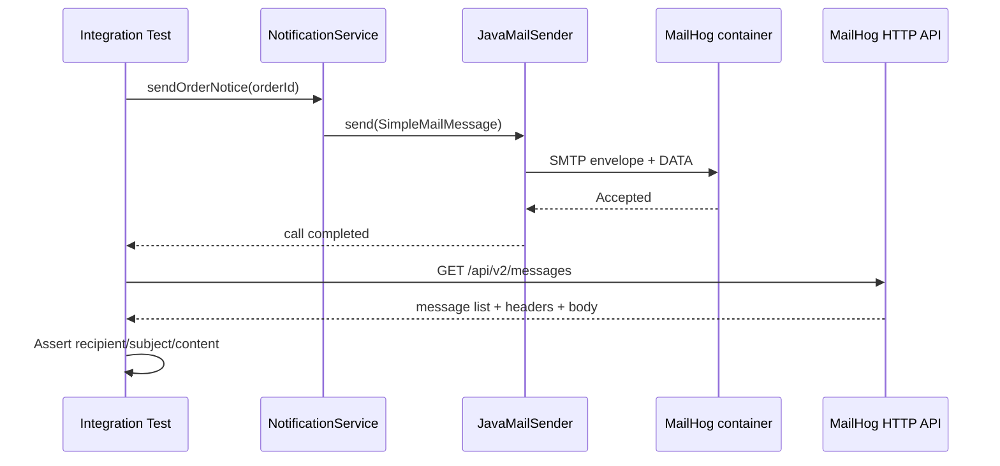
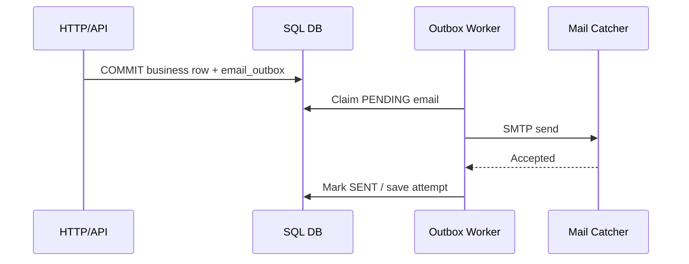
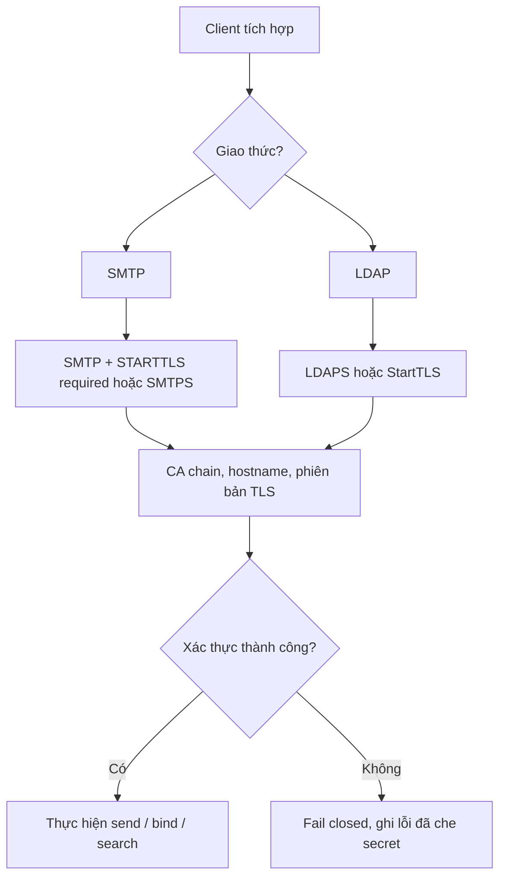
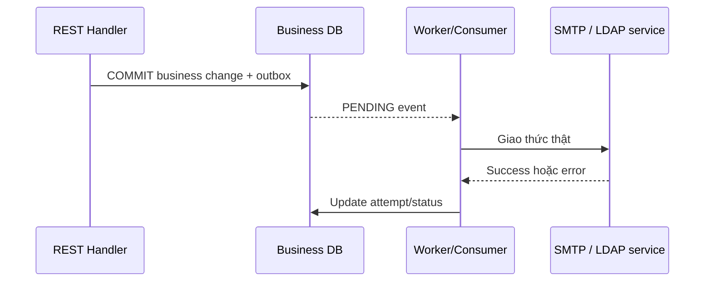

# Kiểm thử mail hoặc LDAP bằng dịch vụ tách biệt

Một ứng dụng Spring Boot có thể chạy hoàn hảo trong unit test nhưng thất bại ngay khi gửi email qua SMTP hoặc tìm người dùng trên LDAP. Mock `JavaMailSender` không phát hiện sai host/port, lỗi SMTP authentication, encoding tiêu đề hoặc thiếu STARTTLS. Mock `LdapTemplate` cũng không chứng minh rằng DN tìm kiếm đúng, tài khoản bind đủ quyền hay directory trả về tập thuộc tính theo hợp đồng. Các lỗi này chỉ xuất hiện khi ứng dụng **giao tiếp với một dịch vụ thực sự hiểu giao thức**.

Bài thuộc chương **Kiểm thử tích hợp** của mô-đun **SPRING_BOOT_INTEGRATION**: tổ chức tích hợp Spring Boot với HTTP client, cơ sở dữ liệu, cache, message broker và adapter Spring Integration, tập trung vào cấu hình, hợp đồng dữ liệu, giao dịch, lỗi, xử lý trùng lặp, kiểm thử và quan sát. Tại đây, chúng ta thiết kế kiểm thử để **SMTP server hoặc LDAP directory chạy tách biệt khỏi logic ứng dụng**, thường trong một container riêng có vòng đời do test quản lý. Cách tiếp cận này kiểm tra đường mạng và giao thức thật trong môi trường kiểm soát được, đồng thời tránh gửi thư hoặc sửa danh bạ của doanh nghiệp.

Sau bài này, bạn có thể:

- Chọn mock, fake/embedded server, container dịch vụ cô lập và môi trường staging đúng mức tin cậy cần kiểm chứng.
- Viết integration test gửi thư qua SMTP đến một mail catcher, đọc lại thư qua API kiểm thử, kiểm tra recipient, subject, body và chống gửi trùng.
- Viết integration test kết nối LDAP, tạo dữ liệu LDIF/entry thử nghiệm, kiểm tra search/filter, bind xác thực và các lỗi thường gặp.
- Cấp cấu hình endpoint động bằng `@DynamicPropertySource`, quản lý vòng đời và trạng thái test để chạy ổn trên CI, không phụ thuộc cổng cố định.
- Kiểm tra timeout, TLS, quyền truy cập, retry, idempotency, dữ liệu nhạy cảm và các ranh giới mà dịch vụ mô phỏng chưa thể chứng minh.

> **Phiên bản ví dụ:** Spring Boot 3.x, Spring Framework 6.x, JUnit Jupiter, Testcontainers và các starter mail/LDAP thường dùng. Ý tưởng vẫn áp dụng cho các bản tương thích mới hơn, nhưng phiên bản artifact/image và API cụ thể cần khớp BOM của dự án. Trong mã ví dụ, host, domain và tài khoản đều là dữ liệu thử nghiệm; hình thức triển khai production có thể khác.

## 1. Kiểm thử một tích hợp là kiểm thử điều gì?

### 1.1. Ranh giới hợp đồng



Bài kiểm thử tích hợp phải đi qua ít nhất các ranh giới có nguy cơ cấu hình sai:

1. Spring Boot tạo đúng bean client từ cấu hình thực tế.
2. Client mở kết nối tới endpoint đang nghe ở địa chỉ và cổng do môi trường test cấp.
3. Client thực hiện thao tác giao thức thật: SMTP `MAIL FROM`, `RCPT TO`, `DATA`; hoặc LDAP bind/search.
4. Test quan sát được hiệu ứng tại phía dịch vụ kiểm thử, thay vì chỉ xác minh một mock được gọi.
5. Khi giao thức trả lỗi, ứng dụng phân loại và xử lý đúng: retry có giới hạn, thông báo lỗi, cập nhật trạng thái công việc hoặc kết thúc an toàn.

Một mail catcher cho thấy SMTP server **đã nhận bản tin**; điều đó chưa chứng minh mailbox Internet đã nhận thư hoặc SPF/DKIM/DMARC hoạt động. Một OpenLDAP container cho thấy ứng dụng nói được LDAP với server kiểm thử; điều đó chưa chứng minh mọi đặc tính của Microsoft Active Directory hay dịch vụ LDAP quản lý của doanh nghiệp.

### 1.2. So sánh các mức kiểm thử

| Mức | Mail | LDAP | Có thể chứng minh | Không chứng minh |
|---|---|---|---|---|
| Unit test với mock | `verify(sender).send(...)` | Mock `LdapTemplate.search` | Logic tạo message/filter, nhánh lỗi do mock mô phỏng | TCP, SMTP/LDAP protocol, authentication, TLS |
| Fake/embedded server trong JVM | GreenMail/Wiser | Embedded LDAP/UnboundID | Phần đáng kể của protocol và mapping | Ranh giới tiến trình/container; một số hành vi vendor |
| Dịch vụ container cô lập | MailHog/Mailpit hoặc SMTP test server | OpenLDAP test container | Kết nối mạng, Spring config, giao thức và một phần hành vi server | Toàn bộ quy định, proxy, certificate và policy của production |
| Staging sát production | SMTP relay thật ở sandbox | LDAP/AD test tenant | Kết nối, TLS, policy và schema gần môi trường vận hành | Bảo đảm production sẽ không bao giờ đổi cấu hình |

Không cần đặt mọi kiểm thử lên môi trường staging thật. Phần lớn test phải chạy lặp lại nhanh và độc lập trên CI. Chọn một số ít bài kiểm tra tương thích với nhà cung cấp thật cho những tính năng mà container không mô phỏng chính xác.

### 1.3. “Dịch vụ tách biệt” cần những tính chất nào?

- **Không dùng hạ tầng production**: không gửi tới relay SMTP thật của doanh nghiệp, không bind vào directory chứa người dùng thật.
- **Dữ liệu độc lập**: địa chỉ `@example.invalid`, DN `dc=example,dc=org`, tài khoản và secret giả; mỗi test suite có fixture rõ ràng.
- **Vòng đời tái lập**: khởi động trước Spring context, dừng sau suite; image được pin version.
- **Network thật**: container lắng nghe cổng riêng, host/port được inject vào client dưới test.
- **Quan sát được**: có inbox API, LDAP search hoặc truy vấn tương đương để assert hiệu ứng sau thao tác.
- **Có đường lỗi**: có thể tắt dịch vụ, đổi credential, gây timeout hoặc áp dụng chứng thư không tin cậy trong môi trường kiểm soát.
- **Không giao thoa test**: reset trạng thái giữa test nếu dùng chung container, hoặc tạo dữ liệu có ID duy nhất.

Với server embedded trong cùng JVM, vẫn có endpoint giao thức riêng để kiểm tra client, nhưng nó không tạo ra cùng mức cô lập tiến trình như container. Quyết định dựa trên mục tiêu test.

## 2. Thiết lập dự án và cấu hình Spring Boot

### 2.1. Các dependency liên quan

Ví dụ Gradle Kotlin DSL cho ứng dụng cần SMTP và LDAP:

```kotlin
dependencies {
    implementation("org.springframework.boot:spring-boot-starter-mail")
    implementation("org.springframework.boot:spring-boot-starter-data-ldap")
    implementation("org.springframework.boot:spring-boot-starter-actuator")

    testImplementation("org.springframework.boot:spring-boot-starter-test")
    testImplementation("org.testcontainers:junit-jupiter")
    testImplementation("org.awaitility:awaitility")
}
```

Ngoài các dependency trên, Testcontainers cần runtime Docker/OCI container tương thích trên máy developer hoặc CI. Sử dụng Spring Boot BOM hoặc dependency management của dự án để đồng bộ version. `GenericContainer` không đòi hỏi một Testcontainers module chuyên biệt riêng cho SMTP hay LDAP.

Nếu service chỉ dùng mail, không cần phụ thuộc LDAP; nếu chỉ dùng directory, không cần mail. Ở đây ghép hai loại vì chủ đề bài học là hai dạng tích hợp có cùng chiến lược **kiểm thử qua dịch vụ riêng**.

### 2.2. Profile và externalized configuration

Cấu hình bên production phải do môi trường triển khai quản lý, ví dụ:

```yaml
# application.yml — cấu hình minh họa, không dùng cho CI test
spring:
  mail:
    host: ${SMTP_HOST}
    port: ${SMTP_PORT}
    username: ${SMTP_USERNAME}
    password: ${SMTP_PASSWORD}
    properties:
      mail.smtp.auth: true
      mail.smtp.starttls.enable: true
      mail.smtp.starttls.required: true
      mail.smtp.connectiontimeout: 5000
      mail.smtp.timeout: 5000
      mail.smtp.writetimeout: 5000

  ldap:
    urls: ${LDAP_URL}
    base: dc=corp,dc=example
    username: ${LDAP_BIND_DN}
    password: ${LDAP_BIND_PASSWORD}
```

Đây là cấu hình minh họa cho **SMTP có STARTTLS** và LDAP URL do môi trường cung cấp. Giá trị có thể khác khi dùng SMTPS (implicit TLS), LDAP over TLS (`ldaps://`) hoặc StartTLS LDAP. Không bật/tắt TLS bằng cách chép cấu hình SMTP sang LDAP: hai giao thức có quy tắc khác nhau.

Test nên ghi đè endpoint bằng `@DynamicPropertySource` thay vì hardcode `localhost:25`, `localhost:389` hoặc sửa file cấu hình nguồn mỗi lần chạy. Credential trong test container là dữ liệu giả; credential production không được đưa vào repository hay log.

### 2.3. Hai lưu ý với `@SpringBootTest`

`@SpringBootTest` khởi tạo Spring application context và có thể khởi chạy listener/scheduler/batch job của ứng dụng. Khi chỉ kiểm tra mail/LDAP, hãy chủ động vô hiệu hóa những startup job không liên quan hoặc tải một context được giới hạn. Nếu giữ toàn bộ context, phải đảm bảo bất kỳ consumer, retry worker hay publisher nào cũng không gửi dữ liệu đến hệ thống thật.

Ngược lại, một test chỉ tạo thủ công `JavaMailSenderImpl` và gọi trực tiếp nó có thể không bắt được lỗi auto-configuration, profile hoặc property binding của Spring Boot. Vì thế các ví dụ dưới đây dùng bean Spring thật và override host/port bằng property động.

## 3. Kiểm thử SMTP bằng mail catcher chạy trong container

### 3.1. Vì sao dùng mail catcher?

MailHog hoặc Mailpit là SMTP server dành cho phát triển/kiểm thử. Chúng nhận thư qua cổng SMTP và cho test truy vấn mailbox qua một HTTP API hoặc giao diện quản trị. Thư được giữ trong môi trường thử, không cần chuyển đến hòm thư Internet của người nhận.



**Quy tắc quan trọng:** kiểm tra thư **thật sự xuất hiện ở mail catcher**, không chỉ `verify(sender).send(...)`. Nếu gửi thư từ queue hoặc outbox worker bất đồng bộ, test phải đợi kết quả với timeout hữu hạn.

### 3.2. Service ứng dụng tối giản

```java
package example.integration.mail;

import org.springframework.mail.SimpleMailMessage;
import org.springframework.mail.javamail.JavaMailSender;
import org.springframework.stereotype.Service;

@Service
public class OrderNotificationService {

    private final JavaMailSender sender;

    public OrderNotificationService(JavaMailSender sender) {
        this.sender = sender;
    }

    public void sendOrderNotice(String orderId, String recipient) {
        SimpleMailMessage message = new SimpleMailMessage();
        message.setFrom("no-reply@example.invalid");
        message.setTo(recipient);
        message.setSubject("Order received");
        message.setText("Order " + orderId + " was accepted.");
        sender.send(message);
    }
}
```

Ở production, `recipient` phải được lấy từ dữ liệu đã validate/được phép gửi, và nghiệp vụ cần định nghĩa rõ tại thời điểm nào thư được phát. Với ví dụ này, method gọi SMTP đồng bộ; khi `send()` trả về, server SMTP kiểm thử đã chấp nhận message theo giao thức, **chưa chứng minh người nhận đã đọc được email**.

### 3.3. Testcontainers với MailHog và cổng động

Ví dụ JUnit 5. Pin image vào version cụ thể và sử dụng Docker network/runtime phù hợp cho CI. Cổng `1025` là SMTP và `8025` là API/Web UI của MailHog trong container.

```java
package example.integration.mail;

import static org.assertj.core.api.Assertions.assertThat;
import static org.awaitility.Awaitility.await;

import java.net.URI;
import java.net.http.HttpClient;
import java.net.http.HttpRequest;
import java.net.http.HttpResponse;
import java.time.Duration;

import com.fasterxml.jackson.databind.JsonNode;
import com.fasterxml.jackson.databind.ObjectMapper;

import org.junit.jupiter.api.Test;
import org.junit.jupiter.api.TestInstance;
import org.springframework.beans.factory.annotation.Autowired;
import org.springframework.boot.test.context.SpringBootTest;
import org.springframework.test.context.DynamicPropertyRegistry;
import org.springframework.test.context.DynamicPropertySource;
import org.testcontainers.containers.GenericContainer;
import org.testcontainers.junit.jupiter.Container;
import org.testcontainers.junit.jupiter.Testcontainers;
import org.testcontainers.utility.DockerImageName;
import org.testcontainers.containers.wait.strategy.Wait;

@SpringBootTest
@Testcontainers
class OrderNotificationSmtpIT {

    @Container
    static final GenericContainer<?> mailhog =
            new GenericContainer<>(
                    DockerImageName.parse("mailhog/mailhog:v1.0.1"))
                .withExposedPorts(1025, 8025)
                .waitingFor(
                    Wait.forHttp("/api/v2/messages")
                        .forPort(8025)
                        .forStatusCode(200));

    @DynamicPropertySource
    static void mailProperties(DynamicPropertyRegistry properties) {
        properties.add("spring.mail.host", mailhog::getHost);
        properties.add(
                "spring.mail.port",
                () -> mailhog.getMappedPort(1025));
        properties.add("spring.mail.properties.mail.smtp.auth",
                () -> "false");
        properties.add("spring.mail.properties.mail.smtp.starttls.enable",
                () -> "false");
        properties.add("spring.mail.properties.mail.smtp.starttls.required",
                () -> "false");
    }

    @Autowired
    OrderNotificationService notifications;

    private final HttpClient http = HttpClient.newHttpClient();
    private final ObjectMapper json = new ObjectMapper();

    @Test
    void submitsExpectedMessageToIsolatedSmtp() {
        notifications.sendOrderNotice(
                "ORD-1042", "qa-recipient@example.invalid");

        await().atMost(Duration.ofSeconds(10)).untilAsserted(() -> {
            JsonNode response = mailhogMessages();
            assertThat(response.path("total").asInt()).isEqualTo(1);

            JsonNode message = response.path("items").get(0);
            JsonNode headers = message.path("Content").path("Headers");

            assertThat(headers.path("To").toString())
                    .contains("qa-recipient@example.invalid");
            assertThat(headers.path("Subject").toString())
                    .contains("Order received");
            assertThat(message.path("Content").path("Body").asText())
                    .contains("ORD-1042");
        });
    }

    private JsonNode mailhogMessages() throws Exception {
        URI endpoint = URI.create(
                "http://" + mailhog.getHost() + ":"
                + mailhog.getMappedPort(8025)
                + "/api/v2/messages");

        HttpRequest request = HttpRequest.newBuilder(endpoint)
                .timeout(Duration.ofSeconds(3))
                .GET()
                .build();

        HttpResponse<String> response = http.send(
                request, HttpResponse.BodyHandlers.ofString());

        assertThat(response.statusCode()).isEqualTo(200);
        return json.readTree(response.body());
    }
}
```

Một số ghi chú thực thi:

- `@Testcontainers` và `@Container` khởi động/dừng container cho lớp test. Testcontainers map cổng container sang **cổng host ngẫu nhiên**, do đó không xung đột với SMTP/LDAP đã chạy trên máy developer.
- `@DynamicPropertySource` được Spring Test dùng khi khởi tạo context; bean `JavaMailSender` nhận đúng endpoint MailHog. Testcontainers JUnit extension bảo đảm container được start trước khi Spring context cần property trong cấu hình thông thường.
- MailHog ở ví dụ nhận **plain SMTP không authentication/TLS**, phù hợp kiểm tra nội dung và cấu hình đường gửi trong sandbox. Nó **không kiểm thử cấu hình production STARTTLS/auth**; cần test riêng bằng dịch vụ có hỗ trợ tính năng đó.
- HTTP API `/api/v2/messages` và cấu trúc JSON ở trên dành cho **MailHog**; nếu đổi sang Mailpit thì phải dùng API/schema của Mailpit.
- `await()` giới hạn thời gian chờ, phù hợp khi gửi thư qua async worker. Không gọi `Thread.sleep(...)` cố định để “đợi email đến”.
- Bài test trên giả định **mailbox ban đầu trống và chỉ có một test dùng container**. Nếu suite có nhiều bài test dùng chung MailHog, phải xóa inbox giữa test hoặc lọc theo một `messageId`/correlation ID duy nhất; tránh assert tổng số message bằng 1 ở mailbox dùng chung.

Khi dùng thư HTML, attachment hoặc nhiều địa chỉ, cần assert MIME thực tế: `Content-Type`, multipart, tên/loại attachment, charset, header `To/Cc/Bcc` và encoding Unicode. Đặc biệt `Bcc` không nên xuất hiện ở header mà người nhận thấy, mặc dù có thể hiện diện trong SMTP envelope recipients.

### 3.4. Đừng để cú pháp kiểm thử che mất semantics email

Gửi qua SMTP thành công thường chỉ có nghĩa mail server đã **accept**. Delivery tới địa chỉ Internet còn phụ thuộc relay, DNS, spam policy, TLS giữa các hop, quota và bounce. Vì vậy nên đặt tên test kiểu `submitsToSmtp` hoặc `smtpAcceptsMessage`, không đặt `deliversToCustomerInbox` khi test chỉ truy vấn MailHog.

Các lớp xử lý email thực tế có thể cần ba trạng thái: `PENDING` (cần gửi), `ACCEPTED_BY_SMTP` (server nhận), `DELIVERED/BOUNCED` (nếu có provider webhook đáng tin). Không đồng nhất các trạng thái trong metric hay thông báo nghiệp vụ.

## 4. Kiểm thử những điều SMTP có thể thất bại

### 4.1. Ma trận ca quan trọng

| Tình huống | Thiết lập dịch vụ thử | Hành vi cần kiểm tra |
|---|---|---|
| Gửi plain text thành công | SMTP accept | Đúng recipient, subject, body; ứng dụng ghi trạng thái tương ứng |
| Không kết nối được SMTP | Dừng service hoặc chặn port trong test có kiểm soát | Timeout hữu hạn, log có phân loại, không treo request vô thời hạn |
| Sai username/password | SMTP test server bật AUTH và trả lỗi auth | Không retry vô hạn với credential sai, không log password |
| STARTTLS bắt buộc nhưng không khả dụng | Server không hỗ trợ STARTTLS | Client từ chối fallback gửi plaintext khi yêu cầu TLS |
| Chứng thư sai CA/hostname | SMTP hỗ trợ TLS với fixture chứng thư không hợp lệ | TLS handshake thất bại; không tắt verify để làm test “xanh” |
| SMTP 4xx tạm thời | Server giả lập 421/450/451 phù hợp | Retry có backoff và giới hạn; không tạo bão gửi |
| SMTP 5xx vĩnh viễn | Server giả lập 550/553 phù hợp | Phân loại lỗi không hồi phục, đưa vào dead-letter/review nếu cần |
| Thư HTML/multipart | SMTP catcher giữ MIME | Header, charset UTF-8, link, attachment và boundary chính xác |
| Retry sau timeout không rõ kết quả | Server có thể đã nhận nhưng client mất phản hồi | Định danh gửi, xử lý duplicate và đối soát theo hợp đồng |

MailHog phù hợp tốt với **happy path và inspect nội dung**. Nó không tự mô phỏng mọi kiểu SMTP 4xx/5xx, AUTH/STARTTLS hoặc lỗi ở thời điểm bất kỳ. Có thể dùng GreenMail (hỗ trợ nhiều chế độ SMTP/POP3/IMAP) hoặc một programmable SMTP test server/proxy có điều khiển phản hồi để kiểm thử tiêu cực. Hãy chọn công cụ có khả năng thật sự tái hiện lỗi cần thử, không ép MailHog làm điều nó không hỗ trợ.

### 4.2. Timeout và retry

```yaml
spring:
  mail:
    properties:
      mail.smtp.connectiontimeout: 3000
      mail.smtp.timeout: 3000
      mail.smtp.writetimeout: 3000
```

Các giá trị trên là ví dụ mili giây dành cho Jakarta Mail SMTP provider tương thích. Chúng giới hạn các thao tác khác nhau: thiết lập kết nối, chờ đọc phản hồi và ghi. Khi kiểm thử timeout, cần tạo sự cố thật qua network proxy/fault injection để xác nhận timeout được thực thi; test chỉ đặt property rồi assert chuỗi cấu hình chưa đủ.

Các nguyên tắc retry:

- Lỗi mạng/SMTP 4xx thường **có thể** retry; nhưng phải có giới hạn lần và backoff.
- Credential sai, cấu hình TLS sai hoặc địa chỉ không hợp lệ thường cần sửa cấu hình/dữ liệu, không retry liên tục.
- Khi mất phản hồi sau `DATA`, client không thể biết chắc server đã nhận hay chưa; retry có thể tạo **email trùng**. Có thể giảm trùng bằng outbox và khóa công việc ở phía ứng dụng, nhưng SMTP không cung cấp exactly-once delivery end-to-end.
- Nếu gửi sau một giao dịch SQL, dùng outbox hoặc sau-commit mechanism phù hợp; không gọi SMTP trong transaction dài rồi mặc định ngoại lệ SMTP rollback được email đã gửi.

### 4.3. Kiểm thử gửi qua outbox

Luồng tích hợp phổ biến:



Kiểm thử nên xác nhận:

1. Rollback giao dịch nghiệp vụ **không tạo outbox record để gửi**.
2. Commit nghiệp vụ tạo đúng một job gửi logic cho cùng `eventId`/idempotency key.
3. Worker lấy bản ghi, gửi qua SMTP catcher và đổi trạng thái có điều kiện.
4. Khi SMTP trả lỗi, trạng thái vẫn còn retryable hoặc chuyển dead-letter theo chính sách.
5. Khi worker chết sau SMTP accept nhưng trước cập nhật DB, hệ thống không mất yêu cầu, đồng thời có chiến lược chấp nhận/giảm duplicate.

Không thể chỉ assert `email_outbox.status=SENT` rồi kết luận server SMTP đã nhận; kiểm tra mail catcher song song để quan sát hiệu ứng thật.

## 5. LDAP: những hành vi khó bắt bằng mock

### 5.1. LDAP không phải một “bảng users”

LDAP tổ chức entry theo cây Distinguished Name (DN), có object class, attribute, search base/scope/filter và quy tắc bind. Ví dụ:

```text
dc=example,dc=org
└── ou=people
    ├── uid=alice,ou=people,dc=example,dc=org
    └── uid=bob,ou=people,dc=example,dc=org
```

Ứng dụng có thể dùng một **service account** để tìm entry, sau đó bind với DN của người dùng để xác minh password; hoặc dùng cơ chế authentication khác theo directory vendor. Sai cấu hình thường gặp:

- `spring.ldap.base` sai nên search rỗng hoặc `No such object`.
- Search filter không khớp schema (ví dụ `uid` trên OpenLDAP khác `sAMAccountName` trong AD).
- Bind DN đúng nhưng thiếu quyền xem một attribute; kết quả khác với mock.
- Tên DN có dấu phẩy, dấu bằng, ký tự Unicode hoặc dấu gạch chéo cần escaping đúng.
- Search scope một level/subtree không khớp cấu trúc directory.
- TLS CA/hostname sai, server yêu cầu LDAPS hoặc StartTLS.
- LDAP referral/pagination/limit hoặc schema policy của vendor làm search khác hành vi đơn giản.

Cần kiểm tra **đúng client Spring LDAP mà ứng dụng dùng**, thay vì chỉ gọi trực tiếp một LDAP SDK không đi qua cấu hình Bean thực tế.

### 5.2. Tập dữ liệu mẫu dạng LDIF

```ldif
dn: ou=people,dc=example,dc=org
objectClass: top
objectClass: organizationalUnit
ou: people

dn: uid=alice,ou=people,dc=example,dc=org
objectClass: top
objectClass: person
objectClass: organizationalPerson
objectClass: inetOrgPerson
uid: alice
cn: Alice Example
sn: Example
mail: alice@example.invalid
userPassword: test-secret
```

Dữ liệu trên chỉ dành cho môi trường kiểm thử. Không copy account thật/secret thật vào fixture và không giả định `userPassword` cleartext là cách lưu production. LDAP test server có thể hỗ trợ đặt password demo trực tiếp, nhưng directory thật thường lưu hash hoặc quản lý password bằng cơ chế riêng.

Dùng LDIF để seed nhiều tài khoản có thể tiện hơn seed bằng code khi fixture lớn; tuy nhiên cần cơ chế bootstrap cụ thể của image. Phần sau minh họa seed trực tiếp bằng `LdapTemplate` để test tự chứa và không cần thêm tệp fixture ngoài hai tệp bài học.

## 6. Chạy LDAP server cô lập bằng Testcontainers

### 6.1. Cấu hình OpenLDAP riêng cho test

Một lựa chọn phổ biến là container OpenLDAP dùng domain giả `example.org`. Ví dụ image `osixia/openldap:1.5.0` được pin version trong bài; dự án thật có thể dùng image được bảo trì phù hợp với kiến trúc CPU/CI. Kiểm tra chính sách bảo mật và tình trạng bảo trì trước khi áp dụng.

```java
package example.integration.ldap;

import static org.assertj.core.api.Assertions.assertThat;
import static org.springframework.ldap.query.LdapQueryBuilder.query;

import java.util.List;

import javax.naming.directory.Attributes;
import javax.naming.directory.BasicAttribute;
import javax.naming.directory.BasicAttributes;

import org.junit.jupiter.api.Test;
import org.springframework.beans.factory.annotation.Autowired;
import org.springframework.boot.test.context.SpringBootTest;
import org.springframework.ldap.core.AttributesMapper;
import org.springframework.ldap.core.LdapTemplate;
import org.springframework.test.context.DynamicPropertyRegistry;
import org.springframework.test.context.DynamicPropertySource;
import org.testcontainers.containers.GenericContainer;
import org.testcontainers.containers.wait.strategy.Wait;
import org.testcontainers.junit.jupiter.Container;
import org.testcontainers.junit.jupiter.Testcontainers;
import org.testcontainers.utility.DockerImageName;

@SpringBootTest(properties = {
        "spring.ldap.base=dc=example,dc=org",
        "spring.ldap.username=cn=admin,dc=example,dc=org",
        "spring.ldap.password=admin-test-secret"
})
@Testcontainers
class LdapDirectoryIT {

    @Container
    static final GenericContainer<?> ldap =
            new GenericContainer<>(
                    DockerImageName.parse("osixia/openldap:1.5.0"))
                .withEnv("LDAP_ORGANISATION", "Example Org")
                .withEnv("LDAP_DOMAIN", "example.org")
                .withEnv("LDAP_ADMIN_PASSWORD", "admin-test-secret")
                .withExposedPorts(389)
                .waitingFor(Wait.forListeningPort());

    @DynamicPropertySource
    static void directoryProperties(
            DynamicPropertyRegistry properties) {
        properties.add("spring.ldap.urls",
                () -> "ldap://" + ldap.getHost()
                      + ":" + ldap.getMappedPort(389));
    }

    @Autowired
    LdapTemplate ldapTemplate;

    @Test
    void searchesAndAuthenticatesAgainstDirectory() {
        // Spring LDAP ghép DN tương đối với base dc=example,dc=org.
        ldapTemplate.bind(
                "ou=people", null, organizationalUnit("people"));

        ldapTemplate.bind(
                "uid=alice,ou=people", null, aliceAttributes());

        List<String> emails = ldapTemplate.search(
                query().base("ou=people")
                       .where("uid").is("alice"),
                (AttributesMapper<String>) attrs ->
                        (String) attrs.get("mail").get());

        assertThat(emails)
                .containsExactly("alice@example.invalid");

        assertThat(ldapTemplate.authenticate(
                "ou=people", "(uid=alice)", "test-secret"))
                .isTrue();

        assertThat(ldapTemplate.authenticate(
                "ou=people", "(uid=alice)", "wrong-secret"))
                .isFalse();
    }

    private static Attributes organizationalUnit(String ou) {
        BasicAttributes attributes = new BasicAttributes(true);
        BasicAttribute classes = new BasicAttribute("objectClass");
        classes.add("top");
        classes.add("organizationalUnit");
        attributes.put(classes);
        attributes.put("ou", ou);
        return attributes;
    }

    private static Attributes aliceAttributes() {
        BasicAttributes attributes = new BasicAttributes(true);
        BasicAttribute classes = new BasicAttribute("objectClass");
        classes.add("top");
        classes.add("person");
        classes.add("organizationalPerson");
        classes.add("inetOrgPerson");
        attributes.put(classes);
        attributes.put("uid", "alice");
        attributes.put("cn", "Alice Example");
        attributes.put("sn", "Example");
        attributes.put("mail", "alice@example.invalid");
        attributes.put("userPassword", "test-secret");
        return attributes;
    }
}
```

Đoạn test dùng `LdapTemplate` do Spring Boot cấu hình từ `spring.ldap.*` và test một đường search/bind thật. Không cần mock `LdapTemplate` hay cố tạo bản sao của LDAP logic bằng Java.

**Giới hạn cần nhớ:**

- Cổng `389` ở đây là LDAP plaintext **trong container cô lập**. Không áp dụng mô hình plaintext/credential của test cho production. Đường TLS (`ldaps://` hoặc StartTLS) phải được kiểm thử riêng với chứng thư/truststore phù hợp.
- Image có thể cần thời gian khởi tạo schema/base DN sau khi mở cổng. `Wait.forListeningPort()` kiểm tra port đang lắng nghe, **chưa khẳng định LDAP đã sẵn sàng để bind**. CI cần readiness check dựa trên bind/search (hoặc retry ngắn có giới hạn) nếu quan sát thấy race lúc startup.
- Việc seed trong test dùng quyền admin để dễ trình bày; phần code ứng dụng production nên dùng service account với quyền tối thiểu. Kiểm thử riêng chính sách quyền đọc/ghi nếu có yêu cầu.
- Test này chỉ nên chạy trong directory mới của lớp test. Nếu dùng lại container hoặc chạy test song song trên cùng base DN, `bind("ou=people")` lần hai có thể lỗi `entryAlreadyExists`. Khi đó phải reset dataset hoặc dùng OU riêng cho từng test.

### 6.2. Cách assert được nghiệp vụ của ứng dụng

Bài test trên xác minh hoạt động `LdapTemplate`. Đối với ứng dụng có `DirectoryUserService` riêng, nên gọi **phương thức service thật**, ví dụ:

```java
@Service
public class DirectoryUserService {
    private final LdapTemplate ldap;

    public DirectoryUserService(LdapTemplate ldap) {
        this.ldap = ldap;
    }

    public String findEmailByUid(String uid) {
        List<String> emails = ldap.search(
                query().base("ou=people").where("uid").is(uid),
                (AttributesMapper<String>) attributes ->
                        (String) attributes.get("mail").get());

        return emails.stream()
                .findFirst()
                .orElseThrow(() ->
                        new IllegalArgumentException("Unknown user"));
    }
}
```

Ví dụ cần các import `org.springframework.stereotype.Service`, `org.springframework.ldap.core.LdapTemplate`, `org.springframework.ldap.core.AttributesMapper`, `java.util.List` và static `LdapQueryBuilder.query`. Lợi ích của API query builder là xây filter bằng giá trị đã được escape đúng theo thư viện, thay vì nối chuỗi `"(uid=" + userInput + ")"` có nguy cơ LDAP injection.

Trong dự án thật, nên định nghĩa cách xử lý nhiều bản ghi trùng UID, attribute thiếu/null, Unicode, alias, referral và limit; nếu hợp đồng yêu cầu UID duy nhất, kiểm thử cả trường hợp trả nhiều kết quả thay vì âm thầm lấy phần tử đầu.

## 7. Kiểm thử LDAP các đường lỗi quan trọng

### 7.1. Ma trận negative test

| Tình huống | Dữ liệu/cấu hình | Hành vi cần chứng minh |
|---|---|---|
| Tài khoản hợp lệ | Entry, password đúng | Bind thành công; search trả đúng thuộc tính được cấp quyền |
| Password sai | Password giả không khớp | Authentication thất bại, không log password |
| Người dùng không tồn tại | UID chưa được seed | Trả `not found` hoặc auth thất bại theo API, không tiết lộ danh sách người dùng |
| Base DN sai | Base nằm ngoài cây | Lỗi hoặc không có kết quả theo cách thư viện xử lý, được phân loại |
| Thiếu attribute | Entry không có `mail` | Mapping không bị `NullPointerException` ngoài kiểm soát |
| Search filter có ký tự đặc biệt | UID chứa `*`, `(`, `)`, `\` | Không biến dữ liệu thành cú pháp LDAP filter ngoài ý muốn |
| Account bị khóa / hết hạn | Directory hỗ trợ policy tương ứng | Ứng dụng tuân thủ chính sách hoặc trả lỗi thích hợp |
| Server không kết nối được | Stop container/chặn network có kiểm soát | Timeout hữu hạn, phân loại `directory unavailable` |
| Referral / pagination | Directory có dữ liệu lớn và referral | Không bỏ sót user theo contract; xử lý giới hạn đúng |
| LDAPS CA hoặc hostname sai | Chứng thư test không tin cậy | Client từ chối xác minh TLS thay vì tự bỏ qua certificate check |

OpenLDAP container cơ bản không tự phản ánh đầy đủ **AD account lockout, group nesting, nested membership, paging/control, bind authorization** hay referral policy. Những hành vi phụ thuộc vendor phải được kiểm thử trong môi trường directory sandbox gần production.

### 7.2. Không nối chuỗi filter từ input

Tránh code kiểu:

```java
// Nguy hiểm: dữ liệu người dùng có thể trở thành cú pháp LDAP filter.
String filter = "(uid=" + userProvidedUid + ")";
```

Một cách an toàn hơn:

```java
List<String> emails = ldapTemplate.search(
        query().base("ou=people")
               .where("uid").is(userProvidedUid),
        (AttributesMapper<String>) attrs ->
                (String) attrs.get("mail").get());
```

Spring LDAP query builder thực hiện escaping filter value theo cơ chế thư viện. Cần phân biệt **escaping filter value** với **escaping DN component**: nếu tạo DN, dùng `LdapNameBuilder` hoặc API `javax.naming.ldap.LdapName` thay vì tự ghép dấu phẩy và dấu bằng. Còn nếu identifier chưa được xác thực hợp lệ theo hợp đồng nghiệp vụ, escaping không thay thế validation.

### 7.3. Bind và search là hai bước có thể có hai quyền khác nhau

Một mẫu xác thực phổ biến:

1. Service account bind bằng secret cấp riêng.
2. Search user theo `uid` hoặc `sAMAccountName`, lấy DN chính xác.
3. Bind với DN người dùng và password do người dùng cung cấp.
4. Chỉ sau khi xác thực thành công mới chuyển sang lấy group/role theo chính sách.

Do đó test “search thành công” chưa đủ để chứng minh “login thành công”. Test nên có cả đường search và bind, đồng thời kiểm tra rằng service account **không** có quyền ngoài phạm vi cần thiết trong môi trường kiểm thử quyền.

Tránh kết luận “không thấy user” từ một directory mà service account không có quyền xem entry; phân biệt lỗi truy cập, không tồn tại và kết quả filter sai theo API/exception thực tế.

## 8. Chứng thư, TLS và cấu hình bảo mật

### 8.1. Hai đường TLS cần kiểm thử riêng

**SMTP:**

- STARTTLS: khởi đầu qua SMTP, sau lệnh `STARTTLS` nâng cấp socket sang TLS. Nếu yêu cầu bảo mật, cấu hình “required” để không fallback plaintext.
- SMTPS: implicit TLS ngay từ kết nối; host/port và properties khác với STARTTLS.
- Authentication: tùy relay, cần chứng minh đúng username/password hoặc cơ chế SASL/OAuth2 và TLS tương ứng.

**LDAP:**

- `ldaps://`: TLS ngay khi mở kết nối.
- LDAP StartTLS: mở LDAP thường rồi thực hiện StartTLS theo API phù hợp trước khi bind/gửi secret.
- Truststore/CA và hostname validation phải phù hợp cert server; nếu dùng proxy hoặc DNS alias, SAN của chứng thư cần chứa tên đích mà client kết nối.



### 8.2. Kịch bản TLS âm tính

Dùng server test hỗ trợ TLS, phát chứng thư test có CA riêng và SAN phù hợp host. Kiểm tra:

- Với CA đúng và hostname đúng: kết nối thành công.
- Với CA không được tin cậy: bị từ chối bằng lỗi trust/certificate path.
- Với hostname không khớp SAN: bị từ chối khi hostname verification bật.
- Với chứng thư hết hạn: thất bại đúng loại lỗi.
- Khi server không hỗ trợ phiên bản TLS cho phép: fail có kiểm soát.

Không “sửa” test bằng `trust-all`, `sslmode=disable` hoặc tắt hostname verification trong production. Test container MailHog plain SMTP ở phần trước **không thay thế** các kịch bản TLS này; kết hợp với GreenMail hoặc server phù hợp để tái hiện.

### 8.3. Không rò rỉ thông tin xác thực

- Secret SMTP/LDAP phải đi từ môi trường/secret store và không nằm trong assertion failure output.
- Khi debug JavaMail/LDAP wire protocol, tắt log chi tiết sau khi điều tra; một số trace có thể lộ user, email header hoặc dữ liệu directory.
- Test dùng mailbox giả và domain dành cho kiểm thử; không dùng customer real email để “xem có nhận được không”.
- Đóng hoặc hủy kết nối LDAP sau mỗi operation theo lifecycle của client, nhất là khi dùng context tự quản lý hoặc connection pool.

## 9. Ghép với luồng tích hợp Spring Boot lớn hơn

SMTP và LDAP hiếm khi đứng riêng. Một hệ thống tích hợp có thể:

- HTTP endpoint tạo đơn hàng → lưu SQL → publish event ra broker → consumer gửi email.
- HTTP authentication → bind LDAP/tra group → cache role → kiểm tra quyền truy cập adapter.
- Spring Batch đọc danh sách người dùng từ LDAP → đồng bộ sang SQL → gửi báo cáo SMTP.
- Spring Integration flow nhận message → transform/route → tra LDAP hoặc gửi notification.

### 9.1. Phân biệt ranh giới transaction



Một transaction JDBC không rollback được email đã gửi qua SMTP. Nếu consumer chết sau khi SMTP accept nhưng trước khi commit offset/outbox status, message có thể được xử lý lần hai. Tương tự, response LDAP là dữ liệu đọc tại thời điểm search; không tự đem lại một giao dịch nguyên tử với SQL/Redis.

Do đó trong integration test, cần assert cả **trạng thái nội bộ** lẫn **side effect bên dịch vụ cô lập** khi mục tiêu là độ tin cậy đầu-cuối.

### 9.2. Mail + broker: kiểm thử at-least-once

Ví dụ consumer nhận `OrderPlaced(eventId)` và gửi email:

- Gửi cùng event ID hai lần; app phải áp dụng chính sách dedup hợp lệ nếu hợp đồng yêu cầu một email logic.
- Simulate SMTP accepted nhưng outbox status chưa commit, sau đó worker khởi động lại. Kiểm tra chính sách đối với email có thể gửi trùng.
- Gửi payload không hợp lệ; không đưa vào retry vô hạn và không phát thư chưa được xác thực.
- Khi broker retry/backoff, xác minh không tạo một loạt kết nối SMTP song song gây cạn tài nguyên.

MailHog không giải quyết các bài toán này; nó chỉ cung cấp **bằng chứng đầu ra thực tế** để test kết hợp với database/broker nếu suite có các thành phần đó.

### 9.3. LDAP + cache: kiểm thử dữ liệu cũ và đổi quyền

Nếu role hoặc profile LDAP được cache trong Redis/local cache, test cần xác định:

1. Lần đầu truy vấn LDAP trả attribute/role mong đợi.
2. Lần sau có thể trả từ cache mà không gọi directory theo thiết kế.
3. Khi entry thay đổi hoặc bị vô hiệu hóa, cache được làm mới/hủy theo TTL/invalidations.
4. Nếu LDAP unavailable, policy fail-open/fail-closed phù hợp loại dữ liệu. Với quyết định cấp quyền truy cập nhạy cảm, cần đặc biệt thận trọng với quyền cũ trong cache.

Không dùng bản mock LDAP quá đơn giản để chứng minh các trạng thái này. Test nên seed và sửa entry trong LDAP riêng, đọc lại qua service nghiệp vụ.

## 10. Tính ổn định, song song và môi trường CI

### 10.1. Tránh cổng cố định và phụ thuộc thời gian

Một số anti-pattern:

```text
BAD:  spring.mail.port=1025 hardcode cho mọi CI job
BAD:  Thread.sleep(10000) rồi giả định thư đã tới
BAD:  Test A tạo LDAP user; Test B mặc định user còn tồn tại
BAD:  Dùng chung mailbox; test nào cũng assert total == 1
BAD:  Test kết nối SMTP/LDAP production bằng secret thật
GOOD: Mapped port từ Testcontainers + DynamicPropertySource
GOOD: Await có timeout hữu hạn và điều kiện đầu ra rõ ràng
GOOD: Fixture độc lập, cleanup có kiểm soát, khóa định danh riêng
GOOD: Dịch vụ test riêng, data giả, credential giả
```

Khi chạy song song, có thể chọn mỗi test class một container hoặc chia sẻ container với namespace/fixture riêng và reset trạng thái bắt buộc. Chia sẻ giúp giảm startup cost nhưng khó kiểm soát race và data pollution. Nếu một Spring context được cache giữa hai lớp test trong khi container static của lớp đầu đã dừng, context có thể giữ endpoint cũ. Cần quản lý lifecycle/container scope cho phù hợp, ví dụ test classes độc lập với context riêng hoặc container chia sẻ có vòng đời dài hơn context.

### 10.2. Readiness khác với “container đang chạy”

- MailHog: HTTP API health/list messages trả thành công và cổng SMTP thực sự chấp nhận kết nối.
- LDAP: server đã khởi tạo base DN/schema và bind thành công, không chỉ mở TCP port.
- Nếu container chưa ready, test nên đợi có giới hạn theo tín hiệu dịch vụ. Không tăng timeout vô hạn để che race khởi tạo.
- Khi thất bại trên CI, giữ log container/exception nguyên nhân nhưng mask credential, địa chỉ email và payload nhạy cảm.

Testcontainers sẽ pull image lần đầu, vì thế CI cần runtime container và quyền tải image tương ứng. Pin version hoặc digest giúp test tái lập; nếu cập nhật image, chạy lại kiểm thử hợp đồng để phát hiện thay đổi schema/response.

### 10.3. Dọn dữ liệu và cô lập test

Với mail catcher:

- Xóa mailbox giữa các test nếu server có API hỗ trợ.
- Hoặc mỗi test dùng correlation ID riêng và chỉ assert message thuộc ID đó.
- Không cho nhiều test mutate cùng mailbox trong khi assert count toàn cục nếu chạy parallel.

Với LDAP:

- Seed OU/uid riêng; nếu seed chung, cleanup entry con trước entry cha.
- Khi thay đổi attribute, xác minh state được reset trước test kế tiếp.
- Nếu chạy qua connection pool, test cần dọn/đóng context để tránh giữ session hoặc tham chiếu cũ.
- Không tạo fixture dựa trên wall-clock làm thay đổi ngẫu nhiên business logic; dùng ID của test hoặc clock giả có kiểm soát.

**Dọn dẹp phải phù hợp với isolation.** Testcontainers tự xóa container không thay thế cleanup khi dùng container chia sẻ dài hạn hoặc volume ngoài lưu dữ liệu bền vững.

## 11. Kiểm thử lỗi mạng và tính phục hồi

### 11.1. Ba loại lỗi cần tách

| Nhóm lỗi | SMTP | LDAP | Chính sách thường gặp |
|---|---|---|---|
| Cấu hình | Sai host/port, TLS mismatch | Base DN sai, Bind DN sai | Fail sớm, rõ nguyên nhân, sửa cấu hình |
| Tạm thời | Socket reset, 421/450, timeout | Directory unavailable, network timeout | Retry giới hạn, backoff, circuit breaker nếu phù hợp |
| Dữ liệu/quyền | Recipient bị từ chối vĩnh viễn, body invalid | Invalid credentials, thiếu entry, thiếu quyền | Thông báo hợp đồng rõ ràng; thường không retry vô hạn |

Không gom mọi exception từ `JavaMailSender` hay `LdapTemplate` thành `RuntimeException("integration failed")` không có phân loại. Khi retry, phải biết request có idempotent không. Đặc biệt email là side effect có thể được nhận dù client thấy timeout.

### 11.2. Test fault injection có kiểm soát

Các cách khả thi:

- Chạy một SMTP/LDAP server test có chế độ cố tình trả phản hồi lỗi.
- Đặt network proxy như Toxiproxy trước container để tạo latency, reset connection hoặc timeout.
- Dừng container **trong một test tách biệt**, rồi assert client timeout và cleanup; tránh dừng container đang dùng bởi các test khác.
- Thay đổi secret test để tạo lỗi xác thực, sau đó phục hồi và chứng minh connection mới dùng cấu hình hợp lệ.
- Dùng chứng thư CA/SAN sai trong fixture TLS thay vì sửa truststore toàn JVM theo cách ảnh hưởng test khác.

Khi test resilience, assert hai khía cạnh: **hành vi trả về ứng dụng** (exception/status/retry) và **hệ quả phía dịch vụ** (không gửi sai, không ghi data sai, hoặc có thể đã accept và cần dedup). Thời hạn chờ phải hữu hạn, tránh biến CI thành bài test treo vô thời hạn.

### 11.3. Tránh phụ thuộc thứ tự sự kiện khi async

Nếu event đi qua Kafka/RabbitMQ hoặc Spring Integration `ExecutorChannel`, hai thread có thể xử lý khác thứ tự dự kiến. Hãy assert **điều kiện cuối** với deadline và khóa correlation thay vì assert callback diễn ra trước một timestamp cố định. Cũng không dùng sleep để mô phỏng crash window khi có thể dùng latch/probe hoặc failure hook có kiểm soát.

Một bài test đúng phải tự thất bại khi email không tới trong deadline hoặc LDAP server không trả đúng filter; nó không nên trở nên “xanh” chỉ vì thời gian chờ rất dài.

## 12. Ma trận kiểm thử kết hợp và phạm vi bảo đảm

### 12.1. Test portfolio đề xuất

| Kịch bản | Công cụ | Kỳ vọng |
|---|---|---|
| Mapping `OrderNotice` → email | Unit test mock sender | Đúng subject, template, recipient và nhánh điều kiện |
| Gửi email plain text thật | MailHog Testcontainer | SMTP accept, inbox có message và MIME/header đúng |
| SMTP AUTH + STARTTLS | GreenMail hoặc server test hỗ trợ | Thao tác thành công với CA/auth đúng; thất bại khi cấu hình sai |
| Email retry/outbox | Mail catcher + SQL test DB + worker | Retry và trạng thái outbox đúng, duplicate được xử lý theo chính sách |
| LDAP query + bind | OpenLDAP Testcontainer | DN, filter, mapping, password đúng/sai hoạt động |
| LDAP filter injection | OpenLDAP + giá trị chứa ký tự đặc biệt | Input được escape, không mở rộng search ngoài ý muốn |
| LDAP permission/attribute missing | Fixture directory với account/ACL khác nhau | Ứng dụng phân loại thiếu quyền/dữ liệu |
| LDAPS/StartTLS | Server có TLS fixture | CA/hostname verification không bị bỏ qua |
| AD vendor-specific behavior | Sandbox AD/Directory thật | Group nesting, referral, policy và schema giống môi trường triển khai |
| Mạng chập chờn | Fault proxy + container | Timeout/retry/circuit breaker tuân SLO |

Không cần chạy toàn bộ bài test nặng trên mỗi lần lưu file; có thể tách suite nhanh khi commit và suite tương thích môi trường thật theo pipeline phù hợp. Tuy nhiên đường gửi SMTP và LDAP search/bind căn bản nên được chạy tự động thường xuyên vì đó là hợp đồng tích hợp cốt lõi.

### 12.2. Assertion có giá trị hơn chỉ “không ném exception”

Với SMTP, kiểm tra:

- Từ yêu cầu nghiệp vụ, recipient list và envelope hợp lệ.
- Subject và text/HTML tương ứng, encoding và attachment khi có.
- Không xuất credential/token hoặc dữ liệu nhạy cảm.
- Số thư tương ứng với logic dedup; khi test parallel, lọc theo correlation.
- Khi server reject, trạng thái nội bộ không ghi `SENT` sai.

Với LDAP, kiểm tra:

- Base DN/search scope/filter đúng, không khớp thêm entry không mong muốn.
- Attribute mapping đúng kiểu và trường hợp null.
- Đường bind password đúng và sai đều có kết quả được kiểm soát.
- Phân biệt không tìm thấy user và directory unavailable.
- Không log password/filter thô chứa thông tin riêng; input được escape.

### 12.3. Định nghĩa mức thành công minh bạch

Đừng viết một assertion như `assertThat(result).isTrue()` mà không chỉ ra thành công ở đâu. Một phương thức có thể trả true vì **đã xếp vào queue**, **đã gửi lệnh SMTP**, hoặc **LDAP search trả được entry**. Hãy đặt tên metric, state và test thể hiện đúng ranh giới. Điều này đặc biệt quan trọng khi hệ thống tích hợp thêm database, cache hoặc broker: “request accepted” không đồng nghĩa “side effect ngoài hệ thống đã hoàn tất”.

## 13. Hai tình huống điển hình

### Tình huống A — thông báo xác nhận đơn hàng qua broker và SMTP

**Bối cảnh:** HTTP service lưu đơn hàng, ghi outbox; worker nhận event và gửi email. Unit test pass, production đôi khi mất thư hoặc gửi trùng khi worker restart.

**Thiết kế test:** SQL test database + worker thật + MailHog container. Test tạo một đơn, commit, đợi worker gửi mail và assert inbox. Gây lỗi ở cập nhật `email_outbox.status` sau khi SMTP đã accept, restart worker và xác nhận chính sách retry/duplicate; không giả định SMTP là transactional. Dùng `eventId` để đối chiếu một lần gửi logic, metric thống kê `accepted`, `attempted`, `failed`.

**Bài học:** việc đã gửi đến SMTP catcher là bằng chứng giao thức chấp nhận; độ tin cậy nghiệp vụ còn phụ thuộc outbox, redelivery và idempotency.

### Tình huống B — đăng nhập và tìm quyền nhóm qua LDAP

**Bối cảnh:** service đăng nhập cần kiểm tra password LDAP, tra `mail` và group membership. Test mock `LdapTemplate` luôn trả user, nhưng staging trả 0 kết quả do search base sai và một số tài khoản có DN chứa dấu phẩy.

**Thiết kế test:** OpenLDAP container với OU, user, attribute và filter có Unicode/ký tự đặc biệt; Spring `LdapTemplate` chạy thật với base DN inject động. Test xác minh search, bind đúng/sai và escaping. Với group nesting/AD-specific policy, bổ sung test sandbox AD vì OpenLDAP không mặc định có cùng schema/semantic.

**Bài học:** mock phù hợp để test logic phân quyền thuần, nhưng không thay được kiểm thử DN, bind, ACL và LDAP filter qua directory thật.

## 14. Checklist vận hành và tổng kết

Trước khi đưa bài kiểm thử vào CI, kiểm tra:

- [ ] Endpoint SMTP/LDAP test được cấp qua cấu hình động; không có bí mật hoặc endpoint production trong test.
- [ ] Dịch vụ test thực sự lắng nghe giao thức và sẵn sàng nhận lệnh trước khi context/test bắt đầu.
- [ ] Image được pin version; CI có Docker/runtime thích hợp và lưu được log lỗi.
- [ ] SMTP test assert thư tại server qua API, không dừng ở `verify(send)`.
- [ ] LDAP test assert search và bind, không chỉ assert một mock được gọi.
- [ ] Fixture và mailbox độc lập; các test chạy song song không tranh dữ liệu.
- [ ] Test timeout, auth failure, TLS CA/hostname, lỗi dữ liệu và redelivery theo các ranh giới cần thiết.
- [ ] Dữ liệu nhạy cảm/secret không đi vào log, payload test hoặc metric label cardinality cao.
- [ ] Nếu có outbox/broker/Batch, trạng thái accepted/committed/delivered được phân biệt và test tương ứng.
- [ ] Đã ghi rõ giới hạn mô phỏng: MailHog không phải relay Internet, OpenLDAP không tự tương đương Active Directory.

Khi test thất bại, áp dụng thứ tự chẩn đoán: **Spring property đã bind đúng? → container/service ready? → DNS/port/network? → TLS/auth? → giao thức và schema? → logic ứng dụng? → async timing/retry?** Ghép lỗi client với log dịch vụ test và correlation ID. Không tăng thời gian chờ hoặc tắt TLS ngay khi chưa xác định nguyên nhân.

**Điểm ghi nhớ:** Kiểm thử mail/LDAP bằng dịch vụ tách biệt giúp kiểm tra **hợp đồng qua ranh giới mạng và giao thức**, nơi mock thường bỏ sót lỗi. Nó tạo lòng tin cao hơn cho cấu hình và hành vi tích hợp, nhưng chỉ trong phạm vi các tính năng mà dịch vụ thử nghiệm thực sự hỗ trợ. Thiết kế đúng cần chọn boundary, fixture, TLS, retry, idempotency và các assertion thể hiện chính xác mức thành công.

### Tài liệu để đối chiếu theo phiên bản

- [Spring Boot — Sending Email](https://docs.spring.io/spring-boot/reference/io/email.html).
- [Spring Boot — LDAP](https://docs.spring.io/spring-boot/reference/data/nosql.html#data.nosql.ldap).
- [Spring Framework — DynamicPropertySource](https://docs.spring.io/spring-framework/reference/testing/annotations/integration-spring/annotation-dynamicpropertysource.html).
- [Spring LDAP Reference](https://docs.spring.io/spring-ldap/reference/).
- [Testcontainers — JUnit 5](https://java.testcontainers.org/test_framework_integration/junit_5/).
- [MailHog API](https://github.com/mailhog/MailHog/blob/master/docs/APIv2/swagger-2.0.yaml).
- [GreenMail — Email Test Server](https://greenmail-mail-test.github.io/greenmail/).
- [LDAPv3 Search Filters (RFC 4515)](https://www.rfc-editor.org/rfc/rfc4515).

Tài liệu chính thức của Spring, Testcontainers và server test nên được đối chiếu với **version thực tế đang dùng** trước khi đưa đoạn cấu hình vào production hoặc pipeline CI dài hạn.
