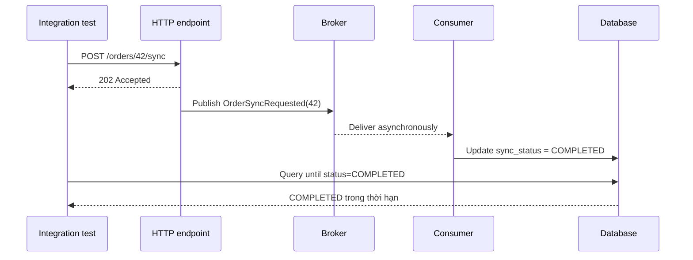
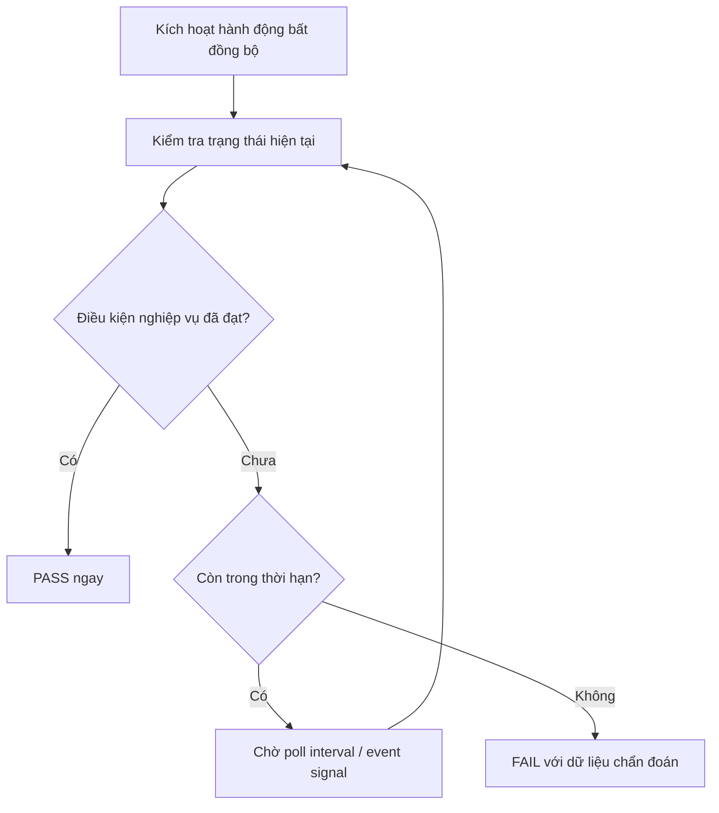
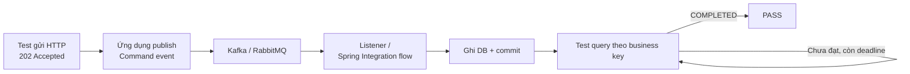
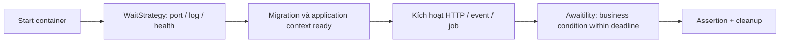

# Chờ điều kiện bất đồng bộ theo thời hạn thay vì thời gian ngủ cố định

Một bài kiểm thử tích hợp Spring Boot thường kích hoạt hành động ở một luồng nhưng kết quả lại xuất hiện trên luồng khác: HTTP request gửi lệnh rồi message được xử lý qua Kafka hoặc RabbitMQ; một polling adapter đọc cơ sở dữ liệu rồi gọi dịch vụ đối tác; một `@Async` handler cập nhật bảng trạng thái; hoặc Quartz lên lịch ghi cache. Trong những tình huống đó, **thời điểm trả về của lời gọi đầu tiên không nhất thiết là thời điểm nghiệp vụ hoàn tất**.

Cách viết `Thread.sleep(2000)` rồi kiểm tra kết quả có vẻ đơn giản, nhưng khó tin cậy: máy CI nhanh có thể chỉ cần 50 ms, còn lần chạy gặp lịch CPU chậm, khởi tạo container hoặc rebalance broker có thể cần hơn 2 giây. Test chờ lâu không cần thiết khi hệ thống nhanh và báo lỗi ngẫu nhiên khi hệ thống chậm. Giải pháp là **chờ một điều kiện quan sát được, trong một thời hạn rõ ràng**, sau đó kiểm tra hợp đồng nghiệp vụ.

Bài học thuộc chương **Kiểm thử tích hợp** của module **SPRING_BOOT_INTEGRATION**. Mọi ví dụ gắn với luồng tích hợp HTTP, cơ sở dữ liệu, cache, broker và Spring Integration, đồng thời chú ý giao dịch, xử lý lỗi, retry, xử lý trùng lặp và quan sát. Mục tiêu là viết được test vừa nhanh ở trường hợp thành công, vừa có giới hạn thời gian và thông tin chẩn đoán tốt khi thất bại.

## 1. Bài toán: bất đồng bộ khiến assertion tức thời không phản ánh kết quả cuối

Giả sử ứng dụng nhận `POST /orders/{id}/sync` và trả `202 Accepted`. Request chỉ có nghĩa là yêu cầu **đã được nhận**, còn xử lý thực tế sẽ đi qua broker, consumer và database:



Nếu test kiểm tra bảng ngay sau HTTP 202, kết quả `NOT_FOUND` hoặc `PENDING` có thể **đúng tại thời điểm đó**. Đây chưa chắc là lỗi nghiệp vụ. Test cần kiểm tra một trong hai hợp đồng khác nhau:

| Loại hợp đồng | Mục tiêu assertion | Cách kiểm tra phù hợp |
| --- | --- | --- |
| **Đồng bộ** | HTTP trả đúng mã, schema và response ngay tại thời điểm request kết thúc. | Assertion trực tiếp, không cần chờ. |
| **Bất đồng bộ** | Một sự kiện được tiêu thụ, bản ghi được commit, cache được cập nhật, message outbound được phát hoặc luồng đạt trạng thái cuối. | Chờ điều kiện tới deadline, hoặc chờ tín hiệu event có timeout. |

Một mệnh đề quan trọng: **“Chờ 2 giây” không phải điều kiện thành công**. Nó chỉ là tiêu thụ thời gian. Điều kiện đúng phải mô tả kết quả cần có, chẳng hạn “đơn hàng mang business key X có trạng thái COMPLETED trong database” hoặc “đã nhận một event chứa correlation ID X”.

## 2. Vì sao `Thread.sleep()` làm test chậm và dễ lỗi?

```java
// Cách viết dễ chập chờn:
sendOrderSyncCommand(orderId);
Thread.sleep(2_000);
assertThat(orderRepository.findStatus(orderId)).isEqualTo(COMPLETED);
```

| Vấn đề | Hệ quả |
| --- | --- |
| Chờ cố định dù điều kiện hoàn tất sớm | Suite chậm theo tổng các lần sleep. |
| Thời gian xử lý thay đổi theo tải CI, startup, network, broker và GC | Flaky test: pass trên máy cá nhân, fail ở CI. |
| Không quan sát trạng thái trong lúc chờ | Khi fail, không biết điều kiện đã từng đạt hay chưa. |
| Thời gian ngủ không biểu diễn SLA | Khó giải thích vì sao chọn 2 giây và khi nào phải thay. |
| Dựa vào may mắn của thứ tự thread | Lỗi race condition bị che giấu, thường xuất hiện lại ở môi trường khác. |

Tăng `sleep(2000)` lên `sleep(10000)` có thể giảm tỷ lệ fail trước mắt nhưng làm thời gian kiểm thử tăng nhiều lần mà vẫn không chứng minh luồng xử lý đúng. Dù chờ rất lâu, một event bị dead-letter hoặc bị mất sẽ không tự biến thành thành công.



Đây là **eventually assertion**: xác minh điều kiện cuối cùng trở thành đúng trong một khoảng thời gian hữu hạn. Nó phù hợp với kết quả bất đồng bộ, nhưng không thay thế assertion đồng bộ dành cho phần dữ liệu đã được trả về ngay.

## 3. Ba yếu tố bắt buộc: điều kiện, deadline và nhịp quan sát

### 3.1. Điều kiện phải gắn với kết quả nghiệp vụ

Một điều kiện tốt có thể diễn đạt rõ:

- `orderId` của test có trạng thái `COMPLETED` trong database.
- Có đúng một bản ghi outbox cho `businessKey` và trạng thái được ghi nhận sau commit.
- Consumer test nhận được event có `correlationId` cần tìm.
- Cache đã chứa value đúng phiên bản hoặc counter đã đạt ngưỡng cụ thể.
- Hệ thống ghi trạng thái `FAILED` và đưa sự kiện vào DLQ khi downstream lỗi.

Điều kiện kém là “thread đã chạy”, “log chứa một chuỗi nào đó”, “application đã ready” hay “queue đang trống”, nếu các tín hiệu này không đủ chứng minh kết quả nghiệp vụ. Ví dụ queue có thể trống vì message chưa được publish, đã được ACK hoặc bị lỗi, chứ không nhất thiết vì đã xử lý thành công.

### 3.2. Deadline giới hạn tổng thời gian chờ

Thời hạn là khoảng thời gian tối đa test chấp nhận cho điều kiện đạt được, ví dụ **5 giây** trong một môi trường test nhất định. Chọn dựa vào hành vi hệ thống và độ biến động được phép của CI, không cộng vô hạn một khoản “đề phòng”.

| Loại công việc | Yếu tố quyết định deadline |
| --- | --- |
| `@Async` chạy cùng tiến trình | Thời gian scheduler/executor, tải CPU và thời gian cập nhật trạng thái. |
| Broker consumer | Publish, network, rebalance, commit offset/ACK, độ trễ consumer và retry. |
| Database read-after-write | Commit, replication/consistency, polling, index hoặc read model projection. |
| Spring Integration poller | Poll interval, trigger, batch size, backpressure và độ trễ handler. |
| Quartz | Lịch trigger, misfire, độ trễ scheduler, thời gian job chạy. |
| Testcontainers và hạ tầng | Container readiness, tạo schema/migration và khởi động listener. |

Deadline của một assertion nên thuộc **hợp đồng kiểm thử**, tách với deadline của từng network call. Nếu lời gọi truy vấn trong điều kiện bị treo 2 phút, `atMost(5 seconds)` của thư viện chờ không phải lúc nào cũng đảm bảo toàn bộ thao tác kết thúc tức thời trong 5 giây. Hãy đặt timeout cho HTTP, JDBC, broker và các công cụ truy vấn ở tầng thực thi.

### 3.3. Poll interval cân bằng tốc độ với tải

Khoảng chờ giữa hai lần kiểm tra quyết định tần suất quan sát. Với điều kiện đọc bộ nhớ, poll vài chục mili giây có thể hợp lý; với điều kiện gọi API hay database thật, poll quá dày tạo nhiều request và có thể làm chậm chính hệ thống đang test.

Ví dụ: `atMost(5s)` với `pollInterval(100ms)` cho phép kiểm tra định kỳ trong tối đa 5 giây. Điều kiện được thỏa sau 150 ms sẽ hoàn thành sớm thay vì bắt test chờ tròn 5 giây. Những con số này là **giá trị minh họa**, cần hiệu chỉnh theo luồng thực.

## 4. Dùng Awaitility thay cho sleep cố định

**Awaitility** là thư viện Java hỗ trợ chờ điều kiện bất đồng bộ bằng các biểu thức dễ đọc. Spring Boot `spring-boot-starter-test` có thể đã cung cấp Awaitility tùy bộ dependency/version; kiểm tra `testRuntimeClasspath` hoặc dependency tree. Nếu chưa có, khai báo phụ thuộc test và để BOM quản lý version nếu phiên bản Boot của dự án có quản lý:

```xml
<dependency>
    <groupId>org.awaitility</groupId>
    <artifactId>awaitility</artifactId>
    <scope>test</scope>
</dependency>
```

Nếu dự án không quản lý version cho artifact này, phải chọn version tương thích với JDK và test stack; không để Maven dependency không có version khi không có BOM/parent nào quản lý.

Thay đoạn sleep phía trên bằng:

```java
import static org.awaitility.Awaitility.await;
import static org.assertj.core.api.Assertions.assertThat;

import java.time.Duration;

sendOrderSyncCommand(orderId);

await()
    .alias("sync status of order " + orderId)
    .atMost(Duration.ofSeconds(5))
    .pollInterval(Duration.ofMillis(100))
    .untilAsserted(() ->
        assertThat(orderRepository.findStatus(orderId))
            .isEqualTo(COMPLETED));
```

`untilAsserted` chạy assertion nhiều lần cho tới khi assertion đạt hoặc quá hạn; khi hết hạn, test thất bại và cung cấp thông tin về điều kiện chưa đạt. `alias` giúp log timeout gắn với đối tượng nghiệp vụ cụ thể. Không cần gắn thêm `Thread.sleep()` ở trước hoặc trong lambda.

Một cách khác:

```java
await()
    .atMost(Duration.ofSeconds(5))
    .until(() -> orderRepository.findStatus(orderId) == COMPLETED);
```

Dùng `untilAsserted` khi cần assertion phong phú (nhiều trường, business invariant, AssertJ message); dùng `until` khi điều kiện boolean đủ rõ. Nếu lambda đọc dữ liệu gây side effect, kết quả test có thể không đáng tin: tránh thực thi lệnh ghi, consume queue, delete hoặc ACK message ngay trong phép kiểm tra lặp.

### Kỳ vọng chính xác về exception và timeout

Không biến mọi exception trong quá trình poll thành “chưa sẵn sàng” vô hạn. Nếu database trả lỗi credentials hoặc query syntax, đó có thể là lỗi cấu hình cần fail ngay. Chỉ retry những ngoại lệ **thực sự được hợp đồng cho phép là tạm thời**, và bảo toàn thông tin lỗi gốc khi test thất bại. Một thư viện chờ có thể lặp lại assertion thất bại, nhưng không thể tự quyết định lỗi kết nối nào là retryable.

Nên giới hạn timeout bằng số hữu hạn và nêu lý do chọn nó. Đừng dùng `await().forever()` trong CI; test treo sẽ tiêu tốn runner và che giấu lỗi. Đừng dùng `Thread.sleep()` ngay cả bên trong `untilAsserted`, vì khi đó mỗi vòng kiểm tra lại tạo một điểm chờ khó dự đoán.

## 5. Ví dụ hoàn chỉnh: `@Async` cập nhật read model

Ví dụ dưới đây có thể chạy trong bài test Spring Boot với JUnit Jupiter, Awaitility và AssertJ. Một bean nhận lệnh qua method `@Async` và cập nhật trạng thái của read model trong bộ nhớ. Đây là mô hình nhỏ để giải thích **test quan sát kết quả**; khi áp dụng thực tế, thay read model bằng repository, cache hoặc consumer thật.

```java
import static org.awaitility.Awaitility.await;
import static org.assertj.core.api.Assertions.assertThat;

import java.time.Duration;
import java.util.Map;
import java.util.UUID;
import java.util.concurrent.ConcurrentHashMap;

import org.junit.jupiter.api.Test;
import org.springframework.beans.factory.annotation.Autowired;
import org.springframework.boot.test.context.SpringBootTest;
import org.springframework.context.annotation.Bean;
import org.springframework.context.annotation.Configuration;
import org.springframework.scheduling.annotation.Async;
import org.springframework.scheduling.annotation.EnableAsync;

@SpringBootTest(classes = AsyncProjectionIT.Config.class)
class AsyncProjectionIT {

    @Autowired
    CommandIngress ingress;

    @Autowired
    ReadModel readModel;

    @Test
    void eventuallyPublishesCompletedState() {
        String businessKey = UUID.randomUUID().toString();

        ingress.accept(businessKey); // Trả về trước khi công việc hoàn tất.

        await()
            .alias("projection " + businessKey)
            .atMost(Duration.ofSeconds(5))
            .pollInterval(Duration.ofMillis(50))
            .untilAsserted(() ->
                assertThat(readModel.stateOf(businessKey))
                    .isEqualTo("COMPLETED"));
    }

    @Configuration(proxyBeanMethods = false)
    @EnableAsync
    static class Config {
        @Bean
        ReadModel readModel() {
            return new ReadModel();
        }

        @Bean
        CommandIngress commandIngress(ReadModel readModel) {
            return new CommandIngress(readModel);
        }
    }

    static class ReadModel {
        private final Map<String, String> states =
                new ConcurrentHashMap<>();

        void complete(String key) {
            states.put(key, "COMPLETED");
        }

        String stateOf(String key) {
            return states.get(key);
        }
    }

    static class CommandIngress {
        private final ReadModel readModel;

        CommandIngress(ReadModel readModel) {
            this.readModel = readModel;
        }

        @Async
        public void accept(String businessKey) {
            readModel.complete(businessKey);
        }
    }
}
```

Giải thích những điểm quyết định tính đúng:

1. `@EnableAsync` cho phép Spring xử lý `@Async`. Lệnh `ingress.accept(...)` phải được gọi **qua Spring proxy** (ở đây là bean được inject); gọi `this.accept(...)` trong cùng object có thể bỏ qua proxy và không thực thi bất đồng bộ.
2. `ConcurrentHashMap` bảo đảm khả năng đọc/ghi trạng thái an toàn giữa các thread trong ví dụ. Dùng `HashMap` chia sẻ không đồng bộ có thể tạo data race khiến test sai ngay cả khi mã nghiệp vụ đúng.
3. Khóa `UUID` riêng cho test tránh đọc nhầm trạng thái còn sót lại của test khác.
4. `await().untilAsserted(...)` kiểm tra **kết quả đã nhìn thấy** trong read model, không đoán thời điểm executor chạy.
5. Test dùng in-memory read model để tập trung vào lifecycle bất đồng bộ. Để kiểm tra hệ thống tích hợp thật, cần thay bằng adapter/database/broker thực hoặc Testcontainers và xác minh commit, serialize, network cũng như lỗi.

Trong một ứng dụng thật, nên cấu hình executor `@Async` riêng (số thread, queue, tên thread, policy khi bão hòa) và có cách ghi nhận exception từ các phương thức `void`. Một phương thức `@Async void` ném exception có thể khiến test chỉ quan sát timeout trong khi nguyên nhân nằm trong log của worker; vì vậy timeout phải đi cùng khả năng trích xuất lỗi background.

## 6. Khi có tín hiệu trực tiếp, dùng chờ sự kiện có timeout

Polling state rất hữu ích khi quan sát database hoặc cache. Nếu test đã có một **tín hiệu hoàn tất** tin cậy, dùng cấu trúc đồng bộ có timeout thường chính xác và ít tốn tài nguyên hơn:

### 6.1. `CountDownLatch` cho một sự kiện đã biết

```java
import static org.assertj.core.api.Assertions.assertThat;

import java.util.concurrent.CountDownLatch;
import java.util.concurrent.TimeUnit;

CountDownLatch processed = new CountDownLatch(1);

// Trong test fixture: consumer test gọi processed.countDown()
// khi đã xác nhận công việc của business key đang test hoàn thành.
sendCommandWithObservableCallback(processed);

boolean completed = processed.await(5, TimeUnit.SECONDS);
assertThat(completed).as("business command completed").isTrue();
```

`await(timeout)` trả về `false` khi hết hạn. Đừng dùng `latch.await()` không thời hạn trong CI. Một latch đơn giản cũng không tự chứng minh payload được xử lý đúng: sau khi nhận tín hiệu phải kiểm tra id, dữ liệu và side effect cần thiết. Đặt `countDown()` ở điểm hoàn tất thực sự, chẳng hạn **sau khi transaction commit**, không ở ngay lúc bắt đầu consumer.

### 6.2. `BlockingQueue.poll` để nhận message thử nghiệm

```java
import static org.assertj.core.api.Assertions.assertThat;

import java.util.concurrent.BlockingQueue;
import java.util.concurrent.TimeUnit;

BlockingQueue<OrderSyncedEvent> receivedEvents = testEventCollector.queue();

sendOrderSyncCommand(orderId);

OrderSyncedEvent event = receivedEvents.poll(5, TimeUnit.SECONDS);
assertThat(event).as("OrderSyncedEvent within deadline").isNotNull();
assertThat(event.orderId()).isEqualTo(orderId);
assertThat(event.status()).isEqualTo("COMPLETED");
```

Đây là đoạn minh họa với `testEventCollector` và `OrderSyncedEvent` do bộ test cung cấp. Test collector có thể là Kafka listener test, Spring Integration test channel adapter hoặc consumer nội bộ, nhưng phải thu đúng message của test. Nếu trong queue có message khác, một lần `poll()` đầu tiên không đảm bảo message đúng key; dùng correlation ID, phân vùng dữ liệu test hoặc bộ lọc sự kiện có timeout tổng để tránh thất bại do message không liên quan.

**Không gọi `receivedEvents.poll()` lặp lại trong lambda của Awaitility mà không kiểm soát:** `poll()` là thao tác tiêu thụ, một vòng chờ thất bại có thể lấy mất message cần kiểm tra trong vòng sau. Với queue, ưu tiên API blocking có timeout hoặc cơ chế thu thập và truy vấn state không phá hủy.

## 7. Kiểm thử HTTP → broker → database theo hợp đồng cuối

Một trường hợp điển hình của Spring Boot Integration:



Quy trình test nên tách rõ **hai assertion**:

1. **Assertion tức thời:** HTTP đã nhận yêu cầu hợp lệ, trả trạng thái và contract response đúng, có request/correlation ID nếu API hỗ trợ.
2. **Assertion eventual:** một business key cụ thể đã tạo trạng thái cuối trong database hoặc đã phát event outbound được phép quan sát. Điều kiện này xuất hiện sau commit/ACK phù hợp với hợp đồng.

Ví dụ mẫu (các bean HTTP client và repository do hệ thống test cung cấp):

```java
String orderId = "it-" + UUID.randomUUID();

ResponseEntity<Void> response = restTemplate.postForEntity(
        "/orders/" + orderId + "/sync", null, Void.class);
assertThat(response.getStatusCode().value()).isEqualTo(202);

await()
    .alias("order synchronization " + orderId)
    .atMost(Duration.ofSeconds(15))
    .pollInterval(Duration.ofMillis(200))
    .untilAsserted(() -> {
        OrderSyncRecord record = repository.findByOrderId(orderId)
                .orElseThrow(() -> new AssertionError(
                        "No committed record for " + orderId));
        assertThat(record.getStatus()).isEqualTo("COMPLETED");
        assertThat(record.getExternalReference()).isNotBlank();
    });
```

Ví dụ giả định `restTemplate`, `repository`, `OrderSyncRecord` được cấu hình trong test Spring Boot đầy đủ. Không chạy trực tiếp đoạn mã độc lập này khi chưa cung cấp các thành phần và endpoint tương ứng.

Nếu ứng dụng lưu trạng thái `RECEIVED` trước rồi cập nhật `COMPLETED` sau, hãy chờ trạng thái `COMPLETED`, tránh chỉ chờ `existsByOrderId(orderId)`. Nếu hệ thống định nghĩa thất bại nghiệp vụ bằng trạng thái `FAILED`, nên quan sát và báo lỗi rõ khi nhận `FAILED` thay vì tiếp tục poll vô ích đến cuối deadline.

### Kiểm tra số lần xử lý và chống trùng lặp

Việc một bản ghi xuất hiện **một lần tại thời điểm poll** chưa chứng minh nó sẽ không xuất hiện lần thứ hai sau vài giây do retry/rebalance. Đối với luồng cần chống trùng, bổ sung một assertion về ràng buộc dữ liệu, ví dụ unique business key, kiểm tra event duplicate và trạng thái không bị ghi lặp. Sử dụng khóa riêng cho test; kiểm tra số bản ghi cùng business key trên nguồn dữ liệu chính thức, không chỉ đếm log của một replica.

Với nghiệp vụ có cơ chế *at-least-once delivery*, mục tiêu đúng thường là **side effect idempotent**, không phải “consumer nhận message đúng một lần”. Hãy test lặp lại cùng command/event và xác minh tác động nghiệp vụ chỉ tạo một kết quả hợp lệ.

## 8. Test điều kiện *không xảy ra*: vì sao phức tạp hơn?

Khẳng định “event X cuối cùng xuất hiện trong vòng 5 giây” có điểm kết thúc rõ. Ngược lại, khẳng định “event X sẽ không bao giờ xuất hiện” không thể chứng minh chỉ bằng việc chờ hữu hạn. Test chỉ có thể xác nhận **không xảy ra trong cửa sổ quan sát đã định nghĩa**.

Ví dụ với Awaitility:

```java
await()
    .during(Duration.ofMillis(500))
    .atMost(Duration.ofSeconds(2))
    .pollInterval(Duration.ofMillis(50))
    .untilAsserted(() ->
        assertThat(repository.countByBusinessKey(orderId)).isEqualTo(1L));
```

Trong cửa sổ 500 ms, điều kiện `count == 1` phải được duy trì theo quy tắc của Awaitility. Nhưng một event có thể đến sau thời điểm quan sát; vì vậy phải chọn cửa sổ dựa vào hợp đồng retry, max redelivery delay hoặc điều kiện ngừng xử lý. Với hệ thống có lịch retry sau vài phút, quan sát 500 ms **không** chứng minh không có duplicate ở chu kỳ sau.

Tách hai câu hỏi: **eventual success** (trạng thái cuối xuất hiện) và **stability/safety** (trạng thái không bị thay đổi sai trong cửa sổ quan sát). Khi có thể, kiểm chứng safety bằng ràng buộc bền vững tại database hoặc bằng cách gửi duplicate có chủ đích rồi đợi xử lý xong, thay vì chỉ nhìn một khoảng thời gian tùy ý.

## 9. Những nguồn gây flaky test mà Awaitility không tự sửa

### 9.1. Transaction chưa commit giữa các thread

Trong Spring Test, `@Transactional` trên phương thức test thường tạo transaction gắn với thread của test và rollback sau khi test kết thúc. Một `@Async` worker hoặc broker consumer ở thread khác **không nhất thiết nhìn thấy dữ liệu chưa commit** của test. Đợi bao lâu cũng có thể không thấy; hoặc worker truy cập dữ liệu theo isolation khác gây kết quả khó hiểu.

**Ví dụ lỗi:** test dùng repository tạo `Order` trong transaction test, sau đó publish event chứa `orderId`. Consumer ở thread khác đọc `Order` từ database nhưng không tìm được vì transaction của test chưa commit.

Hướng xử lý:

- Không bọc toàn bộ test end-to-end bất đồng bộ trong transaction rollback nếu các luồng khác phải thấy dữ liệu đã commit.
- Commit fixture trước khi gửi event; có thể quản lý transaction ở lớp thiết lập, dùng `TransactionTemplate` hoặc API test transaction một cách chủ động.
- Dọn dữ liệu bằng business key riêng sau khi công việc đã hoàn tất; tránh rollback một transaction rồi cho rằng đã dọn mọi side effect từ thread khác.
- Nếu bản thân nghiệp vụ có transactional outbox, test phải xác minh publish xảy ra theo cơ chế sau commit như thiết kế.

### 9.2. Dữ liệu và consumer bị dùng chung giữa các test

Consumer group, queue, topic, cache hoặc bảng dữ liệu có thể chia sẻ giữa nhiều test song song. Một test có thể nhận event của test khác, đọc trạng thái còn tồn tại từ lần chạy trước hoặc tranh chấp partition.

Giải pháp: business key/correlation ID duy nhất, namespace/topic/container riêng khi cần, vệ sinh có kiểm soát, consumer group có mục đích rõ ràng và tránh assertion vào tổng số message của toàn hệ thống. Nếu thật sự chạy test song song, thiết kế isolation trước khi tăng thời gian chờ.

### 9.3. Điều kiện check có side effect hoặc đọc không nhất quán

Một lambda dùng `receive()`, `poll()`, `delete()` hay `ack()` có thể làm thay đổi trạng thái trong mỗi vòng kiểm tra. Một read replica có replication lag hoặc cache chưa nhất quán cũng có thể khiến điều kiện lúc đúng lúc sai.

Ưu tiên **đọc trạng thái không phá hủy** trong phép polling. Nếu cần xác minh tính ổn định, dùng một cửa sổ quan sát hợp lý và điều kiện dữ liệu từ nguồn được xác định. Khi cần read-after-write mạnh, chọn datastore/consistency level theo hợp đồng thay vì dựa vào nhịp poll.

### 9.4. Hạ tầng chưa sẵn sàng và thiếu timeout I/O

Awaitility chờ **kết quả nghiệp vụ**; nó không thay cho việc đợi Kafka broker, Cassandra cluster hay PostgreSQL thật sự nhận kết nối. Nếu một dependency chưa ready, business assertion sẽ timeout dù mã xử lý nghiệp vụ có thể hoàn toàn đúng.

Sử dụng readiness check hoặc Testcontainers wait strategy đúng với từng dependency, chạy migration/schema rồi mới gửi input. Đặt timeout riêng cho HTTP, database, broker operations. Khi có retry/backoff trong ứng dụng, deadline của test phải được tính có chủ đích; tránh che lỗi ứng dụng bằng việc tăng deadline không giới hạn.

### 9.5. Scheduler, polling interval và thời gian ảo

Một Spring Integration poller chạy mỗi 10 giây không thể được kiểm tra đáng tin bằng deadline 1 giây nếu test trông đợi polling thực. Nếu logic dùng `@Scheduled`, Quartz, timeout hoặc retry backoff, ưu tiên tách logic scheduling khỏi xử lý và kiểm thử bằng clock/scheduler có thể kiểm soát khi framework hỗ trợ. Đối với luồng cần xác minh scheduler thật, hãy ấn định lịch test ngắn và chờ theo thời hạn phù hợp.

## 10. Testcontainers: chờ readiness rồi mới chờ kết quả nghiệp vụ

Trong test tích hợp với database, broker hoặc cache thật, cần phân biệt **hạ tầng đã ready** với **nghiệp vụ đã hoàn thành**.



Ví dụ cấu hình `Wait.forHttp` cho một dịch vụ test có endpoint `/health`:

```java
import java.time.Duration;
import org.testcontainers.containers.GenericContainer;
import org.testcontainers.containers.wait.strategy.Wait;

GenericContainer<?> dependency = new GenericContainer<>("example/service:test")
    .withExposedPorts(8080)
    .waitingFor(
        Wait.forHttp("/health")
            .forPort(8080)
            .forStatusCode(200)
            .withStartupTimeout(Duration.ofSeconds(60)));
```

Đây là minh họa WaitStrategy với **image placeholder**; cần thay bằng image dịch vụ test thực và endpoint health đúng của nó. Với Kafka, RabbitMQ, database hoặc các container đặc thù, dùng module/container và chiến lược readiness phù hợp, không giả định mọi hệ thống đều có HTTP `/health`.

**Hai deadline phục vụ hai mục tiêu riêng:** startup timeout giới hạn việc chờ dependency trở nên sẵn sàng; Awaitility `atMost` giới hạn việc chờ business outcome sau khi đã kích hoạt input. Nếu gộp cả hai vào một `Thread.sleep()`, lỗi hạ tầng và lỗi xử lý nghiệp vụ sẽ bị lẫn.

## 11. Khi điều kiện hết hạn, test phải cho biết vì sao

Một test timeout hữu ích cần trả lời tối thiểu: **đối tượng nào**, **điều kiện gì chưa đạt**, **đã chờ bao lâu**, **trạng thái cuối cùng nhìn thấy** và **có lỗi downstream không**.

Ví dụ assertion giàu ngữ cảnh:

```java
await()
    .alias("OrderSyncCompleted for " + orderId)
    .atMost(Duration.ofSeconds(15))
    .pollInterval(Duration.ofMillis(200))
    .untilAsserted(() -> {
        SyncStatus actual = repository.findStatus(orderId);
        assertThat(actual)
            .as("status of order %s (expected COMPLETED)", orderId)
            .isEqualTo(SyncStatus.COMPLETED);
    });
```

Khi timeout, kiểm tra log của HTTP client, consumer, Spring Integration error channel, broker DLQ, database exception, Quartz job hoặc async executor theo đúng `correlationId`. Có thể thêm test helper chẩn đoán (không làm thay đổi trạng thái) để lấy `lastStatus`, `lastError`, số message retry, backlog, timestamp và trace ID khi assertion thất bại.

Chọn metric theo luồng:

| Luồng | Thông tin cần quan sát |
| --- | --- |
| HTTP → broker | HTTP request ID, publish success/timeout, consumer group, offset hoặc message ID. |
| Broker → database | Consumer exception, ACK/NACK, record status, transaction commit, DLQ/retry. |
| Spring Integration | Endpoint/channel, message headers, error channel, poller status, handler errors. |
| Cache/NoSQL | Key, consistency, TTL, trạng thái bản ghi và kết quả query. |
| Quartz | JobKey, fire time, misfire, job exception và trạng thái checkpoint. |

Không đưa password, token, nội dung nhạy cảm hoặc dữ liệu cá nhân vào thông báo timeout. Một test tốt nên giữ trace/correlation ID đủ để điều tra mà không vô tình tạo lỗ hổng trong log CI.

### Khi nào nên fail ngay?

Nếu ứng dụng trả `400 Bad Request` cho request được kỳ vọng hợp lệ, nếu chứng thư TLS bị từ chối, schema database không tồn tại hoặc message bị gửi thẳng vào DLQ vì lỗi không thể phục hồi, test nên ghi nhận **nguyên nhân lỗi ngay khi quan sát được**. Chờ hết 15 giây cho một điều kiện đã không còn khả năng đạt chỉ làm tốn thời gian và che mất lỗi gốc.

Trong thiết kế test nâng cao, có thể kết hợp condition eventual success với điều kiện “terminal failure” được truy vấn riêng. Khi dùng Awaitility version hỗ trợ `failFast`, có thể cấu hình thoát sớm khi trạng thái `FAILED` đã được xác nhận. Nếu không, một vòng lặp chờ riêng với deadline và kiểm tra `FAILED` có thể dễ kiểm soát hơn. Tránh bắt `Exception` rồi trả `false` vô điều kiện vì sẽ che lỗi lập trình.

## 12. Tư duy về thời gian và giới hạn song song

Đối với một lệnh đồng bộ dữ liệu, thời hạn test nên phản ánh một chuỗi bước:

\[
T_{\text{deadline}} \ge T_{\text{publish}} + T_{\text{deliver}} + T_{\text{process}} + T_{\text{commit}} + T_{\text{visibility}} + \text{dư địa hợp lý}
\]

Đây là mô hình để **lý giải thời hạn**, không phải công thức tính chính xác từng thành phần trong hệ thống phân tán. Một số bước có thể song song hoặc lặp lại vì retry, trong khi bottleneck khác nhau theo môi trường. Giá trị phải được đo hoặc kiểm chứng trên CI đại diện.

Khi nhiều phép await nối tiếp nhau, tổng thời gian timeout xấu nhất có thể cộng dồn và làm test kéo dài. Nếu các bước đều thuộc một nghiệp vụ chung, có thể dùng **một deadline tổng** và theo dõi thời gian còn lại; nếu cần kiểm tra từng bước riêng, đặt deadline nhỏ rõ ràng và báo lỗi đúng tầng. Không cho mỗi retry/test helper tự khởi tạo một timeout dài khiến tổng thời gian không có giới hạn thực tế.

Với test song song, một tác vụ dùng `ThreadLocal`, transaction theo thread, executor queue hoặc dữ liệu chia sẻ có thể hành xử khác khi số test tăng. Sự thành công khi chạy từng test đơn lẻ không đủ để khẳng định suite ổn định; phải kiểm tra isolation và sức chứa tài nguyên.

### Hạn chế của timeout ở mức framework

`assertTimeout` của JUnit đánh giá thời gian thực thi nhưng không nhất thiết ngắt công việc đang bị treo. `assertTimeoutPreemptively` chạy code trong thread khác và có thể phá vỡ giả định của Spring test về transaction gắn với thread, nhất là với `@Transactional`. Dùng API timeout có hiểu biết về thread context; với I/O thực, đặt timeout ở client/driver và shutdown tài nguyên đúng cách thay vì trông chờ timeout assertion tự hủy mọi tác vụ.

## 13. So sánh cách chờ và lựa chọn phù hợp

| Cách chờ | Phù hợp với | Ưu điểm | Giới hạn |
| --- | --- | --- | --- |
| `Thread.sleep(duration)` | Rất ít tình huống chủ động mô phỏng thời gian; không nên dùng làm điều kiện kiểm thử nghiệp vụ. | Dễ viết. | Không biết điều kiện thành công, chậm và flaky. |
| Awaitility `untilAsserted` | Query trạng thái DB/cache, read model, counter, health nghiệp vụ. | Dừng sớm khi đạt, deadline rõ, assertion dễ đọc. | Polling tốn truy vấn; điều kiện phải an toàn và quan sát được. |
| `CountDownLatch.await(timeout)` | Một callback/tín hiệu hoàn tất có thể kết nối trực tiếp vào test. | Không poll, đồng bộ rõ ràng. | Tín hiệu phải đặt đúng ranh giới commit/complete; latch một lần không mang nội dung payload. |
| `BlockingQueue.poll(timeout)` | Test collector nhận message từ listener/kênh đã cấu hình. | Chờ event thật, có thể kiểm tra payload. | Là phép tiêu thụ; phải lọc đúng business key và kiểm soát nhiều event. |
| Testcontainers WaitStrategy | Khởi tạo container/service phụ thuộc. | Chờ readiness trước khi test nghiệp vụ. | Không xác minh business flow đã xử lý đúng. |
| Clock/test scheduler/virtual time | Retry, backoff, lịch chạy và luồng mô phỏng thời gian. | Nhanh và ít phụ thuộc đồng hồ thật. | Phải chứng minh phần integration thật qua test riêng. |

Không có công cụ duy nhất đúng cho mọi trường hợp. Nguyên tắc chung là **chờ tín hiệu của hợp đồng đang kiểm tra, với thời hạn hữu hạn và thông tin thất bại đủ rõ để sửa lỗi**.

## 14. Checklist khi viết test tích hợp bất đồng bộ

- [ ] Tách assertion đồng bộ với assertion eventual; xác định kết quả nghiệp vụ có thể quan sát được sau commit.
- [ ] Gửi command/event với business key và correlation ID riêng cho mỗi test.
- [ ] Thay `Thread.sleep()` cố định bằng Awaitility hoặc cơ chế chờ tín hiệu có timeout.
- [ ] Chọn deadline và poll interval theo SLA test, đặc điểm hạ tầng và chi phí truy vấn; không chờ vô hạn.
- [ ] Điều kiện kiểm tra không làm phát sinh side effect và không tiêu thụ mất message cần assert.
- [ ] Xác minh transaction fixture đã commit trước khi consumer bất đồng bộ đọc; chủ động cleanup dữ liệu.
- [ ] Tách readiness của database/broker/container khỏi việc chờ trạng thái nghiệp vụ.
- [ ] Bao phủ nhánh thành công, thất bại, retry, DLQ, idempotency và trạng thái sau redelivery nếu luồng có các tình huống này.
- [ ] Khi test âm tính, định nghĩa cửa sổ quan sát hữu hạn và không kết luận “không bao giờ” từ một khoảng chờ ngắn.
- [ ] Khi timeout, báo id nghiệp vụ, trạng thái nhìn thấy, lỗi cuối, trace và metric liên quan; tránh log secret.
- [ ] Test với cấu hình executor, transaction và listener gần production, đồng thời giữ isolation khi suite chạy song song.

### Tài liệu tham khảo

- [Awaitility — Usage](https://github.com/awaitility/awaitility/wiki/Usage): `until`, `untilAsserted`, timeout, polling và điều kiện giữ ổn định.
- [Spring Boot — Testing Spring Boot Applications](https://docs.spring.io/spring-boot/reference/testing/spring-boot-applications.html): `@SpringBootTest`, test context và ứng dụng tích hợp.
- [Spring Framework — Testing](https://docs.spring.io/spring-framework/reference/testing.html): quản lý transaction trong test và vòng đời context.
- [Spring Integration — Testing Support](https://docs.spring.io/spring-integration/reference/testing.html): kiểm thử channel, endpoint và message flow.
- [Testcontainers — Waiting for Containers to Start or Be Ready](https://java.testcontainers.org/features/startup_and_waits/): readiness/startup strategies cho dependency test.
- [JUnit 5 — User Guide](https://junit.org/junit5/docs/current/user-guide/): các assertion timeout và chiến lược tổ chức test.

**Điểm cần ghi nhớ:** trong kiểm thử tích hợp bất đồng bộ, **thời gian không phải kết quả**. Thay vì ngủ cố định rồi hy vọng, hãy chờ một trạng thái hoặc sự kiện có ý nghĩa nghiệp vụ trong deadline hữu hạn. Khi điều kiện không đạt, test phải thất bại với dấu vết đủ để xác định lỗi nằm ở HTTP, broker, database, Spring Integration, Quartz hay trong chính cấu hình kiểm thử.
