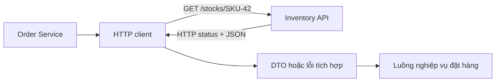
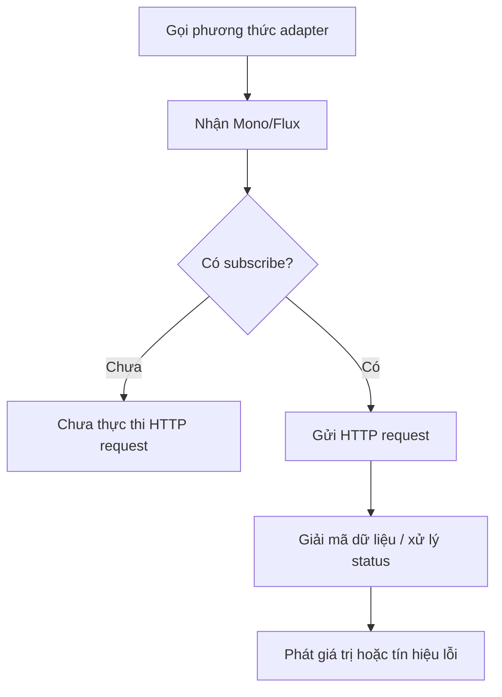

# RestClient, RestTemplate và WebClient trong Spring Boot

Khi một ứng dụng Spring Boot cần gọi HTTP API của hệ thống khác, việc chọn client ảnh hưởng trực tiếp đến mô hình xử lý, hiệu năng khi tải tăng, cách quản lý lỗi và khả năng kiểm thử. Ba lựa chọn thường gặp là **`RestClient`**, **`RestTemplate`** và **`WebClient`**. Chúng đều có thể trao đổi JSON qua HTTP, nhưng cách lập trình và cách sử dụng tài nguyên khác nhau đáng kể.

Bài học này thuộc chủ đề **SPRING_BOOT_INTEGRATION**: tổ chức tích hợp hệ thống qua HTTP client, cơ sở dữ liệu, cache, broker thông điệp và các adapter của Spring Integration; trọng tâm là cấu hình, hợp đồng dữ liệu, giao dịch, lỗi, xử lý trùng lặp, kiểm thử và quan sát luồng tích hợp thực tế.

Sau bài học, bạn có thể:

- Chọn HTTP client phù hợp với ứng dụng Spring MVC, ứng dụng reactive hoặc hệ thống đang dùng API cũ.
- Viết lời gọi HTTP với `RestClient`, `RestTemplate` và `WebClient`; hiểu khác biệt giữa lệnh chặn luồng và chuỗi xử lý reactive.
- Thiết kế ranh giới tích hợp có cấu hình, DTO, timeout, phân loại lỗi và chính sách retry rõ ràng.
- Kiểm thử tương tác HTTP và nhận diện các rủi ro giao dịch, idempotency, bảo mật, quan sát hệ thống.

> **Mốc phiên bản:** `RestClient` được giới thiệu từ Spring Framework 6.1 và có hỗ trợ cấu hình sẵn trong Spring Boot 3.2+. Ví dụ Java bên dưới hướng đến Java 17 và Spring Boot 3.2+/Spring Framework 6.1+. Khi dự án dùng phiên bản khác, kiểm tra lại API, starter và cấu hình tương ứng. Các đoạn mã độc lập minh họa các phương án; không cần đăng ký đồng thời cả ba client trong một ứng dụng.

## 1. Đặt ba client vào bài toán tích hợp

Giả sử **Order Service** cần hỏi **Inventory Service** còn bao nhiêu sản phẩm trước khi xác nhận đơn hàng. Inventory cung cấp hợp đồng:

```http
GET /stocks/{sku}
Accept: application/json

HTTP/1.1 200 OK
Content-Type: application/json

{"sku":"SKU-42","available":12}
```

Phản hồi `404` biểu thị SKU không tồn tại; `503` cho biết dịch vụ tạm thời không sẵn sàng. Đường truyền có thể lỗi hoặc phản hồi chậm, ngay cả khi phía Inventory vẫn đang xử lý yêu cầu. Vì thế, một lời gọi HTTP không chỉ là việc chuyển JSON thành đối tượng Java.



Nên gom cách gọi Inventory vào một lớp adapter/client có giao diện rõ ràng, thay vì viết trực tiếp yêu cầu HTTP rải rác trong controller, service và listener nhận thông điệp. Đây là điểm chung của cả ba giải pháp.

## 2. So sánh nhanh và quy tắc chọn

| Tiêu chí | `RestClient` | `RestTemplate` | `WebClient` |
|---|---|---|---|
| Mô hình lập trình | Imperative, fluent API | Imperative, template API | Reactive, dùng `Mono`/`Flux` |
| Trong lời gọi thông thường | Chặn luồng gọi đến khi có kết quả | Chặn luồng gọi đến khi có kết quả | Không chặn luồng chờ I/O khi được dùng theo chuỗi reactive |
| Bối cảnh phù hợp | Mã đồng bộ mới, Spring MVC, batch dùng luồng thông thường | Bảo trì hoặc nâng cấp dần ứng dụng cũ | Ứng dụng WebFlux, streaming, nhiều tác vụ I/O đồng thời theo mô hình reactive |
| Dạng truy vấn tiêu biểu | `.get().uri(...).retrieve().body(...)` | `.getForObject(...)`, `.exchange(...)` | `.get().uri(...).retrieve().bodyToMono(...)` |
| Xử lý status | `.onStatus(...)`, mặc định báo lỗi `4xx/5xx` với `retrieve()` | `ResponseErrorHandler`, mặc định báo lỗi `4xx/5xx` | `.onStatus(...)`, mặc định báo lỗi `4xx/5xx` với `retrieve()` |
| Mở rộng yêu cầu | Request interceptor, builder, request factory | `ClientHttpRequestInterceptor`, builder, request factory | `ExchangeFilterFunction`, connector, Reactor operators |
| Kiểm thử HTTP client | `MockRestServiceServer` hoặc fake HTTP server | `MockRestServiceServer` hoặc fake HTTP server | Fake HTTP server như WireMock/MockWebServer, hoặc giả `ExchangeFunction` |

**Hướng chọn thường dùng:**

1. Ứng dụng Spring MVC hoặc service dùng các hàm đồng bộ, viết phần tích hợp HTTP mới: **ưu tiên `RestClient`**.
2. Ứng dụng đã dùng `RestTemplate` ổn định: **có thể tiếp tục duy trì**, chuyển sang `RestClient` dần khi cần thay đổi. Không cần thay thế chỉ vì API cũ.
3. Ứng dụng có pipeline reactive từ controller đến thao tác I/O, hoặc cần xử lý luồng dữ liệu/đồng thời ở quy mô phù hợp: **dùng `WebClient`**.

`WebClient` không tự động làm một ứng dụng MVC trở thành reactive. Nếu gọi `.block()` để lấy kết quả, luồng gọi vẫn phải chờ; lợi thế không chặn luồng của chuỗi reactive không còn ở điểm đó. Ngược lại, `RestClient` có thể đủ tốt cho nhiều hệ thống tải cao nếu số kết nối, thread pool và timeout được thiết kế đúng. Quyết định dựa trên kiến trúc xử lý thực tế, không chỉ dựa vào số lượng yêu cầu HTTP.

## 3. `RestClient`: lựa chọn đồng bộ với fluent API

### 3.1. Dependency, cấu hình và hợp đồng dữ liệu

Với ứng dụng Spring MVC có `spring-boot-starter-web`, các lớp HTTP cần thiết của `RestClient` thường đã có trên classpath. Sử dụng `RestClient.Builder` do Spring Boot cung cấp để thừa hưởng các tùy chỉnh được đăng ký cho ứng dụng (chẳng hạn converter và observation khi đã bật cấu hình liên quan).

Đặt địa chỉ máy chủ và giới hạn chờ trong cấu hình thay vì gắn trực tiếp vào mã:

```yaml
# application.yml
integration:
  inventory:
    base-url: ${INVENTORY_BASE_URL:https://inventory.example}
    connect-timeout: 2s
    read-timeout: 3s
```

```java
// InventoryHttpProperties.java
import java.net.URI;
import java.time.Duration;
import org.springframework.boot.context.properties.ConfigurationProperties;

@ConfigurationProperties(prefix = "integration.inventory")
public record InventoryHttpProperties(
        URI baseUrl,
        Duration connectTimeout,
        Duration readTimeout
) {}
```

Trong ứng dụng thực tế, cần kiểm tra `baseUrl` hợp lệ, thời lượng timeout dương và tránh đưa API key hoặc mật khẩu vào mã nguồn. Một bản ghi Java (`record`) thích hợp cho DTO nhỏ bất biến:

```java
// StockResponse.java
public record StockResponse(String sku, int available) {}
```

Tùy hợp đồng API, có thể bổ sung validation cho trường bắt buộc, xử lý đổi tên field bằng annotation JSON và quy tắc tương thích phiên bản. DTO HTTP thuộc ranh giới tích hợp: không mặc định coi cấu trúc JSON của hệ thống khác là domain model nội bộ.

### 3.2. Tạo client một lần và tái sử dụng

Ví dụ sau dùng JDK `HttpClient` làm HTTP transport. `connectTimeout` giới hạn giai đoạn mở kết nối; `readTimeout` giới hạn chờ đọc phản hồi theo cơ chế của request factory. Đây **không phải** một ngân sách thời gian tổng thể cho toàn bộ nghiệp vụ.

```java
// InventoryRestClientConfiguration.java (imports rút gọn)
@Configuration(proxyBeanMethods = false)
@EnableConfigurationProperties(InventoryHttpProperties.class)
class InventoryRestClientConfiguration {

    @Bean("inventoryRestClient")
    RestClient inventoryRestClient(
            RestClient.Builder builder,
            InventoryHttpProperties properties
    ) {
        java.net.http.HttpClient httpClient = java.net.http.HttpClient.newBuilder()
                .connectTimeout(properties.connectTimeout())
                .build();

        JdkClientHttpRequestFactory factory =
                new JdkClientHttpRequestFactory(httpClient);
        factory.setReadTimeout(properties.readTimeout());

        return builder
                .baseUrl(properties.baseUrl().toString())
                .requestFactory(factory)
                .defaultHeader(HttpHeaders.ACCEPT,
                        MediaType.APPLICATION_JSON_VALUE)
                .build();
    }
}
```

Các type Spring trong ví dụ thuộc `org.springframework.context.annotation`, `org.springframework.boot.context.properties`, `org.springframework.web.client`, `org.springframework.http` và `org.springframework.http.client`. Ở dự án thật có thể chọn request factory/connection pool khác, nhưng cần đo đạc và cấu hình giới hạn kết nối phù hợp với số request đồng thời. Không tạo mới client và transport cho mỗi lần gọi.

### 3.3. Gửi request và ánh xạ lỗi

```java
// StockNotFoundException.java
public class StockNotFoundException extends RuntimeException {
    public StockNotFoundException(String sku) {
        super("Không tìm thấy SKU: " + sku);
    }
}
```

```java
// InventoryHttpClient.java (imports rút gọn)
@Service
class InventoryHttpClient {
    private final RestClient client;

    InventoryHttpClient(@Qualifier("inventoryRestClient") RestClient client) {
        this.client = client;
    }

    StockResponse getStock(String sku) {
        StockResponse result = client.get()
                .uri("/stocks/{sku}", sku)
                .retrieve()
                .onStatus(status -> status.value() == 404,
                        (request, response) -> {
                            throw new StockNotFoundException(sku);
                        })
                .body(StockResponse.class);

        if (result == null) {
            throw new IllegalStateException("Inventory trả về body rỗng");
        }
        return result;
    }
}
```

Điểm cần nhớ:

- `.uri("/stocks/{sku}", sku)` áp dụng URI template để mã hóa tham số đúng cách; tránh ghép thẳng chuỗi đầu vào vào URL.
- `.retrieve()` là lối dùng thuận tiện khi muốn đọc body. Mặc định, HTTP `4xx/5xx` tạo ngoại lệ; `.onStatus(...)` cho phép ánh xạ những status có ý nghĩa nghiệp vụ như `404`.
- `RestClientResponseException` thường chứa status và body của phản hồi lỗi; lỗi I/O, kết nối hoặc thời gian chờ có thể xuất hiện dưới dạng `ResourceAccessException`. Đừng gộp mọi ngoại lệ thành “không tìm thấy sản phẩm”.
- `200 OK` với body rỗng, JSON sai cấu trúc hoặc sai kiểu cũng là trường hợp cần xử lý. Với API chỉ trả status như `204 No Content`, dùng phương thức đọc phù hợp thay vì mong đợi DTO.
- JSON `POST`, `PUT`, `PATCH` dùng `.body(requestDto)` và đặt `Content-Type` tương ứng. Cần kiểm tra ràng buộc của API, không suy diễn rằng mọi endpoint đều hỗ trợ cập nhật idempotent.

`RestClient` còn cung cấp `.exchange(...)` khi cần truy cập request/response ở mức thấp hơn. Chỉ nên dùng khi `.retrieve()` và các handler không đủ vì người viết phải tự đảm bảo logic phân loại lỗi, đóng/tiêu thụ response theo đúng API.

## 4. `RestTemplate`: hiểu và duy trì hệ thống đang chạy

`RestTemplate` là API đồng bộ lâu đời của Spring. Nó vẫn hữu ích khi mã nguồn có sẵn nhiều interceptor, `ResponseErrorHandler`, cấu hình kiểm thử hoặc adapter dựa trên `RestTemplate`. Với Spring Boot, có thể tạo từ `RestTemplateBuilder` và đăng ký thành bean:

```java
@Configuration
class LegacyHttpConfiguration {
    @Bean
    RestTemplate legacyRestTemplate(RestTemplateBuilder builder) {
        return builder.build();
    }
}
```

Ví dụ cùng yêu cầu lấy tồn kho:

```java
ResponseEntity<StockResponse> response = restTemplate.exchange(
        "https://inventory.example/stocks/{sku}",
        HttpMethod.GET,
        HttpEntity.EMPTY,
        StockResponse.class,
        "SKU-42"
);

StockResponse stock = response.getBody();
```

`RestTemplate` dùng `HttpMessageConverter` cho JSON và, với error handler mặc định, ném ngoại lệ khi gặp status `4xx/5xx`. `exchange(...)` hữu ích khi cần header, method hay `ResponseEntity`; `getForObject(...)` ngắn gọn khi chỉ cần body. Request cũng là blocking như `RestClient`.

Khi chuyển dần sang `RestClient`, hãy đối chiếu toàn bộ hành vi của client cũ trước khi đổi:

| Mối quan tâm | Với `RestTemplate` | Với `RestClient` |
|---|---|---|
| Đọc DTO | `getForObject(url, Dto.class)` | `get().uri(url).retrieve().body(Dto.class)` |
| Header và method tùy chỉnh | `exchange(...)` với `HttpEntity` | `.get()/.post()/.method()`, `.headers(...)`, `.body(...)` |
| HTTP status lỗi | `ResponseErrorHandler` | `.onStatus(...)` hoặc handler mức builder |
| Header/tracing/chứng thực | `ClientHttpRequestInterceptor` | Request interceptor/filter tương ứng qua builder |
| Kiểm thử request/response | `MockRestServiceServer` | `MockRestServiceServer` |

Không thay API từng dòng rồi giả định tương đương tuyệt đối: lỗi mặc định, converter, encoding URL, timeout, interceptor, cách ghi log và cấu hình transport có thể khác nếu dùng builder không giống nhau. Ưu tiên thay tại ranh giới adapter có kiểm thử hợp đồng sẵn.

## 5. `WebClient`: tổ chức lời gọi theo pipeline reactive

`WebClient` thuộc Spring WebFlux. Một dự án thường thêm `spring-boot-starter-webflux` để có WebClient và Reactor. Khi ứng dụng có cả Spring MVC và WebFlux starter, việc có `WebClient` **không có nghĩa** mọi endpoint được chuyển sang runtime reactive; Spring Boot thường vẫn chọn ứng dụng web servlet khi Spring MVC hiện diện.

### 5.1. Luồng thực thi khác ở đâu?



`Mono<T>` biểu diễn tối đa một phần tử hoặc lỗi; `Flux<T>` biểu diễn nhiều phần tử. Tạo một pipeline bằng `WebClient` thông thường là **lazy**: công việc xảy ra khi có subscription. Khi controller WebFlux trả về `Mono`, framework sẽ phụ trách subscription. Không tự gọi `.subscribe()` trong service chỉ để “kích hoạt request”, vì khi đó lỗi, vòng đời và kết quả dễ tách khỏi luồng nghiệp vụ.

### 5.2. Cấu hình transport và gọi Inventory API

Ví dụ sau dùng Reactor Netty để đặt giới hạn mở kết nối và chờ phản hồi. `responseTimeout` của Netty và `.timeout(...)` trên `Mono` có ý nghĩa khác nhau: cái trước gắn với phản hồi HTTP ở transport; cái sau áp giới hạn cho toàn bộ publisher tính từ lúc subscribe.

```java
// InventoryWebClientConfiguration.java (imports rút gọn)
@Configuration(proxyBeanMethods = false)
@EnableConfigurationProperties(InventoryHttpProperties.class)
class InventoryWebClientConfiguration {

    @Bean("inventoryWebClient")
    WebClient inventoryWebClient(
            WebClient.Builder builder,
            InventoryHttpProperties properties
    ) {
        reactor.netty.http.client.HttpClient nettyClient =
                reactor.netty.http.client.HttpClient.create()
                .option(io.netty.channel.ChannelOption.CONNECT_TIMEOUT_MILLIS,
                        Math.toIntExact(properties.connectTimeout().toMillis()))
                .responseTimeout(properties.readTimeout());

        return builder
                .baseUrl(properties.baseUrl().toString())
                .clientConnector(new ReactorClientHttpConnector(nettyClient))
                .build();
    }
}
```

```java
// ReactiveInventoryHttpClient.java (imports rút gọn)
@Service
class ReactiveInventoryHttpClient {
    private final WebClient client;

    ReactiveInventoryHttpClient(
            @Qualifier("inventoryWebClient") WebClient client
    ) {
        this.client = client;
    }

    Mono<StockResponse> getStock(String sku) {
        return client.get()
                .uri("/stocks/{sku}", sku)
                .retrieve()
                .onStatus(status -> status.value() == 404,
                        response -> Mono.error(new StockNotFoundException(sku)))
                .bodyToMono(StockResponse.class)
                .switchIfEmpty(Mono.error(
                        new IllegalStateException("Inventory trả về body rỗng")))
                .timeout(Duration.ofSeconds(4));
    }
}
```

Khi không có mapping riêng, `WebClient.retrieve()` chuyển phản hồi `4xx/5xx` thành `WebClientResponseException` (hoặc kiểu con); lỗi kết nối, TLS và timeout cần được xét riêng. `.exchangeToMono(...)` cho phép đọc status, header và body theo các nhánh xử lý tùy biến hơn. Nếu dùng `exchangeToMono`, phải tiêu thụ body đúng cách ở từng nhánh theo contract của API.

Điều cần tránh trong ứng dụng reactive:

```java
// Không gọi block() bên trong pipeline/controller WebFlux.
StockResponse stock = webClient.get()
        .uri("/stocks/{sku}", "SKU-42")
        .retrieve()
        .bodyToMono(StockResponse.class)
        .block();
```

`block()` bắt luồng hiện tại chờ kết quả; trên các luồng xử lý không hỗ trợ blocking của Reactor, thao tác này còn có thể gây lỗi runtime. Nếu toàn bộ ứng dụng đang dùng JDBC/JPA và xử lý đồng bộ, chọn `RestClient` thường ít phức tạp hơn. Nếu dùng `WebClient`, cố gắng giữ chuỗi xử lý non-blocking đến caller và chú ý mọi thao tác phụ trợ (database, cache, mã hóa tốn CPU) có blocking hay không.

## 6. Cơ chế tích hợp quan trọng hơn tên client

### 6.1. Timeout, giới hạn tài nguyên và lỗi

Không gọi HTTP từ môi trường production với thời gian chờ vô hạn hoặc không xác định. Cần phân biệt ít nhất:

- **Connection timeout:** chờ thiết lập kết nối TCP/TLS theo transport.
- **Read/response timeout:** giới hạn chờ dữ liệu phản hồi; ngữ nghĩa cụ thể khác nhau theo HTTP transport.
- **Overall deadline:** ngân sách tổng cho một tác vụ nghiệp vụ (có thể gồm retry, backoff và nhiều downstream). Không phải mọi client đều tự cung cấp cùng một ngữ nghĩa deadline.
- **Pool/queue limit:** giới hạn số kết nối đồng thời và thời gian đợi kết nối, phù hợp năng lực Inventory; timeout ngắn mà không giới hạn fan-out vẫn có thể gây quá tải.

Phân nhóm lỗi để caller xử lý đúng:

| Tình huống | Cách nhìn nhận | Hành động gợi ý |
|---|---|---|
| `200`, JSON hợp lệ | Thành công | Chuyển DTO sang kết quả nghiệp vụ |
| `404` với SKU | Lỗi nghiệp vụ tùy hợp đồng | Trả trạng thái “không tồn tại”; không retry vô điều kiện |
| `400`, `401`, `403` | Request sai, thiếu quyền/token | Kiểm tra dữ liệu và cơ chế xác thực; không retry liên tiếp cùng request |
| `429` | Bị giới hạn tốc độ | Tôn trọng `Retry-After` nếu có, áp backoff và giới hạn số lần |
| `502`, `503`, `504` | Lỗi phụ thuộc có thể tạm thời | Retry có chọn lọc nếu thao tác an toàn và còn ngân sách thời gian |
| Connection reset, timeout | Kết quả phía server có thể chưa biết | Phân biệt thao tác đọc/ghi, idempotency và trạng thái thực tế trước khi retry |
| `200` nhưng body hỏng | Vi phạm hợp đồng hoặc lỗi giải mã | Ghi nhận lỗi tương thích dữ liệu, điều tra thay vì trả mặc định sai |

Không bắt mọi exception rồi trả `null` hoặc `200 OK`: cách này làm mất ngữ nghĩa lỗi và khiến hệ thống phía trên không biết Inventory đang gặp sự cố. Nên chuyển lỗi transport/HTTP sang một số exception tích hợp có ý nghĩa rõ ràng và giữ nguyên thông tin status, correlation ID khi thích hợp; không đưa token hoặc toàn bộ body nhạy cảm vào log.

### 6.2. Retry, idempotency và xử lý trùng lặp

Retry chỉ an toàn nếu hiểu **phương thức HTTP và hợp đồng nghiệp vụ**. Một `GET` tra cứu thông thường có thể retry sau lỗi tạm thời với số lần thấp và exponential backoff có jitter. Nhưng một `POST` tạo giữ hàng có thể đã được Inventory thực thi trước khi client bị timeout: gửi lại tùy tiện có thể giữ hàng hai lần.

Nếu Inventory hỗ trợ khóa idempotency, mỗi **một thao tác nghiệp vụ** dùng một mã ổn định và gửi lại đúng mã đó trong các lần thử lại:

```java
// Ví dụ RestClient khi phía Inventory công bố hỗ trợ Idempotency-Key.
ReservationResponse reservation = restClient.post()
        .uri("/reservations")
        .header("Idempotency-Key", operationId)
        .body(new ReservationRequest(orderId, sku, quantity))
        .retrieve()
        .body(ReservationResponse.class);
```

`operationId` phải gắn với một yêu cầu đặt hàng cụ thể, được lưu hoặc có thể tái tạo ổn định; không tạo UUID mới cho từng lần retry. Phía Inventory cũng phải triển khai cơ chế chống trùng và quy định thời hạn lưu khóa. Header một mình không bảo đảm tính *exactly once*.

Nếu dùng Spring Retry/Resilience4j cho lời gọi đồng bộ hoặc `retryWhen(...)` trong Reactor, cần xác định rõ predicate cho lỗi có thể retry, số lần tối đa, backoff, giới hạn thời gian tổng và circuit breaker khi cần. Tránh lồng retry nhiều tầng (HTTP client, service, message consumer) khiến số yêu cầu thực tế nhân lên ngoài dự kiến. `4xx` nói chung không phải nhóm tự động retry; riêng `429` cần chính sách chuyên biệt.

### 6.3. Authentication và cấu hình bí mật

Mã truy cập có thể cấp qua OAuth2 client credentials, API key hoặc mTLS tùy hệ thống. Cấu hình secret bằng secret store/biến môi trường an toàn, luân chuyển token theo vòng đời của nó, gửi token ở header trên HTTPS và tuyệt đối không ghi giá trị bí mật vào log. `RestClient` có thể dùng request interceptor hoặc `.headers(...)`; `WebClient` có filter và các cơ chế OAuth2 client tương ứng. Phải phân biệt authentication của request **outbound** với authentication của request **inbound** vào Order Service.

### 6.4. Giao dịch database, cache và broker thông điệp

Một lời gọi HTTP sang Inventory **không tham gia cùng giao dịch ACID** với cơ sở dữ liệu của Order Service chỉ vì phương thức gọi có `@Transactional`. Nếu transaction SQL rollback sau khi Inventory đã giữ hàng, trạng thái hai hệ thống có thể lệch nhau. Ngược lại, timeout ở phía Order không chứng minh Inventory đã rollback.

Trong quy trình cần độ tin cậy cao, cân nhắc điều phối trạng thái, cơ chế bù (*compensation*), outbox pattern và xử lý event idempotent. Tránh mở transaction database lâu chỉ để chờ HTTP nếu có thể tách pha giao tiếp và pha cập nhật dữ liệu. Với dữ liệu tra cứu thay đổi chậm, cache giúp giảm request nhưng phải có TTL, quy tắc vô hiệu hóa và chấp nhận độ trễ nhất định. Khi nghiệp vụ không cần câu trả lời ngay, broker thông điệp giúp giảm phụ thuộc tức thời; consumer phải chống xử lý lặp vì delivery có thể diễn ra nhiều hơn một lần.

Spring Integration cung cấp các HTTP inbound/outbound gateway và adapter để đưa yêu cầu HTTP vào message flow có channel, transformer, router và error handling. Chọn `RestClient`/`WebClient` trực tiếp khi cần adapter HTTP đơn giản; cân nhắc Spring Integration khi cần điều phối một chuỗi message flow. Outbound gateway phù hợp kiểu request–reply; outbound channel adapter phù hợp luồng gửi một chiều. Lựa chọn framework không thay thế yêu cầu về timeout, lỗi, hợp đồng dữ liệu và idempotency.

### 6.5. Quan sát vận hành

Với Spring Boot Actuator/Micrometer và cấu hình tracing thích hợp, hãy bảo đảm client được khởi tạo bằng builder của Spring Boot để các customization và observation đã đăng ký được áp dụng. Nên đo ít nhất:

- Tần suất, độ trễ (đặc biệt p95/p99), timeout, lỗi mạng và phân bố HTTP status theo tên downstream.
- Số lần retry, sự kiện circuit breaker, số request đang thực hiện và mức sử dụng connection pool (nếu transport cung cấp metrics).
- Trace/correlation ID từ Order Service qua Inventory, với sampling phù hợp và không làm lộ dữ liệu nhạy cảm.

Không dùng SKU, order ID hoặc URL có tham số động làm tag metrics không giới hạn số giá trị (*high cardinality*). Với log lỗi, ưu tiên tên endpoint mẫu, status, thời lượng, correlation ID và mã lỗi nghiệp vụ; che token, cookie, thông tin cá nhân và body nhạy cảm.

## 7. Kiểm thử đúng ranh giới HTTP

Kiểm thử đơn vị của service nghiệp vụ có thể mock giao diện `InventoryGateway`; còn việc URL, header, JSON, status và timeout được biến đổi đúng nên được kiểm tra ở adapter HTTP. Các lớp kiểm thử bổ sung nhau:

| Cấp kiểm thử | Mục tiêu | Cách thực hiện |
|---|---|---|
| Unit test nghiệp vụ | Quyết định của Order Service khi còn hàng, hết hàng, lỗi | Fake/mock `InventoryGateway` |
| Client contract test | Method, URI, header, JSON, ánh xạ `404/5xx`, body rỗng | `MockRestServiceServer` cho `RestClient`/`RestTemplate`; WireMock/MockWebServer cho HTTP thực |
| Integration test | Timeout, auth, cấu hình, retry, propagation của tracing | Chạy với fake HTTP server hoặc môi trường test có thể kiểm soát |
| End-to-end | Đơn hàng và tồn kho nhất quán qua các bước lỗi/thử lại | Môi trường liên dịch vụ và dữ liệu test có điều kiện thất bại |

Ví dụ `MockRestServiceServer` với `RestClient` (cần `spring-test`, thường nằm trong `spring-boot-starter-test`; lược import và static import):

```java
@Test
void returnsStockFromInventoryJson() {
    RestClient.Builder builder = RestClient.builder()
            .baseUrl("https://inventory.test");
    MockRestServiceServer server =
            MockRestServiceServer.bindTo(builder).build();
    InventoryHttpClient sut = new InventoryHttpClient(builder.build());

    server.expect(requestTo("https://inventory.test/stocks/SKU-42"))
            .andExpect(method(HttpMethod.GET))
            .andRespond(withSuccess(
                    "{\"sku\":\"SKU-42\",\"available\":12}",
                    MediaType.APPLICATION_JSON));

    assertEquals(12, sut.getStock("SKU-42").available());
    server.verify();
}
```

Viết thêm ca `404` (mong đợi `StockNotFoundException`), `503`, timeout, body thiếu trường và JSON không hợp lệ; với endpoint ghi, kiểm tra idempotency key được **giữ nguyên** qua retry. `MockRestServiceServer` giả lập ở request factory nên không chứng minh được timeout TCP, TLS hay pool thật; muốn kiểm tra các hành vi transport phải dùng một HTTP server test thực sự và mô phỏng phản hồi trễ, ngắt kết nối.

Với `WebClient`, `StepVerifier` hữu ích để khẳng định giá trị/tín hiệu lỗi từ `Mono` hoặc `Flux`; kết hợp WireMock/MockWebServer để xác nhận yêu cầu HTTP đã phát đi. `WebTestClient` chủ yếu phục vụ kiểm thử endpoint/server reactive hoặc MVC, không nên nhầm nó với công cụ mặc định để mô phỏng outbound HTTP của `WebClient`.

## 8. Những sai lầm hay gặp và cách xử lý

1. **Chọn `WebClient` rồi `.block()` ở mọi nơi:** tăng độ phức tạp mà không bảo toàn luồng reactive. Dùng `RestClient` nếu kiến trúc thực tế vẫn đồng bộ.
2. **Mặc định retry mọi `POST`:** timeout có thể xảy ra sau khi server đã ghi dữ liệu. Kiểm tra tính idempotent, khóa chống trùng và chính sách retry từ phía API.
3. **Không đặt timeout/giới hạn kết nối:** một downstream chậm có thể làm cạn thread hoặc connection pool; tính deadline cho toàn bộ request path.
4. **Bắt mọi exception rồi trả response thành công:** làm mất tín hiệu sự cố, phá logic nghiệp vụ và quan sát; phân loại lỗi theo contract và trạng thái HTTP.
5. **Dùng DTO HTTP làm entity JPA:** thay đổi JSON của đối tác có thể lan vào cơ sở dữ liệu và mô hình domain; đặt mapper tại ranh giới adapter.
6. **Gọi HTTP trong transaction SQL dài:** giữ khóa database khi chờ mạng, trong khi bản thân HTTP không được rollback cùng transaction; thiết kế lại thứ tự cập nhật hoặc workflow bù.
7. **Tạo client/transport mỗi request:** mất lợi ích tái sử dụng và làm tăng chi phí tài nguyên; quản lý bean và cấu hình transport tập trung.
8. **Chỉ kiểm thử happy path:** bỏ sót `404`, `429`, lỗi `5xx`, JSON lỗi, mất kết nối, body rỗng, timeout và request bị gửi trùng.

## 9. Tình huống áp dụng

**Tình huống A — API đồng bộ:** Order Service Spring MVC gọi Inventory trước khi tạo đơn, dùng JDBC/JPA và trả JSON ngay. Chọn `RestClient`, đưa timeout, auth và mapping lỗi vào một `InventoryGateway`; quan sát latency và status theo downstream.

**Tình huống B — hệ thống lâu năm:** Codebase lớn dùng `RestTemplate`, có interceptor xác thực riêng và nhiều integration test. Tiếp tục sử dụng khi ổn định; nếu chuyển sang `RestClient`, chuyển theo adapter kèm kiểm thử contract để giảm rủi ro đổi hành vi.

**Tình huống C — pipeline reactive:** API Gateway/WebFlux cần tổng hợp kết quả từ nhiều API có thể thực thi đồng thời, và toàn bộ pipeline I/O phù hợp mô hình reactive. Chọn `WebClient`, kết hợp `Mono.zip`/`flatMap` với giới hạn concurrency, timeout, error policy và backpressure khi cần; tránh `.block()` giữa pipeline.

**Tình huống D — xác nhận tồn kho kéo dài:** Quy trình tạo đơn phải ghi database, gọi Inventory giữ hàng và phát event cho kho vận. Dù chọn HTTP client nào, vẫn cần idempotency key, trạng thái nghiệp vụ, outbox hoặc cơ chế bù, và xử lý message lặp. HTTP client chỉ giải quyết cách gửi request, không tự giải quyết tính nhất quán liên hệ thống.

### Câu hỏi tự kiểm tra

1. Vì sao một ứng dụng Spring MVC thông thường có thể phù hợp với `RestClient` hơn `WebClient`, ngay cả khi cần gọi nhiều API?
2. `RestClient` và `RestTemplate` khác nhau thế nào về phong cách API và xử lý request đồng bộ?
3. Tại sao một lời gọi `WebClient` tạo `Mono` chưa chắc đã gửi HTTP ngay lập tức? Khi nào `.block()` có vấn đề?
4. Khi `POST /reservations` bị timeout, điều gì khiến việc retry nguy hiểm và phía server cần hợp đồng gì để chống tạo trùng?
5. Vì sao `@Transactional` không rollback được thay đổi đã xảy ra tại Inventory? Những cơ chế nào có thể hỗ trợ tính nhất quán?
6. Để kiểm chứng timeout mạng thật, tại sao chỉ dùng `MockRestServiceServer` là chưa đủ?

**Ghi nhớ:** `RestClient` là điểm khởi đầu hợp lý cho mã HTTP đồng bộ mới; `RestTemplate` phù hợp để duy trì và chuyển đổi hệ thống cũ; `WebClient` phù hợp khi ứng dụng theo đuổi pipeline reactive. Với mọi lựa chọn, chất lượng tích hợp phụ thuộc vào hợp đồng API, timeout, lỗi, retry/idempotency, kiểm thử và quan sát hệ thống.
