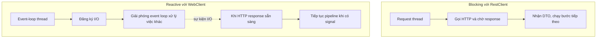
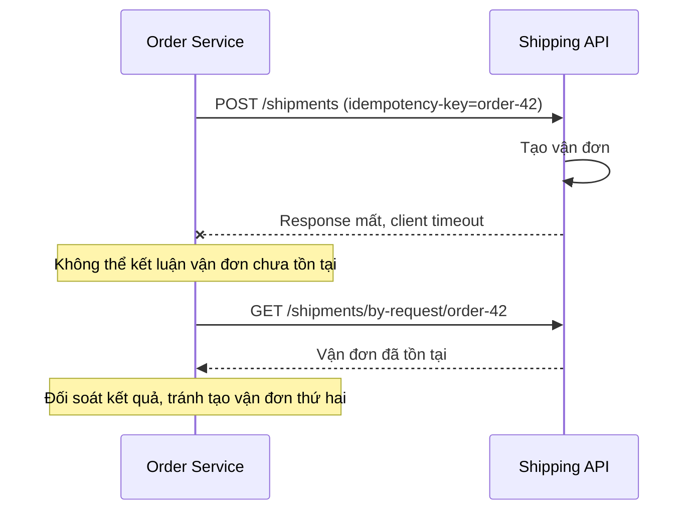
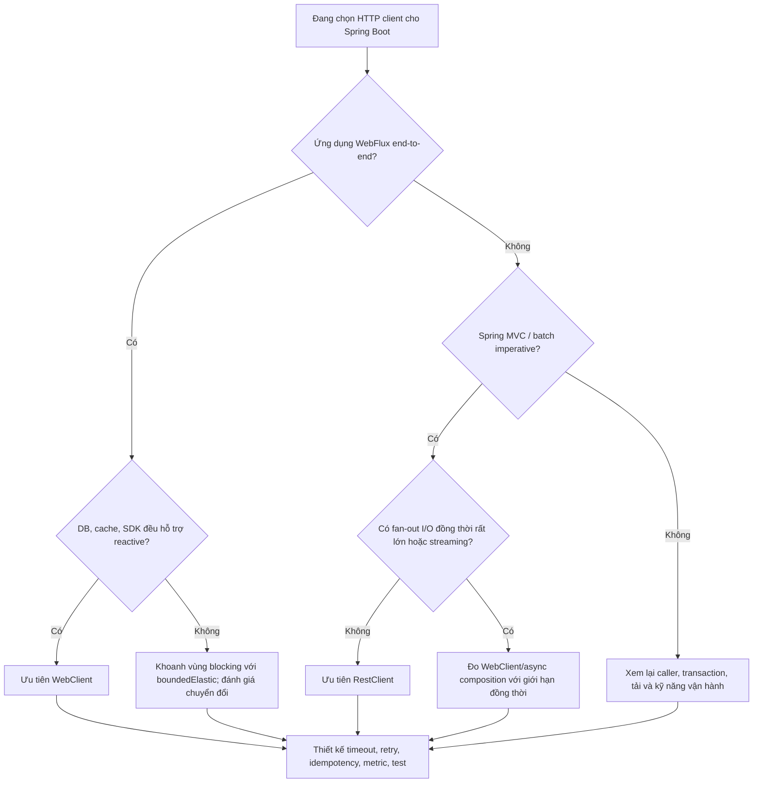

# Lựa chọn API chặn luồng hoặc reactive theo kiến trúc ứng dụng

> **Chương:** Lựa chọn HTTP client  
> **Phạm vi:** SPRING_BOOT_INTEGRATION — tổ chức tích hợp qua HTTP client, cơ sở dữ liệu, cache, broker thông điệp và adapter Spring Integration; chú trọng cấu hình, hợp đồng dữ liệu, giao dịch, lỗi, xử lý trùng lặp, kiểm thử và quan sát luồng thực tế.

## 1. Bài toán: chọn client nào cho lời gọi HTTP ra ngoài?

Giả sử ứng dụng nhận đơn hàng, truy vấn tồn kho qua REST API, ghi đơn vào PostgreSQL rồi phát `OrderCreated` qua broker. Đội phát triển phải chọn API để gọi hệ thống tồn kho:

- **API chặn luồng (blocking):** lời gọi trả về DTO hoặc ném exception; luồng gọi chờ cho tới khi có phản hồi/lỗi. Ví dụ `RestClient`, `RestTemplate` trong Spring Framework.
- **API reactive:** lời gọi trả về một publisher như `Mono<StockStatus>` hoặc `Flux<StockStatus>`; các bước xử lý được kết hợp thành pipeline bất đồng bộ, non-blocking khi sử dụng connector/driver non-blocking. Ví dụ `WebClient` trong Spring WebFlux.

Câu hỏi đúng **không chỉ là API nào nhanh hơn**. Cần xét kiến trúc ứng dụng, loại I/O khác đang dùng, mức đồng thời, transaction, deadline và kỹ năng vận hành. Chọn reactive chỉ ở lớp HTTP mà toàn bộ service liên tục gọi JDBC/JPA blocking có thể làm thiết kế phức tạp mà không thu được lợi ích mong muốn.

### 1.1. Kết quả học tập

Sau bài học, bạn có thể:

1. Phân biệt *blocking*, *asynchronous*, *non-blocking* và *reactive* mà không đồng nhất chúng.
2. Chọn `RestClient`, `WebClient` hoặc API declarative `@HttpExchange` theo mô hình Spring MVC/WebFlux.
3. Giải thích vai trò của platform thread, virtual thread, event loop và connection pool.
4. Viết hai ví dụ tích hợp cùng hợp đồng dữ liệu với cấu hình, timeout và xử lý lỗi có chủ đích.
5. Chỉ ra rủi ro của `.block()`, retry không an toàn, transaction xuyên HTTP, xử lý trùng và việc bỏ qua lỗi publisher.
6. Kiểm thử, đo hiệu năng và quan sát client trước khi quyết định chuyển đổi kiến trúc.

## 2. Hiểu đúng mô hình thực thi

### 2.1. Blocking không đồng nghĩa “chậm”, reactive không đồng nghĩa “song song”

**Blocking:** một luồng Java gọi một thao tác I/O và chờ cho tới khi thao tác hoàn tất. Trong thời gian chờ, luồng đó không tiếp tục thực thi mã phía sau lời gọi.

**Asynchronous:** kết quả có thể đến sau; người gọi dùng callback, future hoặc publisher. Một API trả về `CompletableFuture` có thể chạy việc I/O bằng thread pool khác, nhưng điều đó **không tự chứng minh** I/O bên dưới là non-blocking.

**Non-blocking I/O:** cơ chế I/O không cần giữ một luồng chờ riêng cho mỗi thao tác mạng đang chờ; hệ thống có thể nhận thông báo khi socket sẵn sàng.

**Reactive:** cách biểu diễn và kết hợp luồng xử lý bằng publisher/subscriber, hỗ trợ mô hình demand/backpressure. Reactor dùng `Mono<T>` cho 0–1 kết quả và `Flux<T>` cho 0–N kết quả. Tính non-blocking của cả pipeline còn phụ thuộc tất cả bước bên dưới.



Sơ đồ mô tả đơn giản. Hệ thống thực còn có nhiều luồng khác, scheduler, connection pools, SSL, parser, codec và giới hạn tài nguyên. Reactor vẫn có thể dùng thread để chạy tác vụ CPU hoặc nguồn blocking nếu được chuyển sang scheduler phù hợp.

### 2.2. Chi phí giữ luồng chờ và độ trễ

Xét 200 lời gọi HTTP đồng thời, mỗi lời gọi chờ đối tác trung bình 500 ms:

- Mô hình chặn luồng với **platform threads** thường cần lượng luồng đủ lớn để giữ các lời gọi đang chờ; số luồng quá cao tốn stack, chuyển ngữ cảnh và tài nguyên.
- `WebClient` non-blocking có thể phục vụ nhiều socket chờ với tương đối ít event-loop threads; ứng dụng vẫn phải quản lý pool kết nối, bộ nhớ, timeout và tải của downstream.
- **Virtual threads** (Java 21+, hỗ trợ cấu hình trong các phiên bản Boot phù hợp) làm chi phí cho một tác vụ blocking đồng thời thấp hơn nhiều so với platform thread. Tuy vậy API `RestClient` vẫn **blocking theo ngữ nghĩa** và không cung cấp backpressure của Reactor; connection pool và server đích vẫn là giới hạn.

Đây là cách phân tích tài nguyên, **không phải benchmark** hay cam kết rằng WebClient nhanh hơn một tỷ lệ cụ thể. Nếu downstream trả lời gần như tức thì và mức đồng thời thấp, giải pháp blocking thường đơn giản và đủ tốt.

### 2.3. Nhiều request không đồng nghĩa có thể mở vô hạn kết nối

Năng lực hệ thống phải thỏa cả ba tầng:

| Tầng | Blocking | Reactive | Điều phải cấu hình/đo |
| --- | --- | --- | --- |
| Thread thực thi | Platform/virtual threads đang chờ hoặc xử lý | Event-loop threads và các scheduler | Số thread, thời gian chờ, thread starvation |
| Kết nối HTTP | Request factory và pool HTTP | Reactor Netty/connector và pool | Max connections, pending acquire, keep-alive, timeout |
| Dịch vụ đích | Cùng giới hạn upstream | Cùng giới hạn upstream | Rate limit, concurrency, response time, 429/503 |

Reactive tiết kiệm luồng chờ nhưng không loại bỏ giới hạn socket hoặc rate limit. Đẩy một lúc hàng nghìn request bằng `flatMap` không giới hạn có thể làm nghẽn pool và tạo retry storm.

## 3. Những API HTTP client chính trong hệ sinh thái Spring

Nội dung và code minh họa bên dưới nhắm **Spring Boot 3.2–3.5**, dùng Spring Framework 6.1+ và Java 17+. Tên starter và auto-configuration có thể thay đổi ở các dòng lớn như Boot 4; luôn kiểm tra tài liệu tương ứng với BOM đang dùng.

| Lựa chọn | Kiểu API | Phụ thuộc thông dụng | Khi nên dùng | Điểm cần nhớ |
| --- | --- | --- | --- | --- |
| **`RestClient`** | Fluent, blocking | Spring Web / `spring-boot-starter-web` | Spring MVC, service imperative, JDBC/JPA, ít nhu cầu streaming | API hiện đại cho code HTTP đồng bộ; có `RestClient.Builder` được Boot hỗ trợ cấu hình |
| **`WebClient`** | Fluent, reactive | Spring WebFlux / `spring-boot-starter-webflux` | WebFlux end-to-end, nhiều I/O đồng thời, streaming, reactive composition | Trả `Mono`/`Flux`; không tự `subscribe()` rồi bỏ kết quả |
| **`RestTemplate`** | Blocking, imperative cũ | Spring Web | Duy trì codebase hiện có | Vẫn có thể sử dụng; khi viết luồng mới thường cân nhắc `RestClient` |
| **HTTP service interface** | Interface declarative qua `@HttpExchange` | Spring Web + adapter phù hợp | Muốn contract client rõ, giảm boilerplate | Có thể dùng adapter `RestClient` hoặc `WebClient`; kiểu trả về phải phù hợp |
| **JDK `java.net.http.HttpClient`** | Blocking hoặc `CompletableFuture` | JDK 11+ | Cần kiểm soát thấp hơn hoặc không muốn adapter Spring | Async future không tự tạo Reactor pipeline hoặc tích hợp Boot đầy đủ |

**REST controller MVC/WebFlux là phía server**, còn `RestClient`/`WebClient` là client gọi outbound. Ứng dụng MVC có thể gọi WebClient, nhưng phải dùng đúng mô hình xử lý và không suy ra server đã trở thành WebFlux.

### 3.1. Starter và BOM

Với Spring Boot 3.x, một ứng dụng MVC thường dùng:

```groovy
dependencies {
    implementation 'org.springframework.boot:spring-boot-starter-web'
    testImplementation 'org.springframework.boot:spring-boot-starter-test'
}
```

Nếu ứng dụng reactive từ đầu:

```groovy
dependencies {
    implementation 'org.springframework.boot:spring-boot-starter-webflux'
    testImplementation 'org.springframework.boot:spring-boot-starter-test'
}
```

Hai khối là **lựa chọn theo ứng dụng**. Khi WebFlux starter được đưa vào ứng dụng đã có Spring MVC starter, Boot thường chọn **Spring MVC làm web application type mặc định** nếu cả hai có mặt; sự xuất hiện của `WebClient` không tự biến server MVC thành WebFlux.

Để BOM của Spring Boot quản lý phiên bản Spring Web, Spring WebFlux, Reactor, Netty và HTTP client tương thích. Đừng tự ghép ngẫu nhiên các bản Framework/Boot khác nhau để chỉ nâng một API.

### 3.2. Hai câu hỏi trước khi chọn

**Ứng dụng đang xử lý nghiệp vụ theo mô hình nào?**

- Controller/service trả DTO trực tiếp, dùng JPA/JDBC và transaction kiểu thread-bound → thường chọn `RestClient`.
- Controller/service trả `Mono`/`Flux`, dùng R2DBC, reactive Redis và downstream reactive → thường chọn `WebClient`.
- Ứng dụng Spring MVC gọi nhiều HTTP endpoint song song → có thể dùng WebClient/Future ở ranh giới I/O dù ứng dụng chưa chuyển toàn bộ sang reactive, nhưng phải quản lý thread và timeout.

**Tải vận hành có thực sự cần non-blocking?**

- Đo concurrent in-flight requests, latency, thời gian chờ I/O và thread utilization.
- Nếu phần lớn thời gian là CPU, serialization nặng hoặc một database blocking, thêm WebClient không giải quyết nút thắt đó.
- Nếu có nhiều I/O chờ độc lập, streaming hoặc fan-out cần giới hạn concurrency, WebClient có lợi thế về composition.

## 4. Ma trận chọn client theo kiến trúc ứng dụng

| Kiến trúc thực tế | Lựa chọn mặc định | Lý do | Điều cần tránh |
| --- | --- | --- | --- |
| Spring MVC + JDBC/JPA, luồng đồng bộ | `RestClient` | Cùng mô hình thực thi, lỗi và transaction dễ theo dõi | Giữ DB transaction khi chờ upstream quá lâu |
| Spring MVC + Java 21 virtual threads | `RestClient` trên virtual threads nếu đã kiểm chứng | Giảm chi phí giữ platform thread khi chờ HTTP | Quên giới hạn pool, rate limit và timeout |
| Spring MVC có fan-out lớn tới nhiều HTTP API | Cân nhắc `WebClient` hoặc async composition có giới hạn | Kết hợp nhiều lời gọi I/O mà không giữ một thread trên mỗi lần chờ | Gọi `.block()` ở từng nhánh làm mất phần lớn lợi thế |
| Spring WebFlux + reactive persistence | `WebClient` | End-to-end non-blocking, phù hợp Reactor pipeline | Gọi blocking HTTP/JDBC trên event loop |
| Spring WebFlux nhưng cần dùng thư viện blocking không thay được | Tạm dùng blocking trên scheduler riêng có giới hạn, lên kế hoạch thay | Cô lập phần I/O blocking khỏi event loop | `Mono.just(blockingCall())` hoặc blocking trực tiếp trong `map` |
| Batch job imperative, số lời gọi vừa phải | `RestClient` | Code tuần tự và kiểm soát lỗi dễ hiểu | Quên giới hạn đồng thời nếu batch dùng nhiều worker |
| Xử lý streaming/chunked response liên tục | Thường chọn `WebClient` | `Flux` và xử lý từng phần phù hợp | Gom toàn bộ response lớn vào bộ nhớ không cần thiết |

### 4.1. Virtual thread là lựa chọn thứ ba về tài nguyên, không phải loại client thứ ba

Trong hệ sinh thái Spring Boot 3.2+, khi sử dụng Java 21+, có thể bật hỗ trợ virtual threads trong phạm vi thành phần Boot hỗ trợ:

```yaml
spring:
  threads:
    virtual:
      enabled: true
```

Với MVC, virtual threads có thể giúp giảm áp lực của blocking request handling và một số executor được Boot quản lý. Tuy nhiên:

- `RestClient` **vẫn chặn luồng gọi** về mặt điều khiển chương trình.
- Virtual threads không làm database JDBC, HTTP socket, connection pool hoặc upstream chấp nhận vô hạn request.
- Từng thư viện đồng bộ hóa, native call hoặc synchronized section có thể tác động đến khả năng scale; đo và profile thực tế trước khi kết luận.
- Một vài loại ứng dụng chạy chỉ bằng virtual/daemon threads có yêu cầu cấu hình giữ JVM sống; cần kiểm tra hướng dẫn Boot theo runtime cụ thể.

Nếu mục tiêu chỉ là cải thiện khả năng chịu tải I/O blocking của ứng dụng MVC, thử virtual threads và đo có thể dễ hơn chuyển sang Reactive toàn bộ. Nếu mục tiêu là streaming/reactive flow và backpressure, virtual threads không thay thế các đặc tính đó.

## 5. Ví dụ imperative: Spring MVC gọi tồn kho bằng RestClient

Ứng dụng có endpoint nhận SKU, gọi HTTP API tồn kho, rồi trả DTO. Giả định đối tác cung cấp:

```text
GET https://inventory.example.invalid/api/items/{sku}/stock
200 OK
Content-Type: application/json

{"sku": "SKU-42", "available": 7}
```

Tên miền `example.invalid` chỉ để minh họa; không phải dịch vụ thật. Ví dụ dùng Spring Boot 3.2+ với Spring Web.

### 5.1. Cấu hình endpoint tách khỏi Java

```yaml
integration:
  inventory:
    base-url: ${INVENTORY_BASE_URL:https://inventory.example.invalid/api}
```

Trong môi trường sản xuất, cấu hình HTTPS endpoint, authentication và secret từ nguồn cấu hình an toàn. Không ghi token thật trong repository hoặc log.

### 5.2. Bean RestClient dành riêng cho upstream

```java
import org.springframework.beans.factory.annotation.Value;
import org.springframework.context.annotation.Bean;
import org.springframework.context.annotation.Configuration;
import org.springframework.web.client.RestClient;

@Configuration
class InventoryRestClientConfig {

    @Bean("inventoryRestClient")
    RestClient inventoryRestClient(
            RestClient.Builder builder,
            @Value("${integration.inventory.base-url}") String baseUrl) {
        return builder.baseUrl(baseUrl).build();
    }
}
```

Boot cung cấp `RestClient.Builder` khi cơ chế auto-configuration phù hợp; dùng builder được inject giúp nhận các customizer HTTP chung đã được cấu hình. Chúng ta tạo bean `RestClient` riêng vì Boot không tự suy ra endpoint cụ thể của một đối tác.

### 5.3. DTO và gateway

```java
// StockStatus.java
public record StockStatus(String sku, int available) {
}
```

```java
import java.util.Objects;
import org.springframework.beans.factory.annotation.Qualifier;
import org.springframework.stereotype.Service;
import org.springframework.web.client.RestClient;

@Service
public class BlockingInventoryGateway {
    private final RestClient client;

    public BlockingInventoryGateway(
            @Qualifier("inventoryRestClient") RestClient client) {
        this.client = client;
    }

    public StockStatus findStock(String sku) {
        StockStatus stock = client.get()
                .uri("/items/{sku}/stock", sku)
                .retrieve()
                .body(StockStatus.class);
        return Objects.requireNonNull(
                stock, "Inventory API returned an empty body");
    }
}
```

Đối với API thật, kiểm tra `available >= 0`, SKU trả về, định dạng JSON và sự khác biệt giữa 404 (SKU không tồn tại), 429 (rate limit), 503 (sự cố tạm thời). `Objects.requireNonNull` chỉ minh họa rằng một body rỗng cần được xử lý; một ứng dụng sản xuất nên chuyển nó thành lỗi contract có mã và metric rõ ràng.

### 5.4. REST controller MVC

```java
import org.springframework.web.bind.annotation.GetMapping;
import org.springframework.web.bind.annotation.PathVariable;
import org.springframework.web.bind.annotation.RestController;

@RestController
public class StockController {
    private final BlockingInventoryGateway gateway;

    public StockController(BlockingInventoryGateway gateway) {
        this.gateway = gateway;
    }

    @GetMapping("/stock/{sku}")
    public StockStatus stock(@PathVariable String sku) {
        return gateway.findStock(sku);
    }
}
```

Lời gọi `findStock(...)` chạy trên luồng xử lý request và chỉ trả về khi upstream xong hoặc lỗi. Với mô hình đồng bộ, có thể viết các bước rõ ràng và dùng `try/catch` hoặc `@RestControllerAdvice` để mapping lỗi. Nếu upstream chậm, thread này phải chờ; vì vậy timeout và giới hạn số lời gọi đồng thời là bắt buộc ở môi trường vận hành.

## 6. Ví dụ reactive: Spring WebFlux gọi cùng API bằng WebClient

Giữ nguyên URL và DTO, nhưng toàn bộ HTTP integration trả về `Mono<StockStatus>`. Ví dụ dưới giả định **ứng dụng WebFlux**; không đăng ký cùng lúc hai controller có mapping trùng nhau trong cùng một ứng dụng.

### 6.1. Bean WebClient từ builder của Boot

```java
import org.springframework.beans.factory.annotation.Value;
import org.springframework.context.annotation.Bean;
import org.springframework.context.annotation.Configuration;
import org.springframework.web.reactive.function.client.WebClient;

@Configuration
class InventoryWebClientConfig {

    @Bean("inventoryWebClient")
    WebClient inventoryWebClient(
            WebClient.Builder builder,
            @Value("${integration.inventory.base-url}") String baseUrl) {
        return builder.baseUrl(baseUrl).build();
    }
}
```

Spring Boot có thể auto-configure một `WebClient.Builder` khi Spring WebFlux hiện diện. `WebClient` tạo từ builder phù hợp giúp tận dụng connector, codec và customizer do ứng dụng cấu hình.

### 6.2. Gateway trả Publisher

```java
import java.time.Duration;
import org.springframework.beans.factory.annotation.Qualifier;
import org.springframework.stereotype.Service;
import org.springframework.web.reactive.function.client.WebClient;
import reactor.core.publisher.Mono;

@Service
public class ReactiveInventoryGateway {
    private final WebClient client;

    public ReactiveInventoryGateway(
            @Qualifier("inventoryWebClient") WebClient client) {
        this.client = client;
    }

    public Mono<StockStatus> findStock(String sku) {
        return client.get()
                .uri("/items/{sku}/stock", sku)
                .retrieve()
                .bodyToMono(StockStatus.class)
                .switchIfEmpty(Mono.error(
                        new IllegalStateException("Empty inventory body")))
                .timeout(Duration.ofSeconds(3));
    }
}
```

`Mono` mô tả một công việc sẽ phát kết quả/lỗi khi được subscribe. `timeout` ở đây đặt **deadline cấp pipeline** tham khảo; nó không thay thế cấu hình connect timeout, response timeout, pool-acquire timeout ở HTTP connector. Hủy subscription khi timeout không có nghĩa server đích chắc chắn dừng mọi xử lý đã bắt đầu.

### 6.3. Controller WebFlux

```java
import org.springframework.web.bind.annotation.GetMapping;
import org.springframework.web.bind.annotation.PathVariable;
import org.springframework.web.bind.annotation.RestController;
import reactor.core.publisher.Mono;

@RestController
public class ReactiveStockController {
    private final ReactiveInventoryGateway gateway;

    public ReactiveStockController(ReactiveInventoryGateway gateway) {
        this.gateway = gateway;
    }

    @GetMapping("/stock/{sku}")
    public Mono<StockStatus> stock(@PathVariable String sku) {
        return gateway.findStock(sku);
    }
}
```

Controller trả publisher cho framework web; **không tự gọi `subscribe()`**. Framework quản lý subscription, gửi HTTP response và lan truyền lỗi. Một method gọi `WebClient` rồi `subscribe()` để “chạy nền” và trả HTTP 200 ngay có thể làm thất lạc lỗi, làm sai thời điểm commit nghiệp vụ hoặc mất khả năng truy vết.

## 7. Các tổ hợp dễ nhầm và cách xử lý đúng

### 7.1. Spring MVC có dùng được WebClient không?

**Có.** `WebClient` là HTTP client, không bắt buộc server phải dùng WebFlux. Chẳng hạn MVC có thể dùng `WebClient` để gộp ba yêu cầu HTTP độc lập. Tuy nhiên, nếu cuối cùng gọi `.block()` để chuyển sang kiểu đồng bộ, thread MVC lại phải chờ kết quả. Điều đó đôi khi vẫn chấp nhận được ở **ranh giới imperative** nhưng không phải “tự nhiên non-blocking toàn bộ”.

Một ví dụ phối hợp nhiều upstream theo pipeline:

```java
Mono<Tuple2<StockStatus, PriceStatus>> combined = Mono.zip(
        inventoryGateway.findStock(sku),
        pricingGateway.findPrice(sku));
```

Đoạn minh họa giả định `pricingGateway.findPrice(...)` trả `Mono<PriceStatus>` và đã có các type/import cần thiết (Reactor `Mono`, `Tuple2`). Nếu hai lời gọi I/O độc lập và connector non-blocking, pipeline có thể chờ hai kết quả đồng thời. Nhưng khi MVC block chờ cuối pipeline, **vẫn có một thread servlet chờ**. Cần đặt deadline tổng, giới hạn số yêu cầu đồng thời và xử lý lỗi từng upstream.

Với MVC hỗ trợ mô hình async response, có thể trả về `DeferredResult` hoặc `CompletableFuture` theo hợp đồng controller, nhưng lựa chọn đó cần kiểm thử propagation context, cancellation, error handling và cấu hình executor/servlet.

### 7.2. WebFlux có nên gọi RestClient trực tiếp không?

**Không nên gọi RestClient, JDBC/JPA hoặc SDK đồng bộ ngay trên Netty event loop.** Một thao tác chờ 2 giây có thể giữ event-loop thread và làm chậm các kết nối khác đang chia sẻ thread đó.

Ví dụ sai:

```java
// SAI: findStock() chạy ngay khi biểu thức được đánh giá,
// trước cả khi Mono được subscribe.
Mono<StockStatus> wrong = Mono.just(blockingInventoryGateway.findStock(sku));
```

Nếu bắt buộc dùng API đồng bộ trong một pipeline reactive, cô lập nó:

```java
import reactor.core.publisher.Mono;
import reactor.core.scheduler.Schedulers;

Mono<StockStatus> bridged = Mono.fromCallable(
        () -> blockingInventoryGateway.findStock(sku))
        .subscribeOn(Schedulers.boundedElastic());
```

`Mono.fromCallable` hoãn việc gọi cho tới lúc subscribe; `subscribeOn(Schedulers.boundedElastic())` đưa phần blocking sang scheduler được thiết kế cho kiểu công việc này. Đây là **cầu nối chuyển tiếp** có giới hạn: boundedElastic có số thread/queue hữu hạn, không biến lời gọi trở thành non-blocking. Không chuyển cả giao dịch JDBC thread-bound sang một pipeline tùy ý rồi kỳ vọng `@Transactional` vẫn có cùng ngữ nghĩa xuyên qua nhiều scheduler.

### 7.3. Vì sao `.block()` đặc biệt nguy hiểm trong reactive flow?

```java
// SAI nếu chạy trên Reactor Netty event loop.
StockStatus stock = reactiveInventoryGateway.findStock(sku).block();
```

`block()` chặn luồng đang gọi cho đến khi publisher hoàn tất; Reactor còn có thể phát lỗi nếu cố gọi blocking API trên scheduler được đánh dấu non-blocking. Nó đánh mất lợi thế khi ở giữa reactive pipeline và có nguy cơ starvation/deadlock khi kết hợp với tác vụ cũng cần chính event loop đang bị chặn.

Nếu ranh giới bên ngoài thực sự đồng bộ, có thể chuyển đổi một lần ở **mép hệ thống** và hiểu rõ thread nào đang chờ; thường đơn giản hơn là dùng `RestClient` trực tiếp cho use case đó.

### 7.4. Reactor context không phải ThreadLocal thông thường

Spring MVC/imperative thường mang thông tin trong `ThreadLocal`, ví dụ MDC logging, security context hoặc transaction resource. Reactor có **Reactor Context** và execution có thể đổi thread. Vì vậy:

- Đừng mặc định MDC/ThreadLocal tự được truyền qua mọi `publishOn`, `subscribeOn` và callback.
- Dùng tích hợp context propagation, observation/tracing của Spring/Micrometer theo phiên bản thực tế; đo trace xuyên boundary.
- Reactive transaction (ví dụ R2DBC với reactive transaction manager) dùng cơ chế gắn transaction trong reactive pipeline; không tự gộp với transaction JDBC/JPA kiểu thread-bound.
- Một reactive HTTP call thành công không có nghĩa message broker đã được publish hoặc database đã commit như mong muốn; phải có thiết kế consistency riêng.

### 7.5. API declarative `@HttpExchange` vẫn cần chọn backend

Spring Framework hỗ trợ mô tả contract HTTP bằng interface:

```java
import org.springframework.web.bind.annotation.PathVariable;
import org.springframework.web.service.annotation.GetExchange;
import org.springframework.web.service.annotation.HttpExchange;

@HttpExchange("/items")
public interface InventoryHttpService {
    @GetExchange("/{sku}/stock")
    StockStatus findStock(@PathVariable String sku);
}
```

Với Spring Framework 6.1+, có thể tạo proxy bằng `HttpServiceProxyFactory` và `RestClientAdapter`:

```java
import org.springframework.web.client.support.RestClientAdapter;
import org.springframework.web.service.invoker.HttpServiceProxyFactory;

InventoryHttpService service = HttpServiceProxyFactory
        .builderFor(RestClientAdapter.create(inventoryRestClient))
        .build()
        .createClient(InventoryHttpService.class);
```

Giả định `inventoryRestClient` đã có base URL kết thúc ở `/api`. Khi dùng `WebClientAdapter`, interface reactive thường trả `Mono<StockStatus>` để giữ nguyên lợi ích composition; không chỉ thay adapter rồi giữ mọi method đồng bộ để mong có non-blocking. Proxy giúp chuẩn hóa endpoint và thuận tiện kiểm thử, nhưng **không tự định nghĩa timeout, retry, transaction hoặc error contract**.

## 8. Timeout, pool kết nối và giới hạn tải

Một quyết định client chỉ hoàn chỉnh khi biết cách chặn những lời gọi quá chậm. Cần phân biệt:

| Giới hạn | Có nghĩa gì? | Nếu không giới hạn |
| --- | --- | --- |
| **Connect timeout** | Thời gian tối đa chờ thiết lập kết nối tới host:port | Client có thể chờ lâu khi đường mạng hỏng |
| **Response/read timeout** | Thời gian chờ phản hồi/đọc theo ngữ nghĩa request factory hoặc connector | Một request có thể chiếm tài nguyên rất lâu |
| **Pool acquire timeout** | Thời gian chờ có connection rảnh trong pool | Hàng chờ lấy kết nối tăng, kéo dài latency |
| **Per-attempt timeout** | Giới hạn một lần gọi HTTP | Một lần thử không chiếm toàn bộ ngân sách |
| **End-to-end deadline** | Giới hạn tổng request, retry, backoff, deserialize và xử lý | Người dùng đã timeout nhưng backend vẫn tiếp tục làm việc |
| **Max concurrency / bulkhead** | Số yêu cầu đồng thời được phép tới một upstream | Vượt hạn mức, socket exhaustion, overload |

Không giả định các giá trị timeout mặc định đều phù hợp với hệ thống. Ví dụ SLA của API là 2 giây thì không thể tùy ý đặt timeout upstream 10 giây cộng thêm ba lần retry.

### 8.1. Cấu hình RestClient với JDK HTTP request factory

Với Spring Framework 6.1+, có thể dùng `JdkClientHttpRequestFactory` và `java.net.http.HttpClient`:

```java
import java.net.http.HttpClient;
import java.time.Duration;
import org.springframework.http.client.JdkClientHttpRequestFactory;
import org.springframework.web.client.RestClient;

HttpClient jdkClient = HttpClient.newBuilder()
        .connectTimeout(Duration.ofSeconds(1))
        .build();

JdkClientHttpRequestFactory factory =
        new JdkClientHttpRequestFactory(jdkClient);
factory.setReadTimeout(Duration.ofSeconds(3));

RestClient client = RestClient.builder()
        .requestFactory(factory)
        .baseUrl("https://inventory.example.invalid/api")
        .build();
```

Đây là ví dụ **cấu hình request factory cụ thể**, không nhất thiết là mặc định của Boot. Nếu ứng dụng đã nhận builder được auto-configure từ Boot, nên áp dụng request factory trên builder đó để giữ customizer chung, thay vì tự tạo mọi client từ đầu. Trong môi trường throughput lớn, xem xét khả năng tái sử dụng kết nối, giới hạn pool và đặc điểm request factory được chọn. Tên gọi `readTimeout` phải được hiểu theo implementation tương ứng; không tự suy ra một timeout duy nhất có thể khống chế mọi giai đoạn của request.

### 8.2. Cấu hình WebClient với Reactor Netty

Khi WebClient dùng Reactor Netty làm connector, cấu hình connect và response timeout theo connector:

```java
import java.time.Duration;
import io.netty.channel.ChannelOption;
import reactor.netty.http.client.HttpClient;
import org.springframework.http.client.reactive.ReactorClientHttpConnector;
import org.springframework.web.reactive.function.client.WebClient;

HttpClient httpClient = HttpClient.create()
        .option(ChannelOption.CONNECT_TIMEOUT_MILLIS, 1000)
        .responseTimeout(Duration.ofSeconds(3));

WebClient client = WebClient.builder()
        .clientConnector(new ReactorClientHttpConnector(httpClient))
        .baseUrl("https://inventory.example.invalid/api")
        .build();
```

Đoạn code giả định reactor-netty-http và Netty tương thích đã có trong dependency do Boot quản lý. Có thể đặt cấu hình tương ứng trong bean `WebClient.Builder` của ứng dụng để dùng lại customizer chung.

Nếu cần pool tùy chỉnh, dùng `ConnectionProvider` với số kết nối tối đa, số pending acquire và thời gian chờ phù hợp. Khi tạo pool/provider thủ công, ứng dụng phải quản lý vòng đời và giải phóng tài nguyên. Pool HTTP và Reactor scheduler là những giới hạn độc lập.

### 8.3. Không retry bằng cách nhân thêm tải

Giả sử một lời gọi HTTP có tối đa 3 attempts và lớp service bên ngoài cũng retry toàn phương thức 3 lần. Số lần gọi upstream có thể lên đến 9. Nếu message broker redeliver thêm, tải có thể tăng lớn hơn nữa.

Quy tắc vận hành:

1. Chỉ định tầng nào sở hữu retry budget.
2. Phân biệt **số attempts** (bao gồm lần đầu) và **số retries** (chỉ những lần thực hiện lại).
3. Thêm backoff có jitter; tôn trọng `Retry-After` trên HTTP 429/503 khi hợp đồng yêu cầu.
4. Giới hạn concurrency và có circuit breaker/bulkhead khi cần.
5. Không retry thao tác gây tác dụng phụ nếu chưa chứng minh idempotency/reconciliation.
6. Bảo đảm tổng retry và backoff không vượt deadline của use case.

Reactive không tự động cung cấp những nguyên tắc đó; chúng vẫn phải được áp dụng trong flow.

## 9. Ánh xạ HTTP lỗi: khác cú pháp nhưng giống trách nhiệm

### 9.1. Hợp đồng lỗi trước khi chọn API

Giả sử API tồn kho quy ước:

| Tín hiệu | Ý nghĩa đã thống nhất | Hành động |
| --- | --- | --- |
| 200 + JSON hợp lệ | Có dữ liệu tồn kho | Parse + validate DTO |
| 404 + mã `SKU_NOT_FOUND` | SKU không tồn tại | Trả kết quả domain, không retry |
| 429 + `Retry-After` | Vượt rate limit kỹ thuật | Chờ có kiểm soát nếu còn budget |
| 503 | Dịch vụ tạm không sẵn sàng | Retry giới hạn cho `GET` khi phù hợp |
| 400 do request sai schema | Contract/caller error | Sửa payload/code, không retry |
| Read timeout sau `POST` có side effect | Không rõ upstream đã commit chưa | Tra cứu trạng thái/idempotency key trước khi gửi lại |

**HTTP status không tự quyết định loại lỗi nghiệp vụ.** Một số API trả mã miền trong response body hoặc dùng 409/422; adapter phải biết hợp đồng của upstream.

### 9.2. RestClient: chuyển status sang exception nghiệp vụ

Ví dụ một exception độc lập:

```java
public final class UnknownSkuException extends RuntimeException {
    public UnknownSkuException(String sku) {
        super("Unknown SKU: " + sku);
    }
}
```

Với `RestClient`:

```java
StockStatus stock = client.get()
        .uri("/items/{sku}/stock", sku)
        .retrieve()
        .onStatus(
                status -> status.value() == 404,
                (request, response) -> {
                    throw new UnknownSkuException(sku);
                })
        .body(StockStatus.class);
```

Với các response lỗi khác không có handler riêng, `retrieve()` có cơ chế chuyển status lỗi thành exception theo mặc định. Trong hệ thống thật, cần kiểm tra error body và mã miền trước khi kết luận 404 luôn là SKU không tồn tại.

### 9.3. WebClient: chuyển status thành tín hiệu lỗi của publisher

```java
Mono<StockStatus> stock = client.get()
        .uri("/items/{sku}/stock", sku)
        .retrieve()
        .onStatus(
                status -> status.value() == 404,
                response -> Mono.error(new UnknownSkuException(sku)))
        .bodyToMono(StockStatus.class);
```

WebClient ánh xạ lỗi thành `onError` trong pipeline; exception không nhất thiết được ném ra lúc method `findStock(...)` trả về. Muốn xử lý, dùng operator như `onErrorMap`, `onErrorResume`, `retryWhen` tại vị trí có ngữ nghĩa đúng; không bọc `try/catch` quanh việc **tạo** một `Mono` rồi nghĩ đã bắt hết lỗi bất đồng bộ.

**Cẩn trọng với `onErrorResume`:** trả dữ liệu mặc định như “còn 0 sản phẩm” khi thực tế API tồn kho đang mất kết nối có thể tạo quyết định sai. Fallback phải được domain cho phép, và response cần cho biết dữ liệu tạm thời hay không đáng tin cậy khi đó là yêu cầu.

### 9.4. RetryWhen chỉ dùng cho lời gọi an toàn

Ví dụ retry riêng khi upstream trả HTTP 503 trong một thao tác `GET`:

```java
import java.time.Duration;
import org.springframework.web.reactive.function.client.WebClientResponseException;
import reactor.core.publisher.Mono;
import reactor.util.retry.Retry;

Mono<StockStatus> stockWithRetry = reactiveInventoryGateway.findStock(sku)
        .retryWhen(Retry.backoff(2, Duration.ofMillis(200))
                .maxBackoff(Duration.ofSeconds(1))
                .jitter(0.5)
                .filter(error ->
                        error instanceof
                                WebClientResponseException.ServiceUnavailable))
        .timeout(Duration.ofSeconds(5));
```

`Retry.backoff(2, ...)` trong Reactor cho phép **tối đa hai lần retry sau lần đầu**. Ví dụ này đặt timeout tổng 5 giây cho pipeline bao gồm retry, bên cạnh timeout từng attempt đã cấu hình ở gateway. Nó chỉ minh họa API; cần đo/điều chỉnh budget theo latency và rate limit thực tế, bổ sung logging/metric khi exhausted và phân loại cả lỗi kết nối nếu phù hợp.

Không sao chép nguyên đoạn retry này vào `POST /charge`, `POST /shipment` hay thao tác publish event: với side effect, timeout có thể xảy ra **sau khi upstream đã áp dụng yêu cầu**.

## 10. Giao dịch và consistency trong luồng tích hợp

### 10.1. Không giữ transaction database trong khi chờ HTTP vô hạn

Ví dụ luồng đặt hàng:

```text
1. Kiểm tra tồn kho qua HTTP
2. Ghi đơn hàng vào PostgreSQL
3. Gửi OrderCreated tới broker
```

Với Spring MVC/JPA, nên thiết kế giao dịch database ngắn và có boundary rõ, thay vì mở transaction trước bước 1 rồi giữ lock/connection trong suốt thời gian chờ upstream. Với WebFlux/R2DBC, quyết định tương tự vẫn đúng: việc sử dụng publisher không tự rút ngắn thời gian giữ tài nguyên giao dịch nếu pipeline đặt boundary sai.

### 10.2. Reactive không tạo transaction xuyên hệ thống

| Thành phần | Cần trả lời |
| --- | --- |
| HTTP client | Lần gọi có thể được upstream áp dụng trước timeout không? |
| JDBC/JPA hoặc R2DBC | Transaction DB bắt đầu/commit/rollback khi nào? |
| Cache Redis | Cache miss/timeout có nên làm dừng nghiệp vụ không? |
| Broker Kafka/RabbitMQ/Pulsar | Publish thành công được xác nhận lúc nào? Có duplicate delivery không? |
| Spring Integration | Adapter nào ack/checkpoint message và ở giai đoạn nào? |

Không có client HTTP nào tự bảo đảm atomic commit giữa PostgreSQL và broker. Nếu dữ liệu đơn hàng và sự kiện phải nhất quán, có thể dùng **transactional outbox**: trong transaction SQL ghi cả đơn và outbox, sau đó publisher độc lập gửi event. Consumer cần idempotent vì publish/ack có thể được thử lại.

### 10.3. Idempotency khi timeout đối với thao tác ghi



Sơ đồ giả định đối tác **có API tra cứu theo request key**; đây không phải endpoint chuẩn của mọi API. Nếu đối tác có hợp đồng idempotency, có thể thử lại với **cùng key và payload** theo quy định. Nếu không có cơ chế nào, cần đưa thao tác vào trạng thái cần đối soát thay vì tự tạo request mới.

Điều này đúng cho cả RestClient và WebClient: **mô hình thread không thay đổi semantics của HTTP side effect**.

## 11. Kiểm thử HTTP client theo ý nghĩa hệ thống

Một bài test chỉ kiểm tra DTO trả về không đủ chứng minh client hoạt động tin cậy. Nên tách:

| Lớp kiểm thử | RestClient | WebClient | Điều cần xác minh |
| --- | --- | --- | --- |
| Unit | Mock gateway/service | Publisher với `StepVerifier` | Business mapping, fallback, retry predicate |
| HTTP contract | `MockRestServiceServer` hoặc mock HTTP server | Mock HTTP server + `StepVerifier` | URL, method, headers, JSON, status, error body |
| Timeout/retry | Server phản hồi chậm hoặc 503 → 200 | Server chậm, sequence 503 → 200 | Deadline tổng, số attempts, lỗi sau exhausted |
| Integration | HTTP server test chạy trong tiến trình/container | HTTP server test chạy trong tiến trình/container | TLS, connector, pool, serialization thật |
| End-to-end | HTTP → DB → broker | Reactive HTTP → R2DBC → broker | Side effect, transaction, duplicate, trace và recovery |

### 11.1. Ví dụ kiểm thử RestClient với MockRestServiceServer

Với Spring Framework 6.1+ và `spring-boot-starter-test`:

```java
import org.junit.jupiter.api.Test;
import org.springframework.http.MediaType;
import org.springframework.test.web.client.MockRestServiceServer;
import org.springframework.web.client.RestClient;

import static org.assertj.core.api.Assertions.assertThat;
import static org.springframework.test.web.client.match.MockRestRequestMatchers.requestTo;
import static org.springframework.test.web.client.response.MockRestResponseCreators.withSuccess;

class InventoryRestClientTest {

    @Test
    void mapsValidResponse() {
        RestClient.Builder builder = RestClient.builder()
                .baseUrl("https://inventory.example.invalid/api");
        MockRestServiceServer server =
                MockRestServiceServer.bindTo(builder).build();
        RestClient client = builder.build();

        server.expect(requestTo(
                "https://inventory.example.invalid/api/items/SKU-42/stock"))
                .andRespond(withSuccess(
                        "{\"sku\":\"SKU-42\",\"available\":7}",
                        MediaType.APPLICATION_JSON));

        StockStatus stock = client.get()
                .uri("/items/{sku}/stock", "SKU-42")
                .retrieve()
                .body(StockStatus.class);

        assertThat(stock).isNotNull();
        assertThat(stock.available()).isEqualTo(7);
        server.verify();
    }
}
```

Đây là phép thử outbound mapping **không cần gọi mạng thật**, không đo thread utilization hay timeout TCP. Khi cần kiểm tra timeout, TLS và hành vi connector, dùng HTTP test server thực (ví dụ WireMock/MockWebServer) và cấu hình chính xác backend đang dùng.

### 11.2. Kiểm thử reactive bằng StepVerifier

Ví dụ khi đã có gateway dùng HTTP mock server phản hồi JSON hợp lệ:

```java
import reactor.test.StepVerifier;

StepVerifier.create(reactiveInventoryGateway.findStock("SKU-42"))
        .assertNext(stock -> {
            assertThat(stock.sku()).isEqualTo("SKU-42");
            assertThat(stock.available()).isEqualTo(7);
        })
        .verifyComplete();
```

Đoạn kiểm thử này là **phần assert**: cần cấu hình mock server và import AssertJ tương ứng. Để test thời gian/backoff, có thể dùng `StepVerifier.withVirtualTime` nếu operator hỗ trợ clock ảo thích hợp; timeout của kết nối mạng thật vẫn cần integration test có kiểm soát. Không dùng `Thread.sleep` tùy ý thay cho điều kiện đồng bộ hóa hoặc deadline test.

### 11.3. Các tình huống phải có

1. 200 + body hợp lệ, 204/body rỗng, JSON sai schema hoặc field thiếu.
2. 404 theo hợp đồng domain, 429 + `Retry-After`, 503 phục hồi sau một lần thử.
3. DNS sai, connect timeout, response timeout, TLS handshake failure.
4. Nhiều yêu cầu đồng thời vượt pool; xác minh backpressure/bulkhead và hành vi khi hết queue.
5. Cancellation của reactive pipeline; xác minh không ngộ nhận “canceled client = rollback bên server”.
6. `POST` gửi thành công phía upstream nhưng response mất; idempotency/reconciliation ngăn side effect trùng.
7. Trace và correlation ID xuyên HTTP call, DB và message broker; log không làm lộ credential.

## 12. Quan sát và đánh giá hiệu năng

Không chọn reactive chỉ bằng một benchmark request đơn lẻ. Chạy cùng hợp đồng, cùng upstream/độ trễ giả lập, cùng giới hạn pool/concurrency, cùng tải và cùng phần xử lý dữ liệu.

### 12.1. Chỉ số vận hành nên thu thập

| Chỉ số | Câu hỏi |
| --- | --- |
| p50/p95/p99 latency theo upstream | Có tail latency hay nghẽn khi downstream chậm? |
| Throughput và in-flight requests | Hệ thống chịu được bao nhiêu yêu cầu đồng thời? |
| Platform/virtual thread count, event-loop utilization | Luồng có bị bão hòa hoặc bị blocking ngoài ý muốn? |
| HTTP connection pool active/idle/pending | Pool nhỏ, queue lớn hay mở kết nối quá nhiều? |
| Retry attempts, timeout, 429/503, circuit breaker state | Có retry storm hay quá hạn mức đối tác không? |
| CPU, heap, GC, allocation rate | Reactive có đổi chi phí bộ nhớ/CPU ở tải thật không? |
| Độ trễ từ request tới DB/broker completion | Luồng tổng thể có tốt hơn hay chỉ phần HTTP nhanh hơn? |
| Tracing/correlation | Có nhận diện được request, message và transaction liên quan không? |

Spring Boot Actuator, Micrometer và tracing có thể đo HTTP client nếu dependencies, instrumentation, observation registry và export phù hợp được cấu hình. Không mặc định rằng thêm starter WebFlux đã tự xuất mọi metric của pool hoặc broker. Tùy connector/backend mà metric cần bật thêm. Với high-cardinality data như SKU, token hoặc URL có query nhạy cảm, không đưa trực tiếp chúng vào metric tags.

### 12.2. Một thiết kế đo so sánh công bằng

1. Định nghĩa SLO, ví dụ p95 của endpoint dưới 500 ms ở mức 200 in-flight requests.
2. Khóa cùng dataset, payload, network latency và rate limit ở downstream.
3. Với blocking: kiểm soát thread pool/virtual threads, HTTP connection pool và timeout.
4. Với reactive: kiểm soát event-loop/scheduler, connection pool, giới hạn `flatMap` và timeout.
5. Tăng tải dần, đo throughput, tail latency, timeout, lỗi, CPU, heap và queue.
6. Phát hiện giới hạn thực (upstream throttling, DB pool, GC...) trước khi kết luận client nào phù hợp.

Kết quả cần được đánh giá trên **toàn luồng**, không chỉ thời gian tạo `Mono`. Việc gọi `WebClient.get()...bodyToMono(...)` thường chỉ thiết lập pipeline; phải subscribe/đợi kết quả mới đo được latency của HTTP request thực.

## 13. Cây quyết định thực tế



### 13.1. Checklist trước khi chốt

- [ ] Đã xác định phiên bản Boot/Framework và để BOM quản lý dependencies?
- [ ] Đã biết request server là MVC hay WebFlux và phần persistence là JDBC/JPA hay R2DBC?
- [ ] Đã có timeout kết nối, phản hồi, pool acquire và deadline tổng?
- [ ] Đã giới hạn concurrency, pool và retry budget theo upstream?
- [ ] Đã phân loại HTTP 4xx/5xx và lỗi domain theo hợp đồng thực tế?
- [ ] Với thao tác ghi, đã có idempotency key hoặc cách đối soát khi timeout?
- [ ] Không dùng blocking API trên event loop hoặc subscribe reactive publisher rồi bỏ lỗi?
- [ ] Ranh giới transaction, cache và publish broker đã có cơ chế consistency?
- [ ] Đã thử overload, timeout, duplicate và theo dõi đủ metric/trace?

## 14. Tình huống tổng hợp và câu hỏi tự kiểm tra

**Tình huống A — Spring MVC nhận đơn, JPA và broker:** mỗi request đọc tồn kho một lần, ghi PostgreSQL, xuất outbox event. Luồng xử lý imperative và lượng HTTP concurrency vừa phải. **Chọn `RestClient`** với timeout, phân loại lỗi, ngắn transaction và outbox là điểm xuất phát hợp lý.

**Tình huống B — API tổng hợp giá realtime:** mỗi request gọi 20 upstream độc lập, nhiều response chậm, ứng dụng dùng WebFlux/R2DBC và streaming kết quả. **Chọn `WebClient`** với `flatMap` giới hạn concurrency, timeout tổng, fallback đã được nghiệp vụ chấp nhận và metric pool/event loop.

**Tình huống C — Spring MVC chịu 1.000 yêu cầu concurrent vì downstream chậm:** thử tối ưu timeout/pool/rate limit, đo CPU/thread, cân nhắc **virtual threads với RestClient** trên Java 21+ trước khi quyết định chi phí chuyển đổi cả hệ thống sang reactive.

Câu hỏi:

1. Vì sao `WebClient` trả `Mono` chưa đủ để kết luận toàn bộ pipeline non-blocking?
2. Spring MVC có thể gọi WebClient không? Khi dùng `.block()`, thread nào đang chờ?
3. Nếu ứng dụng WebFlux dùng Hibernate/JPA, rủi ro khi gọi repository trực tiếp trên event loop là gì?
4. Virtual threads thay đổi chi phí tài nguyên nào, và không thay đổi ý nghĩa gì của `RestClient`?
5. Vì sao `Mono.just(blockingCall())` không cô lập lời gọi blocking, còn `Mono.fromCallable(...).subscribeOn(boundedElastic())` làm được?
6. Khi fan-out 50 HTTP calls, vì sao cần giới hạn concurrency dù I/O non-blocking?
7. HTTP `POST /charge` bị read timeout, có thể retry lập tức không? Những thông tin nào phải có trước?
8. Làm sao thiết kế benchmark để lựa chọn RestClient/WebClient phản ánh SLO toàn hệ thống?

**Ghi nhớ:** `RestClient` phù hợp luồng imperative có blocking semantics rõ ràng; `WebClient` phù hợp pipeline reactive khi I/O bên dưới thực sự non-blocking. Lựa chọn phải dựa trên **kiến trúc thực tế, tải, transaction boundary, khả năng phục hồi, kiểm thử và đo lường**, thay vì tên API hay giả định một mô hình luôn nhanh hơn.

### Tài liệu tham khảo

- [Spring Framework — REST Clients](https://docs.spring.io/spring-framework/reference/integration/rest-clients.html).
- [Spring Framework — WebClient](https://docs.spring.io/spring-framework/reference/web/webflux-webclient.html).
- [Spring Framework — HTTP Interface](https://docs.spring.io/spring-framework/reference/integration/rest-clients.html#rest-http-interface).
- [Spring Framework — Reactor and Threading Model](https://docs.spring.io/spring-framework/reference/web/webflux/new-framework.html).
- [Spring Boot — Virtual Threads](https://docs.spring.io/spring-boot/reference/features/task-execution-and-scheduling.html).
- [Project Reactor — Reference Guide](https://projectreactor.io/docs/core/release/reference/).
