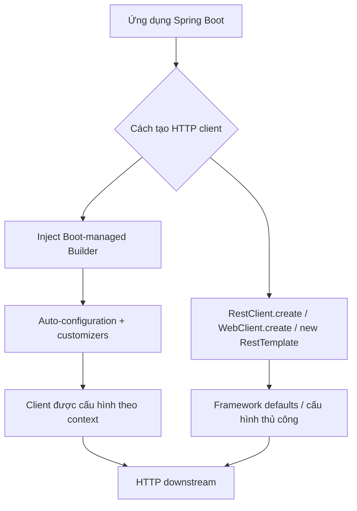
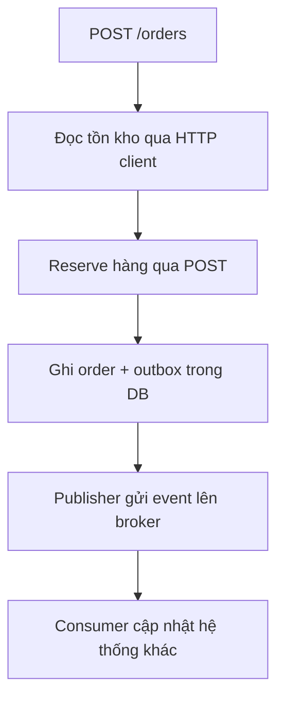
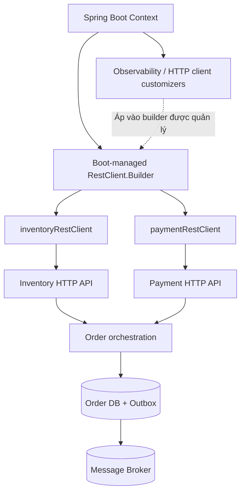

# Builder do Boot quản lý và khác biệt với tạo client trực tiếp

## 1. Vấn đề thực tế: cùng một HTTP client nhưng cấu hình khác nhau

Trong mô-đun **SPRING_BOOT_INTEGRATION**, Spring Boot thường là bên gọi các hệ thống khác: Inventory API, Payment API, Identity Provider hoặc một dịch vụ nội bộ. Những lời gọi này có thể dùng `RestClient`, `RestTemplate` hay `WebClient`. Điểm dễ gây lỗi không chỉ là **chọn API nào**, mà còn là **tạo client bằng cách nào**.

Hãy xét hai đoạn code cùng gọi Inventory API:

```java
RestClient direct = RestClient.create("https://inventory.example.org");
```

và:

```java
@Bean
RestClient inventoryRestClient(RestClient.Builder builder) {
    return builder
        .baseUrl("https://inventory.example.org")
        .build();
}
```

Cả hai có thể gửi HTTP request thành công. Tuy nhiên, chúng **không tương đương về cách nhận cấu hình từ Spring Boot**. `RestClient.Builder` do application context cung cấp được Boot cấu hình thông qua auto-configuration và các customizer phù hợp. `RestClient.create(...)` tạo client trực tiếp bằng cơ chế mặc định của Spring Framework; nó không tự đi qua tất cả tùy biến dành cho builder do Boot quản lý.

Hệ quả có thể chỉ bộc lộ ở môi trường thật:

- HTTP request từ client này có metric/trace, client kia không có.
- Một client dùng connector, pool hoặc TLS được cấu hình tập trung; client còn lại dùng lựa chọn mặc định của framework.
- Header nhận diện service hay bộ chặn lỗi đã khai báo qua customizer không xuất hiện.
- Test chỉ khởi động application context và mock một client, không kiểm tra client thực sự tạo bằng cách nào.
- Thay đổi dependency HTTP transport làm hành vi của client tự tạo khác với client đã được Boot điều phối.

**Mục tiêu:** hiểu builder nào được Spring Boot quản lý, lúc nào nên dùng `create()`/`new` trực tiếp, ảnh hưởng đến HTTP transport, codec, security, timeout, observability và testing; sau đó áp dụng nguyên tắc này vào những luồng tích hợp HTTP–database–cache–broker có hợp đồng rõ ràng.



Bài sử dụng cách gọi API của **Spring Boot 3.2+ / Spring Framework 6.1+** vì `RestClient` được giới thiệu từ Spring Framework 6.1. Với Spring Boot 3.0–3.1, hai dòng API cũ hơn là `RestTemplate` và `WebClient`; không sao chép ví dụ `RestClient` sang những phiên bản không có class này. Tùy phiên bản Boot, danh sách điều kiện và loại HTTP transport được chọn có thể thay đổi; hãy kiểm tra runtime đang dùng thay vì suy đoán từ tên dependency.

## 2. Ba kiểu HTTP client và builder tương ứng

| API client | Builder thường dùng trong Spring Boot | Kiểu lập trình | Dùng khi |
| --- | --- | --- | --- |
| `RestClient` | `RestClient.Builder` | Đồng bộ, API fluent | Ứng dụng imperative/MVC cần client HTTP hiện đại |
| `RestTemplate` | `RestTemplateBuilder` | Đồng bộ, API method-based | Code legacy, hệ thống đã dùng RestTemplate |
| `WebClient` | `WebClient.Builder` | Reactive, trả `Mono`/`Flux` | Non-blocking pipeline, streaming, WebFlux, hoặc client riêng cần reactive |

Ba API trên đều thực hiện HTTP outbound, nhưng không có lý do bắt buộc phải chọn WebClient chỉ vì muốn gọi một REST API. Nếu service Spring MVC đồng bộ và số request/kiểu xử lý phù hợp, `RestClient` thường dễ tích hợp hơn. Nếu cần tổ hợp nhiều lời gọi bất đồng bộ hoặc stream lâu dài, `WebClient` có lợi thế. `RestTemplate` vẫn dùng được cho ứng dụng hiện có; khi viết mới với Spring Framework 6.1+, nên cân nhắc `RestClient`.

Điểm chung:

1. Spring Boot có cơ chế chuẩn bị **builder**, không mặc nhiên tạo một bean client duy nhất cho mọi upstream.
2. Ứng dụng dùng builder để cấu hình **client riêng theo hệ thống đích**, rồi gọi `build()`.
3. Những yếu tố như base URL, authorization, timeout, hợp đồng JSON và retry vẫn là trách nhiệm thiết kế của ứng dụng.
4. Spring Boot auto-configuration chỉ hoạt động khi dependency/điều kiện tương ứng có mặt và không bị thay thế bởi cấu hình khác.

### 2.1. Khác nhau giữa API/framework và Boot auto-configuration

`RestClient`, `RestTemplate` và `WebClient` là API thuộc **Spring Framework**. `RestClient.Builder` và `WebClient.Builder` cũng có thể được tạo trực tiếp trong Java mà không cần Spring Boot. `RestTemplateBuilder` là tiện ích **của Spring Boot**, được thiết kế để tạo/cấu hình `RestTemplate` theo cách thống nhất với ứng dụng.

Vì thế:

- `RestClient.builder()`: có builder do **Spring Framework** tạo trực tiếp.
- Inject `RestClient.Builder`: nhận builder do **Spring Boot application context** cung cấp khi auto-configuration thỏa điều kiện.
- `WebClient.builder()`: có builder do **Spring Framework** tạo trực tiếp.
- Inject `WebClient.Builder`: nhận builder đã đi qua auto-configuration Boot.
- `new RestTemplate()`: tạo instance trực tiếp với các mặc định của Framework.
- Inject `RestTemplateBuilder` rồi `build()`: tạo `RestTemplate` thông qua tiện ích builder Boot.

Sự khác biệt không phải Boot-managed client luôn “gửi nhanh hơn”, mà là nó có **điểm tích hợp cấu hình tập trung** giúp hành vi nhất quán và dễ kiểm tra hơn.

## 3. Dependency và điều kiện có builder do Boot tạo

### 3.1. Ứng dụng MVC / synchronous HTTP

Với Maven quản lý phiên bản qua Spring Boot BOM:

```xml
<dependency>
    <groupId>org.springframework.boot</groupId>
    <artifactId>spring-boot-starter-web</artifactId>
</dependency>
```

Trong Spring Boot 3.2+, starter Web thường cung cấp API `RestClient` và cơ chế auto-configuration builder của Boot, cùng các thư viện cho một ứng dụng Servlet/MVC. `RestTemplateBuilder` cũng được Boot cung cấp khi các điều kiện cấu hình liên quan phù hợp.

Không cần tự tạo một bean `RestClient.Builder` chỉ vì muốn sử dụng client. Hãy thử inject builder đã có trước; nếu cần tùy biến toàn cục, ưu tiên customizer hoặc cơ chế cấu hình client được Boot hỗ trợ.

### 3.2. Ứng dụng cần WebClient

```xml
<dependency>
    <groupId>org.springframework.boot</groupId>
    <artifactId>spring-boot-starter-webflux</artifactId>
</dependency>
```

Starter WebFlux cung cấp WebClient và Reactor dependencies trong cấu hình phổ biến. Trong ứng dụng có cả `spring-boot-starter-web` và `spring-boot-starter-webflux`, Spring Boot thường vẫn chọn loại **web application Servlet/MVC** nếu không có cấu hình override; tuy nhiên **vẫn có thể inject WebClient.Builder để gọi HTTP ra ngoài**.

Không phải mọi project dùng WebClient đều cần chuyển controller sang `Mono`/`Flux`. Nhưng nếu gọi `block()` từ Netty event-loop, bạn có thể gây nghẽn hoặc lỗi; phải hiểu rõ boundary đồng bộ/bất đồng bộ.

### 3.3. Builder không xuất hiện: kiểm tra điều kiện trước khi tạo thủ công

Nếu nhận thông báo:

```text
No qualifying bean of type
'org.springframework.web.client.RestClient$Builder' available
```

hãy kiểm tra:

- Spring Boot có phải 3.2+ và Spring Framework 6.1+ không?
- `spring-web`/Web starter có nằm trên **runtime classpath** không?
- Có `@EnableAutoConfiguration` / `@SpringBootApplication` trong context đang dùng không?
- Có chủ động exclude auto-configuration dành cho HTTP client hay không?
- Code có đang chạy trong một test slice quá hẹp không?
- Có custom configuration khiến Boot back off, hoặc một bean khác gây ambiguity không?

Với `WebClient.Builder`, kiểm tra `spring-webflux` cùng dependencies liên quan. Với `RestTemplateBuilder`, kiểm tra Boot auto-configuration của module web client và context. Xem **Condition Evaluation Report** thay vì đoán toàn bộ tình huống là do “thiếu starter”.

## 4. Boot-managed builder nhận được những gì?

Một builder được Boot auto-configure có thể được chuẩn bị dựa trên các thành phần và tùy biến trong context:

| Khả năng | Lợi ích | Điều kiện/giới hạn |
| --- | --- | --- |
| HTTP message converters / codecs | Encode/decode JSON, text và media types tương ứng | Tùy classpath và custom configuration |
| HTTP request factory / client connector | Chọn transport có trên classpath theo chiến lược của Boot | Không mặc nhiên là một transport duy nhất ở mọi phiên bản |
| `RestClientCustomizer` / `WebClientCustomizer` | Thêm header, filter, connector hoặc chính sách toàn cục | Chỉ áp dụng khi builder đi qua cấu hình phù hợp |
| `RestTemplateCustomizer` | Điều chỉnh `RestTemplate` do builder tạo | Không tự động tác động lên `new RestTemplate()` |
| Observation/tracing integration | HTTP client observations qua Micrometer/ObservationRegistry khi có thiết lập | Cần dependencies, registry và export/actuator cấu hình phù hợp |
| SSL bundles và tích hợp liên quan | Có cơ chế áp dụng bộ chứng chỉ/SSL theo ứng dụng | Không tự bảo đảm mọi client dùng cùng TLS/mTLS policy |
| Builder riêng cho mỗi upstream | Tách base URL, auth và timeout | Phải do ứng dụng chủ động tạo bean client |

**Không suy ra rằng mọi ô trong bảng luôn được kích hoạt.** Boot chuẩn bị builder theo context và classpath. Nếu không có telemetry dependency, có thể không có metric/tracing như mong muốn. Nếu chưa khai báo SSL bundle hoặc chưa áp dụng cho client, không có căn cứ khẳng định mTLS đã hoạt động.

Những cấu hình **Boot không tự biết**:

- Hợp đồng endpoint Inventory API: `/api/v1/inventory/{sku}`, JSON schema, status code.
- Thời gian chờ phù hợp SLA của Order Service.
- OAuth2 token nào được dùng cho upstream nào.
- Có nên retry `POST /reservations` hay không.
- Consumer nào chịu trách nhiệm xử lý lỗi sau khi database đã commit.
- Dữ liệu nào được phép log, cache hoặc gửi tiếp qua broker.

Builder giúp **không bỏ lỡ các cấu hình hệ thống đã chuẩn hóa**; nó không thay thế thiết kế nghiệp vụ hay kiểm thử.

## 5. RestClient.Builder do Boot quản lý: ví dụ đầy đủ

Giả sử Catalog Service gọi Inventory API để lấy tồn kho. Cấu hình endpoint theo môi trường:

```yaml
inventory:
  api:
    base-url: ${INVENTORY_API_BASE_URL:https://inventory.example.org}
```

Định nghĩa DTO phù hợp hợp đồng của provider:

```java
package example.integration.inventory;

public record InventoryResponse(
        String sku,
        Integer availableQuantity) {
}
```

**Bước 1: tạo bean RestClient từ builder do Boot inject.**

```java
package example.integration.inventory;

import org.springframework.beans.factory.annotation.Value;
import org.springframework.context.annotation.Bean;
import org.springframework.context.annotation.Configuration;
import org.springframework.http.HttpHeaders;
import org.springframework.http.MediaType;
import org.springframework.web.client.RestClient;

@Configuration
public class InventoryHttpClientConfiguration {

    @Bean("inventoryRestClient")
    RestClient inventoryRestClient(
            RestClient.Builder builder,
            @Value("${inventory.api.base-url}") String baseUrl) {

        return builder
            .baseUrl(baseUrl)
            .defaultHeader(
                HttpHeaders.ACCEPT,
                MediaType.APPLICATION_JSON_VALUE
            )
            .build();
    }
}
```

**Bước 2: dùng client trong gateway của ứng dụng.**

```java
package example.integration.inventory;

import org.springframework.beans.factory.annotation.Qualifier;
import org.springframework.stereotype.Component;
import org.springframework.web.client.RestClient;

@Component
public class InventoryGateway {

    private final RestClient client;

    public InventoryGateway(
            @Qualifier("inventoryRestClient") RestClient client) {
        this.client = client;
    }

    public InventoryResponse getInventory(String sku) {
        InventoryResponse result = client.get()
            .uri("/api/v1/inventory/{sku}", sku)
            .retrieve()
            .body(InventoryResponse.class);

        if (result == null) {
            throw new IllegalStateException(
                "Inventory API returned no response body"
            );
        }
        return result;
    }
}
```

Sự khác biệt quan trọng nằm ở **tham số `RestClient.Builder builder`**: bean được tạo thông qua builder của application context thay vì viết `RestClient.create(baseUrl)` ngay trong method. Khi Boot/configuration cung cấp customizer về observability, codec hoặc HTTP transport, client vừa build có cơ hội dùng các tùy biến đó.

`RestClient` được build để **tái sử dụng** cho nhiều request. Không tạo client mới cho mỗi item trong vòng lặp hoặc mỗi HTTP controller call. Thông tin auth per-request và correlation ID cần được truyền có kiểm soát, không gắn token của người dùng A thành `defaultHeader` trên một singleton dùng chung cho mọi user.

### 5.1. Điều gì xảy ra với 404 và 5xx?

`retrieve()` theo mặc định xử lý HTTP 4xx/5xx là lỗi. Một số exception có thể là `HttpClientErrorException` hoặc `HttpServerErrorException` tùy status. Không coi mọi 404 là “hết hàng”; phải đọc contract của Inventory API.

Ví dụ nếu contract quy định 404 là “SKU không tồn tại”, tầng gateway có thể ánh xạ thành lỗi domain:

```java
public InventoryResponse getInventoryOrThrow(String sku) {
    try {
        InventoryResponse response = client.get()
            .uri("/api/v1/inventory/{sku}", sku)
            .retrieve()
            .body(InventoryResponse.class);

        if (response == null) {
            throw new IllegalStateException("Empty inventory response");
        }
        return response;
    } catch (org.springframework.web.client.HttpClientErrorException.NotFound ex) {
        throw new InventoryNotFoundException(sku, ex);
    }
}
```

`InventoryNotFoundException` là exception do ứng dụng định nghĩa; phải triển khai theo quy tắc lỗi nghiệp vụ. Đừng bắt `Exception` rồi trả số lượng tồn kho bằng 0 cho mọi lỗi: timeout, TLS failure và JSON decode mismatch không có nghĩa “không còn hàng”.

### 5.2. RestClient trực tiếp không sai, nhưng là lựa chọn khác

Có thể tạo client mà không dùng Boot:

```java
RestClient directClient =
    RestClient.create("https://inventory.example.org");

// Hoặc:
RestClient directFromBuilder =
    RestClient.builder()
        .baseUrl("https://inventory.example.org")
        .build();
```

Hai cách này sử dụng các mặc định và tùy biến **được khai báo ngay tại nơi tạo client hoặc bởi Spring Framework**, không tự lấy toàn bộ `RestClientCustomizer`/`ObservationRegistry`/cấu hình khác của Boot application context. Nói như vậy **không có nghĩa** chúng hoàn toàn không có JSON converter hoặc không thể dùng TLS: Spring Framework cũng có các mặc định dựa trên classpath. Điểm khác biệt là **đường đi qua auto-configuration của Boot**.

Khi viết thư viện Java không phụ thuộc Spring Boot, test rất nhỏ hoặc một công cụ command-line tự quản lý toàn bộ cấu hình, tạo trực tiếp có thể hợp lý. Trong ứng dụng Boot có nhiều downstream và chính sách chung, inject builder giúp giảm configuration drift.

## 6. WebClient.Builder do Boot quản lý và so sánh WebClient.create

Khi cần non-blocking client hoặc xử lý stream, inject `WebClient.Builder`:

```java
package example.integration.inventory;

import org.springframework.beans.factory.annotation.Value;
import org.springframework.context.annotation.Bean;
import org.springframework.context.annotation.Configuration;
import org.springframework.http.HttpHeaders;
import org.springframework.http.MediaType;
import org.springframework.web.reactive.function.client.WebClient;

@Configuration
public class InventoryReactiveClientConfiguration {

    @Bean("inventoryWebClient")
    WebClient inventoryWebClient(
            WebClient.Builder builder,
            @Value("${inventory.api.base-url}") String baseUrl) {

        return builder
            .baseUrl(baseUrl)
            .defaultHeader(
                HttpHeaders.ACCEPT,
                MediaType.APPLICATION_JSON_VALUE
            )
            .build();
    }
}
```

Sử dụng:

```java
package example.integration.inventory;

import org.springframework.beans.factory.annotation.Qualifier;
import org.springframework.stereotype.Component;
import org.springframework.web.reactive.function.client.WebClient;
import reactor.core.publisher.Flux;
import reactor.core.publisher.Mono;

@Component
public class InventoryReactiveGateway {
    private final WebClient client;

    public InventoryReactiveGateway(
            @Qualifier("inventoryWebClient") WebClient client) {
        this.client = client;
    }

    public Mono<InventoryResponse> getInventory(String sku) {
        return client.get()
            .uri("/api/v1/inventory/{sku}", sku)
            .retrieve()
            .bodyToMono(InventoryResponse.class);
    }

    public Flux<InventoryResponse> listInventory() {
        return client.get()
            .uri("/api/v1/inventory")
            .retrieve()
            .bodyToFlux(InventoryResponse.class);
    }
}
```

`bodyToFlux` có thể decode các phần tử từ JSON array hoặc streaming representation phù hợp codec và `Content-Type`; **không có nghĩa mọi endpoint lập tức trở thành luồng sự kiện real-time**. `WebClient` thường trả cold publisher: khi có subscription, request mới được thực thi. Không tự gọi `subscribe()` trong service rồi bỏ qua kết quả/lỗi; controller WebFlux có thể trả `Mono`/`Flux` để framework quản lý subscription.

So sánh:

```java
// Không dùng Boot-managed builder:
WebClient direct = WebClient.create("https://inventory.example.org");

// Dùng Boot-managed builder đã được inject:
WebClient managed = builder
    .baseUrl("https://inventory.example.org")
    .build();
```

`WebClient.create(...)` vẫn là API hợp lệ của Spring Framework. Nhưng nếu hệ thống đã đăng ký `WebClientCustomizer` cho tracing, connector, filter hoặc các policy chung, client direct **không tự đi qua** customizer đó.

### 6.1. Khi trộn WebClient và Spring MVC

Một ứng dụng Spring MVC có thể gọi WebClient, nhưng đừng suy luận rằng chỉ vì dùng `WebClient` thì các bước truy xuất JDBC/JPA trong service sẽ non-blocking. Nếu gọi `block()` trong tầng imperative, đó là điểm blocking có chủ đích và cần deadline. Không gọi `block()` trong Reactor event-loop/WebFlux request handling. Cần chọn mô hình thread và concurrency phù hợp toàn bộ luồng.

## 7. RestTemplateBuilder và new RestTemplate

Với code cũ dùng `RestTemplate`, Spring Boot cung cấp `RestTemplateBuilder` giúp cấu hình client nhất quán. **Spring Boot thường không tự tạo một bean `RestTemplate` mặc định duy nhất** để inject trực tiếp; nó cung cấp `RestTemplateBuilder` để bạn tạo bean nếu cần.

Ví dụ:

```java
import org.springframework.boot.web.client.RestTemplateBuilder;
import org.springframework.context.annotation.Bean;
import org.springframework.context.annotation.Configuration;
import org.springframework.web.client.RestTemplate;

@Configuration
public class LegacyInventoryClientConfiguration {

    @Bean("inventoryRestTemplate")
    RestTemplate inventoryRestTemplate(
            RestTemplateBuilder builder) {

        return builder
            .rootUri("https://inventory.example.org")
            .build();
    }
}
```

Tầng sử dụng:

```java
import org.springframework.beans.factory.annotation.Qualifier;
import org.springframework.stereotype.Component;
import org.springframework.web.client.RestTemplate;

@Component
public class LegacyInventoryGateway {
    private final RestTemplate template;

    LegacyInventoryGateway(
            @Qualifier("inventoryRestTemplate") RestTemplate template) {
        this.template = template;
    }

    public InventoryResponse getInventory(String sku) {
        return template.getForObject(
            "/api/v1/inventory/{sku}",
            InventoryResponse.class,
            sku
        );
    }
}
```

`rootUri` hỗ trợ URI tương đối bắt đầu bằng `/` trong các method phù hợp. Khi dùng URI absolute, logic root URI sẽ không áp dụng như với path tương đối.

Đối chiếu cách tạo trực tiếp:

```java
RestTemplate direct = new RestTemplate();
```

`new RestTemplate()` có cấu hình mặc định của Spring Framework. Nó có thể hoạt động tốt khi endpoint đơn giản và bạn chủ động cấu hình mọi thứ. Tuy nhiên, `RestTemplateCustomizer` đã đăng ký qua Boot không tự áp dụng lên instance tạo bằng `new`.

### 7.1. RestTemplateBuilder khác biệt về tính bất biến

`RestTemplateBuilder` được thiết kế theo phong cách cấu hình trả về builder mới. Khi gọi `builder.rootUri(...)`, hãy dùng **builder trả về**, không chỉ gọi method rồi bỏ kết quả:

```java
RestTemplateBuilder configured =
    builder.rootUri("https://inventory.example.org");

RestTemplate template = configured.build();
```

Trong khi đó, `RestClient.Builder` và `WebClient.Builder` là **mutable builders**. Không nên dùng chung một mutable builder đã tùy biến cho nhiều upstream khác nhau mà không clone hoặc lấy builder mới qua injection.

## 8. Một bảng so sánh quan trọng về cách khởi tạo

| Cách khởi tạo | Đi qua Boot auto-configuration? | Có thể nhận global customizers của Boot? | Lựa chọn thực dụng |
| --- | --- | --- | --- |
| Inject `RestClient.Builder`, gọi `build()` | Có, khi bean do Boot tạo | Có | Khuyến nghị cho RestClient trong ứng dụng Boot |
| `RestClient.create(url)` | Không qua builder của context | Không tự áp dụng | Thư viện, demo, tạo client tự quản |
| `RestClient.builder()` trực tiếp | Không qua builder của context | Không tự áp dụng | Khi chủ động xây cấu hình đầy đủ |
| Inject `WebClient.Builder`, gọi `build()` | Có, khi bean do Boot tạo | Có | Khuyến nghị cho WebClient trong ứng dụng Boot |
| `WebClient.create(url)` | Không qua builder của context | Không tự áp dụng | Client đơn giản hoặc ngoài context |
| Inject `RestTemplateBuilder`, gọi `build()` | Có | Có, theo cơ chế builder/customizers | Khuyến nghị khi vẫn dùng RestTemplate |
| `new RestTemplate()` | Không | Không tự áp dụng | Code nhỏ hoặc tự quản cấu hình |
| Inject một `RestClient`/`WebClient` bean do ứng dụng tạo từ builder | Phụ thuộc cách bean đó được tạo | Có nếu lúc tạo đã dùng managed builder | Tốt để gắn policy cụ thể cho upstream |

Các cột so sánh **nguồn cấu hình**, không nói rằng direct client mặc nhiên sai, mất bảo mật hay không thể encode JSON. Direct client có thể được cấu hình đầy đủ bằng code; nhược điểm là phải có một quy trình riêng để đảm bảo policy không bị bỏ sót.

## 9. Customizer: nơi khai báo chính sách HTTP dùng chung

Một lý do mạnh để inject builder của Boot là khả năng khai báo policy trong một bean riêng và áp dụng nhất quán cho các client được Boot cấu hình.

### 9.1. RestClientCustomizer

Ví dụ thêm header nhận diện **ứng dụng** (không phải token per-user):

```java
import org.springframework.boot.web.client.RestClientCustomizer;
import org.springframework.context.annotation.Bean;
import org.springframework.context.annotation.Configuration;
import org.springframework.http.HttpHeaders;

@Configuration
public class GlobalRestClientPolicy {

    @Bean
    RestClientCustomizer callerServiceHeader() {
        return builder -> builder.defaultHeader(
            "X-Caller-Service",
            "order-service"
        );
    }
}
```

Khi bean `RestClient.Builder` do Boot cấu hình được inject, các customizer tương thích trong context sẽ được áp dụng theo cơ chế của Boot. Một client được tạo bằng `RestClient.create(...)` không tự nhận header này.

**Không đưa access token dùng cho upstream A vào customizer áp dụng cho mọi client.** Tùy biến toàn cục phù hợp cho chính sách thực sự chung (ví dụ định danh service không nhạy cảm, instrumentation). Credentials, mTLS và token của từng hệ thống đích phải được cấu hình theo đúng client/identity để tránh gửi nhầm sang domain khác.

### 9.2. WebClientCustomizer

```java
import org.springframework.boot.web.reactive.function.client.WebClientCustomizer;
import org.springframework.context.annotation.Bean;
import org.springframework.context.annotation.Configuration;

@Configuration
public class GlobalWebClientPolicy {

    @Bean
    WebClientCustomizer commonHeader() {
        return builder -> builder.defaultHeader(
            "X-Caller-Service",
            "order-service"
        );
    }
}
```

Có thể tùy biến thêm `ExchangeFilterFunction`, codec và connector, nhưng filter phải xử lý body, cancellation và error signal đúng cách; nếu filter đọc một lần rồi bỏ response body, downstream có thể không decode được.

### 9.3. RestTemplateCustomizer

```java
import org.springframework.boot.web.client.RestTemplateCustomizer;
import org.springframework.context.annotation.Bean;
import org.springframework.context.annotation.Configuration;

@Configuration
public class GlobalRestTemplatePolicy {

    @Bean
    RestTemplateCustomizer callerHeader() {
        return template -> template.getInterceptors()
            .add((request, body, execution) -> {
                request.getHeaders().add(
                    "X-Caller-Service", "order-service"
                );
                return execution.execute(request, body);
            });
    }
}
```

Ví dụ cố tình đơn giản để cho thấy interceptors được gắn vào `RestTemplate` tạo bởi builder. Trong thực tế, các interceptor/filter cần thống nhất quy định logging, propagation trace context, retry và tránh ghi secrets.

### 9.4. Khi nhiều customizer cùng tồn tại

Thứ tự cấu hình có thể ảnh hưởng hành vi nếu customizer cùng thay đổi một thuộc tính, ví dụ request factory hoặc default headers. Trong Spring, có thể dùng cơ chế sắp thứ tự `@Order`/`Ordered` khi phù hợp. Tuy nhiên:

- Không dựa vào thứ tự bean tình cờ để giải quyết hai policy mâu thuẫn.
- Nếu ứng dụng tự `@Bean RestClient.Builder`, bạn có thể vô tình thay thế đường auto-configuration của Boot.
- Nếu thay hẳn request factory/connector, cần đảm bảo instrumentation, TLS và các lựa chọn hạ tầng khác vẫn đúng.
- Sau khi thêm customizer mới, test cả client thực tế được tạo từ builder và các client direct còn tồn tại.

## 10. Mutable builder, clone và nhiều hệ thống đích

Một Order Service có thể đồng thời gọi Inventory API và Payment API. Hai client có base URL, chứng chỉ, authentication, timeout và retry policy khác nhau. Không nên tái sử dụng một mutable builder rồi lần lượt đổi base URL mà không có cơ chế tách biệt.

Mô hình nên dùng: **mỗi bean client lấy một builder do context cung cấp**.

```java
@Configuration
public class DownstreamClients {

    @Bean("inventoryClient")
    RestClient inventoryClient(RestClient.Builder builder) {
        return builder
            .baseUrl("https://inventory.example.org")
            .build();
    }

    @Bean("paymentClient")
    RestClient paymentClient(RestClient.Builder builder) {
        return builder
            .baseUrl("https://payments.example.org")
            .build();
    }
}
```

Trong Spring Boot, builder dạng mutable cho `RestClient`/`WebClient` thường được cung cấp theo scope phù hợp để mỗi điểm inject có thể nhận một builder độc lập. Tuy vậy, nếu bạn inject **một builder instance vào singleton service rồi mutate nó cho mọi request**, chính bạn đã tạo ra nguy cơ shared mutable state. Hãy tạo các client theo bean cấu hình hoặc chủ động `clone()` builder khi cần biến thể.

Ví dụ với một `WebClient` đã có, `mutate()` tạo builder bắt đầu từ cấu hình của client đó:

```java
WebClient auditClient = inventoryWebClient.mutate()
    .defaultHeader("X-Operation", "audit")
    .build();
```

Thao tác trên không đòi hỏi xây lại client từ mặc định; tuy nhiên hãy kiểm tra filter/header có thể mang thông tin đặc thù upstream cũ hay không. **Không dùng `mutate()` để đổi client Inventory sang Payment rồi giữ nguyên token Inventory**.

## 11. Timeout và HTTP transport: builder không tự biết SLA

Một client gọi Inventory API có thể cần deadline 2 giây; một client tải báo cáo dung lượng lớn có thể chấp nhận chờ lâu hơn. Boot builder không biết SLA này từ tên service.

### 11.1. Hai nhóm timeout cần phân biệt

| Timeout | Mục đích | Ví dụ lỗi |
| --- | --- | --- |
| Connect timeout | Giới hạn thời gian thiết lập kết nối TCP | Downstream không thể kết nối |
| Response/read timeout | Giới hạn chờ phản hồi/đọc dữ liệu tùy transport | Server chậm trả hoặc ngừng truyền |
| Pool acquisition timeout | Giới hạn chờ lấy connection từ pool | Pool bị bão hòa |
| Deadline toàn lời gọi | Giới hạn tổng thời gian xử lý theo nghiệp vụ | Request quá SLA dù từng thao tác chưa timeout |

Không phải mọi transport đều dùng cùng tên property/method cho các loại timeout này. Với `RestClient`/`RestTemplate`, HTTP request factory cụ thể quyết định API hỗ trợ. Với `WebClient` dùng Reactor Netty, có thể cấu hình `HttpClient` và `ReactorClientHttpConnector`; publisher `timeout(...)` lại là một lớp deadline khác.

### 11.2. Ví dụ cấu hình WebClient có connector cụ thể

```java
import java.time.Duration;

import io.netty.channel.ChannelOption;
import org.springframework.http.client.reactive.ReactorClientHttpConnector;
import org.springframework.web.reactive.function.client.WebClient;
import reactor.netty.http.client.HttpClient;

HttpClient netty = HttpClient.create()
    .option(ChannelOption.CONNECT_TIMEOUT_MILLIS, 2000)
    .responseTimeout(Duration.ofSeconds(5));

WebClient client = bootManagedBuilder
    .baseUrl("https://inventory.example.org")
    .clientConnector(new ReactorClientHttpConnector(netty))
    .build();
```

`bootManagedBuilder` là `WebClient.Builder` do context inject. Đoạn này giữ các cấu hình khác đã có trên builder, **nhưng chủ động thay client connector**; cần kiểm tra xem có ghi đè một connector tập trung đã được ứng dụng thiết lập hay không. Ví dụ này giả định classpath có Reactor Netty.

### 11.3. Cấu hình client synchronous

Với `RestClient`, có thể cung cấp một `ClientHttpRequestFactory` được cấu hình cho upstream đó; với `RestTemplateBuilder`, có API cấu hình timeout/request factory theo phiên bản Spring Boot. Đừng tự copy một đoạn cấu hình từ Spring Boot 3.5 sang Boot 3.2 rồi tin tên method chắc chắn giống nhau.

Nguyên tắc:

1. Chọn request factory/transport phù hợp classpath và yêu cầu proxy, TLS, pool.
2. Cấu hình connect/read/pool timeout theo SLA của upstream.
3. Đưa timeout thành phần của `@ConfigurationProperties` hoặc cấu hình môi trường.
4. Kiểm thử lỗi timeout và behavior retry, không chỉ test response 200.
5. Bảo đảm phép gọi synchronous không giữ thread HTTP vô hạn khi downstream ngừng phản hồi.

## 12. SSL, credentials và Service Connections

Builder do Boot quản lý giúp tích hợp với cấu hình SSL bundle và các tùy biến tập trung khi chúng được hỗ trợ. Nhưng **có builder không có nghĩa TLS/mTLS tự động hoàn chỉnh**:

- Cần endpoint HTTPS, trust chain hợp lệ và hostname verification.
- Với mTLS, client phải áp đúng key/trust material cho upstream tương ứng.
- Token OAuth2 hoặc API key cần lấy từ nguồn được phép và gắn cho **đúng** hệ thống đích.
- Không đưa password, token hay private-key content vào log hoặc file cấu hình commit.
- Không áp header `Authorization` của caller vào mọi client qua global customizer.

**Phân biệt service connection và HTTP client base URL.** Các cơ chế local-development như Spring Boot Docker Compose hay Testcontainers có thể tạo `ConnectionDetails` cho database, Redis hoặc broker được hỗ trợ. Điều đó **không mặc nhiên cung cấp base URL cho mọi API HTTP tùy ý**. HTTP client thường vẫn nhận `base-url` qua config, service discovery hoặc một integration riêng.

Nếu Inventory API được chạy trong Compose ở local, đừng hard-code URL production trong bean; dùng profile/env để xác định endpoint. Khi test, thay base URL bằng mock HTTP server mà không đổi business logic.

## 13. Testing: test bằng client thật được tạo từ managed builder

Có hai kiểu kiểm thử khác nhau:

- **Unit test**: mock gateway/interface, kiểm tra orchestration và mapping ở Order Service.
- **HTTP client integration/contract test**: dùng client thật, xác nhận method, URI, headers, payload, status, codec và error handling; thay upstream bằng mock server hoặc provider verification.

### 13.1. RestClientTest và MockRestServiceServer

Spring Boot hỗ trợ test slice cho REST client trong những phiên bản phù hợp, giúp tập trung vào HTTP client configuration. Ví dụ cho Inventory Gateway ở mục 5:

```java
package example.integration.inventory;

import static org.assertj.core.api.Assertions.assertThat;
import static org.springframework.test.web.client.match.MockRestRequestMatchers.requestTo;
import static org.springframework.test.web.client.response.MockRestResponseCreators.withSuccess;

import org.junit.jupiter.api.Test;
import org.springframework.beans.factory.annotation.Autowired;
import org.springframework.boot.test.autoconfigure.web.client.RestClientTest;
import org.springframework.context.annotation.Import;
import org.springframework.http.MediaType;
import org.springframework.test.web.client.MockRestServiceServer;

@RestClientTest(InventoryGateway.class)
@Import(InventoryHttpClientConfiguration.class)
class InventoryGatewayTest {

    @Autowired
    MockRestServiceServer server;

    @Autowired
    InventoryGateway gateway;

    @Test
    void readsInventoryUsingManagedClient() {
        server.expect(requestTo(
                "https://inventory.example.org/api/v1/inventory/sku-123"
            ))
            .andRespond(withSuccess(
                """
                {
                  "sku": "sku-123",
                  "availableQuantity": 9
                }
                """,
                MediaType.APPLICATION_JSON
            ));

        InventoryResponse result = gateway.getInventory("sku-123");

        assertThat(result.availableQuantity()).isEqualTo(9);
        server.verify();
    }
}
```

Giả định trong test, property `inventory.api.base-url` lấy giá trị mặc định như ví dụ `application.yml`; trong môi trường có config riêng, hãy đặt giá trị test tường minh để không kết nối ra production. `@RestClientTest` tự cấu hình phần HTTP client/test cần thiết; `@Import` đưa bean configuration ở mục 5 vào slice. Nếu project sử dụng custom JSON config/filter/auth, cần nhập các bean đó hoặc chạy test tích hợp toàn context tùy mục tiêu.

**Không coi mock-server test ở phía consumer là hợp đồng được provider xác minh.** Nếu consumer kỳ vọng field `availableQuantity`, phía Inventory API cũng cần kiểm thử/schema verification trên implementation thật, nếu không cả hai service có thể thay đổi độc lập và làm hỏng tích hợp.

### 13.2. WebClient và MockWebServer

Với WebClient, một mock HTTP server trên socket thật (ví dụ OkHttp MockWebServer, WireMock) giúp kiểm tra base URL, header, encoding và status. Dùng `StepVerifier` để subscribe và assert `Mono`/`Flux`, không gọi `subscribe()` rồi kiểm tra kết quả bất đồng bộ bằng `Thread.sleep`.

Ví dụ nhỏ để phân biệt response:

```java
Mono<InventoryResponse> result = inventoryWebClient.get()
    .uri("/api/v1/inventory/{sku}", "sku-123")
    .retrieve()
    .bodyToMono(InventoryResponse.class);

reactor.test.StepVerifier.create(result)
    .assertNext(dto -> {
        org.assertj.core.api.Assertions.assertThat(dto.sku())
            .isEqualTo("sku-123");
    })
    .verifyComplete();
```

Đoạn này là phần **assert** của test; cần có upstream test server/stub cung cấp response phù hợp và một bean `inventoryWebClient` trỏ tới nó. `StepVerifier` chỉ kiểm chứng được những tín hiệu thực sự phát ra khi subscribe.

### 13.3. Bắt lỗi customizer bị bỏ qua

Thêm một bài test có **global customizer** trong context, rồi xác nhận client gửi một header chung hoặc tạo HTTP observation như mong muốn. Nếu ai đó thay factory bằng `RestClient.create()` hoặc `new RestTemplate()`, bài test sẽ bắt được thiếu header/behavior.

Ví dụ kỳ vọng HTTP:

```http
GET /api/v1/inventory/sku-123 HTTP/1.1
Host: inventory.example.org
Accept: application/json
X-Caller-Service: order-service
```

Với tracing, nên assert observations/metrics qua test observation registry khi phù hợp, thay vì yêu cầu một chuỗi trace ID cố định. Cần kiểm soát việc mock server phát sinh request thật hay không và không gửi traffic test sang hệ thống thật.

### 13.4. Những case cần thêm ngoài happy path

| Case | Kết quả mong đợi |
| --- | --- |
| 200 với JSON hợp schema | Decode DTO đúng, giữ dữ liệu cần thiết |
| 204/200 với empty body | Xử lý theo hợp đồng, không NPE |
| 404 sản phẩm không tồn tại | Chuyển thành lỗi domain hoặc empty theo API contract |
| 429/503 | Retry/backoff chỉ khi phù hợp và có giới hạn |
| TLS/DNS/connection refused | Phân loại lỗi transport, giữ thông tin truy vết an toàn |
| Provider thêm field JSON | Consumer chịu được nếu hợp đồng cho phép |
| Provider đổi kiểu/thiếu field bắt buộc | Contract/validation test báo lỗi |
| POST timeout sau khi server đã xử lý | Không tạo side effect trùng nhờ idempotency |
| Base URL/token của upstream A bị dùng cho B | Test chặn gửi nhầm credentials |
| Global customizer mới thêm | Managed clients nhận policy; direct clients được đánh giá riêng |

## 14. Quan sát và tracing: lý do lỗi thường chỉ lộ ra ở production

Khi hệ thống có nhiều HTTP downstream, người vận hành cần biết:

- API nào đang chậm và số request theo status code.
- Request nào liên kết với order/event nào mà không lộ PII.
- Transport lỗi ở DNS/TLS/connection pool hay provider trả HTTP 5xx.
- Retry tăng tải lên downstream hay đang phục hồi bình thường.
- Sau khi cập nhật cấu hình, client nào không còn metric hoặc trace như kỳ vọng.

Spring Boot kết hợp Micrometer Observation/Actuator và tracing libraries phù hợp có thể instrument outbound HTTP clients. **Builder do Boot quản lý là một đường tích hợp quan trọng** để dùng các cấu hình đó; direct client có thể cần thiết lập instrumentation thủ công.

Không suy ra “client không có trace thì chắc chắn được tạo trực tiếp”; cũng có thể do thiếu registry/exporter, sampling, endpoint instrumentation hoặc config. Khi điều tra, kiểm tra đồng thời actual bean, code tạo client, auto-configuration, request factory và tracing pipeline.

### 14.1. Correlation ID không phải security token

Nếu cần chuyển `X-Correlation-ID` sang downstream, có thể bổ sung qua request interceptor/filter theo ngữ cảnh lời gọi. Không lấy giá trị từ một biến mutable dùng chung cho mọi request. Nếu dựa vào MDC/ThreadLocal, cần xem cách context được truyền qua Reactor/executor; một luồng tích hợp async có thể mất ThreadLocal mà không có propagation được cấu hình.

Tránh log raw request/response body khi chúng có thông tin người dùng, password, OTP, bearer token hoặc thông tin thanh toán. Đo số lượng/latency và mã lỗi trước khi bật body logging.

## 15. Retry, giao dịch và idempotency không nằm trong builder

Tạo client từ Boot-managed builder **không đồng nghĩa** request trở nên exactly-once, tự động retry an toàn hay tham gia transaction database.

Ví dụ Order Service:



Nếu `POST /reservations` timeout, client không thể biết chắc upstream chưa reserve hàng. Retry một POST không có `Idempotency-Key` hoặc business request ID có thể tạo nhiều reservation. Một transaction `@Transactional` của Order Service cũng không tự rollback request HTTP đã được Inventory Service commit.

**Nguyên tắc xử lý lỗi nhất quán:**

1. Đặt deadline và transport timeouts hợp lý cho từng upstream.
2. Phân loại lỗi trước khi quyết định retry: validation/permission khác 503/timeout.
3. Dùng idempotency key và deduplication cho thao tác có side effect.
4. Dùng transactional outbox và consumer inbox nếu cần nhất quán giữa DB và broker.
5. Ghi correlation ID, operation và attempt count để quan sát request–reply và flow sau.
6. Kiểm thử trạng thái “server thành công, response mất” thay vì chỉ trường hợp server trả 200.

Builder là phần **cấu hình giao tiếp**; retry policy, hợp đồng API và độ tin cậy nghiệp vụ phải được thiết kế ở lớp tích hợp tương ứng.

## 16. Lỗi thường gặp khi chuyển từ tạo trực tiếp sang Boot-managed builder

| Hiện tượng | Nguyên nhân khả dĩ | Cách kiểm tra |
| --- | --- | --- |
| Inject `RestClient` nhưng không có bean | Boot thường cấp builder chứ không tự tạo client cho từng API | Định nghĩa `@Bean RestClient` từ builder |
| Không thấy `RestClient.Builder` | Boot/Framework chưa đủ version hoặc thiếu classpath | Kiểm tra Spring Boot ≥3.2, Spring Web và condition report |
| HTTP client không có tracing/metric | Tạo bằng `create()` trực tiếp, thiếu registry hoặc instrumentation | Kiểm tra code tạo client và observation configuration |
| Sau thêm customizer, client cũ không đổi | Client trực tiếp hoặc bean đã được tạo theo đường riêng | Tạo từ managed builder, test header/filter |
| Hai API dùng nhầm URL | Reuse mutable builder và đổi `baseUrl` không kiểm soát | Mỗi upstream một bean; clone builder khi cần |
| HTTP 401 xuất hiện ở upstream lạ | Global auth header bị áp cho mọi destination | Chuyển credential theo client/identity |
| `RestTemplateBuilder` method được gọi nhưng không có tác dụng | Không sử dụng builder mới được trả về | Dùng kết quả chain rồi `build()` |
| JSON parse sai dù gửi được HTTP | Codec/DTO/Content-Type/schema không tương thích | Contract test, inspect converter/codec |
| Có WebFlux starter nhưng app vẫn MVC | Boot ưu tiên Servlet web application khi có cả hai starter | Xem web application type; WebClient vẫn dùng outbound |
| Timeout không giống dự kiến | Request factory/connector hoặc deadline khác cấu hình | Xác định transport runtime và loại timeout |
| Client mới làm mất SSL/observations | Ghi đè connector/request factory đã cấu hình | Kiểm tra customizer order và bean thực tế |
| Test client pass nhưng provider đổi schema | Consumer test dùng fixture riêng, provider không verify | Chia sẻ contract, provider verification |

### 16.1. Condition Evaluation Report để làm rõ bean được tạo

Có thể bật startup debug trong môi trường phát triển:

```properties
debug=true
```

Sau đó xem phần auto-configuration của `RestClient`, `WebClient`, `RestTemplateBuilder` và các customizer. Nếu dùng Spring Boot Actuator, endpoint `conditions` (khi được bật và bảo vệ) cũng có thể cho biết vì sao điều kiện auto-configuration match hoặc không match.

Điều cần xác minh không chỉ là “có bean không” mà còn:

- Builder đến từ Boot hay một `@Bean` tùy chỉnh?
- Client cuối cùng dùng transport/request factory/connector nào?
- Customizer có áp dụng cho **client instance thực tế** được gọi không?
- Có nhiều `RestClient`/`WebClient` beans và `@Qualifier` có đúng không?
- Các property base URL và secret đến từ profile/env nào?

## 17. Quy tắc lựa chọn khi thiết kế module tích hợp Spring Boot

| Tình huống | Client/API nên cân nhắc | Cách tạo |
| --- | --- | --- |
| Service Spring MVC gọi một REST API thông thường | `RestClient` | Bean từ `RestClient.Builder` được Boot inject |
| Ứng dụng cũ có nhiều RestTemplate | `RestTemplate` | Dùng `RestTemplateBuilder`, tránh đột ngột rewrite hết |
| Cần non-blocking composition hoặc SSE/NDJSON | `WebClient` | Bean từ `WebClient.Builder` được Boot inject |
| Thư viện Java không chạy trong Boot context | `RestClient.create()` hoặc `WebClient.create()` | Tự cấu hình đầy đủ SSL/auth/timeout/observations cần thiết |
| Nhiều upstream với policy riêng | Chọn API theo nhu cầu từng upstream | Tạo bean client có tên, mỗi bean nhận builder độc lập |
| Yêu cầu mTLS, audit và tracing thống nhất | Bất kỳ API được hỗ trợ | Ưu tiên managed builder + policy được kiểm chứng |
| Luồng quan trọng liên quan DB/cache/broker | Chọn API dựa trên thread model | Builder là một phần; thêm contract, outbox/idempotency và test |

### 17.1. Checklist kiểm tra pull request

- [ ] Phiên bản Boot/Framework hỗ trợ API client đang chọn?
- [ ] Đã phân biệt API `RestClient`/`RestTemplate`/`WebClient` với việc tạo client bằng builder?
- [ ] Các bean client trong Boot được tạo từ **managed builder**, trừ khi chủ động chọn direct creation?
- [ ] Mỗi upstream có base URL, xác thực, TLS, timeout và quota riêng?
- [ ] Có tránh chia sẻ mutable builder sai cách giữa các client?
- [ ] Có kiểm tra customizer thực sự áp dụng cho client instance?
- [ ] Có hợp đồng status code, JSON schema, empty/null, timeout và retry?
- [ ] POST hoặc thao tác có side effect đã có idempotency/reconciliation phù hợp?
- [ ] Có test HTTP client thực trên mock server, và contract test với phía provider?
- [ ] Metrics/tracing và log có che thông tin nhạy cảm, thể hiện lỗi theo từng upstream?
- [ ] Không hiểu nhầm success của HTTP client với commit DB hoặc consumer broker đã hoàn tất?

## 18. Tình huống tổng hợp: Order Service gọi Inventory và Payment

Order Service dùng Spring Boot 3.2+ và Spring MVC. Nó gọi Inventory API để đọc tồn kho, gọi Payment API để thực hiện tác vụ có side effect và phát `OrderCreated` qua broker sau khi ghi DB.

Một tổ chức code hợp lý:



Giả sử Inventory chỉ dùng GET và cache TTL ngắn, còn Payment dùng POST có yêu cầu mTLS và idempotency. Khi đó:

1. Tạo **hai bean `RestClient` riêng** từ managed builders.
2. Cấu hình endpoint, trust/key material và credentials theo từng upstream.
3. Dùng customizer cho chính sách *thật sự chung* (correlation, observation); không chia sẻ token Payment sang Inventory.
4. Inventory GET có thể retry bounded với 503 khi an toàn, nhưng cần fallback theo yêu cầu nhất quán.
5. Payment POST phải có business idempotency key và cơ chế đối soát nếu timeout sau commit.
6. Ghi order và outbox trong một DB transaction, publisher gửi event qua broker sau commit.
7. Consumer xử lý event lặp bằng inbox/unique constraint.
8. Test chính bean client thực để chắc chắn headers, timeout và codec không bị khác giữa local/CI/production.

**Kết luận:** `RestClient.create()`, `WebClient.create()` hoặc `new RestTemplate()` có thể gửi HTTP thành công, nhưng không tự đi qua **builder đã được Spring Boot cấu hình**. Trong ứng dụng Spring Boot có nhiều hệ thống đích, ưu tiên inject `RestClient.Builder`, `WebClient.Builder` hoặc `RestTemplateBuilder` rồi build client có tên giúp dùng lại cấu hình thống nhất, giảm lệch observability/transport và dễ kiểm thử. Việc dùng managed builder là quyết định **kỹ thuật cấu hình**, không thay thế thiết kế hợp đồng dữ liệu, giới hạn lỗi, transaction, retry và chống xử lý trùng lặp của luồng tích hợp.
