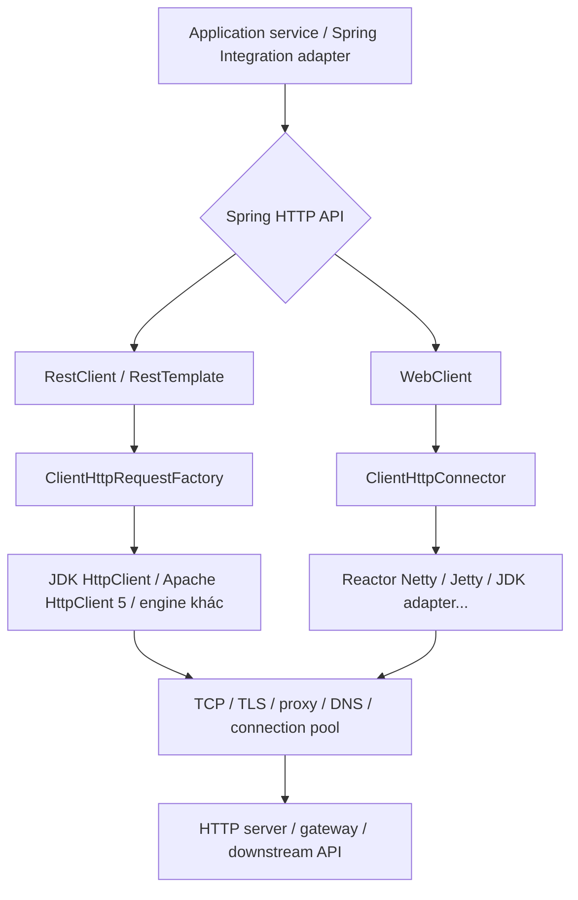
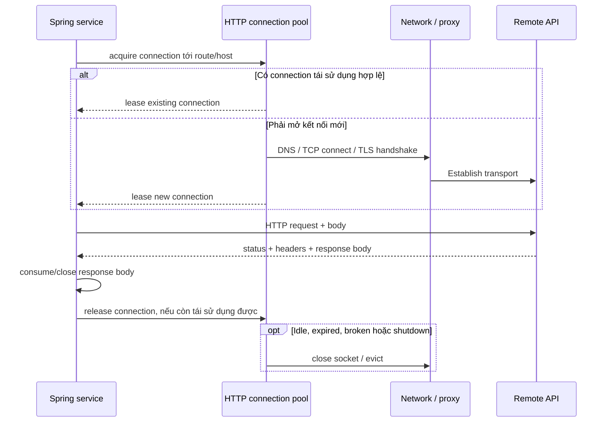
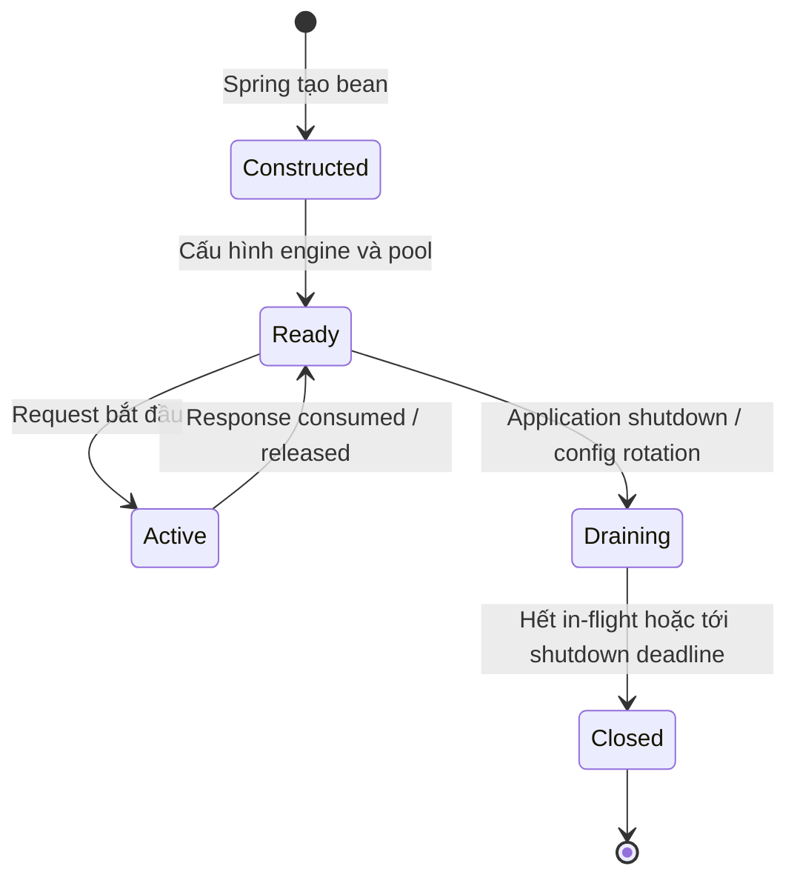
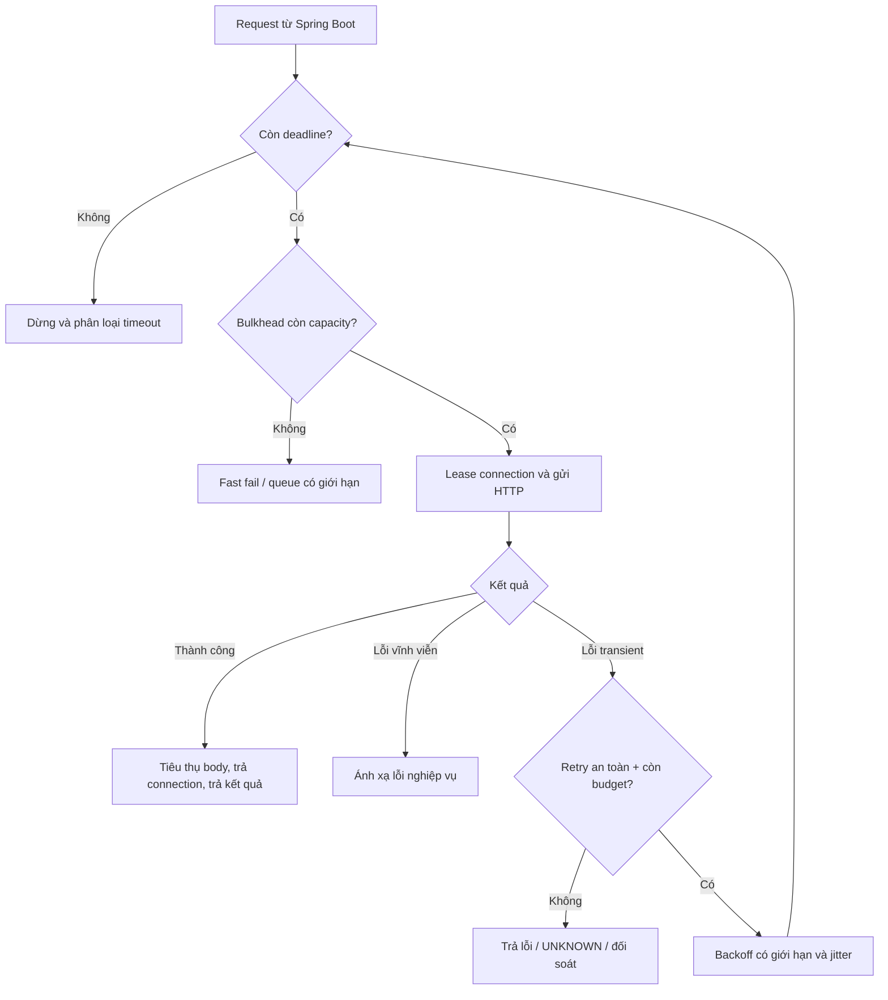
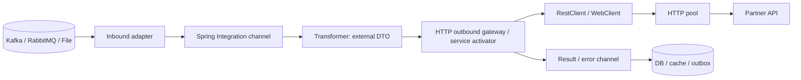

# Thư viện HTTP nền, connection pool và vòng đời kết nối

Trong **SPRING_BOOT_INTEGRATION**, HTTP client là một mắt xích quan trọng khi Spring Boot gọi API đối tác, dịch vụ nội bộ hoặc một gateway nằm trước hệ thống dữ liệu. Lựa chọn `RestClient` hay `WebClient` chỉ là **một phần** quyết định: bên dưới còn có HTTP transport, DNS, TCP, TLS, proxy, connection pool, bộ lập lịch I/O, timeout và cơ chế giải phóng tài nguyên. Một hệ thống có thể xử lý JSON và mã trạng thái chính xác nhưng vẫn suy giảm nghiêm trọng khi tăng lưu lượng do **mở kết nối mới cho mọi request**, **giữ kết nối không được trả về pool**, hoặc **đặt timeout sai giai đoạn**.

Bài thuộc chương **Lựa chọn HTTP client**, tập trung vào **thư viện HTTP nền, connection pool và vòng đời kết nối** trong Spring Boot. Mục tiêu không phải chọn một thư viện “tốt nhất” cho mọi trường hợp, mà là hiểu một lời gọi HTTP dùng những tài nguyên nào, pool được chia sẻ ra sao, cách bảo vệ chúng dưới tải và cách kiểm tra thực tế. Nội dung liên hệ với quản lý cấu hình, hợp đồng DTO, retry, idempotency, transaction, cache, broker, Spring Integration, kiểm thử và observability của những luồng tích hợp.

> Các ví dụ Java hướng tới **Java 17+, Spring Boot 3.x / Spring Framework 6.x** cùng phiên bản thư viện transport do Boot BOM quản lý. API của Apache HttpClient 5, Reactor Netty và các builder Spring có thể khác ở các bản phát hành; khi triển khai cần đối chiếu với đúng version của dự án. Các con số pool/timeout chỉ nhằm minh họa cách suy nghĩ, **không phải cấu hình tối ưu mặc định**.

## 1. Mục tiêu học tập

Sau bài này, bạn có thể:

1. Phân biệt **API Spring** (`RestClient`, `WebClient`, `RestTemplate`, HTTP interface) với **HTTP engine** thực hiện network I/O (`JDK HttpClient`, Apache HttpComponents, Reactor Netty…).
2. Mô tả vòng đời từ lấy connection trong pool, mở TCP/TLS, gửi request, nhận response, giải phóng body đến tái sử dụng hoặc đóng kết nối.
3. Phân biệt pool acquisition timeout, TCP connect timeout, response/read timeout, idle timeout, connection lifetime và deadline của toàn thao tác.
4. Thiết kế giới hạn connection theo đích, concurrency, queueing và hành vi HTTP/1.1 so với HTTP/2.
5. Cấu hình một HTTP client có pool được **tạo một lần**, được dùng lại và được đóng có kiểm soát trong Spring Boot.
6. Hiểu những lỗi như connection leak, stale connection, proxy/TLS/DNS thay đổi và việc retry khiến side effect lặp.
7. Kiểm thử hiệu năng/kết nối/timeout, đo metric pool và chọn transport theo ràng buộc thật của một luồng tích hợp.

## 2. Hai lớp lựa chọn: API dùng trong code và HTTP transport nền

Ở tầng ứng dụng, developer thường nhìn thấy code như `restClient.get().retrieve()` hoặc `webClient.post().retrieve()`. Nhưng **ai quản lý socket và connection pool** phụ thuộc `ClientHttpRequestFactory` (đường synchronous) hoặc `ClientHttpConnector` (đường reactive) đã được chọn.



| Thành phần | Vai trò chính | Có phải chính nó quyết định kích thước pool? |
| --- | --- | --- |
| `RestClient` | Fluent **synchronous** HTTP API của Spring Framework, trả kết quả cho thread gọi | Không. Tùy request factory/engine nền. |
| `RestTemplate` | API synchronous cũ, vẫn gặp trong dự án lâu đời | Không. Cũng phụ thuộc request factory. |
| `WebClient` | Reactive HTTP API dựa trên Publisher/`Mono`/`Flux` | Không trực tiếp; phụ thuộc connector và event-loop/transport. |
| Declarative HTTP interfaces | Proxy method interface thành lời gọi HTTP qua adapter được chọn | Không. Cần xác định proxy dùng `RestClient` hay `WebClient` và engine nền. |
| `ClientHttpRequestFactory` | Cầu nối synchronous Spring API tới HTTP transport | Có thể chứa/tham chiếu engine có pool. |
| `ClientHttpConnector` | Cầu nối reactive Spring API tới transport | Thường tham chiếu HTTP client và connection provider. |
| Apache HttpClient 5 | HTTP engine với connection manager/pool có thể cấu hình rõ | **Có** qua `PoolingHttpClientConnectionManager` và request configuration. |
| JDK `java.net.http.HttpClient` | HTTP engine chuẩn JDK, hỗ trợ HTTP/1.1 và HTTP/2 tùy peer | Quản lý connection nội bộ; không có API pool tuning giống Apache. |
| Reactor Netty `HttpClient` | Non-blocking network engine; có event loop và `ConnectionProvider` | **Có** qua `ConnectionProvider` và cấu hình transport. |

Một `RestClient` có thể dùng Apache HttpClient; một `WebClient` có thể dùng Reactor Netty hoặc engine khác. Vì thế nhận xét “RestClient không có pool” hoặc “WebClient tự giải quyết mọi chuyện về pool” đều sai nếu không biết **cấu hình bên dưới**.

### 2.1. Blocking, non-blocking và điều cần đo

- Với **synchronous client**, thread của lời gọi thường chờ cho đến khi có response hoặc lỗi. Số request đồng thời chịu ảnh hưởng thread pool và connection pool.
- Với **reactive client**, network I/O có thể không chặn event-loop thread; vẫn cần giới hạn số request và connection đang mở, số request chờ acquire và khối lượng dữ liệu response. Không chặn event loop bằng `block()` hay một thao tác JDBC blocking thiếu cô lập.
- Không nên kết luận reactive nhanh hơn với một request đơn lẻ. Nó có thể hiệu quả hơn về **sử dụng thread khi có nhiều I/O đồng thời**, nhưng vẫn chịu bottleneck của API đích, mạng và pool.

Chọn synchronous hay reactive phải phù hợp kiến trúc của caller, thư viện tích hợp, cách xử lý lỗi và khả năng đội ngũ vận hành. **Tối ưu pool sai** có thể gây timeout hàng loạt cho cả hai mô hình.

## 3. Vòng đời của một HTTP request và một connection

Một HTTP exchange điển hình:



Vòng đời có những pha quan trọng:

1. **Tìm địa chỉ/route:** DNS resolve, proxy, target scheme/host/port và TLS configuration. Tên host có thể trỏ sang IP khác theo thời gian.
2. **Lấy connection từ pool (*lease/acquire*):** nếu có kết nối rảnh và hợp lệ, dùng lại; nếu chưa đạt giới hạn, có thể mở mới; nếu đã đầy, request đợi hoặc bị từ chối khi hết acquisition timeout.
3. **TCP connect và TLS handshake:** khi phải tạo kết nối mới, việc bắt tay mạng/bảo mật tốn thời gian và CPU. Connect timeout chưa chắc bao trùm mọi pha TLS/đàm phán qua proxy.
4. **Gửi request và nhận phản hồi:** request headers, body, server processing và nhận status/headers/body. Network có thể chậm ở cả hướng gửi lẫn nhận.
5. **Tiêu thụ hoặc đóng response body:** thư viện phải biết response đã hoàn tất để tái sử dụng an toàn. Để body ở trạng thái chưa được đọc/giải phóng có thể giữ connection bận.
6. **Trả lại pool hoặc đóng:** keep-alive cho phép reuse khi protocol, headers và trạng thái socket còn phù hợp. Kết nối lỗi, hết lifetime, quá idle hoặc bị server đóng sẽ bị loại.
7. **Shutdown ứng dụng:** HTTP client/pool đã tạo riêng cần được đóng đúng vòng đời bean; giữ tài nguyên sau shutdown có thể để lại thread, socket hoặc background evictor.

**Không nhầm reuse với dữ liệu cache:** connection pool tái sử dụng **đường truyền TCP/TLS**, không tái sử dụng HTTP response của lần trước. Cache nằm ở lớp khác và có quy tắc freshness, invalidation riêng.

### 3.1. Khi nào kết nối không được tái sử dụng?

Ví dụ: server trả `Connection: close`, client/peer đóng socket, response body chưa được xử lý đầy đủ theo cách engine yêu cầu, kết nối không còn hợp lệ, proxy thay đổi hoặc pool quyết định loại do lifetime. Retry sau lỗi connection cần phân biệt với retry nghiệp vụ: một lỗi lúc tái sử dụng socket “stale” có thể xảy ra **trước khi gửi trọn request**, nhưng không luôn chứng minh remote chưa xử lý.

**Keep-alive** là khả năng giữ kết nối để phục vụ nhiều HTTP exchange; **TCP keepalive** là cơ chế kiểm tra socket ở tầng TCP, thường có chu kỳ rất khác. Hai khái niệm này không phải cùng một cấu hình.

## 4. Các thư viện HTTP nền và tiêu chí lựa chọn

| Engine | Ưu điểm/đặc điểm | Điểm cần xem xét |
| --- | --- | --- |
| **JDK `HttpClient`** | Có trong JDK 11+, hỗ trợ synchronous/asynchronous, HTTP/2 khi đàm phán thành công; ít dependency ngoài | Pool quản lý nội bộ, không có đầy đủ API tuning per-route/eviction như Apache; behavior và tùy chọn phụ thuộc JDK. |
| **Apache HttpComponents Client 5** | Pooling manager rõ ràng, cấu hình tổng/per-route, connect/socket/response/request timeout, proxy/TLS/route linh hoạt | Cần quản lý `CloseableHttpClient` và connection manager; dễ đặt sai giới hạn hay tạo nhiều pool ngoài ý muốn. |
| **Reactor Netty** | Non-blocking, `ConnectionProvider`, event loop; phù hợp `WebClient`/Reactor và tải I/O đồng thời | Cần kiểm soát pending acquire, max connections, event-loop blocking, resource cleanup và backpressure. |
| **Jetty HTTP client** | HTTP async client với cấu hình pool, thread và transport của Jetty | Cần đồng bộ version và quản lý lifecycle tương ứng. |
| **Simple URLConnection-based factory** | Ít cấu hình, thích hợp tình huống rất đơn giản | Không cung cấp cùng mức quản lý pool/metrics/timeout như những engine chuyên biệt; cần kiểm tra behavior thực tế. |

**Không lựa chọn chỉ theo tên:** xem HTTP/2, proxy, mTLS, OAuth/token, DNS failover, yêu cầu quan sát pool, tính tương thích với project và mức concurrency. Đừng thêm engine mới chỉ vì một API client “có vẻ chậm” nếu vấn đề thật là DB query, timeout ở đối tác hoặc lock contention.

### 4.1. HTTP/1.1 và HTTP/2 ảnh hưởng đến pool thế nào?

Với HTTP/1.1 trong các client thông thường, một connection tại một thời điểm thường phục vụ **một request đang hoạt động**, nên nhiều request đồng thời cần nhiều connection (trừ cơ chế pipelining ít dùng). HTTP/2 hỗ trợ **multiplex nhiều stream qua một TCP connection** theo giới hạn stream/concurrency do hai đầu và client áp dụng.

Vì vậy **không** dùng công thức “100 concurrent requests = 100 TCP connections” một cách máy móc khi chạy HTTP/2. Đồng thời, **HTTP/2 không có nghĩa chỉ một connection mãi mãi**: giới hạn stream, flow control, server setting, proxy, TLS ALPN, fallback HTTP/1.1 và reconnect đều ảnh hưởng.

`maxConnections` hoặc `maxConnPerRoute` có ý nghĩa tùy engine và protocol. Trước khi giảm pool xuống một vài socket dựa trên giả định HTTP/2, cần xác minh **thực sự đã đàm phán HTTP/2** và metric stream/concurrency có đủ. Proxy có thể nhận HTTP/2 từ client nhưng chuyển sang HTTP/1.1 ở backend.

## 5. Connection pool: hạn mức, chờ, tái sử dụng và điều phối tài nguyên

Connection pool là tập kết nối có thể reuse theo logic **destination/route** của engine. Một route có thể bao gồm scheme, host, port, proxy, TLS config và các thuộc tính khác tùy implementation. Không nên giả định hai URL cùng DNS/IP luôn chia được pool, hay hai host khác nhau chắc chắn dùng chung socket.

| Thuộc tính pool | Ý nghĩa | Nguy cơ nếu cấu hình sai |
| --- | --- | --- |
| **`max total connections`** | Trần connection của pool chung | Quá thấp gây chờ acquire; quá cao tốn file descriptor/socket và tải server. |
| **`max per route`** | Trần connection cho mỗi đích/route (ở engine hỗ trợ) | Một đối tác bận có thể nghẽn, hoặc chiếm quá nhiều connection nếu thiếu phân vùng. |
| **Pending acquire queue** | Số request đang chờ connection | Queue không giới hạn làm tăng độ trễ/bộ nhớ, che quá tải. |
| **Pool acquisition timeout** | Thời gian chờ lấy connection | Dài hơn deadline chung khiến caller chờ vô ích. |
| **Max idle time** | Thời gian connection được phép nhàn rỗi trước khi bị loại theo cơ chế pool | Quá dài dễ gặp socket bị NAT/load balancer đóng; quá ngắn tăng TLS handshakes. |
| **Max connection lifetime / TTL** | Thời gian sống tối đa của connection, kể cả có hoạt động | Cần tái kết nối định kỳ; đặt quá ngắn gây churn, quá dài có thể giữ route/TLS cũ lâu. |
| **Idle eviction / validation** | Phát hiện và dọn connection cũ/broken | Không có chính sách hợp lý dễ thấy lỗi “stale connection” khi dùng lại. |
| **Shutdown/dispose** | Giải phóng toàn bộ pool và background resources | Thiếu cleanup có thể để socket/thread tồn tại ngoài vòng đời mong muốn. |

Một pool lớn không giải quyết được một dịch vụ đích chỉ cho 20 request đồng thời. Nếu mỗi instance có pool tối đa 100 và hệ thống chạy 10 instance, **khả năng kết nối tổng** có thể lên tới 1.000, chưa kể các client/process khác. Cần cân đối giới hạn của API đích, load balancer và database mà API đích dùng.

### 5.1. Ước tính quy mô pool bằng concurrency thực tế

Một phép ước tính khởi đầu từ Little's Law trong điều kiện ổn định:

\[
\text{requests đang thực thi trung bình}
\approx
\text{throughput (req/s)}
\times
\text{latency trung bình (s)}
\]

Ví dụ một instance gửi **60 request/giây** tới đối tác, latency trung bình **0,2 giây**: mức đang hoạt động trung bình khoảng **12 requests**. Với HTTP/1.1 và một active request/connection, pool **12** có thể đủ cho trung bình nhưng thiếu dư địa cho p95/p99, burst, retry hoặc độ trễ cao bất thường. Một mức ví dụ ban đầu **24–32 connections per route** có thể đem thử tải và điều chỉnh, không nên coi đó là con số bắt buộc.

Khi tăng 5 instance, mức concurrency tổng và giới hạn downstream cũng phải tính lại. Nếu API đích chỉ chịu được 40 concurrent requests, việc tăng pool của **mỗi** instance lên 200 thường làm tình hình xấu đi. Có thể cần bulkhead, per-host concurrency limit, rate limiter và hàng chờ có giới hạn thay vì chỉ tăng socket.

### 5.2. Pool HTTP khác pool DB

Pool HTTP bảo vệ socket tới đối tác; `HikariCP` bảo vệ JDBC connection tới database. Một request HTTP của ứng dụng có thể đồng thời giữ **một worker thread**, **một DB connection** và **một outbound HTTP connection** nếu transaction scope không hợp lý. Không gọi HTTP bên ngoài trong lúc giữ DB lock/transaction kéo dài trừ khi có thiết kế đặc biệt và đã đo rủi ro.

Ví dụ chain: inbound HTTP → BEGIN transaction → SQL → gọi đối tác 3 giây → COMMIT. Dù SQL chỉ mất 20 ms, DB connection và lock có thể bị giữ trong toàn bộ 3 giây. Tối ưu HTTP pool không sửa được sự lãng phí đó; cần thiết kế ranh giới transaction/async/outbox phù hợp.

## 6. Timeout của mỗi giai đoạn và deadline toàn thao tác

Các timeout dễ bị nhầm nhất:

| Timeout | Bảo vệ giai đoạn | Không chứng minh |
| --- | --- | --- |
| **Pool acquire / connection request timeout** | Chờ một connection rảnh từ pool | Không giới hạn DNS/connect/đợi response khi đã có connection. |
| **DNS resolution timeout** | Phụ thuộc resolver/transport và cấu hình OS/JVM | Không phải engine nào cũng có property riêng dễ đặt. |
| **TCP connect timeout** | Thiết lập kết nối TCP tới host/proxy | Không nhất thiết bao trùm TLS handshake, lấy pool connection hoặc toàn response. |
| **TLS handshake timeout** | Bắt tay TLS trong những engine có hỗ trợ cấu hình riêng | Không đồng nghĩa HTTP server đã xử lý request. |
| **Socket/read inactivity timeout** | Một khoảng chờ dữ liệu I/O theo semantics engine | Không luôn là **tổng** thời gian nhận body/stream. |
| **Response timeout** | Thường giới hạn chờ response, ý nghĩa chi tiết tùy engine | Có client đo chờ header, có client đo khoảng im lặng; không nên suy thành toàn E2E. |
| **Request/operation timeout** | Toàn một HTTP call nếu engine/API hỗ trợ | Không bao gồm mọi bước nghiệp vụ trước/sau HTTP. |
| **Overall business deadline** | Giới hạn toàn luồng HTTP + DB + cache + broker + serialization/retry | Không tự được thiết lập chỉ nhờ các timeout transport. |
| **Idle timeout / TTL** | Vòng đời connection **khi rảnh** hoặc tổng tuổi socket | Không phải thời hạn xử lý một request nghiệp vụ. |

Giả sử một tác vụ cần hoàn thành trong **2.500 ms** và đã tiêu 900 ms ở bước JDBC. Dù HTTP client được cấu hình `responseTimeout=2s`, phần ngân sách còn lại chỉ có **1.600 ms**, còn cần dự phòng cho thao tác tiếp theo. Không nên cho HTTP call dùng trọn 2 giây. Tại mỗi I/O:

\[
\text{allowedStep}
= \min(\text{configuredStepLimit},
       \text{remainingOverallBudget} - \text{reserve})
\]

Nếu kết quả không dương, **không khởi động bước mới**. Với mã Java trong một process, `System.nanoTime()` phù hợp để đo khoảng thời gian đã trôi qua. Khi truyền deadline qua hệ thống/broker, dùng định dạng UTC hoặc budget có quy tắc đồng hồ lệch, không truyền thẳng giá trị nanoTime của máy A cho máy B.

**Một timeout có thể xảy ra sau khi server đã commit tác động.** Nếu HTTP `POST /payments` bị timeout khi client chờ response, không thể kết luận payment chưa diễn ra. Cần khóa idempotency ổn định, API truy vấn trạng thái, transaction/outbox hoặc quy trình reconciliation tùy nghiệp vụ. Không retry tùy tiện một request tạo side effect chỉ vì kết nối bị đóng.

## 7. Spring Boot tự cấu hình gì và ứng dụng chịu trách nhiệm gì?

Trong Spring Boot 3.x, Boot có cơ chế tạo và customize **`RestClient.Builder`** khi thư viện tương ứng hiện diện (đặc biệt từ thế hệ Boot 3.2/Framework 6.1) và **`WebClient.Builder`** khi có WebFlux. Builder do Spring quản lý có thể được liên kết với HTTP message converters/codecs, metrics/tracing và cơ chế nhận diện request factory/connector theo dependency và phiên bản.

Tuy nhiên, **Boot không thể biết mỗi đối tác cần bao nhiêu connection, bao nhiêu request đồng thời, proxy/TLS profile nào, idle timeout hay SLA ra sao**. Việc bổ sung Apache HttpClient hoặc Reactor Netty vào classpath cũng **không tự đảm bảo** toàn bộ request của ứng dụng đang dùng chung một pool được cấu hình theo ý định.

| Việc có thể được Boot chuẩn bị khi đủ điều kiện | Việc ứng dụng phải tự quyết định |
| --- | --- |
| Auto-configure `RestClient.Builder`, `WebClient.Builder` và một số customizer | Chọn **engine nền** phù hợp cho từng outbound adapter. |
| Message converter/JSON codec và phần integration với hệ sinh thái Boot | Hợp đồng JSON/XML, headers, credentials, error mapping và schema version. |
| Một số HTTP resources chung theo hệ sinh thái được kích hoạt | Pool size, pending acquire, connection lifetime, proxy, TLS và per-partner isolation. |
| Context/lifecycle cho những bean được Spring quản lý | Sở hữu và đóng custom `CloseableHttpClient`/`ConnectionProvider` đúng thời điểm. |
| Observability hạ tầng khi có Actuator/Micrometer và auto-configuration phù hợp | Metric per-partner, phân loại timeout, deadline toàn luồng, retry và cảnh báo. |

**Đường đi nên ưu tiên:** inject builder do Boot quản lý rồi tạo **client theo đối tác** dưới dạng singleton Spring bean. Không tạo client mới **mỗi request**. Nếu cần engine và pool tùy chỉnh, khai báo chúng thành bean có chủ sở hữu vòng đời rõ.

Ví dụ phân biệt:

```java
// Không nên làm trong method xử lý request nếu sẽ tạo mới
// HTTP engine/pool hoặc làm mất cấu hình từ Spring Boot:
RestClient client = RestClient.create();

// Nên inject RestClient.Builder do Boot quản lý vào @Configuration,
// cấu hình baseUrl, transport và xây RestClient bean một lần.
```

`RestClient.create()` không bị “cấm”: hữu ích cho chương trình nhỏ hoặc thử nghiệm được kiểm soát. Vấn đề là **tạo lặp lại mà không biết transport và lifecycle**, hoặc tưởng rằng nó chắc chắn nhận mọi customizer/tracing/pool của ứng dụng Boot. Tương tự, không tùy tiện gọi `WebClient.create()` và bỏ qua cấu hình connector được dự án quản lý.

### 7.1. Một pool cho tất cả đối tác hay một pool cho từng đối tác?

Một HTTP engine có thể giữ **pool theo route** cho nhiều host. Một pool chung có thể giảm chi phí quản lý, nhưng các đối tác khác nhau có thể yêu cầu:

- **mTLS certificate**, trust store hoặc proxy khác;
- giới hạn concurrency khác nhau và SLA riêng;
- chính sách authentication khác nhau, tránh rò rỉ header giữa đối tác;
- một hệ đích không được phép chiếm hết connection gây ảnh hưởng hệ khác;
- lịch rotation certificate/token/endpoint không giống nhau.

Khi đó có thể tạo **HTTP client/pool riêng cho một nhóm đối tác**, không nhất thiết một client cho mỗi endpoint path. Đừng dựa vào một `RestClient`/`WebClient` chung với mutable default headers để đặt credential của tenant hiện tại; headers riêng từng request cần được tính tại đúng lời gọi.

## 8. Ví dụ Spring Boot + RestClient + Apache HttpClient 5

Apache HttpComponents Client 5 phù hợp khi cần quản lý **max total/per-route**, lifetime, idle eviction và HTTP configuration một cách tường minh. Trong Maven, ngoài starter Spring Web, thêm Apache HttpClient 5 nếu chưa có transitively:

```xml
<dependency>
    <groupId>org.springframework.boot</groupId>
    <artifactId>spring-boot-starter-web</artifactId>
</dependency>
<dependency>
    <groupId>org.apache.httpcomponents.client5</groupId>
    <artifactId>httpclient5</artifactId>
</dependency>
```

Để thực sự dùng Apache, ta **chỉ định request factory** thay vì chỉ giả định Boot sẽ chọn engine này. Ví dụ Spring Framework 6.x với Apache HttpClient 5:

```java
import org.apache.hc.client5.http.config.ConnectionConfig;
import org.apache.hc.client5.http.impl.classic.CloseableHttpClient;
import org.apache.hc.client5.http.impl.classic.HttpClients;
import org.apache.hc.client5.http.impl.io.PoolingHttpClientConnectionManager;
import org.apache.hc.client5.http.impl.io.PoolingHttpClientConnectionManagerBuilder;
import org.apache.hc.core5.util.TimeValue;
import org.apache.hc.core5.util.Timeout;
import org.springframework.context.annotation.Bean;
import org.springframework.context.annotation.Configuration;
import org.springframework.http.client.HttpComponentsClientHttpRequestFactory;
import org.springframework.web.client.RestClient;

@Configuration(proxyBeanMethods = false)
public class PartnerApacheHttpConfig {

    @Bean(destroyMethod = "close")
    CloseableHttpClient partnerApacheHttpClient() {
        PoolingHttpClientConnectionManager pool =
                PoolingHttpClientConnectionManagerBuilder.create()
                        .setMaxConnTotal(80)
                        .setMaxConnPerRoute(24)
                        .setDefaultConnectionConfig(
                                ConnectionConfig.custom()
                                        .setConnectTimeout(
                                                Timeout.ofMilliseconds(250))
                                        .setSocketTimeout(
                                                Timeout.ofMilliseconds(900))
                                        .setTimeToLive(TimeValue.ofMinutes(3))
                                        .build())
                        .build();

        return HttpClients.custom()
                .setConnectionManager(pool)
                .evictExpiredConnections()
                .evictIdleConnections(TimeValue.ofSeconds(30))
                .build();
    }

    @Bean
    RestClient partnerRestClient(
            RestClient.Builder builder,
            CloseableHttpClient partnerApacheHttpClient) {

        var requestFactory =
                new HttpComponentsClientHttpRequestFactory(
                        partnerApacheHttpClient);
        requestFactory.setConnectionRequestTimeout(200);

        return builder
                .requestFactory(requestFactory)
                .baseUrl("https://partner.example.org")
                .build();
    }
}
```

**Ý nghĩa cấu hình trong ví dụ:**

| Cấu hình | Ý nghĩa |
| --- | --- |
| `setMaxConnTotal(80)` | Tối đa 80 connections trong pool Apache của client này. |
| `setMaxConnPerRoute(24)` | Tối đa 24 connections đến một route theo định nghĩa Apache. |
| `setConnectionRequestTimeout(200)` | Caller được chờ tối đa khoảng 200 **mili giây** khi lấy connection từ manager; không phải connect timeout. |
| `setConnectTimeout(250 ms)` | Giới hạn pha thiết lập kết nối theo Apache connection config; không coi là deadline mọi giai đoạn. |
| `setSocketTimeout(900 ms)` | Giới hạn thao tác đọc socket theo semantics HttpCore, **không phải tổng thời gian E2E** của body lớn. |
| `setTimeToLive(3 phút)` | Giới hạn tuổi connection; giảm khả năng giữ kết nối quá lâu. |
| `evictIdleConnections(30 giây)` | Dọn connection rảnh quá lâu theo cơ chế eviction, tránh tích tụ socket cũ. |
| `@Bean(destroyMethod="close")` | Spring gọi `close()` khi hủy bean, dọn HTTP client/pool/background resources do client sở hữu. |

**Chú ý về ownership:** Trong đoạn code, pool được tạo **bên trong** bean `CloseableHttpClient` và client nhận quyền quản lý pool theo mặc định. Khi Spring đóng client, pool được giải phóng. Nếu bạn khai báo pool riêng rồi chia cho nhiều client với chế độ shared connection manager, phải định nghĩa **ai thực sự đóng pool**; không đóng khi client khác vẫn đang sử dụng.

**Chú ý về timeout:** Không phải mọi phiên bản Spring Framework 6.x có cùng setter cho `setReadTimeout` trên `HttpComponentsClientHttpRequestFactory`. Ví dụ chọn `ConnectionConfig` của Apache để đặt socket timeout và `setConnectionRequestTimeout` của request factory để tránh nhầm API của các phiên bản. Nếu muốn giới hạn chờ response bằng `RequestConfig.setResponseTimeout` hoặc theo request, hãy cấu hình riêng trên Apache client/context và xác nhận semantics trong bản HttpClient 5 đang dùng.

### 8.1. Tạo adapter nghiệp vụ dùng client đã cấu hình

```java
import org.springframework.beans.factory.annotation.Qualifier;
import org.springframework.stereotype.Component;
import org.springframework.web.client.RestClient;

public record PartnerOrderResponse(String orderId, String status) {}

@Component
public class PartnerOrderHttpAdapter {
    private final RestClient client;

    public PartnerOrderHttpAdapter(
            @Qualifier("partnerRestClient") RestClient client) {
        this.client = client;
    }

    public PartnerOrderResponse fetch(String orderId) {
        PartnerOrderResponse response = client.get()
                .uri("/v1/orders/{id}", orderId)
                .retrieve()
                .body(PartnerOrderResponse.class);

        if (response == null) {
            throw new IllegalStateException("Empty partner response");
        }
        return response;
    }
}
```

`RestClient` được dựng một lần và có thể dùng lại giữa nhiều thread theo kiểu dùng thông thường; mỗi lời gọi tạo request-specific state thay vì sửa lại bean. Mã ví dụ chưa có xác thực, status/error mapping, retry và deadline của toàn workflow; đó là trách nhiệm của adapter ứng dụng.

### 8.2. Vì sao không tự tạo `CloseableHttpClient` trong mỗi request?

Nếu mỗi request chạy `HttpClients.custom().build()` rồi bỏ quên đóng client:

- Mỗi instance mới có thể có **pool và connection manager riêng**, mất lợi ích keep-alive/tái sử dụng.
- TCP connect/TLS handshake lặp, tăng độ trễ và CPU cả phía client lẫn server.
- Socket và thread/eviction resources có thể tích tụ khi không đóng đúng cách.
- Không có một nơi duy nhất để giới hạn concurrency, đo pool stats và cập nhật cấu hình.

Nếu dùng `try-with-resources` đóng client sau mỗi request, bạn tránh một số leak nhưng **vẫn không tận dụng pool lâu dài**. Đây thường là lỗi thiết kế cho ứng dụng web/service chạy liên tục, khác với một chương trình CLI chỉ gửi một request rồi kết thúc.

## 9. Ví dụ RestClient với JDK `HttpClient`

Khi không cần điều chỉnh per-route pool chi tiết như Apache, `java.net.http.HttpClient` là một lựa chọn ít phụ thuộc. Nó hỗ trợ HTTP/2 khi server/proxy tương thích; cấu hình chọn HTTP/2 là **nguyện vọng đàm phán**, không phải cam kết mọi request sẽ dùng HTTP/2.

```java
import java.net.http.HttpClient;
import java.time.Duration;
import org.springframework.context.annotation.Bean;
import org.springframework.context.annotation.Configuration;
import org.springframework.http.client.JdkClientHttpRequestFactory;
import org.springframework.web.client.RestClient;

@Configuration(proxyBeanMethods = false)
public class PartnerJdkHttpConfig {

    @Bean
    HttpClient partnerJdkHttpClient() {
        return HttpClient.newBuilder()
                .connectTimeout(Duration.ofMillis(300))
                .version(HttpClient.Version.HTTP_2)
                .build();
    }

    @Bean
    RestClient partnerJdkRestClient(
            RestClient.Builder builder, HttpClient partnerJdkHttpClient) {

        var factory = new JdkClientHttpRequestFactory(
                partnerJdkHttpClient);
        factory.setReadTimeout(Duration.ofMillis(900));

        return builder
                .requestFactory(factory)
                .baseUrl("https://partner.example.org")
                .build();
    }
}
```

**Đây là một phương án thay thế** cho cấu hình Apache ở phần 8, không phải hướng dẫn đăng ký hai `RestClient` cùng tên trong một ứng dụng. `JdkClientHttpRequestFactory.setReadTimeout(Duration)` thuộc Spring Framework thế hệ phù hợp; kiểm tra API theo version dự án. JDK client quản lý kết nối nội bộ và có thể được chia sẻ nhiều lần gọi khi object được tái sử dụng.

Điểm đánh đổi: **không thể áp dụng các API `setMaxConnPerRoute`/`PoolingHttpClientConnectionManager` của Apache cho JDK client**. Nếu cần giới hạn per-partner request concurrency, hãy dùng semaphore/bulkhead/rate limit ở tầng adapter hoặc chọn engine có pool controls đáp ứng đúng yêu cầu. Đừng nhầm giới hạn số connection vật lý với giới hạn số HTTP/2 streams/request đang hoạt động.

Lưu ý vòng đời JDK thay đổi theo Java version. Với Java 17, không nên giả định có cùng `close()/shutdown()` public API như JDK mới hơn; nếu dự án yêu cầu teardown network resources nghiêm ngặt, kiểm tra chính xác khả năng lifecycle của JDK được triển khai. Việc giữ một `HttpClient` lâu dài trong suốt vòng đời ứng dụng vẫn là mẫu phù hợp hơn tạo object mới trên mỗi lời gọi.

## 10. WebClient + Reactor Netty: quản lý `ConnectionProvider`

Với ứng dụng dùng WebFlux hoặc client reactive, Reactor Netty cho phép cấu hình pool qua **`ConnectionProvider`**. Ví dụ Java 17+/Spring Boot 3.x:

```xml
<dependency>
    <groupId>org.springframework.boot</groupId>
    <artifactId>spring-boot-starter-webflux</artifactId>
</dependency>
```

Khai báo custom provider và dùng lại cho một `WebClient`:

```java
import io.netty.channel.ChannelOption;
import java.time.Duration;
import org.springframework.context.annotation.Bean;
import org.springframework.context.annotation.Configuration;
import org.springframework.http.client.reactive.ReactorClientHttpConnector;
import org.springframework.web.reactive.function.client.WebClient;
import reactor.netty.http.client.HttpClient;
import reactor.netty.resources.ConnectionProvider;

@Configuration(proxyBeanMethods = false)
public class PartnerReactiveHttpConfig {

    @Bean(destroyMethod = "dispose")
    ConnectionProvider partnerConnectionProvider() {
        return ConnectionProvider.builder("partner-api-pool")
                .maxConnections(50)
                .pendingAcquireMaxCount(100)
                .pendingAcquireTimeout(Duration.ofMillis(200))
                .maxIdleTime(Duration.ofSeconds(30))
                .maxLifeTime(Duration.ofMinutes(3))
                .evictInBackground(Duration.ofSeconds(15))
                .build();
    }

    @Bean
    WebClient partnerWebClient(
            WebClient.Builder builder,
            ConnectionProvider partnerConnectionProvider) {

        HttpClient engine = HttpClient.create(partnerConnectionProvider)
                .option(ChannelOption.CONNECT_TIMEOUT_MILLIS, 300)
                .responseTimeout(Duration.ofMillis(900));

        return builder
                .clientConnector(new ReactorClientHttpConnector(engine))
                .baseUrl("https://partner.example.org")
                .build();
    }
}
```

```java
import org.springframework.beans.factory.annotation.Qualifier;
import org.springframework.stereotype.Component;
import org.springframework.web.reactive.function.client.WebClient;
import reactor.core.publisher.Mono;

@Component
public class ReactivePartnerOrderAdapter {
    private final WebClient client;

    public ReactivePartnerOrderAdapter(
            @Qualifier("partnerWebClient") WebClient client) {
        this.client = client;
    }

    public Mono<PartnerOrderResponse> fetch(String orderId) {
        return client.get()
                .uri("/v1/orders/{id}", orderId)
                .retrieve()
                .bodyToMono(PartnerOrderResponse.class);
    }
}
```

| Cấu hình Reactor Netty | Ý nghĩa |
| --- | --- |
| `maxConnections(50)` | Số connection tối đa theo chính sách provider cho các pool được quản lý. |
| `pendingAcquireMaxCount(100)` | Giới hạn số yêu cầu chờ acquire theo cơ chế provider; tránh hàng chờ tăng vô hạn. |
| `pendingAcquireTimeout(200 ms)` | Giới hạn thời gian chờ acquire connection, khác TCP connect. |
| `maxIdleTime(30 s)` | Connection nhàn rỗi quá lâu có thể bị loại theo chính sách pool. |
| `maxLifeTime(3 phút)` | Giới hạn tuổi connection khi kiểm tra và tái sử dụng. |
| `evictInBackground(15 s)` | Định kỳ dọn những connection không còn hợp lệ theo các điều kiện. |
| `CONNECT_TIMEOUT_MILLIS=300` | Giới hạn thiết lập TCP connect. |
| `responseTimeout(900 ms)` | Bảo vệ chờ phản hồi theo semantics Reactor Netty, không phải deadline toàn nghiệp vụ. |
| `destroyMethod="dispose"` | Dọn provider/pool do ứng dụng tạo khi context đóng. |

**Điểm quan trọng về lifecycle:** Reactor Netty có thể dùng **global shared event-loop resources** (và các tài nguyên HTTP khác) tùy cấu hình. Khi ứng dụng tạo một `ConnectionProvider` riêng, phải quản lý việc dispose provider; không tự động dispose các event-loop resources dùng chung khi những client khác còn đang hoạt động. Trong Spring Boot, kiểm tra tích hợp với `ReactorResourceFactory`/lifecycle thực tế trước khi tùy biến sâu LoopResources hoặc thay đổi cách quản lý global resources.

### 10.1. Reactive không loại bỏ nhu cầu backpressure

Một `WebClient` có thể tạo nhiều request bất đồng bộ rất nhanh, nhưng pool chỉ cho phép 50 connection và tối đa 100 request chờ acquire theo ví dụ. Nếu upstream tạo 10.000 request ngay tức thì, sẽ có số lượng request **bị từ chối/chờ hoặc hết timeout**, không tự động “non-blocking nghĩa là vô hạn”.

Cần hạn chế concurrency ở tầng gọi, ví dụ `flatMap(..., concurrency)`, bulkhead hoặc rate limiter theo từng đối tác. Khi xử lý broker/queue, số Kafka listeners/AMQP consumers hoặc Spring Integration poller cũng phải cân đối giới hạn HTTP pool và DB pool. Nếu broker cấp nhiều hơn sức chứa downstream, có thể cần giảm prefetch/batch size hoặc tách công việc sang hàng chờ bền vững.

### 10.2. Deadline reactive và cancellation

Reactive pipeline có thể áp `timeout(Duration)` để giới hạn thời gian **subscriber chờ kết quả**:

```java
import java.time.Duration;
import reactor.core.publisher.Mono;

public Mono<PartnerOrderResponse> fetchWithinBudget(
        ReactivePartnerOrderAdapter adapter,
        String orderId,
        Duration remainingBudget) {
    return adapter.fetch(orderId)
            .timeout(remainingBudget);
}
```

Hết timeout có thể cancel subscription và giải phóng tài nguyên phía client theo cơ chế transport, nhưng **không thể thu hồi một side effect đã diễn ra trên server**. Với `GET` an toàn, retry có thể đơn giản hơn; với `POST` chuyển tiền, luôn phải có idempotency key và cách truy vấn lại kết quả khi response bị mất.

Không gọi `block()` trên **Netty event-loop thread**. Nếu kiến trúc toàn bộ là Spring MVC synchronous, có thể sử dụng `WebClient` nhưng cần hiểu việc `block()` tiêu tốn thread và đánh đổi so với `RestClient`. Không chuyển toàn bộ hệ thống sang reactive chỉ để có connection pool: Apache HttpClient 5 và JDK client cũng tái sử dụng kết nối.

## 11. Keep-alive, stale connections, DNS, TLS và proxy

Trong môi trường cloud, request thường đi qua **DNS → load balancer/proxy → gateway → server**. Một connection pool phải đối mặt với việc đối tác thay IP, ingress ngừng nhận kết nối, NAT xóa socket nhàn rỗi, certificate được thay hoặc server chủ động đóng kết nối.

### 11.1. Keep-alive phải phù hợp thời gian idle của toàn tuyến

Ví dụ:

```text
Spring Boot instance
    |
    | idle connection sau 90 giây
    v
Load balancer: đóng connection nhàn rỗi sau 60 giây
    |
    v
Partner API
```

Nếu client để kết nối trong pool 90 giây nhưng load balancer đã đóng socket sau 60 giây, lần reuse tiếp theo có thể nhận EOF, reset hoặc connection closed. Pool sẽ cần tạo kết nối mới. Tùy client và thời điểm lỗi, request có thể được thử lại tự động hoặc lỗi trả về ứng dụng.

Một cách giảm lỗi là đặt **max idle time** của client **thấp hơn** timeout idle được công bố cho load balancer/proxy, kết hợp eviction/validation và retry an toàn. Tuy nhiên, không tự tin rằng việc giảm idle timeout sẽ loại bỏ hoàn toàn reset: server có thể đóng kết nối vì triển khai, quá tải hoặc lỗi mạng bất kỳ lúc nào.

### 11.2. DNS thay đổi không có nghĩa socket hiện có lập tức đổi IP

Khi DNS trả IP mới, những connection đã mở vẫn nối đến IP trước đó cho tới khi chúng bị đóng. Pool có lifetime quá dài có thể tiếp tục sử dụng đích cũ nếu còn được mạng chấp nhận; ngược lại nếu IP cũ không còn phục vụ, cần loại connection lỗi và tạo mới để resolve/connect lại. DNS TTL do resolver, JVM, OS, client và hạ tầng môi trường quyết định; **connection TTL khác DNS TTL**.

Không cố “sửa DNS failover” chỉ bằng cách tăng `maxConnections`. Cần đo reuse, lifetime, error rate khi rolling deploy và kiểm tra load balancer thực tế.

### 11.3. TLS và rotation certificate

Một TLS handshake diễn ra khi mở transport connection mới; các request reuse có thể không bắt tay lại từ đầu. Khi đổi trust store hoặc client certificate dùng cho mTLS:

- Xác định HTTP client/pool có đọc lại cấu hình TLS hay không; nhiều engine tạo SSL context khi khởi động.
- Kết nối cũ có thể tiếp tục tồn tại tới khi hết hạn hoặc bị đóng; đặt lifetime và kế hoạch rotate phù hợp.
- Nếu phải thay SSL context/tài khoản, có thể cần **xây pool mới** và drain pool cũ thay vì thay mutable state giữa nhiều request.
- Không tắt hostname verification/trust validation chỉ để tránh lỗi handshake ở staging hay production.

TLS version, cipher, SNI, proxy CONNECT, ALPN/HTTP2 negotiation và chính sách mTLS có thể ảnh hưởng độ trễ kết nối. Cần test qua proxy/gateway giống môi trường chạy thật, không kết luận chỉ từ `localhost`.

### 11.4. Không trộn nhiều danh tính bảo mật trong một pool tùy tiện

Hai đối tác có thể cùng hostname qua reverse proxy nhưng dùng certificate/credential khác nhau. Một số thông tin authentication nằm trên request header, một số thuộc **transport/TLS connection**. Khi chứng chỉ client hoặc proxy authentication cần tách biệt, thiết kế hai client/pool có cấu hình rõ, không sửa SSL context hoặc default headers của client dùng chung ngay trước khi gọi.

**Connection reuse không được trở thành “session leakage”:** không lưu tenant token trong mutable default headers và đổi chúng dựa vào thread hiện tại. Một client bất biến có thể dùng chung, nhưng mỗi request phải gắn đúng credential, correlation ID và idempotency key theo hợp đồng.

## 12. Vòng đời Spring bean và shutdown an toàn

Một outbound client dùng trong Spring Boot thường tồn tại gần bằng vòng đời application context:



Những vấn đề vận hành cần phân biệt:

1. **Bean tạo một lần:** `RestClient`/`WebClient` cùng HTTP engine/pool được khởi tạo ở bước cấu hình, không tạo mới mỗi inbound request.
2. **Bean chủ sở hữu:** mỗi custom pool được sở hữu bởi một bean có lifecycle rõ. Với Apache ví dụ, `CloseableHttpClient` là bean đóng manager; với Reactor Netty, `ConnectionProvider` do ứng dụng tạo được dispose.
3. **In-flight requests:** khi deployment kết thúc, Spring Boot có cơ chế shutdown của server phù hợp theo cấu hình/phiên bản, nhưng **graceful shutdown inbound server không tự biến tất cả custom outbound HTTP calls thành một quy trình drain hoàn hảo**. Phải xác định request nào còn được phép hoàn tất, thời gian shutdown và cách hủy an toàn.
4. **Retry/job sau shutdown:** nếu request HTTP đã gửi message qua broker hoặc tạo outbox/job, shutdown không được coi tác động đó chưa xảy ra. Trạng thái bền vững và idempotency cho phép khởi động lại.
5. **Bean/transport được dùng chung:** nếu pool được share giữa nhiều adapters, không được đóng theo vòng đời một adapter riêng khiến adapter khác gặp `connection pool shut down`.

### 12.1. Tránh hai cực đoan “đóng quá sớm” và “không bao giờ đóng”

| Cách làm | Hệ quả |
| --- | --- |
| Mở/đóng `CloseableHttpClient` trong mỗi request | Mất pooling, tăng TCP/TLS overhead; không có connection reuse dài hạn. |
| Tạo pool mới trên mỗi tenant/request | Socket/background resources tăng theo cardinality tenant, khó giới hạn tổng. |
| Đóng shared manager khi một client phụ shutdown | Những client khác đang dùng manager lỗi; phải định nghĩa owner. |
| Không đóng custom pool khi application context hủy | Resource leak hoặc làm test/dev reload không giải phóng tài nguyên. |
| Dispose event loops global tùy tiện | Có thể làm client/reactive server khác ngừng hoạt động. |

**Một mô hình tốt:** Spring context sở hữu các bean transport/pool, adapters chỉ **sử dụng** chúng. Điều chỉnh runtime (nếu cần) thực hiện qua cơ chế đổi cấu hình được thiết kế rõ, dựng client/pool thay thế rồi chuyển traffic và giải phóng pool cũ an toàn.

### 12.2. Tài nguyên streaming cần một vòng đời riêng

Không phải request nào cũng nhận JSON vài KB. Khi tải file lớn, server-sent events (SSE) hoặc streaming HTTP response, một kết nối có thể được giữ rất lâu. Pool nhỏ dành cho JSON API bình thường có thể bị **streaming requests chiếm hết**.

Khi có long-lived streams:

- Xem xét pool/client riêng hoặc giới hạn số streams đồng thời.
- Đọc và xử lý response theo streaming API để không giữ toàn bộ body trong RAM.
- Đóng stream/ủy quyền cancellation đúng cách khi request hoặc người dùng hủy.
- Không dùng một `readTimeout` ngắn bất hợp lý cho kết nối streaming hợp lệ, nhưng vẫn cần heartbeat và chính sách phát hiện kết nối chết.

Một endpoint SSE có thể thiết kế heartbeat mỗi 15 giây và timeout im lặng dài hơn theo hợp đồng; đó là bài toán khác với API GET trả JSON trong vài trăm mili giây. Không dùng cùng profile pool/timeout cho cả hai chỉ vì chúng đều gọi HTTP.

## 13. Đọc response body đúng cách để trả connection về pool

Một connection có thể bị giữ lâu hơn kỳ vọng nếu ứng dụng không tiêu thụ hoặc đóng response body theo contract của client. Kết quả: request mới **chờ acquire** dù server đích rất nhanh.

Với cách gọi thông thường:

```java
PartnerOrderResponse response = partnerRestClient.get()
        .uri("/v1/orders/{id}", orderId)
        .retrieve()
        .body(PartnerOrderResponse.class);
```

Spring và HTTP engine chịu trách nhiệm đọc/đóng response theo luồng xử lý thông thường, nên dễ quản lý hơn tự giữ raw InputStream. Nhưng khi code dùng **low-level exchange**, download stream hoặc tự parse body, cần bảo đảm đóng/consume resource.

Ví dụ một đoạn logic xử lý stream trong `RestClient.exchange`:

```java
import java.io.IOException;
import java.io.InputStream;
import org.springframework.web.client.RestClient;

public final class PartnerFileDownloader {
    private final RestClient client;

    public PartnerFileDownloader(RestClient client) {
        this.client = client;
    }

    public long countBytes(String documentId) {
        return client.get()
                .uri("/v1/documents/{id}", documentId)
                .exchange((request, response) -> {
                    if (!response.getStatusCode().is2xxSuccessful()) {
                        throw new IllegalStateException(
                                "Download failed: " + response.getStatusCode());
                    }
                    try (InputStream body = response.getBody()) {
                        byte[] buffer = new byte[8192];
                        long count = 0;
                        int read;
                        while ((read = body.read(buffer)) != -1) {
                            count += read;
                        }
                        return count;
                    } catch (IOException ex) {
                        throw new IllegalStateException(
                                "Unable to read response body", ex);
                    }
                });
    }
}
```

Đây là **ví dụ đọc từng phần**, không ghi file thật. Đừng lặp lại response body trong log hoặc giữ bytes lớn trong bộ nhớ nếu không cần. Với adapter có tải file, body cần giới hạn dung lượng, xác minh checksum/content type, chống path traversal khi lưu tên file do đối tác cung cấp và timeout phù hợp.

Trong reactive WebClient, `retrieve().bodyToMono(...)` hoặc `bodyToFlux(...)` theo cách dùng chuẩn giúp codec tiêu thụ dữ liệu; khi sử dụng `exchangeToMono`/`exchangeToFlux` hoặc xử lý raw `DataBuffer`, phải tuân thủ contract release/cancellation. Tránh gọi `subscribe()` tự do mà bỏ quên error handling và không gắn lifecycle công việc.

### 13.1. “Connection leak” không phải lúc nào cũng là socket chưa đóng

Một pool báo `leased=24, available=0, pending=100` có thể xảy ra khi:

- 24 request thật sự đang chờ server chậm;
- response body chưa được tiêu thụ/đóng;
- 24 streaming requests giữ kết nối lâu;
- code blocking trong handler làm việc giải phóng chậm;
- retry/call fan-out giữ quá nhiều concurrent I/O.

Vì vậy cần quan sát **pool stats và latency per step**, không kết luận ngay là leak chỉ vì available=0. Leak thật có xu hướng connection leased không trở về dù nghiệp vụ đã kết thúc và không còn request đang xử lý.

## 14. Cấu hình theo đối tác và theo môi trường

Hãy đặt cấu hình transport trong namespace ứng dụng có tên rõ, thay vì rải số timeout trong nhiều Java class:

```yaml
app:
  partners:
    catalog:
      base-url: ${CATALOG_API_URL:https://sandbox.catalog.example.org}
      max-total-connections: 80
      max-connections-per-route: 24
      pool-acquire-timeout: 200ms
      connect-timeout: 250ms
      socket-timeout: 900ms
      max-connection-lifetime: 3m
      idle-eviction: 30s
    billing:
      base-url: ${BILLING_API_URL:https://sandbox.billing.example.org}
      max-connections-per-route: 8
      pool-acquire-timeout: 100ms
      connect-timeout: 300ms
      socket-timeout: 1500ms
```

`app.partners.*` **không phải** thuộc tính Boot tự hiểu. Cần khai báo `@ConfigurationProperties`/validation rồi **áp giá trị** vào HTTP engine/pool cụ thể. Ví dụ:

```java
import jakarta.validation.constraints.Min;
import jakarta.validation.constraints.NotNull;
import java.net.URI;
import java.time.Duration;
import org.springframework.boot.context.properties.ConfigurationProperties;
import org.springframework.validation.annotation.Validated;

@Validated
@ConfigurationProperties(prefix = "app.partners.catalog")
public record CatalogHttpProperties(
        @NotNull URI baseUrl,
        @Min(1) int maxTotalConnections,
        @Min(1) int maxConnectionsPerRoute,
        @NotNull Duration poolAcquireTimeout,
        @NotNull Duration connectTimeout,
        @NotNull Duration socketTimeout,
        @NotNull Duration maxConnectionLifetime,
        @NotNull Duration idleEviction
) {}
```

Khi dùng record properties này cần đăng ký qua `@ConfigurationPropertiesScan` ở ứng dụng hoặc `@EnableConfigurationProperties(CatalogHttpProperties.class)` trong configuration thích hợp. Sau đó dùng các giá trị tương ứng khi tạo `CloseableHttpClient` và `RestClient`. **Không thay đổi field trên một singleton pool không có API đảm bảo thread safety chỉ vì cấu hình động được tải lại**.

### 14.1. Cấu hình theo SLA thay vì copy/paste

Billing có thể cần ít connection nhưng timeout đọc dài hơn catalog; một API search có thể cần rất nhiều request GET ngắn nhưng ít side effect. Quy định profile theo:

| Đối tác | Đặc điểm | Ưu tiên cấu hình |
| --- | --- | --- |
| Catalog/read API | GET nhiều, body nhỏ, cache hợp lệ | Pool vừa đủ, low-latency, retry an toàn có giới hạn. |
| Billing/payment API | POST tạo side effect, mức concurrency hạn chế | Giới hạn mạnh, idempotency key, phân loại timeout và reconciliation. |
| File export/download | Body lớn, stream kéo dài | Pool/connection riêng, size/time limits phù hợp, bảo đảm close body. |
| Notification provider | Burst gửi message, có rate limit | Rate limiter, batch/backpressure, xử lý 429/`Retry-After` theo hợp đồng. |

Client có thể dùng chung trong một **nhóm policy tương đồng**. Không cần tạo một pool cho từng URL path hoặc từng customer nếu sẽ gây bùng số pool. Ngược lại, không chia chung TLS trust configuration giữa hai đối tác khi đòi security identity khác nhau.

### 14.2. Secret và cấu hình bảo mật

Credential, client certificate/private key và proxy password phải đến từ secret manager/biến môi trường theo chính sách bảo mật. Không đưa chúng vào YAML mẫu production như giá trị thật. Khi quan sát lỗi HTTP, không log `Authorization`, cookie hay toàn bộ response chứa dữ liệu nhạy cảm; chỉ ghi thông tin có chủ đích như host logic/operation, status, latency, correlation ID.

## 15. Retry, backpressure, circuit breaker và idempotency phải đi cùng pool

Connection pool kiểm soát **số socket**, không tự giải quyết retry, quá tải hay tính đúng đắn nghiệp vụ. Thậm chí nếu retry đặt sai, một đích đang chậm sẽ bị gọi **nhiều hơn**:



### 15.1. Đừng để retry làm pool sụp đổ

Ví dụ một API đích có pool 24 connection. Khi đối tác chậm, 24 request đang bận và 100 request pending, nếu mọi caller thử lại ba lần ngay lập tức, số công việc chờ có thể tăng mạnh hơn nữa. Cần phối hợp:

1. **Timeout ở từng pha:** pool acquire, connect, read/response và deadline chung.
2. **Max attempts + backoff:** chỉ retry lỗi transient thích hợp, không retry validation và HTTP 4xx nói chung.
3. **Budget còn lại:** trước mỗi retry kiểm tra đủ thời gian cho backoff, acquire, gọi đối tác và bước bắt buộc cuối.
4. **Concurrency/bulkhead:** giới hạn số request đang chạy đối với từng partner, ngay cả khi HTTP/2 multiplex cho phép nhiều streams trên một socket.
5. **Circuit breaker:** khi dependency lỗi hàng loạt, từ chối sớm một phần lời gọi theo chính sách để giảm tải và phục hồi nhanh.
6. **Rate limit:** tuân theo giới hạn đối tác và `429 Too Many Requests`, cân nhắc `Retry-After` khi hợp đồng cho phép và còn deadline.

**Retries của transport khác retries của nghiệp vụ.** HTTP engine có thể có cơ chế thử lại một số tình huống kết nối nhất định; adapter ứng dụng lại có retry của Spring Retry/Resilience4j. Nếu không thống nhất, tổng số attempts thực tế có thể lớn hơn nhiều so với policy mà developer tưởng đang áp dụng.

### 15.2. Thao tác có side effect phải giữ idempotency key

Giả sử workflow nhận `POST /api/payments`, ghi trạng thái nội bộ rồi gọi `POST` tới dịch vụ thanh toán:

```text
Client gửi payment(requestId = pay-892)
  -> Spring Boot HTTP client gửi request tới đối tác
  -> đối tác xử lý và COMMIT
  -> response bị mất do timeout/reset
  -> client gửi lại cùng requestId
```

Trong tình huống này, lỗi transport không cho biết giao dịch thành công hay thất bại ở đối tác. Cần:

- Gửi **idempotency key ổn định** cho toàn bộ lần thử lại của cùng nghiệp vụ, theo hợp đồng đối tác.
- Lưu trạng thái xử lý tại hệ thống mình bằng database với unique constraint khi phù hợp.
- Nếu đối tác cho phép tra cứu theo business ID, **đối soát trước retry** khi kết quả mơ hồ.
- Không coi `Future.cancel`, Reactor timeout hoặc đóng socket là một thao tác **rollback** bên phía server.
- Nếu phải ghi DB và phát event sau đó, cân nhắc transactional outbox để không mất sự kiện khi process crash giữa hai hệ thống.

### 15.3. Connection pool không phải transaction boundary

Với Spring Integration, một message có thể qua HTTP outbound gateway, JDBC adapter, Redis cache và Kafka/AMQP. Một HTTP call được trả connection về pool chỉ chứng minh tài nguyên network đã được giải phóng; nó **không** có nghĩa transaction database hoàn tất hay broker đã ack.

Giữ những thông tin độc lập: connection pool state, HTTP response status, business result, database commit status và event/outbox publish status. Khi một bước timeout, quy trình recovery dựa trên **trạng thái nghiệp vụ được lưu bền vững**, không dựa trên số socket rảnh.

## 16. Kết hợp HTTP client với Spring Integration và các adapter khác

Một flow có thể nhận dữ liệu từ file hoặc broker, sau đó gọi HTTP đối tác:



Ở sơ đồ trên, connection pool **thuộc HTTP client/connector**, không thuộc `MessageChannel` hay bản thân `IntegrationFlow`. Việc khai báo một flow mới có thể tạo thêm throughput đến cùng HTTP partner, nhưng **không tự tăng được khả năng xử lý thật** của API đích.

### 16.1. Đồng bộ và bất đồng bộ thay đổi thời điểm xác nhận công việc

| Luồng | Điều cần xem xét |
| --- | --- |
| `DirectChannel` → synchronous HTTP client | Handler có thể giữ thread của caller; lỗi HTTP có thể truyền lại vào message source/gateway. |
| `ExecutorChannel` → synchronous HTTP client | Việc gửi message có thể kết thúc trước lúc HTTP call xong; cần error channel và cách quản lý queue/thread. |
| Reactive `WebClient` trong handler | Cần **chủ động nối kết quả Mono/Flux vào lifecycle flow**; tránh fire-and-forget khiến message được ack trước khi HTTP thành công. |
| Kafka/RabbitMQ listener → HTTP call | Nếu listener ack trước khi HTTP side effect hoàn tất, retry broker không còn là cơ chế phục hồi đơn giản. |
| Poller file/JDBC → HTTP call | Poll interval và `maxMessagesPerPoll` phải cân đối HTTP pool; cần durable checkpoint/claim để restart an toàn. |

**Ví dụ sai:** Kafka listener gọi `webClient.post().retrieve().bodyToMono(...).subscribe()` rồi return ngay, container ack/commit offset, sau đó HTTP call thất bại. Một log “HTTP request started” không phải bằng chứng nghiệp vụ thành công. Hoặc giữ message chưa ack nhưng gọi HTTP tạo tác động, process crash trước ack: message sẽ giao lại và cần idempotency.

### 16.2. Đồng bộ tải giữa producer và downstream

Giả sử có 8 Kafka listener threads, mỗi message tạo 6 HTTP calls song song. Trong tình huống xấu có đến **48 in-flight HTTP operations** chỉ từ một instance, dù pool per-route giới hạn 24 connection. Số call dư sẽ chờ acquire hoặc bị timeout (semantics HTTP/2 có thể khác). Khi scale lên 4 instances, số call có thể lên tới **192**.

Để tránh quá tải:

- Giới hạn số calls đồng thời trên mỗi message hoặc toàn partner.
- Đặt pending acquire queue có giới hạn; từ chối nhanh khi downstream bão hòa.
- Dùng status/outbox/work queue bền vững nếu công việc không cần hoàn thành đồng bộ.
- Theo dõi nhóm consumer lag, thời gian chờ pool và quota của API đích cùng lúc.
- Đừng tăng `maxConnections` mà không đo khả năng downstream/database phía đối tác.

### 16.3. DTO, HTTP client và cache là những hợp đồng riêng

HTTP client trả `PartnerOrderResponse` theo JSON schema của đối tác; service nên chuyển sang **domain command/result** trước khi lưu DB, cập nhật cache hoặc phát event Kafka. Không truyền nguyên HTTP client response vào broker chỉ vì Spring Integration đang có một `Message<?>` thuận tiện.

Nếu cache hoặc broker dùng `ObjectMapper` khác HTTP converter, cần kiểm tra schema của từng boundary. Connection pool tối ưu đường truyền; **hợp đồng dữ liệu** phải được xử lý riêng bằng DTO, validation, mapper và version.

## 17. Observability: đo connection pool thay vì chỉ đo HTTP status

Một API có thể báo `200 OK` cho những request hoàn tất, trong khi hàng trăm request khác đang **chờ pool acquire**, quá deadline hoặc bị từ chối trước khi đến server. Nếu chỉ theo dõi status code, nhóm vận hành dễ kết luận sai rằng đối tác chậm hoặc lỗi là do business service.

| Tín hiệu | Ví dụ | Câu hỏi cần trả lời |
| --- | --- | --- |
| **Active/leased connections** | Số connection đang được sử dụng | Có gần `max per route`/`max total` thường xuyên không? |
| **Idle/available connections** | Số connection có thể reuse | Có khả năng reuse hay đang liên tục mở/đóng? |
| **Pending acquires** | Requests đợi pool | Hàng chờ có tăng khi downstream chậm? |
| **Pool acquire latency/timeouts** | Thời gian chờ lease và số lần hết hạn | Bottleneck ở pool hay ở network/response? |
| **New connections/connection close** | Tần suất TCP/TLS handshake, idle eviction, reset | Có connection churn, TLS failover hoặc keep-alive mismatch? |
| **HTTP latency và status** | p50/p95/p99, 2xx/4xx/5xx, 429 | API chậm khi đang xử lý hay bị throttling? |
| **Connect/read timeout và TLS error** | Phân loại theo pha | Proxy/TLS/DNS và response timeout khác nhau thế nào? |
| **Retry/circuit breaker** | Attempts, retry success, open breaker | Có retry storm làm tải nhân lên không? |
| **In-flight/business deadline** | Còn bao nhiêu budget cho flow | Từng bước có phù hợp SLA toàn luồng? |
| **Downstream queue/DB pool/broker lag** | Hikari pending, Kafka lag, AMQP unacked | Nghẽn HTTP có đang làm toàn pipeline ùn ứ? |

### 17.1. Apache HttpClient pool stats

`PoolingHttpClientConnectionManager` cung cấp số liệu như tổng connection đang **leased**, **available**, **pending** và **max**. Một đoạn quan sát khi đã có manager do Spring quản lý:

```java
import org.apache.hc.client5.http.impl.io.PoolingHttpClientConnectionManager;
import org.apache.hc.core5.pool.PoolStats;

public final class ApachePoolSnapshot {
    public static String describe(
            PoolingHttpClientConnectionManager manager) {
        PoolStats stats = manager.getTotalStats();
        return "leased=" + stats.getLeased()
                + ", available=" + stats.getAvailable()
                + ", pending=" + stats.getPending()
                + ", max=" + stats.getMax();
    }
}
```

Đây là **mẫu quan sát**, không buộc bạn đổi ownership của ví dụ phần 8: nếu cần inject manager vào metrics bean, hãy khai báo manager thành một bean riêng **nhưng không đóng pool hai lần hoặc đóng sớm**; đảm bảo client vẫn là owner hoặc chọn một owner duy nhất. Với nhiều host, lấy thêm stats theo route thay vì chỉ nhìn tổng pool.

### 17.2. Reactor Netty và Micrometer

Reactor Netty có thể tích hợp metrics cho connection provider và HTTP client khi bật theo cấu hình của phiên bản/dự án; Spring Boot Actuator/Micrometer có thể cung cấp HTTP client observations khi dùng builder/connector được tích hợp đúng. Các metric Reactor Netty về **active/idle/pending connections** có ích để phát hiện saturation, nhưng tên metric và việc có bật mặc định hay không **phụ thuộc phiên bản, connector và cấu hình**.

Không khẳng định mọi `RestClient`/`WebClient` đều có sẵn cùng tập metric chỉ vì application bật Actuator. Cần xác nhận actuator endpoint, meter registry, instrumentation của transport và test rằng metric thực sự được tạo khi gửi request.

### 17.3. Correlation ID và kiểm soát cardinality

Log của một outbound call nên có `partner`, `operation`, `attempt`, `durationMs`, `poolAcquireMs` (nếu đo được), `outcome` và correlation ID. Không đưa `orderId`, `customerId`, dynamic URL path hoặc raw exception message chứa dữ liệu cá nhân thành **metric label** có cardinality cao. Dùng tên route/operation chuẩn hóa và exception category.

Một cảnh báo tốt không chỉ nói “HTTP 5xx tăng”: nó có thể nói “poolAcquireTimeout tăng tại partner billing, max connections đạt trần, Hikari của billing downstream cũng bão hòa”. Cảnh báo như vậy dẫn tới hành động cụ thể: giới hạn request đầu vào, tắt retry storm, giảm concurrency, tăng năng lực đúng nơi hoặc liên hệ đối tác.

## 18. Kiểm thử transport và connection pool

### 18.1. Phân biệt mock JSON client và network integration test

`MockRestServiceServer` hoặc mock `RestClient` giúp test request URL/headers/JSON/error mapping ở lớp Spring HTTP API, **nhưng thường không đi qua TCP socket hoặc Apache/Reactor pool thật**. Muốn kiểm tra pool, stale connection, TLS/proxy hay timeout transport, cần một **HTTP server thử nghiệm chạy thật** (ví dụ WireMock/MockWebServer trên localhost hoặc môi trường integration cô lập).

| Cấp kiểm thử | Cần kiểm tra | Điều chưa được chứng minh |
| --- | --- | --- |
| Unit test adapter | Mapping DTO, xử lý status, chọn retry và idempotency key | DNS/TCP/TLS, pooling và server thực. |
| Contract test HTTP | Method, path, headers, JSON schema, error response qua mock server | Pool được reuse dưới concurrency cao hay remote server thật tuân thủ hợp đồng. |
| Network integration test | Kết nối thật vào HTTP test server, pool acquisition, close/read body, timeout | Proxy/mTLS/load balancer production nếu test không có chúng. |
| Load test | Throughput, p95/p99, connection churn, pending acquire, CPU/RAM | Những failure mode chưa được chủ động mô phỏng. |
| E2E | Inbound API → service → HTTP client → đối tác/stub → DB/cache/broker theo phạm vi công bố | Không tự bảo đảm không bao giờ có redelivery hoặc side effect lặp. |

### 18.2. Một test nhỏ có HTTP server thật

Giả sử môi trường test có JUnit 5, Apache HttpClient 5 và `okhttp3.mockwebserver.MockWebServer`. Ví dụ:

```java
import static org.junit.jupiter.api.Assertions.assertEquals;

import okhttp3.mockwebserver.MockResponse;
import okhttp3.mockwebserver.MockWebServer;
import org.apache.hc.client5.http.impl.classic.CloseableHttpClient;
import org.apache.hc.client5.http.impl.classic.HttpClients;
import org.apache.hc.client5.http.impl.io.PoolingHttpClientConnectionManager;
import org.apache.hc.client5.http.impl.io.PoolingHttpClientConnectionManagerBuilder;
import org.junit.jupiter.api.Test;
import org.springframework.http.client.HttpComponentsClientHttpRequestFactory;
import org.springframework.web.client.RestClient;

class ApachePoolingIT {
    @Test
    void releasesConnectionsAfterReadingResponses() throws Exception {
        var server = new MockWebServer();
        server.start();
        try {
            server.enqueue(new MockResponse().setBody("one"));
            server.enqueue(new MockResponse().setBody("two"));

            PoolingHttpClientConnectionManager pool =
                    PoolingHttpClientConnectionManagerBuilder.create()
                            .setMaxConnTotal(2)
                            .setMaxConnPerRoute(1)
                            .build();

            try (CloseableHttpClient apache = HttpClients.custom()
                    .setConnectionManager(pool)
                    .build()) {

                var client = RestClient.builder()
                        .requestFactory(
                                new HttpComponentsClientHttpRequestFactory(
                                        apache))
                        .build();
                String url = server.url("/example").toString();

                assertEquals("one", client.get().uri(url)
                        .retrieve().body(String.class));
                assertEquals("two", client.get().uri(url)
                        .retrieve().body(String.class));

                // Sau khi response body được tiêu thụ, không còn leased.
                assertEquals(0, pool.getTotalStats().getLeased());
            }
        } finally {
            server.shutdown();
        }
    }
}
```

Test dùng **HTTP server thật** và manager thật, xác minh sau hai lần đọc response không có connection còn leased. Nó **chưa** chứng minh chắc chắn cùng một TCP connection đã được reuse hoặc test saturation dưới tải; muốn chứng minh reuse cần quan sát connection identity/network metrics phù hợp hoặc điều khiển kịch bản nhiều request theo công cụ test.

Ở test này `RestClient.builder()` được tạo trực tiếp vì chủ đích kiểm thử **transport riêng**; test behavior qua Spring Boot auto-config cần dùng builder/bean Spring-managed của ứng dụng thay vì builder tách rời.

### 18.3. Những kịch bản nên test thêm

1. **Pool saturation:** giới hạn một connection, giữ request A chưa hoàn tất rồi gửi B; B phải hết acquire timeout có kiểm soát. Không suy ra B bị 503 từ remote nếu nó chưa đi đến server.
2. **Response body chưa đóng:** dùng low-level streaming và kiểm tra leased connections được trả về sau success/error/cancellation.
3. **Server chậm phản hồi:** phân biệt connect timeout với read/response timeout; xác minh số attempts và tổng elapsed dưới deadline.
4. **Remote đóng keep-alive:** server đóng socket nhàn rỗi rồi client reuse; xác minh lỗi được phân loại và retry an toàn.
5. **DNS/proxy/TLS:** thử qua môi trường có proxy/TLS như production; kiểm tra mTLS certificate rotation và hostname verification.
6. **HTTP/2 fallback:** client muốn HTTP/2 nhưng peer/proxy chỉ hỗ trợ HTTP/1.1; xác minh protocol thực và pool behavior.
7. **Retry side effect:** response bị mất sau khi stub đã nhận `POST`; cùng idempotency key được giữ qua mọi attempt và hệ đích chỉ ghi một tác động.
8. **Nhiều adapter cùng pool:** kiểm tra việc đóng một bean hoặc đổi config không làm các client khác mất connection manager đang dùng.
9. **Rolling restart:** inbound server dừng nhận yêu cầu mới, các outbound in-flight calls và outbox/job được hoàn tất/khôi phục theo hợp đồng.
10. **Backpressure:** thử khi Kafka poller/HTTP inbound tạo tải cao hơn API đích cho phép; kiểm tra pending queue không tăng vô hạn.

Với test bất đồng bộ, dùng chờ điều kiện có deadline thay vì `Thread.sleep(5000)`. Với benchmark hiệu năng, đo trên cấu hình ổn định, lượng request đủ lớn, warm-up có kiểm soát và tách latency do pool acquire, TLS handshake và xử lý phía server.

## 19. Sự cố thường gặp: khoanh vùng đúng pha thay vì tăng timeout

| Triệu chứng | Nguyên nhân có thể | Bước chẩn đoán cần làm |
| --- | --- | --- |
| Lúc tải cao mới thấy **timeout dù partner phản hồi nhanh** | Pool hết connection, pending acquire quá lâu, queueing trước khi gửi | Kiểm tra `leased/active`, `pending`, acquire latency và số requests in-flight. |
| `Connection refused` ngay khi gọi | Host/port sai, service chưa lắng nghe, firewall/proxy hoặc DNS route không phù hợp | Kiểm tra endpoint, network path, DNS resolution và connect attempts. |
| `SSLHandshakeException` | Trust store, hostname, mTLS certificate, cipher/TLS version, proxy CONNECT | Kiểm tra chain chứng chỉ và chính sách TLS; không disable verification. |
| Request đầu tiên rất chậm, các request sau nhanh | DNS/TCP/TLS warm-up, JIT, connection reuse hoặc service cold start | So sánh latency first connection và reused connection; xem handshake time. |
| Lỗi reset/EOF sau vài phút nhàn rỗi | Server/LB/NAT đóng idle connection; pool còn giữ stale socket | Đối chiếu keep-alive/idle timeout, eviction, connection lifetime và log client. |
| `Pool shut down` khi vẫn đang có traffic | Bean/pool bị đóng sớm, nhiều adapters dùng chung nhưng lifecycle sai | Tìm owner của connection manager, shutdown hooks và hot-reload/config rotation. |
| CPU cao, nhiều TCP `TIME_WAIT` | Tạo/đóng connection quá thường xuyên, keep-alive không được reuse | Kiểm tra có tạo client mỗi request không; connection churn và TLS handshakes. |
| `Too many open files` hoặc tăng socket không giới hạn | Quá nhiều pool/connection, stream chưa đóng, giới hạn OS quá thấp | Đo socket/file descriptor, số manager, leased/available, body close và pool caps. |
| WebClient bị chậm dù CPU không cao | Pending acquire, event-loop blocking, downstream slow, response chưa consume | Kiểm tra Reactor Netty metrics và blocking calls trên event loop. |
| Kafka lag tăng sau khi thêm HTTP call | Consumer giữ thread khi chờ partner; concurrency/prefetch vượt capacity pool | Đo per-message HTTP latency, listener concurrency, max in-flight và ack policy. |
| Nhiều HTTP 429/503 hơn sau khi “tối ưu pool” | Pool/concurrency quá lớn gây quá tải đối tác hoặc vượt quota | Áp rate limit, bulkhead, backoff và giảm số request đồng thời. |
| Lỗi tăng sau DNS failover/deploy đối tác | Pool giữ connection cũ; TTL/idle/validation không phù hợp | Quan sát IP/route/TLS rotation, age của connection và retry policy. |
| HTTP/2 không cải thiện như dự kiến | Fallback HTTP/1.1, giới hạn concurrent streams, proxy chuyển giao thức | Xác minh protocol được đàm phán và metric stream/connection thực. |
| Timeout nhưng dữ liệu thanh toán đã được ghi | Response mất sau server commit; retry không idempotent | Tra cứu theo idempotency key và đối soát trạng thái trước khi gửi lại. |
| Bật Actuator nhưng không thấy pool metric | Transport chưa bật instrumentation hoặc client dựng ngoài builder đã cấu hình | Kiểm tra meter registry, connector/client config và thử gửi request thực. |

**Quy trình khoanh vùng 5 bước:**

1. **Xác định loại lỗi:** không acquire được pool, không connect được, TLS lỗi, read timeout, 4xx/5xx từ server hay deadline nghiệp vụ hết.
2. **Đối chiếu timestamp:** thời gian chờ queue, pool, connect, server response, deserialize và retry; đừng chỉ dùng tổng duration.
3. **So số liệu capacity:** active/leased, pending, thread/executor, DB pool, partner rate limit và số instance đang gửi.
4. **Kiểm tra vòng đời tài nguyên:** response body có được đóng, client/connection manager có bị tạo lặp hoặc đóng sớm, event-loop có bị block?
5. **Đánh giá tính đúng đắn sau lỗi:** với thao tác có side effect, phải kiểm tra trạng thái nghiệp vụ thực trước khi retry/redrive.

Đừng chữa mọi lỗi bằng cách tăng `readTimeout` từ 1 giây lên 30 giây. Việc này có thể giữ connection và worker lâu hơn, làm pending queue tích tụ, lan lỗi sang các API khác và khiến client vượt overall deadline.

## 20. Chiến lược lựa chọn thư viện và cấu hình ban đầu

Một quy trình thực tế để quyết định:

### Bước 1 — Xác định tính chất caller

- **Ứng dụng MVC/JDBC blocking:** bắt đầu bằng `RestClient` với HTTP engine có cơ chế pooling phù hợp; Apache HttpClient 5 hữu ích khi cần max total/per-route và metrics trực tiếp.
- **Ứng dụng WebFlux/reactive thực sự:** `WebClient` với Reactor Netty là lựa chọn phổ biến; giữ chain non-blocking và kiểm soát `ConnectionProvider`.
- **Ứng dụng nhỏ ít giao tiếp ngoài:** JDK `HttpClient` có thể đủ nếu không cần tuning chi tiết. Không mặc định chọn nó vì “không cần pool”; nó vẫn quản lý connections theo implementation.
- **Khi cần đặc tính đặc biệt:** proxy, HTTP/2, mTLS, streaming hoặc yêu cầu bảo mật/vận hành có thể quyết định engine trước khi tranh luận về syntax gọi API.

### Bước 2 — Xác định công suất và độ tin cậy

Đối với mỗi đối tác, ghi rõ:

- Throughput kỳ vọng và burst (request/giây), concurrency theo từng instance và toàn deployment.
- Latency p50/p95/p99, thời gian connect và TLS handshake, kích thước response/body.
- Rate limit và max in-flight do đối tác cam kết.
- Có bao nhiêu request cần HTTP/2 multiplex hoặc streaming lâu dài.
- Mỗi request là GET có thể retry, hay POST có side effect cần idempotency/reconciliation.
- Deadline toàn thao tác, giới hạn timeout từng pha và retry budget.
- Mô hình HA: proxy/LB, DNS rotation, cert rotation và shutdown.

### Bước 3 — Đặt giới hạn vừa đủ và thử tải

Không chọn pool size chỉ từ số CPU cores. Với HTTP/1.1, dùng throughput × latency để **ước tính concurrency trung bình**, thêm biên độ cho burst và đo bằng load test. Với HTTP/2, đo cả số active streams và điều kiện multiplex; không suy từ socket count sang request count một-một.

Ví dụ một dịch vụ thực hiện **40 GET/giây/instance**, latency trung bình **150 ms**: trung bình khoảng **6 in-flight requests/instance**. Có thể bắt đầu với một pool per-route mức **12–20** cho HTTP/1.1 rồi kiểm chứng dưới p99/burst, đồng thời tính tổng số instances và quota của đích. Nếu response có thể chậm 2 giây lúc lỗi, 40 req/s có thể tạo ra **80 in-flight** chỉ trong điều kiện tốc độ không được giới hạn; tăng pool để “chịu đủ” 80 có thể đẩy tải lỗi sang đối tác. Hãy cân nhắc bulkhead/rate limit và fast-fail thay vì chỉ tăng connections.

### Bước 4 — Chứng minh lifecycle và xử lý lỗi

Chạy các test network/pool và fault injection:

1. Sau success/error/cancellation, **leased connections trở về mức bình thường**.
2. Pool saturation trả lỗi theo acquire timeout, không queue vô hạn.
3. Idle socket bị remote đóng được xử lý đúng; connection mới được tạo khi cần.
4. App shutdown/restart không gây resource leak; outbox và request idempotent phục hồi đúng.
5. Metrics p95/p99, pending, retry, kết quả nghiệp vụ và downstream lag khớp thực tế quan sát.

### Bước 5 — Tách những bảo đảm khác khỏi HTTP pool

**Không để câu “đã gửi HTTP” thay cho câu “nghiệp vụ đã hoàn tất”.** Nếu luồng còn database, cache và message broker, cần thiết kế contract, transaction, outbox/inbox, xử lý duplicate và cách đối soát bên cạnh pool. Một kết nối TCP được reuse thành công không bảo đảm sự kiện Kafka chỉ phát một lần hoặc Redis cache đã được cập nhật.

## 21. Checklist triển khai và vận hành

Trước khi đưa outbound HTTP adapter vào production, kiểm tra:

1. **Client API:** dùng `RestClient`/`WebClient` phù hợp caller; đã biết `ClientHttpRequestFactory` hoặc `ClientHttpConnector` thực tế chưa?
2. **Transport:** JDK/Apache/Reactor Netty/Jetty được chọn vì ràng buộc nào (pool per-route, HTTP/2, TLS, proxy, metrics), không chỉ vì dependency có sẵn?
3. **Lifecycle:** client/pool là bean dùng lại, có một chủ sở hữu vòng đời, đóng/dispose đúng khi shutdown; có tránh tạo client per request không?
4. **Pool caps:** max connections, max per route, pending acquire và số instances có phù hợp quota/concurrency downstream không?
5. **Timeout:** pool acquire, connect, response/read, TLS khi cần, idle và max lifetime có ngữ nghĩa đúng engine; deadline toàn nghiệp vụ đã được tách riêng chưa?
6. **HTTP/2/streaming:** protocol thực được đàm phán là gì; có multiplex, streaming body dài, cancellation và close đúng không?
7. **Network/TLS/DNS:** proxy, mTLS, trust/hostname verification, rotation, idle timeout của LB/NAT và DNS change có được kiểm thử không?
8. **Error/retry:** lỗi connection, timeout, 429/503, retry/backoff và circuit breaker được phân loại và giới hạn trong budget chưa?
9. **Idempotency:** POST có side effect sau timeout có business ID/idempotency key và API đối soát; transaction/outbox có bảo vệ phát sự kiện không?
10. **Đa adapter:** Spring Integration poller, Kafka/RabbitMQ consumer, DB pool và HTTP pool đã được cân bằng concurrency để tránh backlog không?
11. **Contract/security:** JSON/XML DTO, auth headers, tenant isolation, response size và redacted logging đúng chính sách?
12. **Kiểm thử:** có test API contract, real transport, pooling, pool saturation, stale connection, timeout, streaming close, load, failover và shutdown chưa?
13. **Observability:** có leased/available/pending, acquire latency, HTTP latency, retry count, active connections/streams, correlation ID, tỷ lệ lỗi và business outcome không?

**Ghi nhớ:** `RestClient` và `WebClient` chỉ là **giao diện lập trình**; HTTP engine nền mới quyết định cách socket, connection pool, timeout và event loop vận hành. Một pool được tạo một lần, có giới hạn phù hợp, tái sử dụng kết nối an toàn và được đóng đúng lúc sẽ giúp hệ thống tránh connection churn và chờ tài nguyên kéo dài. Nhưng **pooling không thay thế deadline, retry có kiểm soát, transaction hoặc idempotency**: trong Spring Boot Integration, phải quan sát cả đường truyền lẫn kết quả nghiệp vụ để khôi phục tin cậy khi HTTP đối tác chậm hoặc thất bại.
