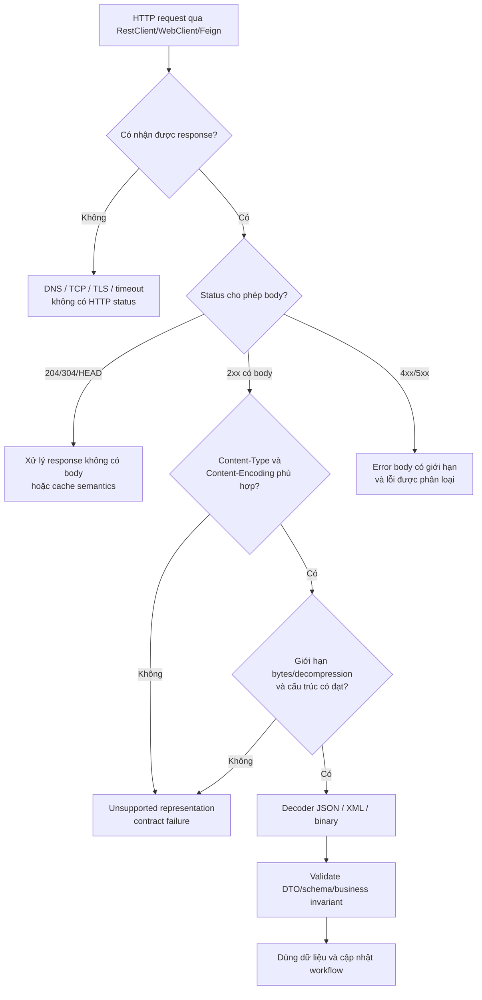
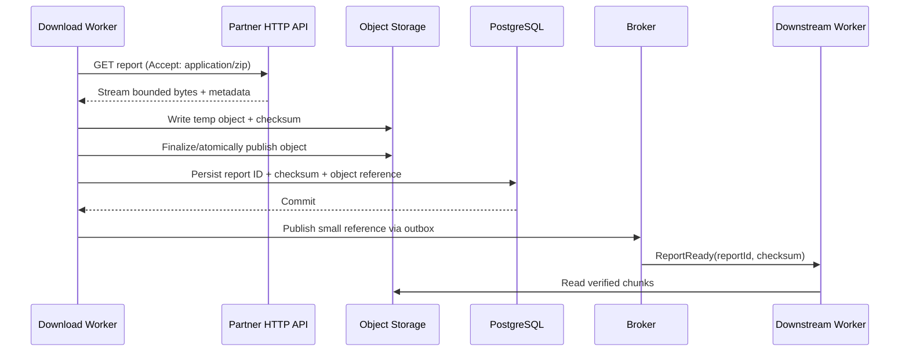
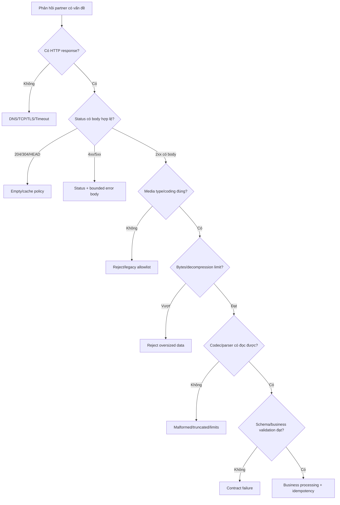

# Thương lượng định dạng, codec và giới hạn nội dung phản hồi

## 1. Tình huống: phản hồi HTTP hợp lệ về kết nối nhưng không đọc được

Trong module **SPRING_BOOT_INTEGRATION**, Spring Boot thường gọi API đối tác để đọc trạng thái đơn hàng, kiểm tra tồn kho, lấy tỷ giá, tra cứu khách hàng hoặc tải dữ liệu đối soát. Các luồng còn phải phối hợp với cơ sở dữ liệu, cache, broker thông điệp và adapter của Spring Integration. Ở ranh giới HTTP client, việc kết nối thành công **không đủ** để khẳng định phản hồi sử dụng được.

Giả sử dịch vụ gọi:

```http
GET /v1/orders/ORD-501 HTTP/1.1
Host: partner.example.internal
Accept: application/json
X-Correlation-Id: req-501
```

Phản hồi mong đợi:

```http
HTTP/1.1 200 OK
Content-Type: application/json; charset=utf-8

{"orderId":"ORD-501","status":"SHIPPED"}
```

Nhưng môi trường thật có thể trả:

- `200 OK` với `Content-Type: text/html` vì một gateway gửi trang đăng nhập.
- `200 OK` với JSON thiếu field bắt buộc hoặc giá trị `status` ngoài enum.
- `200 OK` với `Content-Type: application/json` nhưng body XML, HTML, JSON hỏng hoặc dữ liệu bị cắt.
- `204 No Content` trong khi code client luôn kỳ vọng DTO không rỗng.
- `206 Partial Content` khi ứng dụng yêu cầu `Range` nhưng lại deserialize đoạn byte như một tài liệu JSON đầy đủ.
- `200 OK` với gzip rất nhỏ trên mạng nhưng giải nén thành hàng trăm MB.
- `503 Service Unavailable` và trang HTML lỗi lớn, trong khi error handler lại cố parse như JSON.
- `200 OK` trả mảng có hàng triệu phần tử, vượt bộ nhớ nếu gọi `bodyToMono(List.class)` không có ngân sách tài nguyên.

Chủ đề bài học là ba quyết định liên quan nhưng **khác nhau**:

1. **Thương lượng định dạng (content negotiation)**: client yêu cầu và server chọn kiểu biểu diễn nào?
2. **Codec/converter**: client biến HTTP bytes thành dữ liệu Java hoặc luồng dữ liệu như thế nào?
3. **Giới hạn nội dung phản hồi**: client bảo vệ memory, CPU, thời gian và kích thước dữ liệu ở tầng nào?

Bài áp dụng cho `RestClient`, `WebClient`, Spring HTTP Interface, OpenFeign và các HTTP adapters của Spring Integration; các API khác nhau không có nghĩa là có cùng codec/limit mặc định.

### Mục tiêu học tập

Sau bài này, bạn có thể:

- Phân biệt `Accept`, `Content-Type`, `Accept-Encoding` và `Content-Encoding`.
- Đọc `406`, `415`, `413`, `204`, `206`, `304` theo semantics của HTTP.
- Cấu hình và nhận biết Spring `HttpMessageConverter`, `HttpMessageReader`/`Decoder`, Jackson và Feign decoder.
- Đặt `maxInMemorySize` cho WebClient và hiểu vì sao nó **không phải** hard limit toàn bộ HTTP response.
- Tạo một đường đọc `RestClient` có giới hạn actual bytes trước khi parse JSON.
- Nhận biết decompression bomb, JSON nesting, array lớn, XML XXE và error-body overrun.
- Thiết kế status/error classification, timeout, retry/idempotency và quan sát phản hồi.
- Kiểm thử phản hồi sai kiểu, vượt cỡ, gzip, bị cắt, thiếu field và streaming.

> Các ví dụ tham chiếu Spring Framework 6.1+ và Spring Boot 3.2+ khi dùng `RestClient`; `WebClient` thuộc Spring WebFlux. Một số API, mặc định codec và thuộc tính thay đổi theo Spring Framework 6.x/7.x, Boot 3.x/4.x và HTTP transport. Kiểm tra phiên bản/BOM dự án khi triển khai. Những ngưỡng như 256 KiB hay 5 MiB trong bài là **giá trị minh họa**, không phải mặc định bắt buộc của mọi ứng dụng.

## 2. Bốn câu hỏi cần giải quyết trước khi đọc body

Khi một HTTP response tới nơi, client cần trả lời theo thứ tự tương đối:



Sơ đồ là **thiết kế logic**, không nói mọi HTTP client tự làm toàn bộ các bước. Trong nhiều trường hợp, codec bắt đầu đọc body ngay khi gọi `retrieve().body(...)` hoặc `bodyToMono(...)`, nên việc bảo vệ bytes/encoding cần được cấu hình **trước** thao tác aggregate.

Một tình huống lỗi cần được phân loại:

| Tầng | Ví dụ | Bản chất |
| --- | --- | --- |
| Transport | Không bắt được DNS hoặc TLS handshake fail | Chưa có response HTTP |
| HTTP status | `429`, `503`, `404` | Server đã phản hồi |
| Metadata | `Content-Type: text/html` thay JSON | Sai hợp đồng biểu diễn |
| Content coding | Gzip hỏng, giải nén quá hạn mức | Sai/độc hại ở tầng coding |
| Codec | JSON hỏng, XML không thể parse | Không giải mã được |
| Data schema | Thiếu trường, sai kiểu, sai phiên bản | DTO chưa đáp ứng contract |
| Business | Trạng thái `SHIPPED` nhưng thiếu tracking ID | Bất biến nghiệp vụ sai |
| Resource limit | Body quá lớn/depth quá sâu/timeout | Vượt ngân sách tài nguyên |

**Không retry mù** lỗi format/schema chỉ vì cùng một exception được ném trong client. Một payload hỏng không trở nên hợp lệ nếu tải lần thứ mười.

## 3. Accept: client nói mình có thể nhận định dạng gì

`Accept` là **request header** mô tả những media types client muốn hoặc có thể xử lý:

```http
GET /v1/inventory/SKU-001 HTTP/1.1
Host: inventory.example.internal
Accept: application/json
```

Nghĩa là “tôi muốn representation JSON”. **Nó không bắt buộc mọi server phải luôn tuân thủ**; cần kiểm tra response thực tế, nhất là khi qua proxy, CDN hoặc tích hợp legacy.

Nhiều format với trọng số:

```http
Accept: application/vnd.example.inventory+json;v=2, application/json;q=0.8
```

- `application/vnd.example.inventory+json` là vendor-specific media type có structured suffix `+json`.
- `v=2` chỉ là convention/version parameter **nếu API đối tác định nghĩa**, không phải mọi server đều hiểu.
- `q=0.8` là quality preference; media type không nêu `q` có chất lượng mặc định 1.
- `*/*` chấp nhận nhiều loại nhưng không phù hợp khi adapter **chỉ** parse JSON.
- Nếu không thể chọn representation phù hợp, server có thể trả `406 Not Acceptable`, nhưng cũng có server bỏ qua preferences; client vẫn phải kiểm tra `Content-Type`.

**Không dùng `Accept: application/json` như cơ chế xác thực, validate JSON hoặc bảo vệ tài nguyên.** Nó chỉ là tín hiệu thương lượng.

## 4. Content-Type của request khác Content-Type của response

Đây là hai hướng mang cùng tên header nhưng nghĩa khác nhau.

```http
POST /v1/reservations HTTP/1.1
Host: inventory.example.internal
Content-Type: application/json
Accept: application/json

{"orderId":"ORD-501","sku":"SKU-001","quantity":2}
```

`Content-Type` trong **request** nói cách diễn giải request body mà client gửi. `Accept` nói định dạng response mà client muốn. Response có `Content-Type` riêng:

```http
HTTP/1.1 201 Created
Content-Type: application/json

{"reservationId":"RSV-901","status":"RESERVED"}
```

Nếu client gửi JSON nhưng server chỉ nhận XML, server có thể trả **415 Unsupported Media Type**. Nếu client chỉ chấp nhận JSON nhưng server không thể cung cấp, có thể trả **406 Not Acceptable**.

| Header | Gửi ở đâu? | Trả lời câu hỏi |
| --- | --- | --- |
| Request `Content-Type` | Client → server | Body của request là loại gì? |
| Request `Accept` | Client → server | Client ưu tiên response loại gì? |
| Response `Content-Type` | Server → client | Body trả về thực sự mang media type nào? |
| Request `Accept-Encoding` | Client → server | Client nhận được content codings nào? |
| Response `Content-Encoding` | Server → client | Body phản hồi đã được mã hóa/nén kiểu gì? |
| Response `Vary` | Server → client/caches | Representation có phụ thuộc request headers nào? |

**415 khác 406**: 415 nói media type/coding của **nội dung gửi vào** không được hỗ trợ; 406 liên quan sự lựa chọn response theo `Accept`. Trong thực tế API có thể dùng status riêng theo contract, nên luôn dựa vào cả status và mã lỗi ổn định.

## 5. JSON, XML, text và binary: cùng HTTP nhưng khác semantics

Cùng endpoint logic có thể phục vụ các representations khác nhau:

```http
GET /v1/reports/2026-11 HTTP/1.1
Accept: application/json
```

```json
{"period":"2026-11","count":42}
```

Hoặc:

```http
GET /v1/reports/2026-11 HTTP/1.1
Accept: application/xml
```

```xml
<report>
  <period>2026-11</period>
  <count>42</count>
</report>
```

Hoặc:

```http
GET /v1/reports/2026-11.csv HTTP/1.1
Accept: text/csv
```

```text
period,count
2026-11,42
```

Những định dạng này không có cùng schema/decoder:

- JSON cần JSON parser, Java DTO mapping và ràng buộc schema.
- XML cần parser/mapper và chính sách chống XXE/entity expansion.
- CSV cần quy tắc delimiter, encoding, escape, cột bắt buộc, hàng tối đa, phân biệt header/data.
- PDF/image/ZIP nên xử lý dạng bytes hoặc stream tới file/object storage; **không** deserialize thành business DTO.
- Protobuf/Avro cần schema, serializer/decoder tương ứng; `application/octet-stream` không tự nói đủ schema.

Với Java, `String.class` **không** phải “format-neutral decoder”: đọc JSON/XML thành `String` rồi parse lại có thể gây **double buffering**, mất kiểm soát kích thước và charset. Chỉ dùng text khi contract thật sự yêu cầu.

## 6. Charset và JSON: byte không bằng số ký tự Java

`Content-Type: application/json; charset=utf-8` thường gặp trong hệ thống Java. JSON trao đổi liên hệ thống nên theo UTF-8. Nhưng cần hiểu:

- Một ký tự Unicode có thể sử dụng nhiều bytes khi mã hóa UTF-8.
- `String.length()` đếm UTF-16 code units, không bằng bytes UTF-8 và cũng không luôn bằng số Unicode code points.
- `@Size(max=1000)` áp lên Java object **không tự giới hạn** tổng response bytes.
- `Content-Length` là byte length của HTTP content trong representation tương ứng, không phải số ký tự sau parse.
- Sai UTF-8, BOM, charset không tương thích hoặc text bị cắt có thể gây lỗi decoder ngay cả khi HTTP status 200.

**Bảo vệ body size phải đếm actual bytes ở điểm đọc phù hợp**. Đừng lấy `responseString.length()` rồi cho rằng đã giới hạn memory cho decoder.

## 7. Accept-Encoding và Content-Encoding: nén không phải định dạng dữ liệu

Ví dụ thương lượng compression:

```http
GET /v1/exports/orders HTTP/1.1
Accept: application/json
Accept-Encoding: gzip
```

Server có thể trả:

```http
HTTP/1.1 200 OK
Content-Type: application/json
Content-Encoding: gzip
Vary: Accept, Accept-Encoding
```

Hai thông tin có nghĩa khác nhau:

- **`Content-Type: application/json`**: sau khi giải content coding, representation là JSON.
- **`Content-Encoding: gzip`**: bytes truyền trong HTTP content đã được mã hóa/nén gzip.
- `Transfer-Encoding: chunked` ở HTTP/1.1 là **message framing**, không phải JSON/XML/gzip content type.
- `Vary` hỗ trợ caches biết rằng biến thể response có thể phụ thuộc vào `Accept`/`Accept-Encoding` (phải do server gửi đúng).

Một JSON 50 MiB có thể nén còn vài trăm KiB nếu rất lặp. **Giới hạn wire bytes không tự bảo vệ memory sau giải nén**.

HTTP client có thể tự thêm `Accept-Encoding` và tự giải nén tùy transport (JDK HttpClient, Apache HttpClient, Reactor Netty...). Đừng đoán: kiểm tra transport configuration và test response gzip thật.

## 8. Ba loại giới hạn phải thiết kế tách biệt

Giả sử mỗi response mong đợi dưới 256 KiB:

| Loại limit | Đặt ở đâu? | Bảo vệ | Không bảo vệ |
| --- | --- | --- | --- |
| **Wire bytes** | HTTP client/transport khi đọc raw bytes | Băng thông, buffer trước giải nén | Gzip bomb sau giải nén |
| **Decoded bytes** | Giữa decompress và parser, đếm streaming | Memory/CPU do nội dung bung ra | JSON depth/items/semantic size |
| **Codec aggregation memory** | WebClient reader/decoder `maxInMemorySize` | Buffering cho nhiều code paths | Tất cả streaming bytes, socket/DB state |
| **Parser constraints** | Jackson/XML/CSV decoder | Nesting, number/string token, cấu trúc nguy hiểm | Tổng response body bytes nếu không áp riêng |
| **Business DTO limits** | Bean Validation/schema/rules | Field values, number items, nghiệp vụ | Tài nguyên đã dùng để parse toàn bộ body |
| **Concurrency/budget** | Bulkhead/connection pools/rate limiter | Tổng số responses đồng thời | Từng body quá lớn nếu thiếu per-response cap |

Giới hạn **tổng byte** và giới hạn **bộ nhớ codec** không đồng nhất. Ví dụ một response 1 GiB được xử lý stream theo từng chunk 8 KiB có thể không vượt codec aggregate cap, nhưng vẫn tốn thời gian/disk/network và có nguy cơ chiếm tài nguyên quá lâu.

**Quy tắc:** đặt ngân sách cho (1) mỗi HTTP response, (2) mỗi bước giải mã, (3) tổng concurrency và (4) toàn workflow. Không trông chờ một property duy nhất thay tất cả.

## 9. Content-Length: tối ưu từ chối sớm, không phải bằng chứng an toàn

`Content-Length` có thể giúp client dừng trước khi đọc nếu server khai kích thước lớn hơn hợp đồng. Tuy nhiên:

- HTTP/1.1 chunked response không nhất thiết có `Content-Length`.
- Proxy/transport có thể chuyển framing, nén/giải nén hoặc loại bỏ header.
- Truncated response và connection reset có thể làm bytes thực tế không khớp dự kiến.
- Header sai từ upstream không phải nguồn sự thật bảo mật.
- `Content-Length` thông thường mô tả encoded content bytes, không phải decompressed bytes.
- `HEAD` và một số status không có body có semantics riêng.

Mô hình đúng:

```text
if (knownContentLength > allowedWireBytes) {
    reject_early();
}
while (read_next_chunk()) {
    bytesRead += chunkSize;
    if (bytesRead > hardLimit) {
        abort_read();
    }
    process_bounded_chunk();
}
```

Đây là **pseudocode**. Actual limit phải áp trên đúng stream (wire hoặc decompressed) và không bỏ qua trường hợp chunked. Một interceptor chỉ nhìn header nhưng sau đó gọi `readAllBytes()` không được coi là hard size limit.

## 10. RestClient, WebClient và OpenFeign: ai quyết định codec?

| Client | Abstraction để decode | Nơi cấu hình điển hình |
| --- | --- | --- |
| `RestClient` | `HttpMessageConverter<?>` | `RestClient.Builder.messageConverters(...)`, Boot builder customizers |
| `WebClient` | `HttpMessageReader<?>`/`Decoder<?>` qua `ExchangeStrategies` | `WebClient.Builder.codecs(...)` |
| Spring HTTP Interface + RestClient | Kế thừa RestClient adapter | `RestClient` bên dưới proxy |
| Spring HTTP Interface + WebClient | Kế thừa WebClient adapter | `WebClient` bên dưới proxy |
| Spring Cloud OpenFeign | Feign `Decoder` và Spring HTTP message converters (khi dùng Spring Cloud defaults) | Named-client `Decoder`/configuration |
| Spring Integration HTTP outbound adapter | Phụ thuộc RestTemplate/WebClient/adapter implementation | Cấu hình HTTP client/codec tương ứng |

**HTTP Interface chỉ định method/path/body, không tự có một codec độc lập**. Với cùng Java interface, proxy `RestClientAdapter` và `WebClientAdapter` có thể có giới hạn bộ nhớ/exception behavior khác nhau.

**Feign `Decoder` không phải Spring WebFlux `Decoder`** chỉ vì cùng tên. Cấu hình `spring.codec.max-in-memory-size` dành cho Spring codecs không tự giới hạn mọi Feign response.

## 11. HttpMessageConverter trong RestClient

Spring MVC/imperative HTTP clients sử dụng `HttpMessageConverter` để đọc/ghi Java types theo media type.

Một số converter thường gặp khi thư viện phù hợp có trên classpath:

| Converter | Dữ liệu | Ghi chú |
| --- | --- | --- |
| `MappingJackson2HttpMessageConverter` | JSON ↔ Java objects | Jackson và media types JSON/+json tương ứng |
| `StringHttpMessageConverter` | Text ↔ String | Không validate JSON business contract |
| `ByteArrayHttpMessageConverter` | Bytes ↔ `byte[]` | Aggregate body; nguy cơ memory lớn |
| `ResourceHttpMessageConverter` | Resource | Resource/streaming behavior tùy concrete resource |
| XML converters | XML ↔ Java objects | Cần dependency và cấu hình parser an toàn |
| Form/multipart converters | Form data hoặc multipart | Không tự xử lý mọi JSON/XML |

Khi gọi:

```java
OrderStatusDto dto = restClient.get()
    .uri("/v1/orders/{orderId}", orderId)
    .accept(org.springframework.http.MediaType.APPLICATION_JSON)
    .retrieve()
    .body(OrderStatusDto.class);
```

`RestClient` chọn converter có thể đọc `OrderStatusDto.class` với `Content-Type` của response. Nếu server trả `application/xml` mà không có XML converter tương ứng, có thể gặp conversion/unknown media type error. Nếu server trả `text/html` và bạn yêu cầu DTO, không nên cố ép HTML thành JSON chỉ để “cho qua”.

**Không đưa `byte[].class` hay `String.class` vào body(...) cho dữ liệu không giới hạn** mà không có tầng kiểm soát bytes trước khi aggregate.

## 12. RestClient: cấu hình Accept và xử lý status tường minh

Một client đơn giản cho API đối tác:

```java
import org.springframework.http.HttpHeaders;
import org.springframework.http.MediaType;
import org.springframework.stereotype.Component;
import org.springframework.web.client.RestClient;

@Component
public class PartnerOrderClient {

    private final RestClient client;

    public PartnerOrderClient(RestClient.Builder builder) {
        this.client = builder
            .baseUrl("https://partner.example.internal")
            .defaultHeader(
                HttpHeaders.ACCEPT,
                MediaType.APPLICATION_JSON_VALUE
            )
            .build();
    }

    public OrderStatusDto find(String orderId) {
        return client.get()
            .uri("/v1/orders/{orderId}", orderId)
            .accept(MediaType.APPLICATION_JSON)
            .retrieve()
            .body(OrderStatusDto.class);
    }

    public record OrderStatusDto(
        String orderId,
        String status
    ) {}
}
```

Trong ứng dụng thật:

- `baseUrl` lấy từ cấu hình đã xác minh/allowlist; không hardcode production endpoint.
- `RestClient.Builder` do Spring Boot inject thường mang message converters, observation và customizers tương ứng. Đừng tạo một builder mới trên từng request nếu cần customizations tập trung.
- Dùng `.accept(...)` để nêu định dạng phản hồi, không tự động giới hạn bytes.
- `.retrieve().body(...)` có thể ném HTTP status exception theo default, hoặc converter exception nếu 2xx body sai format.
- Record mapping không tự bảo đảm `status` thuộc tập nghiệp vụ cho phép; cần validate sau decode.
- Đây là ví dụ trả DTO nhỏ, **chưa phải implementation có hard body-size limit**; mục tiếp theo sẽ trình bày cách đọc bounded.

Khi cần xử lý `204` hoặc `404` theo semantics riêng, dùng return type/response strategy phù hợp. Không `Objects.requireNonNull(body)` rồi coi 204 như lỗi mạng.

## 13. Ví dụ RestClient: không gộp 2xx, 204, 4xx và lỗi network

`RestClient.retrieve()` thường báo lỗi cho 4xx/5xx theo default status handling. Có thể dùng `toEntity(...)` để đọc status và headers của response thành công, hoặc `exchange(...)` khi muốn toàn quyền xử lý response thấp hơn.

Ví dụ `exchange` kiểm tra status trước khi decode:

```java
import org.springframework.http.HttpStatusCode;
import org.springframework.http.MediaType;
import org.springframework.web.client.RestClient;

public String readOrderResponse(
        RestClient client, String orderId) {

    return client.get()
        .uri("/v1/orders/{orderId}", orderId)
        .accept(MediaType.APPLICATION_JSON)
        .exchange((request, response) -> {
            HttpStatusCode status = response.getStatusCode();

            if (status.value() == 204) {
                return "NO_CONTENT";
            }
            if (!status.is2xxSuccessful()) {
                throw new IllegalStateException(
                    "Partner HTTP status " + status.value()
                );
            }

            // Only an illustration: actual body reading
            // must be bounded before parsing.
            return "SUCCESS";
        });
}
```

Điều quan trọng: khi gọi `exchange(...)`, **default status handlers của `retrieve()` không tự được áp dụng**; bạn phải xử lý status/headers/body theo hợp đồng. Không trả `SUCCESS` mà bỏ qua body nếu nghiệp vụ cần dữ liệu từ response.

**Tình huống 4xx/5xx có body lớn:** đọc hoặc bỏ body phải có chính sách resource/connection release của request factory; không vô tình tải toàn bộ HTML/JSON lỗi để tạo exception/log.

## 14. Hard cap khi đọc response bytes từ RestClient

Với đường nhận có hợp đồng body nhỏ (ví dụ tối đa 256 KiB sau khi HTTP transport đưa cho ứng dụng), có thể **đếm bytes thực đọc** trước khi chạy JSON decoder. Đây là ví dụ giáo dục cho một response nhỏ đã được aggregate có giới hạn; streaming lớn cần xử lý khác.

```java
import java.io.ByteArrayOutputStream;
import java.io.IOException;
import java.io.InputStream;

public final class BoundedBodyReader {

    private BoundedBodyReader() {}

    public static byte[] readAtMost(
            InputStream source, int maxBytes) throws IOException {

        if (maxBytes < 0) {
            throw new IllegalArgumentException(
                "maxBytes must be nonnegative"
            );
        }

        ByteArrayOutputStream output =
            new ByteArrayOutputStream(
                Math.min(maxBytes, 8192)
            );
        byte[] chunk = new byte[8192];
        int total = 0;

        int count;
        while ((count = source.read(chunk)) != -1) {
            if (count > maxBytes - total) {
                throw new ResponseTooLargeException(
                    "PARTNER_RESPONSE_TOO_LARGE"
                );
            }
            output.write(chunk, 0, count);
            total += count;
        }
        return output.toByteArray();
    }

    public static final class ResponseTooLargeException
            extends IOException {
        public ResponseTooLargeException(String message) {
            super(message);
        }
    }
}
```

**Tính chất của helper**:

- Không gọi `readAllBytes()` trước khi kiểm tra limit.
- Không dựa hoàn toàn vào `Content-Length`.
- Khi nhận chunk khiến tổng bytes vượt ngưỡng, ném exception và dừng đọc.
- Giới hạn bytes mà `InputStream` **thực tế cung cấp**. Nếu transport đã giải nén gzip, đây là decoded bytes; nếu chưa giải nén, đây là encoded bytes. Muốn giới hạn **cả hai**, phải đặt guards ở trước và sau giải nén.
- Dữ liệu vẫn được giữ trong `ByteArrayOutputStream` tới ngưỡng; không dùng cho download hàng GiB.
- Việc từ chối sau một partial read có thể dẫn đến connection không thể reuse; request factory phải giải phóng/đóng response đúng cách.
- Không tự biến `ResponseTooLargeException` thành HTTP 413 của **inbound** request. Đây là lỗi **outbound partner response** trong ứng dụng của bạn.

### Sử dụng kết hợp exchange và Jackson

```java
import com.fasterxml.jackson.databind.ObjectMapper;
import java.io.IOException;
import org.springframework.http.MediaType;
import org.springframework.web.client.RestClient;

public final class BoundedPartnerDecoder {

    private static final int MAX_BODY_BYTES = 256 * 1024;

    private final RestClient client;
    private final ObjectMapper mapper;

    public BoundedPartnerDecoder(
            RestClient client, ObjectMapper mapper) {
        this.client = client;
        this.mapper = mapper;
    }

    public PartnerOrderStatus load(String orderId) {
        return client.get()
            .uri("/v1/orders/{orderId}", orderId)
            .accept(MediaType.APPLICATION_JSON)
            .exchange((request, response) -> {
                int status = response.getStatusCode().value();

                if (status == 204) {
                    throw new IllegalStateException(
                        "Response required, got 204"
                    );
                }

                if (!response.getStatusCode().is2xxSuccessful()) {
                    // Classify the HTTP status without
                    // aggregating the remote error body.
                    throw new IllegalStateException(
                        "Partner status " + status
                    );
                }

                MediaType type =
                    response.getHeaders().getContentType();

                if (type == null || !isJsonMediaType(type)) {
                    throw new IllegalStateException(
                        "Expected JSON response"
                    );
                }

                try {
                    byte[] bytes = BoundedBodyReader.readAtMost(
                        response.getBody(), MAX_BODY_BYTES
                    );
                    return mapper.readValue(
                        bytes, PartnerOrderStatus.class
                    );
                } catch (IOException ex) {
                    throw new IllegalStateException(
                        "Cannot decode bounded partner JSON", ex
                    );
                }
            });
    }

    private static boolean isJsonMediaType(MediaType type) {
        String subtype = type.getSubtype().toLowerCase(
            java.util.Locale.ROOT
        );
        return "application".equalsIgnoreCase(type.getType())
            && ("json".equals(subtype)
                || subtype.endsWith("+json"));
    }

    public record PartnerOrderStatus(
        String orderId, String status
    ) {}
}
```

Đây là một **boundary adapter đơn giản**, chưa có đầy đủ domain error classes, metrics, HTTP timeout và semantic validation. Cần đặt `ObjectMapper` đã cấu hình an toàn (giới hạn parser) thay vì tạo mới per request, dùng `Content-Length` để reject sớm nếu có và xử lý đúng `Content-Encoding` của transport. Với body lớn hơn quota, helper không giữ toàn bộ body; khi thông báo lỗi, **không log raw response**.

Có thể khai báo limit khác nhau theo operation; response PDF/download lớn cần streaming API riêng thay vì tăng `MAX_BODY_BYTES` toàn ứng dụng.

## 15. WebClient và cấu hình maxInMemorySize

`WebClient` sử dụng codec `HttpMessageReader`/`Decoder` để chuyển response bytes thành Java type hoặc reactive publisher. Cấu hình thông dụng:

```java
import org.springframework.context.annotation.Bean;
import org.springframework.context.annotation.Configuration;
import org.springframework.web.reactive.function.client.WebClient;

@Configuration(proxyBeanMethods = false)
public class PartnerWebClientConfiguration {

    @Bean("partnerWebClient")
    WebClient partnerWebClient(WebClient.Builder builder) {
        return builder
            .baseUrl("https://partner.example.internal")
            .codecs(configurer ->
                configurer.defaultCodecs()
                    .maxInMemorySize(256 * 1024)
            )
            .build();
    }
}
```

Đây là **giới hạn bộ nhớ aggregation của nhiều codec**, không phải hard cap toàn bộ response truyền qua mạng:

- Khi `bodyToMono(OrderStatusDto.class)` cần buffer/deserialize, response vượt hạn mức của decoder có thể ném `DataBufferLimitException`.
- Một `bodyToFlux(DataBuffer.class)` streaming có thể nhận **nhiều chunks liên tục**, tổng bytes vượt xa 256 KiB mà không nhất thiết vi phạm một aggregation limit.
- `maxInMemorySize` không tự giới hạn JSON nesting depth, compressed wire bytes, number of business items hoặc toàn bộ streaming time.
- Một codec/adapter tùy biến có thể không áp cùng semantics; phải test đường thực.
- Nếu app có nhiều WebClient builders/instances, hãy xác minh limit trên **đúng client đang được sử dụng**.

**Không tăng `maxInMemorySize` lên vài GiB để xử lý export**, vì đó thường là dấu hiệu cần streaming/chunking/object-storage download thay vì aggregation thành object lớn.

## 16. spring.codec.max-in-memory-size: biết phạm vi trước khi cấu hình

Khi Spring Boot auto-configuration/customizers của WebFlux codecs được áp dụng, có thể dùng:

```yaml
spring:
  codec:
    max-in-memory-size: 256KB
```

Những điều cần tránh hiểu sai:

1. Property trên cấu hình **codec behavior trong phạm vi Boot hỗ trợ** theo stack và version; nó không áp dụng cho mọi `RestClient`, Feign decoder, Apache HttpClient hay custom `ObjectMapper`.
2. Nếu bạn tự khởi tạo `WebClient.builder()` mà không dùng builder/customizers do Boot cấp, một số customizations có thể **không được áp dụng**.
3. HTTP inbound WebFlux và outbound WebClient đều có thể sử dụng codec infrastructure, nhưng **không** đồng nghĩa đây là hard body limit ở gateway/nginx.
4. Không copy giá trị của `spring.servlet.multipart.max-request-size` để suy JSON response max size; multipart inbound khác outbound JSON response.
5. Giá trị 256 KiB thường được nêu là default của nhiều WebFlux codec paths trong nhiều bản Spring Framework, nhưng phải **xác minh phiên bản thật**, không coi là universal constant.

Nếu muốn một partner client có quota khác mọi client còn lại, cấu hình `.codecs(...)` trên **WebClient.Builder riêng** hoặc bean riêng, đồng thời kiểm thử xem override theo client có hiệu lực.

## 17. WebClient: Accept và xử lý error status an toàn

Ví dụ reactive client yêu cầu JSON:

```java
import org.springframework.http.HttpStatusCode;
import org.springframework.http.MediaType;
import org.springframework.web.reactive.function.client.WebClient;
import reactor.core.publisher.Mono;

public final class ReactivePartnerClient {

    private final WebClient webClient;

    public ReactivePartnerClient(WebClient webClient) {
        this.webClient = webClient;
    }

    public Mono<OrderStatusDto> find(String id) {
        return webClient.get()
            .uri("/v1/orders/{id}", id)
            .accept(MediaType.APPLICATION_JSON)
            .retrieve()
            .onStatus(
                HttpStatusCode::isError,
                response -> Mono.error(
                    new PartnerStatusException(
                        response.statusCode().value()
                    )
                )
            )
            .bodyToMono(OrderStatusDto.class);
    }

    public record OrderStatusDto(
        String orderId, String status
    ) {}

    static final class PartnerStatusException
            extends RuntimeException {
        PartnerStatusException(int status) {
            super("Partner HTTP status: " + status);
        }
    }
}
```

Điều ví dụ minh họa:

- `Accept: application/json` được gửi trong request.
- `onStatus` phân loại 4xx/5xx **từ HTTP response**, ở đây không đọc remote error body để tránh lưu dữ liệu lớn/nhạy cảm.
- Nếu DNS/TCP/TLS fail trước khi có response, `onStatus` không chạy; lỗi transport được báo trên reactive stream.
- `bodyToMono(...)` chỉ decode body khi có subscription; DTO phải được validate sau decode.
- Nếu response là `204 No Content`, kết quả có thể là `Mono.empty()` thay vì DTO; workflow phải định nghĩa có chấp nhận empty không.
- Không gọi `.block()` trên Reactor event-loop thread.
- Một `Mono` cold được subscribe lại hoặc `retry` có thể tạo thêm HTTP request. Với POST side effect phải có idempotency.

**Lưu ý:** đoạn code biểu diễn status error mà không đọc body; chính sách quản lý/giải phóng content do WebClient exchange infrastructure và transport quyết định. Nếu cần parse `application/problem+json` error body, cũng phải có quota và fallback khi body malformed/oversized.

## 18. DataBufferLimitException nói gì — và không nói gì?

Một exception thường gặp khi sử dụng WebClient/WebFlux:

```text
org.springframework.core.io.buffer.DataBufferLimitException:
Exceeded limit on max bytes to buffer
```

Nó thường cho biết một thao tác decoder/aggregator trong Spring đã vượt giới hạn bytes để buffer. Nó **không tự chứng minh**:

- Server đã trả HTTP `413`.
- Content-Length của partner lớn hơn quota trên wire.
- Toàn bộ HTTP response đã được tải vào RAM trước đó.
- Response thật sự là JSON hợp lệ hoặc sai.
- Mọi streaming path đã bị ngắt theo cùng chính sách.
- Giới hạn đã áp lên body sau giải nén hoặc trước giải nén đúng như kiến trúc mong đợi.

Một thay đổi sai là:

```yaml
spring:
  codec:
    max-in-memory-size: 64MB
```

rồi coi là đã giải quyết. Nếu API dự kiến trả DTO 20 KiB, response 20 MiB có thể là **API contract drift, proxy error page hoặc payload độc hại**. Nên kiểm tra Content-Type, operation quota, partner behavior và phân loại lỗi trước khi tăng memory budget.

Với export/batch lớn hợp lệ, nên dùng **streaming và processing từng phần** thay cho DTO aggregate một lần.

## 19. Jackson limits: body nhỏ vẫn có thể tốn CPU/memory lớn

JSON body chỉ vài trăm KiB nhưng có cấu trúc lồng sâu hoặc number token rất dài có thể tốn tài nguyên khi parse. Với Jackson 2.15+ có `StreamReadConstraints` cho giới hạn parser như depth/string/number length:

```java
import com.fasterxml.jackson.core.JsonFactory;
import com.fasterxml.jackson.core.StreamReadConstraints;
import com.fasterxml.jackson.databind.ObjectMapper;

public final class PartnerJsonMapperFactory {

    public static ObjectMapper create() {
        JsonFactory jsonFactory = JsonFactory.builder()
            .streamReadConstraints(
                StreamReadConstraints.builder()
                    .maxNestingDepth(40)
                    .maxStringLength(16_384)
                    .maxNumberLength(80)
                    .build()
            )
            .build();

        return new ObjectMapper(jsonFactory);
    }
}
```

Những limit trên:

- `maxNestingDepth`: độ sâu object/array.
- `maxStringLength`: chiều dài string tokens theo parser semantics.
- `maxNumberLength`: giới hạn chiều dài token số.
- Không tự giới hạn **tổng body bytes**, tổng số phần tử array hoặc JSON fields.
- Không thay Bean Validation hoặc JSON Schema cho required fields, enum và business invariants.
- Tùy phiên bản Jackson, exception cụ thể cho constraints có thể khác; phân loại theo **ngữ cảnh decode** thay vì dựa vào một message string.

**Chú ý Spring Boot ObjectMapper:** `new ObjectMapper(jsonFactory)` không tự mang toàn bộ modules/settings do Spring Boot cung cấp (Java Time, custom serializers, naming policy...). Đây là factory minh họa; trong dự án cần cấu hình mapper/JsonFactory **theo đúng client codec**, đăng ký modules tương thích và kiểm thử serialization.

Chỉ tạo một mapper ở bean rồi không gắn vào `WebClient`/`RestClient`/Feign decoder tương ứng thì **không có tác dụng bảo vệ đường response đang chạy**.

## 20. Cấu hình JSON schema: deserialization thành công chưa có nghĩa đúng

Giả sử partner trả:

```json
{
  "orderId": null,
  "status": "SHIPPED",
  "trackingId": ""
}
```

Jackson vẫn có thể tạo một Java object nếu các trường nullable, nhưng dữ liệu **không đạt hợp đồng nghiệp vụ**. Cần thêm tầng validate sau decoder:

```java
import jakarta.validation.constraints.NotBlank;
import jakarta.validation.constraints.Pattern;
import jakarta.validation.constraints.Size;

public record OrderStatusDto(
    @NotBlank @Size(max = 80) String orderId,
    @NotBlank
    @Pattern(regexp = "NEW|PAID|SHIPPED|CANCELLED")
    String status,
    @Size(max = 120) String trackingId
) {}
```

Với một bean `jakarta.validation.Validator`:

```java
import jakarta.validation.ConstraintViolation;
import jakarta.validation.Validator;
import java.util.Set;

public final class PartnerResponseValidator {

    private final Validator validator;

    public PartnerResponseValidator(Validator validator) {
        this.validator = validator;
    }

    public OrderStatusDto validate(OrderStatusDto dto) {
        if (dto == null) {
            throw new IllegalArgumentException(
                "PARTNER_EMPTY_RESPONSE"
            );
        }

        Set<ConstraintViolation<OrderStatusDto>> problems =
            validator.validate(dto);

        if (!problems.isEmpty()) {
            throw new IllegalArgumentException(
                "PARTNER_SCHEMA_INVALID"
            );
        }

        if ("SHIPPED".equals(dto.status())
                && (dto.trackingId() == null
                    || dto.trackingId().isBlank())) {
            throw new IllegalArgumentException(
                "PARTNER_TRACKING_REQUIRED"
            );
        }

        return dto;
    }
}
```

Để dùng Jakarta Bean Validation trên Spring Boot, cần dependency `spring-boot-starter-validation` và cấu hình bean validator thích hợp. Đây là **validation hậu deserialization**, không thay body byte cap hay JSON parser constraints.

Các tình huống cần quyết định bằng contract:

- **Missing vs null:** field không có có thể map thành null; nếu hai trạng thái có nghĩa khác nhau, cần kiểm tra JSON tree/presence.
- **Primitive default:** `int` có thể khiến thiếu field bị hiểu thành 0; dùng boxed `Integer` + `@NotNull` khi cần.
- **Unknown fields:** bỏ qua để forward-compatible hay reject để phát hiện contract drift?
- **Enum mới:** map thành `UNKNOWN` có chủ đích hay fail để quarantine?
- **Version:** đọc từ media type parameter/header/body, phải kiểm tra nhất quán.
- **Số tiền:** ưu tiên `BigDecimal` hoặc integer minor units được quy ước thay `double` nếu cần chính xác.

**Đừng ghi response chưa validate vào cache hoặc system of record**, vì một khi dữ liệu sai đã được persist, lỗi sẽ lan qua các luồng broker/integration khác.

## 21. XML: ngoài converter còn có XXE/entity expansion

Nếu đối tác cung cấp `application/xml`, có thể dùng XML converter/Jackson XML/JAXB khi đúng dependency. Nhưng XML từ nguồn không đáng tin cần cấu hình parser **chống XXE, entity expansion và input rất lớn**.

Ví dụ một `DocumentBuilderFactory` được harden theo hướng cơ bản:

```java
import javax.xml.XMLConstants;
import javax.xml.parsers.DocumentBuilderFactory;

public final class SafeXmlFactory {

    public static DocumentBuilderFactory create()
            throws Exception {

        DocumentBuilderFactory factory =
            DocumentBuilderFactory.newInstance();

        factory.setNamespaceAware(true);
        factory.setFeature(
            XMLConstants.FEATURE_SECURE_PROCESSING,
            true
        );
        factory.setFeature(
            "http://apache.org/xml/features/disallow-doctype-decl",
            true
        );
        factory.setFeature(
            "http://xml.org/sax/features/external-general-entities",
            false
        );
        factory.setFeature(
            "http://xml.org/sax/features/external-parameter-entities",
            false
        );
        factory.setXIncludeAware(false);
        factory.setExpandEntityReferences(false);
        factory.setAttribute(
            XMLConstants.ACCESS_EXTERNAL_DTD, ""
        );
        factory.setAttribute(
            XMLConstants.ACCESS_EXTERNAL_SCHEMA, ""
        );
        return factory;
    }
}
```

Các parser providers có thể không hỗ trợ tất cả features/attributes. Trong production, **không âm thầm bắt rồi bỏ exception** khi không áp dụng được security settings; fail-closed hoặc chọn parser hỗ trợ. Chỉ thiết lập factory này không tự cấu hình mọi XML decoder trong Spring; phải bảo đảm HTTP converter **thực sự sử dụng parser đã harden**.

Đối với JAXB/Jackson XML/StAX, kiểm tra các cơ chế cấu hình tương ứng (XMLInputFactory, external entities, DTD) và test payload khai external entity. Thêm **total bytes, nesting/element count và timeout**; disable XXE không tự chặn mọi XML bomb.

## 22. CSV, văn bản và binary: không được dùng một decoder cho tất cả

Một `text/csv` response có thể hợp lệ nhưng sai số cột, sai quote/escape, chứa ký tự xuống dòng bên trong field, hoặc có hàng triệu rows. Nếu tải thành một `String` toàn bộ rồi `split("\\n")`, có thể:

- Ngốn nhiều bộ nhớ.
- Đọc sai CSV quoted multiline fields.
- Chấp nhận header sai/trùng cột không kiểm soát.
- Không xử lý dấu phân cách/locale/charset theo hợp đồng.
- Đưa công thức `=HYPERLINK(...)` vào file Excel export rồi gặp CSV formula injection ở bước khác.

Với CSV lớn, dùng **CSV parser streaming** có giới hạn số hàng, độ dài mỗi field và tổng bytes; CSV format, delimiter, encoding và schema columns phải được thống nhất.

Với PDF, ZIP, image hoặc file backup:

1. Kiểm tra `Content-Type` và những byte magic/file signature khi hợp đồng yêu cầu; không chỉ tin filename.
2. Stream tới file temp/object storage có **byte quota**, checksum và deadline.
3. Không tự động extract archive entries chứa `../`, symlink/path traversal.
4. Giới hạn tổng dung lượng sau unzip, số entries và nesting depth.
5. Khi cần virus scanning hoặc xử lý nội dung nhạy cảm, phải có pipeline kiểm soát riêng.
6. Không dùng `bodyToMono(byte[].class)` cho file rất lớn.

**Dạng phản hồi quyết định cách xử lý tài nguyên.** DTO JSON nhỏ và bản export ZIP nhiều GB không nên dùng một default decoder/limit như nhau.

## 23. Khi nào WebClient streaming không còn nằm trong maxInMemorySize?

Ví dụ code đọc raw buffers:

```java
import org.springframework.core.io.buffer.DataBuffer;
import reactor.core.publisher.Flux;

Flux<DataBuffer> chunks = webClient.get()
    .uri("/v1/exports/orders.csv")
    .accept(org.springframework.http.MediaType.parseMediaType(
        "text/csv"
    ))
    .retrieve()
    .bodyToFlux(DataBuffer.class);
```

Đoạn trên chỉ **khai báo stream**; chưa có consumer, chưa áp total bytes limit và chưa quyết định xử lý `DataBuffer` thế nào. Nếu subscription xảy ra và dữ liệu kéo về vô hạn, codec aggregate limit không phải hard stop.

Với pooled buffers (đặc biệt Reactor Netty), code tự tiêu thụ `DataBuffer` cần **release** đúng khi không còn dùng (ví dụ `DataBufferUtils.release`), kể cả khi lỗi hoặc cancel. Quên release có thể gây buffer leak. Không giữ tham chiếu một `DataBuffer` qua nhiều async stages nếu lifecycle không được quản lý.

### Một ví dụ giới hạn aggregation có chủ đích

Nếu định dạng chỉ tối đa 256 KiB, nhưng cần đọc raw buffers để kiểm tra signature:

```java
import org.springframework.core.io.buffer.DataBuffer;
import org.springframework.core.io.buffer.DataBufferUtils;
import reactor.core.publisher.Mono;

Mono<byte[]> boundedBytes = DataBufferUtils
    .join(
        webClient.get()
            .uri("/v1/signed-small-document")
            .retrieve()
            .bodyToFlux(DataBuffer.class),
        256 * 1024
    )
    .map(joined -> {
        try {
            byte[] result =
                new byte[joined.readableByteCount()];
            joined.read(result);
            return result;
        } finally {
            DataBufferUtils.release(joined);
        }
    });
```

`DataBufferUtils.join(Publisher, int)` áp giới hạn tổng bytes mà nó **join trong pipeline này**; khi vượt limit, có thể phát `DataBufferLimitException` và cancel upstream. Điều này vẫn là **bounded aggregation**, không phải streaming file nhiều GB. Phải test release/cancel trên phiên bản Spring, content encoding và transport thực.

Nếu dữ liệu rất lớn hợp lệ, dùng pipeline streaming xuống file/object storage có quota **trong khi ghi**, tránh tạo `byte[]` chứa tất cả. Nếu dùng `DataBufferUtils.write`, kiểm tra đúng overload/lifecycle và không chặn event loop bằng filesystem operations blocking tự viết.

## 24. Reactive backpressure không đồng nghĩa tổng byte quota

Reactive Streams cho phép consumer yêu cầu số phần tử/buffers phù hợp khả năng xử lý. Nó giúp tránh một số dạng unbounded demand, nhưng:

- Một `DataBuffer` có kích thước tùy vào transport/decoder.
- Một stream có thể chứa hàng triệu buffers qua thời gian, dù mỗi buffer nhỏ.
- Một operator `collectList()` gom toàn bộ business items vào memory.
- `flatMap(..., concurrency)` giới hạn inner publishers nhưng không giới hạn số bytes mỗi response.
- `onBackpressureBuffer()` không có capacity có thể chuyển nghẽn thành OOM.
- Cancellation không đảm bảo remote server đã dừng gửi ngay hoặc một POST side effect đã rollback.

Vì vậy cần **total byte count, deadline, concurrency cap và downstream output quota** bên cạnh demand/backpressure. Khi consumer xử lý streaming CSV sang database, hãy chia lô, đánh dấu checkpoint/offset và có idempotency để không nhân đôi rows khi retry.

## 25. gzip và decompression bomb: giới hạn trước và sau giải nén

Xét trường hợp:

```text
Network response encoded with gzip: 75 KiB
       |
       v
HTTP client decompression
       |
       v
JSON body after decompression: 45 MiB
       |
       v
Jackson decoder / DTO aggregation
```

Nếu chỉ kiểm tra `Content-Length: 76800` (75 KiB) trên response, client có thể chấp nhận nhưng sau giải nén đã vượt rất xa quota 256 KiB.

Một chiến lược phòng thủ theo thứ tự:

1. **Encoded byte cap:** giới hạn bytes nhận từ network nếu transport cho phép.
2. **Decompressed byte cap:** đếm bytes sau giải nén, dừng sớm khi vượt quota.
3. **Compression ratio/CPU/deadline:** bảo vệ trường hợp zip/gzip ratio quá cao hoặc giải nén quá chậm.
4. **Parser constraints:** độ sâu, chuỗi, số, số phần tử và token count.
5. **Application validation:** schema business, số records và total cost.
6. **Concurrency cap:** không cho hàng trăm requests cùng giải nén body lớn.

Cần biết client thực sự trả về **compressed bytes** hay **decompressed bytes** tại điểm interceptor/stream hook của bạn. Ví dụ Reactor Netty có tính năng handling compression theo `HttpClient.compress(...)`, nhưng chi tiết cấu hình khác giữa transports; test phải xác nhận content encoding thực trước/sau.

Không nên tự gắn `Accept-Encoding: gzip` một cách tùy ý nếu HTTP client chưa được cấu hình giải nén tương ứng. Và không giải nén cùng payload **hai lần** khi transport đã giải nén.

## 26. Content-Type sai hoặc thiếu: strict hay fallback?

Ba phản hồi cùng chứa JSON text:

```http
HTTP/1.1 200 OK
Content-Type: application/json

{"status":"OK"}
```

```http
HTTP/1.1 200 OK
Content-Type: text/plain

{"status":"OK"}
```

```http
HTTP/1.1 200 OK

{"status":"OK"}
```

Đầu tiên phù hợp hợp đồng JSON. Hai trường hợp sau **không tương đương**, dù body nhìn giống JSON. Có hai chiến lược:

**Strict**: từ chối sai/missing Content-Type và tạo `UNSUPPORTED_RESPONSE_MEDIA_TYPE`. Phù hợp API tài chính/bảo mật, schema đã được hai bên thống nhất.

**Controlled compatibility**: chỉ với một integration legacy đã được định danh, nhận `text/plain` hoặc thiếu Content-Type **nếu** body bytes nằm trong giới hạn và JSON parser/schema kiểm tra thành công. Ghi metric cảnh báo legacy deviation và có deadline sửa đối tác.

Không triển khai “nếu decode JSON lỗi thì thử XML, rồi deserialize Java Object” cho mọi response bất kỳ. **Content sniffing** rộng làm tăng bề mặt tấn công và che contract drift.

Đối với `application/problem+json`, đây là error representation chuẩn hóa khác success DTO; phải map theo **status + media type + schema**, không deserialize thành `OrderStatusDto`.

## 27. 204, 205, HEAD, 304 và response không có body

Không phải mọi HTTP success/status đều mang response body:

| Trường hợp | Điều cần hiểu |
| --- | --- |
| `204 No Content` | Response không có content; decoder không nên mong DTO |
| `205 Reset Content` | Thành công với semantics reset view; không có content trong response |
| `HEAD` | Metadata tương tự GET nhưng không trả content |
| `304 Not Modified` | Conditional GET; dùng cached representation theo validators |
| `200 OK` với body rỗng | Có thể vi phạm contract nếu endpoint phải trả DTO |
| `202 Accepted` | Công việc đã được chấp nhận theo hợp đồng, **không tự nói xử lý hoàn tất** |

Một client method trả `OrderStatusDto` non-null nên phản hồi rõ khi gặp 204/empty thay vì để `NullPointerException` xuất hiện sau đó.

### ETag và conditional GET

```http
GET /v1/catalog/SKU-001 HTTP/1.1
If-None-Match: "catalog-v15"
Accept: application/json
```

Server có thể trả `304 Not Modified`. Client phải dùng **dữ liệu cache tương ứng với ETag/URI/tenant/Accept variant**, không coi 304 là lỗi JSON. Khi server gửi `Vary: Accept` hoặc `Vary: Accept-Encoding`, cache key/representation selection phải tính tới những headers đó theo HTTP caching semantics.

Không tự áp ETag cache cho dữ liệu nhạy cảm xuyên tenant hoặc các endpoints mà hợp đồng không cho phép. Một response 304 **không chứa DTO để decode lại**.

## 28. 206 Partial Content và Range: không deserialize mảnh như dữ liệu hoàn chỉnh

Khi tải file lớn, client có thể yêu cầu một byte range:

```http
GET /v1/exports/report.zip HTTP/1.1
Range: bytes=0-1048575
```

Server có thể trả:

```http
HTTP/1.1 206 Partial Content
Content-Type: application/zip
Content-Range: bytes 0-1048575/7340032
```

Đây là **một phần** representation, không phải file đầy đủ. Nếu client định tải lại từng range, cần kiểm tra `Content-Range`, kích thước nhận, `ETag`/`If-Range`, checksum và thứ tự ghép. Không chỉ nối chunks từ những version khác nhau của file.

Với endpoint trả JSON DTO, **không coi mọi 2xx đều giống 200**. Một response 206 ngoài dự kiến có thể là lỗi hợp đồng; decoder không nên nhận fragment JSON như document đầy đủ.

Nếu server bỏ qua Range và trả `200 OK` cùng toàn file, client phải xử lý rõ: có muốn restart download hay reject? Đừng ghi cả file vào vị trí offset đang resume mà không kiểm tra status.

## 29. Error body: application/problem+json, HTML proxy và limits

Khi partner trả lỗi:

```http
HTTP/1.1 503 Service Unavailable
Content-Type: application/problem+json
Retry-After: 30

{"type":"about:blank","title":"Unavailable","status":503}
```

Hoặc gateway có thể trả `text/html` rất lớn. Chính sách an toàn:

1. Phân loại theo **HTTP status** trước, không đòi error body phải parse mới biết server lỗi.
2. Cho phép `application/problem+json` hoặc error JSON schema được hợp đồng định nghĩa, **với byte cap nhỏ**.
3. Nếu error body rỗng, sai media type, malformed hoặc vượt limit, vẫn giữ lại status và mã lỗi kỹ thuật an toàn.
4. Không đưa `response.bodyToMono(String.class)` không giới hạn vào log/error metric.
5. Chỉ log error code, status, destination logical name, trace ID, timing và kích thước; không log token, cookie, PII.
6. Với `429`/`503`, kiểm tra `Retry-After` **nhưng vẫn áp total deadline/retry budget**; không retry infinite.
7. Với timeout không nhận response, **không có HTTP status** để parse hay `onStatus` để chạy.

Trong Spring, một `RestClientResponseException` hoặc `WebClientResponseException` có thể giữ một phần response bytes để chẩn đoán. Kích thước/semantics tùy client/codec/version; không mặc định gọi `getResponseBodyAsString()` rồi ghi nguyên vào log. Khi error body có thể rất lớn, dùng decoder/response handler có quota thực sự và kiểm tra với HTTP server test.

## 30. Feign/OpenFeign: request Accept và response Decoder

Với Spring Cloud OpenFeign:

```java
import org.springframework.cloud.openfeign.FeignClient;
import org.springframework.web.bind.annotation.GetMapping;
import org.springframework.web.bind.annotation.PathVariable;

@FeignClient(
    name = "partner-orders",
    url = "${clients.partner-orders.url}"
)
public interface PartnerOrderFeign {

    @GetMapping(
        value = "/v1/orders/{id}",
        produces = "application/json"
    )
    PartnerOrderStatus get(
        @PathVariable("id") String id
    );
}
```

`produces="application/json"` trong Spring MVC Contract của Spring Cloud OpenFeign thường thể hiện response type mong muốn và hỗ trợ request `Accept` tương ứng. Nhưng Feign thực thi bằng `Client`/`Decoder` và codec config của named client, **không tự đi qua WebClient `maxInMemorySize`**.

Khi cần hard response-size cap cho Feign:

- Có thể dùng **custom Feign Decoder** giới hạn bytes khi đọc `feign.Response.Body`, trước khi giao tới Jackson/Spring decoder.
- Hoặc dùng custom transport/client wrapper enforce quota tại stream phù hợp.
- Một decoder bị gọi sau khi transport đã aggregate body ở memory sẽ **quá muộn** để bảo vệ bước đó.
- Nếu Content-Length không có, vẫn phải đếm actual bytes.
- Phân biệt error response: Feign `ErrorDecoder` xử lý HTTP status errors; cần quota riêng khi đọc error body.
- Client cần URL, connect/read timeout, connection-pool limits và retry policy theo operation.

**Không cấu hình một WebFlux property rồi tuyên bố tất cả Feign responses đã bị giới hạn.** Test qua một mock HTTP server thật với `Transfer-Encoding: chunked`, gzip, JSON 2 MiB và HTML 502 lớn để xác minh các lớp đang hoạt động.

## 31. HTTP Interface inherits the selected underlying client

Spring HTTP Interface cho typed method declarations:

```java
import org.springframework.web.bind.annotation.PathVariable;
import org.springframework.web.service.annotation.GetExchange;
import org.springframework.web.service.annotation.HttpExchange;

@HttpExchange(accept = "application/json")
public interface OrderStatusHttpApi {

    @GetExchange("/v1/orders/{id}")
    OrderStatusDto find(
        @PathVariable("id") String orderId
    );
}
```

Khi gắn với `RestClientAdapter`, proxy kế thừa cơ chế `RestClient` và `HttpMessageConverter`. Khi gắn với `WebClientAdapter`, proxy kế thừa `WebClient` codecs/exchange strategies.

Một factory đồng bộ điển hình (Spring Framework 6.1+):

```java
import org.springframework.web.client.RestClient;
import org.springframework.web.client.support.RestClientAdapter;
import org.springframework.web.service.invoker.HttpServiceProxyFactory;

RestClient restClient = restClientBuilder
    .baseUrl("https://partner.example.internal")
    .build();

OrderStatusHttpApi api = HttpServiceProxyFactory
    .builderFor(RestClientAdapter.create(restClient))
    .build()
    .createClient(OrderStatusHttpApi.class);
```

`restClientBuilder` là builder do app/Spring Boot cấu hình. Đoạn trên chưa có hard body cap, không tự retry, không tự validate DTO sau decode. Đối với reactive proxy, return type thường `Mono<OrderStatusDto>` khi dùng WebClientAdapter.

**Không dùng HTTP Interface như bằng chứng codec/limit đã an toàn.** Chỉ cần đổi underlying adapter từ WebClient sang RestClient là execution model và memory behavior đã khác, dù interface trông gần giống nhau.

## 32. Chọn client theo yêu cầu định dạng và kích thước

| Trường hợp | Lựa chọn thường phù hợp | Quy tắc cần kèm |
| --- | --- | --- |
| JSON DTO nhỏ, Spring MVC | `RestClient` hoặc HTTP Interface + RestClient | Accept/media type + bounded bytes + validate |
| JSON DTO nhỏ, WebFlux reactive | `WebClient` hoặc HTTP Interface + WebClient | Codec limit + parser constraints + validation |
| Hệ thống đã chuẩn hóa OpenFeign | OpenFeign | Named-client decoder/timeout/response cap |
| JSON array lớn cần xử lý dần | WebClient streaming hoặc streaming Jackson/JDBC pipeline | Tổng bytes/items/deadline + backpressure |
| CSV export vài GB | Streaming download + CSV parser | Checksum, disk quota, resume/retention |
| PDF/ZIP/image | Binary/file streaming | Media type/signature, total cap, antivirus nếu cần |
| XML legacy | XML parser/converter được harden | XXE/depth/size limits |
| Response lỗi 503 kèm HTML | Status-first error policy | Bounded error body, no raw logging |
| Broker event yêu cầu file | HTTP download → object storage → durable event reference | Không nhét toàn file vào message |
| Đối tác trả nhiều formats | Negotiation + allowlisted codecs/version | Content-Type check và contract tests |

**Thư viện là tầng thực thi, hợp đồng là tầng quyết định.** Không dùng WebClient chỉ vì “chắc chắn nhẹ hơn” nếu code vẫn `collectList()` hàng triệu items; không dùng OpenFeign chỉ vì interface gọn nếu error decoder tải toàn bộ response về memory.

## 33. Retry, timeout và giới hạn response: ba vòng ngân sách riêng

Một HTTP request có thể thất bại vì:

- HTTP 429/503 → có response, có thể có `Retry-After`.
- Read/connect timeout → có thể chưa có HTTP response hoàn chỉnh.
- Body quá lớn → client tự từ chối dù server trả 200.
- JSON schema sai → response đến nhưng không hợp đồng.
- Response bị cắt → parser/transport báo lỗi.

Không nên retry tất cả theo cùng một policy:

| Lỗi | Retry? | Lý do |
| --- | --- | --- |
| 200 + Content-Type sai | Không tự động | Contract drift/permanent cho attempt giống nhau |
| 200 + JSON hỏng | Không retry nóng | Payload không tự sửa; cảnh báo producer |
| 200 + body vượt hard cap | Không thử lại y nguyên | Bảo vệ tài nguyên |
| 204 khi DTO bắt buộc | Không mặc định | Sai contract/version |
| 429 | Có thể | Theo Retry-After + quota + bounded backoff |
| 503 | Có thể | Transient nếu downstream đang phục hồi |
| DNS/TCP timeout với GET | Có thể | Idempotent GET, deadline và retry budget |
| POST timeout sau side effect | Phải reconcile/idempotent | Outcome chưa chắc chắn |
| 304 | Không phải lỗi cần retry | Dùng cached representation tương ứng |

**Một `DataBufferLimitException` không phải tín hiệu “cứ nâng maxInMemorySize rồi retry”.** Nó có thể là client-side guard đang hoạt động đúng.

Mỗi workflow cần timeout **gồm** queue wait, connect/read, decode, validation, retry/backoff và downstream persistence. Nếu sau 10 giây business deadline hết, tăng read timeout lên 60 giây chỉ chuyển vấn đề sang worker pool/response latency.

## 34. Đưa dữ liệu lớn qua Spring Integration/broker như thế nào?

Giả sử service tải bản đối soát 200 MiB từ đối tác rồi phát RabbitMQ hoặc Kafka cho downstream. Anti-pattern:

```text
WebClient.bodyToMono(byte[].class)
     |
     +--> publish 200 MiB bytes directly into broker message
     |
     +--> multiple retries / duplicates / memory spikes
```

Một thiết kế an toàn hơn:



Điểm cần chú ý:

- Stream body có quota tổng bytes, thời hạn, checksum và disk/object-storage budget.
- Không tin `Content-Length` mà bỏ đếm actual bytes.
- Với `ETag`/`If-Range` có thể resume có kiểm soát, nhưng không ghép fragments từ hai versions.
- Không publish reference trước khi object finalized và metadata commit phù hợp contract.
- Broker message chứa identity, schema version, hash và pointer, **không** bắt buộc chứa file lớn.
- Outbox giúp phục hồi publish khi broker down; consumer idempotent khi event redeliver.
- Nếu HTTP download thất bại giữa chừng, chỉ mark `FAILED/PARTIAL` hoặc retry/resume phù hợp, không đánh dấu `COMPLETED`.
- Secrets cho object storage và PII trong report cần ACL/encryption/retention.

Đây là một ví dụ cho thấy lựa chọn HTTP codec và response limit liên kết trực tiếp với **database, cache và broker**, chứ không chỉ là cấu hình mạng.

## 35. Quan sát response size, decoding errors và negotiation

Những tín hiệu quan trọng cho outbound HTTP:

| Metric/tín hiệu | Công dụng |
| --- | --- |
| `http.client.requests` và latency | Thời gian gọi theo client/URI template/status |
| Response encoded bytes | Biết chi phí network/compression |
| Response decoded bytes | Phát hiện data growth/gzip ratio bất thường |
| Codec buffer limit hits | Đo `DataBufferLimitException` hoặc equivalent |
| JSON/XML parse failures | Phân biệt dữ liệu hỏng với 503 |
| Unexpected Content-Type | Phát hiện gateway login HTML/schema drift |
| 204/206/304 count | Kiểm soát contract cho empty/partial/cache responses |
| Oversized error body | Thấy proxy/partner trả lỗi không đúng contract |
| Retry attempts/exhaustion | Tránh retry storm |
| Outbox/backlog age | SLA tích hợp khi response/data bị lỗi |
| Connection pool pending/active | Phát hiện bottleneck transport |
| Correlation/trace IDs | Lần theo HTTP → DB → broker với quyền kiểm soát |

Một log cấu trúc **không chứa payload**:

```json
{
  "client": "partner-orders",
  "operation": "fetch-order-status",
  "httpStatus": 200,
  "responseMediaType": "text/html",
  "errorCode": "UNEXPECTED_RESPONSE_MEDIA_TYPE",
  "reportedContentLength": 54321,
  "correlationId": "req-501"
}
```

Không đưa `orderId`, `customerId`, full URI chứa query secrets hoặc raw response body vào **metrics labels**. Labels nên có cardinality thấp; IDs cụ thể đi vào trace/log đã sanitize và chỉ người có quyền truy cập.

**Đo ở đúng điểm:** nếu proxy tự giải nén, metric bytes tại codec có thể là decoded bytes chứ không phải bytes trên network. Đặt tên metric rõ, không gọi tất cả là `response.size` rồi so số liệu mâu thuẫn.

## 36. Kiểm thử content negotiation bằng MockRestServiceServer

Với RestClient trong một Spring Boot project có `spring-test`, có thể dùng `MockRestServiceServer` để kiểm tra request Accept và response media type:

```java
import static org.assertj.core.api.Assertions.assertThat;
import static org.assertj.core.api.Assertions.assertThatThrownBy;
import static org.springframework.test.web.client.match.MockRestRequestMatchers.header;
import static org.springframework.test.web.client.match.MockRestRequestMatchers.method;
import static org.springframework.test.web.client.match.MockRestRequestMatchers.requestTo;
import static org.springframework.test.web.client.response.MockRestResponseCreators.withSuccess;

import org.junit.jupiter.api.Test;
import org.springframework.http.HttpHeaders;
import org.springframework.http.HttpMethod;
import org.springframework.http.MediaType;
import org.springframework.test.web.client.MockRestServiceServer;
import org.springframework.web.client.RestClient;

class ContentNegotiationRestClientTest {

    @Test
    void requestsJsonAndDecodesJson() {
        RestClient.Builder builder = RestClient.builder()
            .baseUrl("http://partner.test");
        MockRestServiceServer server =
            MockRestServiceServer.bindTo(builder).build();
        RestClient client = builder.build();

        server.expect(requestTo(
                "http://partner.test/v1/orders/ORD-501"
            ))
            .andExpect(method(HttpMethod.GET))
            .andExpect(header(
                HttpHeaders.ACCEPT,
                MediaType.APPLICATION_JSON_VALUE
            ))
            .andRespond(withSuccess(
                """
                {"orderId":"ORD-501","status":"SHIPPED"}
                """,
                MediaType.APPLICATION_JSON
            ));

        StatusDto dto = client.get()
            .uri("/v1/orders/{id}", "ORD-501")
            .accept(MediaType.APPLICATION_JSON)
            .retrieve()
            .body(StatusDto.class);

        assertThat(dto).isNotNull();
        assertThat(dto.status()).isEqualTo("SHIPPED");
        server.verify();
    }

    record StatusDto(String orderId, String status) {}
}
```

Test này xác minh request headers/URI và converter trong môi trường mock; nó **không đi qua TCP/TLS**, không đo connection/response byte limits thật hoặc chunked/gzip network behavior.

Bổ sung các test khác cho:

- `application/xml` khi chỉ có JSON converter.
- `text/html` trên HTTP 200.
- `application/problem+json` trên HTTP 503.
- Empty/204/304 response.
- JSON thiếu/trống field và có enum mới.
- Content-Type có `+json` suffix hoặc charset.
- Server trả `406` khi không có media type phù hợp.

Không assert một exception class duy nhất cho mọi phiên bản Spring; đặt assertions vào **category/outcome và không có side effect** ở adapter/domain layer.

## 37. Test actual bytes bằng HTTP mock server và network failure

Để kiểm tra tổng bytes, chunked transfer, compression, truncated response và transport exceptions, cần một HTTP server test chạy qua socket như WireMock hoặc MockWebServer, thay vì chỉ mock `RestClient` invocation.

Ma trận kiểm thử:

| Case | Dữ liệu test | Điều cần chứng minh |
| --- | --- | --- |
| JSON nhỏ hợp lệ | 200 + Content-Type JSON + 2 KiB | DTO hợp lệ |
| Vendor JSON | `application/vnd.example+json` | Được accept/reject theo contract |
| HTML thay JSON | 200 + text/html | Contract failure, không cache |
| JSON malformed | 200 + missing closing brace | Parse failure, không retry nóng |
| JSON đúng nhưng field null | 200 + JSON `orderId:null` | Validation failure |
| 204/205 | Không body | Business empty policy |
| 304 | ETag/If-None-Match | Cache representation đúng |
| 206 | Partial ZIP/report bytes | Không deserialize như toàn file |
| 429/503 + JSON error | `application/problem+json` | Status-first, retry budget |
| 502 + HTML 5 MiB | Error body lớn | Không OOM/log raw body |
| Chunked > 256 KiB | Không Content-Length | Actual byte cap hoạt động |
| Content-Length nhỏ, body vượt quota | Upstream sai/điều kiện có thể tạo test | Không tin header duy nhất |
| gzip nhỏ → decoded lớn | Compression ratio lớn | Decoded-size cap |
| Invalid gzip | Hỏng compressed bytes | Decode error rõ |
| JSON lồng rất sâu | Parser depth > max | Parser constraints hoạt động |
| Array nhiều phần tử | Items > quota | Không gom unbounded vào list |
| Slow drip/chunk delay | Nhiều chunks mỗi lần chậm | Read và overall deadline |
| Truncated body | Connection reset giữa body | Transport/codec error, không mark success |
| TLS verification fail | HTTPS test server cert không trust | Không bypass TLS xác thực |
| Redirect sang host khác | 3xx Location tới host không allowlist | Không leak credentials/SSRF |
| Concurrent large responses | Nhiều requests cùng lúc | Pool/bulkhead/memory budget |

**Test không cần tạo file khổng lồ.** Giảm limit của client test xuống vài KiB rồi gửi body > limit; xác minh dừng sau threshold. Có thể chạy load/security tests riêng trong môi trường cô lập để đo memory/cpu với quota production.

Với WebClient streaming, test **cancel/release** và không hoàn tất nếu stream quá cỡ. Với RestClient bounded reader, test body có chunks và kiểm tra `ResponseTooLargeException` hoặc application error code thay vì giữ tất cả bytes trong RAM.

## 38. Troubleshooting theo triệu chứng

| Triệu chứng | Lớp liên quan | Hướng điều tra |
| --- | --- | --- |
| RestClient không convert DTO, báo unsupported content | Message converter/media type | Content-Type thực, Jackson dependency |
| WebClient `DataBufferLimitException` | Codec aggregation | Dạng body, maxInMemorySize, streaming |
| `JsonParseException` | Parser JSON | Syntax/charset/truncation |
| `MismatchedInputException` | Jackson mapping | JSON shape/type vs DTO |
| `StreamConstraintsException` | Jackson parser quota | Nesting/string/number length |
| 200 nhưng body HTML | Contract/proxy/auth | Gateway login/redirect, media type |
| 200 nhưng response 50 MiB | Contract drift/oversize | Expected quota, export vs DTO |
| 204 làm NullPointerException | Empty response policy | Return type, optional DTO |
| 304 bị parse như JSON | Cache/conditional request | ETag, cached representation |
| 206 bị coi là toàn file | Range/partial response | Content-Range, checksum/version |
| 406 Not Acceptable | Accept negotiation | Accept media types/q, server variants |
| 415 Unsupported Media Type | Request Content-Type/coding | Request serializer/server support |
| Partner 503 với HTML rất lớn | Error body | Status-first mapping, bounded errors |
| gzip body gây memory spike | Decompression | Encoded vs decoded limits |
| CSV nhiều rows gây OOM | Unbounded collection | Streaming parser, row quota |
| WebClient buffers leak | DataBuffer lifecycle | Release/cancel/error paths |
| Feign không chịu tác động của spring.codec.* | Khác codec stack | Feign Decoder/HTTP client limits |
| Retry nhiều lần một JSON sai | Wrong error classification | Stop permanent contract failures |
| Timeout GET tăng nhưng p99 vẫn cao | Queue/pool/overall deadline | Worker wait, connection pool, retries |
| HTTP trả success nhưng dữ liệu sai DB | Missing validation | DTO/business checks trước persist |

### Sơ đồ chẩn đoán



**Không chữa sai tầng:** thay decoder JSON để xử lý response 503 HTML không đúng contract; tăng `maxInMemorySize` không giải quyết nén gzip bomb hoặc tổng streaming bytes; retry không sửa một response có field sai kiểu.

## 39. Những sai lầm phổ biến

1. **Coi Accept và Content-Type là một.** `Accept` chỉ định response mong muốn; `Content-Type` mô tả body thực tế.
2. **Coi Content-Type là bằng chứng format hợp lệ.** Body có thể malformed hoặc bị cắt.
3. **Coi `Content-Length` là hard cap.** Chunked/encoding có thể làm giới hạn không chính xác.
4. **Chỉ giới hạn compressed bytes.** Gzip bomb gây decoded body rất lớn.
5. **Dùng `spring.codec.max-in-memory-size` để bảo vệ Feign.** Feign không tự dùng WebFlux decoder.
6. **Dùng `@Size` trên DTO để hạn chế HTTP bytes.** DTO đã được parse mới validate.
7. **Đổi `bodyToMono(List.class)` thành `bodyToFlux(...).collectList()` và cho rằng đã streaming.** `collectList()` vẫn aggregate.
8. **Không release pooled DataBuffers.** Dẫn tới buffer leak.
9. **Retry 200 + JSON sai.** Permanent contract error thành retry storm.
10. **Đọc toàn bộ error body rồi log.** Có thể OOM và lộ thông tin.
11. **Coi 204/304/206 là response JSON 200.** Sai HTTP semantics.
12. **Không có parser limits với XML/JSON.** Dễ tốn CPU/memory/XXE.
13. **Chuyển mọi response sang String trước khi parse.** Double buffering và mất quản lý charset.
14. **Cho phép content sniffing tất cả formats.** Che contract mismatch và tăng attack surface.
15. **Bật global ObjectMapper settings không test.** Làm hỏng các integrations khác.
16. **Tự tạo WebClient builder không dùng Boot customizers.** Có thể mất tracing/limit/policy.
17. **Không kiểm tra response DTO sau deserialize.** Dữ liệu sai được cache/persist.
18. **Cho HTTP request chỉ định remote URL.** SSRF/redirect credential leakage.
19. **Chỉ có unit test mock decoder.** Không kiểm tra gzip/HTTP socket/chunked.
20. **Gửi file lớn trực tiếp vào broker event.** Gây backlog/memory và retry tốn kém.
21. **Retry POST sau timeout bằng ID mới.** Có thể nhân đôi side effect.
22. **Tăng HTTP timeout để bù queue wait.** Không sửa bottleneck/trễ workflow.
23. **Không tách byte size metrics trước/sau nén.** Dashboard khó đọc và guard khó xác nhận.
24. **Không phân biệt lỗi remote và lỗi client guard.** Trả 503/413 sai cho caller nội bộ.
25. **Tin mỗi 2xx đều có body usable.** 204/206/202 cần semantics riêng.

## 40. Tình huống tổng hợp: JSON status nhỏ, ZIP export lớn

Một dịch vụ Spring Boot tích hợp đối tác logistics qua ba endpoints:

- `GET /v1/shipments/{id}`: JSON DTO nhỏ, thường dưới 20 KiB.
- `POST /v1/shipments`: JSON command có side effect, trả receipt hoặc 202.
- `GET /v1/reports/export`: ZIP chứa đối soát nhiều GB.

Ban đầu team dùng một WebClient chung:

```java
webClient.get()
    .uri("/v1/reports/export")
    .retrieve()
    .bodyToMono(byte[].class)
    .block();
```

Khi export lớn, app gặp `DataBufferLimitException`. Team tăng `spring.codec.max-in-memory-size` lên 256MB, nhưng vẫn có requests lớn hơn và memory spikes. Cùng lúc, đối tác trả 502 HTML dài trên endpoint JSON, exception logger ghi raw body; một proxy bật gzip khiến bytes sau giải nén lớn hơn nhiều. Request 202 bị app xem là “shipment đã xong”, dẫn tới sai trạng thái.

### Các bước cải thiện

**Bước 1 — Chia API contracts.** Shipments status/reservation nhận `application/json` với quota nhỏ, export nhận `application/zip` với streaming/file quota, không cùng decoder policy.

**Bước 2 — Phân biệt status.** JSON GET 200 hợp lệ mới decode; 204/404 có mapping riêng; POST 202 chỉ mark `PENDING` và theo dõi kết quả. 502 HTML được phân loại `REMOTE_UNAVAILABLE`, không cố parse JSON success.

**Bước 3 — Chặn bytes ở đúng tầng.** Trên JSON client, cấu hình codec limit và bounded byte/decoded bytes; trên export client, dùng streaming, total file quota, checksum, deadline và object storage. Không dùng `byte[]` toàn file.

**Bước 4 — Bảo vệ compression/parsers.** Giới hạn gzip sau giải nén, parser nesting/string lengths, số items và DTO validation. Không bật nén nếu transport chưa được cấu hình giải nén đúng.

**Bước 5 — Giới hạn error body.** Parse status-first, có quota nhỏ cho `application/problem+json`, không log HTML/gzip payload đầy đủ.

**Bước 6 — Retry theo nghiệp vụ.** GET có thể retry bounded khi 503/timeout. POST dùng stable idempotency key và reconciliation; oversize/format invalid không retry nóng.

**Bước 7 — Tách workloads.** Download worker có pool/connection quota riêng; không để export nặng chiếm capacity của ship-status API. Queue/file/object-storage budgets được theo dõi.

**Bước 8 — Chuyển dữ liệu lớn qua reference.** Chỉ khi object lưu hoàn chỉnh, emit event nhỏ qua outbox/broker; downstream tải bằng streaming có checksum.

**Bước 9 — Test thực.** Mock HTTP server trả chunked/gzip/truncated bodies, vendor JSON, HTML 502 1 MiB và ZIP có Range; verify byte guard, media policy, no memory spike và không publish event khi download partial.

**Bước 10 — Quan sát.** Dashboard chia partner status, media mismatch, response size encoded/decoded, codec limit hits, download progress, checksum failure, retry và outbox age.

**Kết quả mong đợi:** JSON client không nhận sai định dạng/oversized data; file lớn có pipeline streaming an toàn; lỗi network và lỗi contract được xử lý khác nhau; công việc nghiệp vụ không bị đánh dấu thành công khi thực tế chưa hoàn tất.

## 41. Checklist triển khai và tự đánh giá

- [ ] API contract nêu `Accept`, `Content-Type`, định dạng JSON/XML/CSV/binary và schema version.
- [ ] Hiểu `Accept-Encoding`, `Content-Encoding`, `Content-Length` và `Transfer-Encoding` không cùng tầng.
- [ ] Gửi `Accept` tường minh cho endpoints chỉ hỗ trợ JSON; có xử lý `406`/`415` theo contract.
- [ ] Không tin media type hoặc `Content-Length` như bằng chứng body an toàn.
- [ ] Có body wire bytes limit **và** decoded bytes limit nếu hỗ trợ nén.
- [ ] Có parser constraints cho JSON/XML, số phần tử, field lengths và business validation.
- [ ] WebClient `maxInMemorySize` được đặt theo DTO workload; hiểu streaming không có hard total size từ property này.
- [ ] RestClient/Feign có cơ chế bounded read phù hợp; không suy rằng WebFlux property áp dụng cho chúng.
- [ ] Không aggregate file lớn bằng `byte[]`/`String`/`List` không giới hạn.
- [ ] Pooled `DataBuffer` được release trên success/error/cancel.
- [ ] Response 204/205/HEAD/304/206/202 có nghiệp vụ và kiểu return phù hợp.
- [ ] `application/problem+json` và HTML error bodies được phân loại status-first với quota.
- [ ] Không retry permanent codec/schema/oversize error; GET/POST có retry/idempotency policy riêng.
- [ ] Connect/read timeout, overall deadline, connection pool và bulkhead được cấu hình cho từng partner.
- [ ] Header/redirect/endpoint allowlist bảo vệ SSRF và credentials.
- [ ] Không log raw response, tokens, full URI chứa PII hoặc IDs vào metric labels.
- [ ] Có metrics encoded/decoded bytes, media mismatch, codec limits, parser errors và retry.
- [ ] Có test HTTP socket cho chunked, gzip bomb, body truncated, HTML 502 lớn và streaming cancel.
- [ ] Có test 200 DTO malformed, schema version mismatch, unexpected `+json`, 204/304/206.
- [ ] Dữ liệu lớn được lưu bằng streaming/checksum và tham chiếu bền vững, không đẩy trực tiếp vào broker.
- [ ] Kiểm tra đúng version Spring Boot/Framework/Jackson/Feign/Reactor Netty và xác nhận limits trong runtime.

**Ghi nhớ:** `Accept` là yêu cầu **định dạng mong muốn**, `Content-Type` nói **định dạng thực tế**, codec quyết định **cách đọc**, còn giới hạn response xác định **tài nguyên được phép dùng**. WebClient `maxInMemorySize` bảo vệ nhiều đường aggregate nhưng không phải quota tổng streaming bytes; RestClient/Feign cần guards riêng theo transport. Để tích hợp đáng tin cậy, phải kết hợp **media negotiation, bounded decoding, schema validation, timeout, error classification, idempotency, quan sát và kiểm thử với HTTP response thật**.

## Tài liệu tham khảo

- [Spring Framework Reference – REST Clients](https://docs.spring.io/spring-framework/reference/integration/rest-clients.html): RestClient, WebClient, HTTP Interface và message conversion.
- [Spring Framework Reference – WebFlux Codecs](https://docs.spring.io/spring-framework/reference/web/webflux/reactive-spring.html): HTTP readers/decoders, buffering và reactive processing.
- [Spring Framework Reference – WebFlux Configuration](https://docs.spring.io/spring-framework/reference/web/webflux/config.html): codec configuration và `maxInMemorySize`.
- [Spring Framework Javadoc – DataBufferUtils](https://docs.spring.io/spring-framework/docs/current/javadoc-api/org/springframework/core/io/buffer/DataBufferUtils.html): stream/join/release DataBuffers.
- [Spring Boot Reference – REST Client](https://docs.spring.io/spring-boot/reference/io/rest-client.html): `RestClient.Builder`, `WebClient.Builder` và customizations.
- [Spring Boot Application Properties](https://docs.spring.io/spring-boot/appendix/application-properties/): `spring.codec.max-in-memory-size` theo phiên bản.
- [Spring Cloud OpenFeign Reference](https://docs.spring.io/spring-cloud-openfeign/reference/): Encoder/Decoder, Spring MVC contract và client customization.
- [Jackson Core Javadoc – StreamReadConstraints](https://fasterxml.github.io/jackson-core/javadoc/2.17/com/fasterxml/jackson/core/StreamReadConstraints.html): JSON depth/string/number token limits.
- [RFC 9110 – HTTP Semantics](https://www.rfc-editor.org/rfc/rfc9110): Accept, Content-Type, HTTP methods/status codes.
- [RFC 9111 – HTTP Caching](https://www.rfc-editor.org/rfc/rfc9111): caching, ETag và Vary.
- [RFC 8259 – JSON](https://www.rfc-editor.org/rfc/rfc8259): JSON format và encoding.
- [Project Reactor Reference](https://projectreactor.io/docs/core/release/reference/): reactive streams, demand, retry/cancellation.
- [Spring Integration Reference – HTTP Support](https://docs.spring.io/spring-integration/reference/http.html): HTTP inbound/outbound adapters và message channels.

Tài liệu tham khảo có thể chỉ bản mới hơn ứng dụng thực tế. Hãy đối chiếu Spring Boot BOM, Spring Framework minor version, Jackson/Feign libraries và HTTP transport đang triển khai; kiểm tra wire bytes, codec behavior và error path bằng tests thay vì chỉ tin cấu hình trong YAML.
