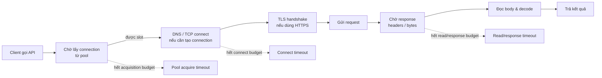
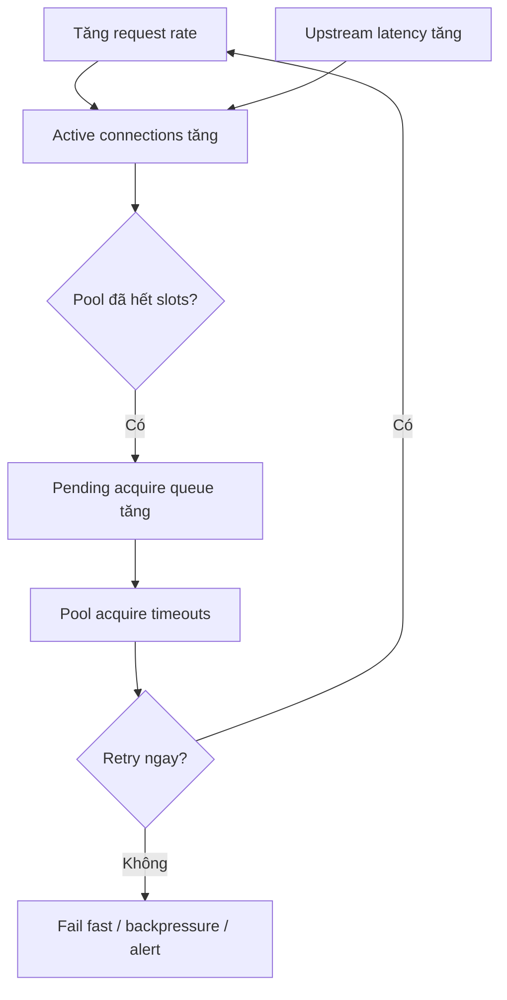
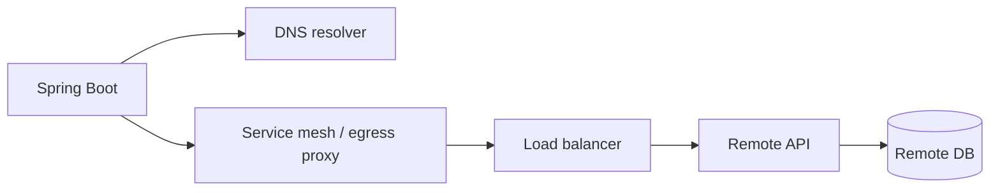
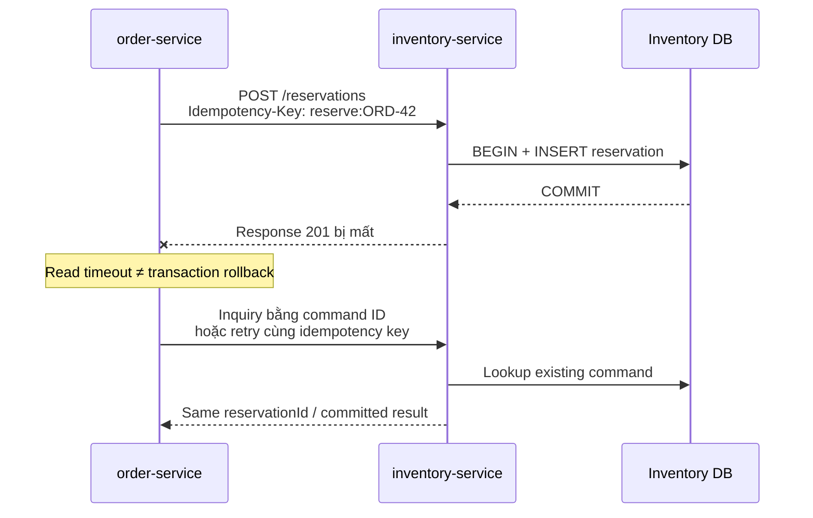
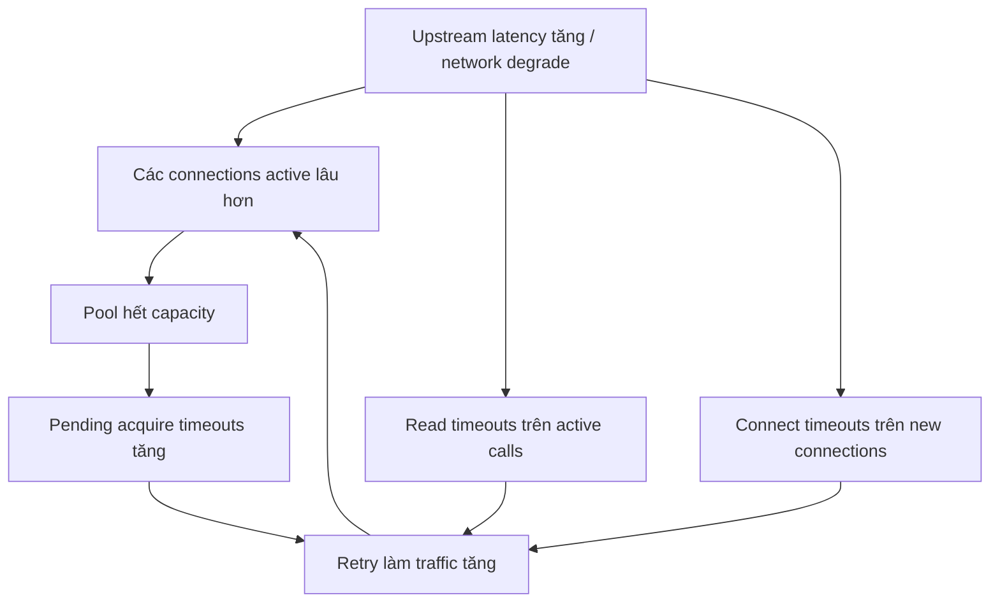

# Phân biệt connect timeout, read timeout và chờ lấy kết nối

## 1. Vấn đề: “HTTP timeout” không phải một lỗi duy nhất

Ứng dụng Spring Boot `order-service` gọi `inventory-service` để kiểm tra tồn kho trước khi xác nhận đơn hàng. Khi lượng truy cập tăng, một số lời gọi thất bại sau 300 ms; một số khác chờ 800 ms rồi báo không kết nối được; một số khác đã kết nối nhưng đợi phản hồi 3 giây rồi timeout. Nếu tất cả được ghi log chung là “inventory timeout” và đều được retry, chính ứng dụng có thể tạo thêm tải, làm hàng đợi connection pool dài hơn.

Ba loại thời gian chờ cần phân biệt:

1. **Chờ lấy kết nối từ pool (connection acquisition/lease/pending acquire timeout):** đợi một connection slot có thể dùng được trước khi thực hiện I/O của request.
2. **Connect timeout:** giới hạn thời gian thiết lập kết nối TCP tới địa chỉ đích khi cần mở một connection mới.
3. **Read/response timeout:** giới hạn chờ dữ liệu HTTP từ kết nối đã được thiết lập, với chi tiết phụ thuộc thư viện.

Đây là ba **ranh giới khác nhau**. Đặt `connect timeout=1s` không giúp một request chờ 20 giây trong pool; đặt `read timeout=3s` không bảo đảm tổng request hoàn tất trong 3 giây.



Bài học thuộc chương **Lựa chọn HTTP client**, module **SPRING_BOOT_INTEGRATION**. Module hướng tới tích hợp Spring Boot với HTTP client, cơ sở dữ liệu, cache, broker và adapter Spring Integration, nhấn mạnh cấu hình, hợp đồng dữ liệu, giao dịch, lỗi, xử lý trùng lặp, kiểm thử và quan sát luồng tích hợp thực tế. Chọn timeout phù hợp vì thế phải gắn với **năng lực upstream, số connections, ngân sách latency và an toàn khi retry**, không chỉ là chọn một property.

**Mục tiêu:**

1. Vẽ được timeline của một HTTP request có connection pool, DNS, connect, TLS, response và body.
2. Phân biệt connection acquisition timeout, connect timeout, read/response timeout, idle timeout và tổng deadline.
3. Hiểu tại sao pooled connection tái sử dụng không phải thực hiện TCP connect mỗi lần.
4. Cấu hình Spring Boot WebClient/Reactor Netty theo từng giới hạn: `pendingAcquireTimeout`, `CONNECT_TIMEOUT_MILLIS`, `responseTimeout`.
5. Cấu hình RestClient với Apache HttpClient 5: `connectionRequestTimeout`, `connectTimeout` và `responseTimeout`.
6. Biết những khác biệt của JDK HttpClient và khi nào không có knob “pool lease” tương đương.
7. Phân loại lỗi để chọn retry/backoff/circuit breaker/bulkhead đúng mục tiêu.
8. Tránh nhân đôi side effects của HTTP POST khi timeout khiến kết quả không rõ.
9. Viết kiểm thử có kiểm soát cho pool exhaustion, TCP connect delay, response delay, streaming body, cancel và tổng deadline.
10. Thiết lập metrics/runbook để xác định request đang nghẽn ở **pool**, **mạng kết nối** hay **upstream phản hồi**.

> **Phạm vi phiên bản:** Các ví dụ Java dùng Java 17+, Spring Boot 3.x, Spring Framework 6.x, Reactor Netty 1.x tương thích BOM, Apache HttpClient 5 và JDK HttpClient. Các API/defaults có thể đổi trong Spring Boot 4.x/Spring Framework 7.x/Reactor Netty 2.x; xác minh dependency và Javadoc đúng bản đang chạy trước khi triển khai. Số thời gian chờ trong ví dụ là giá trị minh họa, **không phải defaults hoặc SLO tiêu chuẩn**.

## 2. Ba đồng hồ bắt đầu ở ba vị trí khác nhau

### 2.1. Chờ lấy kết nối (pool acquisition/lease timeout)

Nhiều HTTP clients dùng một **connection pool** để tái sử dụng TCP/TLS connections và kiểm soát số connections đồng thời tới upstream. Khi tất cả slots đang bận, request mới có thể được đưa vào **pending queue** đợi slot trống.

```text
               Connection pool: maxConnections = 2
                          ┌───────────────────┐
Request A ────────────────>│ connection #1 BUSY│
Request B ────────────────>│ connection #2 BUSY│
                          └───────────────────┘
Request C ──> pending queue ──> chờ connection được release
Request D ──> pending queue ──> có thể timeout ngay tại đây
```

**Acquisition timeout** giới hạn thời gian một pending request được chờ để có connection/slot. Nếu timeout trước khi mượn được slot:

- Không nhất thiết đã có TCP SYN hoặc HTTP request tới upstream.
- Có thể là **tắc nghẽn cục bộ**: concurrency quá cao, response/body chưa kết thúc, leak/unconsumed response, pool quá nhỏ hoặc upstream chậm khiến connections bị giữ.
- Tăng connect timeout hoặc read timeout **không chữa trực tiếp** hàng đợi pool.
- Retry ngay có thể tạo thêm pending requests và làm tình hình tệ hơn.

Trong Apache HttpClient 5 thường gọi là **connection request timeout**; trong Reactor Netty là **pending acquire timeout**. Tên gọi khác nhau nhưng đều liên quan chờ mượn capacity của pool.

**Lưu ý HTTP/2:** một physical connection có thể có nhiều concurrent streams khi client/server hỗ trợ multiplexing. Chính sách pool, active streams và giới hạn server không còn đồng nhất với “mỗi HTTP request cần một socket riêng”. Đừng ước lượng năng lực chỉ từ socket count nếu đang chạy HTTP/2.

### 2.2. Connect timeout

Khi client phải tạo một TCP connection mới, nó thực hiện connect tới địa chỉ IP/port đã xác định. **Connect timeout** giới hạn thời gian ở pha kết nối TCP này theo connector implementation.

```text
pool cấp slot / cần mở connection mới
  -> resolve hostname (DNS)
  -> TCP connect attempt
     -> SYN / SYN-ACK / ...
  -> connected
  -> TLS handshake (HTTPS)
  -> send HTTP request
```

Connect timeout **không đồng nhất** với:

- **DNS resolution timeout**: tra tên host có thể mất thời gian trước TCP connect.
- **TLS handshake timeout**: HTTPS có thêm bắt tay TLS, chứng chỉ, hostname verification.
- **Proxy negotiation timeout**: một HTTP CONNECT proxy hoặc SOCKS proxy có các pha riêng.
- **Read/response timeout**: đã kết nối nhưng chờ server hoặc bytes.
- **Total operation deadline**: tổng thời gian user/caller chờ.

Một socket connect có thể thất bại **ngay lập tức** vì `connection refused`, `no route to host` hoặc DNS resolution error; đó **không phải lúc nào cũng là connect timeout**. Chỉ cần lỗi kết nối không có nghĩa đã dùng hết toàn bộ số millisecond đã cấu hình.

**Connection reuse:** nếu client lấy được idle keep-alive connection hợp lệ từ pool, nó có thể **không làm TCP connect mới**, nên connect timeout không được dùng cho request ấy. Vì vậy hai requests cùng endpoint có thể có timing và exception khác nhau.

### 2.3. Read timeout / response timeout

Sau khi kết nối được thiết lập và request được gửi, ứng dụng đợi server xử lý và phát dữ liệu. Tùy client, có các khái niệm:

- **Socket read timeout / SO_TIMEOUT**: giới hạn thời gian một blocking read chờ dữ liệu.
- **Response timeout**: khoảng thời gian HTTP client được phép chờ nhận response/đọc response, tùy implementation.
- **First-byte/header timeout**: giới hạn chờ bắt đầu response hoặc headers (không phải mọi client đều có một option riêng).
- **Inactivity timeout giữa các lần đọc**: giới hạn thời gian không có network read event trên một response đang stream.
- **Total body deadline**: tổng thời gian tải/giải mã body, **không tự có** chỉ vì đã đặt read timeout.

```text
TCP connected, HTTP request sent
    |
    |--- server queue / business processing ---|
                                          headers
                                             |
                                             +-- chunk 1
                                             +---------- chunk 2
                                             +---------- chunk 3
                                                        ...
```

Nếu upstream không gửi byte nào trong một khoảng thời gian đủ dài, read/response timeout có thể kích hoạt. Nhưng nếu upstream gửi một chunk nhỏ liên tục trước mỗi inactivity deadline, một response lớn hoặc streaming SSE vẫn có thể kéo dài rất lâu **mà không vi phạm khoảng chờ giữa hai lần đọc**.

**Rất quan trọng:** `responseTimeout` của Reactor Netty thường được triển khai để giới hạn thời gian **giữa các lần network-level read** cho response. Nó không phải một hợp đồng “toàn bộ HTTP request phải xong trong N giây”. Đối với Apache HttpClient 5, `RequestConfig.responseTimeout` cũng cần đọc semantics của version/client implementation, không giả định tuyệt đối giống Reactor Netty hoặc JDK HttpClient.

### 2.4. Tổng deadline (end-to-end time budget)

Một client có thể trải qua nhiều pha:

```text
Start
  -> pool pending acquire 200ms
  -> DNS 50ms
  -> TCP connect 500ms
  -> TLS handshake 150ms
  -> send/processing 700ms
  -> body read/decode 400ms
  -> application work 200ms
End
```

Ngay cả khi acquisition timeout là 300 ms, connect timeout 800 ms và read timeout 2 s, tổng thời gian **không được bảo đảm nhỏ hơn 2 s hoặc 3,1 s**. DNS/TLS/other overhead, stream nhiều chunks, retries và downstream processing đều cần ngân sách riêng.

Muốn ràng buộc tổng, áp dụng **logical request deadline** ở tầng phù hợp, cộng timeout từng pha, giới hạn retry attempts/backoff và truyền remaining budget khi gọi nhiều downstream services.

## 3. Timeline của request sử dụng pooled connection

Giả sử outbound WebClient tới Warehouse được cấu hình:

```yaml
# Ví dụ logic, không phải tên property tự động của Spring Boot.
poolAcquisitionTimeout: 250ms
tcpConnectTimeout: 800ms
responseReadTimeout: 2s
operationDeadline: 4s
```

Xét bốn kịch bản:

| Tình huống | Pool | TCP | Server/body | Timeout có thể kích hoạt |
| --- | --- | --- | --- | --- |
| A: pool đầy 400 ms | Pending không có slot | Chưa connect mới | Chưa gửi request | **Acquisition** ở 250 ms. |
| B: pool có slot, blackholed TCP SYN | Cấp slot ngay | Không hoàn tất TCP connect | Chưa gửi request | **Connect** ở 800 ms, trừ giới hạn khác đến trước. |
| C: reused connection, upstream im lặng 3 s | Có idle connection | **Không có connect mới** | Không có response read event | **Read/response** ở khoảng 2 s. |
| D: upstream gửi 1 chunk mỗi 1,5 s trong 30 s | Có connection | Connect thành công | Chunk spacing nhỏ hơn 2 s | Không nhất thiết vi phạm read timeout; **deadline 4 s** nên dừng. |

### 3.1. Khi một timeout đến trước, các timeout khác chưa chắc đã bắt đầu

Ví dụ Request C chờ acquire 250ms rồi fail thì:

```text
acquire timer: expired
connect timer: not applicable
response timer: not applicable
business request may not have reached upstream
```

Đó là một tín hiệu để kiểm tra **local pool saturation**, không phải bằng chứng Warehouse mất kết nối.

### 3.2. Network error khác timeout

Không nên ghi:

```text
Socket error = connect timeout
5xx         = read timeout
NoSuchHost  = connection pool exhausted
```

Đây là ba loại sự cố khác nhau:

| Dấu hiệu | Nguyên nhân thường gặp | Có thể xác định từ exception đơn lẻ? |
| --- | --- | --- |
| `Connection refused` | Không có listener ở IP:port hoặc policy reject. | Thường kết nối bị từ chối nhanh, không phải timeout. |
| `UnknownHostException` | DNS/hostname resolution. | Không suy là TCP connect timeout. |
| `SSLHandshakeException` | TLS trust, certificate, protocol mismatch. | Không suy là read timeout; không retry mù. |
| Pool acquire timeout | Không có slot đúng hạn. | Xem pool pending/active; có thể là overload cục bộ. |
| TCP connect timeout | Socket không kết nối kịp. | Xem network path, firewall, endpoint. |
| Read/response timeout | Kết nối thành công nhưng response không tiến như kỳ vọng. | Xem upstream latency, body streaming, proxy và request contract. |
| HTTP `503` | Server/gateway **đã gửi HTTP response**. | Không phải transport timeout; retry policy riêng. |
| HTTP `429` | Upstream rate limiting. | Tôn trọng `Retry-After` và quota; không tăng pool bừa. |

### 3.3. Kiểm soát HTTP connection lifetime

Ngoài ba timeout trọng tâm:

- **Max idle time:** tối đa một pooled connection được giữ idle trước khi bị loại bỏ (tùy client).
- **Max life time:** tối đa thời gian tồn tại một connection trước eviction.
- **Idle eviction:** chu kỳ dọn connections quá cũ.
- **Pool pending queue max:** số request được phép xếp hàng; tránh queue tăng vô hạn.
- **TCP keepalive / HTTP keep-alive:** cơ chế khác nhau; không thay tổng request timeout.
- **Response body consumption:** nếu body không được tiêu thụ/hủy đúng, connection có thể bị giữ hoặc không tái sử dụng.
- **Connection validation/stale detection:** giúp tránh dùng socket đã bị server/proxy đóng từ trước.

Một client có pool maxConnections=200 nhưng server chỉ chịu 20 active requests chưa chắc hiệu quả hơn pool 20; số connections phù hợp phải dựa trên capacity của upstream và đặc tính HTTP/1.1/HTTP/2.

## 4. Hai chiều giới hạn: thời gian và concurrency

Thời gian chờ không độc lập với số requests cùng chạy. Theo một ước lượng vận hành dạng Little's Law:

\[
\text{Concurrency trung bình} \approx \text{Throughput (request/s)} \times \text{Latency (s)}
\]

Nếu một dependency đang nhận trung bình 100 HTTP calls/giây và mỗi call giữ slot 0,2 giây, số calls in flight trung bình khoảng 20. Khi latency lên 1,5 giây mà traffic không đổi, trung bình khoảng 150 calls in flight. Pool 40 sẽ có pending queue ngay cả khi mạng TCP vẫn bình thường.

**Đừng lấy một phép nhân trung bình làm công thức chọn pool tuyệt đối.** Cần xét burst, p95/p99 latency, HTTP/2 streams, upstream concurrency limit, thread pool, connection reuse, retry traffic, number of replicas và giới hạn tài nguyên của client.

### 4.1. Pool nhỏ, response chậm và acquire timeout



Khi thấy acquire timeouts, tăng `maxConnections` chỉ có ích nếu upstream còn khả năng xử lý thêm và máy client có tài nguyên; nếu không nó chuyển backlog từ pool sang upstream, có thể tạo cascading failure.

### 4.2. Điều quan trọng là “đã chiếm slot” hay “chưa chiếm slot”

| Pha | Đã chiếm pool capacity? | Request có thể đã tới server? |
| --- | --- | --- |
| Pending acquire | Chưa có connection lease; đang xếp hàng. | Thường chưa. |
| Connecting new socket | Đang dùng capacity/slot theo pool implementation. | HTTP request thường chưa gửi. |
| TLS handshake | Có connection đang thiết lập. | Chưa gửi HTTP application request. |
| Request body sent | Có connection active. | **Có**, server có thể đang xử lý. |
| Waiting/reading response | Có active connection/stream. | **Có**, side effect có thể đã commit. |
| Response complete / released | Slot có thể được trả về pool. | Kết quả đã được xử lý ở client. |

Đây là mô hình điển hình, không phải cam kết của mọi connector (ví dụ HTTP/2 multiplexer, proxy). Khi retry một thao tác ghi, **biết đang timeout ở pha nào** giúp đánh giá rủi ro, nhưng không thay được idempotency contract.

## 5. Chọn HTTP client/connector theo hành vi timeout

Spring Boot hỗ trợ nhiều cách gọi HTTP. Chính sách timeout phải được cấu hình ở connector thực tế, không chỉ ở một method service.

| Công nghệ | Mô hình | Chờ lấy connection | Connect | Read/response |
| --- | --- | --- | --- | --- |
| `RestClient` + Apache HttpClient 5 | Imperative/blocking | `RequestConfig.connectionRequestTimeout` | `ConnectionConfig.connectTimeout` trong pooling manager | `RequestConfig.responseTimeout` |
| `RestClient` + JDK HttpClient | Imperative Spring wrapper | JDK quản lý reuse/pool nội bộ, không cung cấp cùng knob pool lease qua Spring factory | `HttpClient.Builder.connectTimeout` | `JdkClientHttpRequestFactory.setReadTimeout` / JDK request-specific timeout tùy API |
| `WebClient` + Reactor Netty | Non-blocking/reactive | `ConnectionProvider.pendingAcquireTimeout` | Netty `ChannelOption.CONNECT_TIMEOUT_MILLIS` | `HttpClient.responseTimeout` |
| `WebClient` + JDK connector | Non-blocking abstraction trên JDK client | Không có Reactor `ConnectionProvider` | JDK client connect timeout | Phụ thuộc JDK request implementation và Reactor operators |
| `RestTemplate` + Apache HttpClient 5 | Legacy imperative | Cùng HTTP components pool manager | ConnectionConfig | RequestConfig |

**Lưu ý:** `RestClient` là API cấp cao của Spring; timeout phụ thuộc **ClientHttpRequestFactory**. `WebClient` là API reactive; timeout phụ thuộc **ClientHttpConnector**, HTTP client và Reactor operators. Bản thân tên `RestClient` hay `WebClient` **không định nghĩa toàn bộ timeout semantics**.

### 5.1. Khi nào chọn RestClient?

- Ứng dụng Spring MVC/imperative, request/response đồng bộ.
- Workflow dễ đọc, không cần streaming hàng nghìn requests với backpressure reactive.
- Có Apache HttpClient 5 khi cần pool lease, connect và response timeout tách bạch.
- Dùng `RestClient.Builder` do Spring Boot inject để giữ interceptors, observability và request factory cấu hình.

### 5.2. Khi nào chọn WebClient?

- Ứng dụng WebFlux/non-blocking, cần compose `Mono`/`Flux` hoặc streaming SSE/NDJSON.
- Muốn giới hạn pool pending acquisitions và TCP connect/read inactivity qua Reactor Netty.
- Cần cancellation, backpressure, concurrency control và total publisher deadline.
- Không dùng `.block()` trên Netty event loop chỉ để tái sử dụng imperative design.

### 5.3. Khi nào không đổi thư viện chỉ để “có thêm timeout”?

Đừng chuyển toàn bộ RestClient→WebClient nếu vấn đề thực tế là: HTTP requests không được cancel, connection pool có 10 slots còn upstream latency tăng, hoặc app đang retry quá nhiều. Có thể giải quyết bằng cấu hình Apache HttpClient 5 pool/request timeouts, backpressure và code xử lý response đúng. Ngược lại, chỉ thay factory không biến một ứng dụng blocking thành non-blocking.

## 6. WebClient + Reactor Netty: ba timeout ở ba nơi

Đây là lựa chọn minh họa dễ quan sát vì Reactor Netty cung cấp `ConnectionProvider` với pending acquisition control, Netty TCP connect option và HTTP response timeout.

### 6.1. Dependencies cho Spring Boot 3.x

```xml
<dependencies>
    <dependency>
        <groupId>org.springframework.boot</groupId>
        <artifactId>spring-boot-starter-webflux</artifactId>
    </dependency>
    <dependency>
        <groupId>org.springframework.boot</groupId>
        <artifactId>spring-boot-starter-actuator</artifactId>
    </dependency>
</dependencies>
```

`spring-boot-starter-webflux` thường mang Reactor Netty qua starter phụ thuộc. Nếu ứng dụng cố tình đổi reactive HTTP connector, phải kiểm tra connector đang chạy thực tế, không áp cấu hình Reactor Netty lên WebClient connector khác rồi nghĩ nó đã có hiệu lực. Spring Boot BOM nên quản lý phiên bản `reactor-netty-http`; không pin một bản quá cũ/mới riêng lẻ khi framework không tương thích.

### 6.2. Cấu hình connection pool, TCP và response

```java
// InventoryWebClientConfiguration.java
package com.example.integration.http;

import java.time.Duration;
import io.netty.channel.ChannelOption;
import org.springframework.beans.factory.annotation.Value;
import org.springframework.context.annotation.Bean;
import org.springframework.context.annotation.Configuration;
import org.springframework.http.client.reactive.ReactorClientHttpConnector;
import org.springframework.web.reactive.function.client.WebClient;
import reactor.netty.http.client.HttpClient;
import reactor.netty.resources.ConnectionProvider;

@Configuration(proxyBeanMethods = false)
public class InventoryWebClientConfiguration {

    @Bean(name = "inventoryConnectionProvider",
          destroyMethod = "dispose")
    ConnectionProvider inventoryConnectionProvider() {
        return ConnectionProvider.builder("inventory-http-pool")
            .maxConnections(40)
            .pendingAcquireMaxCount(80)
            .pendingAcquireTimeout(Duration.ofMillis(250))
            .maxIdleTime(Duration.ofSeconds(30))
            .build();
    }

    @Bean("inventoryWebClient")
    WebClient inventoryWebClient(
        WebClient.Builder builder,
        ConnectionProvider inventoryConnectionProvider,
        @Value("${inventory.base-url}") String baseUrl
    ) {
        HttpClient netty = HttpClient
            .create(inventoryConnectionProvider)
            .option(
                ChannelOption.CONNECT_TIMEOUT_MILLIS,
                800
            )
            .responseTimeout(Duration.ofSeconds(2));

        return builder
            .baseUrl(baseUrl)
            .clientConnector(
                new ReactorClientHttpConnector(netty)
            )
            .codecs(codecs -> codecs
                .defaultCodecs()
                .maxInMemorySize(1024 * 1024)
            )
            .build();
    }
}
```

```yaml
# application.yml
inventory:
  base-url: ${INVENTORY_BASE_URL:http://localhost:8089}
```

Các giới hạn được đặt ở nơi chúng có hiệu lực:

| Cấu hình | Giá trị demo | Kiểm soát |
| --- | --- | --- |
| `maxConnections(40)` | 40 | Số connection slots của pool (cần xét giao thức/HTTP2). |
| `pendingAcquireMaxCount(80)` | 80 | Số yêu cầu chờ acquire tối đa; khi đầy có thể fail sớm. |
| `pendingAcquireTimeout(250ms)` | 250 ms | Thời gian một request được chờ pool slot. |
| `CONNECT_TIMEOUT_MILLIS=800` | 800 ms | TCP connect attempt khi tạo socket mới. |
| `responseTimeout(2s)` | 2 giây | Thời gian read/response inactivity theo Reactor Netty. |
| `maxIdleTime(30s)` | 30 giây | Giới hạn idle connection reuse. |
| `maxInMemorySize(1MiB)` | 1 MiB | Giới hạn aggregation của nhiều codecs, **không phải timeout**. |

**Vì sao `maxInMemorySize` xuất hiện ở bài này?** Một response JSON lớn có thể giữ connection và decoder lâu; tuy nhiên lỗi `DataBufferLimitException` **khác** acquisition/connect/read timeout. Muốn download lớn, dùng streaming và giới hạn tổng bytes; không tăng read timeout để chữa body size, cũng không tăng codec limit để chữa TCP timeout.

### 6.3. Vì sao dùng injected WebClient.Builder?

Spring Boot thường auto-configure `WebClient.Builder` với observations, codecs và customizers từ môi trường. Dùng builder được inject giúp giữ các cấu hình chuẩn, sau đó chỉ thay **connector** có policy riêng cho Inventory. Nếu nhiều WebClient beans dùng cùng một builder instance thủ công và mutate liên tiếp, cấu hình có thể lẫn baseUrl/headers/connector; dùng `builder.clone()` hoặc inject một builder riêng theo lifecycle phù hợp.

**Lifecycle:** một `ConnectionProvider` do application tự tạo phải được dispose khi ứng dụng đóng. Ví dụ trên dùng `@Bean(destroyMethod="dispose")`. Nếu tạo provider mới trong mỗi request, pooling không có giá trị và tài nguyên có thể rò rỉ. Ngược lại, khi sử dụng shared Reactor Netty resources do Boot quản lý, cần hiểu vòng đời của `ReactorResourceFactory` và không destroy nhầm shared resources.

### 6.4. Một WebClient request với deadline tổng

```java
// InventoryGateway.java
package com.example.integration.http;

import java.time.Duration;
import org.springframework.beans.factory.annotation.Qualifier;
import org.springframework.stereotype.Component;
import org.springframework.web.reactive.function.client.WebClient;
import reactor.core.publisher.Mono;

@Component
public class InventoryGateway {
    private final WebClient webClient;

    public InventoryGateway(
        @Qualifier("inventoryWebClient") WebClient webClient
    ) {
        this.webClient = webClient;
    }

    public Mono<InventoryView> readInventory(String sku) {
        return webClient.get()
            .uri("/api/v1/stock/{sku}", sku)
            .retrieve()
            .bodyToMono(InventoryView.class)
            .timeout(Duration.ofSeconds(4));
    }
}
```

```java
// InventoryView.java — file riêng
package com.example.integration.http;

public record InventoryView(
    String sku,
    long available,
    long version
) {}
```

Với một Publisher không cache, `timeout(4s)` ở ngoài `bodyToMono` giới hạn tổng thời gian từ subscription tới khi có result/terminal signal **trong pipeline này**. Nếu `Mono` chưa được subscribe, request chưa bắt đầu. Nếu đặt retry operator **bên trong** timeout, deadline còn có thể bao gồm retries/backoff; nếu đặt timeout bên trong retry, mỗi attempt có thể lại được cấp cả 4 giây.

`Mono.timeout(...)` phát timeout rồi cancel upstream subscription khi deadline vượt, nhưng **không chứng minh remote operation đã rollback**. Với HTTP GET thuần đọc thường có thể retry nếu policy cho phép; với POST có side effect, cần idempotency key và unknown-outcome handling.

### 6.5. Ví dụ kết hợp retry không nhân ngân sách

```java
import java.time.Duration;
import reactor.util.retry.Retry;

public Mono<InventoryView> readWithRetry(
    String sku
) {
    return webClient.get()
        .uri("/api/v1/stock/{sku}", sku)
        .retrieve()
        .bodyToMono(InventoryView.class)
        .retryWhen(
            Retry.backoff(2, Duration.ofMillis(200))
                .maxBackoff(Duration.ofMillis(700))
                .jitter(0.5)
                .filter(this::isTemporaryWarehouseFailure)
        )
        .timeout(Duration.ofSeconds(4));
}
```

Đây là đoạn method minh họa trong một gateway có field `webClient` và helper `isTemporaryWarehouseFailure(Throwable)` do ứng dụng định nghĩa. Nó **không** nên retry mọi `Throwable`; helper phải phân biệt 503/429 theo contract, network errors có khả năng transient và **không retry** lỗi pool saturation nếu sẽ chỉ làm queue thêm đông, trừ khi có cơ chế capacity/budget rõ ràng.

Trong Reactor, `Retry.backoff(2, ...)` có **hai retries sau attempt đầu**, tức tối đa ba HTTP attempts. Tổng `timeout(4s)` ở ngoài operator retry giúp chặn thời gian toàn logical request, nhưng nếu caller/gateway ngoài cùng lại retry thêm, số attempts toàn hệ thống vẫn có thể nhân.

### 6.6. Reactor Netty response timeout và streaming

```text
responseTimeout = 2s

Server gửi:
  chunk 1 at t=1s
  chunk 2 at t=2.5s
  chunk 3 at t=4s
  chunk 4 at t=5.5s

Khoảng không có read giữa các chunks ~1.5s
  -> mỗi khoảng có thể nằm dưới 2s
  -> response vẫn kéo dài hơn 5s
```

Nếu API trả Server-Sent Events, streaming video hoặc NDJSON lâu, `responseTimeout(2s)` có thể **không phù hợp** vì khoảng cách giữa các events có thể lớn hơn 2 giây. Cần idle timeout, heartbeat interval và lifecycle riêng cho stream; khác với deadline của một request JSON thông thường. Không đặt `timeout(4s)` lên SSE chạy liên tục nếu nghiệp vụ yêu cầu subscription hàng giờ.

### 6.7. Tách pool theo upstream/trust boundary

```text
inventory-api -> inventory-http-pool (max 40, acquire 250ms)
pricing-api   -> pricing-http-pool   (max 20, acquire 150ms)
reporting-api -> reporting-pool      (max 8, long streaming)
```

Một report export có thể giữ connection vài phút; nếu dùng chung pool với lệnh Inventory GET cần 300 ms, luồng báo cáo có thể chiếm hết capacity và gây acquire timeout cho API quan trọng. Pool tách biệt không giải quyết mọi vấn đề (CPU/network threads vẫn dùng chung), nhưng giảm **resource contention** và làm metrics rõ ràng hơn.

Chọn số connections sau load test, không sao chép những con số ví dụ vào production không đo đạc.

## 7. RestClient + Apache HttpClient 5: lease, connect, response

Với Spring MVC/imperative, Apache HttpClient 5 là một lựa chọn khi muốn kiểm soát connection pooling và timeouts ở mức transport.

### 7.1. Dependencies

```xml
<dependencies>
    <dependency>
        <groupId>org.springframework.boot</groupId>
        <artifactId>spring-boot-starter-web</artifactId>
    </dependency>
    <dependency>
        <groupId>org.apache.httpcomponents.client5</groupId>
        <artifactId>httpclient5</artifactId>
    </dependency>
</dependencies>
```

Dùng version của Apache HttpClient 5 được Spring Boot BOM tương ứng quản lý khi có thể. Không dùng tài liệu Apache HttpClient **4.x** cho các lớp 5.x vì package, timeout configuration và builder APIs khác nhau.

### 7.2. Tạo pooling manager và request config

```java
// InventoryRestClientConfiguration.java
package com.example.integration.http;

import java.time.Duration;
import org.apache.hc.client5.http.classic.HttpClient;
import org.apache.hc.client5.http.config.ConnectionConfig;
import org.apache.hc.client5.http.config.RequestConfig;
import org.apache.hc.client5.http.impl.classic.CloseableHttpClient;
import org.apache.hc.client5.http.impl.classic.HttpClients;
import org.apache.hc.client5.http.impl.io.PoolingHttpClientConnectionManager;
import org.apache.hc.client5.http.impl.io.PoolingHttpClientConnectionManagerBuilder;
import org.apache.hc.core5.util.Timeout;
import org.springframework.beans.factory.annotation.Value;
import org.springframework.context.annotation.Bean;
import org.springframework.context.annotation.Configuration;
import org.springframework.http.client.HttpComponentsClientHttpRequestFactory;
import org.springframework.web.client.RestClient;

@Configuration(proxyBeanMethods = false)
public class InventoryRestClientConfiguration {

    @Bean(name = "inventoryApacheHttpClient",
          destroyMethod = "close")
    CloseableHttpClient inventoryApacheHttpClient() {
        ConnectionConfig connConfig = ConnectionConfig.custom()
            .setConnectTimeout(Timeout.ofMilliseconds(800))
            .build();

        PoolingHttpClientConnectionManager manager =
            PoolingHttpClientConnectionManagerBuilder.create()
                .setDefaultConnectionConfig(connConfig)
                .setMaxConnTotal(40)
                .setMaxConnPerRoute(20)
                .build();

        RequestConfig requestConfig = RequestConfig.custom()
            .setConnectionRequestTimeout(
                Timeout.ofMilliseconds(250)
            )
            .setResponseTimeout(Timeout.ofSeconds(2))
            .build();

        return HttpClients.custom()
            .setConnectionManager(manager)
            .setDefaultRequestConfig(requestConfig)
            .build();
    }

    @Bean("inventoryRestClient")
    RestClient inventoryRestClient(
        RestClient.Builder builder,
        CloseableHttpClient inventoryApacheHttpClient,
        @Value("${inventory.base-url}") String baseUrl
    ) {
        HttpComponentsClientHttpRequestFactory factory =
            new HttpComponentsClientHttpRequestFactory(
                inventoryApacheHttpClient
            );

        return builder
            .baseUrl(baseUrl)
            .requestFactory(factory)
            .build();
    }
}
```

**Cấu hình phân tầng:**

| Tầng Apache HC5 | API | Giới hạn |
| --- | --- | --- |
| Pool leasing | `RequestConfig.setConnectionRequestTimeout` | Thời gian lấy connection lease từ pooling manager. |
| TCP connection establishment | `ConnectionConfig.setConnectTimeout` | Timeout TCP connect khi phải mở socket. |
| Response reads | `RequestConfig.setResponseTimeout` | Timeout chờ response/reads theo HC5 implementation. |
| Pool capacity | `setMaxConnTotal / setMaxConnPerRoute` | Tổng connections và connection count cho từng route. |

**Không nhầm** `maxConnPerRoute` với max connections của toàn ứng dụng; nếu nhiều host/route, tổng và mỗi route phải được cân đối. Nếu route tới Warehouse bị giới hạn 20, có thể pending lease ngay cả khi global total còn slot.

**Phiên bản:** Với Apache HC5, connect timeout được cấu hình trong `ConnectionConfig` của connection manager ở ví dụ này; cách dùng `RequestConfig.setConnectTimeout` trong một số bản/đoạn tài liệu cũ có thể đã deprecated hoặc chuyển semantics. Luôn kiểm tra Javadoc đúng phiên bản Apache HC5 ứng dụng thực sự sử dụng.

### 7.3. Service gọi RestClient

```java
// InventorySyncGateway.java
package com.example.integration.http;

import org.springframework.beans.factory.annotation.Qualifier;
import org.springframework.stereotype.Component;
import org.springframework.web.client.RestClient;

@Component
public class InventorySyncGateway {
    private final RestClient rest;

    public InventorySyncGateway(
        @Qualifier("inventoryRestClient") RestClient rest
    ) {
        this.rest = rest;
    }

    public InventoryView readInventory(String sku) {
        InventoryView body = rest.get()
            .uri("/api/v1/stock/{sku}", sku)
            .retrieve()
            .body(InventoryView.class);

        if (body == null || !sku.equals(body.sku())) {
            throw new IllegalStateException(
                "Inventory response violates contract"
            );
        }
        return body;
    }
}
```

`RestClient` thao tác imperative/blocking: thread thực hiện call có thể chờ pool lease, TCP connect hoặc response read. Nếu 200 servlet threads cùng chờ pool 250ms, web server vẫn chịu chi phí thread/queuing. Vì vậy cần phối hợp servlet thread capacity, pool max/queue, external API SLA và công cụ backpressure/throttling.

### 7.4. Đừng nhầm Apache connection pool và JDBC DataSource pool

```text
HTTP connection pool:
  routes -> inventory.example.org:443
  capacity -> outbound HTTP sockets/connections

HikariCP:
  JDBC connections -> PostgreSQL database
  capacity -> database sessions
```

Hai pools hoàn toàn khác nhau. Một HTTP connection request timeout **không có nghĩa** Hikari connection pool hết slot. Ngược lại `SQLTransientConnectionException`/Hikari `connectionTimeout` không liên quan TCP connect timeout của Apache HTTP client. Khi dùng Spring Integration flow gọi cả DB và HTTP, cần đo hai pools riêng.

### 7.5. Quản lý lifecycle và response body

`CloseableHttpClient` là resource cần được đóng khi context shutdown. Đoạn bean trên dùng `destroyMethod="close"`. Nếu tạo client mỗi request, sẽ mất connection reuse và tăng TLS handshakes, sockets/TIME_WAIT.

Với RestClient, luôn đọc/đóng response body đúng API (`retrieve().body(...)` hoặc `exchange(...)` với response closing/consumption). Không bỏ response mở hoặc giữ streaming response qua background task chưa có ownership rõ; có thể làm pool cạn và dẫn tới connection request timeouts.

## 8. RestClient + JDK HttpClient: timeout không phải lúc nào có ba nút tương đương

Spring Framework 6.1+ có `JdkClientHttpRequestFactory` bọc Java `java.net.http.HttpClient`. Cấu hình mẫu:

```java
// InventoryJdkRestClientConfiguration.java
package com.example.integration.http;

import java.net.http.HttpClient;
import java.time.Duration;
import org.springframework.beans.factory.annotation.Value;
import org.springframework.context.annotation.Bean;
import org.springframework.context.annotation.Configuration;
import org.springframework.http.client.JdkClientHttpRequestFactory;
import org.springframework.web.client.RestClient;

@Configuration(proxyBeanMethods = false)
public class InventoryJdkRestClientConfiguration {

    @Bean("inventoryJdkRestClient")
    RestClient inventoryJdkRestClient(
        RestClient.Builder builder,
        @Value("${inventory.base-url}") String baseUrl
    ) {
        HttpClient jdkClient = HttpClient.newBuilder()
            .connectTimeout(Duration.ofMillis(800))
            .build();

        JdkClientHttpRequestFactory factory =
            new JdkClientHttpRequestFactory(jdkClient);
        factory.setReadTimeout(Duration.ofSeconds(2));

        return builder
            .baseUrl(baseUrl)
            .requestFactory(factory)
            .build();
    }
}
```

**Điểm khác biệt:**

- JDK `HttpClient` quản lý connection reuse/pooling nội bộ, nhưng Spring `JdkClientHttpRequestFactory` **không có cùng `connectionRequestTimeout`/`pendingAcquireTimeout` API** như Apache HC5 hay Reactor Netty.
- `HttpClient.Builder.connectTimeout(...)` dành cho pha kết nối, không giới hạn tổng logic/DB/JSON mapping.
- `JdkClientHttpRequestFactory.setReadTimeout(...)` đặt read timeout cho factory theo API Spring Framework phiên bản tương ứng; hãy kiểm chứng thực nghiệm behavior với response headers/body streaming.
- Nếu cần kiểm soát cụ thể số concurrent connection leases và pending queue, chọn connector có pool contract cần thiết, hoặc đặt **bulkhead/semaphore** ở tầng ứng dụng với metrics rõ ràng.

**Không suy “JDK client không có pool” từ việc không có public pending-acquire knob:** nó có cơ chế quản lý connections nội bộ; chỉ là nó không cung cấp giao diện và semantics điều chỉnh tương đương các examples của Reactor Netty/Apache.

### 8.1. JDK request timeout khác timeout của Spring factory

JDK `HttpRequest.Builder.timeout(Duration)` có semantics về thời gian request theo JDK API và cách `HttpClient.send/BodyHandler` hoàn tất; với body streaming, cần đọc chính xác JDK/JVM version. Nó không phải mặc nhiên bằng Reactor `responseTimeout` (inactivity interval), và `RestClient` có thể không expose trực tiếp mọi per-request JDK option.

Hãy đo dưới HTTP server test có delayed headers và chunked body thay vì viết bảng quy đổi máy móc:

```text
Apache responseTimeout 2s
Reactor Netty responseTimeout 2s
JDK factory readTimeout 2s

=> KHÔNG suy rằng ba client sẽ hủy một streaming response
   vào cùng timestamp trong mọi tình huống.
```

### 8.2. TLS handshake còn nằm ngoài connect limit không?

Đa số trường hợp nên cấu hình/đo TLS handshake timeout riêng nếu connector hỗ trợ. Một kết nối TCP có thể hoàn tất nhanh nhưng TLS negotiation treo, certificate chain fail hoặc hostname không khớp. Connect timeout thường không bao toàn bộ thời gian TLS. Với Reactor Netty, `HttpClient.secure(...)` có SSL handshake timeout settings; với Apache/JDK, tra đúng APIs của phiên bản và TLS stack đang dùng.

**Không** tắt certificate verification hay đổi từ HTTPS sang HTTP để “chữa timeout”. Một TLS handshake error là vấn đề trust/protocol/certificate chứ không phải lý do retry bằng insecure transport.

## 9. DNS, proxy, TLS và network idle: những khoảng chờ nằm ngoài “ba timeout”

Khi điều tra timeout trong môi trường Kubernetes, cloud VPC hoặc mạng doanh nghiệp, thường có nhiều hops giữa service và upstream:



Trên đường thực tế, client có thể gặp:

- DNS lookup chậm hoặc trả địa chỉ không còn sống.
- TCP connection từ client đến **proxy** thành công nhưng proxy không thể kết nối upstream.
- HTTP CONNECT proxy chờ tunnel thiết lập.
- TLS handshake chậm/không thành công giữa client↔proxy hoặc client↔upstream.
- Load balancer idle timeout đóng pooled keep-alive connection.
- Upstream thread pool/DB connection pool quá tải, xử lý request chậm và không có response headers.
- Một gateway trả HTTP 504 đúng hạn, trong khi client timeout dài hơn.

**Connect timeout luôn gắn với một connection cụ thể**, có thể là connection tới proxy thay vì tới origin host. Nếu proxy chuyển tiếp request thất bại, kết quả có thể là HTTP 502/503/504 hoặc connection reset, không phải TCP connect timeout ở client.

### 9.1. DNS resolution không bị connect timeout bao toàn bộ

Ví dụ:

```text
Resolve inventory.example.com -> 1.5 seconds
TCP connect timeout option     -> 0.8 seconds
TCP connect actually takes     -> 0.1 seconds
TLS handshake                  -> 0.3 seconds

Tổng trước HTTP request ~1.9s dù connect timeout=0.8s.
```

Các giá trị hoàn toàn minh họa. DNS có cache TTL, multiple A/AAAA addresses, IPv4/IPv6 preference, resolver-specific timeouts và retries. Nếu có DNS errors, kiểm tra DNS/resolver metrics chứ không tăng pool `pendingAcquireTimeout` hoặc `responseTimeout`.

### 9.2. Pooled keep-alive có thể stale

Server hoặc load balancer có thể đóng kết nối idle sau 60 giây; client giữ connection trong pool 120 giây rồi tái sử dụng nó. Kết quả có thể là connection reset trước khi nhận response, dù connect timeout không hề kích hoạt.

Phương án:

- Đặt client maxIdleTime hợp lý theo upstream/LB idle timeout.
- Dùng evict/validate idle connections theo HTTP client support.
- Không giữ pools với infinite idle lifetime khi proxy đóng connection sớm.
- Retry read-only requests **có giới hạn** nếu lỗi là stale connection; với POST cần xác định side effect.
- Theo dõi tỷ lệ connection reuse, resets, idle count và errors theo upstream.

### 9.3. TLS handshake timeout tách biệt

Với Reactor Netty phiên bản có `SslProvider`:

```java
// Ví dụ bổ sung cho HttpClient đã có.
HttpClient secured = netty.secure(ssl ->
    ssl.handshakeTimeout(Duration.ofSeconds(3))
);
```

Phương thức `secure(...)` cần được cấu hình cùng SSL context/truststore/hostname verification phù hợp môi trường; nó không thay cho client URL HTTPS/TLS trust policy. Khi cấu hình riêng SSL context, không tạo `InsecureTrustManagerFactory` hoặc tắt hostname checks để tránh timeout/handshake errors.

### 9.4. Idle timeout không phải request deadline

`maxIdleTime` của pool giới hạn **connection đang rảnh**, không phải request đang chạy. `responseTimeout` kiểm soát response reads theo client, không phải thời gian một connection rảnh sau khi response kết thúc. `readTimeout` của TCP socket cũng không quyết định maxIdleTime trong pool.

Mỗi knob trả lời một câu hỏi riêng:

```text
maxIdleTime             : được giữ connection rảnh bao lâu?
pendingAcquireTimeout   : request được đợi slot bao lâu?
connectTimeout          : TCP connect được đợi bao lâu?
TLS handshakeTimeout    : TLS được đợi bao lâu?
response/readTimeout    : chờ dữ liệu response bao lâu?
total deadline          : toàn logical operation được chờ bao lâu?
```

## 10. So sánh HTTP/1.1 và HTTP/2 khi sizing pool

### 10.1. HTTP/1.1 keep-alive

Một HTTP/1.1 client thông dụng thường không thực hiện đồng thời nhiều requests trên một connection nếu không dùng pipelining. Vì vậy 40 pooled active connections thường gần với giới hạn ~40 HTTP calls đang đọc response cùng thời điểm trên cùng route. Điều này là **mô hình gần đúng**, không phải quy tắc cho mọi client.

### 10.2. HTTP/2 multiplexing

HTTP/2 có thể chạy nhiều concurrent streams trên một TCP/TLS connection; giới hạn `SETTINGS_MAX_CONCURRENT_STREAMS` và tài nguyên của connector/server ảnh hưởng capacity.

```text
HTTP/1.1:
  connection #1 -> request A
  connection #2 -> request B

HTTP/2:
  connection #1 -> stream A, stream B, stream C...
  concurrency còn bị giới hạn bởi max concurrent streams/flow control
```

Vì vậy `maxConnections=40` không đồng nhất với 40 requests nếu HTTP/2 thật sự được bật và được negotiated. Khi vận hành, cần xác nhận negotiated protocol (ALPN), streams, flow control, server concurrency limits và việc connector tạo nhiều connections khi stream capacity đạt ngưỡng.

### 10.3. HTTP/2 stream reset

Một response có thể bị reset stream do HTTP/2 protocol, upstream quota hoặc proxy; đó có thể không phải socket-level connect timeout hay read timeout. Retry policy cần xem stream error classification, idempotency và upstream load. Không biến mọi `RST_STREAM` thành lý do phát lại HTTP POST.

### 10.4. HTTP/1.1 và HTTP/2 cùng có request-level budget

Dù có multiplexing, một logical request vẫn cần:

- Phân biệt trạng thái chưa gửi/gửi rồi.
- Bounded header/body size và streaming policy.
- Deadline tổng cho request và retries.
- Correlation ID, trace span và outcome rõ ràng.
- Không suy đoán remote side effect từ cancellation/timeout.

## 11. Thiết kế timeout theo SLO, không bắt đầu bằng số tùy ý

Giả sử API của order-service có p99 target 5 giây, trong đó:

```text
API request budget             = 5000 ms
Authorization, validation      = 300 ms
PostgreSQL transaction          = 500 ms
Inventory HTTP call            = 2500 ms
Payment HTTP call              = 1000 ms
Serialization + margin         = 700 ms
---------------------------------------
Total                          = 5000 ms
```

Nếu Inventory HTTP client có 3 attempts, mỗi attempt cho phép read inactivity tới 2 giây, cộng retries/backoff, nó dễ tiêu hết 2,5 giây chỉ ở một dependency. Cần **budget-aware retries** và truyền remaining deadline sang các lời gọi tiếp theo.

### 11.1. Tách per-attempt và total deadline

```text
Logical inventory lookup deadline: 2500ms

Attempt #1:
  pool acquire <= 150ms
  connect (if needed) <= 500ms
  response read inactivity <= 1000ms
  timeout/failure after 900ms

Backoff <= 200ms

Attempt #2:
  remaining deadline ~1400ms
  must complete or be cancelled before 2500ms overall
```

Đây là mô hình **ngân sách**, không phải công thức bảo đảm các giai đoạn luôn nối tiếp hay mỗi timeout chính xác như đồng hồ hệ điều hành. Request có TLS/DNS/proxy, streaming và scheduler overhead; cần đo latency thực.

### 11.2. Giới hạn từ caller phải có thứ tự hợp lý

Ví dụ:

```text
External API Gateway timeout: 6s
order-service request deadline: 5s
inventory logical deadline: 2.5s
single read attempt timeout: 1s
```

Nếu order-service mất 8 giây mới hủy Inventory, nhưng API gateway đã trả 504 sau 6 giây, ứng dụng có thể tiếp tục chiếm connection/thread và làm side effects không còn được caller quan tâm. Một kiến trúc tốt thường đặt downstream deadlines thấp hơn upstream overall deadline, đủ margin cho error mapping, cleanup và network latency.

Không có quy tắc “timeout HTTP client luôn 1s”. Trong mạng WAN hoặc một batch export hợp lệ, 1s có thể gây false timeouts; endpoint khác yêu cầu <100ms. SLO và lịch sử latency theo operation mới giúp định cấu hình.

### 11.3. Timeout budget khi có nhiều phases không được cộng máy móc

```text
pendingAcquire=250ms
connect=800ms
responseTimeout=2000ms

Suy luận SAI:
  request chắc chắn sẽ timeout sau tối đa 3050ms.
```

Vì:

- DNS/TLS/proxy có chi phí ngoài các timer này.
- `responseTimeout` có thể reset theo network reads và stream có thể kéo dài.
- Java application có work trước/sau client call.
- Retry cùng một logical command có thể lặp lại tất cả phases.
- Connection pool có thể bypass connect khi reuse.

Muốn đặt hard wall-clock deadline, phải có tầng **total timeout** phù hợp async vs blocking model, đồng thời kiểm thử khả năng cancel/hủy resource thực tế.

### 11.4. Total deadline với imperative client

Trong một service blocking, bản thân `RestClient.retrieve()` không phải Reactor Publisher để chỉ cần thêm `.timeout(...)`. Có thể dùng:

- Apache HttpClient/JDK transport timeouts từng phase để bảo đảm không chờ vô hạn ở network operations mà connector hỗ trợ.
- Request-scoped deadline ở application boundary và remaining budget passed to client/connector nếu version hỗ trợ per-request config.
- Bulkhead/concurrency limit ở service.
- `CompletableFuture` + executor + timeout chỉ khi hiểu rõ cancellation và blocking socket I/O; `Future.cancel(true)` không luôn cắt được socket read hay rollback remote side effect.
- Trong Java 21+ có thể cân nhắc structured concurrency theo API/preview status của JDK tương ứng, nhưng **không** suy ra nó thay được transport timeouts.

Với synchronous HTTP, lựa chọn đơn giản và kiểm chứng được thường là phase-specific timeouts + bounded attempts + caller deadline; không bọc blocking call vào một timer không thật sự dừng I/O rồi tuyên bố đã có hard timeout.

## 12. Timeout, retry và idempotency

Timeout đôi khi chỉ nói rằng **client không nhận được kết quả trong budget**, không nói rằng server chưa thực thi.

### 12.1. Ba pha và hậu quả với POST

| Timeout | Thông điệp HTTP đã tới upstream? | Có thể retry POST tự động? |
| --- | --- | --- |
| **Pool acquire** trước khi lấy slot | Thường **chưa gửi từ HTTP client**. | Về mặt side effect của attempt này thường chưa có, nhưng còn business/caller layer và overload; chỉ retry nếu biết chắc nguồn lỗi và budget. |
| **TCP connect** trước khi phát HTTP request | Thường request **chưa gửi** qua connection mới. | Có thể xem xét thử lại khi lỗi transient, nhưng phải xác minh proxy/reuse semantics và không nhân retries. |
| **Read/response** sau khi request gửi | **Có thể đã tới và commit ở remote**. | **Không retry mù**; cần provider idempotency key/inquiry. |

Đây là mô hình điển hình, không phải bằng chứng pháp lý/transactional từ exception class. Trên hệ thống có proxy, redirects, interceptors và nhiều tầng retries, một logical command có thể đã được gửi ở attempt trước dù attempt mới fail khi acquire.

### 12.2. POST reservation có unknown outcome



**Điều kiện retry an toàn cho write:**

- Stable logical command ID/idempotency key qua mọi attempts, **không sinh UUID mới mỗi retry**.
- Provider enforce key atomically, kiểm tra request fingerprint và lưu/replay kết quả.
- Key retention đủ lâu hơn mọi retry, DLT và reconciliation horizon.
- Có đường inquiry theo provider ID/business command ID khi response không rõ.
- Nếu không có guarantee, đặt workflow state `UNKNOWN_OUTCOME` và đối soát, không chuyển thành `FAILED_NOT_EXECUTED`.

Một HTTP client timeout, circuit breaker hoặc service mesh retry **không thể tự tạo exactly-once business effect**.

### 12.3. GET cũng phải tính request amplification

```text
API Gateway retry: 2 total attempts
Service retry:     3 total attempts
HTTP client retry: 3 total attempts

Worst-case calls = 2 × 3 × 3 = 18
```

18 calls cho một GET có thể làm upstream vốn chậm càng quá tải. Chọn **một owner của retry tại mỗi boundary có chủ đích**, giới hạn tổng deadline và không retry pool acquisition saturation vô hạn.

### 12.4. Phân loại failure cho retry policy

| Lỗi | Hướng xử lý mặc định cần cân nhắc |
| --- | --- |
| Pool acquire timeout | Local saturation: fail fast/backpressure; điều tra pool, giảm concurrency. Retry ngay thường không tốt. |
| TCP connect timeout | Có thể retry bounded nếu GET/idempotent và deadline còn, đánh giá upstream/network. |
| DNS NXDOMAIN/hostname sai | Thường lỗi cấu hình; không retry nóng. |
| TLS certificate invalid | Lỗi trust/cấu hình; không retry bằng insecure fallback. |
| Read timeout GET | Retry bounded + backoff/jitter nếu query read-only và upstream còn capacity. |
| Read timeout POST | UNKNOWN_OUTCOME, idempotency/inquiry trước retry. |
| HTTP 429 | Tôn trọng `Retry-After`/quota, tránh dồn request. |
| HTTP 503 | Transient candidate, cân nhắc retry/circuit breaker và budget. |
| HTTP 400/401/403/422 | Thường permanent/contract/permission, không retry giống 503. |
| JSON decode/codec limit | Thường lỗi contract/data size, không retry mù. |

**Không** dùng một `catch (Exception e) { retry(); }`; cần error taxonomy theo từng operation và hỗ trợ exception cause chain/version cụ thể.

## 13. Timeout trong luồng Spring Integration, Kafka và database

### 13.1. HTTP outbound handler và Spring Integration retry

```text
Kafka event / HTTP inbound
  -> Spring Integration outbound handler
     -> WebClient / RestClient
        -> connection pool
        -> connect/read
  -> business DB update / ack / next step
```

Nếu handler gắn `RequestHandlerRetryAdvice` và HTTP client lại có retry operator khác, attempts có thể nhân. Nếu handler là reactive và chỉ **trả một Mono** nhưng Spring Integration advice retry **việc tạo Mono**, nó có thể không retry lỗi HTTP phát sinh khi Publisher subscribe; phải xác định adapter/gateway thực sự subscribe và propagate completion.

**Tách rõ:** handler call failure, inbound broker acknowledgment, database transaction commit và HTTP remote side effect không phải một transaction duy nhất.

### 13.2. Không giữ DB transaction qua HTTP retries dài

Ví dụ nguy hiểm:

```text
BEGIN PostgreSQL transaction
  UPDATE orders SET status='PAYMENT_PENDING'
  POST payment
    -> pool acquire wait
    -> TCP connect
    -> read timeout
    -> sleep 500ms + retry
    -> sleep 1s + retry
COMMIT PostgreSQL
```

Trong lúc chờ, transaction có thể giữ JDBC connection/locks và làm tăng Hikari pool pressure. Một Kafka consumer hoặc HTTP handler khác cần DB sẽ tiếp tục bị nghẽn, tạo cascading timeout **giữa hai connection pools khác nhau**.

Ưu tiên:

```text
BEGIN local DB transaction
  update order state + insert outbox command
COMMIT

worker:
  reserve HTTP capacity + call provider with bounded deadline
  record result or UNKNOWN_OUTCOME
  ack work after durable result/parking
```

Outbox/inbox, stable command IDs và provider idempotency giúp chịu crash/replay. Nó không tự biến HTTP + DB + broker thành atomic XA transaction.

### 13.3. Kafka consumer và timeouts

Nếu Kafka listener đồng bộ chờ HTTP read timeout 30 giây và retry 5 lần, thời gian xử lý có thể vượt giới hạn poll/consumer group settings, gây rebalance và redelivery. Một event đã tạo side effect trước khi offset commit có thể được xử lý lại. Phải cân đối:

- Listener concurrency/poll batch size.
- HTTP total deadline + retry budget.
- Kafka consumer `max.poll.interval.ms`/heartbeat và container pause settings.
- Durable parking/DLT khi dependency outage kéo dài.
- Idempotent handler và ACK sau durable effect.

Không tăng `max.poll.interval.ms` vô hạn để chữa một HTTP timeout không có deadline hoặc pool pending queue không giới hạn.

### 13.4. RabbitMQ listener và unacked messages

Rabbit listener có `prefetch` >1 sẽ giữ nhiều unacked messages khi handler chờ HTTP. Nếu tất cả consumers cùng chờ pool acquire:

```text
Rabbit queue -> 100 unacked messages
HTTP pool    -> 20 active + 80 pending
Upstream     -> 503/slow
```

Tránh tự retry nhanh trong listener, vì giữ unacked messages kéo dài và tăng redelivery khi connection/channel bị đóng. Hãy điều phối prefetch/concurrency, HTTP pool capacity, bounded retries và DLX/parking, bảo đảm idempotency khi message được giao lại.

### 13.5. Cache/Redis/DB pool timeouts không có nghĩa giống HTTP pool

Trong cùng một service:

| Pool/tài nguyên | Timeout thường có | Cần theo dõi |
| --- | --- | --- |
| WebClient Reactor Netty | pendingAcquireTimeout | HTTP pool pending/active/idle. |
| RestClient Apache HC5 | connectionRequestTimeout | Route lease wait, leased/available/pending. |
| HikariCP JDBC | `connectionTimeout` | JDBC active/idle/pending, DB lock/query latency. |
| Lettuce Redis | command/connect timeouts tùy client | Redis connection/commands, event loop/broker. |
| Kafka producer | delivery/request timeouts | Send buffer, broker ACK latency. |

Chúng đều có chữ “connection”/“timeout” nhưng không cùng tài nguyên. Tránh báo cáo “connection timeout” không có `dependency + phase + client type`.

## 14. Kiểm thử: phân biệt ba loại timeout bằng các failure windows

**Không kiểm thử timeout chỉ bằng cách gọi một host ngẫu nhiên ngoài Internet.** DNS, firewall, kernel TCP retransmission, cloud routing, proxy và địa chỉ có thể cho kết quả khác nhau giữa máy developer, CI và production. Hãy dùng một HTTP test server để kiểm tra response behavior; dùng một pool cố tình bão hòa để kiểm tra acquisition; với connect timeout, cần một network test harness điều khiển được TCP SYN/handshake.

### 14.1. Ma trận kiểm thử bắt buộc

| Test | Điều kiện tạo | Expected phase | Không được nhầm với |
| --- | --- | --- | --- |
| Pool max=1, request A giữ connection, B chờ 200 ms | Acquire queue có 1 waiter | Pool acquisition timeout của B | Connect/read của B. |
| Không đủ pending queue capacity | Pending requests vượt max count | Rejection ngay hoặc theo implementation | TCP connect timeout. |
| Network cố ý drop TCP SYN tới host/port test | Không hoàn tất TCP 3-way handshake | TCP connect timeout | Connection refused. |
| Port không có listener, host trả RST | Kết nối bị từ chối nhanh | Connection refused | Chờ hết connect timeout. |
| DNS tên không tồn tại | Resolver không có IP hợp lệ | DNS error | TCP connect timeout. |
| TLS certificate không được tin cậy | TCP connect đã xong | TLS handshake failure | Read timeout. |
| Server nhận request nhưng không gửi response | TCP connected và request gửi | Read/response timeout | Pool acquisition timeout. |
| Server gửi một byte mỗi 500 ms | Kết nối đang có read events | Không chắc vi phạm inactivity timeout | Total deadline. |
| Server gửi 503 ngay | HTTP response đã tới | HTTP 503 status error | Transport timeout. |
| JSON body vượt codec limit | Response nhận bytes nhưng decoder không aggregate được | DataBufferLimitException | Read timeout. |
| Client cancel khi POST đang chạy | Server có thể tiếp tục xử lý | Unknown remote outcome | “Guaranteed rollback”. |

### 14.2. Test dependencies

```xml
<dependencies>
    <dependency>
        <groupId>org.springframework.boot</groupId>
        <artifactId>spring-boot-starter-test</artifactId>
        <scope>test</scope>
    </dependency>
    <dependency>
        <groupId>io.projectreactor</groupId>
        <artifactId>reactor-test</artifactId>
        <scope>test</scope>
    </dependency>
    <dependency>
        <groupId>com.squareup.okhttp3</groupId>
        <artifactId>mockwebserver</artifactId>
        <version>4.12.0</version>
        <scope>test</scope>
    </dependency>
</dependencies>
```

`mockwebserver 4.12.0` là ví dụ cho API `okhttp3.mockwebserver.*`; chọn version phù hợp dependency constraints của project. Test server mô phỏng HTTP behavior, **không tự cung cấp đầy đủ kiểm thử TCP SYN drop**.

### 14.3. JUnit: response timeout sau khi kết nối thành công

```java
// WebClientResponseTimeoutTest.java
package com.example.integration.http;

import static org.junit.jupiter.api.Assertions.*;

import java.io.IOException;
import java.time.Duration;
import java.util.concurrent.TimeUnit;
import okhttp3.mockwebserver.MockResponse;
import okhttp3.mockwebserver.MockWebServer;
import org.junit.jupiter.api.AfterEach;
import org.junit.jupiter.api.BeforeEach;
import org.junit.jupiter.api.Test;
import org.springframework.http.client.reactive.ReactorClientHttpConnector;
import org.springframework.web.reactive.function.client.WebClient;
import reactor.netty.http.client.HttpClient;
import reactor.test.StepVerifier;

class WebClientResponseTimeoutTest {
    private MockWebServer server;
    private WebClient client;

    @BeforeEach
    void setUp() throws IOException {
        server = new MockWebServer();
        server.start();

        HttpClient netty = HttpClient.create()
            .responseTimeout(Duration.ofMillis(300));

        client = WebClient.builder()
            .baseUrl(server.url("/").toString())
            .clientConnector(
                new ReactorClientHttpConnector(netty)
            )
            .build();
    }

    @AfterEach
    void tearDown() throws IOException {
        server.shutdown();
    }

    @Test
    void responseDelayTriggersReadResponseTimeout() {
        server.enqueue(new MockResponse()
            .setResponseCode(200)
            .setHeadersDelay(1200, TimeUnit.MILLISECONDS)
            .setBody("OK"));

        var result = client.get()
            .uri("/slow-headers")
            .retrieve()
            .bodyToMono(String.class);

        StepVerifier.create(result)
            .expectError()
            .verify(Duration.ofSeconds(5));

        // Kiểm tra server thật sự đã nhận HTTP request.
        // Không phải request bị giữ trong pool.
        try {
            assertNotNull(
                server.takeRequest(2, TimeUnit.SECONDS)
            );
        } catch (InterruptedException interrupted) {
            Thread.currentThread().interrupt();
            fail("Interrupted while waiting for request");
        }
    }
}
```

Test này cố tình trì hoãn response headers; HTTP test server nhận request trước, client đã có connection và báo lỗi vì chờ response quá lâu. `expectError()` ở đây minh họa đường timeout, **chưa đủ** để phân loại Netty cause trong mọi versions; test production nên assert cause chain phù hợp `ReadTimeoutException`/connector-specific wrapper, và quan sát trace/netty logs. CI có thể gặp scheduling jitter; dùng ngưỡng tách biệt đủ xa thay vì đo chính xác từng millisecond.

### 14.4. JUnit: connection pool acquisition timeout

Muốn test phase acquisition, chủ động giữ một connection đang bận bằng request thứ nhất rồi tạo request thứ hai:

```java
// WebClientPoolAcquireTimeoutTest.java
package com.example.integration.http;

import static org.junit.jupiter.api.Assertions.*;

import java.io.IOException;
import java.time.Duration;
import java.util.concurrent.TimeUnit;
import okhttp3.mockwebserver.MockResponse;
import okhttp3.mockwebserver.MockWebServer;
import okhttp3.mockwebserver.SocketPolicy;
import org.junit.jupiter.api.AfterEach;
import org.junit.jupiter.api.BeforeEach;
import org.junit.jupiter.api.Test;
import org.springframework.http.client.reactive.ReactorClientHttpConnector;
import org.springframework.web.reactive.function.client.WebClient;
import reactor.core.Disposable;
import reactor.netty.http.client.HttpClient;
import reactor.netty.resources.ConnectionProvider;
import reactor.test.StepVerifier;

class WebClientPoolAcquireTimeoutTest {
    private MockWebServer server;
    private ConnectionProvider pool;
    private WebClient client;

    @BeforeEach
    void setUp() throws IOException {
        server = new MockWebServer();
        server.start();

        pool = ConnectionProvider.builder("test-one-slot")
            .maxConnections(1)
            .pendingAcquireMaxCount(1)
            .pendingAcquireTimeout(Duration.ofMillis(200))
            .build();

        HttpClient http = HttpClient.create(pool)
            .responseTimeout(Duration.ofSeconds(10));

        client = WebClient.builder()
            .baseUrl(server.url("/").toString())
            .clientConnector(
                new ReactorClientHttpConnector(http)
            )
            .build();
    }

    @AfterEach
    void tearDown() throws IOException {
        pool.dispose();
        server.shutdown();
    }

    @Test
    void secondRequestTimesOutWaitingForPool() throws Exception {
        // Server nhận request đầu nhưng không trả response.
        server.enqueue(new MockResponse()
            .setSocketPolicy(SocketPolicy.NO_RESPONSE));

        Disposable occupied = client.get()
            .uri("/occupy")
            .retrieve()
            .bodyToMono(String.class)
            .subscribe(
                ignored -> {},
                error -> {}
            );

        try {
            assertNotNull(
                server.takeRequest(2, TimeUnit.SECONDS),
                "First request should occupy the only connection"
            );

            StepVerifier.create(
                client.get()
                    .uri("/wait-for-pool")
                    .retrieve()
                    .bodyToMono(String.class)
            )
                .expectError()
                .verify(Duration.ofSeconds(3));

            // In a stricter test, inspect cause chain / pool metrics.
            // Không phải một connect timeout: server chỉ nhận A.
            assertNull(
                server.takeRequest(300, TimeUnit.MILLISECONDS)
            );
        } finally {
            occupied.dispose();
        }
    }
}
```

**Cơ chế mong đợi:** `maxConnections=1` đã được request A chiếm, nên B chờ slot và hết `pendingAcquireTimeout=200ms`. Read timeout của A là 10 giây, lớn hơn thời gian chờ của B; B chưa thực hiện HTTP request tới server. Trong môi trường test framework khác, nếu server chủ động đóng connection hoặc HTTP/2 multiplexing được bật, kết quả có thể thay đổi; ví dụ dựa vào HTTP/1.1 của MockWebServer.

**Ghi chú test:** `subscribe()` chủ động ở đây chỉ dùng để giữ connection trong test có kiểm soát. Trong business service reactive, không tự subscribe ở một method rồi trả một Publisher khác để cho caller subscribe lần hai; dễ tạo duplicate HTTP calls/side effects và mất ownership.

### 14.5. Pool “chờ hết hạn” khác queue “đã đầy”

Với `pendingAcquireMaxCount(1)`:

```text
Pool maxConnections=1:
 A occupies connection
 B queued, waiting up to 200ms
 C arrives while B pending
 C might fail immediately due to max pending limit
 B later fails after acquisition timeout
```

Hai failure modes đều liên quan pool capacity nhưng khác nguyên nhân và tốc độ. Đo **pending count, pool allocation, pending cap reached, pending acquire duration** thay vì chỉ một `poolTimeout=true` boolean.

### 14.6. TCP connect timeout cần môi trường network được điều khiển

**Không** dùng `localhost:unused-port` để giả lập TCP connect timeout. Một port không có listener thường trả RST/connection refused rất nhanh. Một địa chỉ RFC1918 không route được có thể báo no route, bị proxy can thiệp, hoặc treo khác nhau giữa các máy.

Muốn chứng minh `CONNECT_TIMEOUT_MILLIS=800`:

1. Tạo test network namespace/container có một địa chỉ đích được route nhưng TCP SYN được **drop có chủ đích**, không trả RST.
2. Đặt connect timeout nhỏ (ví dụ 800 ms), total deadline lớn hơn (ví dụ 3 s).
3. Gọi client **không có idle connection** tới địa chỉ/port test.
4. Assert failure category/cause của connector tương ứng TCP connect timeout, cùng TCP packet capture nếu test harness hỗ trợ.
5. Đối chiếu với server không lắng nghe (connection refused) và DNS không resolve (UnknownHost), tránh nhầm.
6. Cleanup firewall/network rules và container resources sau test.

Network faults có thể được thực hiện bằng Toxiproxy, Linux network namespace/iptables/netem hoặc test infrastructure tương đương **khi khả năng của tool đó thật sự tác động trước TCP handshake**. Một proxy đã **accept TCP rồi mới drop response bytes** chỉ tạo read timeout ở phía client, **không** mô phỏng connect timeout. Không chạy firewall changes trên máy production/shared host hoặc CI không được phép.

### 14.7. Kiểm thử slow streaming không giống delayed first byte

Ví dụ HTTP server gửi 1 byte mỗi 300 ms và toàn body có 100 bytes:

```text
Read inactivity timeout: 1s
Inter-chunk delay:        0.3s
Full body duration:      ~30s
Total operation deadline: 3s
```

Read inactivity timer có thể không kích hoạt vì mỗi chunk đến trước 1 giây, nhưng logical request deadline phải dừng sau khoảng 3 giây theo cấu hình. Kiểm thử bằng `MockResponse.throttleBody(...)` hoặc custom server có timed chunks; đừng chỉ dùng `setBodyDelay(...)` (đợi trước toàn body) và kết luận responseTimeout là total timeout.

### 14.8. Kiểm thử cancellation và connection reuse

Một timed-out reactive call có thể cancel body subscription. Cần đo:

- Active pool slot có được trả lại hoặc connection bị đóng đúng không?
- Pending requests có tiếp tục được phục vụ không?
- Raw `DataBuffer`/response body có được release hay có direct-memory leak?
- Temp file (nếu stream download) có được cleanup khi cancel không?
- Nếu POST đã được gửi, remote side effect có thể vẫn chạy không?

Ở WebClient, prefer `retrieve().bodyToMono(...)`/`toBodilessEntity()` hoặc `exchangeToMono(...)` với body management rõ. Nếu code lấy raw `DataBuffer`, application phải release buffer theo ownership. Connection leaks có thể biến thành acquisition timeouts ngay cả khi backend nhanh.

## 15. Kiểm thử Apache HC5 và JDK client không bằng mock RestClient đơn thuần

Một mock `RestClient` trả `ResourceAccessException` trực tiếp không thực thi:

- Apache pooling manager lease queue.
- TCP connection establishment.
- JDK request factory read timeout.
- TLS handshake.
- Socket keep-alive reuse.

Vì vậy cần **integration test qua HTTP server thật** và chọn connector/request factory đang chạy.

### 15.1. Apache pool test

```text
Apache HC5:
  maxConnPerRoute = 1
  connectionRequestTimeout = 200ms
  connectTimeout = 800ms
  responseTimeout = 5s

Thread A:
  GET /hold (server nhận, chưa gửi response)

Thread B:
  GET /fast (same host/route)

Expected:
  B fail lease around 200ms;
  /fast NOT received by server before lease timeout.
```

Test có thể dùng `ExecutorService` và latches:

1. Bắt đầu A ở worker thread.
2. Chờ test server xác nhận đã nhận `/hold`.
3. Bắt đầu B.
4. Assert exception cause/connection lease timeout theo Apache HC5 version và bounded elapsed time.
5. Giải phóng A/hủy test response, đóng Apache client/executor.

Không assert elapsed đúng 200 ms tuyệt đối trong CI; dùng khoảng thời gian rộng và kiểm tra **server chưa nhận B**, **pool stats** và error category.

### 15.2. Test RestClient/JDK

Với JDK factory, test response headers delayed và request cancellation theo đúng Spring/JDK version. **Không** copy assertion kiểu `PoolAcquireTimeoutException` của Reactor Netty sang JDK client vì nó không expose cùng loại lỗi; nếu business cần một semaphore/bulkhead riêng cho concurrency, test chính semaphore đó chứ không giả định JDK nội bộ có queue knob giống HC5.

### 15.3. Kịch bản TLS và certificate

Dựng test HTTPS server với certificate không được tin hoặc hostname mismatch. Expected:

```text
TCP connect succeeds
TLS handshake / hostname verification fails
No HTTP business request is successfully exchanged
Error is TLS/security-related, not timeout by default
```

Không có “fallback to insecure TLS” trong test/prod adapter. Nếu app tự tin cậy test CA, chỉ cấp trong test truststore/cert chain được kiểm soát; không đặt trust-all global cho cả JVM.

## 16. Quan sát riêng pool, connect và response

Một biểu đồ duy nhất `http_client_request_duration_seconds` không đủ để giải thích vì sao request chậm. Bạn cần biết thời gian nằm ở **connection acquisition**, **socket connect** hay **upstream response/read**.

### 16.1. Các chỉ số quan trọng

| Metric/tín hiệu | Gợi ý phân tích | Nguồn |
| --- | --- | --- |
| Active connections | Slots đang được sử dụng; gần max trong giờ cao điểm? | Reactor Netty/Apache pool stats. |
| Idle/available connections | Có capacity chờ tái sử dụng không? | Pool metrics. |
| Pending acquire requests | Có hàng đợi từ client không? | Reactor ConnectionProvider; Apache pool pending. |
| Pending acquire duration/timeouts | Chậm tại client trước khi gửi request? | Pool instrumentation/logs. |
| Pool max connections/pending max | Hàng đợi và cấu hình có tương ứng capacity thực? | Config/runtime pool stats. |
| TCP connect duration/errors | Mạng, firewall, DNS hoặc target listener có vấn đề? | Connector metrics/traces. |
| TLS handshake duration/errors | Trust chain/SSL negotiation/hostnames? | TLS/client diagnostics. |
| Response TTFB/latency | Upstream application xử lý chậm sau khi nhận request? | HTTP observations và server metrics. |
| Response read idle timeout count | Server không phát dữ liệu đúng hạn? | Connector-specific errors. |
| Overall deadline timeout | Caller budget hết trước khi response hoàn tất? | Application metrics. |
| HTTP 429/503/504 | Upstream/gateway trả status, không phải socket timeout. | HTTP client status metrics. |
| Retry attempts/success-after-retry | Retry đang chữa transient failure hay làm quá tải? | Spring Retry/Resilience4j metrics. |
| In-flight requests by operation | Bùng concurrency có làm pool đầy? | App/bulkhead/connector metrics. |
| Leased connections not returned | Response body/stream bị bỏ quên? | Pool + leak diagnostics. |
| JVM heap/direct memory | Memory pressure và raw DataBuffer leaks. | JVM/Reactor Netty/Netty metrics. |

### 16.2. Reactor Netty pool metrics

Reactor Netty có các metrics về connection provider khi integration hỗ trợ. Tên thường xuất hiện với prefix như:

```text
reactor.netty.connection.provider.active.connections
reactor.netty.connection.provider.idle.connections
reactor.netty.connection.provider.pending.connections
reactor.netty.connection.provider.max.connections
```

Các tên trên mang tính **ví dụ theo dòng Reactor Netty thông dụng**; xác nhận registry/metric names/tags thực tế với version của ứng dụng. Có thể bật metrics cho `ConnectionProvider` khi có Micrometer:

```java
ConnectionProvider provider = ConnectionProvider
    .builder("inventory-http-pool")
    .maxConnections(40)
    .pendingAcquireMaxCount(80)
    .pendingAcquireTimeout(Duration.ofMillis(250))
    .metrics(true)
    .build();
```

Mã này là **một biến thể thay cho bean `inventoryConnectionProvider()` ở mục 6**, không cần tạo pool thứ hai chỉ để bật metrics. Cấu hình thêm Reactor Netty HTTP client metrics, Boot observations và registry thích hợp nếu muốn request-level telemetry; không giả định pool metrics được expose đầy đủ chỉ vì bật Actuator.

### 16.3. Apache HC5 pool stats

Với một `PoolingHttpClientConnectionManager` được inject/giữ làm bean riêng, có thể đọc:

```java
import org.apache.hc.core5.pool.PoolStats;

PoolStats stats = manager.getTotalStats();
int leased = stats.getLeased();
int available = stats.getAvailable();
int pending = stats.getPending();
int max = stats.getMax();
```

`manager` là biến/bean manager cùng object mà Apache HttpClient đang dùng. Đo `getStats(route)` khi cần biết route nào đang nghẽn. Nếu mỗi RestClient được tạo với manager riêng, tổng connection stats của một manager **không** phải tổng toàn service.

Từ stats, có thể tạo gauges/alerts theo dependency và route đã chuẩn hóa. Không dùng hostname động chứa token, query params, userId hay orderId trong metric tags.

### 16.4. Trace nào hữu ích?

Một trace hợp lý có thể ghi:

```text
http.client.request
  dependency=inventory
  operation=readStock
  client=webclient-reactor-netty
  outcome=POOL_ACQUIRE_TIMEOUT
  timeoutConfig.poolAcquireMs=250
  timeoutConfig.connectMs=800
  timeoutConfig.responseMs=2000
  elapsedMs=260
```

Đây là **schema telemetry ứng dụng minh họa**, không phải mặc định được mọi Spring Boot instrumentations cung cấp. Nếu connector không expose riêng acquisition/connect spans, đừng **suy đoán** pha từ elapsed time duy nhất. Kết hợp nguyên nhân exception, pool metrics, server request logs và network traces.

**Không** log Authorization header, cookies, raw POST body, idempotency secret hoặc full URL chứa PII. Correlation ID/trace ID giúp nối với upstream logs, nhưng không được biến từng ID thành metric label cardinality cao.

### 16.5. Phân biệt client timeout với HTTP 504

```text
Case 1:
  Upstream gateway returns HTTP 504 Gateway Timeout
  Client receives response status/body
  -> HTTP status error, not necessarily local read timeout

Case 2:
  Client response read timer expires
  No HTTP status received
  -> client-side timeout

Case 3:
  Client pending acquire timer expires
  HTTP request may never have left application
  -> local capacity problem
```

Một client library có thể wrap cả ba trong một chung exception superclass; phải theo dõi **root cause + status presence + phase metrics** trước khi thống kê.

## 17. Phân loại exception theo chính sách, không theo tên “timeout”

### 17.1. Lớp wrapper của Spring khác root cause

Spring `RestClient` thường chuyển I/O errors thành `ResourceAccessException`; WebClient có thể wrap I/O errors trong `WebClientRequestException`. Tuy nhiên wrapper này **không đủ phân biệt** pending acquire, connect, read, DNS hoặc TLS.

Ví dụ:

```text
RestClient:
  ResourceAccessException
    caused by SocketTimeoutException

WebClient:
  WebClientRequestException
    caused by Netty connect/read/pool exception

JDK HttpClient:
  HttpConnectTimeoutException
  HttpTimeoutException
  SSLHandshakeException
```

Không hardcode việc phân loại bằng chuỗi message như `ex.getMessage().contains("timeout")`; thông điệp thay đổi giữa phiên bản, nội dung có thể bị localize hoặc bọc nhiều tầng.

### 17.2. Ví dụ domain error taxonomy

```java
// OutboundFailureType.java
package com.example.integration.http;

public enum OutboundFailureType {
    POOL_ACQUIRE_TIMEOUT,
    TCP_CONNECT_TIMEOUT,
    RESPONSE_READ_TIMEOUT,
    TLS_HANDSHAKE_FAILURE,
    DNS_FAILURE,
    HTTP_RATE_LIMITED,
    HTTP_SERVICE_UNAVAILABLE,
    HTTP_PERMANENT_REJECTION,
    CLIENT_CANCELLED,
    UNKNOWN_OUTCOME,
    OTHER_IO_ERROR
}
```

**Lưu ý:** enum không tự phân loại exceptions. Cần adapter cho connector đang dùng, thống nhất wrappers/root causes theo dependency, và tests để phát hiện khi nâng version làm đổi exception hierarchy. **Không** biến `UNKNOWN_OUTCOME` thành một ngoại lệ có thể retry vô điều kiện; nó đòi hỏi inquiry/idempotency riêng theo operation.

### 17.3. Error classifier phải gắn với connector cụ thể

Với Reactor Netty có một số exception types của Netty, Reactor Pool hoặc Spring WebClient wrappers. Một số pool exception nằm trong package nội bộ/shaded của phiên bản, **không nên làm compile-time API ổn định dựa vào internal class**.

Thay vào đó:

1. Log class/cause chain đã sanitize ở staging.
2. Dùng typed public exceptions khi thư viện expose API ổn định.
3. Đối với pool rejection/timeout, kết hợp connector metrics/event hooks và policies theo connector.
4. Xây tests thực với maxConnections=1/pendingAcquireTimeout nhỏ để chụp failure thực.
5. Nếu version upgrade đổi exception mapping, điều chỉnh classifier/test; tránh “catch all socket errors then retry POST”.

### 17.4. Không làm retry ở tầng HTTP client và service cùng lúc

```text
WebClient retryWhen(2 retries)
  wrapped by @Retryable(maxAttempts=3)
  called by API gateway retry(2 attempts)
  -> 3 × 3 × 2 = 18 possible outbound calls
```

Đây là trường hợp requests có thể được lặp lại qua nhiều tầng. Càng nhiều attempts, mỗi connect/read timeout càng góp thêm vào total latency và load. Nếu tất cả pods cùng retry sau đúng một khoảng ngắn, có thể tạo **retry storm**; dùng exponential backoff + jitter cho lỗi transient, một retry owner và circuit breaker/bulkhead để bảo vệ downstream.

## 18. Sizing pool từ throughput, latency và upstream capacity

### 18.1. Một bài toán đơn giản

Giả sử mỗi replica của order-service nhận 200 inventory lookups/giây, và HTTP request trung bình giữ connection 150 ms:

\[
200 \; \text{requests/s} \times 0.15 \; \text{s}
= 30 \; \text{calls in flight (trung bình)}
\]

Pool `maxConnections=40` có vẻ đủ ở **mức trung bình** cho HTTP/1.1, nhưng nếu p99 latency tăng tới 2 giây, peak concurrency có thể vượt xa 40. Không lấy `40` là kết quả sizing duy nhất; cần load test burstiness và tail latency.

**Một số yếu tố cần hiệu chỉnh:**

- Request rate theo mỗi replica, không chỉ tổng cluster.
- Số endpoints/hosts/routes cùng dùng pool và `maxConnPerRoute`.
- HTTP/1.1 vs HTTP/2 multiplexing.
- Thời gian response body được giữ/đọc, bao gồm slow streaming.
- Upstream concurrency/quota (đặt pool quá lớn có thể làm đối tác quá tải).
- Số retries bổ sung và nội bộ gateway/service mesh retries.
- Client CPU/thread/event-loop capacity và network throughput.
- TLS handshake/connection churn nếu keep-alive không ổn định.

### 18.2. Pending queue càng dài càng tốt?

Không. Nếu request có caller deadline 1 giây mà pending queue có thể đợi 5 giây, request có thể chiếm bộ nhớ và giữ future trong khi user đã bỏ cuộc. Cấu hình pendingAcquireTimeout phải phù hợp **remaining deadline**, không lớn hơn logical budget một cách vô nghĩa.

```text
Traffic > capacity:
  pending queue grows
  wait increases
  requests time out at gateway
  upstream still finishes old requests
  retries add traffic
```

Thường nên có pending queue **bounded**, fail fast/backpressure và metrics; tăng max connections/queue cần dựa trên upstream capacity, không chỉ để giảm số errors trên dashboard.

### 18.3. Pool size phải đi cùng bulkhead và server concurrency

Nếu một inventory dependency được phép tối đa 50 concurrent calls trên cả cluster, nhưng có 10 pods mỗi pod pool max 40, lý thuyết có thể đẩy tới 400 active connections. Pool per-pod không tự chia quota toàn cluster; cần global/distributed limiter hoặc phân bổ quota theo replica count.

Resilience4j `Bulkhead`/semaphore ở ứng dụng có thể giới hạn concurrent business invocations, còn HTTP pool giới hạn connections/streams. Chúng tương tác nhưng **không đồng nhất**. Nếu bulkhead đặt ngoài retry, slot có thể bị giữ trong cả thời gian backoff; nếu đặt quanh từng attempt, chỉ giới hạn active I/O. Chọn scope có chủ đích và test dưới overload.

### 18.4. Deadline đi trước pool size

Một trường hợp nên **giảm** pendingAcquireTimeout xuống 50 ms thay vì tăng pool lên 500:

```text
Checkout API SLO: 300ms
Current pool pending: 800ms
Upstream request p99: 200ms

Request pending 800ms -> đã không thể đáp ứng SLO
```

Chiến lược: fail fast khi không có capacity trong budget, trả degraded/error theo contract, giảm fanout/cache read-only data nếu phù hợp và bảo vệ upstream. Nhưng nếu hệ thống là batch job chấp nhận wait vài phút, queue dài hơn có thể được thiết kế bền vững với scheduler thay vì synchronous HTTP threads.

## 19. Runbook: xử lý theo đúng loại timeout

### 19.1. Khi pool acquisition timeout tăng

1. Xác định client thật: Reactor Netty ConnectionProvider, Apache HC5 manager hay một client khác.
2. Kiểm tra `active / idle / pending / max` theo upstream/route; có bị `maxConnPerRoute` chặn dù `maxConnTotal` còn không?
3. Kiểm tra latency của active HTTP requests, streaming tasks và response bodies chưa tiêu thụ/release.
4. Kiểm tra caller concurrency, bulkhead, retries và queue/pending cap.
5. Kiểm tra connection leaks hoặc HTTP response cancellation không nhả slot.
6. Nếu upstream khỏe và capacity đủ, cân nhắc tăng pool có kiểm soát, so sánh p95/p99 và memory/socket usage.
7. Nếu upstream đang overload, giảm concurrency hoặc shed load; **không** tăng pool và retry nóng.
8. Bảo đảm connection manager được reuse, không tạo per-request pools.

**Chỉ số xác nhận sau sửa:** pending acquire giảm, active không bão hòa kéo dài, request latency giảm, upstream 503/429 không tăng đột biến.

### 19.2. Khi TCP connect timeout tăng

1. Xác định chính xác endpoint đang connect: origin host, proxy, sidecar hay LB?
2. Kiểm tra DNS resolution, A/AAAA records, route/firewall/security groups/network policies.
3. Kiểm tra upstream listener/port và số connections accepted.
4. So sánh connect timeout với `connection refused`/`no route to host`/TLS handshake failure.
5. Kiểm tra connection churn: maxIdleTime quá thấp, keep-alive không hoạt động, pool không reuse.
6. Kiểm tra TLS handshake riêng nếu TCP connect đã thành công.
7. Thực hiện network test/path trace trong môi trường được phép, không dùng host random.
8. Chỉ tăng connect timeout khi network conditions hợp lý và tổng deadline còn đủ.

**Dấu hiệu đáng lưu ý:** nếu 95% requests dùng reused connection thành công nhưng spike xảy ra khi mở socket mới, hãy kiểm tra DNS/LB/handshake chứ không chỉ upstream application latency.

### 19.3. Khi read/response timeout tăng

1. Kiểm tra server có **nhận request** qua trace/correlation ID không.
2. Kiểm tra upstream thread/DB pool, queue time, GC, outbound dependencies và processing latency.
3. Phân biệt delayed headers, no first byte, slow body chunks, closed connection và HTTP 504 trả về.
4. Kiểm tra request payload/schema; một POST lớn có thể mất nhiều thời gian upload, không phải chỉ server read.
5. Kiểm tra streaming contract (SSE/NDJSON/download) có cần idle timeout khác request/response JSON không.
6. Kiểm tra total deadline/caller đã hết hạn trước local read timeout hay chưa.
7. Phân loại GET vs side-effecting POST trước retry; với POST, đánh dấu UNKNOWN_OUTCOME khi response mất.
8. Tune DB/upstream latency, concurrency, response timeout và deadline theo SLO, không đơn giản tăng read timeout lên 60 giây.

**Tín hiệu:** nếu server log nói handler trả 200 trong 100 ms nhưng client read timeout, kiểm tra proxy/LB/body framing/network/streaming giữa hai bên và correlation IDs, không vội cho rằng code server đã xong toàn bộ bytes.

### 19.4. Khi ba loại lỗi cùng tăng

Một upstream outage có thể tạo chuỗi:



Trong sự cố này, không chỉ chữa loại exception xuất hiện nhiều nhất. Cần tìm **upstream/network root cause**, đặt circuit breaker/rate limiter, giảm retries, và giải phóng active connections đúng cách. Pool acquisition timeout có thể là **hệ quả thứ cấp** của read timeout.

### 19.5. Khi thấy timeout ngay sau deploy

Kiểm tra thay đổi:

- Request factory/client connector có bị đổi vì dependency hoặc Spring Boot auto-detection?
- Timeout settings có còn được áp vào **bean thực**?
- Một WebClient có bị tạo bằng `WebClient.builder()` thủ công, bỏ mất custom connector?
- Profiles/properties của production có override giá trị?
- Mở nhiều pools thay vì singleton provider?
- HTTP/2/ALPN, proxy, TLS, DNS/cache behavior có thay đổi?
- Retry policy có thêm tầng mới hoặc đổi số attempts?
- Response body có bị giữ trong streaming path mới?

Nếu code log nói `connectTimeout=800` nhưng actual connector dùng JDK factory khác, con số đó không có ý nghĩa. Xác minh runtime wiring và connector-specific tests.

## 20. Những sai lầm thường gặp

| Sai lầm | Hậu quả | Cách sửa |
| --- | --- | --- |
| Coi mọi `timeout` là một lỗi | Điều tra nhầm mạng/upstream trong khi pool đã đầy. | Gắn `dependency + connector + phase + root cause`. |
| Tưởng `connectTimeout=1s` giới hạn cả request trong 1s | Pool/DNS/TLS/read/retry vẫn có thể kéo dài. | Thêm phase timeouts và total deadline. |
| Không cấu hình pending acquire timeout | Request có thể chờ pool quá lâu. | Đặt `pendingAcquireTimeout`/`connectionRequestTimeout` theo SLO. |
| Chỉ tăng connect timeout khi pool acquire fail | Không làm pool có thêm capacity. | Kiểm tra active/idle/pending, giảm load hoặc sizing pool. |
| Tăng `maxConnections` vô hạn để giảm pending | Dồn quá nhiều connections/calls sang upstream. | Sizing theo throughput, upstream quota và load tests. |
| Tăng pending queue từ 100 lên không giới hạn | Latency và memory tăng, caller deadline đã hết. | Bounded pending + backpressure/fail fast. |
| Đặt read timeout 2s rồi tuyên bố download không thể quá 2s | Streaming có read events đều đặn. | Tổng deadline/byte count/stream lifecycle riêng. |
| Dùng response timeout nhỏ cho SSE | Kết nối stream bị cắt khi events thưa. | Heartbeat/idle policy phù hợp stream. |
| Connect timeout được hiểu là TLS handshake timeout | TCP xong nhưng TLS vẫn có thể treo hoặc fail. | TLS handshake budget và certificate trust diagnostics. |
| DNS error được coi là connect timeout | Điều tra firewall sai hướng. | DNS metrics, resolver/cache và hostname config. |
| Dùng `localhost:unused-port` để test TCP connect timeout | Thường nhận connection refused nhanh. | Network test harness drop SYN có kiểm soát. |
| Dùng test proxy đã accept TCP rồi không trả response để test connect timeout | Thực tế kiểm tra read timeout. | Mô phỏng đúng **trước TCP handshake**. |
| Tưởng reused connection luôn dùng connect timeout | Không có TCP connect mới trên keep-alive reuse. | Test new connection và reused connection riêng. |
| Bỏ qua `maxConnPerRoute` của Apache HC5 | Một route bão hòa dù total pool còn capacity. | Đo total + per-route lease metrics. |
| Dùng API Apache HttpClient 4.x cho HC5 | Cấu hình sai package/semantics, deprecated APIs. | Đọc Javadocs HC5 version thật. |
| Mọi WebClient đều dùng Reactor Netty dù đã đổi connector | `ConnectionProvider` config không tác dụng. | Kiểm tra `ClientHttpConnector` runtime. |
| Tạo WebClient/ConnectionProvider mới mỗi HTTP request | Mất reuse, tăng sockets/TLS, leak resources. | Singleton beans, quản lý lifecycle. |
| Tạo Apache CloseableHttpClient mới mỗi request | Mất pooling, file descriptor/TIME_WAIT tăng. | Reuse singleton và close khi shutdown. |
| Bỏ body hoặc không release raw DataBuffer | Active connection slot bị giữ, pool acquisition timeout. | Consume/release response đúng contract. |
| Cho `RestClient` blocking wait vô hạn trong HTTP controller | Servlet thread pool nghẽn. | Phase timeouts, total budget, bulkhead/capacity. |
| Gọi `WebClient.block()` trên event loop | Chặn reactive execution, làm latency/timeout tăng. | Compose `Mono/Flux` và tránh blocking I/O trên event loop. |
| Coi `HttpTimeoutException` của JDK giống Netty pending acquire timeout | Sai phase và remediation. | Phân loại per connector/version. |
| Retry mọi `WebClientRequestException` | Có thể retry DNS/TLS/pool saturation không thể tự hết. | Whitelist transient causes, không retry bừa. |
| Retry POST sau read timeout bằng key mới | Gây duplicate charge/reservation nếu remote đã commit. | Stable idempotency key/inquiry/UNKNOWN_OUTCOME. |
| Retry nhiều tầng không đếm tổng attempts | Retry amplification và cascading outage. | Một owner, budget/end-to-end attempt cap. |
| Tin HTTP 504 là client read timeout | Có thể gateway chủ động trả status. | Phân biệt HTTP response vs local transport error. |
| Chỉ đo một metric HTTP request duration | Không biết thời gian ở pool/connect/read. | Metrics connector pool, TCP/TLS, response và total. |
| Sửa “timeout” bằng cách tắt TLS verification | Rủi ro MITM/credential theft. | Sửa CA/certificate/DNS/trust đúng. |
| Tăng timeout mà không tăng caller SLO | Caller đã bỏ request, resources vẫn bị giữ. | Align deadlines theo toàn call chain. |

## 21. Checklist cấu hình HTTP client cho production

1. **Chọn model:** synchronous RestClient/Apache HC5 hoặc reactive WebClient/Reactor Netty đúng với ứng dụng; xác minh connector thực chạy.
2. **Phân biệt ba phases:** pool acquisition, TCP connect và response read; có monitoring và exception mapping.
3. **Pool budget:** max connections, max per route/streams, pending queue cap và pending-acquire timeout phù hợp upstream capacity.
4. **TCP budget:** connect timeout, DNS/retry policy, proxy và failure diagnostics rõ.
5. **TLS:** handshake timeout, certificate trust/SAN, không insecure fallback.
6. **Read budget:** server response/headers/body semantics và streaming idle behavior đã được kiểm thử.
7. **Total deadline:** logical request có ngân sách tổng, bao gồm retries, backoff, DNS/TLS, decoding và downstream processing.
8. **Retry policy:** lỗi transient/permanent/unknown-outcome, exponential backoff/jitter và một retry owner có chủ đích.
9. **Idempotency:** side-effecting POST có stable key và provider guarantee/status inquiry; không suy rollback từ timeout.
10. **Response ownership:** mọi body được consume/discard đúng API, raw DataBuffer/file streaming có cleanup.
11. **Resource lifecycle:** HTTP client/connection provider/manager là singleton phù hợp và đóng/dispose khi shutdown.
12. **QoS:** tách pool/bulkhead cho endpoints streaming lâu và nghiệp vụ latency-sensitive nếu cần.
13. **Connection reuse:** max idle/lifetime, stale connections và LB/proxy keep-alive policy được cân đối.
14. **HTTP/2:** xác minh negotiated protocol, concurrent streams/flow control thay vì áp giả định 1 socket=1 request.
15. **Observability:** pending/active/idle, TCP connect/read failures, HTTP statuses, retries, oldest pending, p95/p99 và external SLO.
16. **Tests:** pool exhausted, network SYN dropped, refused port, DNS failure, delayed headers, slow streaming, TLS mismatch, cancellation.
17. **Integration flows:** DB transaction, Kafka/Rabbit ACK, Spring Integration handler retry và HTTP call boundaries không bị nhầm thành một transaction.
18. **Runbook:** phân công owner, cách shed load/failover, cách xác minh client config sau deploy và khi nào cần reconciliation.

## 22. Bài tập thực hành

### Bài A — Đọc timeline, nhận diện loại timeout

Cho một WebClient có:

```text
maxConnections          = 5
pendingAcquireTimeout   = 100 ms
connectTimeout          = 800 ms
responseTimeout         = 2 s
totalDeadline           = 3 s
```

Xác định lỗi dự kiến và hướng xử lý cho:

1. Có 5 active requests đang giữ body, request thứ sáu chờ 200 ms.
2. Pool rảnh nhưng TCP SYN tới host bị drop.
3. Reused connection, server nhận GET và không trả response trong 4 giây.
4. SSE stream gửi event sau mỗi 1,5 giây và chạy 30 phút.
5. HTTP response 503 được trả ngay sau 100 ms.
6. DNS resolver không phân giải được hostname.

Với tình huống 4, giải thích vì sao response timeout 2 giây không bảo đảm tổng stream kết thúc trong 2 giây, và vì sao totalDeadline 3 giây sẽ không phù hợp một SSE stream dự kiến kéo dài.

### Bài B — Chứng minh pending acquire timeout

Viết integration test với `MockWebServer`:

1. Tạo `ConnectionProvider.maxConnections=1`, `pendingAcquireTimeout=200ms`.
2. Gửi request A tới endpoint giữ response chưa hoàn tất.
3. Chờ test server xác nhận đã nhận A.
4. Gửi request B tới cùng host.
5. Assert B thất bại vì không mượn được slot, không phải HTTP 503 hoặc read timeout.
6. Assert server chưa nhận B trước thời điểm B fail.
7. Cancel A, xác minh pool không còn slot bị giữ.

### Bài C — Chứng minh connect timeout không phải connection refused

Trên network namespace/test environment được phép:

1. Tạo TCP listener hoạt động, kiểm tra kết nối thành công.
2. Thử port không có listener, ghi nhận kết quả refused.
3. Tạo rule drop TCP SYN tới một địa chỉ được route, ghi nhận connect timeout.
4. So sánh exception root cause và thời gian.
5. Dọn rule/network resources và xác minh machine/network trở về trạng thái ban đầu.

Nếu công cụ chỉ drop response sau khi TCP handshake thành công, đánh dấu đó là **read timeout test**, không giả lập connect timeout.

### Bài D — Read timeout, streaming và deadline

Dựng MockWebServer với:

- Delayed headers 3 giây.
- Body dài được gửi từng 1 KiB mỗi 500 ms.
- Response bất thường gửi một byte mỗi 500 ms mãi.
- HTTP 504 được trả ngay.

Kiểm tra khác biệt giữa `HttpClient.responseTimeout(2s)` và `Mono.timeout(4s)`; quan sát pending/active pool slots và cancellation cleanup. Không dùng một expected exception class cho mọi tình huống.

### Bài E — Apache HC5 ba timeout

Tạo RestClient/Apache HC5 riêng:

1. Pool route cap=1, lease timeout=150ms, connect timeout=800ms, response timeout=2s.
2. Dùng thread A giữ HTTP connection, thread B thực hiện request tới cùng route.
3. So exception/elapsed/pool stats của B.
4. Thả A, gửi C thành công qua connection reuse.
5. Kiểm tra `getTotalStats()` và `getStats(route)`, chỉ số leased/available/pending.

Thực hiện test tương ứng với JDK-backed RestClient và giải thích vì sao không thể copy nguyên public `connectionRequestTimeout` sang `JdkClientHttpRequestFactory`.

### Bài F — Timeout trong integration flow

Tạo một Spring Integration handler được gọi từ Kafka listener:

1. Handler gọi Inventory GET bằng một HTTP client có retry bounded.
2. Mô phỏng upstream chậm khiến active connections giữ lâu và pool acquire timeout tăng.
3. Kiểm tra không có retry amplification giữa `RequestHandlerRetryAdvice` và HTTP retry.
4. Kiểm tra Kafka event chỉ ACK/commit offset sau durable DB effect hoặc parking.
5. Nếu handler đổi sang POST reservation, mô phỏng read timeout **sau remote commit**.
6. Chứng minh stable idempotency key/inquiry tránh duplicate reservation khi message được replay.

### Bài G — Sizing và load test

Đo throughput, p50/p95/p99 của Inventory GET, số pods và connection reuse. Ước lượng average concurrency bằng Little's Law rồi load test các cấu hình pool khác nhau (20/40/80), pending queue (20/80), acquisition timeout (50/250ms). So sánh:

- Upstream latency và tỷ lệ HTTP 503/429.
- Client pending-acquire timeout rate.
- JVM/thread/direct memory/connection count.
- Total request SLO và success-after-retry.

Không đánh giá “pool 80 tốt hơn pool 40” chỉ vì thời gian chờ của client giảm; phải xem upstream có quá tải và business SLO có thật sự cải thiện.

## 23. Câu hỏi tự kiểm tra

1. Pool acquisition timeout bắt đầu trước hay sau TCP connect?
2. Nếu pool acquisition timeout, HTTP request đã chắc chắn tới upstream chưa?
3. Tại sao đặt connect timeout không làm request đang pending trong pool hết chờ đúng hạn?
4. Một HTTP connection đã tồn tại trong keep-alive pool có cần TCP connect lại trên mọi request không?
5. Lỗi connection refused khác connect timeout ở điều kiện mạng nào?
6. DNS lookup có luôn nằm trong giới hạn `CONNECT_TIMEOUT_MILLIS` không?
7. TLS handshake timeout có đồng nhất với TCP connect timeout không?
8. Nếu server gửi một chunk mỗi giây, `responseTimeout=2s` có chắc chắn dừng download sau 2 giây không?
9. `maxIdleTime` khác `responseTimeout` ở điều gì?
10. Vì sao HTTP 504 Gateway Timeout không đồng nghĩa local read timeout?
11. `WebClient` có thể dùng một connector khác Reactor Netty không?
12. Cấu hình `pendingAcquireTimeout` của Reactor Netty nằm ở lớp nào?
13. Cấu hình `connectionRequestTimeout` của Apache HC5 nằm ở lớp nào?
14. Cấu hình connect timeout trong ví dụ HC5 được đặt trên `ConnectionConfig` hay `RequestConfig`?
15. `JdkClientHttpRequestFactory` có public knob pool lease tương đương Apache HC5 không?
16. HTTP/2 thay đổi giả định một connection xử lý bao nhiêu concurrent HTTP requests như thế nào?
17. Vì sao chọn `maxConnections` chỉ dựa trên average latency có thể thất bại vào p99 spike?
18. Một pending queue quá dài ảnh hưởng gì đến deadline của caller?
19. Vì sao read timeout sau HTTP POST không chứng minh remote side effect đã rollback?
20. Khi nào nên retry HTTP GET connect timeout, và khi nào phải fail fast?
21. Nếu hệ thống có ba layers retry với 2, 3 và 3 total attempts, worst case có bao nhiêu outbound calls?
22. Vì sao một `Mono.timeout()` có thể cancel client Publisher mà không undo remote reservation?
23. Khi Spring Integration outbound handler được retry, database transaction và broker ACK có tự được rollback cùng HTTP không?
24. Khi bị acquire timeout, nên kiểm tra những metric pool nào trước khi tăng connections?
25. Một JVM Hikari `connectionTimeout` có liên quan trực tiếp đến HTTP pending acquire timeout không?
26. Vì sao một user chỉ thấy tổng request latency không thể biết bottleneck ở DNS, pool hay read?
27. Test nào phân biệt TCP connect timeout với read timeout một cách xác định?
28. Vì sao một host không nghe port thường không phải test connect timeout tin cậy?
29. Nếu pool bị bão hòa do responses không được release, tăng pool có phải sửa được nguyên nhân gốc không?
30. Muốn triển khai nhiều client instances cho Inventory, Pricing và Reporting, có nên cho cả ba dùng cùng pool và cùng deadlines không?

## 24. Tài liệu tham khảo

- [Spring Framework — REST Clients](https://docs.spring.io/spring-framework/reference/integration/rest-clients.html): `RestClient`, request factories, error handling.
- [Spring Boot — Calling REST Services](https://docs.spring.io/spring-boot/reference/io/rest-client.html): `RestClient.Builder`/`WebClient.Builder` auto-configuration và customization.
- [Spring Framework — WebClient](https://docs.spring.io/spring-framework/reference/web/webflux-webclient.html): reactive HTTP client và response processing.
- [Spring Framework — WebClient Configuration](https://docs.spring.io/spring-framework/reference/web/webflux-webclient/client-builder.html): connectors, codecs, injected builders.
- [Spring Framework — HTTP Clients Javadoc](https://docs.spring.io/spring-framework/docs/current/javadoc-api/org/springframework/http/client/HttpComponentsClientHttpRequestFactory.html): Apache HttpComponents client factory.
- [Spring Framework — JdkClientHttpRequestFactory Javadoc](https://docs.spring.io/spring-framework/docs/current/javadoc-api/org/springframework/http/client/JdkClientHttpRequestFactory.html): JDK HTTP request factory, read timeout.
- [Spring Framework — ReactorClientHttpConnector Javadoc](https://docs.spring.io/spring-framework/docs/current/javadoc-api/org/springframework/http/client/reactive/ReactorClientHttpConnector.html): Reactor Netty connector.
- [Reactor Netty — Reference Guide](https://projectreactor.io/docs/netty/release/reference/): HTTP client, connection pools, timeouts và metrics.
- [Reactor Netty — HTTP Client Javadoc](https://projectreactor.io/docs/netty/release/api/reactor/netty/http/client/HttpClient.html): `responseTimeout`, TCP settings và TLS integration.
- [Reactor Netty — ConnectionProvider Javadoc](https://projectreactor.io/docs/netty/release/api/reactor/netty/resources/ConnectionProvider.html): pendingAcquireTimeout, connection pool capacity, metrics, lifecycle.
- [Apache HttpComponents Client 5](https://hc.apache.org/httpcomponents-client-5.5.x/): Client 5 connection pooling, request/connection configuration và timeouts; đối chiếu đúng version BOM.
- [Apache HttpComponents Core 5](https://hc.apache.org/httpcomponents-core-5.3.x/): `Timeout`, `PoolStats` và networking primitives; kiểm tra bản thực dùng.
- [JDK java.net.http.HttpClient](https://docs.oracle.com/en/java/javase/17/docs/api/java.net.http/java/net/http/HttpClient.html): connect timeout, request client lifecycle, connection reuse.
- [JDK HttpRequest.Builder](https://docs.oracle.com/en/java/javase/17/docs/api/java.net.http/java/net/http/HttpRequest.Builder.html): request options và timeout semantics.
- [Project Reactor — Reference](https://projectreactor.io/docs/core/release/reference/): timeout, retryWhen, cancellation và scheduler considerations.
- [Spring Integration — RequestHandlerRetryAdvice](https://docs.spring.io/spring-integration/reference/handler-advice/classes.html#retry-advice): retry scope của message handler.
- [Spring for Apache Kafka — Error Handling](https://docs.spring.io/spring-kafka/reference/kafka/annotation-error-handling.html): retry/ack/recovery khi event processing fail.
- [RFC 9110 — HTTP Semantics](https://www.rfc-editor.org/rfc/rfc9110.html): safe/idempotent methods, HTTP status và response semantics.
- [RFC 9112 — HTTP/1.1](https://www.rfc-editor.org/rfc/rfc9112.html): connection handling và message framing.
- [RFC 9113 — HTTP/2](https://www.rfc-editor.org/rfc/rfc9113.html): multiplexed streams và flow control.

**Ghi nhớ:** *Pool acquisition* trả lời “có connection slot để bắt đầu request không?”, *connect timeout* trả lời “TCP connection mới có thiết lập được đúng hạn không?”, còn *read/response timeout* trả lời “dữ liệu phản hồi có tới đúng nhịp/đúng hạn theo HTTP client không?”. **Không cái nào tự giới hạn toàn bộ thời gian một workflow có retries, DNS/TLS, database và message broker; cần total deadline và chính sách phục hồi theo side effect.**
