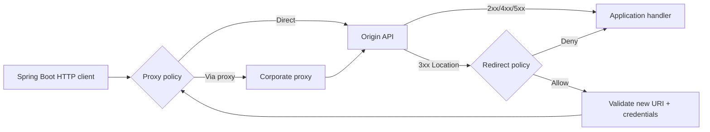
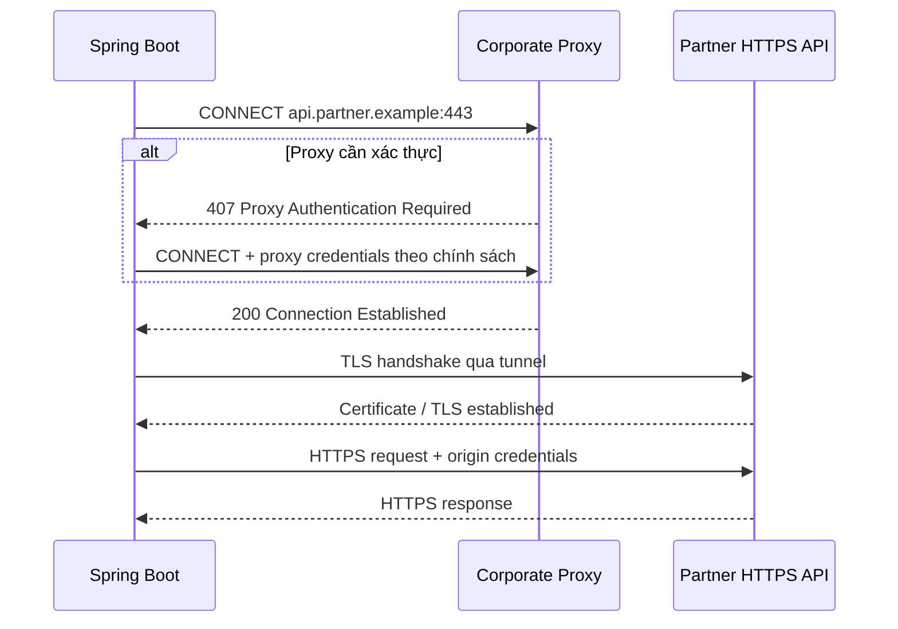
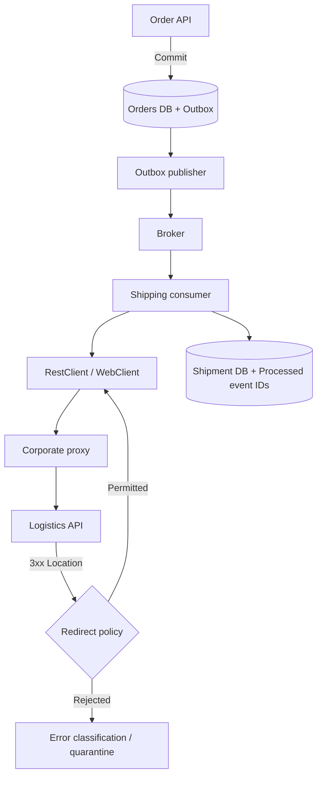

# Proxy, chuyển hướng và chính sách gửi thông tin xác thực

Một ứng dụng Spring Boot gọi HTTP ra ngoài thường không chỉ cần chọn `RestClient`, `WebClient` hay `RestTemplate`. Trong môi trường doanh nghiệp, request có thể phải đi qua **proxy**, gặp phản hồi **3xx redirect**, mang **Bearer token, Basic credentials, cookie, API key hoặc chứng chỉ client**. Nếu cấu hình mặc định không phù hợp, client có thể gửi nhầm bí mật sang một host khác, đi vòng qua proxy bắt buộc, retry một thao tác đã thành công hoặc coi phản hồi chuyển hướng là kết quả nghiệp vụ.

Bài học thuộc chương **Lựa chọn HTTP client** của mô-đun `SPRING_BOOT_INTEGRATION`. Mục tiêu là thiết lập một chính sách rõ ràng cho đường đi HTTP, cách xử lý chuyển hướng và phạm vi được phép gửi thông tin xác thực. Ví dụ tập trung vào các luồng thực tế nối Spring Boot với HTTP API, cơ sở dữ liệu, cache và broker, nơi lỗi request có thể kéo theo xử lý trùng và mất nhất quán. Không có cấu hình proxy hay redirect chung nào phù hợp mọi hệ thống: phải xác định hợp đồng với từng đối tác và cơ chế thực sự của HTTP transport đang dùng.

## 1. Ba câu hỏi trước khi gửi một HTTP request

Mọi outbound HTTP client cần trả lời được:

1. **Request đi qua đâu?** Gửi trực tiếp hay qua HTTP proxy, SOCKS proxy hoặc egress gateway? Proxy có yêu cầu xác thực không? Có được phép bypass một số host không?
2. **Nếu nhận `Location` thì đi đâu?** Có cho phép tự theo redirect? Chỉ cùng origin hay sang một allowlist? Chấp nhận thay đổi method, body, scheme và số lần chuyển hướng như thế nào?
3. **Bí mật được gửi cho ai?** Origin server nhận `Authorization` hoặc cookie nào; proxy nhận `Proxy-Authorization` nào; bearer token có được gửi tiếp khi chuyển host/path hoặc giảm từ HTTPS xuống HTTP không?



Trong sơ đồ, vòng quay về chính sách proxy là có chủ đích: **một URL đích mới sau redirect phải được đánh giá lại**, kể cả cách định tuyến mạng và khả năng gửi thông tin xác thực. Nếu tự chuyển hướng mà bỏ bước đánh giá lại, request ban đầu hợp lệ có thể trở thành request ra Internet không được phép hoặc đến địa chỉ nội bộ.

### 1.1. Phân biệt origin và proxy

**Origin** của URL được xác định bởi bộ ba `scheme + host + port`, ví dụ:

```text
https://api.partner.example:443/v1/orders/42
        |____________________|
         HTTPS origin (scheme, host, port)

https://api.partner.example/v2/orders       -> cùng origin (port HTTPS mặc định 443)
https://auth.partner.example/v1/token       -> khác origin (host)
http://api.partner.example/v1/orders        -> khác origin (scheme)
https://api.partner.example:8443/v1/orders  -> khác origin (port)
```

**Proxy** là trung gian được client chọn để kết nối đến origin. Với HTTP qua forward proxy, request có thể đi qua proxy bằng absolute-form URL. Với HTTPS, client thường dùng phương thức `CONNECT` để mở tunnel qua HTTP proxy, sau đó thiết lập TLS với origin qua tunnel đó. Nếu proxy của tổ chức chủ động giải mã TLS để kiểm tra lưu lượng, kiến trúc, chuỗi chứng chỉ và chính sách tin cậy sẽ khác.

Hai loại xác thực không được trộn:

| Đối tượng | Header/challenge thường gặp | Mục đích |
| --- | --- | --- |
| Origin API | `Authorization`, `WWW-Authenticate`, HTTP `401` | Chứng minh quyền gọi dịch vụ đích |
| HTTP proxy | `Proxy-Authorization`, `Proxy-Authenticate`, HTTP `407` | Chứng minh quyền sử dụng proxy |
| Cookie-based origin | `Cookie`, `Set-Cookie` | Duy trì phiên tại phạm vi cookie cụ thể |
| Mutual TLS | Chứng chỉ client trong TLS handshake | Xác thực ở lớp kết nối; tùy bên kết thúc TLS |

`407 Proxy Authentication Required` không đồng nghĩa với `401 Unauthorized` của API đối tác. Nếu server trả `401`, không nên tự động cấp lại credential của proxy; nếu proxy trả `407`, không nên thử gửi Bearer token của origin như credential của proxy.

## 2. Proxy: đường đi, kiểu kết nối và chính sách bypass

### 2.1. Những cách cấu hình thường gặp

| Cơ chế | Trường hợp sử dụng | Lưu ý |
| --- | --- | --- |
| HTTP forward proxy | Outbound HTTP/HTTPS đi qua proxy doanh nghiệp | Có thể cần `CONNECT` và xác thực `407` |
| SOCKS proxy | Cần chuyển kết nối TCP qua trung gian theo chính sách mạng | Hỗ trợ SOCKS phụ thuộc transport và client library |
| Egress gateway/service mesh | Kiểm soát lưu lượng ở hạ tầng, không nhất thiết ở code Java | Vẫn phải áp dụng redirect và credential policy ở ứng dụng |
| Direct connection | Gọi hệ thống nội bộ được cho phép | Không được tự bypass một proxy bắt buộc |
| `NO_PROXY`/non-proxy hosts | Một số host đi trực tiếp theo cấu hình | Không phải thư viện HTTP nào cũng đọc cùng biến môi trường/cú pháp |

Cấu hình proxy ở lớp JVM như `http.proxyHost`, `https.proxyHost` hoặc `http.nonProxyHosts` có thể tác động rộng đến ứng dụng, nhưng **không bảo đảm mọi transport đều tự áp dụng**. Apache HttpClient, Reactor Netty, JDK `HttpClient` và các adapter có cơ chế lựa chọn proxy khác nhau. Phải kiểm tra transport thực tế, nhất là khi thay thư viện bằng cách đổi request factory hoặc connector.

Một hợp đồng egress nên xác định rõ:

- URL/host/port nào bắt buộc qua proxy và host nào được phép trực tiếp.
- Cách nhận cấu hình theo môi trường, các giá trị secret và thời điểm rotation.
- Cách xử lý khi proxy không sẵn sàng: lỗi có kiểm soát hay có tuyến dự phòng được phê duyệt.
- Chính sách truy cập DNS, địa chỉ nội bộ, địa chỉ link-local và metadata endpoint của cloud.
- Mức cần thiết của TLS inspection; danh sách CA/tin cậy và logging khi truy cập qua proxy.

Không nên “thử proxy lỗi thì gửi trực tiếp” nếu chính sách yêu cầu mọi outbound đi qua proxy. Đây là một thay đổi đường đi bảo mật, không chỉ là fallback cải thiện độ sẵn sàng.

### 2.2. HTTPS qua HTTP proxy và TLS

Với kết nối `https://api.partner.example` thông qua proxy:



Sơ đồ là trường hợp **tunnel không bị giải mã**. Proxy biết địa chỉ đích của tunnel nhưng thường không nhìn thấy payload HTTPS đã mã hóa. Nếu doanh nghiệp áp dụng TLS interception, client có thể thấy chứng chỉ được ký bởi CA nội bộ; khi được chính sách cho phép, hãy thêm CA hợp lệ vào truststore phù hợp. **Không tắt kiểm tra hostname hoặc chứng chỉ** bằng “trust all” để vượt lỗi TLS: thao tác đó xóa bảo vệ trước kẻ đứng giữa.

Nếu API dùng mTLS, hãy xác định chính xác TLS handshake nào yêu cầu chứng chỉ client. Xác thực mTLS với origin không đồng nghĩa proxy tự nhận được quyền truy cập; proxy vẫn có thể yêu cầu chứng thực riêng.

### 2.3. Cấu hình proxy có giới hạn phạm vi

Trong ứng dụng tích hợp nhiều đối tác, thường nên tạo **HTTP client riêng cho mỗi integration** thay vì đặt credential proxy và token API thành default toàn cục. Ví dụ:

```text
Partner A: https://api.a.example -> corp-proxy-A:3128 -> Bearer token A
Partner B: https://api.b.example -> direct qua egress gateway -> mTLS B
Internal:  https://internal.example -> approved network path -> service identity
```

Các địa chỉ trên chỉ mang tính minh họa. Một client riêng cho từng đối tác giúp giới hạn connection pool, truststore, timeout, proxy, redirect và credential. Dùng chung một cấu hình chỉ hợp lý khi các đích có cùng ranh giới bảo mật và hợp đồng vận hành.

## 3. Chọn HTTP client theo khả năng kiểm soát

Spring Boot cung cấp nhiều cách gọi HTTP. **`RestClient`/`RestTemplate`/`WebClient` là API ở lớp Spring**, còn phần thực hiện kết nối là request factory hoặc client connector, có thể dùng JDK HttpClient, Apache HttpClient, Reactor Netty và các cơ chế khác. Quy tắc proxy và redirect phụ thuộc cả API Spring lẫn transport bên dưới.

| Lựa chọn | Kiểu lập trình | Nơi cấu hình proxy/redirect | Lưu ý |
| --- | --- | --- | --- |
| `RestClient` | Đồng bộ, fluent | `ClientHttpRequestFactory`, ví dụ `JdkClientHttpRequestFactory` hoặc Apache factory | Phù hợp gọi API đồng bộ; kiểm tra transport được chọn |
| `RestTemplate` | Đồng bộ, API lâu đời | `ClientHttpRequestFactory` | Thường duy trì hệ thống cũ; cùng yêu cầu kiểm soát credential và redirect |
| `WebClient` | Reactive/non-blocking khi dùng connector phù hợp | `ClientHttpConnector`, thường Reactor Netty | Cần cấu hình pool, timeout, TLS, proxy và async error path |
| JDK `java.net.http.HttpClient` | API Java trực tiếp | `HttpClient.Builder` với `ProxySelector`, `followRedirects`, `Authenticator` | Thích hợp nếu muốn điều khiển trực tiếp JDK transport |
| Apache HttpClient 5 | Blocking hoặc async client tùy module | Route planner, proxy, redirect strategy, credentials provider | Có thể hữu ích với routing/connection policy phức tạp |

Ví dụ `RestClient` là một API đồng bộ có trong Spring Framework 6.1 trở lên; với phiên bản Spring Boot khác cần xác định dependency tương thích. Đừng giả định chỉ vì đổi từ `RestTemplate` sang `RestClient` thì proxy, redirect và authentication được giữ nguyên: nếu request factory mới khác, hành vi mạng có thể đổi.

**Tiêu chí chọn:** ưu tiên khả năng kiểm soát policy ở lớp transport, khả năng cô lập client theo đối tác, mức phù hợp với mô hình đồng bộ/reactive, cơ chế timeout/retry và kiểm thử được cả chuyển hướng lẫn credential leakage.

## 4. Redirect HTTP: 301/302/303/307/308 không giống nhau

Một response `3xx` có thể chứa `Location` chỉ dẫn URL mới. Tự động theo redirect có thể làm phát sinh thêm HTTP request mà mã nghiệp vụ không nhìn thấy, đặc biệt nếu client library tự xử lý phía dưới.

| Status | Ý nghĩa chung | Phương thức/body khi theo redirect |
| --- | --- | --- |
| `301 Moved Permanently` | Tài nguyên có địa chỉ mới lâu dài | Client có lịch sử tương thích thay POST thành GET; không nên dựa vào hành vi thống nhất giữa các thư viện |
| `302 Found` | Chuyển hướng tạm thời | Với POST, một số user agent đổi thành GET theo hành vi tương thích |
| `303 See Other` | Lấy kết quả ở URL khác | Thường theo bằng GET (trừ HEAD), không gửi lại body POST |
| `307 Temporary Redirect` | Chuyển hướng tạm thời, giữ phương thức | Không được tự ý đổi method; body có thể bị gửi lại |
| `308 Permanent Redirect` | Chuyển hướng lâu dài, giữ phương thức | Không được tự ý đổi method; body có thể bị gửi lại |

Không phải mọi mã trong nhóm `3xx` đều phải được theo như `Location` redirect: `304 Not Modified` phục vụ cache validation, còn các mã khác có nghĩa và tiền điều kiện riêng. HTTP client nên có chính sách rõ đối với các status nó thực sự hỗ trợ.

### 4.1. Lỗi nghiêm trọng khi redirect một POST có side effect

Giả sử Spring Boot gửi:

```http
POST /v1/payments HTTP/1.1
Host: payments.partner.example
Authorization: Bearer <access-token>
Idempotency-Key: payment-request-42
Content-Type: application/json

{"orderId":"o-42","amount":350000}
```

Partner trả `307` đến URL khác. Nếu client tự theo và gửi nguyên body lần hai, ứng dụng vừa thực hiện **một request HTTP mới**. Nếu URL đầu đã xử lý trước khi redirect hoặc nếu client retry sau timeout, có khả năng tạo side effect trùng. Đối với POST thanh toán, chỉ theo redirect khi hợp đồng API và idempotency key bảo đảm retry an toàn; thường nên từ chối redirect tự động, đối soát trạng thái và cấu hình endpoint chính xác.

### 4.2. Redirect tương đối, tuyệt đối và vòng lặp

`Location` có thể là:

```http
Location: /v2/orders/42
Location: https://api.partner.example/v2/orders/42
Location: https://another.example/v2/orders/42
```

Client phải resolve redirect tương đối dựa trên **URL đã trả response**, không ghép chuỗi tùy ý. Một chuỗi `/old → /new → /old` có thể gây loop; cần giới hạn hop và deadline tổng. Thư viện có thể áp dụng mặc định khác nhau cho tối đa số lần follow, chuyển method, auth headers và xử lý downgrade. Chính sách ứng dụng phải quyết định rõ những việc này trước khi cho phép auto-follow.

## 5. Chính sách gửi bí mật khi chuyển hướng

Backend HTTP client không bị ràng buộc bởi cơ chế same-origin của browser theo cách mà JavaScript chạy trong trang web bị ràng buộc. Vì vậy **ứng dụng phải tự kiểm soát phạm vi credential**; không giả định mọi HTTP library đều tự xóa mọi header nhạy cảm ở mọi tình huống.

| Thành phần | Nơi được gửi | Rủi ro khi redirect |
| --- | --- | --- |
| `Authorization: Bearer ...` | API issuer/audience/scope tương ứng | Token bị gửi đến host khác hoặc endpoint không được phép |
| `Authorization: Basic ...` | Dịch vụ/realm được phép, qua TLS | Username/password có thể lộ nếu gửi sai authority |
| `Cookie` | Domain/path/secure scope của cookie | Tự gắn header `Cookie` có thể bỏ qua quy tắc cookie jar |
| `X-API-Key` hoặc key trong header riêng | API đã được cấp key | Library có thể không coi đây là header nhạy cảm để tự strip |
| `Proxy-Authorization` | Đúng proxy ở lớp kết nối | Credential proxy không thuộc về origin và không được gửi trong application header đến origin |
| Client certificate | Endpoint TLS đã được xác định và tin cậy | Chứng chỉ/key có thể được chọn sai khi đổi đích/connector |

Ngoài `Authorization`, cần xem các header chứa danh tính hoặc metadata nhạy cảm như `X-Auth-Token`, `X-User-Context`, `X-Forwarded-Authorization`, tenant claims hoặc session key. Kể cả khi thư viện tự bỏ `Authorization` trên cross-host redirect, header ứng dụng tự đặt **có thể vẫn được chuyển tiếp**.

### 5.1. Chính sách tối thiểu để tránh lộ credentials

1. **Mặc định tắt tự động follow redirect** cho outbound integration có token/API key nhạy cảm; chỉ bật khi đã đánh giá contract.
2. Nếu nhận `3xx`, đọc `Location`, resolve URI, kiểm tra scheme, host, port, path và destination allowlist.
3. **Từ chối HTTPS → HTTP** đối với request mang bí mật hoặc dữ liệu nhạy cảm; chỉ sử dụng TLS hợp lệ.
4. Từ chối chuyển sang origin khác trừ khi có danh sách đích được phép, cơ chế auth riêng và hợp đồng rõ ràng.
5. Khi tạo request đến URL mới, **không sao chép nguyên header map** của request cũ. Xác định từng credential có được phép gắn lại hay không.
6. Giới hạn số redirect, tổng thời gian và phương thức; ghi lại sự kiện redirect ở log đã che thông tin nhạy cảm.

**Cùng origin cũng không luôn đủ.** Một token được cấp cho `/api/payments` không nhất thiết phù hợp endpoint `/public/callback` của cùng host. Khi đối tác chia sẻ hostname giữa nhiều ứng dụng, hãy kiểm tra thêm path/purpose và audience của token. Ngược lại, một lần chuyển từ `api.partner.example` sang `api2.partner.example` có thể hợp lệ về nghiệp vụ nhưng vẫn cần rule riêng; không tự gửi lại token chỉ vì cùng domain cấp hai.

### 5.2. Bảo vệ trước SSRF và redirect đến mạng nội bộ

Nếu URL gốc hoặc `Location` có thể bị điều khiển bởi hệ thống không tin cậy, redirect có thể biến outbound integration thành **server-side request forgery (SSRF)**. Các đích phải đặc biệt hạn chế gồm loopback, private network, link-local address, metadata service trong cloud, service quản trị và endpoint nội bộ nhạy cảm.

Đừng chỉ kiểm tra chuỗi `startsWith("https://api.partner.example")`: URL như `https://api.partner.example.attacker.test` cũng khớp prefix. Hãy parse URI và kiểm tra hostname, scheme, port và đường đi theo hợp đồng. Với đích động, cần đối phó DNS rebinding, redirect lặp, IPv4/IPv6, địa chỉ đã resolve và route egress; allowlist host ở tầng ứng dụng nên kết hợp với firewall/egress gateway.

## 6. Thiết kế policy cho từng integration

Một policy tốt có thể được mô tả trước khi viết code:

| Thành phần | Ví dụ policy cho API đơn hàng |
| --- | --- |
| Base URL | `https://api.partner.example` |
| Proxy route | Bắt buộc qua `proxy.corp.internal:3128` |
| TLS | Xác minh certificate/hostname, chỉ tin CA được cấp phép |
| Credentials của proxy | Lấy từ secret manager, giới hạn cho proxy cụ thể |
| Origin credentials | OAuth2 client credentials, audience dành riêng cho partner |
| Redirect tự động | Tắt |
| Redirect thủ công | Chỉ GET/HEAD, tối đa hai lần, HTTPS, đúng origin và path được cho phép |
| Cross-origin redirect | Từ chối mặc định, muốn cho phép phải cấu hình chính sách và token riêng |
| POST có side effect | Không tự follow hoặc retry khi chưa có idempotency contract |
| Timeout | Connect, response và tổng deadline theo SLA của API |
| Retry | Theo method/idempotency, giới hạn backoff và số lần |
| Logging | Host đích, status, hop, request/correlation ID; che token, cookie và query nhạy cảm |

Đây là **bộ giá trị minh họa**, không phải cấu hình mặc định. API có thể sử dụng redirect hợp lệ khi đổi endpoint nhưng phải định nghĩa rõ authorization và phương thức; các hệ thống khác có thể cấm redirect hoàn toàn.

## 7. Cấu hình RestClient với proxy và redirect policy tường minh

Với Spring Framework 6.1+ và Spring Boot tương ứng, `RestClient` có thể sử dụng JDK `HttpClient` thông qua `JdkClientHttpRequestFactory`. Cách này giúp định nghĩa rõ proxy, kết nối và redirect ngay ở transport:

```java
@Configuration(proxyBeanMethods = false)
public class PartnerRestClientConfiguration {

    @Bean("partnerRestClient")
    RestClient partnerRestClient(RestClient.Builder builder) {
        HttpClient transport = HttpClient.newBuilder()
                .connectTimeout(Duration.ofSeconds(3))
                .proxy(ProxySelector.of(
                        new InetSocketAddress("proxy.corp.internal", 3128)))
                .followRedirects(HttpClient.Redirect.NEVER)
                .build();

        return builder
                .requestFactory(new JdkClientHttpRequestFactory(transport))
                .baseUrl("https://api.partner.example")
                .build();
    }
}
```

Những import chính: `java.net.http.HttpClient`, `java.net.ProxySelector`, `java.net.InetSocketAddress`, `java.time.Duration`, `org.springframework.http.client.JdkClientHttpRequestFactory`, `org.springframework.web.client.RestClient` cùng các annotation cấu hình Spring. Đoạn code áp dụng khi HTTP transport và Spring Framework phiên bản đang chạy hỗ trợ request factory này. Proxy được giả định sẵn sàng; ví dụ chưa gắn credential proxy hoặc cấu hình truststore.

Điểm chính:

- `followRedirects(HttpClient.Redirect.NEVER)` ngăn transport tự gửi request thứ hai sang `Location`.
- `ProxySelector.of(...)` chọn proxy HTTP cho client mẫu. Nếu có host phải bypass, cần một `ProxySelector`/route policy có quy tắc rõ ràng; không tự động bỏ proxy khi lỗi.
- `connectTimeout` chỉ giới hạn một phần quá trình kết nối. Timeout đọc response, timeout của từng request và deadline toàn flow phải cấu hình riêng theo khả năng của transport và API đang dùng.
- `RestClient.Builder` có thể được Spring Boot tự cấu hình. Nếu dùng chung builder cho nhiều client, cần tránh ghi đè các policy không mong muốn và đảm bảo từng bean dùng transport đúng.

### 7.1. Chỉ cấp Bearer token cho request thuộc phạm vi đối tác

```java
@Service
public class PartnerOrderClient {
    private final RestClient client;
    private final PartnerAccessTokenProvider tokens;

    public PartnerOrderClient(
            @Qualifier("partnerRestClient") RestClient client,
            PartnerAccessTokenProvider tokens) {
        this.client = client;
        this.tokens = tokens;
    }

    public String getOrder(String orderId) {
        ResponseEntity<String> response = client.get()
                .uri("/v1/orders/{id}", orderId)
                .headers(headers ->
                        headers.setBearerAuth(tokens.currentAccessToken()))
                .retrieve()
                .toEntity(String.class);

        if (response.getStatusCode().is3xxRedirection()) {
            throw new IllegalStateException(
                    "Partner redirect requires explicit approval");
        }
        return response.getBody();
    }
}
```

`PartnerAccessTokenProvider` là service do ứng dụng triển khai để lấy token đúng audience/scope, quản lý refresh và rotation. Khi `RestClient.retrieve()` gặp 4xx/5xx, mặc định xử lý theo error status behavior của Spring (thường ném exception), còn 3xx không nên tự được xem là phản hồi nghiệp vụ hoàn chỉnh. Đoạn này giả định response 2xx có body dạng `String`; ứng dụng thực tế nên deserialize DTO và validation tương ứng.

Đặc biệt, phương thức gọi này chỉ truy cập **base URL cố định** và đường dẫn tương đối do code kiểm soát. Nếu người gọi truyền một URI tuyệt đối từ request HTTP hoặc database vào `.uri(...)`, họ có thể vượt phạm vi host mong đợi; cần parse và kiểm tra URI trước khi gắn token. Đừng xây dựng RestClient với default `Authorization` rồi tái sử dụng cho những URL hoàn toàn khác nhau.

### 7.2. Nếu proxy cần xác thực

JDK `HttpClient` có thể nhận một `Authenticator`. Cần giới hạn logic cung cấp secret cho **proxy được phép**, không mù quáng trả proxy password cho mọi challenge:

```java
Authenticator proxyAuthenticator = new Authenticator() {
    @Override
    protected PasswordAuthentication getPasswordAuthentication() {
        if (getRequestorType() != RequestorType.PROXY) {
            return null;
        }
        if (!"proxy.corp.internal".equalsIgnoreCase(getRequestingHost())
                || getRequestingPort() != 3128) {
            return null;
        }
        return new PasswordAuthentication(
                proxyUser,
                proxyPassword.toCharArray());
    }
};

HttpClient transport = HttpClient.newBuilder()
        .proxy(ProxySelector.of(
                new InetSocketAddress("proxy.corp.internal", 3128)))
        .authenticator(proxyAuthenticator)
        .followRedirects(HttpClient.Redirect.NEVER)
        .build();
```

Đoạn này là một **biến thể** của phần xây dựng transport ở trên. `proxyUser` và `proxyPassword` là các giá trị được cấp an toàn qua cấu hình runtime/secret manager, không phải hằng số nằm trong source. Cần import `java.net.Authenticator` và `java.net.PasswordAuthentication`. Transport hoặc proxy có thể có giới hạn riêng đối với scheme xác thực, đặc biệt Basic qua `CONNECT`; hãy kiểm chứng trong môi trường thật và với phiên bản JDK đang dùng. Không sửa các cờ JVM nới lỏng xác thực hoặc TLS khi chưa đánh giá tác động bảo mật.

Với mTLS hoặc proxy sử dụng cơ chế doanh nghiệp khác, cấu hình `Authenticator` đơn giản có thể chưa đủ: cần xem sơ đồ xác thực thực tế của proxy và endpoint.

## 8. Xử lý redirect thủ công bằng JDK HttpClient

Với các endpoint mang Bearer token, hướng an toàn nhất để bắt đầu là **tự kiểm tra mỗi bước redirect** và chỉ gửi token sau khi URL đích đã qua kiểm tra. Ví dụ sau cho phép tối đa hai lần redirect cho GET trong cùng origin và path `/v1/orders/`. Nó từ chối mọi scheme không phải HTTPS, mọi host/port ngoài allowlist và redirect thiếu `Location`.

```java
public final class StrictPartnerRedirectClient {
    private static final int MAX_REDIRECTS = 2;
    private final HttpClient transport;

    public StrictPartnerRedirectClient(HttpClient transport) {
        this.transport = transport; // Phải cấu hình Redirect.NEVER.
    }

    public String getOrder(URI initialUri, String bearerToken)
            throws IOException, InterruptedException {
        URI current = validateTarget(initialUri);
        Set<URI> visited = new HashSet<>();

        for (int hop = 0; hop <= MAX_REDIRECTS; hop++) {
            if (!visited.add(current)) {
                throw new IOException("Redirect loop");
            }

            HttpRequest request = HttpRequest.newBuilder(current)
                    .timeout(Duration.ofSeconds(8))
                    .header("Accept", "application/json")
                    // Mỗi hop đều đã được validate cùng origin/path.
                    .header("Authorization", "Bearer " + bearerToken)
                    .GET()
                    .build();

            HttpResponse<String> response = transport.send(
                    request, HttpResponse.BodyHandlers.ofString());
            int status = response.statusCode();

            if (isRedirect(status)) {
                if (hop == MAX_REDIRECTS) {
                    throw new IOException("Too many redirects");
                }
                String location = response.headers()
                        .firstValue("Location")
                        .orElseThrow(() -> new IOException(
                                "Redirect without Location"));
                current = validateTarget(
                        current.resolve(URI.create(location)).normalize());
                continue;
            }

            if (status >= 300) {
                throw new IOException(
                        "Partner returned unexpected HTTP status " + status);
            }
            return response.body();
        }
        throw new IOException("Redirect policy exhausted");
    }

    private static boolean isRedirect(int status) {
        return status == 301 || status == 302 || status == 303
                || status == 307 || status == 308;
    }

    private static URI validateTarget(URI uri) {
        boolean valid =
                "https".equalsIgnoreCase(uri.getScheme())
                && "api.partner.example".equalsIgnoreCase(uri.getHost())
                && (uri.getPort() == -1 || uri.getPort() == 443)
                && uri.getRawUserInfo() == null
                && uri.getPath() != null
                && uri.getPath().startsWith("/v1/orders/");
        if (!valid) {
            throw new SecurityException(
                    "Redirect target violates partner policy");
        }
        return uri;
    }
}
```

Các import bổ sung: `java.io.IOException`, `java.net.URI`, `java.net.http.HttpRequest`, `java.net.http.HttpResponse`, `java.util.Set` và `java.util.HashSet`. Truyền vào một `HttpClient` đã cấu hình `Redirect.NEVER` và proxy đúng chính sách như phần trước. Đây là ví dụ có chủ đích **chỉ dành cho GET**; không tự áp dụng cách làm này cho POST, PUT hoặc request có body vì semantics của 303/307/308 và idempotency khác nhau.

Việc gắn lại Bearer token ở mọi hop trong ví dụ **chỉ hợp lý vì tất cả URI, kể cả URI ban đầu, đều được kiểm tra đúng origin và path được phép**. Nếu policy cho phép cross-origin redirect, phải tạo request mới với credential đúng đối tượng; mặc định không mang token, Basic credential, cookie hay API key của host cũ sang host mới.

Đây là minh họa kiểm tra URL ở lớp ứng dụng, chưa đủ làm bộ lọc SSRF tổng quát cho đích động. Production có thể cần canonicalization bổ sung, không cho phép userinfo/fragment bất thường, giới hạn URI, xác minh DNS/IP, cấm redirect tới địa chỉ nội bộ và chặn egress ở mạng. Với response rất lớn, cũng cần giới hạn dung lượng body, total deadline và connection pool; `BodyHandlers.ofString()` trong ví dụ tải toàn body vào bộ nhớ.

### 8.1. JDK Redirect.NEVER, NORMAL và ALWAYS

JDK `HttpClient.Redirect` cung cấp ba lựa chọn:

- `NEVER`: không tự đi theo redirect.
- `NORMAL`: cho phép redirect nhưng không chuyển từ URL HTTPS sang HTTP.
- `ALWAYS`: theo redirect kể cả các trường hợp mà `NORMAL` loại trừ.

Các chế độ này chỉ trả lời **có theo redirect hay không**, không biểu diễn đầy đủ chính sách credential theo audience, path hoặc khả năng SSRF. Với request mang thông tin xác thực, `NORMAL` **không đủ** thay cho một allowlist và kiểm soát header. Đồng thời, thư viện, phiên bản và loại auth có thể có cách xử lý khác nhau khi redirect, nên phải viết integration test xác nhận dữ liệu thực sự được gửi đến đâu.

## 9. WebClient và Reactor Netty: policy nằm ở connector

Với mô hình reactive, có thể cấu hình Reactor Netty `HttpClient` rồi đưa vào `WebClient` bằng `ReactorClientHttpConnector`:

```java
@Configuration(proxyBeanMethods = false)
public class PartnerWebClientConfiguration {

    @Bean("partnerWebClient")
    WebClient partnerWebClient() {
        HttpClient transport = HttpClient.create()
                .proxy(spec -> spec
                        .type(ProxyProvider.Proxy.HTTP)
                        .host("proxy.corp.internal")
                        .port(3128))
                .followRedirect(false)
                .responseTimeout(Duration.ofSeconds(8));

        return WebClient.builder()
                .baseUrl("https://api.partner.example")
                .clientConnector(
                        new ReactorClientHttpConnector(transport))
                .build();
    }
}
```

Import cần thiết: `reactor.netty.http.client.HttpClient`, `reactor.netty.transport.ProxyProvider`, `org.springframework.http.client.reactive.ReactorClientHttpConnector`, `org.springframework.web.reactive.function.client.WebClient` và `java.time.Duration`. Đoạn mã giả định dự án có Spring WebFlux và Reactor Netty phiên bản phù hợp. Nếu chạy WebClient với connector khác, cấu hình proxy/redirect ở Netty **không tác động** lên connector đó.

Xử lý rõ response 3xx khi dùng `exchangeToMono`:

```java
public Mono<PartnerOrder> loadOrder(String id, String token) {
    return partnerWebClient.get()
            .uri("/v1/orders/{id}", id)
            .headers(h -> h.setBearerAuth(token))
            .exchangeToMono(response -> {
                if (response.statusCode().is3xxRedirection()) {
                    return Mono.error(new IllegalStateException(
                            "Redirect not permitted"));
                }
                if (response.statusCode().isError()) {
                    return response.createException()
                            .flatMap(ex -> Mono.error(ex));
                }
                return response.bodyToMono(PartnerOrder.class);
            });
}
```

`PartnerOrder` là DTO ứng dụng; `partnerWebClient` là bean đã inject, `Mono` thuộc Reactor. Đoạn code cũng cần quy tắc xử lý response 204 hoặc body rỗng nếu hợp đồng API cho phép. Một số codebase chọn `retrieve()` thay vì `exchangeToMono()`; khi cần phân biệt cụ thể 3xx và kiểm tra `Location`, việc truy cập `ClientResponse` trực tiếp có thể rõ ràng hơn.

Trong reactive flow, tránh gọi `block()` trên event-loop thread và tránh thao tác blocking (JDBC, file I/O chậm) trong chain không có scheduler hoặc adapter thích hợp. Proxy/redirect có thể phát sinh thêm round trip; cấu hình timeout tổng của flow, backpressure và khả năng hủy subscription phải phù hợp với service đang gọi.

Nếu bật cơ chế tự follow redirect của Reactor Netty hoặc Apache HttpClient, hãy kiểm tra chính xác cách thư viện giữ/bỏ sensitive headers khi đổi domain và cách callback tùy biến hoạt động. Không phụ thuộc vào hành vi “thường thì thư viện sẽ xóa `Authorization`” khi chính sách nghiệp vụ yêu cầu cấm hoàn toàn việc gửi token sang origin khác.

## 10. Xác thực origin: token, Basic, cookie và mTLS

### 10.1. Bearer/OAuth2 access token

Một access token phải được cấp theo **issuer, audience, scope và lifetime** phù hợp với API đích. Khi Spring Boot dùng OAuth2 client credentials để gọi một partner API, token provider nên lấy token từ cấu hình hoặc cơ chế quản lý client riêng của integration. Đừng truyền access token của người dùng cuối qua mọi downstream theo mặc định; cần quy tắc ủy quyền/token exchange tương ứng.

Một policy thực tế:

- Lấy token ở nơi lưu và refresh được kiểm soát, không hardcode trong source.
- Chỉ gắn token sau khi xác minh URI đích; không gắn token trong interceptor toàn cục nếu client có thể gửi tới nhiều host.
- Xử lý `401` bằng cách xác định token đã hết hạn hay bị từ chối. Nếu hợp đồng cho phép, refresh và retry **có giới hạn** trên cùng đích được phép.
- Xử lý `403` như lỗi quyền/policy; không retry mù quáng bằng cùng token.
- Không log token, không đưa token vào query string và không chuyển token sang header của proxy.

Nếu client gửi một POST đã có thể tạo side effect rồi gặp `401`/timeout trong quy trình refresh, phải xem xét chính xác thời điểm phía server xử lý và cơ chế idempotency. Một retry tự động chỉ an toàn khi hợp đồng chỉ rõ request trước chưa được áp dụng hoặc server có idempotency key.

### 10.2. HTTP Basic và API key

`headers.setBasicAuth(username, password)` hoặc `headers.setBearerAuth(token)` của Spring là cách xây dựng header ở request hiện tại. Chúng **không tự giới hạn phạm vi URL có thể nhận header**. Nếu REST client cho phép truyền URI tuyệt đối hoặc auto redirect đến host mới, chính sách của ứng dụng vẫn phải chặn chuyển tiếp không mong muốn.

API key đặt trong `X-API-Key` hoặc header tùy biến thường không được mọi HTTP library nhận diện là credential đặc biệt. Phải chủ động xóa/thay header khi đổi origin. Tránh ghi API key vào query vì URL có thể xuất hiện trong log proxy, hệ thống giám sát, lịch sử cache hoặc công cụ truy vết.

### 10.3. Cookie và session

Nếu gọi API dùng cookie, cần xác định:

- Ai quản lý cookie jar, domain, path, `Secure`, thời hạn và cookie được phép gửi.
- Có gửi cookie của một tenant/user sang request của tenant/user khác qua connection/client dùng chung không.
- Khi redirect khác host hoặc path, cookie jar có đúng rule theo chuẩn cookie và chính sách ứng dụng không.
- Có header `Cookie` được code gắn thủ công, từ đó bỏ qua cơ chế quản lý cookie hay không.

Một backend client không tự nhận mọi biện pháp bảo vệ của browser, như same-origin policy hoặc chính sách CORS. Khi thay cookie jar bằng header thủ công, ứng dụng chịu trách nhiệm đặc biệt lớn trong việc giới hạn nơi gửi.

### 10.4. mTLS và truststore

mTLS xác thực bằng chứng chỉ ở TLS handshake. Certificate, private key, truststore và TLS context có vòng đời và phạm vi truy cập riêng. Khi một client được cấu hình nhiều identity, không để nó tự dùng nhầm chứng chỉ của partner A cho partner B.

Với proxy HTTPS có TLS inspection, cần hiểu cert nào do proxy cung cấp và cert nào do origin cung cấp. Nếu hệ thống yêu cầu end-to-end mTLS với origin, một proxy giải mã TLS có thể không đáp ứng hợp đồng. Không chữa lỗi chứng chỉ bằng `trustAll`, `insecure()` hay tắt hostname verification; hãy sửa trust chain, SNI, chứng chỉ hoặc kiến trúc proxy.

## 11. Timeout, retry, circuit breaker và phản hồi lỗi

Proxy và redirect làm thay đổi số bước kết nối. Một request có thể trải qua DNS, kết nối proxy, `CONNECT`, TLS handshake, gửi request, chờ phản hồi và nhiều lần đi theo `Location`. Vì vậy **connect timeout**, **response/read timeout**, **per-request deadline** và **tổng ngân sách xử lý** là những giới hạn khác nhau.

| Tín hiệu | Khả năng xảy ra | Hành động gợi ý |
| --- | --- | --- |
| `407` từ proxy | Proxy từ chối/muốn xác thực | Kiểm tra proxy credential và chính sách; không gửi origin token cho proxy |
| `401` từ API | Token sai/hết hạn, challenge từ origin | Refresh có giới hạn nếu hợp đồng cho phép, cùng origin đã xác thực |
| `403` | Không đủ quyền hoặc bị chặn chính sách | Dừng/điều tra scope, quyền; không retry vô hạn |
| `301/302/303/307/308` | Server đề nghị URL mới | Áp dụng redirect policy, kiểm tra method và credential |
| `408/429/503` | Timeout/rate limit/tạm không sẵn sàng | Có thể retry có backoff, tôn trọng `Retry-After` khi phù hợp |
| TLS/hostname verification failure | Certificate/identity không hợp lệ | Chặn request và sửa cấu hình/tin cậy; không tắt xác minh |
| Proxy không kết nối được | Network/proxy outage | Theo chính sách egress; không tự fallback direct |
| Timeout sau POST thanh toán | Server có thể đã xử lý | Đối soát bằng idempotency key thay vì retry mù quáng |

Đặc biệt, một response `3xx` không phải là tín hiệu thành công nghiệp vụ của một lệnh tạo đơn, thanh toán hoặc cập nhật trạng thái. Nếu client tự đi theo redirect và cuối cùng nhận `200`, hệ thống phải biết **request nào** đã thực hiện side effect, ở đâu và với phương thức gì.

### 11.1. Retry và idempotency

Các request `GET`/`HEAD` thường được thiết kế idempotent về mặt phương thức, nhưng vẫn phải kiểm tra hợp đồng API, tốc độ retry và side effect thứ cấp như ghi log/tăng thống kê. `PUT`/`DELETE` được định nghĩa là idempotent về semantics HTTP, nhưng hệ thống thực tế có thể có hành vi hoặc ràng buộc bổ sung. `POST` không mặc nhiên idempotent; cần idempotency key và chính sách retry đã thống nhất với đối tác.

Ví dụ:

```text
POST /payments  Idempotency-Key: pay-123
  -> timeout, trạng thái không rõ
  -> GET /payments/by-idempotency-key/pay-123
  -> nếu chưa xử lý và hợp đồng cho phép: retry POST cùng key/payload
  -> nếu đã xử lý: lấy kết quả hiện có
```

Không thay idempotency key mỗi lần retry; như vậy sẽ khiến đối tác coi đây là nhiều yêu cầu nghiệp vụ mới. Nếu một redirect 307/308 yêu cầu gửi lại body, phải áp dụng cùng quy tắc chống trùng và kiểm tra endpoint nhận.

### 11.2. Circuit breaker và giới hạn tải

Nếu proxy hoặc API đối tác gặp sự cố, retry hàng nghìn request đồng thời có thể làm tăng lỗi. Dùng timeout có giới hạn, exponential backoff với jitter, circuit breaker và bulkhead/connection pool limit khi phù hợp. Cần phân biệt lỗi routing/policy vĩnh viễn với lỗi hạ tầng tạm thời; circuit breaker không sửa được token bị cấp sai audience hoặc URL redirect bị cấm.

Trong luồng Spring Integration, một outbound HTTP gateway có thể chờ phản hồi và đưa lỗi vào error handling path; message broker consumer có thể redeliver. Nếu downstream POST đã thực hiện side effect nhưng HTTP response mất, cả HTTP client retry **và** broker retry có thể gửi cùng yêu cầu: cần idempotency end-to-end và kiểm soát số lần thử ở từng tầng.

## 12. Tích hợp Spring Boot: cấu hình tách biệt và thay đổi môi trường

Ứng dụng thường chạy ở local, staging và production với đường mạng khác nhau. Nên tách **dữ liệu cấu hình** và **quy tắc bảo mật**:

```yaml
# application.yml: ví dụ cấu hình ứng dụng, chưa phải Spring Boot built-in.
integration:
  partner-orders:
    base-url: https://api.partner.example
    connect-timeout: 3s
    response-timeout: 8s
    redirects:
      enabled: false
      max-hops: 2
    proxy:
      enabled: true
      host: proxy.corp.internal
      port: 3128
```

Các property dưới `integration.partner-orders` là **namespace tự định nghĩa**; Spring Boot không tự áp dụng chúng cho RestClient/WebClient. Ứng dụng cần một `@ConfigurationProperties` tương ứng và code xây client để bảo đảm mọi giá trị được sử dụng:

```java
@ConfigurationProperties(prefix = "integration.partner-orders")
public record PartnerOrdersProperties(
        URI baseUrl,
        Duration connectTimeout,
        Duration responseTimeout,
        RedirectPolicy redirects,
        ProxySettings proxy) {

    public record RedirectPolicy(boolean enabled, int maxHops) {}
    public record ProxySettings(
            boolean enabled, String host, int port) {}
}
```

Đây là ví dụ mô hình property; để Spring đăng ký record, cần bật `@ConfigurationPropertiesScan` hoặc `@EnableConfigurationProperties(PartnerOrdersProperties.class)` và cấu hình validation thích hợp. `base-url`, `connect-timeout`, `max-hops` được binder ánh xạ sang field camelCase. Nếu thay transport, code xây request factory/connector phải tiếp tục sử dụng các property theo đúng semantics.

Không lưu proxy password, bearer token hoặc private key dưới dạng plaintext trong repository. Dùng secret manager, workload identity, environment secret hoặc cơ chế cấp token được tổ chức phê duyệt; kiểm soát quyền đọc và rotation. Cẩn thận khi dùng `/actuator/env`, debug config dump hoặc exception message vì cấu hình có thể chứa bí mật.

### 12.1. Cấu hình “no proxy” phải được kiểm thử

Một số môi trường khai báo `HTTP_PROXY`, `HTTPS_PROXY`, `NO_PROXY`; môi trường khác dùng JVM system properties, file PAC hoặc egress routing ở hạ tầng. Từng transport có cách đọc và diễn giải khác nhau. Không nên viết chính sách production dựa trên giả định rằng một biến `NO_PROXY=.internal` sẽ hoạt động đồng nhất với JDK HttpClient, Apache HttpClient và Reactor Netty.

Để kiểm chứng:

1. Xác nhận instance outbound HTTP thực tế dùng transport nào sau khi Spring Boot auto-configuration hoàn tất.
2. Gửi request test đến host bắt buộc qua proxy và xem proxy có nhận request/CONNECT không.
3. Gửi request test đến host được phép direct và xác minh đường đi đúng.
4. Tạo redirect đến host khác tuyến và xác minh policy được áp dụng lại.
5. Mô phỏng proxy outage; client phải theo lựa chọn fail-closed/fallback đã định, không vô tình bypass.

### 12.2. Phân biệt outbound HTTP client và server-side gateway

`RestClient`/`WebClient` là **outbound HTTP client**. Spring Cloud Gateway chủ yếu là proxy/gateway tiếp nhận và định tuyến request ở phía server; Spring Integration HTTP outbound gateway là endpoint thực hiện HTTP request/reply trong messaging flow. Chúng giải quyết những lớp khác nhau và có bộ config khác nhau.

Nếu một API Spring Boot nhận URL đối tác từ người dùng và dùng WebClient gọi theo, việc thêm Spring Cloud Gateway phía trước ứng dụng **không tự bảo vệ** outbound client khỏi SSRF hoặc lộ token qua redirect. Phải kiểm soát đích gửi ở chính chỗ thực hiện outbound request và ở tầng egress.

## 13. Một tình huống xuyên HTTP, DB và broker

Giả sử đơn hàng được lưu trong PostgreSQL, phát sự kiện qua RabbitMQ/Kafka, rồi một consumer Spring Boot gửi yêu cầu tạo vận đơn đến dịch vụ logistics. Hệ thống logistics nằm sau proxy bắt buộc và đôi khi trả redirect khi thay phiên bản API.



Một chuỗi lỗi thực tế:

1. Shipping consumer đọc `OrderPaid(eventId=e-77)`, chuẩn bị gửi `POST /shipments` kèm `Idempotency-Key=shipment-order-77`.
2. HTTP client gửi request qua proxy; proxy xác thực thành công. Origin trả `307 Location: https://legacy-other.example/shipments`.
3. Nếu client tự follow và sao chép `Authorization` sang host mới, token của logistics có thể lộ. Nếu client gửi lại POST mà không có hợp đồng idempotency của URL mới, có thể tạo vận đơn trùng.
4. Chính sách an toàn từ chối redirect ngoài allowlist, ghi nhận lỗi có thể cấu hình lại, giữ message ở cơ chế xử lý lỗi phù hợp. Người vận hành kiểm tra thay đổi endpoint/contract với đối tác.
5. Sau khi xác minh API mới, service cấu hình đúng base URL/identity và replay **cùng event ID, idempotency key**. Transaction/unique constraint của dữ liệu vận đơn bảo vệ side effect khỏi việc redelivery của broker.

Trường hợp này minh họa vì sao proxy, redirect và auth policy phải được xem cùng idempotency, transaction và cơ chế khôi phục. Nếu consumer ack broker trước khi hoàn tất xử lý mà không lưu trạng thái công việc bền vững, lỗi redirect có thể khiến sự kiện bị mất. Nếu consumer retry vô hạn, proxy và API đối tác có thể bị quá tải.

Một thiết kế có thể lưu trạng thái vận đơn ở DB, phát yêu cầu qua outbox/worker, nhận kết quả, cập nhật trạng thái và chỉ đánh dấu nhiệm vụ đã xử lý theo hợp đồng. Ở mỗi ranh giới, cần biết side effect đã commit ở đâu, ID nào dùng để đối soát và lỗi nào cho phép retry.

## 14. Kiểm thử proxy, redirect và rò rỉ credential

Unit test kiểm tra hàm `validateTarget(...)` hữu ích nhưng chưa đủ. Cần kiểm thử **HTTP request thực được gửi đi** qua transport đã cấu hình, với mock server/proxy hoặc môi trường integration test được kiểm soát.

| Kịch bản | Kỳ vọng có thể kiểm chứng |
| --- | --- |
| GET HTTPS qua proxy được phép | Proxy nhận request/CONNECT, origin nhận request hợp lệ, certificate được xác minh |
| Proxy trả `407` | Client dùng đúng proxy credential hoặc báo lỗi; origin token không bị gửi làm proxy credential |
| Origin trả `401` | Client không dùng proxy secret để xác thực origin; token refresh chỉ theo policy |
| Origin trả `302` cùng origin, path hợp lệ | Chỉ follow nếu được bật; giữ đúng method và token scope |
| Origin trả `307` sang host ngoài allowlist | **Không** gửi request thứ hai và không rò `Authorization`/`X-API-Key` |
| Origin trả `301` từ HTTPS sang HTTP | Từ chối downgrade nếu request có dữ liệu/credential nhạy cảm |
| Redirect đến `127.0.0.1` hoặc cloud metadata endpoint | Bị chặn trước khi thiết lập outbound connection |
| Redirect loop `A → B → A` | Dừng có giới hạn hop/deadline, có metric |
| `Location` là URI tương đối | Resolve theo response URI, xác minh origin và path |
| URI có hostname giả dạng `api.partner.example.evil.test` | Hostname allowlist từ URI parser từ chối |
| Request có header `X-API-Key` và redirect cross-origin | Header không được chuyển tiếp |
| HTTP client nhận URL tuyệt đối từ input ngoài | Chỉ gửi đến target đã qua validate; không vượt base URL |
| Proxy mất kết nối | Thực thi fail-closed hoặc fallback được cấu hình, không bypass trái phép |
| Chứng chỉ TLS sai hostname/không được tin cậy | Handshake thất bại, không bật trust-all để qua test |
| POST có redirect `307/308` | Không tự replay body ngoài hợp đồng idempotency |
| Consumer retry sau timeout HTTP | Dùng cùng idempotency key, DB không tạo side effect trùng |

Có thể dùng WireMock, MockWebServer hoặc HTTP test server tương đương để tạo response `3xx`, `401`, `407` và ghi lại headers. Để kiểm thử `CONNECT`, proxy credentials hoặc TLS inspection thật, cần một proxy test hỗ trợ các giao thức tương ứng; mock origin HTTP đơn thuần không thể chứng minh cấu hình proxy đã hoạt động.

### 14.1. Ví dụ kiểm thử ranh giới redirect

Với class `StrictPartnerRedirectClient` phía trên:

```java
@Test
void refusesRedirectToDifferentOriginBeforeSendingToken() {
    URI current = URI.create(
            "https://api.partner.example/v1/orders/42");
    URI location = URI.create(
            "https://untrusted.example/collect");

    assertThatThrownBy(() -> validatePartnerRedirect(current, location))
            .isInstanceOf(SecurityException.class);
}
```

`validatePartnerRedirect` là helper/test seam dự kiến tách từ quy tắc `validateTarget(current.resolve(location))` trong phần ví dụ; snippet có tính minh họa, không phải method đã được định nghĩa trong JDK. Để kiểm chứng **bí mật chưa bị gửi**, cần thêm integration test có test server ở đích giả và xác nhận server ấy **không nhận request** hoặc **không nhận sensitive headers**. Kiểm tra exception thôi chưa chứng minh không có network hop.

### 14.2. Kiểm thử thay đổi library/version

Khi nâng phiên bản Spring Boot, Reactor Netty, Apache HttpClient hoặc JDK, cần chạy lại nhóm test:

- Default của redirect/follow và cách đổi method/body.
- Cách forwarding hoặc stripping headers khi đổi origin.
- Proxy selection và no-proxy matching.
- Proxy `CONNECT`/`407` và phương thức xác thực được hỗ trợ.
- TLS truststore, hostname verification, mTLS, connection reuse.
- Error mapping cho 3xx/4xx/5xx và deadline khi redirect nhiều lần.

Những hành vi ấy ở lớp transport có thể thay đổi ngoài phần code gọi `RestClient.get()` hoặc `WebClient.get()`. Một test chỉ mock `RestClient` có thể không nhận ra sự khác biệt.

## 15. Quan sát và vận hành

Khi phân tích lỗi outbound HTTP, không cần log toàn bộ request để có đủ dữ liệu. Nên ghi các trường đã được chuẩn hóa:

```text
integration=partner-orders
method=GET
target_origin=https://api.partner.example
proxy_route=corp-proxy
redirect_hops=1
final_status=200
duration_ms=142
correlation_id=...
policy_decision=redirect_allowed
```

Các giá trị này là mẫu log, không phải format bắt buộc. **Không log** Bearer token, Basic auth, `Proxy-Authorization`, cookie, API key, private key hoặc query chứa credential. Nếu URL có ID nhạy cảm, cân nhắc log route template (`/v1/orders/{id}`) thay vì URL đầy đủ.

| Nhóm metric | Ví dụ | Giá trị vận hành |
| --- | --- | --- |
| Proxy | Proxy connection errors, `407`, CONNECT latency | Phát hiện lỗi route hoặc credential proxy |
| Origin auth | `401`/`403`, token refresh failures | Phát hiện sai scope/expired token |
| Redirect | 3xx count, denied redirects, average hops, loops | Phát hiện thay đổi endpoint và rủi ro cross-origin |
| Network | DNS, connect, TLS, response duration, timeout | Định vị bước chậm thay vì tăng timeout tùy ý |
| Resilience | Retry attempts, circuit breaker open, rate limits | Phát hiện tăng tải bất thường |
| Nghiệp vụ | Idempotency duplicate, reconciliation backlog | Phát hiện side effect không chắc chắn |

Spring Boot Actuator/Micrometer có thể thu thập metrics HTTP client tùy instrumentation và cấu hình. Nhãn metric nên dùng origin/service name hoặc URI template ổn định; không đưa full URL chứa token hay ID người dùng thành nhãn có cardinality lớn. Nếu cần distributed tracing, gắn correlation ID và trace context theo chính sách; không biến trace baggage thành kênh truyền credential.

### 15.1. Runbook khi nhận redirect lạ

1. Xác định request gốc, status 3xx, hostname đích sau parse và số hop; xem log đã che bí mật.
2. So sánh redirect với hợp đồng đối tác và allowlist; không nới rule chỉ để request “chạy qua”.
3. Kiểm tra có thay scheme, port, hostname, path nghiệp vụ hoặc phương thức/body hay không.
4. Xác minh token audience/scope, cách auth của URL mới và proxy route.
5. Với request có side effect, tra trạng thái nghiệp vụ bằng idempotency key trước khi retry.
6. Cập nhật cấu hình/kết nối sau khi xác nhận, chạy test chặn rò credential và kiểm tra metrics sau triển khai.

## 16. Checklist trước khi chọn và triển khai HTTP client

1. **Transport:** `RestClient`, `WebClient` hay API khác đang dùng request factory/connector nào? Phiên bản có hỗ trợ policy cần thiết không?
2. **Proxy:** từng destination đi qua proxy hay direct? Có kiểm thử `CONNECT`/`407`, bypass policy và proxy outage không?
3. **TLS:** có xác minh chứng chỉ/hostname và truststore đúng, mTLS identity đúng đối tác, không có cấu hình insecure không?
4. **Redirect:** mặc định follow hay deny? Có quy tắc riêng theo 301/302/303/307/308, method, body, max hop và deadline không?
5. **Destination:** mọi URL, kể cả `Location` và URI từ input, được parse/validate theo scheme, hostname, port, path và egress policy chưa?
6. **Credentials:** Bearer, Basic, cookie, API key, proxy credentials và client certificate có phạm vi rõ, không truyền nhầm sang origin khác không?
7. **Lỗi:** có phân biệt 401, 403, 407, 3xx bị từ chối, TLS failure và timeout không? Lỗi nào retry, lỗi nào cần cấu hình lại?
8. **Nhất quán:** POST/PUT với side effect có idempotency key và cách đối soát khi timeout hoặc redirection bất thường không?
9. **Kiểm thử:** đã dùng transport thật để kiểm tra proxy, header forwarding, cross-origin redirect, HTTPS downgrade, SSRF và thay đổi phiên bản chưa?
10. **Quan sát:** log/metrics đủ tìm lỗi nhưng không chứa secret, có cảnh báo redirect bị từ chối, proxy errors và retry bất thường chưa?

Khi chọn HTTP client trong Spring Boot, API lập trình chỉ là một phần quyết định. **Proxy xác định đường đi**, **redirect có thể thay đích và ý nghĩa request**, còn **chính sách credential xác định bí mật được gửi cho ai**. Kiểm soát cả ba theo từng integration, kết hợp timeout, idempotency, kiểm thử và giám sát, sẽ giúp luồng HTTP an toàn hơn và tránh gây lỗi dây chuyền sang database, cache hoặc message broker.
