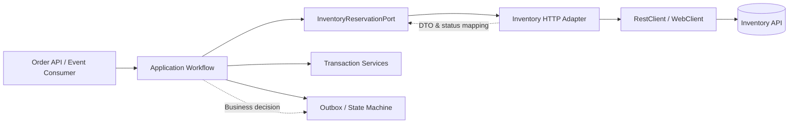
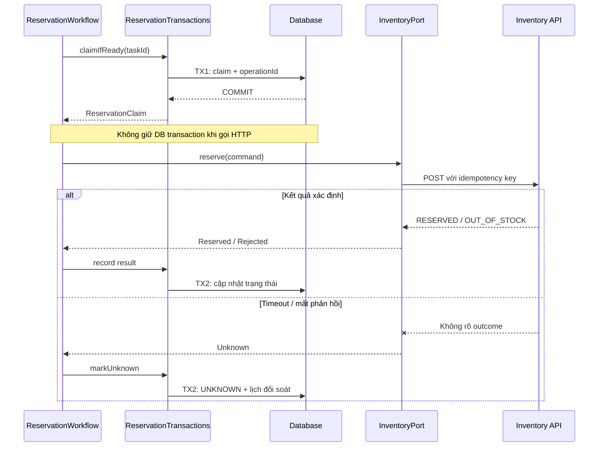
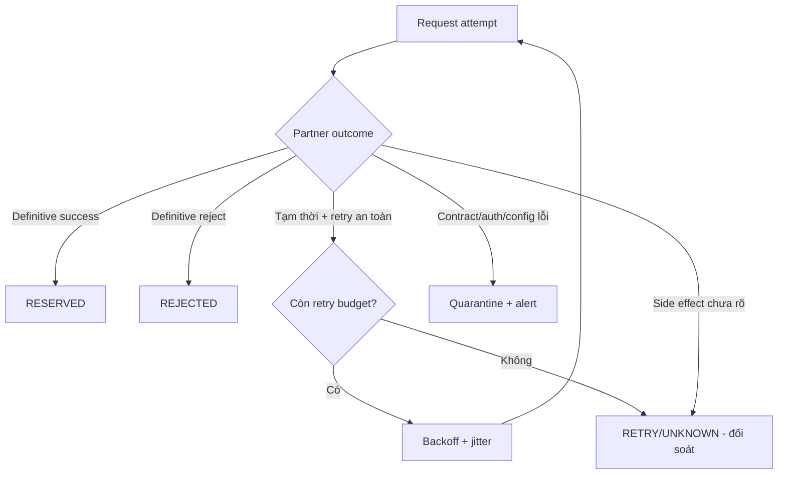

# Ranh giới giữa cơ chế gọi HTTP và chính sách nghiệp vụ

## 1. Chọn HTTP client chưa phải là thiết kế tích hợp

Trong module **SPRING_BOOT_INTEGRATION**, Spring Boot tổ chức các luồng kết nối HTTP client, database, cache, broker thông điệp và các adapter Spring Integration. Các luồng này không chỉ phải gửi request đúng. Chúng còn phải giữ hợp đồng dữ liệu, phân loại lỗi, kiểm soát giao dịch, tránh xử lý trùng và phục hồi khi ứng dụng hoặc hệ thống ngoài gặp sự cố.

Ví dụ ứng dụng đặt hàng gọi Inventory API để giữ hai sản phẩm. HTTP client gửi `POST /reservations` với một `operationId`, nhưng kết quả có thể là:

- `201 Created`: đối tác xác nhận đã giữ hàng, trả mã reservation.
- `422 Unprocessable Entity`: đối tác từ chối theo một **mã lỗi nghiệp vụ đã được hợp đồng định nghĩa**, chẳng hạn `OUT_OF_STOCK`.
- `409 Conflict`: operation đã được gửi trước đó, cần tra cứu trạng thái (nếu hợp đồng của đối tác quy định như vậy).
- `429 Too Many Requests`: đối tác đang giới hạn lưu lượng; cần điều tiết.
- `503` hoặc mất kết nối sau khi gửi POST: ứng dụng **không chắc** bên ngoài đã tạo reservation hay chưa.
- `200` kèm JSON không hợp lệ: HTTP đã có phản hồi, nhưng dữ liệu không đáp ứng hợp đồng.

Nếu chuyển mọi status lỗi thành “không đủ hàng”, hệ thống sẽ đưa ra quyết định nghiệp vụ sai. Nếu client retry POST bằng một ID mới sau timeout, đối tác có thể giữ hàng hai lần. Nếu gọi HTTP trong transaction DB đang giữ lock, một downstream chậm có thể làm quá tải cả ứng dụng.

**Kết luận mở đầu:** `RestTemplate`, `RestClient` và `WebClient` quyết định **cách gửi/nhận HTTP**. Adapter tích hợp quyết định **dịch hợp đồng đối tác**. Application/domain quyết định **phải làm gì với kết quả**, bao gồm trạng thái, transaction, retry và đối soát.



## 2. Ba ranh giới trách nhiệm

| Lớp | Sở hữu | Ví dụ | Điều không nên làm |
| --- | --- | --- | --- |
| **HTTP mechanism** | URL, method, request factory/connector, TLS, timeout, connection pool, serialization, headers kỹ thuật | `RestClient.post().uri(...).retrieve()` | Quyết định đơn hàng `PAID` hay `REJECTED` |
| **Integration adapter** | Mapping DTO/wire schema, error code **theo endpoint**, xác thực response, chuyển dữ liệu ngoài thành khái niệm nội bộ | `201 + reservation_id` → `Reserved`; `422 + OUT_OF_STOCK` → `Rejected` | Giữ transaction DB dài trong khi chờ mạng |
| **Application/domain policy** | Workflow, state machine, idempotency, deadline nghiệp vụ, điều kiện retry/đối soát, ranh giới transaction | Timeout giữ hàng → `UNKNOWN`; lưu job để tra cứu lại | Parse JSON HTTP hoặc phụ thuộc `WebClientResponseException` |

Trong thực tế có thêm nhóm **reliability policy** nằm giữa kỹ thuật và nghiệp vụ:

- **Transport:** connect timeout, response timeout, pool acquire timeout, TLS, DNS. Cấu hình tại HTTP client.
- **Adapter/partner:** một vài lỗi tạm thời, mapping `Retry-After`, rate limiter, circuit breaker, giới hạn concurrent requests. Cấu hình riêng theo đối tác.
- **Workflow:** thao tác có được retry không, sau timeout cần query trạng thái hay bù trừ, khi nào đánh dấu `DONE`. Quyết định dựa trên bất biến nghiệp vụ và hợp đồng side effect.

Không có quy tắc “toàn bộ retry thuộc domain” hoặc “toàn bộ retry thuộc HTTP client”. Chính sách phải có **một nơi sở hữu retry budget chung**, tránh việc nhiều tầng cùng nhân số lần gọi.

## 3. Lựa chọn RestTemplate, RestClient hay WebClient

| API | Mô hình | Phù hợp với | Cần lưu ý |
| --- | --- | --- | --- |
| `RestTemplate` | Đồng bộ, API lâu đời | Hệ thống Spring MVC/batch hiện hữu đang vận hành ổn định | Vẫn hợp lệ để bảo trì; cấu hình `RestTemplateBuilder`, error handler và message converters |
| `RestClient` | Đồng bộ, fluent API từ Spring Framework 6.1 | Ứng dụng blocking mới, muốn API request/response dễ đọc | Fluent **không có nghĩa non-blocking** |
| `WebClient` | Reactive, thường dùng `Mono`/`Flux` | Pipeline WebFlux/non-blocking, streaming hoặc cần hợp thành reactive | Không gọi `block()` trên event-loop; hiểu subscription, backpressure, cancellation |
| HTTP Interface `@HttpExchange` | Hợp đồng khai báo; thực thi qua adapter HTTP | Muốn gom endpoint/method/headers trong interface | `RestClientAdapter` và `WebClientAdapter` vẫn có mô hình thực thi khác nhau |
| SDK đối tác / Java HttpClient | Tùy thư viện | Provider có SDK chuyên dụng hoặc yêu cầu protocol đặc thù | Che thư viện sau một adapter; test error mapping riêng |

Cần dựa vào **toàn bộ mô hình chạy** chứ không chỉ một lời gọi HTTP:

1. Ứng dụng Spring MVC dùng JDBC/JPA blocking và số lượng call vừa phải: thường bắt đầu với `RestClient`.
2. Ứng dụng đã dùng `RestTemplate`: không cần nâng cấp hàng loạt chỉ để đổi cú pháp. Nên ưu tiên timeout, contract test, trạng thái lỗi và idempotency trước.
3. Ứng dụng WebFlux đã reactive từ controller qua service tới I/O: `WebClient` phù hợp hơn để tránh chặn event-loop.
4. Nếu database/JDBC hoặc SDK bên dưới vẫn blocking, việc thay HTTP bằng `WebClient` **không** làm toàn hệ thống non-blocking.
5. Với tải cao, đo throughput, latency p95/p99, pool saturation, backpressure và giới hạn bên ngoài; không mặc định WebClient luôn nhanh hơn.

**Tiêu chí kiến trúc:** có thể thay implementation của adapter mà không đổi ý nghĩa `RESERVED`, `REJECTED`, `UNKNOWN` ở application/domain.

## 4. Định nghĩa Port bằng ngôn ngữ nghiệp vụ

Để domain không biết HTTP, ta mô hình hóa chức năng “giữ hàng” thay vì “gửi POST”:

```java
// Mỗi public top-level type được đặt trong file Java riêng khi triển khai.

public interface InventoryReservationPort {
    ReservationOutcome reserve(ReserveCommand command);
}

public record ReserveCommand(
        String operationId,
        String orderId,
        String sku,
        int quantity) {}

public sealed interface ReservationOutcome
        permits ReservationOutcome.Reserved,
                ReservationOutcome.Rejected,
                ReservationOutcome.Unknown {

    record Reserved(String reservationId)
            implements ReservationOutcome {}

    record Rejected(String reasonCode)
            implements ReservationOutcome {}

    record Unknown(String operationId)
            implements ReservationOutcome {}
}
```

Port không trả `ResponseEntity<PartnerResponse>` hay ném trực tiếp `HttpClientErrorException` cho domain. Các kết quả thể hiện **kiến thức đã được xác nhận**:

- `Reserved`: có reservation ID và hợp đồng đối tác xác nhận thao tác thành công.
- `Rejected`: đối tác đưa ra từ chối **xác định**, sau khi kiểm tra error code nghiệp vụ.
- `Unknown`: không thể khẳng định trạng thái cuối; có thể đối tác đã thực hiện side effect.

Nếu API hỗ trợ `DEFERRED`, `PENDING` hoặc `ALREADY_RESERVED`, hãy bổ sung outcome rõ nghĩa. Không cố nhét tất cả tình huống vào `boolean success`. Với domain phức tạp, có thể phân biệt `Unknown` với `RetryLater` và `IntegrationFailure`.

Một ứng dụng reactive có thể định nghĩa port trả `Mono<ReservationOutcome>`, nhưng đó là **quyết định mô hình application**; không nên thay toàn bộ domain thành reactive chỉ vì một HTTP adapter dùng WebClient.

## 5. Adapter dịch DTO và status theo hợp đồng đối tác

Giả sử Inventory API có hợp đồng minh họa:

| Response | Ý nghĩa đã thỏa thuận | Mapping adapter |
| --- | --- | --- |
| `201` + `reservation_id` hợp lệ | Giữ hàng thành công | `Reserved(reservationId)` |
| `422` + `code=OUT_OF_STOCK` | Từ chối xác định | `Rejected("OUT_OF_STOCK")` |
| `409` + `code=REQUEST_IN_PROGRESS` | Operation đang xử lý hoặc đã nhận | `Unknown(operationId)`, tra cứu |
| `429` + `Retry-After` | Rate limit | Retry/deferred có điều kiện |
| `500/503` sau request có side effect | Kết quả chưa chắc chắn | `Unknown(operationId)` hoặc điều tra |
| `401/403` | Credential/quyền sai | Integration/configuration error, không phải từ chối nghiệp vụ |
| `2xx` + body sai schema | Vi phạm hợp đồng | Protocol/data error, không trả thành công |

**Đây là bảng giả định cho ví dụ**, không phải ý nghĩa cố định của mọi status HTTP. Cùng `404` có thể là “SKU không có” ở endpoint GET hoặc “đường dẫn sai” ở endpoint POST. Adapter phải xét endpoint và error body, không dùng một quy tắc toàn cục.

### 5.1. Cấu hình RestClient riêng theo partner

Ví dụ client được tạo từ `RestClient.Builder` do Spring Boot cung cấp, với base URL lấy từ configuration properties đã kiểm tra:

```java
import org.springframework.beans.factory.annotation.Qualifier;
import org.springframework.context.annotation.Bean;
import org.springframework.context.annotation.Configuration;
import org.springframework.web.client.RestClient;

@Configuration(proxyBeanMethods = false)
public class InventoryHttpConfiguration {

    @Bean("inventoryRestClient")
    RestClient inventoryRestClient(
            RestClient.Builder builder,
            InventoryPartnerProperties properties) {
        return builder
                .baseUrl(properties.baseUrl())
                .defaultHeader("Accept", "application/json")
                .build();
    }
}
```

`InventoryPartnerProperties` là bean cấu hình của ứng dụng (ví dụ từ `@ConfigurationProperties`); `baseUrl()` trả URL đã được validate. Timeout, authentication, TLS và connection pool cũng được gắn **ở client dành cho partner này**. Không đưa token hoặc host production vào source code, không để input từ client tự định đoạt host tùy ý (SSRF).

### 5.2. DTO wire tách biệt record nội bộ

Ví dụ body request có các field snake_case:

```json
{
  "merchant_order": "ORDER-42",
  "product_code": "SKU-100",
  "units": 2,
  "request_id": "reserve-ORDER-42"
}
```

Các DTO thuộc adapter có thể dùng Jackson:

```java
import com.fasterxml.jackson.annotation.JsonProperty;

record PartnerReserveRequest(
        @JsonProperty("merchant_order") String orderId,
        @JsonProperty("product_code") String sku,
        @JsonProperty("units") int quantity,
        @JsonProperty("request_id") String requestId) {}

record PartnerReserveResponse(
        @JsonProperty("reservation_id") String reservationId) {}

record PartnerErrorResponse(
        @JsonProperty("code") String code,
        @JsonProperty("message") String message) {}
```

DTO wire được kiểm tra theo schema thực tế. Nếu nhà cung cấp đổi tên `reservation_id` hoặc thêm enum mới, adapter và contract test thay đổi trước; `OrderService` không phải biết ký hiệu trong JSON.

### 5.3. RestClient HTTP adapter hoàn chỉnh ở mức minh họa

```java
import com.fasterxml.jackson.core.JsonProcessingException;
import com.fasterxml.jackson.databind.ObjectMapper;
import org.springframework.beans.factory.annotation.Qualifier;
import org.springframework.http.MediaType;
import org.springframework.stereotype.Component;
import org.springframework.web.client.HttpClientErrorException;
import org.springframework.web.client.HttpServerErrorException;
import org.springframework.web.client.ResourceAccessException;
import org.springframework.web.client.RestClient;

@Component
public final class InventoryHttpAdapter
        implements InventoryReservationPort {

    private final RestClient http;
    private final ObjectMapper mapper;

    public InventoryHttpAdapter(
            @Qualifier("inventoryRestClient") RestClient http,
            ObjectMapper mapper) {
        this.http = http;
        this.mapper = mapper;
    }

    @Override
    public ReservationOutcome reserve(ReserveCommand command) {
        try {
            PartnerReserveResponse response = http.post()
                    .uri("/v1/reservations")
                    .contentType(MediaType.APPLICATION_JSON)
                    .header("Idempotency-Key", command.operationId())
                    .body(new PartnerReserveRequest(
                            command.orderId(),
                            command.sku(),
                            command.quantity(),
                            command.operationId()))
                    .retrieve()
                    .body(PartnerReserveResponse.class);

            if (response == null || response.reservationId() == null
                    || response.reservationId().isBlank()) {
                throw new PartnerContractException(
                        "Thiếu reservation_id");
            }
            return new ReservationOutcome.Reserved(
                    response.reservationId());

        } catch (HttpClientErrorException.UnprocessableEntity ex) {
            String code = errorCode(ex.getResponseBodyAsString());
            if ("OUT_OF_STOCK".equals(code)) {
                return new ReservationOutcome.Rejected(code);
            }
            throw new PartnerContractException(
                    "422 với code chưa được hỗ trợ: " + code, ex);

        } catch (HttpClientErrorException.Conflict ex) {
            String code = errorCode(ex.getResponseBodyAsString());
            if ("REQUEST_IN_PROGRESS".equals(code)) {
                return new ReservationOutcome.Unknown(
                        command.operationId());
            }
            throw new PartnerContractException(
                    "409 ngoài hợp đồng: " + code, ex);

        } catch (HttpServerErrorException | ResourceAccessException ex) {
            // 5xx hoặc lỗi I/O không chứng minh server chưa xử lý.
            return new ReservationOutcome.Unknown(
                    command.operationId());
        }
    }

    private String errorCode(String json) {
        try {
            PartnerErrorResponse response =
                    mapper.readValue(json, PartnerErrorResponse.class);
            if (response == null || response.code() == null) {
                throw new PartnerContractException(
                        "Thiếu code trong lỗi downstream");
            }
            return response.code();
        } catch (JsonProcessingException ex) {
            throw new PartnerContractException(
                    "Error body không phải JSON đúng schema", ex);
        }
    }
}
```

`PartnerContractException` là exception nội bộ của adapter (định nghĩa riêng, có constructor `(String)` và `(String, Throwable)`). Ví dụ cũng cần chính sách **riêng** cho `429`, 401/403 và một số lỗi hợp đồng; không nên nuốt mọi exception thành `Unknown`:

```java
// Ví dụ mô hình error nội bộ, không phụ thuộc Spring Web:
public final class PartnerContractException extends RuntimeException {
    public PartnerContractException(String message) {
        super(message);
    }
    public PartnerContractException(String message, Throwable cause) {
        super(message, cause);
    }
}
```

Với `429`, có thể bắt `HttpClientErrorException.TooManyRequests` để tạo `PartnerRateLimitedException` mang thông tin thời gian thử lại và operation ID. `Retry-After` có thể là **số giây hoặc HTTP-date**, có thể thiếu hoặc sai; parse phải có giới hạn. Worker có thể ghi `RETRY_AT`, giảm tốc độ và lên lịch sau commit. Không retry vô hạn ngay trong thread nhận HTTP request.

**Ý nghĩa exception ở ví dụ:** lỗi xác thực, sai schema hoặc response body không hợp lệ là vấn đề cấu hình/hợp đồng; worker phải ghi trạng thái cần điều tra/quarantine, phát cảnh báo. Không chuyển tự động sang `Rejected(OUT_OF_STOCK)` hay xóa task khỏi hệ thống.

### Quy tắc xác thực outcome

Một outcome `Reserved` chỉ có giá trị khi:
- Status/body của endpoint đúng hợp đồng.
- `reservation_id` không null/rỗng và đủ ràng buộc.
- Nếu response có `operation_id`, `tenant_id` hoặc `sku`, các field đó phải khớp request.
- Field số tiền/currency/số lượng không bị chuyển đổi sai đơn vị.
- Không gộp `200 + {"success":false}` thành thành công chỉ vì HTTP status là 2xx.

Các validation này thuộc boundary adapter. Application có thể kiểm tra thêm bất biến nghiệp vụ như một đơn hàng không được chuyển từ `CANCELLED` sang `RESERVED`.

## 6. Application quyết định trạng thái, không để HTTP client quyết định

Một ví dụ orchestration không mang `@Transactional` quanh lời gọi HTTP:

```java
import java.util.UUID;
import org.springframework.stereotype.Service;

@Service
public final class ReservationWorkflow {

    private final InventoryReservationPort inventory;
    private final ReservationTransactions transactions;

    public ReservationWorkflow(
            InventoryReservationPort inventory,
            ReservationTransactions transactions) {
        this.inventory = inventory;
        this.transactions = transactions;
    }

    public void process(UUID taskId) {
        ReservationClaim claim = transactions.claimIfReady(taskId);
        if (claim == null) {
            return;  // Đã xử lý hoặc worker khác đang claim.
        }

        ReserveCommand cmd = new ReserveCommand(
                claim.operationId(),
                claim.orderId(),
                claim.sku(),
                claim.quantity());

        ReservationOutcome outcome = inventory.reserve(cmd);

        if (outcome instanceof ReservationOutcome.Reserved reserved) {
            transactions.recordReserved(
                    taskId, claim.operationId(), reserved.reservationId());
        } else if (outcome instanceof ReservationOutcome.Rejected rejected) {
            transactions.recordRejected(
                    taskId, claim.operationId(), rejected.reasonCode());
        } else {
            transactions.markUnknown(taskId, claim.operationId());
        }
    }
}
```

`ReservationTransactions` và `ReservationClaim` là các thành phần nghiệp vụ minh họa. Trong implementation thực, `claimIfReady` mở transaction DB **ngắn** để claim atomically bằng optimistic locking, conditional update hoặc lease; các hàm `record...` mở transaction mới để cập nhật trạng thái có điều kiện.



**Tại sao không `@Transactional` cho toàn workflow?** Transaction JDBC/JPA không bao gồm HTTP trong cùng ACID transaction; nếu downstream chậm, DB connection/lock bị giữ vô ích. Đặc biệt với thanh toán, “HTTP đã thành công rồi DB rollback” không làm tiền tự hoàn trả.

### Vòng đời trạng thái nghiệp vụ

```text
PENDING -> PROCESSING -> RESERVED
             |             |
             +-> REJECTED  |
             +-> UNKNOWN -> RECONCILE -> RESERVED / REJECTED / RETRY
             +-> RETRY (backoff, budget)
```

`UNKNOWN` là trạng thái **không đủ thông tin**, không đồng nghĩa `REJECTED` hoặc `FAILED`. Nếu đối tác có endpoint tra cứu bằng operation ID, worker có thể đối soát trước khi gửi lại. Nếu không, cần chính sách thủ công/bù trừ được thỏa thuận rõ.

## 7. Transactional outbox và độ bền khi crash

Một workflow gọi HTTP **sau khi** transaction DB đã commit vẫn có thể làm mất việc:

```text
TX1: INSERT order
COMMIT
-- process crash ngay tại đây --
scheduleAsync(orderId) chưa chạy
```

Vì vậy, nếu tác vụ tích hợp không được mất, lưu **order + outbox** trong cùng một transaction:

```java
@Service
public final class OrderCommandService {
    private final OrderRepository orders;
    private final OutboxRepository outbox;

    public OrderCommandService(
            OrderRepository orders, OutboxRepository outbox) {
        this.orders = orders;
        this.outbox = outbox;
    }

    @Transactional
    public UUID create(CreateOrderCommand command) {
        Order order = orders.save(Order.from(command));
        outbox.save(OutboxMessage.reserveInventory(
                order.getId(), order.getOperationId()));
        return order.getId();
    }
}
```

Các entity/repository và factory `reserveInventory` là mã nghiệp vụ của dự án, không phải lớp Spring có sẵn. Sau `COMMIT`, dispatcher đọc outbox và chuyển tác vụ cho worker. Nếu process chết, job `PENDING` vẫn nằm trong DB.

Cần xét từng cửa sổ crash:

| Cửa sổ | Điều có thể xảy ra | Cơ chế cần có |
| --- | --- | --- |
| Sau DB commit, trước enqueue | Job chưa được worker nhận | Outbox bền vững, quét lại |
| Sau claim, trước HTTP | Job bị kẹt `PROCESSING` | Lease và claim lại sau hết hạn |
| Sau HTTP thành công, trước ghi `DONE` | Retry có thể gửi lại cùng ý định | Idempotency key ổn định / đối soát |
| Sau ghi `DONE`, trước ack broker | Broker redeliver event | Inbox dedup, conditional update |
| Hai worker cùng xử lý | Race hoặc gửi trùng | Unique constraint, compare-and-set/version |
| Timeout không rõ kết quả | Có thể đã thực hiện side effect | Giữ `UNKNOWN`, query theo operation ID |

Outbox đảm bảo **yêu cầu tích hợp được lưu cùng trạng thái nghiệp vụ**, không tự đảm bảo exactly-once delivery. Kafka, RabbitMQ hoặc Spring Integration `QueueChannel` vẫn có cơ chế ack, retry và khả năng replay riêng. Không đánh dấu outbox `DONE` chỉ vì adapter `send()` trả true: enqueue/submit chưa chứng minh side effect hoàn tất.

## 8. Timeout, retry và idempotency: ranh giới kép

### 8.1. Timeout là giới hạn tài nguyên, không phải kết quả cuối

| Lỗi hoặc điều kiện | Client biết được gì? | Có chắc side effect chưa xảy ra? |
| --- | --- | --- |
| Connect fail trước khi truyền request | Không mở được kết nối theo attempt đó | Thường chưa gửi qua kết nối đó; cần xét proxy/retry tầng dưới |
| Read timeout sau khi gửi body | Không nhận được câu trả lời đúng hạn | **Không** |
| Connection reset khi đọc response | Phản hồi có thể đã bị cắt | **Không** |
| HTTP `503` | Server báo unavailable | **Không** mặc định |
| `Mono.timeout` hủy subscription | Reactive pipeline hết budget | **Không** tự chứng minh server rollback |
| `422 + OUT_OF_STOCK` đúng hợp đồng | Server xác nhận từ chối | Có thể coi là từ chối xác định theo contract |

Connect timeout, pool acquire timeout, response/read timeout và workflow deadline là những giới hạn khác nhau. Chọn các timeout phù hợp với SLO chung; không để một lần gọi partner chiếm trọn thời gian của request upstream rồi kéo dài qua nhiều retry.

### 8.2. Retry policy không thể chỉ xét HTTP status

Một quyết định retry cần trả lời:

1. **Thao tác có side effect không?** GET idempotent khác POST giữ hàng hoặc thu tiền.
2. **Lỗi có tạm thời không?** 429/503 thường khác 400/401.
3. **Đối tác có cam kết dedup theo idempotency key không?** Độ dài cửa sổ giữ key là bao lâu?
4. **Operation ID có giữ nguyên qua mọi lần thử không?** Không tạo key mới chỉ vì timeout.
5. **Ngân sách retry tổng là gì?** Số lần, backoff, jitter, thời hạn, các tầng retry khác.
6. **Nếu vẫn chưa rõ kết quả thì sao?** Đối soát hoặc trạng thái `UNKNOWN`, không mặc định “FAILED”.



Nếu HTTP client tự retry 3 lần, application retry 3 lần và broker redelivery 3 lần, một sự kiện có thể làm phát sinh **27 attempts**. Cần có một retry budget xuyên suốt và metrics theo `operationId`. Mọi retry tại broker/worker cũng phải tuân thủ idempotency.

## 9. Cùng status khác nghĩa theo endpoint

| Status | `GET /products/{sku}` | `POST /reservations` | Hành động thiết kế |
| --- | --- | --- | --- |
| `200` | Dữ liệu hợp lệ nếu body đúng | Có thể là kết quả đã xử lý trước đó | Validate schema, business code và operation ID |
| `201` | Ít dùng | Đã tạo reservation | Adapter map sang `Reserved` |
| `202` | Ít dùng | Đã nhận **nhưng chưa hoàn tất** | Workflow giữ `PENDING`/poll callback |
| `204` | Thành công không body theo hợp đồng | Có thể là thao tác không cần DTO | Không cố deserialize body rỗng |
| `404` | SKU không tồn tại | Có thể sai path hoặc reservation chưa có | Mapping riêng từng endpoint |
| `409` | Conflict/version mismatch | Duplicate hoặc in-progress tùy error code | Kiểm tra code và truy vấn lại khi cần |
| `422` | Invalid input | Có thể là out of stock hoặc validation | Không suy diễn từ status riêng |
| `429` | Rate limit | Rate limit | Backoff có giới hạn, giảm admission |
| `500/503` | Có thể retry GET | Side effect có thể chưa rõ | Xem operation semantics và trạng thái |

Một `ResponseErrorHandler` hoặc `defaultStatusHandler` áp dụng toàn cục với quy tắc “mọi `404` là không có kết quả” sẽ làm sai những endpoint khác. Cấu hình global chỉ nên gom quy tắc thật sự chung (ví dụ observability, TLS, timeout mặc định); ý nghĩa business của status nên nằm gần hợp đồng từng endpoint.

### 2xx với body sai vẫn phải thất bại

Một body `{"available":-5}` hoặc `{"success":false}` không trở thành dữ liệu đúng chỉ vì status `200`. Adapter cần kiểm tra:
- Content type, charset, body rỗng và JSON syntax.
- Field bắt buộc, enum, nullability, giới hạn giá trị.
- Đúng sku, tenant, currency và đơn vị tiền.
- Version payload, correlation/operation ID theo contract.
- Trường dữ liệu lạ có được chấp nhận không.

Ví dụ record `int available` có thể nhận mặc định `0` khi field bị thiếu; `Integer` + validation giúp phân biệt **thiếu dữ liệu** với **hết hàng**.

## 10. WebClient cũng phải tuân thủ cùng boundary

Với application reactive, interface có thể được thiết kế:

```java
public interface ReactiveInventoryReservationPort {
    Mono<ReservationOutcome> reserve(ReserveCommand command);
}
```

Một HTTP adapter reactive có thể bắt đầu như sau:

```java
public Mono<ReservationOutcome> reserve(ReserveCommand command) {
    return webClient.post()
            .uri("/v1/reservations")
            .header("Idempotency-Key", command.operationId())
            .bodyValue(new PartnerReserveRequest(
                    command.orderId(),
                    command.sku(),
                    command.quantity(),
                    command.operationId()))
            .retrieve()
            .bodyToMono(PartnerReserveResponse.class)
            .map(response -> (ReservationOutcome)
                    new ReservationOutcome.Reserved(
                            response.reservationId()));
}
```

**Đây chỉ là happy-path snippet**, chưa đủ cho production: phải thêm `onStatus(...)` hoặc `exchangeToMono(...)` để map status, validation body, timeout, cancellation và unknown outcome. Không được thay đổi business semantics chỉ vì client chuyển từ blocking sang reactive.

Đặc trưng khác nhau cần hiểu:

- `Mono` thường lazy; request có thể chỉ phát khi có subscriber.
- `retryWhen(...)` có thể resubscribe và **gửi lại POST**; cần operation ID ổn định và budget.
- `timeout(...)` có thể hủy subscription, nhưng không chứng minh downstream chưa xử lý.
- Không gọi `block()` trong Netty event-loop; JDBC/JPA blocking cũng không tự non-blocking vì dùng WebClient.
- Truyền context như trace ID, tenant và security phải có cách phù hợp, không lấy transaction ThreadLocal đồng bộ làm mặc định trong reactive pipeline.

Một Spring MVC application blocking không bắt buộc trở thành reactive chỉ để gọi một API. Ngược lại, một WebFlux app không nên gọi `RestClient` blocking trên event-loop.

## 11. HTTP Interface hoặc SDK không thay thế business policy

`@HttpExchange` giúp khai báo endpoint theo interface:

```java
import org.springframework.web.bind.annotation.PathVariable;
import org.springframework.web.service.annotation.GetExchange;

public interface InventoryHttpApi {
    @GetExchange("/v1/inventory/{sku}")
    InventoryDto getInventory(@PathVariable String sku);
}
```

HTTP Service Proxy từ `HttpServiceProxyFactory` có thể dùng adapter tương ứng với `RestClient` hoặc `WebClient`. Dù cú pháp ngắn hơn, proxy vẫn **chỉ thực hiện HTTP contract**:

- Không tự hiểu `404` là hết hàng hay URL sai.
- Không tự quyết định chuyển trạng thái `UNKNOWN`.
- Không tự lưu outbox hoặc thay đổi transaction DB.
- Không tự bảo đảm idempotency/exactly-once.
- Không tự kiểm chứng response đúng schema/semantics của nghiệp vụ.

Vì thế có thể đặt `InventoryHttpApi` **bên trong** `InventoryHttpAdapter`, còn application chỉ gọi `InventoryReservationPort`. Tương tự với OpenFeign, JDK HttpClient hoặc một SDK bên thứ ba.

## 12. Kiểm thử đúng từng lớp

### 12.1. Kiểm thử chính sách với fake Port

Kiểm thử application/domain không cần dựng HTTP client:

```java
// Pseudocode minh họa: transaction helper và fixture được fake.
InventoryReservationPort fakePort =
        command -> new ReservationOutcome.Unknown(
                command.operationId());

ReservationWorkflow workflow =
        new ReservationWorkflow(fakePort, fakeTransactions);

workflow.process(taskId);

// Assert: taskId chuyển UNKNOWN và giữ cùng operationId.
// Không đánh dấu RESERVED, không phát completion event.
```

Test kiểu này kiểm tra **quyết định nghiệp vụ**. Nếu domain chỉ dùng `ReservationOutcome`, test không phụ thuộc Spring Web hoặc cổng đối tác.

### 12.2. Kiểm thử adapter RestClient bằng MockRestServiceServer

```java
import static org.assertj.core.api.Assertions.assertThat;
import static org.springframework.test.web.client.match.MockRestRequestMatchers.*;
import static org.springframework.test.web.client.response.MockRestResponseCreators.*;

import com.fasterxml.jackson.databind.ObjectMapper;
import org.junit.jupiter.api.Test;
import org.springframework.http.HttpMethod;
import org.springframework.http.HttpStatus;
import org.springframework.http.MediaType;
import org.springframework.test.web.client.MockRestServiceServer;
import org.springframework.web.client.RestClient;

@Test
void maps201AndValidatesRequest() {
    RestClient.Builder builder = RestClient.builder()
            .baseUrl("https://inventory.example.test");
    MockRestServiceServer server =
            MockRestServiceServer.bindTo(builder).build();

    InventoryReservationPort adapter = new InventoryHttpAdapter(
            builder.build(), new ObjectMapper());

    server.expect(requestTo(
                "https://inventory.example.test/v1/reservations"))
            .andExpect(method(HttpMethod.POST))
            .andExpect(header("Idempotency-Key", "op-42"))
            .andExpect(content().json(
                    """
                    {
                      "merchant_order":"ORDER-42",
                      "product_code":"SKU-100",
                      "units":2,
                      "request_id":"op-42"
                    }
                    """))
            .andRespond(withStatus(HttpStatus.CREATED)
                    .contentType(MediaType.APPLICATION_JSON)
                    .body("""
                          {"reservation_id":"res-123"}
                          """));

    ReservationOutcome outcome = adapter.reserve(
            new ReserveCommand("op-42", "ORDER-42", "SKU-100", 2));

    assertThat(outcome)
            .isEqualTo(new ReservationOutcome.Reserved("res-123"));
    server.verify();
}
```

Ví dụ trên là **phương thức test đặt trong một JUnit test class**, với các thành phần domain/adapter đã định nghĩa. Nó kiểm tra HTTP method, URI, header, JSON wire và mapping response. Nên bổ sung case `422 + OUT_OF_STOCK`, `409 + REQUEST_IN_PROGRESS`, `429`, `503`, body sai schema và mã lỗi không được hỗ trợ.

`MockRestServiceServer` bind vào `RestClient.Builder` trước khi `build()` để intercept request nhưng **không dùng socket thật**. Nó không chứng minh connect/read timeout, TLS hoặc pooling. Với WebClient hoặc khi cần fault network, dùng **MockWebServer/WireMock** trên localhost và `StepVerifier` để kiểm tra reactive publisher.

### 12.3. Kiểm thử transaction, idempotency và khôi phục

Dùng Testcontainers (PostgreSQL/broker), HTTP stub server và fault injection nếu cần:

1. Transaction tạo `order + outbox` đã commit.
2. Worker lấy task; stub nhận POST với cùng `operationId`.
3. Cho stub nhận request nhưng cắt kết nối trước response.
4. Xác minh trạng thái `UNKNOWN` hoặc `RETRY` theo hợp đồng.
5. Khởi động lại worker/process và đọc lại job; không làm mất task.
6. Dùng cùng operation ID để tra cứu/retry an toàn; không sinh side effect mới.
7. Gửi duplicate event; unique constraint/state guard ngăn xử lý hai lần.
8. Cho HTTP chậm; xác minh DB transaction không bị giữ qua khoảng chờ mạng.

Unit test mock Port **không chứng minh** lock/commit; test HTTP client **không chứng minh** exactly-once. Mỗi loại test phải tập trung vào ranh giới nó quan sát được.

## 13. Bảo mật và khả năng quan sát cũng theo ranh giới

HTTP mechanism phải được cấu hình an toàn:

- Xác định allowed hosts/base URL, ngăn SSRF qua URL do người dùng cung cấp.
- Dùng TLS được xác thực; không tắt certificate verification chỉ để “test nhanh”.
- Giữ secret/token trong hệ thống quản lý bí mật; không đưa vào Git, log, trace hoặc exception body.
- Thiết lập connection/read/pool timeouts, tối đa response size, số request đồng thời theo đối tác.
- Tách credentials theo partner; không đặt interceptor gắn Authorization token vào mọi HTTP client.
- Quản lý response streaming/DataBuffer đúng vòng đời để tránh giữ tài nguyên.

Ứng dụng cần theo dõi **operationId/correlationId** xuyên suốt:

| Signal | Hữu ích để nhận biết |
| --- | --- |
| HTTP latency theo partner/endpoint | Downstream chậm hay lỗi pool |
| Status và error category | 429 rate limit, 503 unavailable, contract error |
| Retry attempts/backoff/timeout | Có nhân retry hoặc vượt SLA không |
| State `UNKNOWN` quá hạn | Side effect chưa đối soát |
| Outbox pending age / dead-letter | Dispatcher bị tắc hoặc message lỗi |
| Duplicate/dedup rate | Có redelivery, retry sau crash không |
| DB transaction duration và lock wait | Có giữ transaction qua HTTP call không |

Không log toàn bộ response body nếu chứa thông tin cá nhân, token hoặc dữ liệu nhạy cảm. Trace/metrics nên dùng nhãn có cardinality hữu hạn (partner, endpoint template, error category), không dùng mỗi `operationId` làm label metric.

## 14. Những anti-pattern cần tránh

| Cách viết | Vấn đề | Cách thiết kế lại |
| --- | --- | --- |
| `OrderService` ghép URL và đọc `HttpStatus` | Domain lệ thuộc chi tiết HTTP | Port + adapter translation |
| Tất cả 4xx → `BusinessRejected` | Che lỗi 401/403, bad contract | Mapping theo endpoint/error code |
| `onErrorReturn(RESERVED)` sau timeout | Biến lỗi tích hợp thành thành công giả | Outcome `Unknown`/quarantine |
| Retry POST với operation ID mới | Có thể tạo side effect trùng | Giữ idempotency key và đối soát |
| `@Transactional` bao trùm HTTP call | DB lock/connection kéo dài, không rollback HTTP | Transaction ngắn + outbox |
| `RestClient` fluent được xem là non-blocking | Chọn mô hình concurrency sai | Phân biệt blocking vs reactive |
| Gọi `WebClient.block()` trong event-loop | Nghẽn throughput reactive | Compose `Mono`/`Flux` |
| Mọi error handler global coi 404 là bình thường | Endpoint khác bị diễn giải sai | Quy tắc lỗi theo contract từng API |
| Nhận 200 mà không validate DTO | Dữ liệu thiếu field, enum lạ, sai currency | Decode + validate protocol/business fields |
| Queue `send()==true` được coi là việc đã DONE | Chỉ chứng minh được enqueue | Ghi DONE sau kết quả đã xác nhận |
| Unit test mock toàn bộ WebClient chain | Không bắt lỗi codec, URI/header | HTTP adapter test với stub phù hợp |
| Logs chứa token, PII hoặc body gốc | Rò rỉ dữ liệu khi điều tra lỗi | Logging có redaction theo policy |

## 15. Checklist thiết kế HTTP integration

1. Xác định application dùng **blocking** hay **reactive**; chọn `RestClient`/`RestTemplate` hoặc `WebClient` tương ứng.
2. Đặt Port bằng ngôn ngữ nghiệp vụ; domain không phụ thuộc `ResponseEntity`, status code và DTO của partner.
3. Tách cấu hình base URL, credentials, TLS, timeout, pool và request headers theo **từng đối tác**.
4. Viết bảng hợp đồng status + JSON body cho **từng endpoint**, gồm cả trường hợp 2xx nhưng sai dữ liệu.
5. Phân biệt **rejection xác định**, **unknown outcome** và **configuration/protocol failure**.
6. Giữ operation ID/idempotency key ổn định, có một retry budget tổng và backoff phù hợp.
7. Không gọi HTTP bên ngoài khi còn giữ transaction database không cần thiết.
8. Lưu yêu cầu tích hợp vào outbox/job table nếu không được mất việc khi crash.
9. Thiết kế state machine, conditional update, dedup và đối soát khi kết quả chưa rõ.
10. Test chính sách nghiệp vụ độc lập, test HTTP adapter bằng mock/stub server, test DB/broker bằng môi trường thực tế.
11. Theo dõi latency, 429/503, contract error, retry, task UNKNOWN và trạng thái outbox; giới hạn log nhạy cảm.

**Điều cần nhớ:** HTTP client quyết định **cách gọi**; adapter quyết định **dịch hợp đồng**; application/domain quyết định **ý nghĩa và hành động tiếp theo**. Ranh giới rõ ràng giúp Spring Boot Integration thay cơ chế HTTP, cập nhật hợp đồng dữ liệu và phục hồi sau lỗi mạng mà không vô tình làm thay đổi nghiệp vụ.

### Tài liệu tham khảo

- [Spring Framework Reference — REST Clients](https://docs.spring.io/spring-framework/reference/integration/rest-clients.html): RestClient, RestTemplate, HTTP Interface và body conversion.
- [Spring Framework Reference — WebClient](https://docs.spring.io/spring-framework/reference/web/webflux-webclient.html): reactive HTTP, status/error handling và exchange.
- [Spring Framework Reference — Declarative Transactions](https://docs.spring.io/spring-framework/reference/data-access/transaction/declarative.html): ranh giới transaction và propagation.
- [Spring Integration Reference](https://docs.spring.io/spring-integration/reference/): channel, gateway, adapter và error handling.
- [Spring Boot Reference — REST Clients](https://docs.spring.io/spring-boot/reference/io/rest-client.html): cấu hình HTTP client trong Spring Boot.
