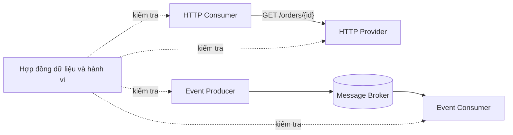
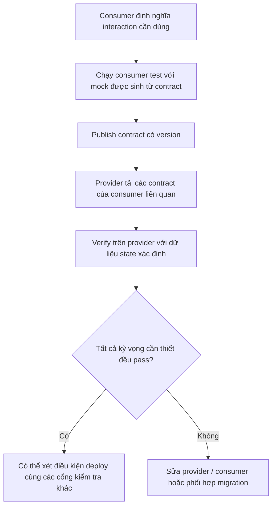
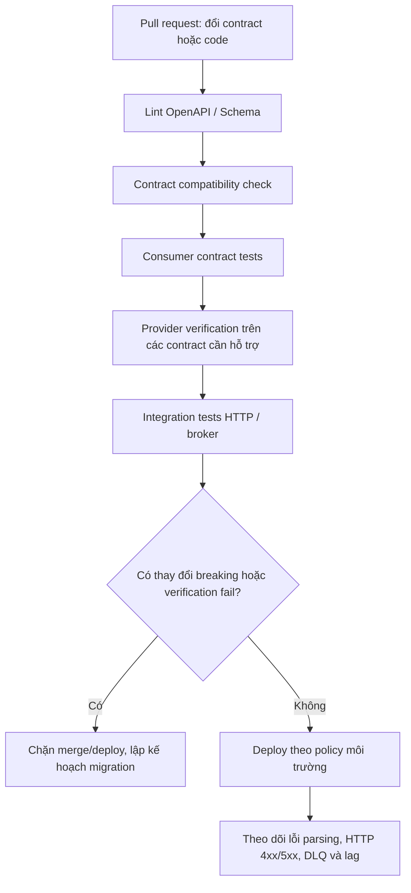

# Kiểm thử hợp đồng HTTP, schema và thông điệp giữa hai phía

## 1. Vì sao kiểm thử từng service vẫn chưa đủ?

Trong mô-đun **SPRING_BOOT_INTEGRATION**, các ứng dụng Spring Boot tích hợp qua HTTP client, cơ sở dữ liệu, cache, message broker và adapter của Spring Integration. Mỗi thành phần có thể vượt qua unit test riêng nhưng luồng tích hợp vẫn thất bại vì hai phía **hiểu khác nhau về dữ liệu và hành vi**.

Ví dụ, Order Service gọi Inventory Service để lấy tình trạng hàng:

- **Consumer** (Order Service) mong đợi HTTP `200` với JSON có trường `availableQuantity` kiểu số nguyên.
- **Provider** (Inventory Service) triển khai thành công một thay đổi trả về `available` kiểu boolean và bỏ `availableQuantity`.
- Unit test của mỗi service đều xanh vì cả hai dùng mock hoặc DTO của chính mình. Khi triển khai chung, consumer có thể parse thất bại hoặc suy ra tồn kho sai.

Tình huống tương tự xảy ra khi producer phát sự kiện `OrderCreated` qua broker nhưng consumer không còn đọc được `occurredAt`, hiểu sai đơn vị tiền tệ, hoặc coi sự kiện trùng lặp là giao dịch mới.

**Kiểm thử hợp đồng (contract testing)** xác nhận sự thống nhất giữa hai phía tại ranh giới tích hợp: **ai gửi gì, ai nhận gì, theo định dạng nào, trong tình huống nào và phải xử lý ra sao**. Bài học tập trung vào hợp đồng HTTP, JSON Schema/OpenAPI, thông điệp bất đồng bộ, lỗi biên, kiểm thử hai phía và cách đưa kiểm tra vào CI/CD.



Trong sơ đồ, **hợp đồng không thay thế việc triển khai hệ thống**. Nó là bằng chứng để bắt sai lệch giữa producer/provider và consumer trước khi thay đổi được triển khai. Việc mạng có hoạt động, broker có quyền ACL phù hợp và các service phối hợp được trong production vẫn cần integration test và quan sát vận hành.

## 2. Phân biệt unit, component, contract và end-to-end test

| Loại kiểm thử | Câu hỏi chính | Ví dụ | Giới hạn |
| --- | --- | --- | --- |
| Unit test | Logic bên trong một thành phần đúng không? | Mapper DTO, xác thực giá trị `orderId` | Không xác nhận phía bên kia có cùng giả định |
| Component test | Service hoạt động theo cấu hình nội bộ không? | MockMvc với controller thật và dependency giả | Có thể vẫn mock sai API của provider |
| **Consumer contract test** | Consumer thực sự cần request/response hoặc event hình dạng nào? | Contract do Order Service mô tả | Chỉ có giá trị khi provider cũng kiểm chứng contract |
| **Provider verification** | Provider có đáp ứng được contract consumer đã công bố không? | Provider chạy controller thật đối chiếu kỳ vọng | Không chứng minh broker/network thực tế luôn hoạt động |
| Integration test | Các thành phần thật giao tiếp được không? | HTTP server thật, database/broker test | Tốn tài nguyên; vẫn có thể thiếu các biến thể dữ liệu |
| End-to-end test | Luồng nghiệp vụ từ đầu đến cuối đáp ứng kỳ vọng không? | Đặt hàng → tồn kho → thông báo | Chậm, dễ nhiễu, thường không bao phủ hết lỗi biên |

**Điểm mấu chốt:** kiểm thử một client với mock response chỉ chứng minh code của client làm đúng trước mock đó. Nó trở thành một phần của **kiểm thử hợp đồng hai phía** khi kỳ vọng này được chia sẻ, phía cung cấp xác minh trên implementation thực và kết quả verification được dùng để quyết định có thể triển khai an toàn hay không.

Hợp đồng có thể do **provider dẫn dắt** (OpenAPI/JSON Schema do provider xuất bản) hoặc **consumer dẫn dắt** (consumer-driven contracts, ví dụ Pact/Spring Cloud Contract). Hai cách có thể kết hợp; cần xác định ai sở hữu định nghĩa, cách thay đổi và ai kiểm tra tương thích.

## 3. Xác định chính xác ranh giới và trách nhiệm của mỗi phía

Một hợp đồng tốt mô tả cả **cú pháp** lẫn **ngữ nghĩa**:

- **Cú pháp:** URL, HTTP method, header, JSON field, kiểu dữ liệu, `null`/missing, encoding, schema version.
- **Ngữ nghĩa:** “availableQuantity” là số lượng có thể bán, “totalAmount” là đơn vị tiền nào, một request lặp có tạo đơn hàng mới hay không.
- **Hành vi khi lỗi:** status code, error body, timeout, retryable hay terminal, cách xử lý duplicate hoặc message không hợp lệ.
- **Quy tắc tiến hóa:** consumer cũ có đọc được message mới không, producer cũ có tiếp tục gửi khi consumer được nâng cấp không.

Ví dụ ranh giới:

| Luồng | Phía tạo hợp đồng đầu ra | Phía tiêu thụ | Các điều khoản quan trọng |
| --- | --- | --- | --- |
| HTTP GET tồn kho | Inventory API | Order client | Path, trạng thái, JSON schema, 404/503, timeout |
| HTTP POST đặt hàng | Order API (nhận request) và client (gửi request) | Hai phía | Validation, idempotency key, 201/409/422, error format |
| Sự kiện `OrderCreated` | Order publisher | Inventory/Notification listeners | Event type, version, event ID, payload, timestamp, ordering |
| Thông điệp cache dùng chung | Service ghi Redis | Service đọc Redis | Key prefix, serializer, TTL, xử lý dữ liệu cũ |
| Tích hợp DB chia sẻ schema | Service sở hữu schema | Các truy vấn/adapter bên ngoài | Migration và tương thích; tốt nhất hạn chế coupling trực tiếp |

Tại ranh giới HTTP, API provider thường quyết định response format và trạng thái lỗi; consumer chỉ nên đặt yêu cầu với những field/hành vi nó thật sự sử dụng. Tại ranh giới message, producer sở hữu sự kiện được công bố nhưng mỗi nhóm consumer có thể có những yêu cầu tương thích khác nhau.

## 4. Hợp đồng HTTP: từ ví dụ đến đặc tả OpenAPI

Giả sử Inventory Service có endpoint:

```http
GET /api/v1/inventory/sku-123 HTTP/1.1
Accept: application/json
```

Khi thành công, response:

```http
HTTP/1.1 200 OK
Content-Type: application/json

{
  "sku": "sku-123",
  "availableQuantity": 12,
  "updatedAt": "2026-11-21T02:15:00Z"
}
```

Một đặc tả **OpenAPI 3.0.3** tối giản có thể ghi nhận hợp đồng đó:

```yaml
openapi: 3.0.3
info:
  title: Inventory API
  version: 1.0.0
paths:
  /api/v1/inventory/{sku}:
    get:
      operationId: getInventory
      parameters:
        - name: sku
          in: path
          required: true
          schema:
            type: string
            minLength: 1
      responses:
        "200":
          description: Inventory item
          content:
            application/json:
              schema:
                type: object
                required: [sku, availableQuantity, updatedAt]
                properties:
                  sku:
                    type: string
                  availableQuantity:
                    type: integer
                    minimum: 0
                  updatedAt:
                    type: string
                    format: date-time
        "404":
          description: SKU not found
        "503":
          description: Inventory temporarily unavailable
```

Đặc tả này minh họa cấu trúc; để dùng trong production nên bổ sung error schema, security scheme, ví dụ request/response, giới hạn giá trị và quy tắc pagination/headers nếu có.

**Một schema chưa đủ để mô tả hết hành vi.** Ví dụ, `availableQuantity = 0` nghĩa là hết hàng hay hệ thống chưa đồng bộ? Khi SKU không tồn tại, phải trả `404` hay `200` với lượng tồn bằng 0? Hai phía cần thống nhất bằng lời và kiểm thử những trường hợp đó.

### 4.1. Các điều khoản HTTP thường bị bỏ sót

| Thành phần | Điều cần chốt trước | Lỗi điển hình |
| --- | --- | --- |
| Method và path | `GET/POST/PATCH`, segment, path/query param | Client gửi `/stock/{id}`, provider chỉ nhận `/inventory/{id}` |
| Header | `Accept`, `Content-Type`, auth, correlation | Provider bắt buộc header mới mà consumer cũ không gửi |
| Status code | 200/201/204, 400/404/409/422, 429/503 | Consumer đọc body ở response `204 No Content` |
| Pagination | Page/size, cursor, sorting, thứ tự ổn định | Client bỏ sót page hoặc lặp dữ liệu |
| Kiểu JSON | integer, decimal, boolean, array, nullable | Provider chuyển số thành chuỗi |
| Thời gian | ISO-8601, UTC/offset, precision | Client parse timestamp không có offset |
| Lỗi | Error code ổn định, message, retry hints | Client retry một lỗi validation vĩnh viễn |
| Idempotency | Hành vi khi POST lặp, timeout sau write | Request timeout rồi retry tạo hai bản ghi |

## 5. JSON Schema và khác biệt giữa cú pháp với nghiệp vụ

JSON Schema giúp xác định ràng buộc dữ liệu trong HTTP response hoặc message bất đồng bộ: kiểu, trường bắt buộc, định dạng, tập giá trị, giới hạn kích thước. Có nhiều **dialect/version** của JSON Schema; ví dụ tiếp theo dùng **draft 2020-12**, không copy máy móc vào OpenAPI 3.0 vì OpenAPI 3.0 có schema dialect riêng.

```json
{
  "$schema": "https://json-schema.org/draft/2020-12/schema",
  "$id": "https://schemas.example.org/inventory/v1.json",
  "type": "object",
  "required": ["sku", "availableQuantity", "updatedAt"],
  "properties": {
    "sku": {
      "type": "string",
      "minLength": 1,
      "maxLength": 64
    },
    "availableQuantity": {
      "type": "integer",
      "minimum": 0
    },
    "updatedAt": {
      "type": "string",
      "format": "date-time"
    }
  },
  "additionalProperties": true
}
```

Ở đây `additionalProperties: true` cho phép provider thêm field mới mà không làm consumer vỡ **nếu client có chính sách bỏ qua field chưa biết**. Chấp nhận field mới là lựa chọn tương thích thường gặp với **response/event**, nhưng với **request từ client gửi vào**, provider có thể cần validation chặt để ngăn typo và field không hỗ trợ.

Đặc biệt phải kiểm tra:

1. **Thiếu field và `null` khác nhau.** `{"updatedAt": null}` không thỏa schema ở trên; thiếu `updatedAt` cũng không thỏa vì `required`. Consumer phải hiểu rõ ý nghĩa của từng trường hợp.
2. **Số nguyên không đồng nghĩa mọi Java `int` đều chứa được.** ID, số tiền hoặc counter có thể vượt giới hạn 32-bit; nên chọn kiểu Java phù hợp và nhất quán cách serialize.
3. **Tiền tệ phải có đơn vị.** `125000` có thể là VND, đồng xu, hay dạng điểm thưởng. Ghi rõ `currency` và đơn vị nhỏ nhất hoặc sử dụng decimal dạng chuỗi theo hợp đồng.
4. **Enum có thể mở rộng.** Nếu producer thêm `BACKORDERED`, consumer switch exhaustiveness hoặc DTO enum Java có thể parse lỗi. Cần quy tắc unknown value và kiểm thử tương thích.
5. **`format: date-time` tùy validator.** Trong JSON Schema 2020-12, mức độ bắt buộc kiểm tra format phụ thuộc cấu hình implementation/vocabulary. Không mặc nhiên cho rằng mỗi validator đều từ chối timestamp sai.
6. **Schema valid không đồng nghĩa dữ liệu hợp lệ nghiệp vụ.** `availableQuantity = 2` hợp schema nhưng có thể sai nếu tồn kho thực tế âm sau điều chỉnh. Logic nghiệp vụ cần bài test riêng.

### 5.1. Quản lý schema theo phiên bản

Đặt schema có version rõ ràng, ví dụ `inventory/v1.json`, `order-created/v1.json` hoặc đăng ký vào schema registry nếu broker và tổ chức dùng. Lưu ý **phiên bản file** chỉ giúp truy vết; tính tương thích phải được xác định qua quy tắc và kiểm thử.

| Thay đổi | Tương thích trong trường hợp thường gặp? | Điều kiện |
| --- | --- | --- |
| Thêm field tùy chọn ở response/event | Thường có | Consumer bỏ qua unknown field |
| Thêm field bắt buộc vào response/event | Có thể tương thích với consumer cũ | Phải còn cung cấp tất cả field cũ và consumer chấp nhận field mới |
| Thêm field bắt buộc vào request | Thường breaking với client cũ | Cần default hoặc chuyển đổi |
| Xóa/đổi tên field đang dùng | Breaking | Tất cả consumer đã chuyển hợp đồng |
| Đổi `integer` thành `string` | Thường breaking | Có adapter hoặc code hỗ trợ cả hai |
| Thêm enum value | Có thể breaking | Consumer xử lý unknown value |
| Thay đổi ý nghĩa mà không đổi schema | Breaking ngữ nghĩa | Cần contract/test nghiệp vụ, không chỉ schema validator |

Khả năng “backward/forward compatibility” còn phụ thuộc **ai đọc dữ liệu cũ, ai đọc dữ liệu mới** và quy tắc của từng serialization framework (Avro, Protobuf, JSON). Không áp dụng một bảng đơn giản như lời hứa tương thích tuyệt đối.

## 6. Kiểm thử consumer HTTP bằng Spring Test

Giả sử Order Service viết một client gọi API tồn kho qua `RestTemplate`. Đoạn mã sau minh họa một consumer nhỏ:

```java
import org.springframework.web.client.RestTemplate;

public class InventoryClient {
    private final RestTemplate restTemplate;
    private final String baseUrl;

    public InventoryClient(RestTemplate restTemplate, String baseUrl) {
        this.restTemplate = restTemplate;
        this.baseUrl = baseUrl;
    }

    public InventoryDto getInventory(String sku) {
        return restTemplate.getForObject(
            baseUrl + "/api/v1/inventory/{sku}",
            InventoryDto.class,
            sku
        );
    }

    public record InventoryDto(
        String sku,
        int availableQuantity,
        java.time.OffsetDateTime updatedAt
    ) {}
}
```

Để kiểm tra consumer gửi đúng request và đọc được response giả lập theo hợp đồng:

```java
import static org.assertj.core.api.Assertions.assertThat;
import static org.springframework.test.web.client.match.MockRestRequestMatchers.*;
import static org.springframework.test.web.client.response.MockRestResponseCreators.*;

import org.junit.jupiter.api.Test;
import org.springframework.http.HttpMethod;
import org.springframework.http.MediaType;
import org.springframework.test.web.client.MockRestServiceServer;
import org.springframework.web.client.RestTemplate;

class InventoryClientContractTest {

    @Test
    void readsRequiredInventoryFields() {
        RestTemplate template = new RestTemplate();
        MockRestServiceServer server =
            MockRestServiceServer.bindTo(template).build();
        InventoryClient client =
            new InventoryClient(template, "http://inventory.test");

        server.expect(requestTo(
                "http://inventory.test/api/v1/inventory/sku-123"))
            .andExpect(method(HttpMethod.GET))
            .andRespond(withSuccess(
                """
                {
                  "sku": "sku-123",
                  "availableQuantity": 12,
                  "updatedAt": "2026-11-21T02:15:00Z"
                }
                """,
                MediaType.APPLICATION_JSON
            ));

        InventoryClient.InventoryDto dto =
            client.getInventory("sku-123");

        assertThat(dto.sku()).isEqualTo("sku-123");
        assertThat(dto.availableQuantity()).isEqualTo(12);
        server.verify();
    }
}
```

Ví dụ dùng Java text blocks (Java 15+) và Spring Test. **Để deserialize DTO với `RestTemplate`, project phải có JSON `HttpMessageConverter` (thường qua `spring-boot-starter-web` và Jackson) và hỗ trợ Jackson cho Java Time; trong ứng dụng Boot thông thường chúng được cung cấp qua dependency phù hợp.** Khi tạo `RestTemplate` thủ công trong test, cần bảo đảm converter giống cấu hình client thật; nếu client production dùng `RestClient` hoặc `WebClient`, hãy kiểm thử chính client đó.

Bài test trên **chưa tự chứng minh provider đáp ứng contract**. Nó giúp phát hiện lỗi trong consumer khi yêu cầu hoặc response không đúng kỳ vọng. Phải chia sẻ fixture/contract đã công bố và chạy **provider verification** tương ứng để khép vòng kiểm thử hai phía.

Đối với hợp đồng lỗi, thêm những trường hợp như `404`, `429` với `Retry-After`, `503`, content-type sai, body thiếu field, response chậm và JSON invalid; xác định consumer phải throw, fallback hay retry theo chính sách.

## 7. Kiểm thử provider HTTP với MockMvc và hợp đồng chia sẻ

Ở phía Inventory Service, có thể kiểm tra controller và serialization thật bằng `MockMvc`:

```java
import static org.springframework.test.web.servlet.request.MockMvcRequestBuilders.get;
import static org.springframework.test.web.servlet.result.MockMvcResultMatchers.*;

import org.junit.jupiter.api.Test;
import org.springframework.beans.factory.annotation.Autowired;
import org.springframework.boot.test.autoconfigure.web.servlet.AutoConfigureMockMvc;
import org.springframework.boot.test.context.SpringBootTest;
import org.springframework.http.MediaType;
import org.springframework.test.web.servlet.MockMvc;

@SpringBootTest
@AutoConfigureMockMvc
class InventoryProviderContractTest {

    @Autowired
    MockMvc mvc;

    @Test
    void exposesInventoryContract() throws Exception {
        mvc.perform(get("/api/v1/inventory/{sku}", "sku-123"))
            .andExpect(status().isOk())
            .andExpect(content().contentTypeCompatibleWith(
                MediaType.APPLICATION_JSON))
            .andExpect(jsonPath("$.sku").value("sku-123"))
            .andExpect(jsonPath("$.availableQuantity").isNumber())
            .andExpect(jsonPath("$.updatedAt").isString());
    }
}
```

Đây là ví dụ cấu trúc test, cần **fixture/provider state** để SKU `sku-123` tồn tại và có kết quả xác định trước. Không dùng database production cho test. Với provider trả về động, đặt state bằng test fixture, test database hoặc stub dependency nội bộ được kiểm soát. Nếu endpoint có authentication, gửi credentials/headers test phù hợp.

`MockMvc` kiểm tra HTTP stack trong application context (controller, validation, message converters, advice) mà không cần mở socket mạng. Muốn kiểm tra proxy, TLS, routing hay hạ tầng thật, cần integration test riêng.

**Một điểm rủi ro:** khi mỗi bên tự viết một JSON fixture khác nhau, hai test có thể đều xanh nhưng hợp đồng lệch nhau. Để giải quyết, tổ chức nên:

- Dùng một nguồn hợp đồng có version: OpenAPI kèm ví dụ, JSON Schema hoặc consumer contracts.
- Xuất bản contract/stub theo version và gắn với mã commit/provider build.
- Kiểm chứng provider **trên chính các kỳ vọng consumer đang sử dụng**.
- Không publish hoặc triển khai một thay đổi breaking trước khi các consumer liên quan được đánh giá.

### 7.1. Consumer-driven contract với Pact hoặc Spring Cloud Contract

Hai cách phổ biến trong hệ sinh thái Java là:

**Pact:** consumer công bố các interaction kỳ vọng; provider chạy verification trên implementation của mình với các provider states cần thiết. Có thể dùng Pact Broker để quản lý phiên bản contract và xác nhận mức độ tương thích giữa các phiên bản triển khai.

**Spring Cloud Contract:** dùng contract DSL (Groovy/YAML tùy công cụ và phiên bản) để sinh các bài provider verification và stub dành cho consumer; thường kết hợp WireMock. Cần chọn phiên bản Spring Cloud phù hợp với release train và Spring Boot đang sử dụng.

Hai công cụ không đồng nhất về cách viết DSL, quản lý states, publish và broker metadata. **Không trộn cú pháp contract của Pact vào Spring Cloud Contract** mà không có chuyển đổi tương ứng. Cả hai đều cần kiểm tra khía cạnh triển khai thực: provider có endpoint/hành vi đó không, và consumer có đọc đúng dữ liệu không.

Một workflow consumer-driven điển hình:



Để workflow này bảo vệ môi trường production, CI cần biết **provider version nào** và **consumer version nào** đang chạy ở môi trường đích. Chỉ chạy verification với contract mới nhất mà bỏ qua các consumer đã triển khai có thể tạo cảm giác an toàn giả.

## 8. Kiểm thử hợp đồng thông điệp: có broker thì phải làm gì khác?

Với giao tiếp bất đồng bộ, hợp đồng không chỉ là JSON body mà còn là **destination, metadata và ngữ nghĩa phân phối**.

Ví dụ Order Service phát một sự kiện:

```json
{
  "eventId": "c5149203-7998-4d5a-aea8-51c04abef332",
  "eventType": "OrderCreated",
  "schemaVersion": 1,
  "occurredAt": "2026-11-21T02:15:00Z",
  "data": {
    "orderId": "ord-1024",
    "customerId": "cus-17",
    "totalMinorUnits": 125000,
    "currency": "VND"
  }
}
```

Consumer Inventory Service có thể chỉ cần `eventId`, `data.orderId` và thông tin dòng hàng; nếu event này không có dòng hàng, consumer phải có cách lấy chi tiết hoặc cần thống nhất một contract khác. Không giả định mọi event “OrderCreated” đều đủ dữ liệu cho mọi nghiệp vụ.

Schema JSON có thể mô tả một phần bắt buộc:

```json
{
  "$schema": "https://json-schema.org/draft/2020-12/schema",
  "$id": "https://schemas.example.org/events/order-created/v1.json",
  "type": "object",
  "required": [
    "eventId",
    "eventType",
    "schemaVersion",
    "occurredAt",
    "data"
  ],
  "properties": {
    "eventId": {
      "type": "string",
      "format": "uuid"
    },
    "eventType": {
      "const": "OrderCreated"
    },
    "schemaVersion": {
      "const": 1
    },
    "occurredAt": {
      "type": "string",
      "format": "date-time"
    },
    "data": {
      "type": "object",
      "required": ["orderId", "totalMinorUnits", "currency"],
      "properties": {
        "orderId": { "type": "string", "minLength": 1 },
        "totalMinorUnits": {
          "type": "integer",
          "minimum": 0
        },
        "currency": {
          "type": "string",
          "pattern": "^[A-Z]{3}$"
        }
      },
      "additionalProperties": true
    }
  },
  "additionalProperties": true
}
```

Schema kiểm tra được hình dạng message, nhưng hợp đồng **end-to-end** còn phải quy định:

| Mặt hợp đồng | Ví dụ cần chốt |
| --- | --- |
| Destination và routing | `orders.events` topic / `orders.created.q` queue, routing key/header nếu dùng |
| Key và partitioning | Các sự kiện cùng order có giữ thứ tự hay không |
| Content type/encoding | `application/json`, UTF-8 |
| Định danh sự kiện | `eventId` ổn định qua retry của cùng sự kiện |
| Loại và phiên bản | `eventType` và `schemaVersion` độc lập với tên class Java |
| Timestamp | `occurredAt` dùng UTC/offset và ý nghĩa business time |
| Duplicate | Consumer có thể nhận nhiều lần và phải xử lý idempotent |
| Ack và retry | Lúc nào ack/commit, retry bao nhiêu lần, lỗi nào vào DLQ |
| TTL/retention | Message được giữ bao lâu; consumer offline nhận lại được không |
| Bảo mật | Ai được publish/consume, payload có dữ liệu cá nhân nhạy cảm không |

Các điều khoản broker như ordering, replication, durable subscription, dead-letter và tối đa số lần redelivery thay đổi theo **JMS/Artemis, RabbitMQ, Kafka hoặc Spring Integration adapter** đang dùng. Kiểm thử schema không chứng minh được semantics của broker.

### 8.1. AsyncAPI và schema registry hỗ trợ phần nào?

**AsyncAPI** có thể mô tả channel, operation, message, payload và một số binding tương ứng giao thức. **Schema registry** giúp lưu, phân phối và có thể kiểm tra compatibility của schema Avro/Protobuf/JSON, tùy công cụ và policy. Cả hai là **nguồn đặc tả**, không tự chứng minh listener Spring Boot đọc và xử lý đúng payload.

Ví dụ producer và consumer cùng dùng một event schema trong repository/registry theo version; pipeline cần kiểm tra cả sự kiện producer **tạo ra** thỏa schema và consumer **đọc được** những message có thể gặp (bao gồm phiên bản cũ còn tồn trong broker).

### 8.2. Kiểm thử message theo hai phía

**Phía producer:**
1. Gọi use case tạo đơn hàng ở một môi trường test có publisher thật.
2. Bắt message phát ra bằng test binder, fake transport hoặc broker test.
3. Xác nhận destination, header, event ID, version và payload theo schema.
4. Kiểm tra không vô tình phát sự kiện trước khi transaction dữ liệu nghiệp vụ có hiệu lực, theo thiết kế outbox/transaction đã chọn.

**Phía consumer:**
1. Đưa các fixture event hợp lệ do contract công bố vào consumer qua đúng adapter.
2. Kiểm tra parse, validation, business side effects và acknowledgment.
3. Gửi trùng cùng `eventId`; xác nhận không nhân đôi side effect.
4. Thử field mới, field thiếu, enum lạ, version cũ và message lỗi không sửa được.
5. Với broker thật, kiểm tra redelivery, dead-letter, concurrency và ordering theo cấu hình production.

Khi dùng Spring Integration, kiểm thử cả transformation/filter/router và error channel bên cạnh listener hoặc handler. Adapter có thể thay header hoặc content-type; unit test gọi thẳng handler sẽ không phát hiện sai lệch do adapter ở ranh giới.

## 9. Lỗi biên cần được đưa thẳng vào contract

“Happy path” chỉ là một phần nhỏ của contract. Những sự cố đáng giá nhất thường nằm ở ranh giới:

| Nhóm lỗi biên | Case bắt buộc nghĩ tới | Kỳ vọng hai phía |
| --- | --- | --- |
| Thiếu/`null`/rỗng | Trường bắt buộc biến mất, `null` thay cho string, danh sách `[]` | Fail validation hoặc default có định nghĩa |
| Giới hạn kích thước | ID quá dài, payload vượt giới hạn, số vượt 32-bit | 4xx hoặc xử lý theo schema và quota |
| Ký tự đặc biệt | Unicode, path chứa ký tự được URL encode, header injection | Không phá parsing, validation an toàn |
| Phiên bản | Producer thêm/xóa field, schema mới, consumer cũ | Có policy compatibility và test liên phiên bản |
| HTTP 204/404/409/422 | Response không body, resource thiếu, xung đột | Client không decode sai hoặc retry sai |
| Rate limit và timeout | 429 với `Retry-After`, timeout sau khi server đã ghi | Retry bounded, idempotency thích hợp |
| Duplicate message | Event cùng ID đến hai lần | Chỉ một side effect nghiệp vụ |
| Out-of-order | Event `OrderShipped` đến trước `OrderCreated` | Quy tắc ordering/version-check hoặc reconciliation |
| Poison message | JSON hỏng, unknown event type | Không retry vô hạn; DLQ/parking và cảnh báo |
| Thất bại nửa chừng | DB commit rồi process chết trước ack | Redelivery + inbox/idempotency |
| Reconnect/failover | Broker đóng connection, HTTP upstream đổi node | Reconnect và xử lý lỗi có quan sát |
| Sai quyền | Token hết hạn, thiếu scope, broker ACL | Lỗi rõ, không lộ thông tin nhạy cảm |

### 9.1. HTTP idempotency khi retry sau timeout

Ví dụ Order API nhận `POST /orders`. Client gửi request, phía server tạo đơn hàng nhưng response thất lạc trên mạng; client nhìn thấy timeout và gửi lại. Nếu không có idempotency contract, hai đơn hàng có thể được tạo.

Một hợp đồng thực dụng có thể quy định:

- Client gửi `Idempotency-Key` ổn định cho **một** yêu cầu tạo đơn hàng.
- Server lưu fingerprint và kết quả xử lý theo key trong một phạm vi được định nghĩa, đồng bộ với transaction nghiệp vụ.
- Retry cùng key và **cùng nội dung logic** nhận lại cùng kết quả đã lưu hoặc kết quả có nghĩa tương đương theo đặc tả.
- Cùng key nhưng nội dung khác được từ chối bằng một mã lỗi đã công bố.
- Có TTL/retention cho key, cách xử lý concurrent requests và quy tắc khi request đang `PROCESSING`.

Lựa chọn status code cụ thể (200/201/409/422) là **quyết định của API**, không có một đáp án áp dụng cho mọi ứng dụng. Cần kiểm thử tình huống timeout sau commit và hai request đồng thời cùng key. `Idempotency-Key` không tự trở nên an toàn chỉ vì có header.

### 9.2. Idempotency cho consumer và outbox

Trong messaging, message redelivery là điều bình thường với cơ chế at-least-once. Một mẫu xử lý là sử dụng inbox:

```text
BEGIN database transaction
  INSERT inbox(consumer_name, event_id) with UNIQUE constraint
  IF duplicate: skip side effects
  ELSE: update business state
COMMIT database transaction
ACK broker message (theo container/adapter)
```

Nếu process chết sau commit DB trước ack broker, broker có thể gửi lại; duplicate được phát hiện bằng unique constraint. Lưu ý **DB transaction và broker ack không tự atomic với nhau**. Nếu side effect là gọi HTTP hoặc gửi email, cần thiết kế thêm outbox, idempotency của downstream hoặc cơ chế đối soát.

## 10. Kiểm chứng thông điệp có broker thật

Contract test schema đơn thuần không tìm ra các vấn đề như sai queue name, ACL, deserializer, headers bị adapter loại bỏ hoặc broker redelivery khác dự kiến. Vì vậy cần một nhóm integration test trên hạ tầng test sát production.

Ví dụ với **Spring JMS**, có thể chạy Artemis thật qua container/test environment và thực hiện:

```java
import static org.assertj.core.api.Assertions.assertThat;

import org.junit.jupiter.api.Test;
import org.springframework.beans.factory.annotation.Autowired;
import org.springframework.boot.test.context.SpringBootTest;
import org.springframework.jms.core.JmsTemplate;

@SpringBootTest
class OrderEventTransportTest {
    @Autowired
    JmsTemplate jmsTemplate;

    @Test
    void transportsOrderCreatedEvent() {
        jmsTemplate.setReceiveTimeout(2000L);
        String destination = "contract-test.orders.created.q";
        String payload = """
            {
              "eventId": "c5149203-7998-4d5a-aea8-51c04abef332",
              "eventType": "OrderCreated",
              "schemaVersion": 1,
              "occurredAt": "2026-11-21T02:15:00Z",
              "data": {
                "orderId": "ord-1024",
                "totalMinorUnits": 125000,
                "currency": "VND"
              }
            }
            """;

        jmsTemplate.convertAndSend(destination, payload);
        Object received = jmsTemplate.receiveAndConvert(destination);

        assertThat(received).isEqualTo(payload);
    }
}
```

Đây là **transport smoke test**, chưa phải một bài kiểm chứng schema đầy đủ: dù payload minh họa có đủ các trường bắt buộc theo JSON Schema `OrderCreated` ở mục 8, test không trực tiếp chạy schema validator và không xác nhận business side effects. Khi kiểm thử contract thật, cần validate fixture bằng schema, assert field/metadata và kiểm tra consumer xử lý đúng thay vì chỉ so sánh chuỗi sau khi chuyển qua broker.

Bài test yêu cầu broker test đã hoạt động, ứng dụng có quyền gửi/nhận, `JmsTemplate` ở queue mode và không có consumer cạnh tranh cùng destination. Trong CI, chọn destination độc lập cho từng test để tránh nhiễu, đồng thời kiểm tra TLS/ACL và cách tạo destination trên broker test nếu production yêu cầu.

**Kinh nghiệm quan trọng:** một test gửi và nhận từ cùng một `JmsTemplate` có thể chứng minh kết nối nhưng vẫn không chứng minh consumer business xử lý đúng. Phải chạy listener/adapter thật với dependency test và assert sự thay đổi của hệ thống đích, hoặc dùng provider verification trên contract phù hợp.

## 11. Chiến lược tương thích khi triển khai không đồng thời

Trong hệ thống phân tán, không thể bảo đảm hai phía luôn được triển khai cùng lúc. Vì vậy cần **một khoảng tương thích** giữa phiên bản cũ và mới.

### 11.1. Với HTTP

Ví dụ cần đổi tên field `availableQuantity` thành `sellableQuantity`:

1. **Expand:** provider tiếp tục trả `availableQuantity` và bổ sung `sellableQuantity`; thêm contract cho hai field.
2. **Migrate:** cập nhật consumer chuyển sang `sellableQuantity`; theo dõi các consumer đã chuyển và version thực tế đang chạy.
3. **Contract:** chỉ bỏ field cũ khi không còn consumer dựa vào nó và contract verification của các phiên bản đang triển khai xác nhận an toàn.

Nếu API là public và không kiểm soát hết consumer, có thể cần version endpoint `/v2` hoặc header content negotiation thay vì xóa field ngay.

### 11.2. Với thông điệp

Một message cũ có thể còn trong queue/topic dù producer đã deploy schema mới. Vì vậy consumer mới phải đọc được **cả message cũ còn lưu** và message mới trong khoảng chuyển tiếp. Chỉ kiểm tra producer mới với consumer mới là thiếu.

Mẫu phù hợp là:

- Thêm field tùy chọn có default hoặc giữ nguyên field cũ trong thời gian chuyển đổi.
- Nếu thay đổi ngữ nghĩa lớn, tạo event type mới hoặc schema version mới và cách route/consume rõ ràng.
- Kiểm tra compatibility theo policy của registry nếu dùng; bổ sung business semantics test vì registry không hiểu toàn bộ nghiệp vụ.
- Xác định retention của broker và thời gian tối đa cho phép consumer cũ tồn tại trước khi bỏ tương thích.

**Không đồng nhất version giữa artifact schema, API version, code version và event version.** Mỗi loại giải quyết một vấn đề khác nhau; cần quản lý mapping và quyền sở hữu rõ ràng.

## 12. Thiết kế fixture và kiểm thử chất lượng cao

Một bộ contract có giá trị nên chứa cả **positive fixtures** lẫn **negative/boundary fixtures**. Với response tồn kho:

| Fixture | Input/response | Điều muốn bắt |
| --- | --- | --- |
| Hàng còn | `availableQuantity = 12` | Client đọc đúng số lượng |
| Hết hàng | `availableQuantity = 0` | Client không xem 0 là thiếu field |
| Không tồn tại | HTTP 404 với error schema | Không chuyển thành số lượng 0 ngầm |
| Provider tạm lỗi | HTTP 503 | Retry/fallback theo policy |
| Field mới | JSON thêm `warehouseCode` | Consumer cũ xử lý unknown field |
| Field bắt buộc biến mất | JSON không có `availableQuantity` | Contract validator báo lỗi |
| Sai kiểu | `"availableQuantity": "12"` | Không phụ thuộc coercion không được công bố |
| Timestamp sai | `updatedAt = "yesterday"` | Format validator + parser kiểm tra |
| Body rỗng | HTTP 200 nhưng không có JSON | Phát hiện sai response contract |

Một số lỗi mà DTO parser Java có thể bỏ qua hoặc tự ép kiểu. Vì vậy cần **validation độc lập trên raw JSON** theo JSON Schema/OpenAPI với cấu hình strictness phù hợp; không chỉ deserialize và cho rằng đối tượng khác `null` thì đã đúng.

Tránh test quá khớp vào dữ liệu ngẫu nhiên (ví dụ timestamp hiện tại hoặc `JMSMessageID` do broker tạo). Dùng provider state/fixture xác định được, matcher cho trường động, và chỉ assert những phần thực sự thuộc hợp đồng. Tuy nhiên đừng dùng matcher quá lỏng như “bất kỳ chuỗi nào” cho ID nếu format/semantics là quan trọng.

## 13. Đưa contract testing vào CI/CD

Một pipeline mẫu:



Trong thực tế, consumer/provider nằm ở repository khác nhau nên không phải bước nào cũng chạy trong một pipeline duy nhất. Có thể publish contract vào broker/registry/artifact store và kích hoạt verification cho provider liên quan.

**Các quy tắc vận hành nên thống nhất:**

- Hợp đồng có owner, version, changelog và quy trình review. Đổi tên field không được “âm thầm” trong refactor controller/DTO.
- CI kiểm chứng **những consumer version đang triển khai**, không chỉ version mới nhất của main branch.
- Provider state phục vụ verification độc lập với dữ liệu production và không làm bẩn môi trường chung.
- Contract verification failure chặn deployment theo policy; nếu cần rollout từng bước, phải thể hiện rõ khoảng tương thích và thời điểm bỏ field cũ.
- Thu thập kết quả để giải thích consumer nào phụ thuộc field nào; không chỉ báo “contract failed” chung chung.

Các framework như Spring Cloud Contract và Pact hỗ trợ tự động hóa, nhưng cần chọn phiên bản tương thích Spring Boot, API Java và mô hình build cụ thể. Cơ chế release train, plugin và DSL thay đổi theo phiên bản; khi triển khai phải tham chiếu tài liệu đúng version đang dùng.

## 14. Quan sát sau triển khai: hợp đồng vẫn có thể hỏng trong runtime

Contract testing giảm sai lệch do thay đổi code, nhưng không thể bao phủ tất cả cấu hình môi trường, quyền truy cập, lỗi mạng hoặc dữ liệu thực tế. Khi vận hành cần:

- **HTTP:** request count, status code theo downstream, p95/p99 latency, timeout/retry, lỗi deserialize/schema validation, version client và correlation/trace ID.
- **Messaging:** số message sản xuất/tiêu thụ, processing lag, DLQ size, redelivery count, unknown schema/event version, idempotency duplicate, lỗi converter/adapter.
- **Điều tra lỗi:** log mã lỗi, contract/schema version, event ID, tên operation và context truy vết; **không ghi credential, token, toàn bộ payload nhạy cảm hoặc PII tùy tiện**.
- **Biện pháp phục hồi:** rollback provider khi breaking change, tạm chuyển traffic, giữ và reprocess DLQ sau khi sửa consumer, chạy migration với dữ liệu cũ.

Khi phát hiện lỗi production, lưu lại một fixture **đã loại bỏ dữ liệu nhạy cảm** làm regression test ở đúng tầng ranh giới. Đây là cách mở rộng coverage từ lỗi thực mà không ràng buộc test vào hạ tầng bên ngoài.

## 15. Tình huống tổng hợp: Order Service, Inventory API và broker

Giả sử hệ thống có ba thành phần: Order Service gọi Inventory Service qua HTTP, sau đó phát sự kiện đặt hàng để Notification Service gửi email. Mục tiêu là không làm hỏng consumer cũ khi đổi contract và không tạo thông báo trùng khi broker redeliver.

**Thiết kế hợp đồng:**

1. **Inventory API:** OpenAPI ghi `GET /api/v1/inventory/{sku}`, `200` với `availableQuantity` kiểu integer, `404` khi không tồn tại và `503` khi upstream không khả dụng.
2. **Order consumer:** contract test dùng response 200/404/503, timeout và field mới; provider verify trên controller/DTO thật theo fixture xác định.
3. **OrderCreated event:** JSON Schema có `eventId`, `schemaVersion`, `occurredAt` và các field nghiệp vụ bắt buộc; destination, content type và route được công bố.
4. **Notification consumer:** schema validation, parser, thử unknown field và version cũ; dùng inbox/unique constraint để không gửi thông báo hai lần cho cùng business event.
5. **Outbox:** transaction ghi order + outbox event, publisher phát ra broker sau commit và retry có kiểm soát.
6. **Integration test:** broker và database test thực, message đúng schema, redelivery an toàn và DLQ khi payload không hợp lệ.
7. **CI/CD và runtime:** so sánh breaking changes, verify các consumer đang chạy, quan sát HTTP errors, schema errors, duplicate count và lag.

**Checklist cho mỗi pull request có thay đổi tích hợp:**

- [ ] Có xác định provider/producer, consumer và owner của contract?
- [ ] Có cập nhật OpenAPI/JSON Schema/event contract và fixture tương ứng?
- [ ] Có kiểm tra thiếu field, `null`, sai kiểu, empty array, time format, enum mở rộng?
- [ ] Có mô tả trạng thái lỗi/timeout, retry, idempotency, redelivery và DLQ?
- [ ] Phía consumer và provider/producer đều verify trên **cùng kỳ vọng phiên bản**?
- [ ] Các phiên bản đang triển khai còn tương thích trong giai đoạn rollout?
- [ ] Có ít nhất integration test qua HTTP transport/broker thật cho đường quan trọng?
- [ ] Có metric/log/trace để phát hiện sai lệch và khôi phục dữ liệu khi triển khai?

**Kết luận:** Hợp đồng tích hợp phải được xem là một **tài sản có phiên bản, có chủ sở hữu và được xác minh bởi cả hai phía**. OpenAPI/JSON Schema mô tả hình dạng dữ liệu; consumer/provider verification chứng minh hai implementation còn cùng kỳ vọng; integration test và quan sát xác nhận luồng HTTP hoặc message vẫn hoạt động trong điều kiện thực. Đối với hệ thống Spring Boot có cache, cơ sở dữ liệu, broker và Spring Integration adapter, cần đặc biệt kiểm tra ngữ nghĩa lỗi, giao dịch, phiên bản và xử lý trùng lặp, vì đó là các điểm dễ gây sai dữ liệu dù bài kiểm thử đơn lẻ vẫn xanh.
