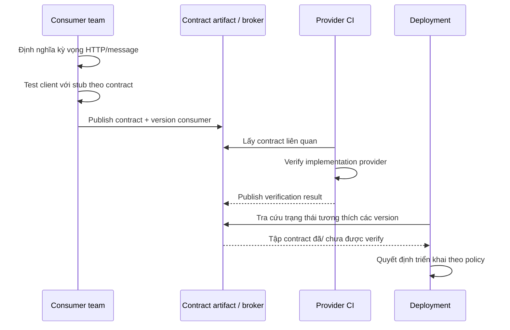
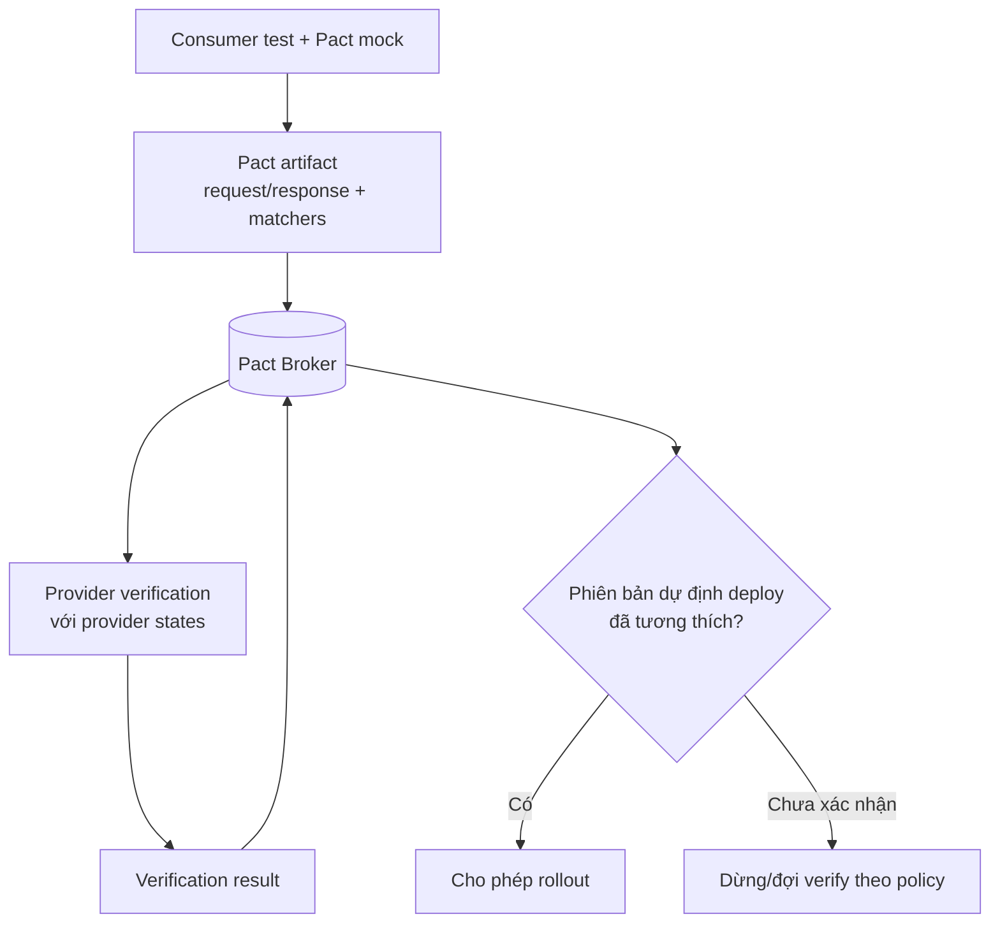
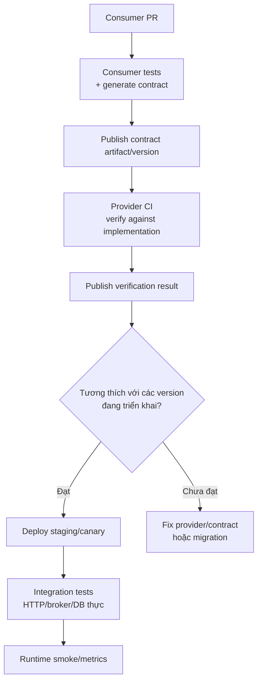

# Consumer-driven contract và phạm vi thư viện hỗ trợ

## 1. Bối cảnh và mục tiêu

Một ứng dụng Spring Boot hiếm khi hoạt động độc lập. `order-service` cần gọi `warehouse-service` qua HTTP để kiểm tra hàng, nhận sự kiện `PaymentCaptured` từ Kafka, ghi vào database và có thể đẩy một bản sao vào cache. Mỗi ranh giới đều có **hợp đồng**: URL, HTTP method, status, JSON schema, tên header, topic, key, kiểu dữ liệu hoặc ý nghĩa của một thông điệp. Chỉ một thay đổi nhỏ ở phía cung cấp cũng có thể khiến phía sử dụng dừng hoạt động dù hai dịch vụ đều biên dịch và khởi động thành công.

Ví dụ, `warehouse-service` đổi response từ:

```json
{"sku":"SKU-42","available":12}
```

thành:

```json
{"sku":"SKU-42","quantityAvailable":"12"}
```

Nếu consumer đang deserialize vào Java record `StockResponse(String sku, int available)`, trường `available` có thể nhận giá trị mặc định `0` khi thiếu field, hoặc lỗi mapping tùy cấu hình. Đây là một **breaking change đối với consumer**, bất kể phía provider cho rằng endpoint vẫn trả `200 OK`.

**Consumer-driven contract (CDC)** là một cách để ghi nhận các hành vi mà *consumer thực sự cần*, rồi xác minh provider vẫn đáp ứng những hành vi đó trước khi thay đổi được triển khai. Nó giúp các nhóm phát triển dịch vụ độc lập nhưng vẫn kiểm soát tương thích.

Trong module **SPRING_BOOT_INTEGRATION**, CDC đặc biệt hữu ích với HTTP client, các adapter Spring Integration và message broker. Đồng thời cần nhìn đúng giới hạn: contract test không tự xác minh tính nhất quán giữa database và broker, chống xử lý trùng, độ trễ, TLS, retry hoặc hoạt động của hạ tầng thật. Những phần đó vẫn cần các lớp kiểm thử và quan sát khác.

Sau bài học, bạn có thể:

1. Giải thích ai là consumer, ai là provider và contract được sinh/xác minh như thế nào.
2. Phân biệt CDC với OpenAPI, JSON Schema, schema registry, mock, unit test và end-to-end test.
3. Chọn đúng phạm vi của Spring Cloud Contract, Pact, WireMock, `MockRestServiceServer`, Spring REST Docs và các công cụ liên quan.
4. Viết một hợp đồng HTTP có cả response thành công lẫn lỗi biên và dùng nó trong CI.
5. Áp dụng tư duy contract cho sự kiện Kafka/RabbitMQ mà không nhầm bảo đảm schema với bảo đảm giao nhận.
6. Thiết kế chiến lược tương thích phiên bản, kiểm thử lỗi, triển khai và theo dõi khi nhiều dịch vụ thay đổi độc lập.

> **Phạm vi phiên bản:** Các ví dụ Java chính sử dụng Java 17+, Spring Boot 3.x, Spring Framework 6.x và API `RestClient` (từ Spring Framework 6.1). Spring Cloud Contract, Pact JVM và Spring Integration phải dùng **version tương thích với BOM/framework của dự án**. Không suy ra một version duy nhất phù hợp đồng thời cho Spring Boot 3.x và 4.x. Ví dụ cấu trúc contract YAML dưới đây là minh họa cho cú pháp HTTP thường dùng của Spring Cloud Contract; hãy kiểm tra DSL/plugin và generator của đúng phiên bản khi đưa vào build thật.

## 2. Consumer-driven contract là gì?

### 2.1. Ba khái niệm chính

| Khái niệm | Giải thích | Ví dụ |
| --- | --- | --- |
| **Consumer** | Ứng dụng sử dụng API hoặc message. | `order-service` gọi API tồn kho. |
| **Provider** | Ứng dụng cung cấp endpoint hoặc phát message. | `warehouse-service` phục vụ `GET /stocks/{sku}`. |
| **Contract** | Tập các tương tác đầu vào/đầu ra mà consumer cần provider giữ ổn định. | GET với SKU hợp lệ trả JSON có `sku` và `available` kiểu số. |

Không nhất thiết consumer phải biết toàn bộ API của provider. Một consumer chỉ sử dụng hai trường có thể viết contract cho hai trường đó; một consumer khác có thể cần thêm `warehouseId`, status `404` hoặc header `ETag`. Tổng hợp các hợp đồng của nhiều consumer cho provider thấy **những hành vi nào hiện có khách hàng phụ thuộc**.

### 2.2. Vòng đời một CDC



Các bước:

1. **Consumer xác định nhu cầu thật:** endpoint, request, các field cần đọc, error semantics và những giả định quan trọng.
2. **Consumer dùng stub/mock được dẫn dắt bởi contract** để phát triển client khi provider còn chưa hoàn tất thay đổi.
3. **Contract được version hóa** (trong repo, artifact repository hoặc contract broker như Pact Broker).
4. **Provider verification** chạy hợp đồng với implementation của provider. Nếu provider đổi response hoặc behavior làm contract fail, CI thông báo trước khi release.
5. **Deployment policy** dùng kết quả verification tương ứng với version/branch/environment, thay vì chỉ thấy một lần build xanh chung chung.

CDC chuyển việc hỏi “provider có chạy được không?” thành “provider có còn cung cấp đúng hành vi mà các consumer đang dùng không?”.

### 2.3. CDC không đồng nghĩa consumer toàn quyền định nghĩa API

Trong thực tế, provider có thể sở hữu chuẩn API, bảo mật, giới hạn tải và quy tắc nghiệp vụ. Consumer đóng góp **hợp đồng sử dụng**: những behavior cần duy trì khi provider thay đổi. Hai nhóm vẫn phải thống nhất tính hợp lý của expectation, chính sách version và cách giải quyết xung đột.

Một CDC trở nên kém hữu ích nếu consumer ghi snapshot toàn bộ response gồm các trường không sử dụng, các ID ngẫu nhiên hoặc timestamp không ổn định. Hợp đồng nên **chặt ở phần quan trọng và linh hoạt ở phần không quan trọng**, nếu framework/matcher hỗ trợ.

## 3. Ranh giới của một hợp đồng tích hợp

### 3.1. Những gì thường nằm trong HTTP contract

| Phần | Ví dụ | Vì sao quan trọng |
| --- | --- | --- |
| Request method/path | `GET /api/v1/stocks/{sku}` | Đổi method hoặc path làm client gọi sai endpoint. |
| Query/path variable | `sku=SKU-42`, `page=0` | Encoding, cách xử lý optional parameter và phân trang. |
| Request headers | `Accept`, `Content-Type`, `Idempotency-Key` | Media type, xác thực và ý nghĩa command. |
| Request body | JSON với `orderId`, `quantity` | Schema, mandatory/optional fields, validation. |
| Response status | `200`, `201`, `204`, `400`, `404`, `409` | Client thường rẽ nhánh theo status. |
| Response headers | `Location`, `ETag`, `Retry-After` | Client có thể sử dụng để truy vấn, cập nhật hoặc retry. |
| Response body | Field, type, nullability, structure | Tránh breaking change khi deserialize. |
| Business semantics | “Cùng idempotency key trả cùng reservation” | Tránh hiểu contract chỉ là JSON shape. |

Một contract đơn lẻ chỉ xác minh các tương tác được mô tả. Nó không chứng minh mọi input đều hoạt động, tất cả validation đều đúng hoặc provider có đủ hiệu năng dưới tải.

### 3.2. Contract, schema và implementation

| Loại bằng chứng | Xác minh được gì? | Không tự chứng minh được gì? |
| --- | --- | --- |
| JSON Schema / Avro / Protobuf schema | Cấu trúc, kiểu, required fields, compatibility theo quy tắc schema. | Endpoint thực thi đúng URL, status, nghiệp vụ hay side effect. |
| OpenAPI | Mô tả toàn API HTTP, path, operation, schema, response dự kiến. | Implementation đang phục vụ đúng spec nếu không có test/validation. |
| CDC interaction test | Provider đáp ứng các tình huống được consumer mô tả. | Hành vi không có trong contract, performance hay lỗi hạ tầng. |
| Unit test | Logic trong method/class khi dependency được giả lập. | Tương thích giữa hai dịch vụ thật. |
| Integration test | Tương tác của các thành phần thật trong một phạm vi nhất định. | Mọi cấu hình và lỗi production không được tái hiện. |
| End-to-end test | Một số user journey qua nhiều hệ thống. | Toàn bộ không gian input/edge case; thường chậm và dễ bị ảnh hưởng môi trường. |

**Định nghĩa hợp đồng theo ngữ nghĩa:** hai JSON cùng shape có thể mang ý nghĩa khác nhau. Ví dụ một field `available` kiểu `int` được đổi từ “số lượng còn sẵn để bán” thành “tổng tồn kho kể cả hàng đã giữ”; test chỉ kiểm tra kiểu có thể vẫn xanh nhưng tích hợp đã sai. Vì vậy, cần mô tả business meaning và có ví dụ đại diện, không chỉ schema.

## 4. Ví dụ xuyên suốt: consumer gọi Warehouse API

Giả sử `order-service` cần kiểm tra tồn kho trước khi nhận đơn. API provider:

```http
GET /api/v1/stocks/SKU-42 HTTP/1.1
Host: warehouse.example.internal
Accept: application/json
X-Correlation-Id: trace-001
```

Phản hồi theo hợp đồng:

```http
HTTP/1.1 200 OK
Content-Type: application/json

{"sku":"SKU-42","available":12,"warehouseId":"HCM-01"}
```

Một tập contract quan trọng hơn chỉ happy path:

| Tình huống | Request | Kết quả mong đợi |
| --- | --- | --- |
| Có SKU | GET `/stocks/SKU-42` | 200, `sku` là chuỗi, `available` số nguyên không âm. |
| SKU không tồn tại | GET `/stocks/UNKNOWN` | 404 với error code đã thống nhất, không phải 200 + số lượng 0 nếu contract không cho phép. |
| SKU sai định dạng | GET `/stocks/%...` | 400 (nếu validation contract quy định), không trả stack trace. |
| Thiếu quyền | GET thiếu token | 401 hoặc 403 theo hợp đồng bảo mật. |
| Upstream giới hạn tần suất | GET vượt quota | 429, có thể kèm `Retry-After`. |
| SKU có ký tự URL đặc biệt | GET với path encoding đúng | Provider diễn giải đúng giá trị, không nhầm phân đoạn path. |
| Response thay đổi phiên bản | GET cùng endpoint | Field đang được sử dụng vẫn giữ kiểu/ý nghĩa hoặc đã có quy trình migration. |

### 4.1. Consumer adapter trong Spring Boot

DTO nên tách khỏi JPA entity và không cần phụ thuộc vào chi tiết nội bộ của provider:

```java
// StockResponse.java
public record StockResponse(
    String sku,
    int available,
    String warehouseId
) {}
```

Gateway dùng `RestClient`:

```java
// WarehouseGateway.java
import org.springframework.http.MediaType;
import org.springframework.web.client.RestClient;

public class WarehouseGateway {
    private final RestClient client;

    public WarehouseGateway(RestClient client) {
        this.client = client;
    }

    public StockResponse getStock(String sku) {
        StockResponse response = client.get()
            .uri("/api/v1/stocks/{sku}", sku)
            .accept(MediaType.APPLICATION_JSON)
            .retrieve()
            .body(StockResponse.class);

        if (response == null) {
            throw new IllegalStateException("Warehouse trả 200 nhưng thiếu body");
        }
        if (response.sku() == null || response.available() < 0) {
            throw new IllegalStateException("Warehouse trả dữ liệu không hợp lệ");
        }
        return response;
    }
}
```

Trong ứng dụng thật, gateway là bean được tạo từ `RestClient.Builder` có `baseUrl`, timeout, authentication, observation và error policy. `RestClient` đồng bộ là phần **client runtime**; nó không tự sinh CDC hay xác minh provider.

**Lưu ý khi thiết kế DTO:** `int available` không phân biệt JSON thiếu field với giá trị `0` khi Jackson được cấu hình theo mặc định. Nếu bắt buộc phải biết trường có mặt và không null, cân nhắc `Integer` + validation sau deserialize, cấu hình strict mapping phù hợp hoặc JSON Schema validation. Contract test phải mô tả kỳ vọng thật, tránh chỉ kiểm tra deserialization thành công.

## 5. Viết một HTTP contract với Spring Cloud Contract

**Spring Cloud Contract (SCC)** hỗ trợ mô tả contract và sinh automated tests cho phía provider, đồng thời tạo stub dùng trong phía consumer. Một nguồn hợp đồng được lưu/version hóa giúp tránh hai team tự viết hai bộ expectation không liên hệ.

### 5.1. Ví dụ cấu trúc contract YAML

Giả sử lưu một file contract dưới cây thư mục contract mà build của provider cấu hình:

```yaml
description: "Warehouse trả tồn kho cho SKU tồn tại"
name: "should_return_stock_for_existing_sku"
request:
  method: GET
  url: /api/v1/stocks/SKU-42
  headers:
    Accept: application/json
response:
  status: 200
  headers:
    Content-Type: application/json
  body:
    sku: SKU-42
    available: 12
    warehouseId: HCM-01
```

Ý nghĩa: với request GET tới một URL cố định và header `Accept` phù hợp, provider trả status 200, media type JSON và các field cần kiểm tra. Công cụ có thể dùng contract này để sinh **provider-side verification test** và/hoặc stub mapping theo cấu hình.

Ví dụ thứ hai cho trường hợp không tồn tại:

```yaml
description: "Warehouse trả lỗi có cấu trúc khi SKU không tồn tại"
name: "should_return_not_found_for_unknown_sku"
request:
  method: GET
  url: /api/v1/stocks/UNKNOWN
response:
  status: 404
  headers:
    Content-Type: application/json
  body:
    code: STOCK_NOT_FOUND
    message: "Không tìm thấy SKU"
```

Hai đoạn YAML minh họa **hai contract khác nhau**; trong dự án cần lưu ở hai file riêng theo cấu trúc contract repository và plugin. Đừng ghi nhiều top-level document thành một file nếu phiên bản DSL/plugin không hỗ trợ.

### 5.2. Tránh contract phụ thuộc dữ liệu ngẫu nhiên

Ví dụ ở trên dùng `SKU-42` cố định và `available=12`. Để generated test chạy ổn định:

- Provider verification phải có dữ liệu fixture hoặc provider state được thiết lập trước test.
- Không kỳ vọng một bản ghi production thật có tồn kho luôn bằng 12.
- Nếu chỉ quan tâm `available` là số nguyên không âm, dùng **matcher** của phiên bản SCC phù hợp thay cho hard-code một con số; ví dụ vẫn có thể chứa giá trị sinh stub đại diện.
- Khi status 404 cần error body, kiểm tra code máy đọc được; không cố định câu chữ hiển thị cho người dùng nếu client chỉ sử dụng code.
- Những field mới ngoài các field consumer đọc không nên khiến test fail nếu contract cho phép mở rộng.

### 5.3. Producer verification và consumer stub

Trong mô hình SCC:

1. Team consumer mô tả contract và tiêu chí pass.
2. Team provider nhận/pull contract, cấu hình SCC verifier và test base class để tạo dữ liệu/khởi động controller tương ứng.
3. Build provider sinh và chạy tests từ contract: nếu endpoint đổi path, trả thiếu field hoặc sai status, build fail.
4. SCC có thể sinh/publish WireMock stubs để consumer dùng trong integration tests.
5. CI liên kết artifact/version contract với phiên bản provider đã verify.

Tùy cách tổ chức, contract có thể nằm trong repo provider, repo riêng hoặc artifact do consumer đóng góp. “Consumer-driven” nằm ở **nguồn kỳ vọng do consumer xác định và provider phải verify**, không phải bắt buộc contract file phải đặt tại một repo nhất định.

SCC không thay thế unit test trong provider, không tạo DB fixture đúng nghiệp vụ một cách kỳ diệu và không tự chạy toàn bộ test qua hạ tầng thật chỉ vì đã sinh stub. Đặc biệt với HTTP, kiểm tra controller/handler theo mock web environment khác với kiểm tra DNS/TLS/gateway ngoài đời.

## 6. Kiểm thử phía consumer bằng `MockRestServiceServer`

Spring Framework cung cấp `MockRestServiceServer` để xác minh **request được client tạo ra**, không cần mở HTTP socket. Đây là công cụ rất phù hợp khi team chỉ muốn kiểm tra chính xác `RestClient` gửi URL, headers, method và xử lý body.

Ví dụ một test:

```java
// WarehouseGatewayTest.java
import static org.junit.jupiter.api.Assertions.assertEquals;
import static org.springframework.test.web.client.match.MockRestRequestMatchers.header;
import static org.springframework.test.web.client.match.MockRestRequestMatchers.method;
import static org.springframework.test.web.client.match.MockRestRequestMatchers.requestTo;
import static org.springframework.test.web.client.response.MockRestResponseCreators.withSuccess;

import org.junit.jupiter.api.Test;
import org.springframework.http.HttpHeaders;
import org.springframework.http.HttpMethod;
import org.springframework.http.MediaType;
import org.springframework.test.web.client.MockRestServiceServer;
import org.springframework.web.client.RestClient;

class WarehouseGatewayTest {

    @Test
    void getStockSendsTheRequestRequiredByTheConsumer() {
        RestClient.Builder builder = RestClient.builder()
            .baseUrl("https://warehouse.test");
        MockRestServiceServer server =
            MockRestServiceServer.bindTo(builder).build();
        WarehouseGateway gateway = new WarehouseGateway(builder.build());

        server.expect(
                requestTo("https://warehouse.test/api/v1/stocks/SKU-42"))
            .andExpect(method(HttpMethod.GET))
            .andExpect(header(HttpHeaders.ACCEPT, "application/json"))
            .andRespond(withSuccess(
                """
                {"sku":"SKU-42","available":12,"warehouseId":"HCM-01"}
                """,
                MediaType.APPLICATION_JSON
            ));

        StockResponse result = gateway.getStock("SKU-42");

        assertEquals("SKU-42", result.sku());
        assertEquals(12, result.available());
        server.verify();
    }
}
```

`MockRestServiceServer.bindTo(builder)` phải dùng cùng builder mà gateway lấy `RestClient` từ đó. Test này chứng minh client xử lý một tương tác đã mô phỏng; nó **không chứng minh provider thật còn trả đúng response**. Để thành CDC xuyên hai repo, cần publish/verify cùng một hợp đồng ở phía provider, ví dụ bằng SCC/Pact, hoặc dùng hợp đồng được quản lý chung và có provider-side validation.

### 6.1. Test phía consumer nên kiểm tra gì?

- HTTP method và URL/path variable được mã hóa đúng.
- Headers như `Accept`, `Content-Type`, `Authorization` (ở dạng test token), correlation ID/idempotency key khi cần.
- Body JSON serialization cho POST/PUT/PATCH, kể cả field null/missing.
- Response 200/201/204 và typed DTO/envelope/generic list.
- 400/404/409/412/429/5xx và cách adapter ánh xạ sang lỗi nghiệp vụ.
- Empty body, malformed JSON, timeout và lỗi kết nối; không lặng lẽ biến 503 thành “không có hàng”.

Đối với client `WebClient`, có thể dùng mock server ở cấp HTTP như WireMock/MockWebServer để kiểm tra I/O reactive hoặc các cách mock `ExchangeFunction` có chủ đích. Không dùng `MockRestServiceServer` cho `WebClient` như thể chúng có cùng request infrastructure.

## 7. Pact: consumer contract và provider verification qua Pact Broker

**Pact** là hệ công cụ CDC đa nền tảng: consumer test khai báo các interaction mà mình sử dụng, sau đó xuất một **pact file**; phía provider chạy verification với pact tương ứng. **Pact Broker** lưu pact và kết quả verification theo version/branch/environment để phối hợp triển khai.

Luồng điển hình:

1. Consumer viết Pact consumer test: dựng một mock provider, khai báo request mong đợi và response mẫu/matchers.
2. Client thực của consumer gọi mock provider; test kiểm tra consumer xây request đúng và xử lý response.
3. Test sinh pact artifact, gắn tên/phiên bản consumer và publish lên Pact Broker.
4. Provider CI lấy pact của các consumer liên quan, chuẩn bị provider state, gửi request thật tới provider chạy ở test environment và so sánh phản hồi.
5. Provider publish verification result. Trước khi deploy có thể dùng quyết định tương thích theo phiên bản dựa trên Broker.



**Pact Broker không phải Kafka/RabbitMQ broker.** Pact Broker là dịch vụ lưu **hợp đồng và kết quả verify**, không tham gia vận chuyển message ở production.

Provider state là cơ chế dựng điều kiện đầu vào cho verification, chẳng hạn “SKU-42 tồn tại và tồn kho là 12”. Việc chuẩn bị state phải ổn định và có thể lặp lại, tránh phụ thuộc dữ liệu production hoặc thứ tự test.

Pact hỗ trợ matcher để không khóa mọi trường vào giá trị tĩnh. Tuy nhiên, nếu matcher quá rộng (ví dụ chấp nhận mọi string cho trường mà nghiệp vụ cần enum hữu hạn), hợp đồng sẽ bỏ lọt breaking change thực tế.

### 7.1. Khi nào cân nhắc Pact?

- Consumer/provider có thể nằm ở nhiều ngôn ngữ hoặc framework khác nhau.
- Các team muốn công bố hợp đồng theo phiên bản để đánh giá tương thích trước deploy.
- Cần biết provider version nào đã verify với từng consumer version.
- Muốn consumer test thực sự chạy client code dựa trên mock provider và xuất pact artifact.

Pact không tự giải quyết tất cả các bước thiết lập mock server, token/identity production, database state, retry sau network partition hoặc side effect ngoài hợp đồng. Giữ pact ở mức tương tác consumer dùng và thêm integration/E2E tests ở nơi cần bằng chứng thực tế.

## 8. Thư viện nào hỗ trợ phần việc nào?

Không có một thư viện Spring duy nhất bao phủ mọi loại hợp đồng. Nên chọn công cụ theo câu hỏi đang cần xác minh.

| Công cụ/thư viện | Phạm vi mạnh nhất | Những điều **không** tự làm |
| --- | --- | --- |
| **Spring Cloud Contract** | Contract DSL; sinh provider verification tests và client stubs; hỗ trợ HTTP/messaging thông qua các integration được cấu hình. | Không tự kiểm tra production broker, transaction liên hệ DB/Kafka hay SLO. |
| **Pact JVM / Pact Broker** | Consumer-driven interaction tests, provider verification, quản lý contract/version và kết quả tương thích. | Không thay thế provider state setup, performance test hoặc infrastructure test. |
| **WireMock** | HTTP server stub/mock; kiểm tra request và mô phỏng status/delay/fault. | Chỉ dùng WireMock riêng lẻ không bảo đảm provider thật tuân thủ cùng expectation. |
| **`MockRestServiceServer`** | Mock HTTP request/response ngay trong test client dùng Spring `RestClient`/`RestTemplate`. | Không mở socket thật, không verify provider. |
| **Spring REST Docs** | Tạo tài liệu API từ test đã chạy, giúp documentation bám hành vi được kiểm tra. | Không mặc nhiên là CDC giữa các repo hoặc thay thế broker verification. |
| **springdoc-openapi / OpenAPI tooling** | Xuất/mô tả API và validation schema/operations khi được bổ sung. | Không tự chứng minh mỗi consumer còn tương thích nếu không có test. |
| **JSON Schema / Avro / Protobuf + Schema Registry** | Schema evolution và kiểm tra tương thích của payload sự kiện. | Không chứng minh consumer commit offset đúng hoặc xử lý side effect lũy đẳng. |
| **AsyncAPI** | Mô tả kênh/message trong hệ thống event-driven. | Tài liệu mô tả không phải bài test broker delivery thật. |
| **Spring Integration Test** | Kiểm tra `IntegrationFlow`, channel, transformer, router, gateway và adapter. | Không tự verify API của đối tác hoặc behavior của filesystem/broker production. |
| **Testcontainers** | Khởi chạy dependency thật (database/broker) trong CI để thử giao thức, serialization và transaction. | Không tự tạo hợp đồng, không chứng minh môi trường production tương đương. |
| **JUnit/AssertJ/Jackson/Bean Validation** | Unit tests, assertions, parsing/validation nội bộ. | Không có cơ chế publish/version/verify CDC xuyên dịch vụ khi dùng riêng lẻ. |

### 8.1. Chọn theo câu hỏi kỹ thuật

| Cần chứng minh | Lựa chọn thường phù hợp |
| --- | --- |
| `RestClient` gửi đúng URL/header/body và hiểu lỗi? | `MockRestServiceServer`; WireMock khi cần HTTP socket thật. |
| Provider có còn đáp ứng consumer đã phát hành? | Spring Cloud Contract hoặc Pact + provider verification. |
| API tài liệu có phản ánh hành vi đã test? | Spring REST Docs; kết hợp OpenAPI tooling nếu cần. |
| Event trên Kafka có schema tương thích? | Avro/JSON Schema/Protobuf và compatibility checks. |
| Message có thực sự serialize/consume qua broker không? | Spring Kafka test + embedded broker/Testcontainers Kafka. |
| DB commit rồi Kafka publish lỗi có mất event không? | Outbox integration/failure tests, chưa đủ bằng CDC đơn thuần. |
| API chịu được 500 RPS và timeout đúng SLO? | Load/performance/resilience tests và metrics. |

**Một đối tượng có thể vừa là provider vừa là consumer**: `order-service` là consumer của warehouse HTTP API, nhưng là provider của `OrderCreated` event mà notification service đọc. Hãy xác định vai trò theo **từng ranh giới**, không theo tên dịch vụ.

## 9. CDC cho message broker: Kafka, RabbitMQ và event payload

Sự kiện bất đồng bộ có contract riêng: tên topic/exchange/routing key, message key, headers, schema, version và ý nghĩa của event. Ví dụ:

```json
{
  "eventId": "f9a4d0d1-8cb0-466f-8903-c40f7b1a2e39",
  "schemaVersion": 1,
  "orderId": "ORD-42",
  "occurredAt": "2026-11-21T02:00:00Z",
  "amount": 125000
}
```

### 9.1. Những gì cần nằm trong event contract

| Thành phần | Ví dụ | Tương thích cần xét |
| --- | --- | --- |
| Event type | `OrderCreated` | Không đổi tên/ngữ nghĩa mà không có migration. |
| Topic/exchange/routing key | `orders.created.v1` | Routing có ảnh hưởng trực tiếp consumer subscription. |
| Record key | `orderId` | Quy định partitioning và thứ tự cục bộ nếu dùng Kafka. |
| `eventId` | UUID ổn định qua retry/replay | Consumer dùng để chống xử lý lặp. |
| `schemaVersion` | `1` | Quy tắc evolution và đọc phiên bản cũ. |
| Dữ liệu bắt buộc | `orderId`, `amount` | Không xóa, đổi kiểu hoặc đổi nghĩa ngoài chính sách. |
| Timestamp | ISO-8601 UTC | Timezone/precision/nullable rõ ràng. |
| Headers | trace ID, content type, schema ID | Loại dữ liệu, propagation, tracing và auth nếu có. |

**Consumer-driven event contract** có thể kiểm tra producer phát ra nội dung phù hợp kỳ vọng của consumer, hoặc consumer đọc được message đại diện. SCC có hỗ trợ contract cho messaging qua các framework tích hợp; Pact cũng có mô hình message interactions. Tuy nhiên, **message contract test thường xác minh message được sinh/tiêu thụ**, không chứng minh broker thực đã lưu, phân vùng, redeliver và commit offset đúng trong mọi tình huống.

### 9.2. Schema compatibility không phải semantic compatibility

Giả sử field `amount` giữ kiểu integer nhưng provider đổi đơn vị từ VND sang đồng xu hoặc đổi sang “số tiền sau thuế”. Schema vẫn hợp lệ, consumer vẫn deserialize, nhưng báo cáo tài chính có thể sai. Contract cần ghi rõ **đơn vị, ý nghĩa và bất biến nghiệp vụ**. Schema registry chỉ áp dụng những luật tương thích về cấu trúc/kiểu mà công cụ hỗ trợ, không đọc được ý định nghiệp vụ.

### 9.3. Các edge case ngoài phạm vi schema contract

1. **Duplicate delivery:** cùng `eventId` được Kafka/RabbitMQ giao lại; handler phải lũy đẳng.
2. **Out-of-order:** `OrderCancelled(version=3)` đến trước `OrderPaid(version=2)`; cần version/sequence.
3. **Offset/ack window:** DB commit thành công nhưng consumer crash trước ack; message có thể đến lại.
4. **Dead-letter:** lỗi deserialize, validation, business error cần recovery/replay; DLT không tự sửa dữ liệu.
5. **Transaction boundary:** database và broker không có transaction ACID chung theo mặc định; outbox/inbox khi cần.
6. **Backpressure/lag:** consumer xử lý chậm hơn producer; schema contract không đo throughput.

Với Spring Boot, cần bổ sung tests với Kafka/RabbitMQ thật (Testcontainers hoặc test broker) và dữ liệu cố tình trùng/sai thứ tự; đo consumer lag, retry, DLT, side effect count và trạng thái database.

## 10. Thiết kế edge-case contracts đúng mức

Happy-path contract là cần thiết nhưng chưa đủ. Những lỗi biên thường gây breaking changes khi provider “chỉ chỉnh nhẹ” error handler hoặc serialization.

### 10.1. HTTP error response nên có dạng ổn định

Ví dụ hợp đồng lỗi:

```http
HTTP/1.1 409 Conflict
Content-Type: application/problem+json

{
  "type": "https://api.example.com/problems/idempotency-key-conflict",
  "title": "Request conflict",
  "status": 409,
  "code": "IDEMPOTENCY_KEY_REUSED",
  "detail": "Khóa đã được dùng với nội dung khác"
}
```

Ở đây dùng dạng mở rộng của **Problem Details** (RFC 9457) với trường custom `code`. Nếu consumer chỉ rẽ nhánh theo `status` và `code`, không cần đóng băng `detail` mang tính hiển thị. Đặt matcher/schema cho các trường bắt buộc; cho phép ngôn ngữ thông báo thay đổi khi không ảnh hưởng client.

### 10.2. Ma trận lỗi cần cân nhắc

| Điểm biên | Ví dụ | Điều nên xác minh bằng contract |
| --- | --- | --- |
| Không tồn tại | GET unknown SKU | Status 404, error code và media type. |
| Thiếu trường bắt buộc | POST thiếu `orderId` | 400/422 theo API, lỗi có cấu trúc. |
| Trường có `null` | PATCH `{"active":null}` | Giữ nguyên, xóa field hay reject? |
| Unicode/encoding | SKU hoặc query có dấu cách/ký tự đặc biệt | Path/query được hiểu đúng. |
| Numeric boundary | `quantity=0`, giá trị âm, overflow | Validation/status và giới hạn hợp đồng. |
| Date/time | Timestamp UTC, timezone, precision | Parser consumer nhận đúng. |
| Danh sách rỗng | `items=[]`, không có trang tiếp | Shape response nhất quán. |
| Pagination | Trang cuối, `nextCursor=null` | Cursor/offset semantics rõ ràng. |
| Conflict | Cùng Idempotency-Key, payload khác | 409 và không tạo thêm side effect. |
| Optimistic concurrency | PUT với `If-Match` cũ | 412, không ghi đè dữ liệu. |
| Rate limit | 429 và `Retry-After` | Header/value format nếu consumer phụ thuộc. |
| Async processing | POST nhận 202 | Có location/status endpoint hay event hoàn tất theo contract. |
| Không có body | DELETE trả 204 | Consumer không cố parse JSON rỗng. |
| Content negotiation | `Accept`/`Content-Type` khác thỏa thuận | 406/415 hoặc representation đúng. |

Không cần tạo contract cho **mọi giá trị đầu vào**. Ưu tiên những nhánh mà consumer có xử lý riêng hoặc những thay đổi dễ phá tương thích. Validation property-based/fuzz testing, security testing và integration testing giải quyết phần không gian đầu vào còn lại.

### 10.3. Những giả định gây test giòn

- Khóa chặt toàn bộ JSON khi consumer chỉ cần một số field.
- So sánh timestamp hoặc correlation ID bằng một giá trị cứng không có fixture.
- Giả định thứ tự phần tử JSON object có ý nghĩa.
- Nhầm field absent và field `null` trong một PATCH.
- Giả định mọi `404` đều đồng nghĩa business “không có hàng”, kể cả khi URL sai.
- Mock trả `200` với response đẹp, còn provider thực trả `206`, `204` hoặc error envelope khác.
- Stub lỗi `503` nhưng bỏ qua timeout, TCP reset, TLS handshake fail và retry behavior ngoài contract.

CDC hữu ích nhất khi kiểm tra **điều consumer thật sự dựa vào**, không phụ thuộc chi tiết triển khai vô tình xuất hiện trong response.

## 11. Compatibility và chiến lược thay đổi API

### 11.1. Thay đổi nào thường an toàn?

| Thay đổi provider | Có thể tương thích khi... | Điều cần xác minh |
| --- | --- | --- |
| Thêm field tùy chọn vào JSON response | Consumer bỏ qua field lạ, không deserialize strict quá mức. | Consumer tests, matcher/schema. |
| Thêm endpoint mới | Endpoint cũ không thay đổi. | Các consumer cũ vẫn verify. |
| Thêm enum value | Consumer xử lý giá trị không biết theo fallback đã định. | Test enum unknown; nhiều consumer Java dùng enum đóng. |
| Thêm field required vào request | Có giá trị mặc định hoặc giữ được contract cũ. | Các consumer cũ vẫn gửi request hợp lệ. |
| Đổi từ `int` sang `string` cho field số | Consumer đã có chính sách tương thích rõ ràng. | Thường là breaking change; verify ở các version consumer. |
| Đổi error code/status | Không có consumer phụ thuộc hoặc có migration được thỏa thuận. | Error-path contracts và rollout. |
| Bỏ field/topic/header | Tất cả consumer đang dùng đã di chuyển. | Kiểm tra contract/version của consumer đã deploy. |

Không coi “thêm field là luôn an toàn” nếu consumer dùng strict deserializer, chữ ký số trên raw JSON hoặc schema đóng. Không coi “thay đổi chỉ nội bộ provider” là an toàn nếu behavior, latency/error hoặc business meaning thay đổi.

### 11.2. Expand–migrate–contract

Một cách nâng cấp phổ biến:

1. **Expand:** provider thêm field/endpoint/event version mới trong khi vẫn phục vụ hợp đồng cũ.
2. **Migrate:** consumer triển khai code đọc phiên bản mới; publish contract mới, provider verify cả phiên bản cũ và mới.
3. **Observe:** xác nhận consumer cũ đã ngừng dùng contract cũ thông qua broker/version deployment và metrics runtime.
4. **Contract:** sau khi bảo đảm không còn consumer phụ thuộc, provider mới bỏ field/endpoint cũ.

Đối với Kafka, không xóa event reader cũ khi còn message trong retention/DLT hoặc replay lịch sử cần đọc. Bản contract mới ở CI không thể làm message cũ đang lưu trên broker tự biến đổi schema.

### 11.3. Ma trận triển khai

Nếu consumer và provider triển khai độc lập:

| Consumer | Provider | Kết quả cần biết |
| --- | --- | --- |
| v1 đang production | v1 đang production | Hợp đồng hiện tại hoạt động. |
| v1 đang production | v2 sắp deploy | Provider v2 có verify pact/contract của consumer v1 không? |
| v2 sắp deploy | v1 đang production | Consumer v2 có dùng field/endpoint mà provider v1 chưa hỗ trợ không? |
| v2 production | v2 production | Contract mới đã verify và quan sát runtime chưa? |

Đừng chỉ kiểm tra phiên bản latest-to-latest. Khoảng thời gian triển khai lệch nhau, rollback và instance đang chạy hai version tạo ra các kết hợp cũ–mới. Pact Broker hoặc hệ quản lý contract/version có thể giúp trả lời câu hỏi tương thích cho từng cặp version; nhưng cần cấu hình CI policy đúng.

## 12. CDC trong CI/CD của một hệ thống Spring Boot

Một pipeline có thể tổ chức:



### 12.1. Consumer pipeline

- Build client adapter và unit tests.
- Dùng stub/mock sinh từ contract hoặc Pact mock provider để chạy consumer interactions.
- Kiểm tra code thật gửi đúng request và parse đúng response.
- Publish contract có metadata tên service, commit SHA, branch/tag và version.
- Không lấy mock status thành bằng chứng provider production đã chạy đúng.

### 12.2. Provider pipeline

- Lấy các contract của những consumer/versions liên quan.
- Dựng provider state/fixtures, khởi chạy controller hoặc HTTP provider test server.
- Verify các hợp đồng, bao gồm 4xx/409/429 và những field thực sự được sử dụng.
- Publish kết quả verification theo commit/version provider.
- Dùng compatibility gate trước rollout; vẫn chạy integration/security/performance tests cần thiết.

### 12.3. Khi một contract fail

Đọc test diff theo thứ tự:

1. Có phải **provider behavior thật sự thay đổi** (status/path/field/type) hay chỉ fixture bị biến động?
2. Hợp đồng có mô tả nhu cầu hợp lý của consumer, hay đang khóa chi tiết không sử dụng?
3. Có cách mở rộng provider để hỗ trợ song song contract cũ và mới không?
4. Nếu bắt buộc breaking change, đã có kế hoạch rollout/version/rollback và xác nhận consumer cũ chưa?
5. Consumer có cần code xử lý error/timeout mới, hay chỉ cập nhật expectation sai?

**Không sửa contract cho “khớp implementation mới” chỉ để làm CI xanh** khi consumer production chưa được triển khai tương ứng. Điều đó làm mất giá trị bảo vệ compatibility của CDC.

## 13. Các giới hạn phải kiểm thử bằng phương tiện khác

### 13.1. Network, security và resilience

Một provider verification test chạy trong process hoặc test HTTP server không tự chứng minh:

- DNS, TLS certificate, mTLS, proxy/load balancer và firewall trong production đúng.
- Token OAuth2/JWT được cấp/refresh và phân quyền đúng cho từng tenant.
- Read/connect timeout, circuit breaker, retry/backoff và connection pool hoạt động khi hệ thống quá tải.
- Rate limit/quota được áp đúng cho từng client, không chỉ trả response mock 429.

Các phần này cần integration tests với network/auth thực hoặc môi trường mô phỏng phù hợp, load/resilience tests và monitoring.

### 13.2. Database, cache và broker

Contract HTTP `POST /orders → 201` không chứng minh:

- Database và outbox event được commit atomically.
- Consumer Kafka không trừ hàng hai lần sau redelivery.
- Cache không ghi lùi khi sự kiện đến sai thứ tự.
- Transaction rollback sau HTTP timeout không gây trạng thái lệch giữa hai dịch vụ.
- DLT được tạo đúng khi deserialize fail hoặc worker quá tải.

Kiểm thử chính các bất biến này bằng transaction/integration/fault-injection tests với database, broker và các adapter thật. Ví dụ, gửi cùng `eventId` hai lần tới Kafka, crash consumer sau DB commit nhưng trước offset commit, rồi kiểm tra chỉ có một side effect.

### 13.3. Semantics ngoài payload

Nếu contract chỉ nói `{"available":12}` mà business rule đã đổi thành “tổng tồn kho” thay vì “có thể bán”, producer verification vẫn có thể pass. Cần business integration tests, domain invariants, metric cảnh báo và sự phối hợp của hai team để bảo vệ **ý nghĩa** dữ liệu.

### 13.4. Một công cụ có thể tạo false confidence

**Mock đi cùng implementation** có thể cùng sai với implementation. Ví dụ, team provider tự sửa cả controller và WireMock stub trong một commit; consumer không có hợp đồng riêng để bắt đổi `available` thành `quantityAvailable`. CDC giải quyết một phần bằng cách cho consumer kiểm soát expectation và provider phải verify; nhưng nếu consumer test không bao phủ field quan trọng, breaking change vẫn có thể lọt qua.

## 14. Thực hành đề xuất cho nhiều loại tích hợp

Một cấu trúc hợp đồng và kiểm thử thực dụng:

| Ranh giới | Contract owner | Contract kiểm tra | Test bổ sung |
| --- | --- | --- | --- |
| `order-service → warehouse HTTP` | Consumer đặt kỳ vọng, provider xác nhận | GET stock, POST reservation, error/status, idempotency key. | Timeout, retry, TLS, provider state, đối soát reservation. |
| `payment-service → Kafka → order-service` | Consumer Order đặt kỳ vọng event; Payment phát | Event type, topic, key, schemaVersion, amount/currency. | Broker integration, duplicate/out-of-order, offset, DLT. |
| `batch importer → MongoDB/PostgreSQL` | Nghiệp vụ/DB schema owner | DTO/document schema, unique batch ID, version. | Transaction rollback, concurrency, index, pool timeout. |
| `Spring Integration file adapter ↔ partner` | Hai bên thỏa thuận file contract | Tên, extension, encoding, columns, checksum, .done/.writing. | Temp rename, permission, file lớn, restart, two-reader race. |
| `order-service → Redis/cache` | Application team | Key/value schema, TTL/invalidation semantics. | Failover, concurrent updates, stale writes và cache stampede. |

CDC phù hợp nhất ở **giao diện tiêu thụ giữa những nhóm phát triển độc lập**. Với hợp đồng giữa hai package cùng repository, type-safe interface và module-level tests có thể đã đủ; không cần thêm Pact Broker chỉ để kiểm tra một method nội bộ.

## 15. Những sai lầm thường gặp

| Sai lầm | Hậu quả | Cách khắc phục |
| --- | --- | --- |
| Đặt tên mọi mock test là “CDC” | Provider có thể đổi mà consumer không biết. | Publish contract và provider verification dùng cùng artifact. |
| Chỉ test 200 happy path | 404/409/429/204 khác contract làm client lỗi. | Thêm edge cases consumer thực sự xử lý. |
| So sánh nguyên JSON bằng snapshot | Thêm trường không liên quan làm test fail. | Matcher/schema theo field consumer sử dụng. |
| Matcher quá lỏng | Đổi nghĩa/kiểu dữ liệu quan trọng vẫn pass. | Required fields, type/format/range và rule nghiệp vụ. |
| Provider verification phụ thuộc dữ liệu production | Test flaky, khó chạy lại. | Provider states/fixtures riêng. |
| Dùng OpenAPI file như bằng chứng runtime | Spec và implementation có thể lệch. | Thêm contract/runtime verification. |
| Dùng schema registry rồi bỏ consumer tests | Message hợp schema nhưng handler/broker policy sai. | Test deserialize, idempotency, offset, ordering. |
| Không version contract | Không biết version nào được verify với consumer đang chạy. | Quản lý contract + provider result theo commit/version. |
| Chỉ verify latest consumer với latest provider | Rollback/mixed-version rollout có thể hỏng. | Kiểm tra ma trận version đang deploy. |
| Sửa contract theo implementation cho xanh CI | Che breaking change đối với consumer cũ. | Giữ contract cũ đến khi migration hoàn tất. |
| Tin stub server chứng minh TLS/circuit breaker | Lỗi production không được kiểm tra. | Integration/resilience tests thật. |
| Coi schema giống nhau là nghiệp vụ giống nhau | Đổi đơn vị tiền/tồn kho gây sai kết quả. | Viết semantics và domain invariants rõ. |
| Nhầm Pact Broker với Kafka broker | Thiết kế pipeline sai trách nhiệm. | Tách hợp đồng/verification khỏi message transport. |
| Dùng CDC để khẳng định exactly-once | Side effect DB/email vẫn có thể nhân đôi. | Inbox/outbox, unique constraints, fault injection. |

## 16. Checklist triển khai CDC cho Spring Boot integration

1. **Vẽ ranh giới:** xác định consumer/provider theo từng HTTP operation, event type hoặc file exchange.
2. **Chốt owner và semantics:** ai viết expectation, ai verify, ai phê duyệt breaking change.
3. **Chọn công cụ:** SCC hoặc Pact cho CDC; MockRestServiceServer/WireMock cho HTTP client test; schema registry cho event; Testcontainers cho broker/DB.
4. **Ghi contract rõ:** request method/path/headers/body, response status/headers/body; event type/key/version/schema; error codes và edge cases cần thiết.
5. **Viết consumer test từ code thật:** stub/mock phải được dùng bởi client adapter, không chỉ so JSON bằng tay.
6. **Chạy provider verification:** kiểm thử implementation cùng provider state ổn định; publish result theo version.
7. **Kiểm soát deploy:** kiểm tra compatibility với những phiên bản đang chạy, chuẩn bị rollout/rollback và expand–migrate–contract.
8. **Kiểm thử ngoài contract:** auth/TLS, timeout, resilience, DB transaction, idempotency, Kafka redelivery, DLT, file adapter rename và cache consistency.
9. **Quan sát runtime:** latency/error status, consumer lag, contract-related parsing errors, schema version distribution và retry/DLT.
10. **Duy trì hợp đồng:** cập nhật khi consumer thực sự thay đổi nhu cầu; loại bỏ contract cũ sau khi đã xác nhận migration.

**Câu hỏi tự kiểm tra**

1. Vì sao một test dùng `MockRestServiceServer` cho `RestClient` chưa đủ để gọi là CDC xuyên hai dịch vụ?
2. Trong CDC, consumer định nghĩa điều gì và provider phải kiểm chứng điều gì?
3. Sự khác nhau giữa Pact Broker và Kafka broker là gì?
4. Một JSON thêm field mới có luôn tương thích không? Khi nào strict deserialization làm nó không tương thích?
5. Vì sao schema registry không bảo đảm event `OrderPaid` chỉ được ghi một lần vào database?
6. Nếu provider đổi 404 thành 200 với body rỗng, consumer nào có thể bị ảnh hưởng?
7. Khi consumer v1 vẫn chạy production, vì sao provider v2 phải verify cả hợp đồng v1?
8. Tại sao producer verification trong test environment không thay thế kiểm thử TLS, rate limit hoặc circuit breaker ở production?
9. Vì sao `available` vẫn là số nguyên nhưng đổi ý nghĩa từ “bán được” sang “tổng tồn kho” có thể là breaking change?

## 17. Tài liệu tham khảo

- [Spring Cloud Contract — Reference Documentation](https://docs.spring.io/spring-cloud-contract/reference/): Contract DSL, Verifier, Stub Runner, producer/consumer workflow và messaging.
- [Pact — Documentation](https://docs.pact.io/): consumer-driven contracts, provider verification, Pact Broker và versioning.
- [Spring Framework — REST Client Testing](https://docs.spring.io/spring-framework/reference/testing/spring-mvc-test-client.html): công cụ và chiến lược kiểm thử HTTP client trong Spring.
- [Spring Framework — REST Clients](https://docs.spring.io/spring-framework/reference/integration/rest-clients.html): `RestClient`, `WebClient`, HTTP Interface và error handling.
- [WireMock — Documentation](https://wiremock.org/docs/): HTTP stubbing, request matching, faults và response templating.
- [Spring REST Docs — Reference](https://docs.spring.io/spring-restdocs/docs/current/reference/htmlsingle/): tạo tài liệu API từ các bài kiểm thử.
- [OpenAPI Specification](https://spec.openapis.org/oas/latest.html): mô tả hợp đồng HTTP API.
- [AsyncAPI Specification](https://www.asyncapi.com/docs/reference/specification/latest): mô tả contract event/message channel.
- [Spring for Apache Kafka — Reference](https://docs.spring.io/spring-kafka/reference/): Kafka client, testing, errors, transactions và message delivery.
- [RFC 9457 — Problem Details for HTTP APIs](https://www.rfc-editor.org/rfc/rfc9457): response lỗi có cấu trúc và trường mở rộng.
