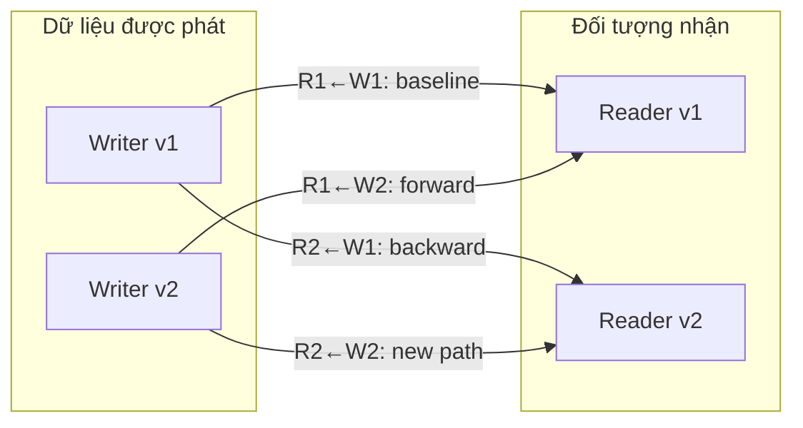
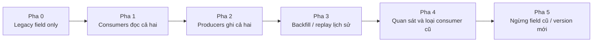
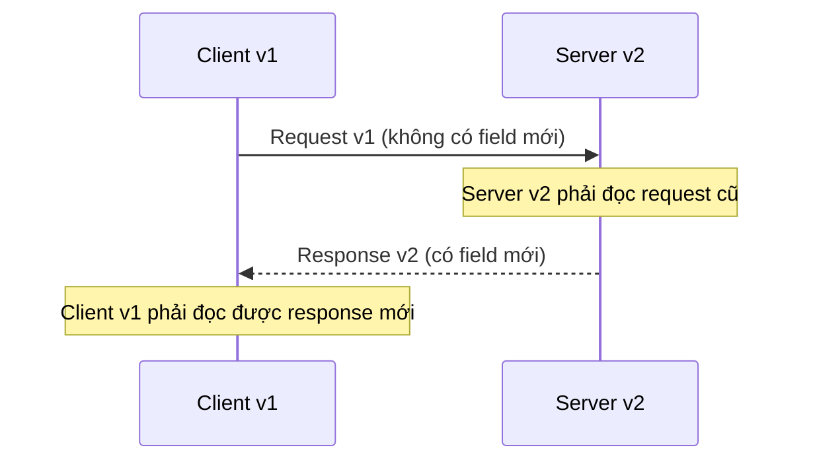
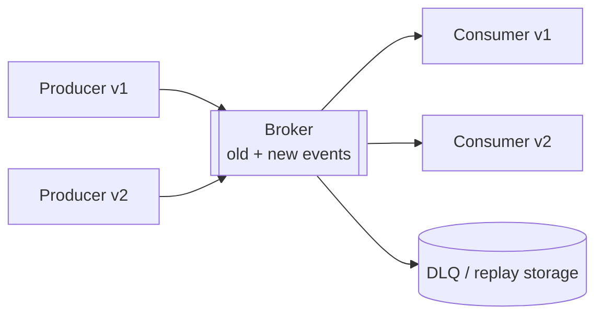
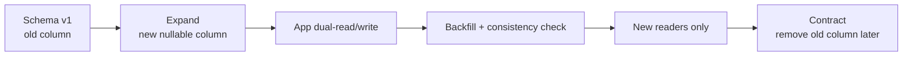
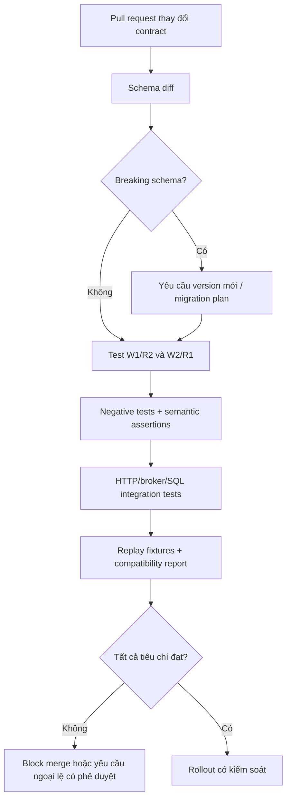
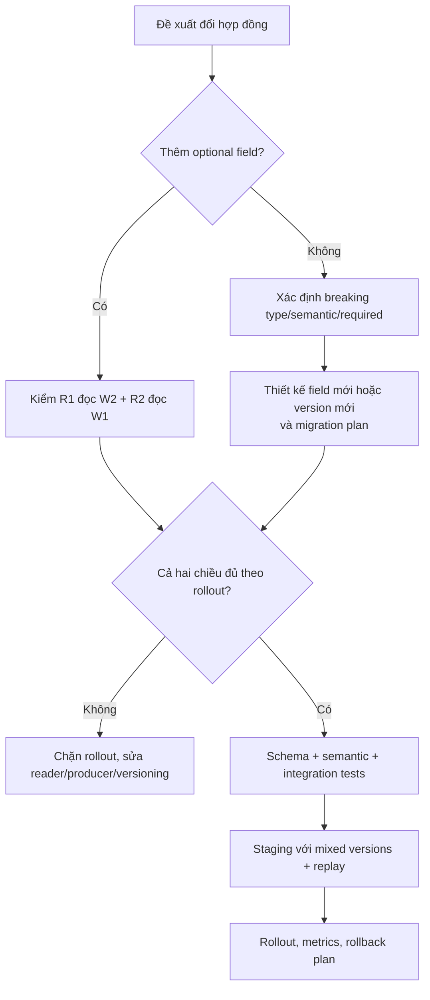

# Kiểm chứng tương thích ngược khi thêm trường hoặc thay đổi kiểu

Một hệ thống tích hợp có thể chạy ổn định trong nhiều tháng, sau đó hỏng chỉ vì một thay đổi nhỏ trong JSON: producer thêm trường `salesChannel`, chuyển `amount` từ chuỗi sang số hoặc đổi `status` từ `"PAID"` thành `"SETTLED"`. Trong một ứng dụng triển khai đồng thời cùng lúc, sự khác biệt có thể được phát hiện ngay. Nhưng ở hệ thống phân tán, **producer và consumer thường không được nâng cấp cùng thời điểm**: còn instance cũ, message trong broker, dữ liệu cache, tệp trao đổi hoặc client của đối tác chưa cập nhật.

**Tương thích ngược** không chỉ có nghĩa JSON mới “vẫn parse được”; nó có nghĩa một phiên bản hệ thống vẫn hiểu và xử lý đúng những dữ liệu mà nó phải gặp trong cửa sổ triển khai và replay. Muốn chứng minh điều đó, cần kiểm tra cả **schema**, **ngữ nghĩa nghiệp vụ**, **dữ liệu thực**, **quy trình triển khai** và **khả năng phục hồi**.

Bài thuộc chương **Hợp đồng và lỗi biên** của module **SPRING_BOOT_INTEGRATION**. Trong module này, Spring Boot kết nối hệ thống qua HTTP client, SQL, cache, broker thông điệp và các adapter Spring Integration. Vì vậy, chúng ta sẽ xét tương thích cho JSON HTTP, sự kiện Kafka/RabbitMQ, cơ sở dữ liệu, tệp tích hợp và mô hình dữ liệu nội bộ; kiểm soát trường mới, kiểu dữ liệu, lỗi, retry, xử lý trùng lặp, kiểm thử và observability.

> **Phạm vi ví dụ:** Java 17+, Spring Boot 3.x và Jackson 2.x cho các đoạn code; nguyên tắc hợp đồng áp dụng rộng hơn. Spring Boot 4.x, Jackson 3.x, serializer Avro/Protobuf hoặc các binder khác có thể thay đổi package và cơ chế cấu hình. Các ví dụ là tài liệu học tập; kiểm thử thực tế cần dùng đúng dependency và contract của dự án.

## 1. Mục tiêu học tập

Sau bài này, bạn có thể:

1. Định nghĩa **backward**, **forward**, **full compatibility** và phân biệt chúng với binary/source compatibility.
2. Vẽ ma trận **old/new producer × old/new consumer** trước khi thay đổi payload.
3. Xác định khi nào **thêm trường tùy chọn** tương thích và khi nào thêm trường vẫn làm hỏng consumer cũ.
4. Nhận diện các thay đổi **không an toàn**: đổi kiểu, đổi tên, đổi enum, đổi đơn vị, đổi định dạng ngày giờ hoặc cách biểu diễn null.
5. Sử dụng Jackson và validation tại biên một cách có chủ đích, không dựa vào coercion ngầm để “qua được test”.
6. Thiết kế migration kiểu dữ liệu theo chiến lược **add → dual read/write → migrate → remove**.
7. Kiểm chứng hợp đồng giữa HTTP API, broker, SQL, cache và file adapter qua unit test, contract test, integration test và replay.
8. Thiết lập CI gate, rollout và rollback an toàn khi các phiên bản cùng tồn tại.
9. Quan sát schema/version mismatch, lỗi giải mã, dữ liệu bị quarantine và độ trễ xử lý.

## 2. Hợp đồng dữ liệu không chỉ là danh sách trường

Hợp đồng giữa hai hệ thống bao gồm ít nhất:

| Khía cạnh | Ví dụ | Nếu thay đổi sai |
| --- | --- | --- |
| **Cấu trúc** | JSON object với `orderId`, `status` | Consumer không tìm thấy trường |
| **Kiểu** | `totalMinor` là integer, `currency` là string | Lỗi parse hoặc mất độ chính xác |
| **Bắt buộc/tùy chọn** | `eventId` bắt buộc, `salesChannel` tùy chọn | Dữ liệu cũ không thỏa schema mới |
| **Giá trị hợp lệ** | `status ∈ {CREATED, PAID, CANCELLED}` | Enum mới làm consumer cũ lỗi |
| **Ngữ nghĩa** | `totalMinor` là đơn vị tiền nhỏ nhất | Truyền giá trị đúng kiểu nhưng tính sai tiền |
| **Thời gian** | `occurredAt` là ISO 8601 UTC | Sai múi giờ hoặc nhầm giây với mili giây |
| **Định danh** | `(source, eventId)` xác định sự kiện | Retry tạo tác dụng phụ hai lần |
| **Hành vi HTTP** | 200 trả object; 204 không có body | Client cũ cố decode body rỗng |
| **Thứ tự/phiên bản** | `aggregateVersion` tăng dần theo aggregate | Event cũ ghi đè trạng thái mới |
| **Giới hạn vận hành** | Max size, rate limit, TTL, replay window | Consumer quá tải hoặc mất dữ liệu |

**Schema compatibility** là điều kiện quan trọng nhưng chưa đủ cho **semantic compatibility**. Ví dụ đổi ý nghĩa `quantity = 1` từ *một chiếc* thành *một thùng* vẫn giữ kiểu integer và có thể vượt qua mọi bài kiểm tra JSON Schema, nhưng phá nghiệp vụ.

Tương tự, đổi HTTP status từ `200` sang `202` có thể không thay một byte JSON nào, nhưng client cũ đang hiểu “200 nghĩa là đã hoàn tất” sẽ sai. Do đó hợp đồng cần gắn **dữ liệu và hành vi**.

## 3. Định nghĩa backward và forward theo người đọc/người ghi

Có hai vai trò:

- **Writer/producer** tạo dữ liệu. Ví dụ API server trả JSON hoặc Kafka producer phát event.
- **Reader/consumer** nhận và giải mã dữ liệu. Ví dụ WebClient, Kafka listener hoặc Spring Integration transformer.

Quy ước:

- `W1`: writer cũ.
- `W2`: writer mới.
- `R1`: reader cũ.
- `R2`: reader mới.

| Khả năng | Cặp cần kiểm tra | Câu hỏi |
| --- | --- | --- |
| **Backward compatibility** | **R2 đọc W1** | Consumer mới có đọc dữ liệu cũ được không? |
| **Forward compatibility** | **R1 đọc W2** | Consumer cũ có đọc dữ liệu mới được không? |
| **Full compatibility** | Cả **R2 ← W1** và **R1 ← W2** | Hai phía nâng cấp độc lập có an toàn trong cả hai chiều không? |
| **Chỉ kiểm tra phiên bản mới** | **R2 đọc W2** | Kiểm tra happy path, **chưa chứng minh tương thích** |

Với một REST API, cách dùng thuật ngữ có thể khác nhau tùy phía nào được xem là reader; vì vậy trong ticket/PR nên **ghi trực tiếp các cặp producer–consumer**, tránh tranh luận thuật ngữ.



Trong một lần **rolling deployment**, cả bốn cặp có thể xảy ra. Message tồn trong broker hoặc file đã lưu còn kéo dài cửa sổ dữ liệu cũ **sau khi mọi instance producer đã nâng cấp**.

### 3.1. Source, binary và wire compatibility là ba chuyện khác

- **Source compatibility**: code Java gọi interface cũ còn biên dịch với thư viện mới hay không.
- **Binary compatibility**: bytecode đã biên dịch còn chạy với phiên bản thư viện mới hay không.
- **Wire/data compatibility**: payload JSON, Avro, Protobuf, XML hoặc giao thức HTTP vẫn được các bên hiểu đúng hay không.

Một bản nâng cấp Spring Boot/Jackson có thể tương thích ở tầng wire nhưng không tương thích binary với một thư viện Java. Ngược lại, Java record giữ nguyên tên/kiểu nhưng thay ý nghĩa giá trị sẽ biên dịch tốt mà phá hợp đồng nghiệp vụ.

## 4. Ví dụ xuyên suốt: OrderCreated v1 và v2

Giả sử hệ thống Order phát sự kiện `OrderCreated` khi đơn được tạo.

**Hợp đồng v1:**

```json
{
  "eventId": "evt-101",
  "orderId": "ORD-101",
  "status": "CREATED",
  "occurredAt": "2026-11-21T03:00:00Z"
}
```

Một đề xuất v2 bổ sung nguồn phát sinh đơn:

```json
{
  "eventId": "evt-101",
  "orderId": "ORD-101",
  "status": "CREATED",
  "occurredAt": "2026-11-21T03:00:00Z",
  "salesChannel": "MOBILE"
}
```

Câu hỏi cần trả lời:

1. Consumer v1 có chấp nhận **trường không biết** `salesChannel` hay bị lỗi?
2. Consumer v2 khi đọc event v1 **thiếu `salesChannel`** thì làm gì?
3. `salesChannel` có thực sự là optional, hay business code v2 sẽ gọi `salesChannel.equals(...)` mà không kiểm tra null?
4. Nếu muốn đặt giá trị mặc định, `UNKNOWN` có đúng nghĩa nghiệp vụ không, hay nên giữ trạng thái “không xác định”?
5. Hợp đồng JSON Schema/OpenAPI/registry có cho phép trường mới không?
6. Các listener, cache, DLQ/replay job và ứng dụng phân tích dữ liệu có cùng quy tắc không?

Chỉ sau khi trả lời, thử v2 payload với v1 consumer và v1 payload với v2 consumer mới có ý nghĩa.

## 5. Thêm trường: điều kiện để một thay đổi là tương thích

### 5.1. Thêm trường optional thường là thay đổi *có thể* an toàn

Bổ sung `salesChannel` có thể tương thích nếu:

- **R1** bỏ qua hoặc cho phép trường không biết (unknown field).
- **R2** chấp nhận payload v1 không có trường này.
- Không có rule nghiệp vụ bắt buộc `salesChannel` trong mọi event.
- Tầng xác thực schema không dùng cấu hình closed schema cấm trường bổ sung.
- Tầng forwarding, signing, hash, canonical JSON hoặc log không lệ thuộc vào chính xác tập field cũ.
- Việc thêm field không làm vượt giới hạn kích thước message hoặc thay đổi hành vi routing/filter.

**Ví dụ phá vỡ dù chỉ thêm trường:**

```json
{
  "eventId": "evt-101",
  "orderId": "ORD-101",
  "status": "CREATED",
  "occurredAt": "2026-11-21T03:00:00Z",
  "salesChannel": "MOBILE"
}
```

Nếu R1 dùng JSON Schema:

```json
{
  "type": "object",
  "properties": {
    "eventId": { "type": "string" },
    "orderId": { "type": "string" },
    "status": { "type": "string" },
    "occurredAt": { "type": "string" }
  },
  "additionalProperties": false
}
```

thì field `salesChannel` bị từ chối, bất kể business code có sử dụng nó hay không. Đây là một **closed-world contract**. Thay đổi chỉ an toàn nếu các consumer được phép đọc field mới, dùng chiến lược version hoặc đã nâng schema cho các consumer cần thiết.

### 5.2. Thêm trường required thường phá backward compatibility

Giả sử v2 quy định `salesChannel` là **required**. Một event v1 không có trường này:

```json
{
  "eventId": "evt-old",
  "orderId": "ORD-OLD",
  "status": "CREATED",
  "occurredAt": "2025-10-15T07:30:00Z"
}
```

sẽ không thỏa validation của reader v2 nếu reader mới yêu cầu trường hiện diện. Khi replay broker hoặc đọc file lịch sử, consumer v2 có thể dừng xử lý.

Một cách phát triển an toàn hơn:

1. Thêm `salesChannel` với ý nghĩa **optional**.
2. Cho reader v2 nhận null/missing với xử lý rõ ràng.
3. Cho writer v2 bắt đầu điền trường đó khi biết giá trị.
4. Theo dõi tỷ lệ thiếu trường ở nguồn dữ liệu thật.
5. Chỉ chuyển thành required sau khi hết cửa sổ replay và đã xử lý toàn bộ writer cũ, hoặc mở **contract version mới** nếu không thể bảo đảm.

**Đừng vội chuyển null thành một giá trị hợp lệ giả.** Ví dụ `salesChannel = "MOBILE"` khi không có dữ liệu có thể làm sai báo cáo doanh thu. Nếu business cần phân biệt thiếu dữ liệu, dùng `UNKNOWN` có hợp đồng rõ hoặc mô hình tùy chọn.

### 5.3. Missing và explicit null không phải một

Ba payload khác nhau:

```json
{"eventId":"evt-1"}
```

```json
{"eventId":"evt-1","salesChannel":null}
```

```json
{"eventId":"evt-1","salesChannel":""}
```

Chúng có thể mang ba ý nghĩa:

- Không gửi trường vì producer cũ chưa biết nó.
- Producer mới biết trường nhưng giá trị hiện chưa xác định.
- Producer gửi một chuỗi rỗng (có thể vi phạm validation).

Một số thư viện mapping sẽ đưa cả **missing** và **explicit null** vào giá trị Java `null`, làm mất khả năng phân biệt. Nếu ngữ nghĩa cần phân biệt (ví dụ HTTP PATCH: *không sửa* và *xóa giá trị*), phải dùng JSON tree, patch model hoặc wrapper biểu diễn **presence** thay vì chỉ dựa vào field nullable.

## 6. Jackson: tolerant reader và validation tại biên

### 6.1. Dùng annotation để quy định unknown field rõ ràng

**`OrderEventV1.java`**

```java
package com.example.integration.contracts;

import com.fasterxml.jackson.annotation.JsonIgnoreProperties;

@JsonIgnoreProperties(ignoreUnknown = true)
public record OrderEventV1(
        String eventId,
        String orderId,
        String status,
        String occurredAt
) {}
```

**`OrderEventV2.java`**

```java
package com.example.integration.contracts;

import com.fasterxml.jackson.annotation.JsonIgnoreProperties;

@JsonIgnoreProperties(ignoreUnknown = true)
public record OrderEventV2(
        String eventId,
        String orderId,
        String status,
        String occurredAt,
        String salesChannel
) {}
```

`@JsonIgnoreProperties(ignoreUnknown = true)` cho phép Jackson bỏ qua field chưa khai báo khi deserialize hai record này. Điều đó hữu ích với những event được thiết kế để mở rộng. Nhưng **không phải ứng dụng nào cũng nên bỏ qua mọi field lạ**: với hợp đồng cần phát hiện typo hoặc trường bảo mật quan trọng, cần strict validation tại boundary.

**Không dựa vào giả định “Spring Boot mặc định thế nào”**: hành vi Jackson có thể được cấu hình khác nhau giữa `ObjectMapper`, `JsonMapper`, HTTP message converter và Kafka serializer/deserializer. Annotation cục bộ tạo ý định rõ cho các type này; test phải dùng **mapper thực sự của ứng dụng**.

### 6.2. Unit test hai chiều với fixture

```java
package com.example.integration.contracts;

import static org.junit.jupiter.api.Assertions.*;

import com.fasterxml.jackson.databind.ObjectMapper;
import org.junit.jupiter.api.Test;

class OrderEventCompatibilityTest {

    private final ObjectMapper mapper = new ObjectMapper();

    private final String v1Payload = """
            {
              "eventId": "evt-101",
              "orderId": "ORD-101",
              "status": "CREATED",
              "occurredAt": "2026-11-21T03:00:00Z"
            }
            """;

    private final String v2Payload = """
            {
              "eventId": "evt-101",
              "orderId": "ORD-101",
              "status": "CREATED",
              "occurredAt": "2026-11-21T03:00:00Z",
              "salesChannel": "MOBILE"
            }
            """;

    @Test
    void oldReaderAcceptsNewPayload_whenUnknownFieldsAllowed()
            throws Exception {
        OrderEventV1 old = mapper.readValue(
                v2Payload, OrderEventV1.class);
        assertEquals("evt-101", old.eventId());
        assertEquals("CREATED", old.status());
    }

    @Test
    void newReaderAcceptsOldPayload_whenFieldIsOptional()
            throws Exception {
        OrderEventV2 newer = mapper.readValue(
                v1Payload, OrderEventV2.class);
        assertNull(newer.salesChannel());
        assertEquals("ORD-101", newer.orderId());
    }

    @Test
    void newReaderUnderstandsNewPayload() throws Exception {
        OrderEventV2 newer = mapper.readValue(
                v2Payload, OrderEventV2.class);
        assertEquals("MOBILE", newer.salesChannel());
    }
}
```

Các test trên chứng minh **hành vi deserialize** với payload được chọn, chưa kiểm chứng dữ liệu đã **hợp lệ về nghiệp vụ**. Ví dụ còn cần kiểm tra `eventId`/`orderId` không blank, `status` thuộc tập hợp hợp lệ và `occurredAt` là thời điểm có thể đọc được.

**Không có `@NotNull` không có nghĩa domain được phép dùng null tùy ý.** Ngược lại, việc đặt `@NotNull` vào DTO cũng không tự phát sinh Bean Validation khi code chỉ gọi `ObjectMapper.readValue(...)`. Cần thực thi validation thật tại boundary, ví dụ qua Spring Validator/Bean Validation hoặc hàm kiểm tra rõ ràng.

### 6.3. Một consumer tolerance quá rộng có thể nguy hiểm

Giả sử producer nhầm tên `tenantId` thành `tenentId`. Nếu reader bỏ qua unknown field và dùng một tenant mặc định, dữ liệu có nguy cơ rò rỉ giữa tenant hoặc bị xử lý sai.

Chính sách cân bằng:

- **Field bắt buộc phục vụ định danh, bảo mật, idempotency, tiền và version**: validate nghiêm.
- **Field mở rộng không ảnh hưởng bất biến**: có thể cho phép unknown field và optional.
- Ghi log/metric về unknown field có kiểm soát nếu cần phát hiện thay đổi contract.
- Dùng schema/version review để chặn thay đổi ngoài kế hoạch, thay vì chỉ tin vào Jackson.

## 7. Đổi kiểu: vì sao nguy hiểm hơn thêm trường?

### 7.1. Ví dụ string → number

Ban đầu:

```json
{"orderId":"ORD-101","totalAmount":"125.50","currency":"USD"}
```

Đề xuất mới:

```json
{"orderId":"ORD-101","totalAmount":125.50,"currency":"USD"}
```

Hai giá trị `"125.50"` và `125.50` không có cùng **JSON type**: một là `string`, một là `number`. Có thư viện Java tự ép kiểu theo mặc định, nhưng client JavaScript, JSON Schema strict, hệ thống lưu trữ hoặc consumer khác có thể từ chối.

Ngay cả khi Jackson đọc thành công:

- Số thực binary có thể mất độ chính xác khi biểu diễn tiền.
- Một số client không giữ nguyên `125.50` và `125.5` như cùng chuỗi hiển thị.
- Khác biệt decimal scale có thể ảnh hưởng chữ ký/hash hoặc so sánh snapshot.
- Nếu người gửi bắt đầu dùng integer number, consumer dựa vào decimal string có thể tính sai.

**Không dùng permissive type coercion làm bằng chứng tương thích.** Test phải kiểm tra JSON type và giá trị/đơn vị thực.

### 7.2. Ma trận rủi ro khi thay đổi dữ liệu

| Thay đổi | Mức rủi ro | Vì sao |
| --- | --- | --- |
| Thêm field optional, reader bỏ qua unknown | Thường thấp | Vẫn phải kiểm tra mọi consumer và semantic |
| Thêm field required, không có default | Cao | Old writer không gửi field |
| Đổi `string` thành `number` | Cao | Parse/schema/coercion, precision, locale |
| Đổi `int` thành `long` | Trung bình–cao | Old reader có thể overflow; JavaScript mất chính xác với số lớn |
| Đổi `long` thành `int` | Cao | Thu hẹp miền giá trị |
| Đổi `boolean` thành `"Y"/"N"` | Cao | Đổi JSON type và nghĩa |
| Đổi `timestamp` giây thành mili giây | Rất cao | Kiểu có thể không đổi nhưng thời điểm sai ×1000 |
| Đổi `"2026-..."` sang epoch number | Cao | Đổi type, timezone và precision |
| Đổi tên field | Cao | Old reader thiếu field cũ |
| Thêm enum value | Tùy consumer | Switch exhaustive/unknown enum có thể lỗi |
| Đổi nghĩa enum cũ | Rất cao | Parse được nhưng hành vi sai |
| Đổi null → empty array/string | Tùy semantics | Có thể đổi ý nghĩa “không có dữ liệu” |
| Đổi thứ tự trường JSON | Thường thấp | JSON object không dựa vào thứ tự, trừ khi ký/hashing/custom parser sai |
| Xóa field cũ | Cao | Old reader vẫn cần nó |

### 7.3. Số nguyên lớn và độ chính xác

Java `long` chứa số nguyên 64-bit có dấu. JavaScript `Number` dùng floating-point double và chỉ biểu diễn chính xác mọi số nguyên trong khoảng từ `-(2^53 - 1)` đến `2^53 - 1`.

Ví dụ JSON:

```json
{"sequence":9007199254740993}
```

Một consumer JavaScript đọc thành Number có thể mất độ chính xác. Đừng kết luận việc đổi `int32 → int64` “chỉ mở rộng” là an toàn cho mọi hệ sinh thái. Với ID lớn, có thể truyền dưới dạng **string có contract rõ** và cung cấp field mới thay vì âm thầm đổi field cũ.

### 7.4. Enum và pattern matching

Old consumer:

```java
return switch (status) {
    case "CREATED" -> "PENDING";
    case "PAID" -> "COMPLETE";
    case "CANCELLED" -> "CANCELLED";
    default -> throw new IllegalArgumentException(
            "Unknown status: " + status);
};
```

Nếu producer thêm `"PARTIALLY_PAID"`, old consumer sẽ ném lỗi. Cách giải quyết không phải luôn “đưa vào default thành COMPLETE”. Cần xác định:

- Consumer có thể hiển thị `UNKNOWN` và tránh tạo side effect không?
- Event mới có cần **event type/version riêng**?
- Có thể nâng consumer trước khi producer bắt đầu phát trạng thái mới không?
- Có cần một capability/feature flag ở producer theo consumer hoặc partner không?

Một enum mở rộng **có thể** forward-compatible nếu reader cũ hỗ trợ unknown values an toàn, nhưng không mặc nhiên như vậy.

## 8. Chiến lược đổi kiểu an toàn: thêm field mới và chuyển dần

### 8.1. Tránh đổi kiểu ngay tại chỗ

Thay vì đổi `totalAmount` từ chuỗi decimal sang số, hãy thêm `totalMinor` chứa số tiền theo **đơn vị nhỏ nhất**, giữ `totalAmount` cũ trong giai đoạn chuyển tiếp.

**Payload chuyển tiếp:**

```json
{
  "orderId": "ORD-101",
  "totalAmount": "125.50",
  "totalMinor": 12550,
  "currency": "USD"
}
```

Trường `totalAmount` giữ nghĩa và JSON type cũ. Trường `totalMinor` là **field mới** có nghĩa rõ (12550 cent với USD). Consumer cũ tiếp tục đọc `totalAmount` và bỏ qua `totalMinor` nếu policy cho phép. Consumer mới ưu tiên field mới nhưng phải còn hỗ trợ dữ liệu lịch sử chỉ chứa `totalAmount`.

**Điều kiện:** Quy đổi sang minor unit phụ thuộc currency (USD có hai chữ số thập phân, JPY không có); ví dụ dùng USD để minh họa. Dự án cần có bảng currency scale và quy tắc rounding chính xác, không áp `×100` cho mọi currency.

### 8.2. Các pha mở rộng hợp đồng



Giải thích:

1. **Mở khả năng đọc trước.** Deploy consumer mới biết `totalMinor` nhưng cũng đọc được `totalAmount`.
2. **Ghi cả hai trong giai đoạn chuyển tiếp**; duy trì ý nghĩa trường cũ.
3. **So khớp giá trị** nếu cả hai cùng xuất hiện. Nếu khác nhau, coi là contract violation, không chọn ngẫu nhiên.
4. **Backfill/replay** dữ liệu lưu trữ hoặc các vật mang dữ liệu cũ như broker, cache, file.
5. **Đo số consumer/producer cũ** còn hoạt động và khoảng lưu giữ dữ liệu.
6. Chỉ **remove field cũ** khi có căn cứ tất cả đường đọc liên quan đã nâng cấp; nếu client ngoài không thể nâng đồng loạt, cần giữ field hoặc version endpoint/event.

Trong hệ thống đa đối tác, không thể mặc định tất cả consumer v1 sẽ biến mất. Cần đánh dấu deprecation, thời hạn và cơ chế liên hệ đối tác rõ ràng.

## 9. Kiểm tra cả JSON type, đơn vị và giá trị trong code

### 9.1. Đọc hai field, không tin coercion ngầm

Ví dụ chuyển tiếp từ `totalAmount` (chuỗi USD) sang `totalMinor` (integer cent). Trong ví dụ này, hợp đồng chỉ hỗ trợ `USD` để tập trung vào logic chuyển đổi.

**`MoneyContractReader.java`**

```java
package com.example.integration.contracts;

import java.math.BigDecimal;

import com.fasterxml.jackson.databind.JsonNode;

public final class MoneyContractReader {

    public record Money(String currency, long minorUnits) {}

    public Money read(JsonNode node) {
        JsonNode currencyNode = node.get("currency");
        if (currencyNode == null || !currencyNode.isTextual()
                || !"USD".equals(currencyNode.textValue())) {
            throw new IllegalArgumentException(
                    "Ví dụ này chỉ hỗ trợ currency USD");
        }

        Long fromNewField = null;
        JsonNode minorNode = node.get("totalMinor");
        if (minorNode != null && !minorNode.isNull()) {
            if (!minorNode.isIntegralNumber()
                    || !minorNode.canConvertToLong()) {
                throw new IllegalArgumentException(
                        "totalMinor phải là số nguyên 64-bit");
            }
            fromNewField = minorNode.longValue();
        }

        Long fromOldField = null;
        JsonNode majorNode = node.get("totalAmount");
        if (majorNode != null && !majorNode.isNull()) {
            if (!majorNode.isTextual()) {
                throw new IllegalArgumentException(
                        "totalAmount phải là decimal string");
            }
            try {
                fromOldField = new BigDecimal(majorNode.textValue())
                        .movePointRight(2)
                        .longValueExact();
            } catch (NumberFormatException | ArithmeticException ex) {
                throw new IllegalArgumentException(
                        "totalAmount không hợp lệ hoặc quá lớn", ex);
            }
        }

        if (fromNewField == null && fromOldField == null) {
            throw new IllegalArgumentException(
                    "Phải có totalAmount hoặc totalMinor");
        }

        if (fromNewField != null && fromOldField != null
                && !fromNewField.equals(fromOldField)) {
            throw new IllegalArgumentException(
                    "Hai cách biểu diễn tổng tiền không khớp");
        }

        long amount = fromNewField != null ? fromNewField : fromOldField;
        if (amount < 0) {
            throw new IllegalArgumentException(
                    "Số tiền không được âm");
        }

        return new Money("USD", amount);
    }
}
```

Vì sao code trên an toàn hơn đọc thẳng vào `double`:

- Kiểm tra rõ `JsonNode.isIntegralNumber()` và `isTextual()` thay vì để Jackson tự ép string sang number.
- `longValueExact()` từ `BigDecimal` ngăn âm thầm cắt số thập phân nhỏ hơn đơn vị cent hoặc overflow.
- Khi có cả trường cũ và mới, **xác minh cùng giá trị**.
- Nếu cả hai thiếu, báo lỗi hợp đồng thay vì coi tổng tiền là zero.
- Chỉ dùng USD theo giả định minh họa; hệ thống đa tiền tệ phải quản lý exponent/scale theo currency.

**Ghi chú:** Với payload JSON không đáng tin, `BigDecimal` có thể nhận chuỗi rất dài gây tốn CPU/bộ nhớ. API thực tế cần giới hạn độ dài, kích thước body và định dạng decimal trước khi parse.

### 9.2. Kiểm thử chuyển đổi qua lại

```java
package com.example.integration.contracts;

import static org.junit.jupiter.api.Assertions.*;

import com.fasterxml.jackson.databind.JsonNode;
import com.fasterxml.jackson.databind.ObjectMapper;
import org.junit.jupiter.api.Test;

class MoneyContractReaderTest {

    private final ObjectMapper mapper = new ObjectMapper();
    private final MoneyContractReader reader =
            new MoneyContractReader();

    private MoneyContractReader.Money decode(String json)
            throws Exception {
        JsonNode node = mapper.readTree(json);
        return reader.read(node);
    }

    @Test
    void readsLegacyAmount() throws Exception {
        assertEquals(12550L, decode("""
                {"totalAmount":"125.50","currency":"USD"}
                """).minorUnits());
    }

    @Test
    void readsNewAmount() throws Exception {
        assertEquals(12550L, decode("""
                {"totalMinor":12550,"currency":"USD"}
                """).minorUnits());
    }

    @Test
    void acceptsMatchingDualWrite() throws Exception {
        assertEquals(12550L, decode("""
                {
                  "totalAmount":"125.50",
                  "totalMinor":12550,
                  "currency":"USD"
                }
                """).minorUnits());
    }

    @Test
    void rejectsTypeChangeAtOldField() {
        assertThrows(IllegalArgumentException.class,
                () -> decode("""
                    {"totalAmount":125.50,"currency":"USD"}
                    """));
    }

    @Test
    void rejectsConflictingDualWrite() {
        assertThrows(IllegalArgumentException.class,
                () -> decode("""
                    {
                      "totalAmount":"125.50",
                      "totalMinor":12551,
                      "currency":"USD"
                    }
                    """));
    }
}
```

Test cần bổ sung: thiếu currency, empty string, âm, lớn hơn Long max, decimal quá nhiều chữ số, null, malformed JSON, Unicode, độ dài quá mức và giá trị chính xác ở biên.

## 10. Contract test phải kiểm tra cả bốn cặp phiên bản

### 10.1. Fixture và consumer behavior

Một bộ fixture hữu ích nên lưu:

```text
contracts/
  order-created/
    v1-valid.json
    v2-valid.json
    v1-missing-optional.json
    v2-null-optional.json
    v2-type-changed-invalid.json
    v2-unknown-enum.json
    v2-extra-field.json
    v2-max-long.json
    v2-malformed.json
```

Đây là **cấu trúc minh họa**, không phải yêu cầu tạo thêm file trong bài. Trong dự án, fixture cần được quản lý dưới version control và có nguồn gốc rõ ràng (OpenAPI/schema repository hoặc mẫu do đối tác xác nhận).

Ma trận tối thiểu:

| Test | Producer fixture | Consumer version | Kỳ vọng |
| --- | --- | --- | --- |
| A | W1 | R1 | Baseline còn chạy |
| B | W2 | R2 | New path hoạt động |
| C | W1 | R2 | **Backward compatibility** |
| D | W2 | R1 | **Forward compatibility** nếu rollout cần |
| E | W2 có extra optional | R1 strict | Phát hiện break, không gắn nhãn compatible |
| F | W1 thiếu field mới | R2 | Áp dụng missing policy |
| G | W2 đổi type trái hợp đồng | R1/R2 | Bị từ chối đúng nhóm lỗi |
| H | W2 thêm enum chưa biết | R1 | Fallback hoặc reject có kiểm soát |

Không phải mọi release đều bắt buộc đạt **FULL**. Có những hệ thống chỉ cần R2 đọc W1 vì producer được cập nhật sau consumer. Nhưng khi một đối tác vẫn gửi W1 và một consumer R1 còn tồn tại, tiêu chí phải bao phủ cả hai cặp này.

### 10.2. Test một chiều là chưa đủ

Các lỗi thường bị bỏ sót khi chỉ viết:

```java
assertDoesNotThrow(() ->
        mapper.readValue(v2Payload, OrderEventV2.class));
```

Test này chỉ kiểm tra **W2 → R2**. Nó không biết:

- Old consumer có chấp nhận trường mới không.
- New consumer có đọc được dữ liệu cũ trong broker hay không.
- Business code xử lý null/unknown như thế nào.
- Chữ ký/HMAC, HTTP status hoặc message header có thay đổi không.

Một test đúng mức phải dùng **artifact/contract của consumer v1**, không chỉ class v2 được đổi tên thành v1. Nếu cần test phiên bản ứng dụng thật, chạy consumer v1 như một tiến trình/container độc lập hoặc contract test giữ mã và behavior tương ứng.

### 10.3. Test cả cấu trúc lẫn semantics

Ví dụ event mới có `salesChannel = "MOBILE"`. Ngoài kiểm tra decode, cần assert:

- Một order thuộc đúng tenant/partner.
- Order total không đổi khi bật field mới.
- `eventId` không thay khi retry cùng event.
- Consumer cũ không bỏ qua một lỗi business quan trọng vì fallback `UNKNOWN`.
- Event mới không làm thay đổi key/partition/routing nếu không nằm trong contract.
- Khi nhận lại event phiên bản cũ, hệ thống không ghi đè trạng thái mới.

**Đọc được JSON là điều kiện tối thiểu, không phải mục tiêu cuối.**

## 11. HTTP API: hợp đồng request và response đổi theo hai hướng

### 11.1. Phân biệt request và response

Với `POST /orders`:

- **Client là writer** của request, server là reader.
- **Server là writer** của response, client là reader.

Cùng một lần nâng cấp có thể gây break ở hai chiều khác nhau:



Với một server nâng trước client, cần kiểm tra:

1. **Server v2 chấp nhận request v1**.
2. **Client v1 chấp nhận response v2**.
3. Status, headers, validation và error response vẫn thỏa contract cũ.

### 11.2. Ví dụ đổi trường trong API

V1 response:

```json
{
  "orderId": "ORD-101",
  "status": "PENDING",
  "totalAmount": "125.50"
}
```

V2 muốn thêm trường:

```json
{
  "orderId": "ORD-101",
  "status": "PENDING",
  "totalAmount": "125.50",
  "totalMinor": 12550,
  "currency": "USD"
}
```

Khi server gửi thêm field, client v1 Jackson có thể bỏ qua theo cấu hình, nhưng frontend TypeScript runtime validator, mobile SDK hoặc đối tác khác có thể dùng strict parser và fail. Đừng suy từ hành vi của **một** WebClient rằng toàn bộ consumer đều tương thích.

### 11.3. Những thay đổi HTTP phá hợp đồng ngoài JSON

| Thay đổi | Rủi ro |
| --- | --- |
| Chuyển `200 OK` thành `202 Accepted` | Caller cũ có thể tưởng nghiệp vụ đã hoàn tất hoặc parse sai |
| Chuyển `200 + body` thành `204 No Content` | Client cũ đọc body rồi nhận null/error |
| Thay đường dẫn `/v1/orders` | SDK/HTTP interface cũ gọi 404 |
| Đổi query param `customerId` thành `accountId` | Client cũ không bind đúng |
| Biến header optional thành required | Client cũ thiếu header, bị 400/401 |
| Đổi tên error code hoặc error JSON structure | Retry/error mapping có thể lỗi |
| Thay `Content-Type` hoặc charset | Converter/decoder không nhận payload |
| Thay thời hạn cache/ETag semantics | Dữ liệu hiển thị stale hoặc cache invalidation sai |
| Thay limit/rate-limit/status 429 | Client retry dồn dập hơn |

Cần đưa những thay đổi này vào **OpenAPI và consumer contract test**, không chỉ JSON Schema của body.

### 11.4. Version endpoint khi không thể giữ compatibility

Khi thay đổi lớn không thể cùng tồn tại, lựa chọn thường gặp:

- **URL version**: `/v1/orders` và `/v2/orders` có hợp đồng riêng.
- **Media type version**: `Accept: application/vnd.example.order.v2+json` theo contract của tổ chức.
- **Header/capability negotiation** theo hợp đồng có kiểm soát.
- **Separate event type/topic** nếu đổi nội dung hoặc semantics lớn ở message broker.

Versioning có chi phí: phải duy trì hai triển khai/contract, hỗ trợ deprecation và sunset theo chính sách đối tác. Tuy nhiên, nó rõ ràng hơn việc âm thầm thay type của field cũ.

## 12. Kafka/RabbitMQ: event schema và dữ liệu cũ trong broker

### 12.1. Không thể coi deployment như chuyển đổi nguyên tử

Trong hệ thống message-driven:



Ngay cả khi producer v1 đã dừng, broker vẫn có thể chứa:

- Event v1 trong các partition chưa được tiêu thụ.
- DLQ chưa sửa xong.
- Message lưu cho reprocess hoặc audit.
- Snapshot, object store hoặc file batch chứa payload cũ.

Vì vậy, **consumer v2 phải chịu được dữ liệu cũ trong thời gian retention/replay được quy định**. Không xóa deserializer v1 ngay sau khi thấy producer mới triển khai xong.

### 12.2. Envelope, business version và schema version

Một sự kiện có thể chứa:

```json
{
  "eventId": "evt-101",
  "eventType": "OrderCreated",
  "schemaVersion": 2,
  "aggregateId": "ORD-101",
  "aggregateVersion": 17,
  "occurredAt": "2026-11-21T03:00:00Z",
  "payload": {
    "orderId": "ORD-101",
    "status": "CREATED",
    "salesChannel": "MOBILE"
  }
}
```

Cần phân biệt:

- `schemaVersion`: version của **hợp đồng payload/envelope**.
- `aggregateVersion`: version trạng thái **nghiệp vụ** để chống event đến sai thứ tự.
- `eventId`: khóa nhận diện **một lần phát sự kiện** để dedup.
- `aggregateId`: khóa nhóm sự kiện cùng aggregate, có thể liên quan Kafka partition key.
- `occurredAt`: thời điểm nghiệp vụ phát sinh; không nên thay bằng lúc consumer nhận.

Đừng tái sử dụng `schemaVersion` làm thứ tự nghiệp vụ. Một payload schema v2 vẫn có thể biểu diễn aggregateVersion 3 hoặc 900 tùy trạng thái thực.

### 12.3. Thay schema và thay serializer là hai quyết định khác

JSON payload có thể được serialize bằng Jackson, Avro, Protobuf hoặc một envelope khác. Hệ thống phải thống nhất:

- Wire format/content type.
- Schema ID hoặc version nằm ở header/body/nơi khác.
- Key serializer/deserializer.
- Consumer group và routing.
- Quy tắc unknown field/enum.
- Cơ chế replay dữ liệu lịch sử.
- Kiểm soát message size, compression và timeout.

Nếu đổi từ JSON sang Avro trên cùng topic mà không cho consumer cũ hiểu format mới, đó là **breaking wire change**, cho dù business fields giữ nguyên. Đổi Kafka partition key cũng có thể thay ordering/partition semantics và ảnh hưởng trạng thái consumer.

### 12.4. Avro và Protobuf cần quy tắc tiến hóa riêng

**Avro:** schema có kiểu, reader/writer schema resolution; thêm field có default phù hợp thường giúp reader mới đọc dữ liệu cũ. Quy tắc chính xác phụ thuộc kiểu union, null, default, alias và compatibility mode. Không thể mặc định cứ thêm field bất kỳ là an toàn.

**Protobuf:** field number/tag là một phần của wire contract. Đổi tên field mà giữ tag và kiểu phù hợp có tính chất khác hẳn việc đổi tag hoặc reuse field number cũ. Khi loại field/tag, nên **reserve** số/tên theo công cụ schema để tránh tái sử dụng gây diễn giải sai dữ liệu lịch sử. Không xem thay đổi `int32 → int64` hay enum mới là hoàn toàn an toàn nếu có consumer ở ngôn ngữ/hạ tầng khác.

**JSON:** không có schema registry bắt buộc theo định dạng; chính ứng dụng, JSON Schema/OpenAPI hoặc registry phải kiểm tra hợp đồng nếu cần.

## 13. Schema Registry và compatibility mode

Với một số hệ sinh thái broker/serializer, Schema Registry có thể đặt quy tắc chấp nhận schema mới theo chủ thể (subject).

| Mode khái niệm | Kiểm tra | Sử dụng |
| --- | --- | --- |
| **BACKWARD** | Reader mới đọc dữ liệu được viết theo schema cũ | Phù hợp khi deploy consumer trước producer |
| **FORWARD** | Reader cũ đọc dữ liệu viết theo schema mới | Cần khi producer mới gặp consumer cũ |
| **FULL** | Cả backward và forward | Phù hợp khi rollout hai chiều |
| **BACKWARD_TRANSITIVE** | Schema mới tương thích với **mọi** schema trước đó trong lịch sử xét | Quan trọng với replay dữ liệu lâu đời |
| **FORWARD_TRANSITIVE** | Schema mới vẫn có thể đọc bởi **mọi** reader cũ trong lịch sử xét | Phù hợp khi nhiều client rất cũ cùng tồn tại |
| **FULL_TRANSITIVE** | Kiểm tra cả hai chiều xuyên toàn bộ lịch sử | Yêu cầu chặt, dễ phát hiện breaking change |

Tên gọi/implementation cụ thể phụ thuộc loại registry và serializer; không phải mọi registry có đúng cùng chế độ hoặc cùng cách giải thích. **Bài test registry pass chưa đảm bảo semantic compatibility**: registry thường không biết rằng `totalMinor` là số cent, còn `totalAmount` là đô la.

Cũng phải xác định compatibility của **key schema** và **value schema** riêng. Một value schema không đổi không bảo vệ hệ thống khỏi việc producer thay Kafka key làm mất ordering.

## 14. SQL schema evolution: expand–migrate–contract

SQL là một boundary quan trọng trong module **SPRING_BOOT_INTEGRATION** vì nhiều instance Spring Boot cùng truy cập cùng database trong rolling deployment.

### 14.1. Ví dụ thêm cột mới

Bảng ban đầu:

```sql
CREATE TABLE orders (
    order_id VARCHAR(64) PRIMARY KEY,
    total_amount_text VARCHAR(64) NOT NULL
);
```

Muốn dùng integer minor units, **không nên** đổi ngay kiểu `total_amount_text` hoặc rename cột khiến application v1 thất bại. Có thể:

**Pha expand:**

```sql
ALTER TABLE orders
ADD COLUMN total_minor BIGINT;
```

Cột mới cho phép `NULL` để app v1 vẫn insert chỉ hai cột. App v2 biết đọc cả hai.

**Pha migrate:**

- Backfill `total_minor` từ `total_amount_text` bằng script được kiểm thử theo quy tắc tiền tệ.
- Nếu app v1 và v2 cùng ghi, app v2 có thể dual-write, hoặc dùng cơ chế đồng bộ được quản trị; cần tránh dữ liệu mới sinh ra thiếu cột.
- Kiểm tra chênh lệch và tỷ lệ null trước khi chuyển logic đọc.

**Pha contract:**

- Chỉ đặt `NOT NULL` khi dữ liệu và tất cả writer đã đáp ứng.
- Chỉ drop `total_amount_text` khi không có application version/ETL/reporting cũ cần cột.
- Với deployment có rollback, giữ cột cũ qua cửa sổ rollback hoặc bảo đảm phiên bản cũ vẫn đọc được.



**Lưu ý:** Không phải mọi migration SQL có thể chạy trong một transaction hoặc không khóa bảng ở mọi database. Với bảng lớn, cần đánh giá online DDL, lock, backfill theo batch và rollback plan. Flyway/Liquibase giúp quản lý thứ tự migration, nhưng không tự bảo đảm migration “online” an toàn.

### 14.2. Các thay đổi SQL dễ phá version cũ

| Thay đổi SQL | Rủi ro với app cũ |
| --- | --- |
| Thêm nullable column | Thường an toàn với SQL chọn cột tường minh |
| Thêm NOT NULL column không default | Old insert có thể fail |
| Rename/drop column | Query/mapping cũ fail |
| Đổi varchar thành numeric | Old writer vẫn truyền string, lỗi parse hoặc cắt dữ liệu |
| Thu hẹp độ dài/precision | Dữ liệu cũ hoặc mới không fit |
| Đổi default | Logic cũ dựa vào default có thể thay nghĩa |
| Thêm unique constraint | Dữ liệu cũ trùng khiến migration fail, writer cũ tạo lỗi |
| Đổi enum/check constraint | App cũ gửi giá trị không còn hợp lệ |

Ứng dụng tích hợp có thể gọi SQL qua JDBC, jOOQ hoặc JPA. Dù mapper/ORM có hỗ trợ schema evolution, **transaction và constraint thật** phải được kiểm chứng trên database engine dự kiến.

## 15. Cache, search index và tệp trao đổi cũng có contract

### 15.1. Redis cache

Cache có thể chứa JSON đã serialize từ phiên bản cũ. Sau khi deploy reader mới, nó có thể đọc lại dữ liệu được cache trước đó:

- Nếu thêm field optional, reader mới phải xử lý missing.
- Nếu đổi kiểu in-place, reader mới có thể lỗi deserialize khi gặp entry cũ.
- Nếu đổi key format/TTL, cache invalidation phải có kế hoạch.
- Nếu đổi schema lớn, cân nhắc **versioned cache key prefix** như `order:v2:{id}` và có chính sách chuyển tiếp/expire.

Không nên tắt toàn bộ validation chỉ để cache đọc được dữ liệu cũ. Với cache có thể tái tạo, xóa/invalidate có kiểm soát là một lựa chọn, nhưng phải đánh giá cache stampede và sức tải hệ nguồn.

### 15.2. Elasticsearch/search projection

Document trong search index cũng có schema/mapping riêng. Ví dụ đổi một field `keyword` sang `long` không chỉ là đổi DTO Java: Elasticsearch mapping có thể không cho sửa kiểu trực tiếp ở index hiện có.

Quy trình thường cần tạo index mới, reindex dữ liệu, bắt kịp thay đổi và chuyển alias theo kế hoạch. Tên field/mapping mới phải được kiểm thử với reader cũ, search query, sort, aggregation và indexer. Reindex chỉ từ dữ liệu cũ có thể làm mất những cập nhật phát sinh trong lúc chuyển nếu không có checkpoint/dual-write hợp lý.

### 15.3. CSV, XML và file SFTP

Thêm cột CSV không mặc định là tương thích nếu parser cũ dựa vào **vị trí cột**.

Ví dụ v1:

```csv
order_id,status,total_amount
ORD-101,PAID,125.50
```

V2:

```csv
order_id,status,total_amount,sales_channel
ORD-101,PAID,125.50,MOBILE
```

Nếu parser cũ yêu cầu đúng ba cột, nó có thể từ chối. Nếu parser map theo header và bỏ qua cột không biết, nó có thể chấp nhận. Cần test với parser/CSV library thật, bao gồm BOM/encoding, dấu phân cách, quote, newline và dữ liệu có dấu phẩy bên trong.

Với XML, namespace, XSD, thứ tự element, minOccurs/maxOccurs và namespace prefix có thể ảnh hưởng validation/transformer. Thay XSD để thêm element optional vẫn có thể phá consumer strict hoặc logic XPath. SFTP chỉ vận chuyển file; **không chứng minh schema CSV/XML tương thích**.

## 16. Kiểm chứng lỗi biên và đường xử lý thất bại

### 16.1. Ba nhóm lỗi cần tách biệt

| Nhóm | Ví dụ | Hướng xử lý |
| --- | --- | --- |
| **Cú pháp/format** | JSON malformed, CSV quote lỗi, wrong content type | Trả lỗi/quarantine, không retry nguyên payload |
| **Schema/contract** | Missing required, number thay string, enum lạ | Ghi version/field lỗi, cảnh báo, sửa producer hoặc version mapping |
| **Transient infrastructure** | HTTP 503, broker tạm mất kết nối, SQL timeout | Retry có giới hạn và idempotency |

Nếu một consumer bắt `Exception` rồi retry vô hạn mọi payload, một event v2 có breaking type change sẽ trở thành **poison message**: tốn CPU, cản backlog và không bao giờ tự sửa. Ngược lại, đưa mọi lỗi mạng vào DLQ ngay lần đầu có thể làm mất cơ hội phục hồi.

### 16.2. Ví dụ phân loại consumer

```java
public void handleEvent(String rawJson) {
    try {
        OrderEventV2 event =
                mapper.readValue(rawJson, OrderEventV2.class);

        validateRequiredFields(event);
        processIdempotently(event);

    } catch (com.fasterxml.jackson.core.JsonProcessingException ex) {
        quarantine(rawJson, "INVALID_JSON", ex);
    } catch (ContractViolationException ex) {
        quarantine(rawJson, "CONTRACT_VIOLATION", ex);
    }
    // Lỗi SQL/broker tạm thời phải được xử lý ở tầng retry/ack tương ứng.
}
```

`ContractViolationException`, `validateRequiredFields`, `processIdempotently` và `quarantine` là các type/operation do dự án triển khai. Snippet cho thấy **ranh giới phân loại**, không phải một Kafka listener hoàn chỉnh.

**Quan trọng:** Việc quarantine thành công rồi acknowledge message, hoặc để exception propagate để broker retry, phụ thuộc chính sách listener, transaction và DLQ của adapter. Không được ack trước khi dữ liệu lỗi được lưu **bền vững** theo hợp đồng nếu yêu cầu không mất message.

### 16.3. EventId và version không được đổi vô cớ khi cập nhật schema

Một event được chuyển từ JSON v1 sang JSON v2 **không nhất thiết là một sự kiện nghiệp vụ mới**. Nếu cùng business event được retry hoặc chuyển đổi định dạng, giữ `eventId`/operation ID ổn định theo contract để consumer không tạo side effect hai lần.

`aggregateVersion` cũng phải duy trì ý nghĩa tăng đơn điệu. Không được reset version chỉ vì `schemaVersion` tăng. Với event đến chậm hoặc sai thứ tự, consumer cần quy tắc để bỏ qua/áp dụng đúng mà không dựa trên schema version làm thứ tự nghiệp vụ.

## 17. Tự động hóa kiểm chứng trong CI

Một pipeline tốt cần chặn breaking change **trước khi merge**, chứ không chờ production consumer lỗi.

### 17.1. Các lớp kiểm thử

| Lớp | Công cụ/cách triển khai | Điều bảo đảm |
| --- | --- | --- |
| **Schema diff** | OpenAPI diff, JSON Schema diff, Avro/Protobuf compatibility check | Phát hiện thay đổi cấu trúc |
| **Consumer contract tests** | Fixture v1/v2, consumer-driven contract test | Xác minh reader thật chấp nhận dữ liệu theo hợp đồng |
| **Producer contract tests** | Serialize DTO rồi validate schema/fixture | Xác minh writer không phát payload trái hợp đồng |
| **Integration tests** | Mock HTTP server, Testcontainers broker/SQL/Redis | Xác minh codec, listener, transaction, key và header |
| **Replay tests** | Chạy dữ liệu đã ẩn thông tin nhạy cảm từ giai đoạn trước | Phát hiện field/enum ngoài fixture lý tưởng |
| **Negative tests** | Missing field, wrong type, null, overflow, unknown enum | Xác minh fail safe, phân loại lỗi |
| **End-to-end smoke** | Deploy staging v1/v2 cùng lúc | Xác minh rollout và contract thật |

### 17.2. CI gate gợi ý



Một pipeline chỉ gọi `mvn test` nhưng không có consumer v1 hoặc schema lịch sử trong test sẽ không phát hiện được nhiều incompatibility. Phải **giữ artifact/fixture/reference schema của version đã phát hành** theo chính sách, không chỉ test source mới nhất.

### 17.3. Một ví dụ test strict JSON type

```java
import static org.junit.jupiter.api.Assertions.*;

import com.fasterxml.jackson.databind.JsonNode;
import com.fasterxml.jackson.databind.ObjectMapper;
import org.junit.jupiter.api.Test;

class JsonTypeContractTest {

    private final ObjectMapper mapper = new ObjectMapper();

    @Test
    void legacyTotalAmountMustRemainTextWhileV1IsSupported()
            throws Exception {
        JsonNode valid = mapper.readTree("""
                {"totalAmount":"125.50","currency":"USD"}
                """);

        JsonNode breaking = mapper.readTree("""
                {"totalAmount":125.50,"currency":"USD"}
                """);

        assertTrue(valid.path("totalAmount").isTextual());
        assertFalse(breaking.path("totalAmount").isTextual());
    }
}
```

Dùng `JsonNode.isTextual()` là cách rõ ràng để xác nhận JSON type trong hợp đồng, thay vì để mapper tự chuyển số sang chuỗi khiến test “xanh giả”.

Trong project thật, test nên áp dụng cho **payload do producer thực sự serialize**, không chỉ JSON hardcoded do người viết test tự tạo.

## 18. Rollout và rollback khi nhiều phiên bản tồn tại

### 18.1. Chọn thứ tự triển khai có chủ đích

Với thay đổi additive mà reader v1 không biết field mới, một kế hoạch thường an toàn hơn là:

1. **Phát hành consumer mới** có thể đọc payload v1 và v2.
2. Xác minh consumer mới không coi field mới là required khi dữ liệu lịch sử thiếu.
3. Triển khai producer mới, bắt đầu phát field mới bằng feature flag hoặc rollout từng phần.
4. Quan sát consumer errors, tỷ lệ missing/unknown, backlog và DLQ.
5. Sau khi hết cửa sổ tương thích đã công bố, mới xem xét loại legacy field.

Tuy nhiên, nếu producer buộc nâng trước consumer, phải đảm bảo **R1 đọc được W2** hoặc dùng event/API version riêng; không thể chỉ thay thứ tự rollout rồi hy vọng.

### 18.2. Rollback code cũng là bài toán hợp đồng

Giả sử đã deploy producer v2 và phát event có field mới. Nếu rollback một consumer về v1:

- Consumer v1 có hiểu W2 payload đang có trong broker không?
- Có message v2 ở DLQ hoặc object storage chưa replay không?
- Cache/SQL đã được ghi với schema mới mà code v1 không đọc được không?
- Có cần tạm dừng producer hoặc chuyển sang phát v1-compatible payload khi rollback không?

**Không được xem rollback image là rollback dữ liệu**. Một migration đã drop cột hoặc một event đã phát không biến mất khi deploy code cũ.

### 18.3. Version và lịch hỗ trợ

Khi phải breaking change có chủ đích, ghi rõ:

- Version hợp đồng cũ và mới.
- Những consumer nào đang dùng version cũ.
- Thời điểm bắt đầu gửi field mới và thời điểm ngừng field cũ.
- Retention/replay window tối thiểu.
- Tài liệu mapping, ví dụ payload và lỗi chuẩn.
- Kế hoạch rollout, rollback, migration và thông báo đối tác.
- SLA của việc hỗ trợ schema cũ hoặc cách đối soát dữ liệu tồn.

## 19. Observability: biết được tương thích có thực sự hoạt động không?

Sau deploy, cần bằng chứng thay vì chỉ một test suite xanh.

### 19.1. Metric và log nên có

| Tín hiệu | Mục đích |
| --- | --- |
| `schema_version_seen` theo consumer/contract | Biết version nào còn xuất hiện |
| `contract_validation_failure_total` theo loại lỗi | Phát hiện payload vi phạm schema |
| `unknown_enum_total` hoặc unknown field summary | Phát hiện producer bổ sung giá trị chưa biết |
| `deserialization_error_total` | Phát hiện codec/serialization mismatch |
| `coercion_fallback_total` | Biết consumer đang dùng đường legacy bao nhiêu |
| `dual_write_mismatch_total` | Phát hiện field cũ và mới khác giá trị |
| `DLQ size / oldest age` | Phát hiện poison message bị tồn |
| `consumer_lag / replay_failure` | Theo dõi tồn đọng khi rollout |
| `HTTP 4xx/5xx by contract version` | Phát hiện client cũ gửi request không hợp lệ |
| `SQL migration/backfill progress` | Biết khi nào có thể đặt NOT NULL hoặc drop cột |

Không đưa `orderId`, `eventId`, raw payload hoặc tên khách hàng vào **metric label** có cardinality cao. Các ID đó nên ở log/traces được kiểm soát truy cập; cần loại thông tin nhạy cảm và giới hạn retention.

### 19.2. Một log lỗi contract có thể chẩn đoán

```text
operation=consume-OrderCreated
schemaVersion=2
consumerVersion=1.8.4
source=partner-A
errorCategory=TYPE_MISMATCH
field=totalAmount
expectedType=STRING
actualType=NUMBER
eventId=evt-101
action=QUARANTINE
traceId=8f9a...
```

Log này có đủ dữ liệu để xác định lỗi, nhưng không ghi nội dung tiền/số tài khoản/tên khách hàng. `eventId` là ví dụ minh họa; hệ thống thực tế phải áp dụng chính sách truy cập log.

### 19.3. Alert theo rủi ro thay vì mọi trường lạ

Mức cảnh báo nên phân biệt:

- Field optional mới đã được chấp thuận: thông tin hoặc metric.
- Field bắt buộc thiếu/đổi type: lỗi hợp đồng, cần quarantine/alert.
- Unknown status trong nghiệp vụ tiền hoặc xác thực: mức nghiêm trọng cao hơn.
- Legacy fallback tăng sau deploy: dấu hiệu producer mới chưa tuân thủ.
- DLQ backlog tăng và retry liên tục: cần tạm dừng rollout hoặc giảm tần suất.

Không để consumer “tolerant” đến mức mọi lỗi thật đều biến thành success.

## 20. Những sai lầm thường gặp

1. **“Thêm field luôn tương thích.”** Sai nếu reader cũ strict hoặc field mới đổi ngữ nghĩa/size.
2. **“Jackson đọc được là tương thích.”** Sai nếu coercion ngầm, enum fallback hoặc business rule bị sai.
3. **Thêm required field ngay** mà quên dữ liệu lịch sử trong broker, Redis hoặc file.
4. **Đổi type in-place** từ `string` sang `number` và chỉ test consumer mới.
5. **Đổi đơn vị giây ↔ mili giây** dù JSON type vẫn là number.
6. **Dùng `double` cho tiền** hoặc làm tròn mà không có hợp đồng.
7. **Đổi enum rồi map unknown sang một trạng thái thành công** để tránh lỗi.
8. **Không kiểm tra null/missing/empty** và dựa vào giá trị mặc định không có ngữ nghĩa.
9. **Không giữ consumer v1 trong test suite**, làm mất kiểm chứng forward compatibility.
10. **Chỉ kiểm schema không kiểm hành vi**: status HTTP, headers, Kafka keys, partition, retries.
11. **Xem schemaVersion như aggregateVersion** và bỏ qua nguy cơ event sai thứ tự.
12. **Đổi database column trực tiếp** khi app cũ và mới cùng đang chạy.
13. **Bỏ qua cache/replay/DLQ**, dù đã nâng mọi service đang chạy.
14. **Retry payload sai contract vô hạn**, gây poison message và nghẽn consumer.
15. **Xóa legacy field quá sớm**, trước khi đủ dữ liệu để chứng minh không còn client cũ.
16. **Quên rollback dữ liệu**, chỉ chuẩn bị rollback Docker image.
17. **Không kiểm tra kết quả dual-write**, làm sai dữ liệu một cách im lặng.
18. **Chấp nhận unknown field tùy ý ở ranh giới bảo mật**, khiến tenant/identity sai hoặc bị bỏ qua.

## 21. Quy trình kiểm chứng trước khi phê duyệt thay đổi

Một pull request đổi hợp đồng nên trả lời:

1. **Đâu là contract gốc?** OpenAPI, JSON Schema, Avro, Protobuf, CSV/XSD hay Java DTO?
2. **Những writer/reader nào đang chạy?** Phiên bản hiện tại, mobile/partner, job batch, replay consumer.
3. **Cửa sổ dữ liệu cũ là bao lâu?** Broker retention, DLQ, object storage, Redis TTL, SQL history.
4. **Thay đổi là additive hay breaking?** Field mới, required, type, enum, unit, rename, behavior.
5. **Ma trận W1/R2 và W2/R1 ra sao?** Có test bằng artifact cũ thật không?
6. **Missing/null/unknown có ngữ nghĩa gì?** Được bỏ qua, fallback, reject hay quarantine?
7. **Có kiểm tra dữ liệu biên không?** Overflow, precision, Unicode, timezone, kích thước, enum lạ.
8. **Có đụng SQL, cache hoặc search index không?** Expand–migrate–contract có phù hợp?
9. **Có ảnh hưởng idempotency/routing không?** event ID, partition key, aggregate version, ack semantics.
10. **CI có chặn breaking change?** Schema diff, consumer contract, integration test, replay fixtures.
11. **Rollout/rollback đã có chưa?** Thứ tự nâng, feature flag, deprecation, xử lý dữ liệu v2 sau rollback.
12. **Quan sát có đủ không?** Error rate, DLQ, legacy fallback, mismatch, consumer lag.



## 22. Câu hỏi tự kiểm tra

1. R2 đọc W1 và R1 đọc W2 lần lượt chứng minh loại tương thích nào?
2. Vì sao một PR chỉ test W2 đọc W2 chưa chứng minh backward compatibility?
3. Khi thêm `salesChannel` vào JSON, những điều kiện nào khiến old reader vẫn có thể bị lỗi?
4. Thêm field required không có default gây tác động gì với message được lưu từ năm trước?
5. Jackson `@JsonIgnoreProperties(ignoreUnknown = true)` có bảo đảm dữ liệu nghiệp vụ hợp lệ không?
6. Tại sao missing field, field có giá trị null và empty string cần phân biệt?
7. Vì sao đổi `"125.50"` sang `125.50` là một breaking type change dù một mapper có thể ép kiểu?
8. Những rủi ro nào xuất hiện khi đổi `int` thành `long` và consumer dùng JavaScript Number?
9. Nếu muốn đổi money string sang minor units, vì sao nên thêm field mới trước khi xóa field cũ?
10. `schemaVersion`, `aggregateVersion` và `eventId` khác nhau như thế nào?
11. Thêm một enum value có luôn forward-compatible không? Cần test gì?
12. Tại sao đổi Kafka key/partitioning có thể phá business ordering dù payload không đổi?
13. Schema Registry báo BACKWARD compatible đã đủ chứng minh customer không bị tính sai tiền chưa?
14. Với SQL rolling deployment, vì sao không thêm ngay cột NOT NULL không có default?
15. Vì sao file CSV thêm cột cuối có thể làm consumer cũ không xử lý được?
16. Sau khi deploy consumer mới, vì sao vẫn cần replay test dữ liệu v1?
17. Khi nhận payload type mismatch, nên retry vô hạn hay quarantine? Vì sao?
18. Một rollback code có bảo đảm Redis cache và event v2 trong broker trở về định dạng v1 không?
19. Những metric nào cho biết producer v2 đang tạo dữ liệu không tương thích?
20. Những bằng chứng nào cần có trước khi chính thức ngừng hỗ trợ một trường cũ?

### Bài tập thực hành

Giả sử Order Service đang phát JSON event v1 với `orderId`, `eventId`, `status`, `totalAmount` (decimal string) và `currency`. Nhiệm vụ là thêm `salesChannel` và chuyển sang `totalMinor`:

1. Viết **contract v1/v2** với ví dụ JSON, quy tắc field required/optional, enum, timezone và tiền tệ.
2. Xây reader v1 bỏ qua unknown field **chỉ ở các trường cho phép**, reader v2 đọc cả hai phiên bản.
3. Viết converter nhận `totalAmount` string và `totalMinor` integer, kiểm tra hai giá trị khớp.
4. Tạo bộ test W1/R1, W1/R2, W2/R1 và W2/R2.
5. Bổ sung negative tests cho null, số âm, overflow, decimal sai, enum mới, missing event ID và body quá lớn.
6. Dựng Kafka/RabbitMQ test environment; phát message v1/v2 và xác minh consumer group, DLQ, retry/idempotency.
7. Thực hiện SQL expand–migrate–contract cho cột `total_minor`, kèm backfill và kiểm tra dữ liệu.
8. Viết kế hoạch rollout khi producer/consumer chạy song song, có cơ chế rollback code và xử lý event v2 còn lưu.
9. Ghi metric `contract_validation_failure_total`, `legacy_fallback_total` và `dual_write_mismatch_total`.
10. Chứng minh không tạo side effect trùng khi cùng `eventId` được replay với hai cách biểu diễn payload.

**Tiêu chí hoàn thành:** Thay đổi được chứng minh qua cả hai chiều producer/consumer cần thiết, không mất tiền/đơn vị/ID nghiệp vụ, xử lý dữ liệu cũ sau deploy và có cách quan sát/khôi phục khi một consumer gặp schema mới.

## 23. Ghi nhớ

- **Tương thích dữ liệu là quan hệ giữa writer và reader**, không chỉ thuộc tính riêng của một JSON Schema.
- **Backward** kiểm tra reader mới đọc writer cũ; **forward** kiểm tra reader cũ đọc writer mới; **full** cần cả hai.
- **Thêm optional field chỉ an toàn có điều kiện**: old reader phải chấp nhận unknown field, new reader phải chấp nhận missing field và business logic phải xử lý đúng.
- **Đổi type, enum, đơn vị hoặc semantics** thường nguy hiểm hơn thêm field; không dùng ép kiểu ngầm làm bằng chứng.
- **Add new field + dual-read/write + kiểm tra nhất quán + migrate + remove** thường an toàn hơn đổi kiểu hoặc rename ngay tại chỗ.
- **Hợp đồng tồn tại ở HTTP, broker, SQL, cache, search index và file**, không chỉ ở DTO Java.
- **Replay, DLQ, retry và rolling deployment** khiến payload cũ/mới cùng tồn tại lâu hơn một lần triển khai.
- **Schema tests phải đi với semantic tests, integration tests và observability**, đặc biệt với tiền, quyền tenant, idempotency, thứ tự sự kiện và kết quả HTTP.

### Tài liệu tham khảo

1. [Spring Framework — HTTP Message Conversion](https://docs.spring.io/spring-framework/reference/web/webmvc/message-converters.html)
2. [Spring Framework — WebClient](https://docs.spring.io/spring-framework/reference/web/webflux-webclient.html)
3. [Spring for Apache Kafka — Reference](https://docs.spring.io/spring-kafka/reference/)
4. [Spring AMQP — Reference](https://docs.spring.io/spring-amqp/reference/)
5. [Spring Integration — Reference](https://docs.spring.io/spring-integration/reference/)
6. [Jackson — JsonIgnoreProperties](https://javadoc.io/doc/com.fasterxml.jackson.core/jackson-annotations/latest/com/fasterxml/jackson/annotation/JsonIgnoreProperties.html)
7. [Apache Avro — Schema Specification](https://avro.apache.org/docs/current/specification/)
8. [Protocol Buffers — Updating a Message Type](https://protobuf.dev/programming-guides/proto3/#updating)
9. [Confluent Schema Registry — Schema Evolution and Compatibility](https://docs.confluent.io/platform/current/schema-registry/fundamentals/schema-evolution.html)

**Kết luận:** Muốn thay đổi hợp đồng an toàn trong **SPRING_BOOT_INTEGRATION**, hãy bắt đầu từ những phiên bản producer/consumer thực sự cùng tồn tại, xác định điều gì được phép thiếu hoặc thêm, giữ kiểu và ngữ nghĩa ổn định cho trường cũ, và dùng thử nghiệm hai chiều cùng quy trình rollout rõ ràng. Khi thay đổi bắt buộc phá hợp đồng, hãy tạo field/version mới và quản lý chuyển tiếp thay vì để lỗi xảy ra âm thầm ở HTTP client, SQL, broker hoặc các adapter Spring Integration.
