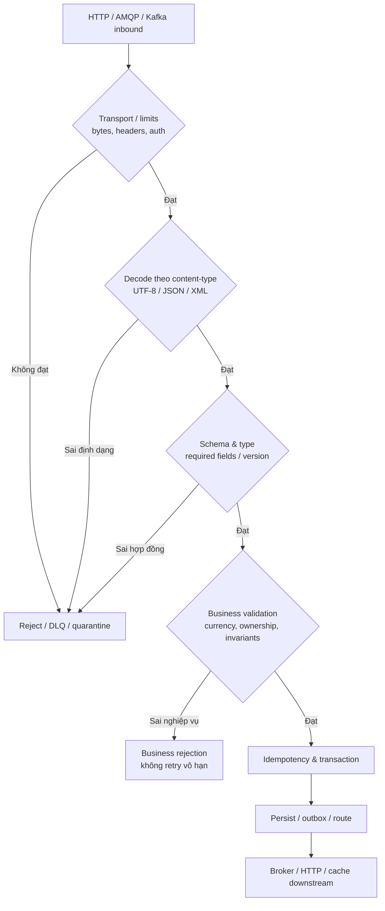
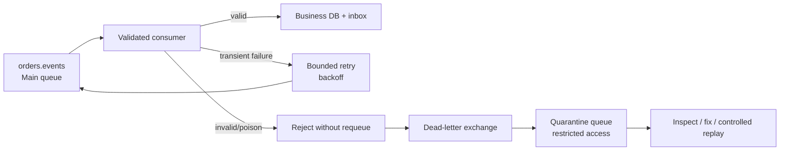
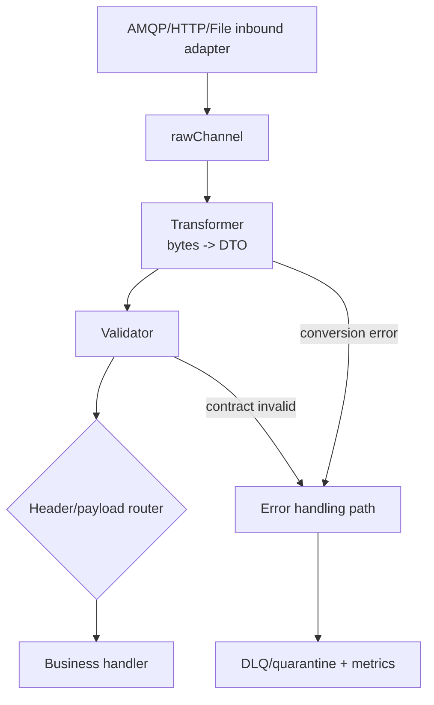
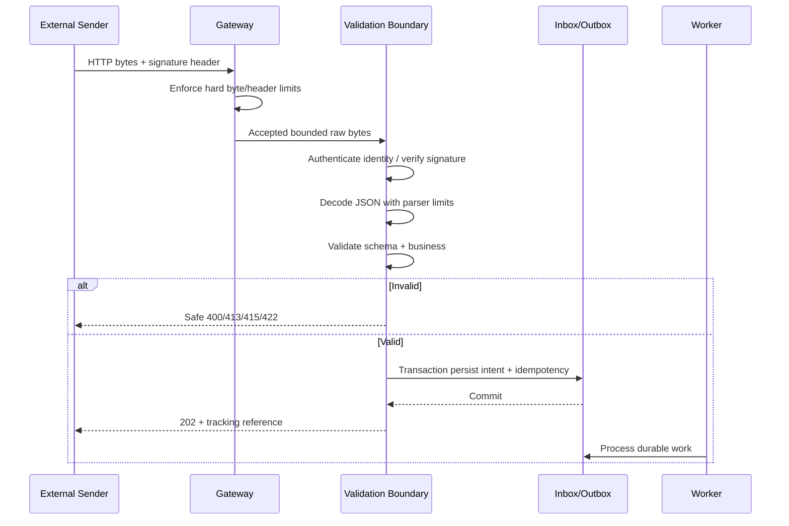
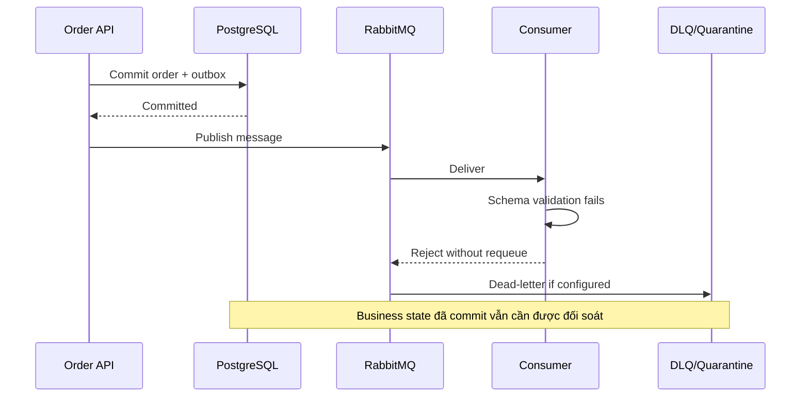
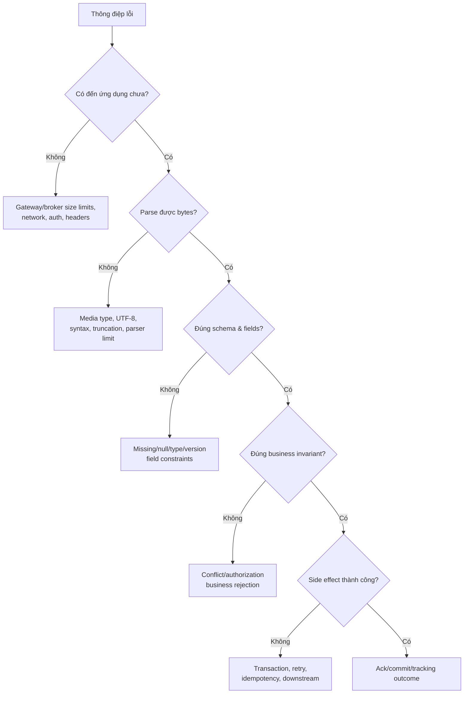

# Thông điệp thiếu trường, sai định dạng và dữ liệu vượt kích thước

## 1. Bài toán: thông điệp đi qua nhiều ranh giới không luôn đúng hợp đồng

Trong module **SPRING_BOOT_INTEGRATION**, ứng dụng Spring Boot thường trao đổi thông điệp qua HTTP, database, cache, RabbitMQ/Kafka và những adapter của Spring Integration. Dữ liệu có thể được gửi lại, đi qua nhiều phiên bản dịch vụ hoặc được tạo bởi đối tác không kiểm soát cùng một vòng phát hành. Vì thế, một thông điệp nhận được **không mặc nhiên hợp lệ** chỉ vì kết nối mạng thành công.

Ví dụ dịch vụ đơn hàng nhận sự kiện `order.created`:

```json
{
  "eventId": "evt-2026-1001",
  "eventType": "order.created",
  "schemaVersion": 2,
  "orderId": "ORD-501",
  "customerId": "C-501",
  "totalAmount": 125000,
  "currency": "VND",
  "occurredAt": "2026-11-21T03:00:00Z"
}
```

Trong thực tế có thể gặp:

- **Thiếu trường:** không có `eventId`, không thể chống xử lý trùng; thiếu `currency`, không thể tính tiền đúng.
- **Có trường nhưng giá trị không dùng được:** `"orderId": null`, chuỗi trắng, số âm hoặc thời điểm không đúng quy tắc.
- **Sai kiểu hoặc sai cú pháp:** `"totalAmount": "nhiều"`, dấu ngoặc JSON chưa đóng, UTF-8 hỏng hoặc nội dung XML trong request khai JSON.
- **Vượt kích thước:** payload nhiều MB, string rất dài, JSON lồng quá sâu, hàng triệu phần tử hoặc nội dung nén phình lớn sau giải nén.
- **Sai phiên bản hoặc metadata:** producer gửi schema v3 nhưng consumer chỉ hiểu v2, `Content-Type` không đúng hoặc header route đến nhầm tenant.

Nếu chỉ bắt một `Exception` rồi retry, hệ thống có thể tạo **poison message loop**, làm nghẽn broker, tiêu tốn tài nguyên, hoặc mất dấu một giao dịch quan trọng.

### Mục tiêu

Sau bài này, bạn có thể:

1. Phân loại lỗi cú pháp, cấu trúc, kiểu dữ liệu, ngữ nghĩa và giới hạn tài nguyên.
2. Định nghĩa hợp đồng có required/optional fields và chính sách tương thích phiên bản.
3. Dùng Jackson và Jakarta Bean Validation trong Spring Boot để kiểm tra hai lớp khác nhau.
4. Phân biệt lỗi HTTP 400/413/415/422, lỗi codec và lỗi transport.
5. Áp dụng giới hạn kích thước theo **nhiều tầng** mà không lầm tưởng một property bảo vệ toàn hệ thống.
6. Xử lý thông điệp độc hại/vô phương sửa chữa ở RabbitMQ, Kafka và Spring Integration.
7. Thiết kế quarantine/DLQ, ack, transaction, idempotency và test để không mất dữ liệu nghiệp vụ.

> Ví dụ hướng đến Java 17+, Spring Boot 3.x, Spring Framework 6.x, Jackson 2.x hiện đại và Spring AMQP. Những cấu hình codec/servlet/connector, chữ ký API và mặc định có thể thay đổi theo phiên bản. Các mức giới hạn là **ví dụ học thuật**, cần đo và điều chỉnh dựa trên hợp đồng/thực tế tải.

## 2. Bản đồ xử lý lỗi từ byte đến tác động nghiệp vụ

Một request/message thường đi qua các lớp:



Một số lỗi có thể được phát hiện **trước** khi payload được chuyển thành Java DTO. Ví dụ nếu JSON không đóng dấu ngoặc, Jackson không tạo `OrderCreatedEvent`; annotation `@NotBlank` trên DTO chưa có cơ hội chạy. Nếu body đã vượt giới hạn tại reverse proxy, Java controller có thể **không nhận request nào**.

| Lớp | Ví dụ lỗi | Tín hiệu hợp lý |
| --- | --- | --- |
| HTTP request line/headers | Header quá dài, media type không hỗ trợ | 400/415/431 hoặc giới hạn riêng của proxy/server |
| Raw body | Kích thước vượt hợp đồng | 413 hoặc từ chối ở broker/gateway |
| Parse/encoding | JSON sai cú pháp, UTF-8 lỗi | 400 ở HTTP; chuyển lỗi non-retryable trong consumer |
| DTO/schema | Thiếu field, sai kiểu, enum ngoài tập | 400 hoặc 422 theo API contract |
| Business invariant | Tiền âm, currency không cho phép, tenant mismatch | 422/409 hoặc business rejection phù hợp |
| Dependency | DB unavailable, HTTP 503, broker timeout | Retry có giới hạn + trạng thái phục hồi bền vững |
| Duplicate | Cùng `eventId` đã xử lý | Trả kết quả idempotent; không xem là poison mặc định |

**Phân loại rõ** giúp một trường hợp không thể tự sửa không bị retry mãi, đồng thời một lỗi mạng tạm thời không bị đưa nhầm vào DLQ như dữ liệu hỏng.

## 3. Hợp đồng dữ liệu phải nêu loại, bắt buộc và giới hạn

Đừng chỉ định nghĩa Java record rồi gọi đó là hợp đồng đầy đủ. Một contract nên nêu:

| Trường | Kiểu | Bắt buộc | Ràng buộc | Vai trò |
| --- | --- | --- | --- | --- |
| `eventId` | string | Có | 1–120 ký tự, không trắng | Khóa chống trùng |
| `eventType` | string | Có | Tập enum được hỗ trợ | Chọn handler |
| `schemaVersion` | integer | Có | Phiên bản được hỗ trợ | Chọn decoder/migration |
| `orderId` | string | Có | 1–80 ký tự, đúng format | Business identity |
| `customerId` | string | Có | 1–80 ký tự, đúng tenant | Chủ thể |
| `totalAmount` | decimal/integer | Có | Không âm, đơn vị rõ | Tiền |
| `currency` | string | Có | `VND`, `USD`, ... | Đơn vị tiền |
| `occurredAt` | RFC 3339 timestamp | Có | Offset/time-zone rõ | Ordering/audit |
| `metadata` | object | Không | Giới hạn fields/depth/size | Bổ sung tương thích |

Ngoài bảng fields, phải ghi **ngưỡng kích thước**: tổng body, số phần tử collection, độ dài từng chuỗi, nesting depth, header count/length, và có cho phép nén không. Ví dụ: body JSON không quá **256 KiB bytes trên wire sau khi giải mã transport tương ứng**, `items` tối đa 500, một text field tối đa 2.000 ký tự. Đây chỉ là ví dụ; một file upload hoặc batch export sẽ cần hợp đồng khác.

Các câu hỏi phải được trả lời trước khi viết code:

- Trường mới có mặc định an toàn không, hay bắt buộc producer version mới?
- `null` được phép khác gì với trường bị thiếu?
- Có cho phép `totalAmount` ở dạng string số hay phải JSON number?
- Unknown fields được bỏ qua để forward-compatible hay bị từ chối?
- Hợp đồng version lấy từ **payload** hay một **header đã xác thực**?
- Message quá lớn có thể gửi qua object storage rồi truyền reference không?
- Sai dữ liệu sẽ trả lỗi cho HTTP caller, đưa DLQ, hay lưu quarantine record?
- Khi producer retry, khóa idempotency có giữ nguyên hay không?

## 4. Missing, null, blank và default: bốn trạng thái không tương đương

Ví dụ với `orderId`:

```json
{}
```

```json
{"orderId": null}
```

```json
{"orderId": ""}
```

```json
{"orderId": "   "}
```

Các trường hợp:

| Dữ liệu | Vấn đề | Cách phát hiện |
| --- | --- | --- |
| Không có field | Producer bỏ quên hoặc schema cũ | Presence check hoặc Bean Validation nếu mapping thành `null` |
| `null` rõ ràng | Producer cố ý gửi null hoặc lỗi serialize | `@NotNull`/`@NotBlank`; presence check nếu cần phân biệt |
| Chuỗi rỗng | Có field nhưng không có identity | `@NotBlank` |
| Chỉ dấu cách | Không có giá trị sau trim | `@NotBlank` |
| `"ORD-501"` | Hợp lệ về basic format | Còn cần kiểm tra semantic và ownership |

**Đặc biệt với Java primitives:** Nếu DTO dùng `int schemaVersion` hoặc `boolean approved`, giá trị mặc định có thể là `0`/`false` khi field không được bind như kỳ vọng, khiến bạn không phân biệt “không gửi” với “gửi hợp lệ bằng 0/false” chỉ bằng kiểu Java. Khi `required` có ý nghĩa, hãy dùng `Integer`/`Boolean` kèm validation hoặc kiểm tra presence từ JSON tree.

Không tự gán mặc định như `currency="VND"` cho mọi message thiếu currency nếu producer/đối tác có thể dùng nhiều loại tiền. Một mặc định sai còn nguy hiểm hơn phản hồi hợp đồng rõ ràng.

## 5. Invalid syntax, wrong type, wrong schema và invalid business rule

Bốn lỗi thường bị gộp thành “JSON sai”:

### 5.1. JSON sai cú pháp

```json
{"eventId":"evt-1","orderId":"ORD-501"
```

Thiếu dấu `}`, Jackson có thể ném `JsonParseException` khi parse. Không tồn tại DTO hợp lệ để chạy Bean Validation.

### 5.2. JSON đúng cú pháp nhưng sai kiểu

```json
{
  "eventId": "evt-1",
  "orderId": "ORD-501",
  "totalAmount": {"amount": 125000}
}
```

Nếu contract yêu cầu số, object ở `totalAmount` không đúng. Jackson có thể ném `MismatchedInputException`/`JsonMappingException`. Một số cấu hình Jackson có thể **coerce** number/string, nên hãy quyết định rõ có chấp nhận chuyển kiểu hay không.

### 5.3. Schema/version không hỗ trợ

```json
{
  "schemaVersion": 3,
  "eventType": "order.created",
  "eventId": "evt-1",
  "payment": {"amount": 125000, "currency": "VND"}
}
```

Payload có thể hợp lệ theo **schema v3**, nhưng consumer v2 vẫn không hiểu trường `payment` thay thế `totalAmount`. Đây là lỗi compatibility, không phải lỗi JSON syntax.

### 5.4. Dữ liệu đúng kiểu nhưng sai nghiệp vụ

```json
{
  "schemaVersion": 2,
  "eventType": "order.created",
  "eventId": "evt-1",
  "orderId": "ORD-501",
  "customerId": "C-501",
  "totalAmount": -500,
  "currency": "VND",
  "occurredAt": "2026-11-21T03:00:00Z"
}
```

Trường `totalAmount` là số hợp lệ, nhưng giá trị âm có thể vi phạm business invariant. Phải tách **deserialization**, **field constraints** và **business validation**.

## 6. Charset, Content-Type, gzip và framing là một phần của hợp đồng

Sai định dạng không chỉ là thiếu dấu ngoặc:

- HTTP `Content-Type: application/json` nhưng body thật là XML.
- Body tuy là JSON bytes nhưng chứa UTF-8 không hợp lệ.
- Producer nén gzip nhưng không gắn `Content-Encoding: gzip` đúng cách.
- Broker message dùng Avro/Protobuf nhưng consumer cấu hình Jackson JSON converter.
- Header `schemaVersion` là số, nhưng client đọc như string/byte array không nhất quán.
- Webhook signature được tính trên **raw bytes**; nếu verify sau khi parse/serialize lại JSON, byte sequence có thể đổi dù dữ liệu trông giống nhau.
- Body bị cắt giữa chừng khi connection reset, content length thực khác kỳ vọng.

Với HTTP JSON hiện đại, **UTF-8** là lựa chọn thường gặp. Không dựa vào charset mặc định của hệ điều hành; converter và contract phải thống nhất cách decode. Với broker, cần thống nhất `contentType`, `contentEncoding`, schema identifier và serialization version qua producer/consumer.

Nếu chữ ký số áp dụng cho raw body, hãy **kiểm tra raw bytes trong giới hạn cho phép** trước khi biến đổi dữ liệu. Không log raw payload chứa token/PII chỉ để debug signature.

## 7. Bốn lớp kiểm tra: transport, parser, schema và business

Một pipeline đáng tin cậy:

1. **Transport guard:** identity, endpoint, Content-Type, content length, header constraints, body size; từ chối quá tải càng sớm càng tốt.
2. **Parser/converter:** bytes → JSON tree/DTO; kiểm soát encoding, depth, token length và lỗi codec.
3. **Schema/field validation:** required/optional/nullability, kiểu dữ liệu, enum, array count, version, cross-field shape.
4. **Business validation:** quyền tenant, trạng thái đơn hàng, currency/domain rules, tồn tại foreign references, optimistic lock và idempotency.

Không phải mỗi lớp đều chạy ở cùng tiến trình: reverse proxy có thể từ chối 413 trước khi Spring Controller hoạt động; broker có thể từ chối publish oversized message; Spring Integration transformer có thể ném lỗi trước service activator.

### Vì sao không chỉ dùng @Valid?

`@Valid` không giới hạn số byte HTTP socket đã đọc, không chống JSON nesting sâu trước khi DTO được tạo, không tự validate message AMQP nếu listener chưa kích hoạt validator, và không phân biệt mọi dạng malformed framing/encoding. Nó là **một** lớp hữu ích, không phải toàn bộ boundary defense.

## 8. DTO Java: ràng buộc trường với Jakarta Bean Validation

Để dùng `@NotBlank`, `@NotNull`, `@PositiveOrZero` và `@Size`, thêm validation starter khi cần:

```xml
<dependency>
    <groupId>org.springframework.boot</groupId>
    <artifactId>spring-boot-starter-validation</artifactId>
</dependency>
```

Ví dụ một DTO tương thích Jackson record:

```java
import java.math.BigDecimal;
import java.time.OffsetDateTime;

import jakarta.validation.constraints.NotBlank;
import jakarta.validation.constraints.NotNull;
import jakarta.validation.constraints.PositiveOrZero;
import jakarta.validation.constraints.Size;

public record OrderCreatedEvent(
    @NotBlank @Size(max = 120) String eventId,
    @NotBlank String eventType,
    @NotNull Integer schemaVersion,
    @NotBlank @Size(max = 80) String orderId,
    @NotBlank @Size(max = 80) String customerId,
    @NotNull @PositiveOrZero BigDecimal totalAmount,
    @NotBlank @Size(min = 3, max = 3) String currency,
    @NotNull OffsetDateTime occurredAt
) {}
```

Lưu ý:

- `@NotBlank` loại `null`, chuỗi rỗng và chuỗi chỉ có whitespace cho `String`.
- `@Size` giới hạn số ký tự/elements ở mức Java object; **không tương đương** raw bytes hoặc compressed size.
- `@NotNull` trên `Integer` giúp phát hiện thiếu phiên bản nếu Jackson map thành `null`.
- `@PositiveOrZero` cho tiền không âm; không thay thế quy tắc scale/currency/rounding của tài chính.
- Dùng `BigDecimal` cho decimal monetary value; tránh `double` nếu cần độ chính xác thập phân.
- `@NotNull OffsetDateTime` kiểm tra có giá trị Java; việc timestamp có đúng format đã được decoder quyết định.
- Annotation không tự kiểm tra `eventType == "order.created"`, `schemaVersion == 2` hoặc currency trong allowlist; viết rule bổ sung.

Với nested object/list, phải dùng `@Valid` **có chủ đích** để cascade validation. Nếu trường `items` phải có ít nhất một phần tử, dùng `@NotEmpty`, `@Size(max = ...)` và kiểm tra từng phần tử. Kiểm tra toàn bộ object graph lớn có thể tốn tài nguyên; bounded parsing vẫn bắt buộc trước đó.

## 9. HTTP endpoint: parse và validate ở ranh giới

Một endpoint Spring MVC:

```java
import jakarta.validation.Valid;

import org.springframework.http.MediaType;
import org.springframework.http.ResponseEntity;
import org.springframework.web.bind.annotation.PostMapping;
import org.springframework.web.bind.annotation.RequestBody;
import org.springframework.web.bind.annotation.RequestMapping;
import org.springframework.web.bind.annotation.RestController;

@RestController
@RequestMapping("/integration/events")
public class IntegrationEventController {

    private final IntegrationEventService service;

    public IntegrationEventController(
            IntegrationEventService service) {
        this.service = service;
    }

    @PostMapping(
        consumes = MediaType.APPLICATION_JSON_VALUE,
        produces = MediaType.APPLICATION_JSON_VALUE
    )
    public ResponseEntity<Receipt> receive(
            @Valid @RequestBody OrderCreatedEvent event) {

        Receipt receipt = service.accept(event);
        return ResponseEntity.accepted().body(receipt);
    }
}
```

`IntegrationEventService` và `Receipt` là các loại do ứng dụng định nghĩa. Giả định `service.accept` **commit một record công việc bền vững** (ví dụ inbox/outbox) trước khi trả receipt; nếu nó chỉ gọi `@Async` trên hàng đợi JVM thì HTTP `202 Accepted` không tự bảo đảm công việc có thể phục hồi khi process crash.

Thông thường:

- JSON sai cú pháp/không decode thành DTO → `HttpMessageNotReadableException` trước controller method.
- DTO parse được nhưng vi phạm Bean Validation → `MethodArgumentNotValidException` cho request body `@Valid` theo controller validation thông thường.
- `Content-Type` không thuộc `consumes` → `HttpMediaTypeNotSupportedException` hoặc xử lý media type tương ứng.
- Business invariant/duplicate/conflict → service tạo **domain outcome**, không nhất thiết là lỗi JSON.
- Body bị proxy/ngay transport từ chối vì quá lớn → controller có thể hoàn toàn không được gọi.

Không coi HTTP 202 nghĩa là downstream broker/consumer đã hoàn tất; response contract phải nói rõ **đã chấp nhận lưu bền vững** hay **đã xử lý xong**.

## 10. Trả ProblemDetail có mã lỗi an toàn

Một HTTP API cần phân biệt dữ liệu không parse được và dữ liệu parse được nhưng không đạt validation. Có thể áp dụng HTTP **400 cho request không hợp lệ** và dùng error code riêng. Một số API dùng **422** cho dữ liệu đúng cú pháp nhưng sai semantic, với điều kiện các caller đã đồng thuận. **415** phù hợp khi media type không được hỗ trợ; **413** khi body vượt giới hạn.

Ví dụ `@RestControllerAdvice` cho MVC:

```java
import org.springframework.http.HttpStatus;
import org.springframework.http.ProblemDetail;
import org.springframework.http.converter.HttpMessageNotReadableException;
import org.springframework.web.bind.MethodArgumentNotValidException;
import org.springframework.web.bind.annotation.ExceptionHandler;
import org.springframework.web.bind.annotation.RestControllerAdvice;

@RestControllerAdvice
public class IntegrationContractErrorAdvice {

    @ExceptionHandler(HttpMessageNotReadableException.class)
    ProblemDetail unreadable(HttpMessageNotReadableException ex) {
        ProblemDetail detail =
            ProblemDetail.forStatus(HttpStatus.BAD_REQUEST);
        detail.setTitle("Invalid message format");
        detail.setDetail("Không đọc được nội dung yêu cầu.");
        detail.setProperty("code", "INVALID_FORMAT");
        return detail;
    }

    @ExceptionHandler(MethodArgumentNotValidException.class)
    ProblemDetail invalidFields(MethodArgumentNotValidException ex) {
        ProblemDetail detail = ProblemDetail.forStatus(422);
        detail.setTitle("Invalid message fields");
        detail.setDetail("Thông điệp không đáp ứng hợp đồng dữ liệu.");
        detail.setProperty("code", "INVALID_FIELDS");
        return detail;
    }
}
```

Ở đây chúng ta **không trả nguyên `ex.getMessage()`** từ Jackson hoặc validation; những message đó có thể chứa dữ liệu do client cung cấp. Nếu cần field-level errors, chỉ xuất tên field/constraint code được allowlist, tránh leak raw rejected values, query strings hoặc stack traces.

Một số Spring Boot/Spring MVC mặc định đã cung cấp Problem Details/ErrorResponse theo cấu hình; ví dụ trên chỉ minh họa chính sách của ứng dụng. Khi thêm advice, kiểm tra interaction với `ResponseEntityExceptionHandler` nếu bạn đang kế thừa nó, tránh xử lý một exception hai lần.

### Vì sao không dùng 500 cho mọi lỗi?

500 khiến producer nghĩ hệ thống gặp lỗi tạm và có thể retry vô hạn dữ liệu hỏng. Với 400/413/415/422 và một mã lỗi ổn định, caller biết phải **sửa dữ liệu hoặc thay đổi hành vi**. Tuy vậy, một 4xx ở HTTP không tự nói producer nào là lỗi; hợp đồng tổ chức phải thống nhất cách ánh xạ và bảo vệ thông tin.

## 11. Khi cần phân biệt missing khác explicit null: kiểm tra JSON tree

Với yêu cầu `PATCH` hoặc envelope nhạy với semantics:

- **Field thiếu**: không thay đổi giá trị hiện tại.
- **Field null**: xóa giá trị hiện tại (nếu được phép).
- **Field có giá trị**: cập nhật.

Bean Validation thông thường có thể xem cả missing và null thành `null` sau deserialization. Khi cần khác biệt, kiểm tra presence:

```java
import com.fasterxml.jackson.databind.JsonNode;
import com.fasterxml.jackson.databind.ObjectMapper;

public class PresenceReader {

    private final ObjectMapper mapper;

    public PresenceReader(ObjectMapper mapper) {
        this.mapper = mapper;
    }

    public String inspect(String rawJson) throws Exception {
        JsonNode root = mapper.readTree(rawJson);
        if (!root.isObject()) {
            return "INVALID_ROOT";
        }

        if (!root.has("customerId")) {
            return "MISSING";
        }

        if (root.get("customerId").isNull()) {
            return "EXPLICIT_NULL";
        }

        if (!root.get("customerId").isTextual()) {
            return "WRONG_TYPE";
        }

        return "PRESENT";
    }
}
```

`has("customerId")` cho biết field tồn tại kể cả khi JSON null; `hasNonNull` chỉ đúng khi field tồn tại và khác null. Đừng dùng `path(...).asText("")` quá sớm rồi làm mất khả năng phân biệt missing/null/wrong type.

**Cảnh báo:** ví dụ nhận `String rawJson` để làm rõ semantics, không phải một bộ lọc kích thước. Trong ứng dụng thực, hạn chế body bytes và parser constraints **trước khi** đọc tất cả nội dung thành `String`.

## 12. Ép kiểu ngầm và dữ liệu số: quyết định policy nhất quán

Một số cấu hình Jackson có thể biến `"125000"` thành number hoặc biến empty string thành null, tùy kiểu, setting và version. Điều đó có thể tiện với legacy integration, nhưng gây khó kiểm tra schema.

So sánh:

```json
{"totalAmount": 125000}
```

```json
{"totalAmount": "125000"}
```

```json
{"totalAmount": "125.000,00"}
```

Ba giá trị không tương đương theo JSON Schema nếu `totalAmount` phải là `number`. Giá trị cuối còn mơ hồ về locale. Trong hợp đồng tích hợp, nên chuẩn hóa:

- Currency code theo chuẩn/tập được cho phép.
- Decimal scale, precision, rounding hoặc integer minor units có mô tả.
- Timestamp theo ISO/RFC 3339 với offset, nếu cần.
- `boolean` là JSON boolean, không phải `"true"`/`"false"` trừ khi contract cho phép.
- Không dùng floating-point để so sánh số tiền chính xác.

Có thể cấu hình Jackson coercion nghiêm ngặt theo version hoặc kiểm tra kiểu trên `JsonNode`/JSON Schema trước khi map DTO. **Không bật một setting strict toàn ứng dụng mà chưa kiểm thử các clients khác đang phụ thuộc coercion cũ.**

## 13. Unknown fields và schema evolution: strict hay tolerant?

Producer triển khai v3 thêm field:

```json
{
  "eventId": "evt-101",
  "eventType": "order.created",
  "schemaVersion": 3,
  "orderId": "ORD-501",
  "totalAmount": 125000,
  "currency": "VND",
  "newTaxBreakdown": {"vat": 10000}
}
```

Một consumer v2 có thể:

- **Từ chối unknown fields:** phát hiện mismatch sớm nhưng dễ làm đứt backward/forward compatibility.
- **Bỏ qua fields mới:** forward-compatible với thông tin bổ sung, nếu nghĩa của fields cũ giữ nguyên.
- **Chọn parser theo schemaVersion:** đọc đúng version, chuyển sang canonical model khi có adapter.
- **Quarantine version mới chưa hỗ trợ:** an toàn với thay đổi mang ý nghĩa nghiệp vụ mới.

Spring Boot/Jackson có thể cấu hình việc fail on unknown properties, ví dụ:

```yaml
spring:
  jackson:
    deserialization:
      fail-on-unknown-properties: true
```

Đây là **chính sách global của ObjectMapper do Boot cấu hình**, không phải luôn phù hợp cho tất cả endpoints. Có thể dùng một `ObjectMapper`/`ObjectReader` riêng hoặc `@JsonIgnoreProperties(ignoreUnknown = true)` trên DTO theo hợp đồng. **Đừng âm thầm bỏ qua một field mới có thay đổi ngữ nghĩa**, ví dụ `isTestPayment` hoặc `reversalReason`.

Nếu một consumer chỉ hỗ trợ v1/v2, từ chối v3 với `UNSUPPORTED_SCHEMA_VERSION` rõ ràng, không cố đọc v3 như v2 rồi gửi nhầm message sang đối tác.

## 14. Kích thước thông điệp là nhiều loại kích thước khác nhau

Một giới hạn `256 KiB` không đủ rõ nếu bạn không chỉ ra giới hạn nào:

| Loại kích thước | Ví dụ | Tại sao khác nhau? |
| --- | --- | --- |
| On-wire bytes | HTTP body trước khi giải nén | Tính network quota, gateway limits |
| Decompressed bytes | gzip 20 KiB phình thành 20 MiB | Chống decompression bomb |
| UTF-8 bytes | Text nhiều ký tự đa byte | Không bằng số Java `char` |
| JSON string length | Trường mô tả dài | Bảo vệ model/DB column |
| Collection item count | `items` có 100.000 phần tử | Bảo vệ CPU/memory và downstream |
| JSON nesting depth | `a.b.c...` lồng rất sâu | Chống stack/CPU exhaustion |
| Header count/total size | Nhiều headers không cần thiết | Bảo vệ proxy/web server |
| Response buffer | WebClient tải error body lớn | Tránh `DataBufferLimitException` |

Một message nén có thể đạt giới hạn bytes trên wire nhưng vượt xa giới hạn giải nén. Một JSON body chỉ 100 KiB có thể có hàng trăm nghìn token ngắn, làm parser tốn CPU. Một `@Size(max=1000)` trên string **không tự giới hạn** raw HTTP body.

Vì vậy cần **nhiều lớp bảo vệ độc lập**, phù hợp từng protocol và thư viện.

## 15. Giới hạn inbound HTTP: proxy, server và codec

### 15.1. Reverse proxy/API gateway

Đây thường là nơi thích hợp để áp đặt **hard maximum request body size** trước khi request tiêu tốn memory/CPU ở Spring Boot. Gateway có thể trả HTTP `413 Content Too Large` (tên cũ thường thấy: Payload Too Large), chặn header bất thường hoặc áp rate limit.

Cần cấu hình ở **hạ tầng thật đang dùng** (Nginx, Envoy, ingress controller, API gateway...), không có một property Spring Boot duy nhất áp dụng cho tất cả.

### 15.2. Servlet Spring MVC

Phải phân biệt:

- `spring.servlet.multipart.max-file-size` và `max-request-size` áp dụng cho **multipart upload**, không phải một hard cap tổng quát cho mọi JSON body.
- `server.max-http-request-header-size` liên quan **headers**, không phải JSON body.
- `server.tomcat.max-http-form-post-size` liên quan **form POST processing** của Tomcat, không phải hard limit cho mọi `application/json` request.
- Connector/server có thể có giới hạn request body, swallow size hoặc buffering riêng; phải kiểm tra Tomcat/Jetty/Undertow và reverse proxy thực tế.

Một guard chỉ nhìn `Content-Length` có thể **reject sớm** khi header nói body quá lớn, nhưng không đủ để bảo vệ transfer-encoding chunked hoặc Content-Length giả. Muốn hard limit ở ứng dụng, phải **đếm actual bytes khi đọc stream**, dừng ở `limit + 1`, xử lý giải nén và không aggregate vượt limit vào memory.

### 15.3. WebFlux và codecs

Ở Spring WebFlux, `spring.codec.max-in-memory-size` ảnh hưởng tới giới hạn memory buffering của nhiều codec khi aggregate dữ liệu. Nhưng đó **không phải** một universal inbound body limit bảo vệ mọi kiểu streaming. Các request `Flux<DataBuffer>` hoặc multipart streaming có thể yêu cầu chính sách bytes riêng.

Một ví dụ properties:

```yaml
spring:
  codec:
    max-in-memory-size: 256KB
  servlet:
    multipart:
      max-file-size: 4MB
      max-request-size: 5MB
```

Hai nhóm trên **nhắm tới những đường xử lý khác nhau**. Không sao chép và coi 256KB là giới hạn chung cho toàn bộ Web MVC/WebFlux; cần test với cả `Content-Length`, chunked, gzip và nội dung bị cắt.

## 16. Jackson StreamReadConstraints: giới hạn độ sâu, string và number

Với Jackson 2.15+ (kiểm tra version đang dùng), `StreamReadConstraints` cho phép bảo vệ parser khỏi một số cấu trúc JSON bất thường:

```java
import com.fasterxml.jackson.core.JsonFactory;
import com.fasterxml.jackson.core.StreamReadConstraints;
import com.fasterxml.jackson.databind.ObjectMapper;

public final class BoundedJsonParser {

    public static ObjectMapper newMapper() {
        JsonFactory factory = JsonFactory.builder()
            .streamReadConstraints(
                StreamReadConstraints.builder()
                    .maxNestingDepth(40)
                    .maxStringLength(65_536)
                    .maxNumberLength(100)
                    .build()
            )
            .build();

        return new ObjectMapper(factory);
    }
}
```

Giải thích:

- `maxNestingDepth` giới hạn độ sâu lồng object/array.
- `maxStringLength` giới hạn chiều dài string token mà parser chấp nhận theo semantics của Jackson.
- `maxNumberLength` giới hạn độ dài token số; hữu ích chống chuỗi số khổng lồ.
- Những giới hạn này **không thay thế hard total byte limit**, số phần tử array, số fields hay thời gian parse.
- `new ObjectMapper(factory)` chưa được cấu hình các modules/time settings/mixins/custom serializers như ObjectMapper mặc định của Boot. Nếu dùng cho DTO `OffsetDateTime`, phải đăng ký Java Time module hoặc customizations phù hợp.
- Không chỉnh một `ObjectMapper` global khiến client/adapter khác đổi behavior mà chưa test compatibility.

Trong hệ thống thật, đảm bảo mapper được cấu hình tập trung, các codecs inbound và broker converters **thực sự sử dụng mapper đó**. Chỉ tạo bean mapper không bảo đảm mọi thư viện tự sử dụng.

## 17. Phòng tránh zip bomb, dữ liệu nén và tài nguyên bất thường

Một HTTP request gzip 30 KiB có thể giải nén thành hàng chục MB. Một archive zip có thể chứa rất nhiều entries, nested archives hoặc đường dẫn độc hại. Đối tác tải file XML có thể dùng entity expansion nếu parser cho phép.

Một chiến lược an toàn:

1. Đặt hard cap cho **compressed bytes** ở gateway/transport.
2. Đếm **decompressed bytes** trong khi giải nén bằng streaming; dừng ở ngưỡng.
3. Giới hạn compression ratio và thời gian/CPU khi cần, không chỉ một con số bytes.
4. Giới hạn số entries, total extracted bytes, nesting depth của archive.
5. Không extract đường dẫn `../` hoặc absolute path vào filesystem khi xử lý file.
6. Với XML, cấu hình parser chống **XXE/entity expansion** và đặt depth/size constraints.
7. Chỉ parse theo media type và format hợp đồng; không tự động thử mọi parser cho dữ liệu không đáng tin.
8. Log metadata và mã lỗi, không đưa toàn bộ bytes độc hại vào DLQ/log.

Đối với thông điệp JSON không dùng compression, vẫn cần bảo vệ số lượng array elements, độ sâu và string size. Giới hạn payload là một phần **resource isolation và bảo mật**, không phải chỉ là tối ưu hiệu năng.

## 18. Outbound HTTP: response quá lớn hoặc error body bất thường

Spring Boot Integration không chỉ **nhận** dữ liệu. `WebClient`/`RestClient` còn đọc response từ đối tác. Đối tác có thể trả một HTML 502 dài nhiều MB hoặc JSON chứa array bất thường.

Với WebClient, có thể giới hạn buffer codec ở client cụ thể:

```java
import org.springframework.web.reactive.function.client.WebClient;

WebClient client = WebClient.builder()
    .baseUrl("https://partner.example.internal")
    .codecs(configurer ->
        configurer.defaultCodecs().maxInMemorySize(256 * 1024)
    )
    .build();
```

**Lưu ý:**

- `maxInMemorySize` giới hạn mức codec cần buffer, không đồng nghĩa tổng số response bytes của mọi pipeline streaming đều bị giới hạn như nhau.
- `DataBufferLimitException` khi body vượt buffer là **resource/decoding failure ở client**, không chứng minh HTTP server đã trả status 413.
- `retrieve().onStatus(...)` xử lý **HTTP response có status**; DNS/TCP/TLS/timeout nằm ở tầng transport, không chạy qua `onStatus` nếu chưa có response.
- Khi dùng `response.createException()`, cần cân nhắc kích thước/error body retention, không log toàn bộ error payload.
- Với download/stream rất lớn, dùng streaming có giới hạn bytes/thời gian thay vì `bodyToMono(byte[].class)` rồi mới so size.

Một lỗi downstream quá lớn không nhất thiết là lỗi client gửi sai dữ liệu; nó có thể là đối tác vi phạm **response contract**. Tách chúng khỏi lỗi validation của inbound HTTP caller để tránh quy trách nhiệm sai.

## 19. RabbitMQ: kiểm tra raw message trước khi deserialization nghiệp vụ

RabbitMQ có thể đưa một message tới listener dưới dạng bytes, nhưng **message converter** của ứng dụng có thể ném lỗi trước khi listener method nhận được DTO. Vì vậy phải biết validation được đặt ở đâu.

Nếu muốn chủ động kiểm tra raw body và metadata ở một listener, có thể nhận `org.springframework.amqp.core.Message` rồi parse có kiểm soát:

```java
import java.util.Set;

import com.fasterxml.jackson.core.JsonProcessingException;
import com.fasterxml.jackson.databind.ObjectMapper;

import jakarta.validation.ConstraintViolation;
import jakarta.validation.Validator;

import org.springframework.amqp.AmqpRejectAndDontRequeueException;
import org.springframework.amqp.core.Message;
import org.springframework.amqp.core.MessageProperties;
import org.springframework.amqp.rabbit.annotation.RabbitListener;
import org.springframework.stereotype.Component;

@Component
public class OrderEventAmqpListener {

    private static final int MAX_BYTES = 256 * 1024;

    private final ObjectMapper mapper;
    private final Validator validator;
    private final OrderEventProcessor processor;

    public OrderEventAmqpListener(
            ObjectMapper mapper,
            Validator validator,
            OrderEventProcessor processor) {
        this.mapper = mapper;
        this.validator = validator;
        this.processor = processor;
    }

    @RabbitListener(queues = "partner.order.events")
    public void accept(Message message) {
        byte[] bytes = message.getBody();

        if (bytes == null || bytes.length > MAX_BYTES) {
            throw new AmqpRejectAndDontRequeueException(
                "INVALID_MESSAGE_SIZE"
            );
        }

        String contentType =
            message.getMessageProperties().getContentType();
        if (contentType == null
                || !contentType.startsWith(
                    MessageProperties.CONTENT_TYPE_JSON)) {
            throw new AmqpRejectAndDontRequeueException(
                "UNSUPPORTED_CONTENT_TYPE"
            );
        }

        final OrderCreatedEvent event;
        try {
            event = mapper.readValue(
                bytes, OrderCreatedEvent.class
            );
        } catch (JsonProcessingException ex) {
            throw new AmqpRejectAndDontRequeueException(
                "INVALID_JSON", ex
            );
        }

        if (event == null) {
            throw new AmqpRejectAndDontRequeueException(
                "INVALID_ROOT"
            );
        }

        Set<ConstraintViolation<OrderCreatedEvent>> violations =
            validator.validate(event);
        if (!violations.isEmpty()) {
            throw new AmqpRejectAndDontRequeueException(
                "INVALID_FIELDS"
            );
        }

        processor.process(event);
    }
}
```

`OrderEventProcessor` là service do dự án định nghĩa; nó phải có idempotency và transaction policy. Đoạn code minh họa một **raw-message boundary** có thể đưa thông điệp sai vào dead-letter flow bằng exception tường minh.

Các điểm cần hiểu kỹ:

1. Bytes đã được RabbitMQ client **nhận vào memory** trước khi method chạy. So `bytes.length` chỉ là **lớp phòng vệ cuối**, không thay producer/broker limits.
2. Dùng `ObjectMapper` được cấu hình bounded parsing như mục 16; nếu không, raw bytes đã nhỏ vẫn có thể chứa JSON nesting/number nguy hiểm.
3. Kiểm tra `contentType` cần hợp đồng cụ thể. `startsWith("application/json")` là minh họa, chưa phải media type parser nghiêm ngặt cho tất cả biến thể; có thể dùng thư viện MIME parser và allowlist subtype/charset nếu cần.
4. `Validator.validate()` phải được gọi rõ nếu bạn tự parse raw message; `@Valid` ở HTTP controller không áp dụng tự động cho mọi Rabbit listener.
5. `AmqpRejectAndDontRequeueException` ra tín hiệu **không requeue message bị reject** trong Spring AMQP. Message chỉ thực sự vào DLQ nếu broker topology/policy được cấu hình đúng.
6. Exception từ `processor.process()` có thể là lỗi DB/network **tạm thời**, không được tự động biến thành `INVALID_FIELDS`.
7. Với listener được cấu hình dùng converter DTO trực tiếp, **lỗi chuyển đổi có thể xảy ra trước method**; error handler và container policy phải được kiểm thử riêng.

Không gắn raw payload hoặc thông tin nhạy cảm vào exception message; mã lỗi ngắn đủ để phân loại, còn correlation/event ID lưu ở hệ thống audit theo chính sách dữ liệu.

## 20. Vì sao một poison message có thể làm nghẽn RabbitMQ?

Một message có JSON sai sẽ **không tự sửa** qua việc nhận lại lần thứ 1.000. Nếu listener luôn ném lỗi và broker requeue ngay, hệ thống có thể:

- Nhận lại cùng message liên tục, làm cạn CPU và log storage.
- Che khuất message tốt đang nằm phía sau.
- Tạo số lượng redelivery lớn, ảnh hưởng throughput và độ trễ.
- Giữ worker bận với dữ liệu không thể xử lý.
- Tạo vòng DLQ → main queue → DLQ không có giới hạn.

Một phương án:



### Chọn policy theo loại lỗi

| Loại lỗi | Retry ngay? | Hành động tiêu biểu |
| --- | --- | --- |
| JSON malformed, invalid UTF-8 | Không | Reject → DLQ/quarantine |
| Thiếu required field | Không | DLQ + báo producer sửa hợp đồng |
| Schema version chưa hỗ trợ | Không retry nóng | Quarantine; phát lại sau khi nâng consumer nếu phù hợp |
| Body quá lớn | Không gửi lại y nguyên | DLQ metadata hoặc chuyển payload sang object storage với reference |
| Auth/signature fail | Không | Reject an toàn, security monitoring |
| PostgreSQL mất kết nối tạm | Có, giới hạn | Retry/backoff, giữ message/work bền vững |
| Broker publish timeout | Có thể | Dựa trên outcome chưa chắc chắn + stable eventId |
| Business conflict cố định | Tùy contract | Reject/compensate/manual review |
| Duplicate event | Không mặc định là lỗi | Idempotent success hoặc trạng thái đã xử lý |

Các loại lỗi “không retry” **không có nghĩa là xóa không dấu vết**. Cần nơi lưu bằng chứng an toàn, có owner, retention và replay workflow được kiểm soát.

## 21. DLX/DLQ không tự xuất hiện chỉ vì ném exception

RabbitMQ dead-lettering cần exchange/queue/binding hoặc policies thích hợp. Ví dụ topology khái niệm:

```text
partner.order.events
  ├─ valid delivery --> consumer
  └─ rejected, requeue=false --> DLX: partner.orders.dlx
                                      |
                                      v
                                queue: partner.orders.dlq
```

Cấu hình Spring AMQP listener có thể nêu một policy khi exception xảy ra:

```yaml
spring:
  rabbitmq:
    listener:
      simple:
        default-requeue-rejected: false
```

**Cảnh báo:** setting này áp dụng cho **simple listener container** trong cấu hình tương ứng, không tự bao trùm direct container hoặc mọi custom listener factories. Khi bật, nhiều exception không được retry tại listener có thể bị reject/dropped; nếu chưa khai báo DLX chính xác, message có thể **không còn ở main queue và cũng không xuất hiện trong DLQ**.

Spring AMQP còn có `ConditionalRejectingErrorHandler`/`FatalExceptionStrategy` để phân loại một số lỗi converter/method dispatch là fatal; hành vi và mặc định thay đổi theo version/container config. **Không dùng mặc định suy đoán thay cho test thực tế**.

Một DLQ có thể được tạo bằng broker policies hoặc khai báo topology qua Spring AMQP `Queue`, `Exchange`, `Binding`/`RabbitAdmin`. Với production, quyết định **ai sở hữu topology**: Infrastructure as Code hoặc ứng dụng. Tránh để nhiều service khởi động đồng thời với các queue arguments mâu thuẫn.

### Không tạo vòng retry vô hạn

Nếu DLQ được nối tự động về main queue theo TTL nhưng consumer vẫn lỗi cố định, bạn có một vòng lặp không giới hạn. Với transient errors, dùng bounded attempt count, delayed retry policy, backoff và cuối cùng dừng ở **parking-lot/quarantine**. Khi replay từ DLQ, phải có cả **version, producer owner và idempotency controls**.

## 22. Kafka: deserialization error có thể xảy ra trước @KafkaListener

Với Kafka, một record có bytes lỗi schema có thể làm lỗi **Deserializer** trước khi Spring Kafka gọi listener method. Một `try/catch` bên trong `@KafkaListener` sẽ không bắt được trường hợp method chưa chạy.

Trong các phiên bản Spring Kafka hỗ trợ, `ErrorHandlingDeserializer` có thể đóng lỗi deserialization vào headers/record để error handler xử lý hoặc đưa đến dead-letter topic theo policy.

Ví dụ định hướng cấu hình, cần đối chiếu đúng Spring Kafka version/serializer:

```yaml
spring:
  kafka:
    consumer:
      value-deserializer: org.springframework.kafka.support.serializer.ErrorHandlingDeserializer
      properties:
        spring.deserializer.value.delegate.class: org.springframework.kafka.support.serializer.JsonDeserializer
        spring.json.trusted.packages: com.example.integration.events
        spring.json.value.default.type: com.example.integration.events.OrderCreatedEvent
```

Các class `com.example.integration.events.OrderCreatedEvent` trong ví dụ là **package minh họa**: khi áp dụng phải dùng class thật. Có thể cần các tùy chọn type headers/default type riêng theo hợp đồng. Không để `trusted.packages=*` một cách tùy tiện khi deserializing dữ liệu không đáng tin cậy.

**Không tự hiểu rằng YAML trên đã khai báo DLT.** Bạn còn cần listener container error handler, `DeadLetterPublishingRecoverer` hoặc recovery strategy phù hợp, producer permissions, topic retention và chính sách commit offset.

Mức giới hạn Kafka cũng có ở **producer, broker, topic và consumer fetch**, với tên/cách phối hợp cấu hình tùy Kafka version. Không chỉ đặt giới hạn JSON mapper rồi bỏ qua message size được broker chấp nhận. Một record lớn bị broker từ chối **không bao giờ tới listener**, nên phải có test producer error path.

## 23. Spring Integration: transformer và errorChannel không luôn bắt cùng loại lỗi

Trong Spring Integration, một message có thể đi qua converter/transformer trước khi đến router hoặc service activator:



Nếu dùng **`DirectChannel` đồng bộ**, exception của transformer/handler có thể lan tới caller ngay trên call stack, **không mặc định trở thành `ErrorMessage` gửi tới `errorChannel`**. Khi sử dụng poller, executor channel hoặc một số inbound adapter async, có thể có cơ chế chuyển exception thành `ErrorMessage` và gửi đến error channel đã cấu hình.

Do đó cần kiểm tra:

1. Transformer chạy trước hay sau validate? Với raw bytes, kiểm tra size/media type trước khi decode DTO.
2. Error xảy ra ở adapter (như Kafka deserializer) hay trong flow? Adapter-level error có thể cần handler riêng.
3. Nếu `Message<?>` chứa payload chưa xác thực, header nào thật sự đáng tin để chọn route?
4. Default route có `nullChannel` không? Nếu có, một message lỗi có thể bị **bỏ có chủ ý** mà không lưu dấu.
5. Có correlationId/eventId và mã lỗi an toàn khi message được gửi tới quarantine không?
6. Khi error flow ghi audit/quarantine thất bại, có giữ message tại durable source không?

Không đồng nhất `errorChannel` của Spring Integration với DLQ của RabbitMQ. Một bên là **message channel xử lý lỗi trong ứng dụng**, bên kia là **hàng đợi do broker quản lý** với topology và delivery semantics riêng.

## 24. Một bảng phân loại để tránh retry sai

Hãy thiết kế loại lỗi trước khi viết `retryWhen`, `RetryTemplate` hoặc listener retry advice.

| Category | Tính chất | Retry tự động | Owner chính |
| --- | --- | --- | --- |
| `INVALID_FORMAT` | Cú pháp/encoding không hợp lệ | Không | Producer/schema owner |
| `MISSING_REQUIRED_FIELD` | Thiếu dữ liệu bắt buộc | Không | Producer |
| `WRONG_TYPE` | JSON shape/type sai | Không | Producer/contract |
| `UNSUPPORTED_SCHEMA_VERSION` | Consumer chưa hiểu version | Không retry nóng; có thể replay sau nâng cấp | Producer + consumer owners |
| `PAYLOAD_TOO_LARGE` | Vượt size/complexity quota | Không gửi lại y nguyên | Producer + platform |
| `UNAUTHORIZED_SOURCE` | Sai signature/identity/tenant | Không | Security/integration owner |
| `BUSINESS_CONFLICT` | Trạng thái không cho phép | Tùy quy tắc/version | Business owner |
| `DUPLICATE_EVENT` | Replay của event đã xử lý | Thường trả idempotent success | Consumer |
| `DOWNSTREAM_UNAVAILABLE` | DB/HTTP/broker tạm unavailable | Có giới hạn, backoff | Consumer/operations |
| `TIMEOUT_UNKNOWN_OUTCOME` | Không chắc remote side effect đã commit | Reconcile/idempotent retry | Workflow owner |

Không chỉ dựa trên exception class. Ví dụ `IllegalArgumentException` có thể do input sai **hoặc** lỗi lập trình trong chính consumer. Một `JsonProcessingException` khi parse message thô thường là lỗi contract, nhưng JSON serializer của outbox producer ném cùng nhóm exception có thể là bug ứng dụng. Cần đặt classification theo **giai đoạn và nguồn dữ liệu**.

### Quy tắc retry thực dụng

- **Permanent invalid** → từ chối có mã lỗi, không tiêu hao vô số attempts.
- **Transient transport/database** → retry bounded, backoff/jitter, deadline và circuit breaker.
- **Unknown outcome after side effect** → tra cứu trạng thái hoặc retry với **stable idempotency key** nếu đối tác hỗ trợ.
- **Unsupported version** → quarantine có lịch kiểm tra/nâng consumer và replay khi an toàn, không lặp nóng.
- **Duplicate** → coi là trạng thái đã biết, tránh tạo side effect lần hai.

## 25. Quarantine record nên lưu gì?

DLQ không phải luôn là nơi lưu toàn bộ payload. Một thông điệp cực lớn có thể làm quá tải cả **hàng đợi lỗi** và công cụ xử lý sự cố. Đôi khi nên lưu một **record metadata nhỏ**, chỉ trỏ tới blob được mã hóa/quản lý riêng khi được phép.

Ví dụ PostgreSQL:

```sql
CREATE TABLE rejected_integration_event (
    rejection_id UUID PRIMARY KEY,
    source_system VARCHAR(80) NOT NULL,
    event_id VARCHAR(120),
    schema_version INTEGER,
    failure_code VARCHAR(64) NOT NULL,
    payload_sha256 CHAR(64),
    payload_size_bytes BIGINT,
    payload_reference VARCHAR(500),
    first_seen_at TIMESTAMPTZ NOT NULL DEFAULT CURRENT_TIMESTAMP,
    replay_status VARCHAR(24) NOT NULL DEFAULT 'PARKED'
);

CREATE INDEX idx_rejected_source_time
    ON rejected_integration_event(source_system, first_seen_at);
```

Đây là **schema tham khảo**, cần migration, retention, access control và audit trail. Không tự động lưu raw payload vào DB chỉ vì parser fail, đặc biệt khi nó có thể chứa PII, credentials hoặc malware.

Metadata có ích:

- `source_system` đã xác thực, không lấy từ header ngoài bất kỳ.
- `failure_code` được allowlist, không chứa toàn bộ stack trace.
- Hash payload cho dedup/forensics khi có chính sách cho phép.
- Kích thước thực, schema version nếu đọc được an toàn.
- Correlation/event ID nếu có; không dùng text do client gửi làm SQL identifier.
- Ngày nhận, trạng thái replay, số lần xử lý, owner.
- Reference đến bản payload đã qua kiểm soát bảo mật; có encryption/TTL/quyền phù hợp.

Nếu quarantine write thất bại, **không ack thông điệp bắt buộc xử lý rồi báo thành công**. Cần giữ nguồn bền vững, retry ghi quarantine với giới hạn hoặc dừng ingestion theo chính sách. RabbitMQ reject-to-DLQ và ghi PostgreSQL là **hai resource khác nhau**, không có atomic transaction mặc định; cần xác định nguồn sự thật của failure record.

## 26. Idempotency: thông điệp sai và thông điệp trùng là hai vấn đề khác nhau

Một message có `eventId=evt-1001` có thể:

1. Đến lần đầu với JSON hợp lệ.
2. Được consumer xử lý, commit database.
3. Consumer chết trước ack.
4. Broker redeliver cùng message.
5. Consumer phải nhận ra đã xử lý và **không nhân đôi tác động**.

Đó là **duplicate delivery**, không phải lỗi schema.

Một bảng inbox có unique key:

```sql
CREATE TABLE processed_event (
    source_system VARCHAR(80) NOT NULL,
    event_id VARCHAR(120) NOT NULL,
    processed_at TIMESTAMPTZ NOT NULL DEFAULT CURRENT_TIMESTAMP,
    PRIMARY KEY (source_system, event_id)
);
```

Nếu message bị thiếu `eventId`, không nên tạo UUID mới mỗi lần nhận để “sửa” rồi xử lý; như vậy producer replay có thể thành nhiều tác động nghiệp vụ độc lập. Message cần được từ chối/quarantine theo hợp đồng cho đến khi có khóa nhận dạng đáng tin.

### Trùng eventId nhưng payload khác nhau

Còn một edge case khó hơn: cùng `(sourceSystem,eventId)` nhưng payload lần hai khác `totalAmount` hoặc `orderId`. Nếu consumer đơn giản bỏ mọi bản trùng, nó có thể che producer corruption. Có thể lưu **payload digest hoặc canonical business hash**, so với bản đầu và phát `DUPLICATE_ID_DIFFERENT_PAYLOAD` cho security/contract review.

**Không dùng hash để thay thế unique constraint transactionally**. Hash giúp phát hiện lệch nội dung; database unique constraint và transaction giúp chống race giữa hai worker đồng thời.

## 27. Thứ tự kiểm tra: authentication, size, signature, parsing

Đối với webhook có chữ ký, thứ tự kiểm tra cần cân bằng bảo mật và tài nguyên:



Không cần **parse cả JSON** để biết request vượt hard body limit; nếu có gateway chặn sớm thì càng tốt. Signature thường cần kiểm tra trên **raw bytes nguyên bản**, nên bạn có thể lưu tạm bytes đã được giới hạn để verify trước khi deserialize.

Cần nhớ:

- **Auth trước side effect**; không route sang tenant-specific handler bằng metadata do người ngoài tự gán.
- **Size guard trước parse toàn bộ**, nhất là với body nén.
- **Verify signature trước tin nội dung**; canonicalization/encoding phải theo đúng hợp đồng chữ ký.
- **Schema validation trước business transaction**, nhưng việc chống trùng/ghi inbox cần transaction/unique constraint.
- **Không tạo bản ghi rejection chứa PII vô hạn** mỗi khi một attacker gửi body sai; còn cần rate limiting và retention.

## 28. Response và request metadata có thể bị giả mạo

Một đối tác gửi:

```text
Content-Type: application/json
X-Partner-Id: trusted-partner
X-Schema-Version: 2
X-Correlation-Id: abc
```

Chừng đó **không chứng minh** source là `trusted-partner`. Header do client gửi có thể tùy ý thay đổi. Nên xác định:

- Danh tính nguồn qua TLS client identity, OAuth2/mTLS, HMAC signature hoặc cơ chế đã thống nhất.
- `verifiedSourceSystem`/`verifiedTenantId` được gắn **nội bộ sau authentication**.
- Contract version được kiểm tra đồng nhất với payload và thỏa quyền của nguồn.
- Correlation ID được sanitize, giới hạn độ dài và không dùng như secret/access token.
- Routing header không được phép chứa **tên Spring bean/channel tùy ý** để điều khiển đường đi tới handler khác.
- Header `Content-Type` phải khớp decoder được cho phép, không dùng “sniff mọi định dạng” nếu tạo bề mặt tấn công.

Giới hạn message body không có ích nếu một header nhiều MB hoặc hàng nghìn headers đã làm nghẽn proxy/servlet. Hãy đặt **header size/count limits** ở ingress và client/server phù hợp.

## 29. Kiểm thử DTO và schema: những trường hợp tối thiểu

Unit tests cho parser/validator nên sử dụng dữ liệu được xây dựng có chủ đích.

| Ca kiểm thử | Input | Kỳ vọng |
| --- | --- | --- |
| Đúng hợp đồng | Đủ fields, đúng types | Decode + validate pass |
| Thiếu `eventId` | Field không có | `MISSING_REQUIRED_FIELD` |
| `eventId=null` | JSON null | Bị từ chối; không tạo UUID mới |
| `eventId=""` | Chuỗi rỗng | Bị `@NotBlank` từ chối |
| `totalAmount="abc"` | Sai kiểu | Lỗi mapping/schema |
| `totalAmount=-1` | Đúng kiểu nhưng sai constraint | Field validation fail |
| `schemaVersion=999` | Version chưa hỗ trợ | Quarantine/reject non-retryable |
| JSON thiếu dấu ngoặc | Malformed bytes | Parser error |
| Root là array thay object | Wrong shape | Parser/schema rejection |
| Duplicate field `orderId` | Hai property cùng tên | Theo strict parser policy, không âm thầm chọn nếu hợp đồng cấm |
| Unknown field mới | Field bổ sung | Accept hoặc reject theo versioned contract |
| Number rất dài | Hàng nghìn chữ số | Parser numeric-length limit |
| JSON lồng sâu | Nesting > quota | Parser nesting rejection |
| Array quá dài | Items > quota | Contract/business size rejection |
| Empty body | 0 bytes | Explicit invalid/empty policy |
| UTF-8 invalid | Bytes không hợp lệ | Decode/encoding rejection |
| gzip nở rất lớn | Compressed nhỏ, decompressed lớn | Chặn theo decompressed bytes |

**Không chỉ assert exception class**. Test nên kiểm tra lỗi được phân loại đúng (code/status), không ghi dữ liệu, không publish event, không ack thành công sai và không làm lộ payload nhạy cảm.

### Duplicate JSON keys

Ví dụ:

```json
{"orderId":"ORD-501","orderId":"ORD-999"}
```

Các parser có thể mặc định chọn một giá trị cuối, tùy API/config. Nếu hợp đồng quan trọng hoặc chữ ký số liên quan, hãy cân nhắc chế độ **strict duplicate detection** của parser và test behavior của đúng Jackson version. Hai producer/consumer chọn giá trị khác nhau có thể gây sai lệch nghiêm trọng dù JSON “trông đọc được”.

## 30. Kiểm thử HTTP boundary bằng MockMvc

Trong ứng dụng Spring MVC đã có controller và error advice ở mục 9–10, một bài test có thể chứng minh 400 cho malformed JSON và 422 cho dữ liệu thiếu required fields.

```java
import static org.springframework.test.web.servlet.request.MockMvcRequestBuilders.post;
import static org.springframework.test.web.servlet.result.MockMvcResultMatchers.status;

import org.junit.jupiter.api.Test;
import org.springframework.beans.factory.annotation.Autowired;
import org.springframework.boot.test.autoconfigure.web.servlet.AutoConfigureMockMvc;
import org.springframework.boot.test.context.SpringBootTest;
import org.springframework.http.MediaType;
import org.springframework.test.web.servlet.MockMvc;

@SpringBootTest
@AutoConfigureMockMvc
class IntegrationContractHttpIT {

    @Autowired
    MockMvc mvc;

    @Test
    void malformedJsonReturns400() throws Exception {
        mvc.perform(
            post("/integration/events")
                .contentType(MediaType.APPLICATION_JSON)
                .content("{\"eventId\":\"evt-1\"")
        ).andExpect(status().isBadRequest());
    }

    @Test
    void missingRequiredFieldsReturn422() throws Exception {
        mvc.perform(
            post("/integration/events")
                .contentType(MediaType.APPLICATION_JSON)
                .content("""
                    {"eventId":"evt-2","eventType":"order.created"}
                    """)
        ).andExpect(status().is(422));
    }
}
```

Ví dụ giả định project đã có Spring MVC starter, validation starter, test starter, `IntegrationEventController`, `IntegrationContractErrorAdvice` và bean `IntegrationEventService` cùng cấu hình test phù hợp. Các test này dừng ở validation trước khi method nhận DTO nên không cần side effect thực; tuy nhiên `@SpringBootTest` vẫn có thể cần external dependencies khi context khởi động, tùy project.

**MockMvc không nhất thiết đi qua reverse proxy và TCP request limits của deployment.** Một test gửi 10 MB vào MockMvc không thể dùng làm bằng chứng rằng ingress Nginx đã trả 413. Với HTTP body limits, phải có **integration test qua socket/proxy thực** hoặc cấu hình server được kiểm tra trong môi trường gần production.

## 31. Kiểm thử payload quá lớn: không chỉ kiểm tra Content-Length

Ma trận test nên có:

1. Request `Content-Length` lớn hơn giới hạn: proxy/server trả 413 trước khi controller chạy.
2. Chunked request không khai tổng size: stream reader vẫn chặn khi vượt max actual bytes.
3. Header khai size sai hoặc bị proxy rewrite: không tin `Content-Length` làm bảo vệ duy nhất.
4. gzip compressed nhỏ nhưng decompressed lớn: chặn theo decompressed quota.
5. JSON lồng sâu nhưng tổng body nhỏ: Jackson parser constraints từ chối.
6. Trường string rất dài: từ chối parser/schema layer trước khi ghi database.
7. Array quá nhiều entries: từ chối count limit, tránh tạo hàng triệu DTO objects.
8. Multipart upload vượt file/request quota: kiểm tra riêng cơ chế multipart.
9. WebClient đọc response quá lớn: assert đúng loại lỗi client và không retry vô hạn.
10. Producer publish broker message quá size: test kết quả **producer/broker rejection**, vì listener có thể không nhận.
11. Consumer nhận message dưới ngưỡng broker nhưng trên **business contract limit**: reject/DLQ có chủ đích.
12. Nhiều messages nhỏ ồ ạt: rate limit/queue capacity bảo vệ tổng tài nguyên, không chỉ per-message size.

Khi kiểm thử, tránh tạo nhiều payload gigabyte gây quá tải CI. Dùng ngưỡng test nhỏ và chứng minh phép so byte/chunk/decompression thực sự dừng tại limit + 1, đồng thời đánh giá stress/load riêng ở môi trường kiểm soát.

### Giới hạn một task và tổng tài nguyên

Giới hạn mỗi message 256 KiB vẫn không ngăn 10.000 messages cùng được buffer trong memory. Cần kết hợp **concurrency caps, queue depth, broker prefetch, throughput quota, HTTP rate limit** và memory limits. Resource protection có cả chiều **per-request** lẫn **aggregate**.

## 32. Test RabbitMQ, Kafka và error handling trong môi trường thật

Một component test chỉ gọi trực tiếp `listener.accept(message)` có thể xác minh parse/validation logic nhưng **không xác minh**:

- Broker ack/nack/requeue behavior.
- Dead-letter exchange/queue binding.
- Message converter ném trước listener.
- Kafka deserializer failure và offset commit.
- Retry exhaustion, delayed queue/parking lot.
- Consumer restart và redelivery.
- Publisher confirm/return khi gửi thông điệp sai size.

Với Spring AMQP, integration test nên chạy RabbitMQ qua Testcontainers hoặc broker cô lập, khai báo main queue + DLQ thực và gửi một message malformed. Assert message cuối cùng tới **DLQ một lần theo chính sách**, không lặp nóng main queue, và một message hợp lệ sau đó vẫn được xử lý.

Với Spring Kafka, chạy Kafka test broker và gửi malformed bytes thông qua producer phù hợp. Kiểm tra `ErrorHandlingDeserializer`/error handler, DLT record, offset advancement và khả năng tiếp tục xử lý record tốt. Nếu không cấu hình recovery đúng, poison record có thể khiến cùng partition bị kẹt.

Trong cả hai trường hợp, dùng **eventually assertions có timeout**, không dùng `Thread.sleep(5000)` để đoán một consumer đã chạy xong.

## 33. Idempotency và transaction trong kịch bản dữ liệu hỏng

Giả sử HTTP POST hợp lệ được ghi vào outbox PostgreSQL, publisher gửi RabbitMQ, consumer mới phát hiện payload sai schema vì producer serializer có bug:



Một message bị đưa DLQ **không hoàn tác** business transaction PostgreSQL đã xảy ra trước đó. Phải có workflow **sửa producer/contract, chuyển message tới consumer tương thích hoặc bù trừ**, tùy nghiệp vụ.

Không tự động xóa order trong PostgreSQL chỉ vì một projection consumer không parse được event. Nếu Neo4j/Redis là read model, có thể chạy backfill/reconciliation từ source of truth; nếu một remote operation có side effect, cần saga/reconciliation tương ứng.

### Tránh mất message khi quarantine lỗi

Nếu message đã reject khỏi main queue mà DLX chưa có routing/binding đúng, nó có thể bị mất. Nếu consumer nuốt exception sau khi ghi log và container tự ack, message cũng có thể bị mất. Hãy test **business outcome + durable state + broker state**, không chỉ test exception.

## 34. Observability: đo chính xác lỗi hợp đồng

Nên có metrics theo tên tích hợp, version và error category:

| Metric/tín hiệu | Mục đích |
| --- | --- |
| `integration.received` | Số message tới boundary, chia nguồn/protocol |
| `integration.invalid` | Tần suất parse/schema/business reject |
| `integration.payload.size` | Distribution bytes nhận; phân biệt compressed/decompressed nếu có |
| `integration.quarantine.pending` | Số trường hợp đang chờ xử lý |
| `integration.deadletter.count` | Số message vào DLQ, theo nguyên nhân nếu thu được |
| `integration.retry.attempt` | Số retry tạm thời và kết quả |
| `integration.duplicate.count` | Số event được ngăn xử lý lặp |
| `integration.schema.version` | Tập version được quan sát, cảnh báo version chưa hỗ trợ |
| `integration.processing.latency` | Thời gian validate, parse, persist và xử lý |
| Outbox backlog age | Chậm xử lý do lỗi hợp đồng hoặc downstream |

**Lưu ý metric cardinality:** Không gắn `eventId`, `orderId`, email, raw URL hoặc nội dung body làm metric labels. Dùng categories có tập giá trị nhỏ; ID cụ thể đi vào trace/log có quyền kiểm soát, không phải một chuỗi time series riêng.

Log có cấu trúc, ví dụ metadata an toàn:

```json
{
  "operation": "order-event-ingest",
  "sourceSystem": "partner-erp",
  "schemaVersion": 2,
  "failureCode": "MISSING_REQUIRED_FIELD",
  "field": "eventId",
  "payloadSizeBytes": 1842,
  "correlationId": "req-1001"
}
```

Không ghi rejected value, raw payload, token, signature, access cookie hoặc full stack trace của untrusted input ở INFO cho mọi request. Nếu cần forensic, lưu metadata + body reference được bảo vệ với retention giới hạn.

### Alert phải dẫn tới hành động

- Lỗi malformed tăng sau release producer → kiểm tra contract compatibility.
- 413 tăng → xác minh business batch size, compression và gateway quota.
- DLQ tăng nhưng có message hợp lệ phía sau → báo producer owner mà vẫn giữ pipeline chính hoạt động.
- Thời gian xử lý tăng do parser sâu → cân nhắc resource abuse, không chỉ tăng số thread.
- Retry tăng cùng với 5xx downstream → điều chỉnh backoff/circuit breaker, không quy vào lỗi hợp đồng.

## 35. Troubleshooting theo triệu chứng

| Triệu chứng | Khả năng | Kiểm tra ưu tiên |
| --- | --- | --- |
| HTTP 400 trước controller | JSON syntax, DTO mapping hoặc request parse | Raw bytes bounded, Content-Type, Jackson cause |
| HTTP 422 từ advice | DTO parse được nhưng field constraints fail | Field path/code, schema version |
| HTTP 415 | Sai `Content-Type`/`consumes` | Media type thực, adapter headers |
| HTTP 413 tại gateway | Payload/body vượt hard limit | Proxy/ingress config và actual bytes |
| HTTP 431 hoặc 400 do header | Header size/count vượt giới hạn | Header mapper, proxy/server limits |
| `HttpMessageNotReadableException` | Jackson parse/typing failure | Missing brace, wrong token type, date parser |
| `MethodArgumentNotValidException` | Bean Validation violations | @Valid, @NotBlank/@NotNull/@Size |
| `DataBufferLimitException` | WebClient/WebFlux codec aggregation vượt buffer | Codec maxInMemorySize, streaming design |
| `JsonParseException` | JSON malformed | Offset/format, charset/truncation |
| `MismatchedInputException` | Wrong shape/type hoặc missing creator value | DTO/constructor/Jackson coercion |
| `StreamConstraintsException` | JSON depth/string/number vượt parser constraints | Jackson limits, producer data shape |
| RabbitMQ message cứ redeliver | Reject/requeue policy sai hoặc poison message | Listener error handler, DLX, retry count |
| RabbitMQ DLQ trống dù reject | DLX/binding không tồn tại hoặc sai | Broker policies/topology, ack mode |
| Kafka listener không được gọi | Deserializer lỗi trước listener | ErrorHandlingDeserializer, container error handler |
| Kafka partition kẹt một offset | Poison record liên tục | Recovery/DLT/offset strategy |
| Thiếu eventId nhưng vẫn ghi DB | DTO validation không chạy hoặc tự sinh ID | Controller/consumer validation + unique key |
| Một event được xử lý hai lần | Redelivery và thiếu inbox/idempotency | eventId, unique constraint, tx/ack boundary |
| Hệ thống chậm khi body nhỏ | JSON nesting/token count hoặc concurrency burst | Parser limits, CPU profiles, rate limit |

### Sơ đồ chẩn đoán nhanh



**Không chữa sai tầng:** tăng `max-in-memory-size` khi vấn đề là payload không đúng hợp đồng có thể mở rộng DoS surface; retry một `MismatchedInputException` sẽ không thay đổi JSON; sửa `@NotBlank` không giải quyết request đã bị proxy từ chối 413.

## 36. Anti-pattern: mười lăm lỗi thiết kế dễ bỏ sót

1. **Coi missing và null như một business default an toàn:** có thể biến đơn hàng không có currency thành tiền VND sai.
2. **Dùng primitives cho required fields nhưng không kiểm tra missing:** `0`/`false` che lỗi producer.
3. **Bật coercion tự do mọi input:** string có format lạ lọt qua validation một cách khó đoán.
4. **Chỉ dùng `@Valid` như bộ bảo vệ message size:** parser/HTTP buffers có thể đã nhận dữ liệu quá lớn.
5. **Chỉ tin `Content-Length`:** chunked/decompression có thể vượt giới hạn.
6. **Giải nén toàn bộ rồi mới kiểm tra size:** zip bomb có thể gây OOM.
7. **Tin `Content-Type` do bên ngoài công bố là bằng chứng nội dung hợp lệ:** cần validate parser/schema và identity.
8. **Trả nguyên Jackson exception/body cho caller:** lộ dữ liệu nhạy cảm hoặc chi tiết nội bộ.
9. **Retry mọi lỗi ở consumer:** tạo poison message loop.
10. **Coi `AmqpRejectAndDontRequeueException` tự tạo DLQ:** chưa khai topology thì message có thể mất.
11. **Bắt exception Kafka chỉ trong listener:** deserialization có thể fail trước listener.
12. **Cho schemaVersion mới tự đi theo version cũ:** có thể làm thay đổi nghĩa nghiệp vụ và route sai.
13. **Tự sinh eventId cho message thiếu eventId khi redelivery:** tạo duplicate business effects.
14. **Ack sau khi ghi một log lỗi nhưng chưa có durable record và chưa xác định policy:** có thể làm mất khả năng replay.
15. **Giới hạn một message nhưng không giới hạn tổng concurrency/queue backlog:** vẫn bị OOM khi rất nhiều message nhỏ.

Ngoài ra, tránh đặt toàn bộ raw payload trong DLQ/quarantine mà không có quota/retention. Một thông điệp độc hại có thể lặp đi lặp lại ở cả đường thành công lẫn đường lỗi.

## 37. Tình huống thực tế: đối tác thay đổi định dạng và batch tăng gấp 100

Một dịch vụ Spring Boot nhận webhook thanh toán qua HTTP, ghi PostgreSQL inbox/outbox rồi phát RabbitMQ cho consumer quản lý đơn hàng. Trong một lần nâng cấp, đối tác thay đổi:

- `eventId` đôi lúc bị thiếu trong payload v3.
- `totalAmount` từ number thành object `{value,currency}`.
- Batch từ 50 events lên 5.000 events trong cùng request.
- Một phần request được gzip với body chỉ 100 KiB nhưng giải nén tới 15 MiB.
- Header `X-Schema-Version` báo 2 dù payload ghi `schemaVersion=3`.
- RabbitMQ consumer cũ chỉ biết DTO v2, converter ném lỗi trước listener method.
- Worker configured requeue liên tục làm queue đầy và lag của sự kiện hợp lệ tăng.

### Phân tích theo thứ tự

**Bước 1 — Không tăng memory limit để “chữa” tất cả.** Trước hết xác định contract size, decompressed limit, maximum batch count và schema version. 15 MiB sau giải nén có thể vượt hợp đồng 256 KiB, phải từ chối có mã lỗi rõ.

**Bước 2 — Sửa quy trình versioning.** Không ép v3 vào DTO v2. Có thể thêm v3 decoder/transformer chuyển `{value,currency}` thành canonical money model, nhưng chỉ khi tương thích nghĩa và được test. Header sai version là mismatch cần reject/quarantine.

**Bước 3 — Bảo toàn event identity.** Thiếu `eventId` là contract failure. Không sinh UUID riêng cho mỗi retry vì sẽ làm mất idempotency.

**Bước 4 — Giảm impact của poison message.** Bật phân loại fatal conversion failure và thiết kế reject-to-DLQ rõ, kiểm thử exchange/binding/queue thực. Không requeue nóng thông điệp không thể sửa; hợp đồng replay phải có owner.

**Bước 5 — Giới hạn tải tổng thể.** Rate-limit producer, giới hạn payload/batch, điều tiết broker prefetch/concurrency, bảo vệ parser/codec và connection pools. Một limit per-message không tự chặn 5.000 event trong mỗi request.

**Bước 6 — Không mất transaction đã commit.** PostgreSQL outbox giữ trạng thái sự kiện; message invalid tại consumer không tự đảo ngược order transaction. Có quarantine và reconciliation/backfill sau khi sửa contract.

**Bước 7 — Bảo mật rejection path.** Không log body chứa dữ liệu thanh toán hoặc token; lưu source, field/error code, schemaVersion, hash, size và reference có kiểm soát.

**Bước 8 — Test theo tầng.** Unit test missing/null/wrong type; HTTP socket test 413 và gzip; Spring MVC test 400/422; RabbitMQ container test DLX/poison redelivery; PostgreSQL test unique constraints/outbox; test v2/v3 song song.

**Bước 9 — Quan sát.** Theo dõi tỷ lệ `INVALID_FIELDS`, `UNSUPPORTED_SCHEMA_VERSION`, `PAYLOAD_TOO_LARGE`, DLQ count, backlog age và số order thật sự hoàn tất.

Kết quả mong muốn: **không âm thầm nhận sai dữ liệu, không làm nghẽn luồng hợp lệ, không mất dấu nhiệm vụ đã commit, và có cách replay có kiểm soát sau khi sửa hợp đồng**.

## 38. Checklist trước khi phát hành

- [ ] Hợp đồng nêu required/optional/null, data types, enum, schema version và đơn vị (tiền, thời gian).
- [ ] Đã quyết định rõ missing khác null/empty/blank hay không; không dựa vào Java primitive defaults.
- [ ] Jackson/codec xử lý sai format/type/schema có mã lỗi ổn định; coercion/unknown fields có chính sách theo version.
- [ ] Parser có giới hạn nesting, string/number size; danh sách/batch có giới hạn số phần tử.
- [ ] Request có hard cap bytes ở gateway/server/stream reader; có xử lý chunked, compressed và decompressed size.
- [ ] Multipart, JSON, XML, HTTP response và broker message limits được phân biệt; không suy từ một property chung.
- [ ] HTTP phản hồi 400/413/415/422 theo contract; body lỗi an toàn, không lộ raw payload/PII.
- [ ] Auth/signature/tenant identity được xác thực trước business routing; headers ngoài không được tin vô điều kiện.
- [ ] RabbitMQ/ Kafka error handler phân loại poison vs transient; DLQ/DLT topology và retry bounds được test thật.
- [ ] Lỗi ở converter/deserializer **trước listener** có đường xử lý cụ thể.
- [ ] Quarantine lưu metadata/refs có quota, ACL, encryption/retention và owner; không log toàn bộ bytes.
- [ ] Không ack/commit trước durable acceptance hoặc completion mà contract yêu cầu.
- [ ] Idempotency dùng event ID ổn định và database uniqueness; replay cùng ID khác payload được phát hiện.
- [ ] Transaction/outbox và broker ack có ranh giới rõ; consumer xử lý at-least-once an toàn.
- [ ] Test có missing/null/blank/wrong type, malformed UTF-8/JSON, duplicate keys, unsupported schema, oversized/chunked/gzip và large arrays.
- [ ] Test socket/proxy chứng minh size limits thực; MockMvc không thay cho ingress tests.
- [ ] Test RabbitMQ/Kafka chứng minh poison message vào DLQ/DLT và message tốt tiếp tục được xử lý.
- [ ] Metrics/alerts phân biệt invalid schema, oversize, conversion, auth, transient failures và business duplicates.
- [ ] Khi nâng phiên bản framework, kiểm tra Jackson constraints, Spring AMQP listener/container, Kafka deserializer, Boot codec/server properties và API contract.

**Ghi nhớ:** một thông điệp “không xử lý được” có thể **thiếu trường**, **sai kiểu/sai định dạng**, **sai nghĩa nghiệp vụ** hoặc **vượt giới hạn tài nguyên**. Cần xác định lỗi xảy ra trước/giữa/sau deserialization, phân loại permanent/transient, và xử lý khác nhau tại HTTP, broker và Spring Integration. Một hệ thống **SPRING_BOOT_INTEGRATION** đáng tin cậy phải **reject có lý do, quarantine có kiểm soát, retry đúng chỗ, giới hạn tài nguyên ở nhiều tầng và giữ được dữ liệu nghiệp vụ sau crash/replay**.

## Tài liệu tham khảo

- [Spring Framework Reference – Validation](https://docs.spring.io/spring-framework/reference/core/validation/beanvalidation.html): Bean Validation và tích hợp trong Spring.
- [Spring Framework Reference – Spring MVC](https://docs.spring.io/spring-framework/reference/web/webmvc.html): request bodies, message conversion, error handling.
- [Spring Framework Reference – WebFlux](https://docs.spring.io/spring-framework/reference/web/webflux.html): codecs, streaming và error handling reactive.
- [Spring Boot Reference – Common Application Properties](https://docs.spring.io/spring-boot/appendix/application-properties/): giới hạn servlet/multipart/header/codecs theo version.
- [Jackson Core Javadoc – StreamReadConstraints](https://fasterxml.github.io/jackson-core/javadoc/2.17/com/fasterxml/jackson/core/StreamReadConstraints.html): giới hạn parser JSON.
- [Spring AMQP Reference – Exception Handling](https://docs.spring.io/spring-amqp/reference/amqp/exception-handling.html): listener error handling, reject và DLQ.
- [Spring for Apache Kafka Reference – Serialization/Deserialization](https://docs.spring.io/spring-kafka/reference/kafka/serdes.html): deserializer và error handling.
- [RabbitMQ Documentation – Dead Letter Exchanges](https://www.rabbitmq.com/docs/dlx): exchange/binding/policies để dead-letter.
- [HTTP Semantics – RFC 9110](https://www.rfc-editor.org/rfc/rfc9110): HTTP status và request/response semantics.
- [JSON Schema Specification](https://json-schema.org/specification): required fields, types, formats, schemas/versioning.

Các tài liệu có thể dẫn tới bản mới hơn của các thư viện so với dự án. Hãy đối chiếu phiên bản Spring Boot, Spring Framework, Jackson, Spring AMQP và Spring Kafka đang dùng; kiểm thử các giới hạn/tình huống lỗi bằng đúng giao thức và hạ tầng production trước khi đưa cấu hình vào vận hành.
