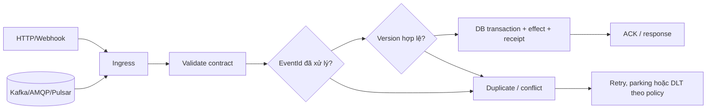
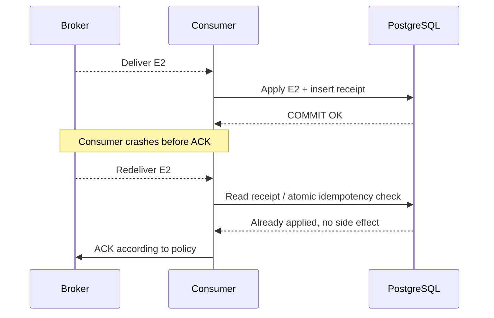
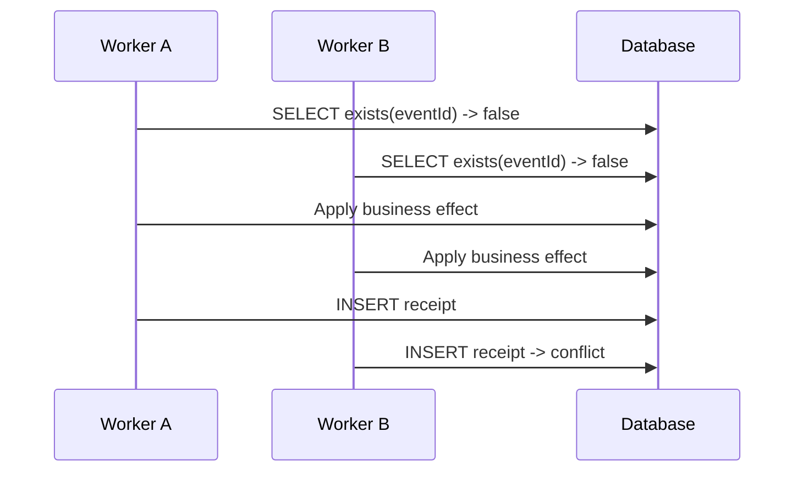
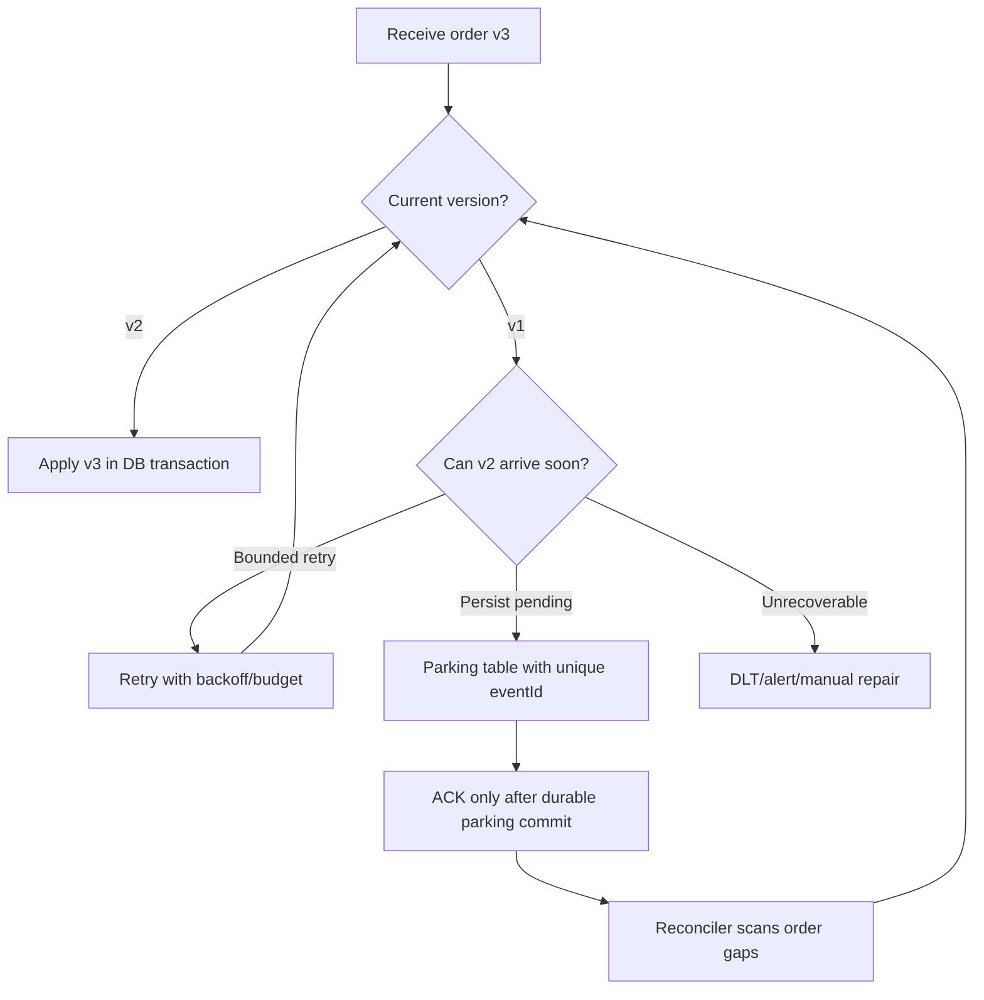
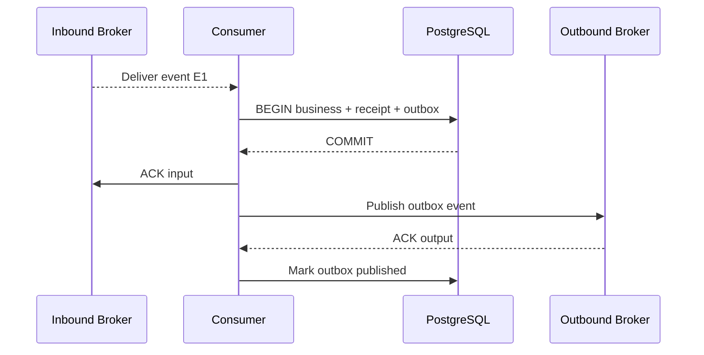
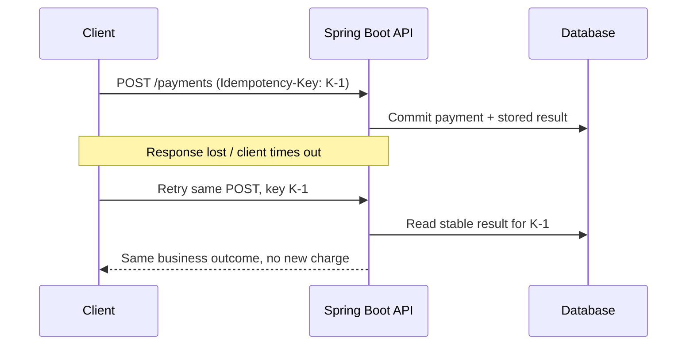
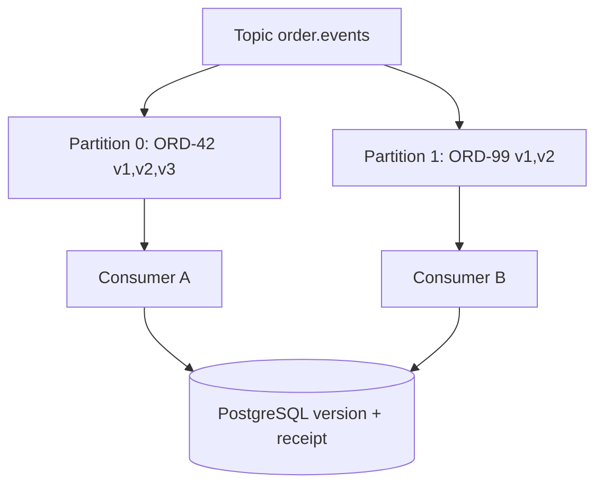
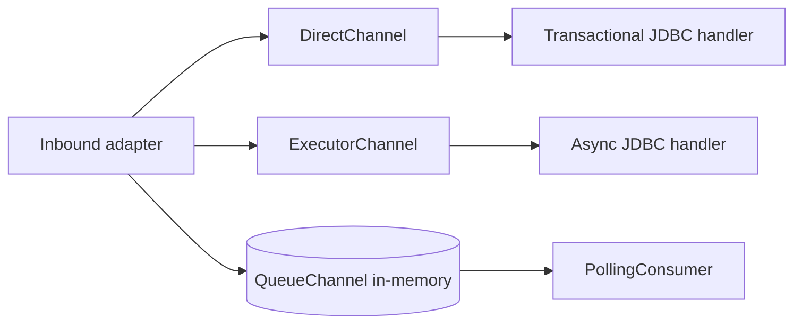
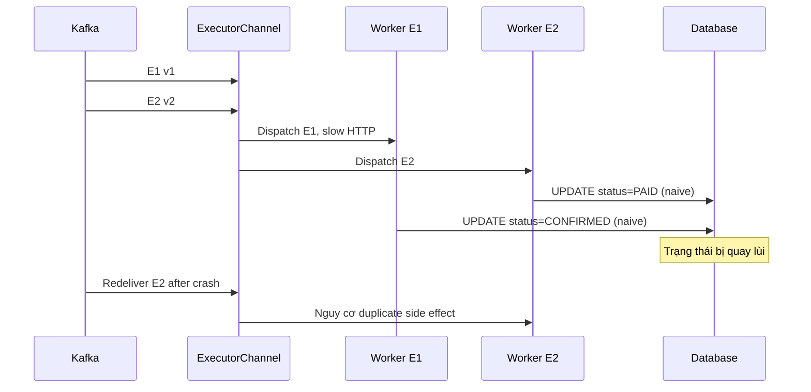

# Kiểm thử dữ liệu trùng, sai thứ tự và xử lý đồng thời

## 1. Vì sao ba nhóm lỗi này quyết định độ tin cậy của tích hợp?

Trong hệ thống Spring Boot tích hợp HTTP client, PostgreSQL, Redis, Kafka, RabbitMQ, Pulsar và Spring Integration, **cùng một dữ liệu có thể xuất hiện nhiều lần, đến không đúng thứ tự mong đợi, hoặc được xử lý đồng thời ở nhiều thread/pod**. Một bài kiểm thử chỉ gửi một message hợp lệ rồi xác nhận database có một bản ghi sẽ bỏ sót phần lớn các tình huống gây sai lệch nghiệp vụ thực tế.

Giả sử một dịch vụ nhận các sự kiện thay đổi trạng thái đơn hàng:

```text
Order ORD-42
  event E1: version=1, status=CONFIRMED
  event E2: version=2, status=PAID
  event E3: version=3, status=SHIPPED
```

Những trường hợp cần kiểm thử:

- **Dữ liệu trùng:** `E2` được gửi lại vì producer timeout sau khi broker đã nhận, consumer chết sau DB commit nhưng trước ACK, hoặc HTTP client retry.
- **Sai thứ tự:** `E3` tới trước `E2` do nhiều nguồn phát, retry tách sang queue khác, nhiều partitions hoặc xử lý song song.
- **Đồng thời:** hai pod cùng xử lý `E2` hoặc hai sự kiện khác nhau cố cập nhật cùng đơn hàng ở cùng một version.
- **Tương tác giữa cả ba:** `E3` đến sớm, được lưu để chờ; sau đó `E2` đến hai lần ở hai pods, trong khi một worker vừa bị kill.



Sơ đồ thể hiện những **quyết định logic**, không có nghĩa chỉ cần dùng một `SELECT exists` rồi `INSERT` là đủ an toàn trước race. Việc quyết định phải dựa vào **database constraint, atomic update và transaction**.

Đây là một nội dung của chương **Hợp đồng và lỗi biên** trong module **SPRING_BOOT_INTEGRATION**. Mục tiêu không chỉ là hiểu khái niệm, mà là **thiết kế test có thể tái hiện lỗi và chứng minh những bất biến nghiệp vụ** khi có retry, crash, out-of-order và concurrency.

### Mục tiêu học tập

Sau bài này, bạn có thể:

1. Phân biệt duplicate delivery, duplicate side effect, duplicate request ID và duplicate business operation.
2. Xây dựng hợp đồng event/request có định danh ổn định, phiên bản, correlation ID và policy với payload xung đột.
3. Xử lý đúng event cũ, event đến sớm có gap, retry/redelivery và cập nhật đồng thời theo aggregate.
4. Áp dụng PostgreSQL **unique constraints**, optimistic concurrency, conditional updates và transaction receipt.
5. Viết JUnit 5/Testcontainers tests tái hiện trùng message, lệch thứ tự và race nhiều worker một cách có kiểm soát.
6. Kiểm thử crash windows của DB commit, broker ACK và HTTP timeout; xác định nơi cần inbox/outbox.
7. Kiểm tra chính sách ACK/retry/DLT/parking của adapter thay vì giả định `MessageChannel.send()` đồng nghĩa xử lý thành công.
8. Xây dựng ma trận kiểm thử, monitoring và runbook để vận hành theo at-least-once delivery mà vẫn bảo toàn kết quả nghiệp vụ.

> **Phạm vi minh họa:** Java 17+, Spring Boot 3.5.x, Spring Framework 6.x, Spring JDBC, Spring Kafka 3.x/Spring Integration 6.x và PostgreSQL 16. Các API và cấu hình adapter khác nhau theo phiên bản; ví dụ Kafka/RabbitMQ/Pulsar được nêu có điều kiện. Không có cơ chế “exactly-once cho mọi HTTP + DB + broker side effect” chỉ nhờ một annotation hoặc test thành công.

## 2. Định nghĩa rõ lỗi trước khi viết test

### 2.1. Duplicate delivery không đồng nghĩa duplicate effect

Một event có thể được **giao nhiều lần** nhưng business effect chỉ cần xảy ra **một lần**:



**At-least-once delivery** cho phép redelivery. Mục tiêu thực tế là **effectively-once business effect** tại phạm vi được định nghĩa bằng idempotency và transaction, không phải cam kết broker chỉ phát một bản.

### 2.2. Cùng event ID nhưng payload khác là xung đột

Hai payload:

```json
{"eventId":"EVT-9","orderId":"ORD-42","version":2,"status":"PAID"}
```

```json
{"eventId":"EVT-9","orderId":"ORD-42","version":2,"status":"CANCELLED"}
```

không nên được xử lý như duplicate hợp lệ chỉ vì `eventId` giống nhau. Cần **so sánh business fields hoặc canonical payload fingerprint**, rồi báo `EVENT_ID_REUSE_CONFLICT`/đưa vào recovery. Nếu lặng lẽ bỏ bản thứ hai, lỗi producer/schema có thể bị che khuất.

### 2.3. Sai thứ tự phải xét theo aggregate

Thứ tự thường có ý nghĩa **theo `orderId`**, không phải toàn hệ thống:

```text
ORD-42: version 1 → 2 → 3  (strict sequence)
ORD-99: version 1 → 2      (độc lập)
```

Event của hai đơn hàng khác nhau có thể xử lý song song. Event `ORD-42/v3` tới trước `ORD-42/v2` phải theo policy: **park, retry có kiểm soát hoặc reject**, không mặc định cập nhật trạng thái lên version 3 và bỏ mất bước version 2.

### 2.4. Xử lý đồng thời là cả race trong một JVM và giữa các pod

`synchronized`, `ReentrantLock` và `ConcurrentHashMap` có thể bảo vệ một process, nhưng **không khóa** các pod JVM khác. Một dịch vụ chạy 4 replicas cần ràng buộc ở tầng có **phạm vi toàn hệ** như database unique key/row lock hoặc một cơ chế phân phối có đảm bảo phù hợp.

## 3. Hợp đồng dữ liệu dùng xuyên suốt bài

Ví dụ event được thiết kế để có đầy đủ trường cần kiểm tra:

```java
// OrderStatusChanged.java
package example.integration.contract;

public record OrderStatusChanged(
        String eventId,
        String orderId,
        long version,
        String status) {
}
```

Ví dụ JSON:

```json
{
  "eventId": "EVT-ORD42-002",
  "orderId": "ORD-42",
  "version": 2,
  "status": "PAID"
}
```

Hợp đồng cần tuyên bố rõ:

| Trường | Ý nghĩa | Ràng buộc kiểm thử |
| --- | --- | --- |
| `eventId` | ID bất biến của **một business event** | Stable qua retry, unique trong phạm vi producer/consumer contract |
| `orderId` | Aggregate ID | Dùng làm correlation/routing/partition key khi phù hợp |
| `version` | Phiên bản liên tục tăng **trên một order** | Version đầu là 1; `v(n)` sau `v(n-1)` nếu strict |
| `status` | Trạng thái kết quả | Thuộc enum/transition whitelist và không được thay đổi sau khi publish |
| `schemaVersion` *(nếu thêm)* | Phiên bản cấu trúc payload | Phân biệt với aggregate version; có compatibility rules |
| `occurredAt` *(nếu thêm)* | Thời điểm producer ghi nhận event | Không dùng thay ordering/version khi clocks lệch |
| `correlationId` *(header)* | Tracing qua HTTP/broker/adapter | Không làm idempotency key mặc định |

**Phân biệt hai loại version:**

- `schemaVersion=2`: cấu trúc JSON version 2, ví dụ bổ sung field mới.
- `version=5`: đây là thay đổi trạng thái thứ năm của `ORD-42`.

Không dùng thời điểm nhận (`receivedAt`) để kết luận event nào “mới” nếu hai sources hoặc clocks có độ trễ. Nếu hai producers đều có thể tạo `version=2` cho một order, producer-side sequencing phải được giải quyết; consumer không thể tự đoán sự kiện nào đúng.

### 3.1. Business invariant quan trọng hơn số lượng message

Với một order:

\[
\text{lastVersion} \text{ tăng theo } 0,1,2,3,\ldots
\]

và:

\[
\text{numberOfBusinessEffects}(\text{consumer},\text{eventId}) \leq 1.
\]

Cụ thể:

- Event `v2` chỉ được **áp dụng** khi current version là `1`.
- Cùng `eventId` và cùng payload được giao lại phải trả `DUPLICATE` mà **không tạo effect mới**.
- Cùng `eventId` nhưng khác `orderId`, `version` hoặc `status` là lỗi hợp đồng.
- Hai writers cạnh tranh cập nhật `v2`: tối đa **một** update được chấp nhận.
- Khi trạng thái business bị rollback, receipt cho event đó cũng phải rollback nếu dùng cùng database transaction.

Chúng ta sẽ **kiểm thử invariant**, không dựa vào thứ tự log in ra hoặc việc `Thread.sleep` rồi thấy kết quả có vẻ đúng.

## 4. Ma trận kiểm thử trước khi triển khai

| Nhóm | Input/thao tác | Kết quả mong đợi |
| --- | --- | --- |
| Happy path | v1 rồi v2 rồi v3 | Version 3, trạng thái của v3 |
| Duplicate | v1, sau đó phát lại **cùng** v1 | Một effect; lần hai là `DUPLICATE` |
| ID reuse | Cùng eventId, nội dung status khác | `EVENT_ID_REUSE_CONFLICT`, không ghi đè |
| Gap | v3 đến khi current v1 | `GAP`; không áp dụng v3 |
| Gap recovery | v3 đến sớm, sau đó v2, rồi retry v3 | Trạng thái v3; không bỏ bước v2 |
| Stale | v1 đến sau khi current v3, nhưng chưa có receipt | `STALE_CONFLICT` theo policy |
| Race cùng event | 20 threads cùng xử lý v1 | Một `APPLIED`, còn lại `DUPLICATE` |
| Race khác eventId cùng version | A/v1 và B/v1 đồng thời | Một `APPLIED`, một `STALE_CONFLICT` |
| Race v1 và v2 | Chạy đồng thời không đảm bảo thứ tự | v2 có thể `GAP`; retry có kiểm soát cho tới v2 |
| DB rollback | Receipt được insert rồi handler throw | Không có receipt hoặc business effect đã commit |
| Crash trước DB commit | Kill consumer | Redelivery/recovery, không half-commit |
| Crash sau DB commit trước ACK | Kill consumer | Redelivery nhưng effect không lặp |
| HTTP timeout unknown outcome | Client retry cùng key | Không tạo effect thứ hai |
| Broker redelivery/rebalance | Cùng event qua 2 consumer instances | Không có double effect |
| Poison message | Sai JSON/schema, version không hỗ trợ | Retry/DLT/parking đúng lớp lỗi |
| Load | Nhiều orders và concurrent consumers | Giữ invariant; latency/backlog có giới hạn |

**Một test thành công chưa chứng minh toàn hệ “exactly once”.** Ma trận phải bao phủ từng failure window và **đúng adapter/container/transaction manager** đang chạy thực.

## 5. Database là trọng tài cho idempotency và version

Với PostgreSQL, dựng bảng projection và receipt bằng migration có version:

```sql
CREATE TABLE order_projection (
    order_id VARCHAR(80) PRIMARY KEY,
    version BIGINT NOT NULL DEFAULT 0,
    order_status VARCHAR(32) NOT NULL,
    updated_at TIMESTAMPTZ NOT NULL DEFAULT now(),
    CONSTRAINT ck_order_projection_version CHECK (version >= 0)
);

CREATE TABLE handled_event (
    consumer_name VARCHAR(100) NOT NULL,
    event_id VARCHAR(100) NOT NULL,
    order_id VARCHAR(80) NOT NULL,
    event_version BIGINT NOT NULL,
    event_status VARCHAR(32) NOT NULL,
    handled_at TIMESTAMPTZ NOT NULL DEFAULT now(),
    PRIMARY KEY (consumer_name, event_id)
);

CREATE INDEX idx_handled_event_order
    ON handled_event (order_id, event_version);
```

Tạo một order ban đầu:

```sql
INSERT INTO order_projection (order_id, version, order_status)
VALUES ('ORD-42', 0, 'CREATED');
```

`handled_event` chứa đủ fields để phát hiện **event ID bị dùng lại với payload khác**, không chỉ một Boolean “đã tồn tại”. Ở production, có thể dùng canonical payload hash/version khi payload nhiều fields và kiểm soát serializer/canonicalization. **Không** hash chuỗi JSON tùy ý với thứ tự field không ổn định rồi giả định hai payload tương đương luôn có cùng bytes.

### 5.1. Phạm vi unique key

Trong ví dụ, `(consumer_name,event_id)` được dùng vì hai logical consumers khác nhau có thể cần áp dụng hai hiệu ứng riêng cho cùng event. Nếu là HTTP idempotency, key có thể cần `(tenant_id, operation_type, idempotency_key)`. Nếu `eventId` chỉ unique trong một producer, thêm `producerId`/namespace vào key.

Không dùng broker offset làm event ID cho business idempotency: một cùng business event được publish lại có thể nằm ở **offset khác**. Không dùng một cache key TTL ngắn hơn cửa sổ redelivery thực rồi coi là dedupe bền vững.

### 5.2. Transaction chứa **cả effect và receipt**

```text
BEGIN
  conditional UPDATE order_projection
  INSERT handled_event
COMMIT
```

Nếu ghi projection thành công rồi receipt thất bại, **cả hai phải rollback**. Nếu receipt commit trước rồi projection không cập nhật, lần redelivery sau có thể bị bỏ qua sai. Vì vậy hai thao tác phải nằm trong **cùng một database transaction** và dùng **cùng JDBC DataSource/transaction manager**.

## 6. Không sử dụng check-then-act làm cơ chế dedupe duy nhất

Anti-pattern:

```java
if (!repository.existsByEventId(event.eventId())) {
    repository.applyBusinessUpdate(event);
    repository.insertProcessedReceipt(event.eventId());
}
```

Hai threads có thể cùng thấy `exists=false`:



Nếu business effect đã **commit riêng** hoặc gọi API bên ngoài trước unique conflict, tác dụng có thể bị lặp. Đừng xem `synchronized` quanh đoạn code là đủ nếu có nhiều replicas.

**Cơ chế đúng:** database unique constraints, conditional UPDATE/CAS, transaction rollback và logic xác định outcome cho duplicate/conflict. Có thể dùng một fast-path query để giảm chi phí nhưng **không** thay atomic claim.

### 6.1. `ON CONFLICT DO NOTHING` giúp gì?

```sql
INSERT INTO handled_event (
    consumer_name, event_id, order_id, event_version, event_status
)
VALUES (:consumer, :eventId, :orderId, :version, :status)
ON CONFLICT (consumer_name, event_id) DO NOTHING;
```

Phải **đọc affected rows**: 1 là bạn vừa tạo receipt; 0 là một receipt đã tồn tại. Với ID reuse, còn phải so sánh payload đã lưu. Nếu chỉ `DO NOTHING` rồi tiếp tục thực hiện side effect, unique key **không còn bảo vệ được idempotency**.

### 6.2. Optimistic concurrency trên aggregate

```sql
UPDATE order_projection
SET
    version = :incomingVersion,
    order_status = :status,
    updated_at = now()
WHERE order_id = :orderId
  AND version = :incomingVersion - 1;
```

Đây là một **compare-and-set SQL**. PostgreSQL đánh giá điều kiện dưới row lock khi cập nhật concurrent rows; nếu có hai transactions cạnh tranh từ cùng version, thường chỉ một update match và commit. Không đặt `version = version + 1` mà **không** kiểm tra expected version, vì nó có thể áp sai event khi reorder.

**Lưu ý:** xử lý được **race trên một row** không đồng nghĩa toàn workflow có nhiều bảng tự atomic. Phải đặt những SQL operations liên quan trong cùng transaction và test rollback/uniqueness.

## 7. Mô hình kết quả rõ nghĩa cho consumer

Đừng chỉ trả `boolean handled` vì cần phân biệt những trường hợp khác nhau:

```java
// Decision.java
package example.integration.contract;

public enum Decision {
    APPLIED,        // effect mới đã được commit khi tx hoàn tất
    DUPLICATE,      // cùng eventId, cùng business payload, đã xử lý
    GAP,            // cần một version trước đó
    STALE_CONFLICT  // event/version không còn được phép áp dụng
}
```

Một lỗi ID reuse hoặc payload sai schema nên đi theo exception/category riêng, không âm thầm thành `DUPLICATE`:

```java
// EventIdConflictException.java
package example.integration.contract;

public class EventIdConflictException extends RuntimeException {
    public EventIdConflictException(String message) {
        super(message);
    }
}
```

Ứng dụng cần ánh xạ outcome sang chính sách nguồn:

| Outcome | Business effect | Broker ACK/HTTP response |
| --- | --- | --- |
| `APPLIED` | Mới và bền vững sau commit | ACK sau transaction; HTTP success theo contract |
| `DUPLICATE` | Không tạo thêm | Thường ACK; HTTP trả kết quả cũ/stable response |
| `GAP` | Chưa áp dụng | Retry có giới hạn hoặc **persist parking rồi ACK**, không bỏ vô điều kiện |
| `STALE_CONFLICT` | Không áp dụng | Phân loại policy: conflict, DLT/parking, reconcile |
| `EVENT_ID_REUSE_CONFLICT` | Không áp dụng | Lỗi hợp đồng cần alert/investigation; không treat as duplicate success |

Chính sách cụ thể còn phụ thuộc nguồn HTTP, JDBC poller, Kafka, RabbitMQ, Pulsar và mức quan trọng nghiệp vụ. Một `GAP` có thể do mạng chậm **hoặc** event bị mất ở upstream; không nên retry vô hạn mà không có deadline/parking.

## 8. Dịch vụ JDBC: một đường xử lý có thể kiểm thử được

Đoạn triển khai sau chủ ý:

- Dùng một `JdbcTemplate` trên một PostgreSQL `DataSource`.
- Dùng `@Transactional` trên Spring bean được gọi qua proxy, giữ `UPDATE` và `INSERT receipt` trong một transaction.
- Áp dụng version tiếp theo bằng **conditional update**.
- Với update không match, kiểm tra receipt, phát hiện ID reuse, rồi xác định `GAP` hoặc `STALE_CONFLICT`.

### 8.1. Khai báo transaction manager tường minh

```java
// OrderTransactionConfiguration.java
package example.integration.contract;

import javax.sql.DataSource;
import org.springframework.context.annotation.Bean;
import org.springframework.context.annotation.Configuration;
import org.springframework.jdbc.support.JdbcTransactionManager;
import org.springframework.transaction.PlatformTransactionManager;

@Configuration(proxyBeanMethods = false)
public class OrderTransactionConfiguration {

    @Bean("orderJdbcTxManager")
    PlatformTransactionManager orderJdbcTxManager(
            DataSource dataSource) {
        return new JdbcTransactionManager(dataSource);
    }
}
```

Trong hệ chỉ có một `DataSource`, Spring Boot thường có thể tạo JDBC transaction manager theo auto-config conditions. Ví dụ explicit giúp tests và service nêu **đúng manager**. Nếu ứng dụng dùng JPA, cần đánh giá `JpaTransactionManager`/EntityManager và JDBC participation thay vì thêm manager một cách tùy tiện.

### 8.2. Dịch vụ cập nhật trạng thái và receipt

```java
// OrderProjectionHandler.java
package example.integration.contract;

import java.util.List;
import java.util.Objects;
import org.springframework.jdbc.core.JdbcTemplate;
import org.springframework.stereotype.Service;
import org.springframework.transaction.annotation.Transactional;

@Service
public class OrderProjectionHandler {

    private static final String CONSUMER = "orders-projection-v1";
    private final JdbcTemplate jdbc;

    public OrderProjectionHandler(JdbcTemplate jdbc) {
        this.jdbc = jdbc;
    }

    @Transactional(transactionManager = "orderJdbcTxManager")
    public Decision apply(OrderStatusChanged event) {
        validate(event);

        int changed = jdbc.update("""
                UPDATE order_projection
                SET version = ?, order_status = ?, updated_at = now()
                WHERE order_id = ? AND version = ?
                """,
                event.version(),
                event.status(),
                event.orderId(),
                event.version() - 1);

        if (changed == 1) {
            // Cùng transaction với UPDATE projection.
            // Unique constraint bảo vệ receipt ngay cả khi có race.
            jdbc.update("""
                    INSERT INTO handled_event (
                        consumer_name, event_id, order_id,
                        event_version, event_status
                    )
                    VALUES (?, ?, ?, ?, ?)
                    """,
                    CONSUMER,
                    event.eventId(),
                    event.orderId(),
                    event.version(),
                    event.status());
            return Decision.APPLIED;
        }

        List<SeenEvent> seen = jdbc.query("""
                SELECT order_id, event_version, event_status
                FROM handled_event
                WHERE consumer_name = ? AND event_id = ?
                """,
                (rs, n) -> new SeenEvent(
                        rs.getString("order_id"),
                        rs.getLong("event_version"),
                        rs.getString("event_status")),
                CONSUMER,
                event.eventId());

        if (!seen.isEmpty()) {
            SeenEvent receipt = seen.get(0);
            if (Objects.equals(receipt.orderId(), event.orderId())
                    && receipt.version() == event.version()
                    && Objects.equals(receipt.status(), event.status())) {
                return Decision.DUPLICATE;
            }
            throw new EventIdConflictException(
                    "Event ID reused with different content: "
                            + event.eventId());
        }

        List<Long> versions = jdbc.query("""
                SELECT version FROM order_projection WHERE order_id = ?
                """,
                (rs, n) -> rs.getLong("version"),
                event.orderId());

        if (versions.isEmpty()) {
            // Ví dụ giả định order phải được tạo trước.
            throw new IllegalStateException(
                    "Missing order aggregate: " + event.orderId());
        }
        long currentVersion = versions.get(0);

        if (event.version() > currentVersion + 1) {
            return Decision.GAP;
        }
        return Decision.STALE_CONFLICT;
    }

    private static void validate(OrderStatusChanged event) {
        if (event == null
                || event.eventId() == null || event.eventId().isBlank()
                || event.orderId() == null || event.orderId().isBlank()
                || event.version() < 1
                || event.status() == null || event.status().isBlank()) {
            throw new IllegalArgumentException("Invalid event contract");
        }
    }

    private record SeenEvent(
            String orderId,
            long version,
            String status) {
    }
}
```

Đoạn ví dụ cố ý **không** thực hiện một external HTTP/Kafka side effect trong cùng transaction. Nếu business workflow còn có bảng hóa đơn, tồn kho, inbox/outbox, thêm những thao tác phải atomic vào cùng transaction. Với status transition phức tạp, validate state machine trước và trong conditional update, không cho bất kỳ giá trị `status` nào chỉ vì version đúng.

**Chi tiết race:** hai concurrent transactions update cùng row/version: một transaction sẽ thắng; transaction còn lại có thể chờ lock, sau đó không còn match. Với PostgreSQL `READ COMMITTED`, một câu `SELECT` theo sau sau khi transaction đầu commit có thể nhìn thấy receipt. Tuy nhiên, nếu dùng isolation khác, retries hoặc lỗi unique constraint xảy ra, cần đánh giá rollback/retry toàn transaction. Không hứa logic này tương đương trên mọi RDBMS hoặc isolation level.

### 8.3. Nếu đã có receipt nhưng thiếu projection thì sao?

Tình trạng receipt đã commit trong khi projection không có update là **vi phạm bất biến dữ liệu** nếu hai writes phải cùng một transaction. Bài test rollback/recovery cần phát hiện. Nếu hai tables nằm ở hai DataSources, một transaction manager JDBC duy nhất không tự bảo đảm atomicity xuyên chúng.

### 8.4. ID reuse ở version mới: unique violation phải rollback

Nếu `EVT-1` đã được dùng cho v1, rồi producer sai hợp đồng lại gửi `EVT-1` cho v2, câu `UPDATE ... WHERE version=1` **có thể cập nhật được v2 tạm thời**. Nhưng `INSERT handled_event` sẽ vi phạm primary key `(consumer_name,event_id)`; cả hai thao tác phải **rollback trong cùng transaction**, nên projection vẫn ở v1. Đây là một nhánh lỗi cần test bên cạnh “cùng ID/cùng version nhưng payload khác”.

Ví dụ test method:

```java
@Test
void reusingEventIdAtNewVersionRollsBackNewState() {
    var v1 = new OrderStatusChanged(
            "EVT-1", "ORD-42", 1L, "CONFIRMED");
    var v2WithReusedId = new OrderStatusChanged(
            "EVT-1", "ORD-42", 2L, "PAID");

    assertThat(handler.apply(v1)).isEqualTo(Decision.APPLIED);

    assertThatThrownBy(() -> handler.apply(v2WithReusedId))
            .isInstanceOf(
                    org.springframework.dao.DataIntegrityViolationException.class);

    assertThat(jdbc.queryForObject("""
            SELECT version FROM order_projection WHERE order_id=?
            """, Long.class, "ORD-42")).isEqualTo(1L);
}
```

Ví dụ handler để exception SQL lan ra để Spring rollback. Trong code production, có thể map thành `EVENT_ID_REUSE_CONFLICT` **sau khi transaction đã rollback**, hoặc dùng một precheck và vẫn giữ unique constraint làm bảo vệ cuối. Với PostgreSQL, đừng bắt lỗi unique-key violation bên trong cùng transaction đã lỗi rồi tiếp tục chạy SQL như thể transaction còn hợp lệ; cần rollback/savepoint hoặc giao dịch mới theo thiết kế.

## 9. Hợp đồng về sai thứ tự: strict, latest-wins hay commutative?

Không phải loại dữ liệu nào cũng cần cùng một chính sách ordering:

| Loại dữ liệu | Phương án | Ví dụ và giới hạn |
| --- | --- | --- |
| **Strict sequence** | Chỉ áp dụng version tiếp theo | Trạng thái đơn hàng, ledger cần không bỏ bước |
| **Latest version wins** | Chỉ chấp nhận version lớn nhất, bỏ version thấp | Snapshot/profile mang toàn bộ trạng thái, không phụ thuộc delta trung gian |
| **Commutative operation** | Có thể reorder nếu phép toán thực sự giao hoán | Một số counters cộng độc lập; vẫn cần dedupe event |
| **Causal dependencies** | Chờ sự kiện tiền đề, DAG/correlation | PaymentCaptured cần PaymentAuthorized |
| **Best-effort notification** | Có thể bỏ bản quá cũ | Cache invalidation hoặc thông báo không quan trọng |

**Không chọn latest-wins mặc định** cho event dạng delta:

```text
v1: +10 điểm
v2: -3 điểm
v3: +5 điểm
```

Nếu `v3` tới trước rồi ứng dụng nhảy thẳng lastVersion=3, hai delta trước có thể bị mất. Ngược lại, nếu mỗi event chứa **snapshot đầy đủ** của trạng thái và contract khẳng định version cao thay thế toàn bộ version thấp, latest-wins có thể phù hợp. Dù vậy duplicate delivery vẫn cần xử lý idempotently.

### 9.1. Trạng thái cần phân biệt

```text
current=1, incoming=2  → NEXT/APPLY
current=1, incoming=3  → GAP (chờ v2)
current=3, incoming=2  → STALE hoặc DUPLICATE nếu receipt v2 tồn tại
current=2, incoming=2 nhưng eventId khác → CONFLICT
```

Nếu receipt v2 đã bị xóa vì retention, consumer không thể xác định chắc một event v2 đến lại có payload giống trước hay không chỉ từ version. Khi xóa receipt cần giữ retention window lớn hơn **broker retention, HTTP retry window, delayed retry/DLT replay window và audit requirements**, hoặc có nguồn truth khác.

### 9.2. Vì sao không dựa vào timestamp?

Clocks giữa producers có thể lệch; network delay/retry khiến event cũ tới sau. Test nên tạo payload có `occurredAt` **mới hơn nhưng version thấp hơn** để bảo đảm consumer áp dụng quy tắc **business sequence**, không dùng received timestamp như nguồn thứ tự.

## 10. Gap handling: retry, parking và reconciliation

Khi `E3/v3` tới lúc current version là 1, xử lý `GAP` phải theo một chính sách công khai:



### 10.1. Không retry nóng vô hạn

Một Kafka consumer xử lý v3 trên partition P có thể chờ v2 mãi, nhưng v2 lại được đặt **sau v3 trên cùng partition** do producer sai thứ tự. Nếu cứ retry v3 và không advance offset, v2 sẽ không bao giờ được xử lý. Đây là dạng **head-of-line blocking**.

Giải pháp thường là:

1. Lưu v3 vào một **durable parking table/topic** với eventId và aggregate version.
2. Commit việc parking **trước** khi ACK v3.
3. Cho luồng broker tiếp tục xử lý v2.
4. Reconciler phát lại v3 khi trạng thái aggregate đã tới version 2.
5. Có TTL/SLA, backoff và alert khi v2 không đến.

Nếu lựa chọn Kafka retry topics làm parking, cần xét thứ tự giữa main/retry topics và khả năng event cũ được phát lại sau khi trạng thái đã tiến xa. Dedupe/sequence guard ở database vẫn phải đúng.

### 10.2. Schema parking minh họa

```sql
CREATE TABLE pending_order_event (
    consumer_name VARCHAR(100) NOT NULL,
    event_id VARCHAR(100) NOT NULL,
    order_id VARCHAR(80) NOT NULL,
    event_version BIGINT NOT NULL,
    payload_json JSONB NOT NULL,
    first_seen_at TIMESTAMPTZ NOT NULL DEFAULT now(),
    retry_after TIMESTAMPTZ NOT NULL DEFAULT now(),
    attempts INTEGER NOT NULL DEFAULT 0,
    PRIMARY KEY (consumer_name, event_id)
);

CREATE INDEX idx_pending_order_sequence
    ON pending_order_event (
        consumer_name, order_id, event_version
    );
```

Hai versions cùng `orderId` và `event_version` nhưng khác eventId có thể là **producer conflict**. Có thể thêm unique constraint `(consumer_name, order_id, event_version)` khi contract bảo đảm mỗi aggregate/version chỉ có một event. Nếu dùng nó, ghi nhận và xử lý xung đột thay vì `ON CONFLICT DO NOTHING` mù quáng.

### 10.3. Tính atomic giữa parking và ACK

Một consumer có thể:

```text
Begin DB tx
  INSERT pending_order_event (idempotent)
Commit DB tx
  → listener returns / ACK broker theo policy
```

Nếu crash sau DB commit nhưng trước broker ACK, event sẽ redeliver và parking `INSERT` phải idempotent. Nếu ACK trước DB commit, event có thể **mất** khi process chết. Đây cũng là lý do `QueueChannel` in-memory không thể thay parking bền vững.

## 11. Bộ kiểm thử JUnit 5 + Testcontainers cho logic JDBC

Chúng ta kiểm thử **DB thật**, vì mock repository không thể chứng minh row-level concurrency, isolation hoặc unique constraints. Dependencies Maven:

```xml
<dependency>
    <groupId>org.springframework.boot</groupId>
    <artifactId>spring-boot-starter-test</artifactId>
    <scope>test</scope>
</dependency>
<dependency>
    <groupId>org.springframework.boot</groupId>
    <artifactId>spring-boot-testcontainers</artifactId>
    <scope>test</scope>
</dependency>
<dependency>
    <groupId>org.testcontainers</groupId>
    <artifactId>junit-jupiter</artifactId>
    <scope>test</scope>
</dependency>
<dependency>
    <groupId>org.testcontainers</groupId>
    <artifactId>postgresql</artifactId>
    <scope>test</scope>
</dependency>
```

Trong Spring Boot 3.5, `@ServiceConnection` có thể cung cấp JDBC connection details cho PostgreSQL Testcontainer khi starter/conditions phù hợp. Test dưới đây giả định dự án có `OrderProjectionHandler`, transaction manager bean và **Flyway migrations tạo các bảng mục 5**. Không thêm file migration ngoài nội dung bài học này.

### 11.1. Test fixture setup tách khỏi business transaction

```java
// OrderProjectionHandlerIT.java - phần cấu hình/fixture
package example.integration.contract;

import org.junit.jupiter.api.BeforeEach;
import org.springframework.beans.factory.annotation.Autowired;
import org.springframework.boot.test.context.SpringBootTest;
import org.springframework.boot.testcontainers.service.connection.ServiceConnection;
import org.springframework.jdbc.core.JdbcTemplate;
import org.testcontainers.containers.PostgreSQLContainer;
import org.testcontainers.junit.jupiter.Container;
import org.testcontainers.junit.jupiter.Testcontainers;

@SpringBootTest
@Testcontainers
class OrderProjectionHandlerIT {

    @Container
    @ServiceConnection
    static PostgreSQLContainer<?> postgres =
            new PostgreSQLContainer<>("postgres:16-alpine");

    @Autowired
    OrderProjectionHandler handler;

    @Autowired
    JdbcTemplate jdbc;

    @BeforeEach
    void reset() {
        // Không dùng @Transactional trên test khi đang test
        // commit thực và concurrency nhiều threads.
        jdbc.execute("DELETE FROM handled_event");
        jdbc.execute("DELETE FROM order_projection");
        jdbc.update("""
                INSERT INTO order_projection
                    (order_id, version, order_status)
                VALUES (?, ?, ?)
                """, "ORD-42", 0L, "CREATED");
    }
}
```

Các testcase ở những mục sau được trình bày như **phương thức đặt bên trong class `OrderProjectionHandlerIT`** đã có fixture và imports tương ứng; không tạo nhiều public test classes trùng tên.

**Lưu ý quan trọng:** nhiều test classes chạy song song không nên dùng chung một database schema rồi cùng `DELETE FROM` tables. Dùng isolated containers/schemas/unique IDs hoặc tắt parallel execution phù hợp. Một test method tự khai báo `@Transactional` sẽ giữ transaction ở JUnit thread, trong khi concurrent worker threads **không** nhìn thấy fixture chưa commit; vì vậy các test concurrency nên seed dữ liệu bằng transaction đã commit.

### 11.2. Mức kiểm thử

| Mức | Thích hợp để kiểm tra | Không chứng minh |
| --- | --- | --- |
| Unit với fake repository | Validation, outcome mapping, DTO contract | DB locking/unique race |
| PostgreSQL Testcontainers | Unique key, compare-and-set, rollback, isolation | Kafka offset ACK thực |
| Kafka/Rabbit/Pulsar Testcontainers | Listener/adapter, retries, DLT, rebalances | Tất cả kịch bản node failure production |
| Multi-instance staging/chaos | Partition handoff, crash windows, pool saturation | Chứng minh toán học mọi execution có thể |

## 12. Test dữ liệu trùng: cùng payload, không áp thêm effect

Thêm test method:

```java
@Test
void replayingSameEventDoesNotApplyTwice() {
    var v1 = new OrderStatusChanged(
            "EVT-1", "ORD-42", 1L, "CONFIRMED");

    assertThat(handler.apply(v1))
            .isEqualTo(Decision.APPLIED);
    assertThat(handler.apply(v1))
            .isEqualTo(Decision.DUPLICATE);

    assertThat(jdbc.queryForObject("""
            SELECT version FROM order_projection WHERE order_id=?
            """, Long.class, "ORD-42")).isEqualTo(1L);

    assertThat(jdbc.queryForObject("""
            SELECT COUNT(*) FROM handled_event WHERE event_id=?
            """, Integer.class, "EVT-1")).isEqualTo(1);
}
```

Cần import trong test class:

```java
import org.junit.jupiter.api.Test;
import static org.assertj.core.api.Assertions.assertThat;
```

Test này mạnh hơn việc assert service đã được gọi hai lần: nó xác minh **business state và receipt** sau retry.

### 12.1. Cùng event ID nhưng nội dung khác phải bị phát hiện

```java
@Test
void sameEventIdWithChangedPayloadIsConflict() {
    var original = new OrderStatusChanged(
            "EVT-1", "ORD-42", 1L, "CONFIRMED");
    var mutated = new OrderStatusChanged(
            "EVT-1", "ORD-42", 1L, "CANCELLED");

    assertThat(handler.apply(original))
            .isEqualTo(Decision.APPLIED);

    assertThatThrownBy(() -> handler.apply(mutated))
            .isInstanceOf(EventIdConflictException.class);

    assertThat(jdbc.queryForObject("""
            SELECT order_status FROM order_projection WHERE order_id=?
            """, String.class, "ORD-42"))
            .isEqualTo("CONFIRMED");
}
```

Thêm static import `org.assertj.core.api.Assertions.assertThatThrownBy`. **Không** trả `DUPLICATE` cho cùng key với business payload khác; đó là lỗi hợp đồng upstream.

### 12.2. Receipt rollback cùng business update

Một cách tạo lỗi sau `UPDATE` projection là seed trước một receipt có `eventId` xung đột, khiến bước `INSERT` trong cùng transaction bị unique-key violation:

```java
@Test
void projectionRollsBackWhenReceiptInsertFails() {
    jdbc.update("""
            INSERT INTO handled_event
                (consumer_name, event_id, order_id,
                 event_version, event_status)
            VALUES (?, ?, ?, ?, ?)
            """,
            "orders-projection-v1",
            "EVT-1",
            "ORD-42",
            999L,
            "SPOOFED");

    var v1 = new OrderStatusChanged(
            "EVT-1", "ORD-42", 1L, "CONFIRMED");

    assertThatThrownBy(() -> handler.apply(v1))
            .isInstanceOf(
                    org.springframework.dao.DataIntegrityViolationException.class);

    assertThat(jdbc.queryForObject("""
            SELECT version FROM order_projection WHERE order_id=?
            """, Long.class, "ORD-42")).isEqualTo(0L);
}
```

Vì service được gọi qua Spring proxy `@Transactional`, `UPDATE` không thể commit nếu `INSERT` trong transaction đó ném exception và rollback. Test này bắt được một lỗi phổ biến: ghi business effect và receipt trong **hai transactions tách biệt**.

## 13. Test sai thứ tự: gap, phục hồi và stale event

### 13.1. v3 đến sớm không được áp dụng

```java
@Test
void versionGapIsNotAppliedAndCanRecover() {
    var v1 = new OrderStatusChanged(
            "EVT-1", "ORD-42", 1L, "CONFIRMED");
    var v2 = new OrderStatusChanged(
            "EVT-2", "ORD-42", 2L, "PAID");
    var v3 = new OrderStatusChanged(
            "EVT-3", "ORD-42", 3L, "SHIPPED");

    assertThat(handler.apply(v1)).isEqualTo(Decision.APPLIED);
    assertThat(handler.apply(v3)).isEqualTo(Decision.GAP);

    assertThat(jdbc.queryForObject("""
            SELECT version FROM order_projection WHERE order_id=?
            """, Long.class, "ORD-42")).isEqualTo(1L);

    assertThat(handler.apply(v2)).isEqualTo(Decision.APPLIED);
    assertThat(handler.apply(v3)).isEqualTo(Decision.APPLIED);
    assertThat(handler.apply(v3)).isEqualTo(Decision.DUPLICATE);

    assertThat(jdbc.queryForObject("""
            SELECT order_status FROM order_projection WHERE order_id=?
            """, String.class, "ORD-42")).isEqualTo("SHIPPED");
}
```

Test chỉ chứng minh handler có thể **gọi lại** một event GAP để xử lý đúng. Để kiểm tra luồng production, phải thêm test **parking được persist và có reconciler lấy lại đúng thứ tự**; không chỉ thử thủ công một lần gọi lại.

### 13.2. Một event cũ không được quay lùi state

```java
@Test
void staleDifferentEventCannotOverwriteCurrentVersion() {
    var v1 = new OrderStatusChanged(
            "EVT-1", "ORD-42", 1L, "CONFIRMED");
    var conflicting = new OrderStatusChanged(
            "EVT-OTHER", "ORD-42", 1L, "CANCELLED");

    assertThat(handler.apply(v1)).isEqualTo(Decision.APPLIED);
    assertThat(handler.apply(conflicting))
            .isEqualTo(Decision.STALE_CONFLICT);

    assertThat(jdbc.queryForObject("""
            SELECT order_status FROM order_projection WHERE order_id=?
            """, String.class, "ORD-42"))
            .isEqualTo("CONFIRMED");
}
```

**Một event có version thấp nhưng receipt đã lưu** có thể trả `DUPLICATE`; một event khác ID/khác nội dung với version thấp trả `STALE_CONFLICT`. Hai trường hợp cần được kiểm thử và giám sát khác nhau.

### 13.3. Gaps trên nhiều aggregates phải độc lập

Nếu `ORD-42/v3` đang chờ v2 nhưng `ORD-99/v1` hợp lệ, không nên để một global lock/queue tạm dừng toàn bộ hệ thống. Test nên seed hai orders rồi xử lý xen kẽ; `ORD-99` vẫn tiến được trong khi `ORD-42` chưa đủ prerequisites.

Kafka partition key theo `orderId` giúp giữ ordering **trong cùng partition và cùng topic** dưới các điều kiện producer/consumer phù hợp, nhưng không bảo đảm ordering xuyên nhiều topics, retry topics, multiple producers hoặc async worker completions. Database version guard vẫn phải tồn tại.

## 14. Kiểm thử xử lý đồng thời: khởi chạy cùng lúc, đo invariant

Một concurrency test không nên chỉ:

```java
for (int i = 0; i < 10; i++) {
    handler.apply(event);
}
```

Đó là kiểm thử tuần tự, không có race. Cần nhiều threads gọi service proxy cùng lúc. Một `CountDownLatch` đóng vai trò **cổng khởi chạy chung**; tất cả workers sẵn sàng, sau đó đồng loạt được mở cổng.

### 14.1. Cùng event, 8 concurrent workers, đúng một APPLIED

Thêm imports:

```java
import java.util.ArrayList;
import java.util.List;
import java.util.concurrent.CountDownLatch;
import java.util.concurrent.ExecutorService;
import java.util.concurrent.Executors;
import java.util.concurrent.Future;
import java.util.concurrent.TimeUnit;
```

Test method bên trong `OrderProjectionHandlerIT`:

```java
@Test
void concurrentSameEventProducesOneBusinessEffect()
        throws Exception {

    int workers = 8;
    var event = new OrderStatusChanged(
            "EVT-1", "ORD-42", 1L, "CONFIRMED");

    ExecutorService executor = Executors.newFixedThreadPool(workers);
    var ready = new CountDownLatch(workers);
    var start = new CountDownLatch(1);
    List<Future<Decision>> futures = new ArrayList<>();

    try {
        for (int i = 0; i < workers; i++) {
            futures.add(executor.submit(() -> {
                ready.countDown();
                if (!start.await(5, TimeUnit.SECONDS)) {
                    throw new IllegalStateException("Start gate timeout");
                }
                return handler.apply(event);
            }));
        }

        assertThat(ready.await(5, TimeUnit.SECONDS)).isTrue();
        start.countDown();

        List<Decision> results = new ArrayList<>();
        for (Future<Decision> future : futures) {
            results.add(future.get(15, TimeUnit.SECONDS));
        }

        assertThat(results.stream()
                .filter(d -> d == Decision.APPLIED)
                .count()).isEqualTo(1L);

        assertThat(results.stream()
                .filter(d -> d == Decision.DUPLICATE)
                .count()).isEqualTo(7L);

        assertThat(jdbc.queryForObject("""
                SELECT version FROM order_projection WHERE order_id=?
                """, Long.class, "ORD-42")).isEqualTo(1L);

        assertThat(jdbc.queryForObject("""
                SELECT COUNT(*) FROM handled_event WHERE event_id=?
                """, Integer.class, "EVT-1")).isEqualTo(1);
    } finally {
        start.countDown(); // giải phóng workers nếu một assertion fail sớm
        executor.shutdownNow();
        assertThat(executor.awaitTermination(5, TimeUnit.SECONDS))
                .isTrue();
    }
}
```

Trong test này:

- Mỗi call đi qua Spring bean `handler`, nên `@Transactional` được intercept bởi proxy.
- Hikari pool cần đủ capacity cho mức concurrency của test; nếu quá nhỏ, test có thể fail vì acquire timeout, **không** chứng minh lỗi idempotency.
- Test không tự bảo đảm mọi thread tới đúng SQL statement cùng một nanosecond. Nó tạo **cạnh tranh gần đồng thời** và kiểm tra invariant kết quả. Với test muốn ép race chính xác, bổ sung barrier tại chỗ trước database write qua test hook/proxy.
- Không gắn `@Transactional` lên method JUnit để giữ fixture chưa commit: worker threads dùng connections riêng và có thể không nhìn thấy order seed.
- `shutdownNow()` được gọi **sau khi** đã chờ futures; test có deadline để tránh treo CI.

### 14.2. Hai event khác ID nhưng cùng expected version

```java
@Test
void concurrentConflictingEventsCannotBothWin()
        throws Exception {

    var first = new OrderStatusChanged(
            "EVT-A", "ORD-42", 1L, "CONFIRMED");
    var second = new OrderStatusChanged(
            "EVT-B", "ORD-42", 1L, "CANCELLED");

    ExecutorService pool = Executors.newFixedThreadPool(2);
    var gate = new CountDownLatch(1);
    try {
        Future<Decision> a = pool.submit(() -> {
            gate.await();
            return handler.apply(first);
        });
        Future<Decision> b = pool.submit(() -> {
            gate.await();
            return handler.apply(second);
        });
        gate.countDown();

        List<Decision> outcomes = List.of(
                a.get(10, TimeUnit.SECONDS),
                b.get(10, TimeUnit.SECONDS));

        assertThat(outcomes).containsExactlyInAnyOrder(
                Decision.APPLIED,
                Decision.STALE_CONFLICT);

        assertThat(jdbc.queryForObject("""
                SELECT COUNT(*) FROM handled_event
                WHERE order_id=? AND event_version=?
                """, Integer.class, "ORD-42", 1L)).isEqualTo(1);
    } finally {
        gate.countDown();
        pool.shutdownNow();
        assertThat(pool.awaitTermination(5, TimeUnit.SECONDS))
                .isTrue();
    }
}
```

Đừng viết test kỳ vọng chắc `EVT-A` sẽ thắng: scheduler của JVM và database lock acquisition không bảo đảm điều đó. Business invariant cần chứng minh là **chỉ một phiên bản được áp**, còn winner có thể là A hoặc B. Nếu hệ thống cần winner theo priority/time, phải thiết kế thêm một quy tắc deterministic ở **domain level**.

### 14.3. v1 và v2 đồng thời: không ép lịch giả

Khi v2 và v1 được submit cùng lúc, có hai kết quả hợp lệ ban đầu:

1. v1 commit trước v2 kiểm tra → cả v1 và v2 được áp dụng.
2. v2 kiểm tra trước khi v1 commit → v2 trả `GAP`; sau đó v1 được áp dụng, và v2 cần retry.

Test nên chấp nhận cả hai lịch **nhưng không chấp nhận** kết quả cuối cùng sai sau reconciliation:

```text
Concurrent(v1, v2) produces:
  v1 = APPLIED
  v2 = APPLIED or GAP
After retrying GAP:
  final version = 2
  final status  = PAID
  receipts for v1 and v2 exactly once
```

Nếu v2 đã được áp dụng, đừng retry rồi kỳ vọng `APPLIED` lần nữa; lần retry phải là `DUPLICATE`. Concurrency tests nên khẳng định **trạng thái hội tụ (convergence)** và invariant hơn là phụ thuộc vào một lịch chạy.

### 14.4. Nhiều aggregates song song

Seed nhiều order IDs và gửi v1 cho mỗi order ở các threads khác nhau. Test:

- Mọi order đều đạt version 1, không có business effect của order này nằm ở order kia.
- Transaction scope không tạo **global lock** ngăn toàn bộ orders xử lý song song.
- Một event lỗi ở order A không rollback các business transactions độc lập của order B.
- Connection pool không bị cạn khi concurrency bằng hoặc lớn hơn pool size; kết quả timeout phải có policy rõ.

## 15. Test race có điều khiển: latch ở đúng điểm lỗi

`CountDownLatch` trước khi vào service tạo cạnh tranh, nhưng vẫn có thể không chạm đúng crash window. Để kiểm tra concurrency sâu hơn, dùng **test hook** tại biên quan trọng:

```text
Worker A:
  BEGIN
  UPDATE aggregate row (lock held)
  [TEST HOOK: pause before receipt INSERT]

Worker B:
  BEGIN
  UPDATE same aggregate/version
  [wait for DB lock]

Test:
  assert B cannot commit a second update
  release A
  assert A commits; B sees no match/receipt
```

Test hook có thể là một interface `ProcessingCheckpoint`:

```java
package example.integration.contract;

@FunctionalInterface
public interface ProcessingCheckpoint {
    void afterAggregateUpdate(OrderStatusChanged event);
}
```

Ở production, bean mặc định có thể là no-op; trong test, một implementation dùng latches để dừng chính xác sau `UPDATE` và trước `INSERT receipt`. Khi thêm hook vào service, không thay đổi business transaction boundary và không gọi hook chứa network side effects ngoài test.

### 15.1. Kiểm tra rollback khi worker giữ lock bị lỗi

Kịch bản:

1. Worker A cập nhật version 1, giữ transaction chưa commit.
2. Worker B chờ cùng row.
3. Buộc A ném exception trước insert receipt → T1 rollback.
4. B được tiếp tục và có thể áp dụng version 1 thành công.
5. Kiểm tra receipt và projection chỉ phản ánh **một** event thành công.

Đây là test quan trọng vì concurrency không chỉ gồm hai commit thành công; còn có **rollback, retry và contention**.

### 15.2. Đặt deadline, không dùng sleep để đồng bộ test

Anti-pattern:

```java
Thread.sleep(500);
assertThat(workerFinished).isFalse();
```

Test như vậy dễ flaky trên CI chậm hoặc GC pause. Dùng `CountDownLatch`, `CyclicBarrier`, futures với timeout và `Awaitility` khi phải chờ trạng thái không đồng bộ. Với async retries, có thể dùng virtual clock/fake scheduler ở unit test; tích hợp với DB/broker thật vẫn cần deadlines hữu hạn.

### 15.3. Không chỉ đo “không lỗi”

Một race test có thể không ném exception nhưng business đã ghi 2 invoices. Sau test, cần kiểm tra:

```sql
SELECT COUNT(*) FROM handled_event
WHERE consumer_name = 'orders-projection-v1'
  AND event_id = 'EVT-1';
```

```sql
SELECT order_status, version FROM order_projection
WHERE order_id = 'ORD-42';
```

Nếu nghiệp vụ là thanh toán, còn phải xác minh **transaction ledger/outbox/external partner idempotency** chứ không chỉ `handled_event` có một row.

## 16. Crash window: kiểm thử tại những mốc không thể rollback

Trên một pipeline broker → Spring Boot consumer → PostgreSQL → broker outbound, không phải mọi thành phần nằm trong một atomic transaction:



Hãy kiểm thử **crash ở từng mốc**:

| Crash tại đâu? | Điều có thể xảy ra | Bất biến cần giữ |
| --- | --- | --- |
| Trước DB commit | Input chưa ACK/được redeliver | Không half-commit projection và receipt |
| Sau DB commit trước input ACK | Redelivery | Receipt khiến effect không lặp |
| Sau input ACK trước outbound publish | Nếu không có outbox thì mất event | Outbox row pending vẫn phát được |
| Sau outbound broker ACK trước DB mark-published | Outbox được gửi lại | Consumer downstream dedupe eventId |
| Trong HTTP partner call chưa biết response | Không rõ đối tác đã thực hiện chưa | Partner idempotency key và reconcile |
| Sau enqueue vào in-memory queue trước worker DB commit | Có thể mất nếu input đã ACK | Không dùng RAM queue làm durable boundary |
| Trong graceful shutdown rồi SIGKILL | Callback/handler không chắc hoàn tất | Durable backlog/receipt và retry |

### 16.1. Fault injection cần có trigger xác định

Thay vì “khởi động ứng dụng rồi randomly kill”, một integration test có thể:

- Chặn qua latch **ngay sau DB commit trước listener ACK**, rồi kill consumer process.
- Chặn **sau Kafka producer send ACK** nhưng trước `outbox.markPublished`, rồi kill.
- Dùng Toxiproxy hoặc test network proxy để mô phỏng timeout/connection reset sau khi server đã xử lý request.
- Gây deadlock/unique constraint violation bằng SQL fixture có kiểm soát.
- Khởi động lại instance mới và assert business state **không nhân đôi**.

**Đừng dùng cùng process để tự khẳng định kill test:** `context.close()` chạy graceful callbacks; `SIGKILL` hoặc container hard kill không chạy JVM shutdown hooks. Muốn chứng minh recovery sau kill, cần process/container độc lập với test runner và một database/broker bên ngoài process ấy.

### 16.2. Lưu work và ACK theo đúng thứ tự

```text
Broker input
  → validate
  → DB transaction: inbox + business effect/outbox
  → COMMIT
  → ACK input broker theo policy
```

Với công việc phải mất nhiều phút, có thể chỉ persist inbox + commit rồi ACK, worker khác xử lý sau. Nhưng `inbox status=PENDING` phải được scan/recover sau restart, có retry/lease, tránh queue RAM mất dữ liệu.

## 17. HTTP request trùng: idempotency-key là hợp đồng riêng

Trong tích hợp đồng bộ HTTP, duplicate không chỉ đến từ broker. Client có thể timeout sau khi server đã commit order:



Hợp đồng HTTP cần xác định:

- Header/body chứa **idempotency key** do client tạo hay server cấp?
- Phạm vi unique: tenant + operation + key, hay account + API route + key?
- Key có ổn định qua retries không? Không tạo key mới cho mỗi retry.
- Cùng key nhưng payload khác phải xử lý **409 Conflict/validation error**, không trả success giả.
- Kết quả được lưu bao lâu? Retention phải phù hợp với retry windows và compliance.
- Request đang `IN_PROGRESS` sẽ được xử lý thế nào khi request trùng đến **trước** khi request đầu commit?
- Nếu kết quả external API không rõ, ai reconcile và quyết định response?

### 17.1. Table idempotency record

```sql
CREATE TABLE http_idempotency (
    tenant_id VARCHAR(80) NOT NULL,
    operation VARCHAR(80) NOT NULL,
    idempotency_key VARCHAR(120) NOT NULL,
    request_fingerprint CHAR(64) NOT NULL,
    state VARCHAR(20) NOT NULL,
    response_status INTEGER,
    response_body JSONB,
    created_at TIMESTAMPTZ NOT NULL DEFAULT now(),
    updated_at TIMESTAMPTZ NOT NULL DEFAULT now(),
    PRIMARY KEY (tenant_id, operation, idempotency_key)
);
```

Một kiến trúc có thể ghi claim `IN_PROGRESS` trong transaction ngắn, làm business operation, rồi lưu response. Nhưng nếu claim commit riêng trước business effect, phải có **lease/timeout/recovery** cho claim bị kẹt; nếu business effect nằm ngoài DB, không thể đơn giản rollback cả hai.

Khi effect là DB write và stored response cũng thuộc DB, cố gắng dùng **một transaction** cho business effect + final idempotency result. Với hai HTTP requests cùng key đến đồng thời, unique constraint và locking là trọng tài; cần policy rõ cho request thứ hai: **đợi kết quả, 409/425 theo contract hoặc 202 để check status**.

### 17.2. Hash payload phải ổn định

Nếu dùng request fingerprint, chuẩn hóa đúng fields business, number/time/Unicode/string representation và schema version theo contract. Không đơn giản hash raw JSON bytes nếu payload tương đương có thể thay đổi thứ tự properties/whitespace. Một JSON field nhạy cảm không nên được lưu nguyên văn vào logs chỉ vì cần debug key conflict.

### 17.3. Test hai HTTP POST đồng thời

Test với `WebTestClient` hoặc `MockMvc` tương ứng server stack:

```text
Given: payment idempotency key K-1, amount=1000
When:  20 concurrent POST /payments same tenant/key/payload
Then:  exactly one payment business effect
       all responses comply with in-progress/final policy
       stored final response is stable for retries
       no duplicate outbox event
```

Sau đó test **cùng key, amount=2000** bị báo conflict; test key khác nhau vẫn được xử lý độc lập; test crash ngay sau DB commit trước HTTP response rồi gửi lại cùng key.

### 17.4. HTTP client cũng cần idempotency

Khi Spring Boot là outbound HTTP client (`RestClient`, `WebClient` hoặc HTTP Interface), timeout không chứng minh đối tác **chưa xử lý**. Retry `POST /charge` không có idempotency key có thể tính phí hai lần. Cần key ổn định và partner contract, chứ không chỉ cấu hình exponential backoff.

## 18. Kafka: partition order, duplicate redelivery và ACK boundary

Kafka có **thứ tự offset trong mỗi partition**, không bảo đảm một thứ tự tổng thể giữa các partitions. Nếu mọi sự kiện của cùng `orderId` được produce tới **một topic và luôn dùng cùng partition key**, Kafka giúp các consumer trong một group nhận chúng theo offset trên partition. Tuy nhiên:

- Hai producers độc lập có thể tạo version không nhất quán trước khi publish.
- Retry topics/DLT, reprocessing và repartitioning có thể khiến event cũ xuất hiện muộn.
- Một consumer có thể dispatch công việc qua `ExecutorChannel`, `@Async` hoặc task pool và hoàn thành **ngoài thứ tự poll**.
- Rebalance/restart hoặc offset commit thất bại có thể giao lại record đã xử lý.
- Một event có thể bị **publish lại ở offset khác** với cùng eventId; offset không phải idempotency ID.



### 18.1. Listener đồng bộ tới commit bền vững

Một Spring Kafka listener đơn giản có thể dùng service `OrderProjectionHandler`:

```java
// OrderStatusKafkaListener.java
package example.integration.kafka;

import example.integration.contract.Decision;
import example.integration.contract.OrderProjectionHandler;
import example.integration.contract.OrderStatusChanged;
import org.springframework.kafka.annotation.KafkaListener;
import org.springframework.stereotype.Component;

@Component
public class OrderStatusKafkaListener {

    private final OrderProjectionHandler handler;

    public OrderStatusKafkaListener(
            OrderProjectionHandler handler) {
        this.handler = handler;
    }

    @KafkaListener(
            id = "order-status-consumer",
            topics = "${integration.kafka.order-status-topic:orders.status.v1}",
            groupId = "${spring.kafka.consumer.group-id}")
    public void onEvent(OrderStatusChanged event) {
        Decision result = handler.apply(event);

        switch (result) {
            case APPLIED, DUPLICATE -> {
                // Service @Transactional đã kết thúc thành công.
                // Container quản lý offset/ACK theo ack mode.
            }
            case GAP -> throw new GapDetectedException(
                    event.orderId(), event.version());
            case STALE_CONFLICT -> throw new StaleEventException(
                    event.eventId());
        }
    }
}
```

`GapDetectedException` và `StaleEventException` là exception types do ứng dụng định nghĩa. Code minh họa giả định **JSON deserializer/message converter** được cấu hình để truyền `OrderStatusChanged` vào method. Nếu deserialization lỗi trước listener, `@KafkaListener` không chạy; cần kiểm thử và cấu hình deserialization error handling riêng.

Ví dụ cấu hình record listener:

```yaml
spring:
  kafka:
    consumer:
      group-id: order-status-projection
      enable-auto-commit: false
    listener:
      type: single
      ack-mode: record
```

Với record listener và `ack-mode: record`, Spring Kafka container quản lý commit theo chính sách sau khi listener xử lý record thành công; không có nghĩa database và offset commit là **một atomic transaction**. Khi handler trả về qua Spring transaction proxy, JDBC commit đã hoàn thành. Nếu crash trước offset commit, event redeliver nhưng receipt bảo vệ business effect.

**Cảnh báo với GAP:** code ném exception để **bộc lộ tình huống cần xử lý**, không phải một error policy production hoàn chỉnh. Một `DefaultErrorHandler` chỉ retry cố định rồi DLT có thể đưa event thiếu version vào DLT, còn retry vô hạn có thể chặn partition. Muốn xử lý gap đúng contract, thiết kế **parking bền vững + ACK sau parking**, hoặc một retry mechanism có giới hạn và không deadlock thứ tự.

### 18.2. Test ACK đúng thời điểm

Một broker integration test nên kiểm chứng:

```text
1. Publish v1 với key=ORD-42, eventId=EVT-1.
2. Chờ DB projection version=1 và receipt EVT-1.
3. Dừng consumer/kill process trước khi offset commit (fault injection).
4. Start consumer mới cùng group; record có thể redeliver.
5. Assert projection vẫn version=1, effect vẫn chỉ một.
6. Kiểm tra offset/consumer lag sau recovery theo ack policy.
```

Không chỉ assert `consumer lag=0`: nếu listener ack quá sớm rồi đẩy work sang in-memory queue, lag có thể bằng 0 trong khi DB **chưa ghi** gì.

### 18.3. Test replay cùng event ở offset mới

Publish **hai Kafka records** khác offsets nhưng cùng event ID/payload. Kỳ vọng DB có một business effect, không dựa vào dedupe theo `(topic,partition,offset)`. Sau đó publish cùng event ID nhưng status khác: phải báo conflict/parking, không áp thêm.

### 18.4. Test rebalance và consumer concurrency

Với cùng consumer group, cùng partition chỉ có một member được assign tại một thời điểm, nhưng rebalance có thể tạo in-flight handoff/redelivery. Dùng Kafka Testcontainers, **hai application consumers** và `CountDownLatch` để giữ handler tại DB boundary. Restart một member, kiểm chứng:

- Consumer còn lại tiếp nhận partition theo assignment.
- Record chưa commit được xử lý lại.
- Không có duplicate business effect.
- Ordering theo `orderId` không bị phá bởi async handoff của ứng dụng.

Không giả định `concurrency=10` giúp một partition xử lý song song 10 events theo thứ tự; số partitions và key distribution quyết định mức song song của consumer group.

## 19. RabbitMQ: ACK/NACK, redelivery và prefetch

RabbitMQ có semantics giao message và acknowledgement riêng:

| Tình huống | Điều cần test |
| --- | --- |
| Handler thành công + DB commit | ACK theo container policy |
| Handler throw trước commit | NACK/requeue/recover theo error handler |
| DB commit xong, connection đóng trước ACK | Broker có thể redeliver, receipt chặn duplicate effect |
| Hai consumers có prefetch lớn | Nhiều in-flight deliveries; ordering hoàn thành có thể khác thứ tự queue |
| Payload sai schema | Reject/DLQ/parking phù hợp, tránh retry vô hạn |
| Producer publish reply thất bại sau DB commit | Outbox/retry, không chỉ log rồi bỏ |

Ví dụ:

```java
@RabbitListener(
        id = "orders-rabbit-consumer",
        queues = "${integration.rabbit.orders-queue:orders.commands}")
public void onMessage(OrderStatusChanged event) {
    Decision decision = handler.apply(event);
    if (decision == Decision.GAP) {
        throw new GapDetectedException(
                event.orderId(), event.version());
    }
    if (decision == Decision.STALE_CONFLICT) {
        throw new StaleEventException(event.eventId());
    }
}
```

Ở snippet trên, `handler` là Spring bean được inject, message converter phải map payload sang DTO; `GapDetectedException`/`StaleEventException` là app exceptions. Error handling, reject/requeue/DLQ policy phải được cấu hình cho **Spring AMQP listener container thực**, không suy từ tên exception.

Với `acknowledge-mode: auto`, Spring AMQP thường ACK khi listener thành công theo policy; với `manual`, ứng dụng chịu trách nhiệm ACK/NACK bằng API của RabbitMQ `Channel`. **Đừng ACK trước DB commit**. Nếu manual ACK thất bại do connection mất, redelivery là khả năng hợp lệ.

### 19.1. Ordering có thể mất vì prefetch và concurrency

Một queue có hai consumers và mỗi consumer prefetch 20 có thể đã phát nhiều deliveries in-flight. Nếu consumer B hoàn tất event mới trước consumer A hoàn tất event cũ, trạng thái projection có thể bị thử cập nhật sai thứ tự. Version guard/parking giúp bảo toàn kết quả; chỉ giảm prefetch không thay thế được invariant.

### 19.2. Test shutdown/requeue

Trong Testcontainers RabbitMQ:

1. Publish event v1.
2. Dùng latch giữ handler trước DB commit.
3. Stop listener container hoặc kill consumer process.
4. Kiểm tra unacked/redelivery và retry policy.
5. Consumer mới tiếp tục xử lý, DB có tối đa một receipt và effect.

Nếu shutdown gracefully, container có thể đợi handler hoàn tất; nếu bị hard-kill, không có cleanup callback. **Cần test cả hai**, vì một hành vi đúng ở graceful shutdown không chứng minh đúng khi pod bị `SIGKILL`.

## 20. Pulsar: subscription, redelivery và ordering theo key

Pulsar có các subscription modes như Exclusive, Failover, Shared và Key_Shared, với sự khác nhau về parallelism, key ordering và redelivery. Test phải khớp **subscription type và Spring Pulsar container/client version** thực, không sao chép cấu hình của Kafka/RabbitMQ.

Các tình huống phải kiểm chứng:

- Cùng message ID bị redeliver do chưa ACK/negative acknowledgement/ack timeout.
- Producer phát lại **cùng business event ID** bằng một Pulsar message ID khác.
- Với Shared subscription, nhiều consumers hoàn thành không đúng business sequence.
- Với Key_Shared, tính nhất quán key, batching và ordering theo key phải được xác nhận bằng integration test.
- Consumer dừng sau DB commit trước ACK: redelivery nhưng không duplicate effect.
- DLT/parking topic có thể thay đổi ordering tương đối với main topic.

**Message ID do Pulsar cấp không thay business `eventId`** khi producer gửi lại một event. Nếu database key `(consumer_name,eventId)` ổn định, replay transport vẫn có thể được nhận diện.

## 21. Spring Integration: channel type thay đổi khả năng chịu lỗi

Một HTTP inbound gateway, Kafka inbound adapter hoặc JDBC poller có thể đẩy message qua `MessageChannel`:



### 21.1. `DirectChannel`: lỗi đồng bộ thường quay về caller

Với `DirectChannel` mặc định, handler thường chạy trên **sender thread**. Nếu listener đồng bộ gửi `send(message)` và đợi handler transaction commit/throw, listener/container có thể dựa vào completion để quyết định ack/retry theo policy.

### 21.2. `ExecutorChannel`: completion khác enqueue

`ExecutorChannel.send()` có thể trả về ngay sau khi `TaskExecutor` nhận task. Lúc đó:

- Business handler chưa chắc đã chạy.
- JDBC transaction của sender thread không tự đi sang worker thread.
- Exception ở worker không tự ném về listener đã return.
- Nếu listener ACK theo `send()` thành công, message có thể mất khi process bị kill trước worker commit.

### 21.3. `QueueChannel`: không tự durable

`QueueChannel` thông thường là queue **trong JVM**. `send()==true` nghĩa message được enqueue, **không** nghĩa dữ liệu đã được ghi vào inbox/DB. Nếu ACK upstream rồi pod crash, work có thể mất. Với dữ liệu quan trọng, giữ broker unacked đến durable boundary hoặc dùng JDBC MessageStore/inbox phù hợp cùng transaction/recovery đã được thiết kế rõ.

### 21.4. Splitter/Aggregator và thứ tự từng phần

Một order có 10 line items qua splitter; aggregator nhận results có thể không theo thứ tự đầu vào khi worker chạy parallel. Test cần:

- Correlation ID đúng order/batch, không trộn hai orders.
- Sequence metadata và completion conditions đúng.
- Duplicate parts không được tính hai lần.
- Missing part timeout/parking/recovery.
- Aggregator message store được cấu hình bền vững nếu cần sống qua restart.

`PublishSubscribeChannel` fan-out không có broker retention và không bảo đảm atomic side effects qua nhiều subscribers. Nếu audit bắt buộc lưu bền vững, dùng outbox/durable broker thay vì một subscriber in-memory best-effort.

### 21.5. Poller transaction và channel boundary

```text
JDBC poller transaction T1
  → SELECT/claim rows
  → DirectChannel → synchronous business JDBC handler
  → COMMIT/ROLLBACK T1
```

Khi chuyển sang `ExecutorChannel` hoặc `QueueChannel`, poller T1 có thể commit claim trước handler T2. Test phải xác minh `PROCESSING` row có lease/retry khi worker fail, không còn kỳ vọng rollback T1 do một exception async.

## 22. Redis cache và distributed locks: test điều gì?

Redis thường được dùng cho cache, rate limit hoặc cơ chế dedupe nhanh:

```text
SET dedupe:EVT-1 1 NX EX 600
```

Tuy nhiên, cache TTL **không thay thế** unique database receipt cho business side effect quan trọng:

- Key có thể hết TTL trước khi broker DLT replay sau nhiều ngày.
- Redis có thể evict keys hoặc failover làm mất state tùy persistence/replication.
- Redis write thành công nhưng DB transaction fail: key tồn tại trong khi effect chưa xảy ra → event bị chặn sai.
- DB commit thành công nhưng Redis key chưa được ghi: redelivery có thể chạy lại nếu chỉ dựa vào Redis.
- Distributed lock lease hết hạn khi worker vẫn đang chạy: worker khác có thể xử lý đồng thời.

### 22.1. Test TTL expiry và duplicate sau thời gian dài

Kịch bản:

```text
T0: Consumer processes E1, DB effect committed
T0 + 11 minutes: Redis dedupe TTL (10 minutes) expired
T0 + 12 minutes: E1 replayed from DLT
Expected: DB receipt still blocks duplicate business effect
```

Không dùng `Thread.sleep(11 minutes)` trong unit tests. Dùng fake clock/Redis test instance với TTL nhỏ cho behavior Redis, và test độc lập rằng durable DB receipt vẫn bảo vệ khi Redis key không còn. Testcontainers Redis nếu cần kiểm tra lệnh `SET NX EX` và failover semantics phù hợp.

### 22.2. Distributed lock không đủ bảo vệ side effect

Khi dùng Redis lock với lease, cần test **worker A bị pause lâu hơn lease**, worker B lấy lock mới, sau đó A resume. Nếu cả hai có thể cập nhật, phải có **fencing/version token** ở database hoặc downstream để từ chối owner đã hết hạn, cộng idempotency theo event ID.

Khóa phân tán giúp **giảm khả năng đụng độ**, không xóa mọi crash window, không thay DB unique constraints và transaction atomicity.

## 23. Isolation levels, deadlocks và retry toàn transaction

PostgreSQL mặc định thường dùng `READ COMMITTED`. Hai concurrent `UPDATE ... WHERE version=?` trên cùng row sẽ tương tác qua row locks; transaction sau có thể thấy điều kiện không còn match sau khi transaction trước commit.

Khi dùng `REPEATABLE READ` hoặc `SERIALIZABLE`, một transaction có thể nhận lỗi serialization thay vì chỉ affected rows=0. Test cần chạy **đúng isolation level** production:

| Tình huống | Expected behavior |
| --- | --- |
| Hai updates cùng version, READ COMMITTED | Một update thắng, bên còn lại không được áp effect |
| Serializable transaction conflict | Một transaction có thể abort; retry **toàn transaction** có kiểm soát |
| Deadlock giữa hai tables/rows | DB chọn một victim; retry có backoff/jitter |
| Lost update do đọc rồi ghi không CAS | Test phải phát hiện invariant bị vi phạm |
| Long-running transaction và lock wait | Timeout, rollback và recovery; không giữ pool vô hạn |
| Unique receipt conflict | Rollback effect cùng transaction, xác định duplicate/conflict khi thử lại |

### 23.1. Retry scope là toàn thao tác nguyên tử

Nếu DB trả SQLSTATE `40001` (serialization failure) hoặc `40P01` (deadlock detected) trong PostgreSQL, một retry chính xác thường phải **thực thi lại toàn bộ transaction**, không chỉ câu SQL vừa lỗi bên trong cùng transaction đã hỏng.

```text
Attempt 1:
  BEGIN
  read version / update / insert receipt
  serialization failure → ROLLBACK

Backoff + jitter

Attempt 2:
  BEGIN NEW transaction
  read current state / reevaluate duplicate/version
  apply or classify appropriately
```

Với Spring Retry, retry advice phải nằm **ngoài transaction boundary** để mỗi attempt có transaction mới khi cần; advice ordering và proxy invocation phải được test. Không retry tự động một external HTTP charge đã gửi thành công trong transaction DB vừa rollback nếu partner không có idempotency key.

### 23.2. Retry budget và poison data

Phân loại:

- **Transient:** DB connection timeout, deadlock, broker tạm mất kết nối → retry bounded.
- **Permanent:** invalid schema, event ID reuse, unknown status, version conflict không thể giải quyết → DLT/parking/alert.
- **Expected duplicate:** không tạo thêm effect, ACK/success theo contract.
- **Gap:** có thể phục hồi nếu version trước đến; cần parking + reconciliation/SLA.
- **Unknown external outcome:** retry chỉ khi idempotency/reconciliation được bảo đảm.

Một `DefaultErrorHandler`, `RetryTemplate`, Reactor `retryWhen` hoặc HTTP retry interceptor **không** tự biết semantic class của event. Cần policy, metrics và test từng exception category.

## 24. Kiểm thử hoán vị dữ liệu, không phụ thuộc một lịch chạy may mắn

Một số testcases bằng tay không bao phủ mọi cách events được xen kẽ. Với một order có v1..vN, có thể sinh **permutations** của delivery order và duplicate deliveries, sau đó xác minh trạng thái cuối hội tụ:

\[
\forall\pi,\quad
\operatorname{reconcile}(\pi(E_1,\ldots,E_N,\text{duplicates}))
\Rightarrow\text{lastVersion}=N.
\]

Điều kiện: các events hợp lệ, đủ v1..vN và có cơ chế **giữ lại/retry event GAP**. Nếu v2 chưa từng tồn tại, không thể tự hội tụ tới vN; phải cảnh báo/reconcile với nguồn.

### 24.1. Test shuffle có seed cố định

Thêm imports:

```java
import java.util.ArrayList;
import java.util.Collections;
import java.util.List;
import java.util.Random;
```

Test method trong `OrderProjectionHandlerIT`:

```java
@Test
void reorderedDuplicatedEventsEventuallyConverge() {
    int n = 30;
    List<OrderStatusChanged> arrivals = new ArrayList<>();

    for (int version = 1; version <= n; version++) {
        var event = new OrderStatusChanged(
                "EVT-" + version, "ORD-42", version,
                "STATE-" + version);
        arrivals.add(event);
        arrivals.add(event);
    }

    Collections.shuffle(arrivals, new Random(20261121L));
    List<OrderStatusChanged> pending = new ArrayList<>();

    for (OrderStatusChanged event : arrivals) {
        Decision decision = handler.apply(event);
        if (decision == Decision.GAP) {
            pending.add(event);
        } else {
            assertThat(decision).isIn(
                    Decision.APPLIED, Decision.DUPLICATE);
        }
    }

    // Mô phỏng reconciler: trong production phải dùng
    // một parking store bền vững, không phải list JVM.
    for (int pass = 0; pass < n && !pending.isEmpty(); pass++) {
        List<OrderStatusChanged> waiting = new ArrayList<>();
        for (OrderStatusChanged event : pending) {
            Decision decision = handler.apply(event);
            if (decision == Decision.GAP) {
                waiting.add(event);
            } else {
                assertThat(decision).isIn(
                        Decision.APPLIED, Decision.DUPLICATE);
            }
        }
        assertThat(waiting.size()).isLessThan(pending.size());
        pending = waiting;
    }

    assertThat(pending).isEmpty();
    assertThat(jdbc.queryForObject("""
            SELECT version FROM order_projection WHERE order_id=?
            """, Long.class, "ORD-42")).isEqualTo(30L);
    assertThat(jdbc.queryForObject("""
            SELECT order_status FROM order_projection WHERE order_id=?
            """, String.class, "ORD-42")).isEqualTo("STATE-30");
    assertThat(jdbc.queryForObject("""
            SELECT COUNT(*) FROM handled_event
            WHERE consumer_name=?
            """, Integer.class, "orders-projection-v1")).isEqualTo(n);
}
```

Test dùng seed cố định để tái hiện lỗi; CI có thể thử nhiều seeds và **ghi seed gây fail**. `pending` chỉ là simulation trong test. Nếu nguồn broker đã ACK mà production giữ pending events trong list JVM, chúng vẫn mất khi process crash.

### 24.2. Property-based testing

Với jqwik hoặc framework tương đương, sinh ngẫu nhiên:

- N aggregates, versions và duplicate deliveries.
- Permutations, delayed/missing events, idempotency key collisions.
- Concurrent workers, random rollback, deadlocks và timeouts.
- Stale leases, retries, crash giữa commit/ACK và downstream publish.

Các invariants:

1. Aggregate `version` **không giảm** khi nhận events hợp lệ.
2. Mỗi `(consumer,eventId)` có nhiều deliveries nhưng tối đa một effect commit.
3. Hai khác event IDs cùng `(orderId,version)` không thể cùng được áp dụng.
4. Mỗi event được áp có receipt khớp; receipt/effect commit hay rollback cùng nhau.
5. Khi đủ mọi versions được cung cấp và reconciler hoàn tất, projection đạt version N.
6. Khi cố tình thiếu một version, hệ thống giữ GAP/parking, **không tự bỏ bước**.
7. Không có retry loop vô hạn hoặc test background threads tồn tại sau deadline.

Property-based model tests không thay PostgreSQL locking/unique constraints integration tests. Những lỗi phụ thuộc SQL isolation phải được kiểm tra với database thật.

### 24.3. Model checking những interleavings nhỏ

Với hai workers A/B, liệt kê các điểm:

```text
read version
try conditional UPDATE
insert receipt
commit / rollback
ACK source
```

Ép các lịch hợp lệ giữa các điểm bằng test hooks/latches, kể cả worker crash. Một phản ví dụ deterministic có thể hữu ích hơn chạy stress test ngẫu nhiên rất lâu nhưng chỉ kiểm tra cuối cùng “không có exception”.

## 25. Kiểm thử thời gian, timeout và lease mà không flaky

### 25.1. Ba loại thời gian cần phân biệt

| Thời gian | Ý nghĩa | Mục đích |
| --- | --- | --- |
| Event occurred time | Producer ghi nhận business event lúc nào | Audit, không tự thay version ordering |
| Processing time | Consumer bắt đầu/kết thúc xử lý | Latency, timeout, retry |
| Deadline/lease expiry | Khi claim/retry hết hiệu lực | Reclaim, cảnh báo và backoff |

Nếu thuật toán dùng đồng hồ, inject `java.time.Clock` thay vì gọi `Instant.now()` nhiều nơi; test có thể dùng `Clock.fixed(...)` hoặc `Clock.offset(...)` mà không chờ thật. Với Reactor, `StepVerifier.withVirtualTime` hữu ích cho operators chạy trên schedulers hỗ trợ virtual time, **không biến PostgreSQL/Kafka thật thành virtual time**.

### 25.2. Awaitility: chờ eventual result, không che race

```java
await()
        .atMost(Duration.ofSeconds(10))
        .untilAsserted(() ->
                assertThat(jdbc.queryForObject("""
                        SELECT version FROM order_projection
                        WHERE order_id=?
                        """, Long.class, "ORD-42"))
                        .isEqualTo(3L));
```

`await()` cần Awaitility dependency và static import `org.awaitility.Awaitility.await`; `Duration` là `java.time.Duration`. Dùng cho **eventually consistent integration tests**. Sau khi đợi đủ business completion/quiesce, vẫn phải kiểm tra receipt/ledger, không chỉ version đạt 3 một lần.

### 25.3. Không dùng sleep làm bằng chứng không có message trùng

```java
Thread.sleep(500);
assertThat(duplicateEffect).isFalse();
```

Không có effect trong 500 ms có thể vì consumer chưa poll, broker lag hoặc CI chậm. Với thử nghiệm retry, hãy cấu hình budget/schedule rõ, chờ mọi in-flight work dừng, rồi assert invariants được **database constraints** bảo vệ. Một observation window chỉ có ý nghĩa khi biết giới hạn retry/processing deadline.

### 25.4. Clock skew

```text
E1: version=1, occurredAt=2026-11-21T10:00:05Z
E2: version=2, occurredAt=2026-11-21T09:59:59Z
```

Theo hợp đồng **aggregate version**, E2 là bước tiếp theo dù timestamp trông “cũ hơn”. Đây là test phát hiện handler nhầm wall-clock timestamp với causal order.

## 26. Quan sát vận hành: đo kết quả nghiệp vụ, không chỉ messages consumed

Những metric nên có:

| Điểm đo | Tín hiệu | Tác dụng |
| --- | --- | --- |
| Ingress | Received count, deserialization errors | Bao nhiêu deliveries, bao nhiêu lỗi trước handler |
| Dedupe | Duplicate count/rate | Producer trùng, retry hoặc redelivery storm |
| Contract | Same-ID payload conflict count | Producer vi phạm immutability |
| Ordering | GAP count, oldest missing-version age | Event chờ tiền đề quá lâu |
| Concurrency | CAS conflicts, deadlocks, serialization retries | Tranh chấp cùng aggregate |
| PostgreSQL | DB commit/rollback, Hikari pending | Effect thật sự bền vững và pool state |
| Parking/DLT | Pending count/oldest age, failed replay | Việc chưa được hoàn tất |
| Broker | Kafka lag, Rabbit unacked, Pulsar backlog | Nguồn còn backlog/redelivery |
| Outbox | Pending age, broker ACK errors | Outbound delivery/recovery |
| Business | Applied count, aggregate versions | Outcome nghiệp vụ |
| HTTP client | Idempotency reuse, 409, timeouts | Unknown outcome và request retries |
| Shutdown | In-flight work, pending leases | Độ an toàn khi rollout/restart |

Tên metric trên là **điều cần instrument**, không phải những Micrometer meter names đảm bảo được xuất sẵn với mọi Boot/Integration version. Dùng Spring Boot Actuator, Micrometer và business counters/timers phù hợp; xác minh meter registry thực tế.

### 26.1. Tránh metric label high-cardinality

```text
GOOD:
integration_events_total{
    source="kafka",
    event_type="order.status",
    result="duplicate"
}

BAD:
integration_events_total{
    event_id="EVT-ORD42-0000000012345"
}
```

`eventId`, `orderId`, payment ID có cardinality cao: chỉ đưa vào structured logs/traces có quyền truy cập và retention phù hợp, không dùng làm metric label vô hạn. Hạn chế raw payload nhạy cảm/credentials trong logs và error messages.

### 26.2. Alert trên tuổi pending, không chỉ số lượng

Mười pending events kẹt hai ngày nguy hiểm hơn 10.000 events mới tới một phút trong một số SLO. Theo dõi:

- `gap_oldest_age` cao hơn business SLO.
- DLT publish failures, retry exhaustion và oldest parked event.
- Duplicate ratio tăng đột ngột sau producer deployment.
- Same-ID different-payload conflict xuất hiện.
- SQL deadlock/serialization retry budget exhausted.
- Kafka lag gần 0 nhưng DB completion giảm: có thể ack/enqueue quá sớm.
- Outbox pending age tăng dù producer log send “accepted”.

### 26.3. Phân biệt định danh business và transport

| ID | Vai trò | Không nên thay |
| --- | --- | --- |
| `traceId`/`correlationId` | Theo dõi requests qua services | Idempotency key |
| `eventId` | Nhận diện cùng business event qua nhiều deliveries | Kafka offset |
| `orderId` | Aggregate sequencing key | ID của delivery cụ thể |
| `idempotencyKey` | Một HTTP operation có thể gọi lại | Access token |
| Kafka topic/partition/offset | Vị trí delivery | Business event ID |
| RabbitMQ delivery tag | ACK/NACK theo channel | ID toàn hệ |
| Pulsar message ID | Delivery identifier của Pulsar | ID business event cố định |
| `schemaVersion` | Contract compatibility | Aggregate ordering version |

Một trace mới có thể được tạo khi **cùng event** được redeliver. Nếu dedupe theo trace ID, duplicate business effect vẫn có thể xảy ra.

## 27. Tình huống tổng hợp: trạng thái PAID bị ghi đè thành CONFIRMED

**Bối cảnh giả định:**

- Service phát `OrderStatusChanged` lên Kafka, phân vùng theo `orderId`.
- Consumer đưa message qua Spring Integration `ExecutorChannel` với 16 workers rồi ghi PostgreSQL.
- E1/v1 `CONFIRMED` gọi API đối tác chậm.
- E2/v2 `PAID` hoàn tất trước E1, update database trước.
- E1 retry sau đó ghi `CONFIRMED` đè lên `PAID`.
- Consumer restart sau DB commit nhưng trước offset ACK, nên E2 được giao lại.



### 27.1. Nguyên nhân

1. Kafka đảm bảo offset order theo partition, nhưng executor tách **completion order** khỏi poll order.
2. SQL không kiểm tra **expected aggregate version**.
3. Không có DB receipt unique theo `eventId` nên redelivery có thể nhân đôi side effect.
4. Listener có thể ACK khi executor chỉ nhận task, cần kiểm tra ack mode và callback semantics.
5. HTTP partner call không có idempotency key, nên retry khi không biết response có thể tạo duplicate external effect.

### 27.2. Thiết kế sửa

```text
Kafka event
  → validate eventId / aggregateId / version / schema
  → durable inbox hoặc synchronous handler đến DB commit
  → conditional UPDATE WHERE version = incomingVersion - 1
  → receipt trong cùng database transaction
  → APPLIED / DUPLICATE / GAP / CONFLICT
  → ACK sau durable outcome, hoặc parking rồi ACK
  → outbox cho các remote side effects
```

Khi E2 đến trước E1 và current=0, handler trả GAP, không cập nhật PAID ngay. Khi E1 được áp dụng và E2 được retry, projection đạt v2 PAID. Khi E1/E2 redeliver, cùng eventId/payload trả DUPLICATE và không quay lùi. Nếu payload thay đổi với cùng eventId, phát hiện conflict thay vì bỏ qua.

### 27.3. Bộ test bắt đúng lỗi cũ

- E2 trước E1 → GAP, state vẫn v0.
- E1 rồi retry E2 → state v2 PAID.
- Replay E1 sau E2 → DUPLICATE, không quay lùi.
- Hai workers cùng E2 → đúng một APPLIED, còn lại DUPLICATE.
- Hai khác event IDs cùng v2 → chỉ một APPLIED, một CONFLICT.
- Kill sau DB commit trước ACK → redelivery không nhân business effect.
- Kafka lag gần 0 nhưng JDBC/Executor queue cao → end-to-end latency vẫn cảnh báo.
- HTTP timeout outcome không rõ → retry/reconcile bằng idempotency key.

**Bài học:** đổi `DirectChannel` sang `ExecutorChannel` là đổi **commit/ACK timing, lỗi và thứ tự hoàn thành**, không chỉ tăng throughput. Phải review delivery contract và test trước rollout.

## 28. Runbook khi phát hiện trùng, sai thứ tự hoặc race

### 28.1. Một order bị cập nhật hai lần

1. Xác định business `eventId`, `orderId`, `version` và `consumer_name`.
2. Kiểm tra có bao nhiêu transport deliveries (Kafka offset/Rabbit delivery/Pulsar message ID) cho cùng eventId.
3. Tra `handled_event`/idempotency receipt và transaction logs xem effect đã commit bao nhiêu lần.
4. Kiểm tra DB unique constraint có tồn tại thực, không chỉ là validation trong Java.
5. Xác định consumer đã ACK lúc nào so với DB commit; có chuyển qua Queue/Executor channel không?
6. Kiểm tra producer có phát lại cùng business event với **eventId mới** hay không.
7. Nếu là external payment/HTTP side effect, tra partner idempotency key và reconcile trước khi retry.
8. Sửa đúng nguyên nhân, thêm test fault window rồi mới replay dữ liệu.

### 28.2. Một order kẹt do thiếu version

1. Đọc `order_projection.version` và version của pending event.
2. Xác định version trung gian thiếu; kiểm tra producer event history/broker retention/outbox.
3. Kiểm tra retry topic hoặc parking table có chứa event thiếu không.
4. Kiểm tra consumer bị head-of-line blocking vì retry v3 đang chặn v2 phía sau hay không.
5. Không dùng `UPDATE version=3` thủ công để “bỏ qua lỗi” khi event là delta cần đủ các bước.
6. Thực hiện replay/reconciliation theo thứ tự, giữ event IDs cố định và kiểm tra idempotency.
7. Alert nếu version không thể phục hồi trong SLA.

### 28.3. Hai workers cùng thực hiện một business effect

1. Xác định replicas, thread IDs, transaction IDs và ownership của job/lease.
2. Tìm race `SELECT exists → INSERT/update` thiếu unique constraint/row lock.
3. Kiểm tra optimistic version guard có trong **SQL update** không.
4. Nếu dùng Redis lock, kiểm tra TTL hết hạn trong khi owner cũ còn chạy và cơ chế fencing.
5. Kiểm tra isolation level, deadlock/serialization failures và retry ordering.
6. Kiểm tra `@Transactional` đã đi qua Spring proxy và dùng đúng DataSource.
7. Chạy lại deterministic latch tests với hai workers/contexts; kiểm tra business state và receipts.
8. Đối với side effects đã nhân đôi, xử lý bù trừ theo quy trình nghiệp vụ, không xóa audit trail.

### 28.4. Kafka lag giảm nhưng dữ liệu chưa vào DB

1. Kiểm tra listener có gọi `.subscribe()`, `@Async`, `ExecutorChannel` hoặc `QueueChannel` rồi return sớm không.
2. Xác định ack mode, retry/error handler và offset commit boundary.
3. Kiểm tra executor queue depth, active workers, rejection và Hikari pending.
4. Xác định điểm lưu bền vững cuối cùng: broker unacked, inbox, business DB, outbox.
5. Nếu đã commit offset trước durable receipt và process crash, xác định nguồn replay khác hoặc giới hạn khôi phục.
6. Chuyển sang xử lý sync đến commit hoặc durable inbox trước ACK, thêm test crash window.

### 28.5. Cùng idempotency key nhưng client nhận hai response khác nhau

1. Xác minh cùng tenant, operation, key và canonical request payload.
2. Kiểm tra idempotency record: `IN_PROGRESS`, `COMPLETED`, `FAILED`, TTL.
3. Xác định hai requests có overlap không; có dùng atomic claim/unique constraint không.
4. Nếu request đầu commit rồi response mất, request hai phải trả cached/stable business result.
5. Nếu payload khác với cùng key, trả conflict; không tạo operation mới.
6. Nếu partner API outcome không rõ, dùng status query/reconciliation thay vì gọi lại không có idempotency.

## 29. Checklist kiểm thử trước production

1. **Định danh:** event ID ổn định qua retries, scope uniqueness rõ; không nhầm broker offset/traceId.
2. **Immutable payload:** cùng eventId, khác fields là conflict; kiểm tra canonical hash nếu sử dụng.
3. **Business invariant:** version không giảm, mỗi effect tối đa một lần, duplicate không thay state.
4. **Out-of-order policy:** strict sequence, latest snapshot hay commutative được quyết định theo domain.
5. **Gap handling:** bounded retry, durable parking, reconciler và age-based alert.
6. **Stale event:** khác biệt giữa duplicate đã có receipt và event lạ với version cũ.
7. **Atomicity:** business writes + receipt trong cùng DB transaction/manager.
8. **Unique constraints:** DB là trọng tài giữa nhiều pods, không chỉ Java check.
9. **Optimistic concurrency:** SQL `WHERE version=expected`, kiểm tra affected rows.
10. **Conflicting same-version:** chỉ một event được áp, event còn lại có conflict policy.
11. **Deterministic concurrency tests:** latch/barrier/futures có timeout, không chỉ sequential calls.
12. **Rollback:** fail sau business update nhưng trước receipt; assert cả hai rollback.
13. **DB isolation:** test READ COMMITTED/Serializable theo production, bounded deadlock retries.
14. **Crash windows:** trước/sau DB commit, broker ACK và outbound publish.
15. **Restart:** separate process/container test, không coi `context.close()` tương đương SIGKILL.
16. **HTTP client/server:** Idempotency-Key scope, conflict, stable response và unknown outcomes.
17. **Kafka:** key/partition assignment, replay offset mới, consumer rebalance và error handler.
18. **RabbitMQ:** auto/manual ACK, prefetch, requeue, DLQ và consumer shutdown.
19. **Pulsar:** subscription mode, ACK/redelivery, key ordering và poison message.
20. **Spring Integration:** Direct/Queue/Executor semantics, transaction boundary, `send()` vs complete.
21. **Redis:** TTL expiry, cache loss/failover và lock lease expiry; DB receipt vẫn bảo vệ.
22. **Inbox/outbox:** durable pending state, idempotent publish/consume và retry/lease.
23. **Schema evolution:** versioned payloads, missing/unknown fields, consumer compatibility.
24. **Multi-replica:** 2+ pod test, overlap/rebalance và global resource limits.
25. **Property-based:** seeds, permutations, duplicate deliveries, eventual convergence và missing versions.
26. **Performance:** connection pools, lock waits, backlog age, retry storm và bounded concurrency.
27. **Observability:** business completed, duplicate/conflict/gap metrics, DLT/parking alerts.
28. **Security:** không log raw PII/credentials; validate tenant/order authorization trong HTTP path.
29. **Shutdown:** stop consumers/pollers trước khi đóng pool; work pending phải recoverable.
30. **Runbook:** có cách phân biệt redelivery bình thường với duplicate effect và replay có kiểm soát.

### Câu hỏi tự kiểm tra

**1.** Vì sao consumer nhận cùng Kafka event hai lần không nhất thiết là lỗi nghiệp vụ? Khi nào mới là double effect?

**2.** Cùng `eventId`, cùng payload và cùng `eventId` nhưng khác payload phải được xử lý khác nhau như thế nào?

**3.** Tại sao `SELECT exists(eventId)` rồi `INSERT` có thể sai khi hai pods chạy đồng thời?

**4.** `UPDATE ... WHERE version=incomingVersion-1` giúp tránh điều gì? Có tự xử lý missing version không?

**5.** Khi v3 đến trước v2 trên cùng Kafka partition và listener retry vô hạn v3, có thể xảy ra deadlock nghiệp vụ gì?

**6.** Vì sao phải đưa receipt và business effect vào cùng DB transaction?

**7.** Test hai workers bắt đầu gần đồng thời nên dùng gì thay cho `Thread.sleep()`?

**8.** Tại sao concurrency test không nên kỳ vọng luôn worker A thắng?

**9.** Nếu hai events khác eventId nhưng cùng aggregate version đến cùng lúc, kết quả nào là hợp lệ?

**10.** Crash sau DB commit trước broker ACK sẽ tạo tình huống gì, và idempotency bảo vệ ở đâu?

**11.** Vì sao ACK nguồn sau `QueueChannel.send()==true` có thể làm mất dữ liệu?

**12.** Một HTTP POST timeout có chứng minh đối tác chưa tính phí không? Cần cơ chế gì?

**13.** Redis `SET NX EX` có thể thay DB unique constraint nếu replay từ DLT sau nhiều ngày không?

**14.** Spring Kafka partition key giúp giữ thứ tự trong phạm vi nào? Điều gì làm completion order khác đi?

**15.** Với property-based test trên 30 versions và duplicate events, những invariants nào quyết định kết quả đúng?

**16.** Vì sao metric consumer lag gần 0 không đủ để kết luận business completion thành công?

## Tài liệu tham khảo

- [Spring Framework — Transaction Management](https://docs.spring.io/spring-framework/reference/data-access/transaction.html): declarative transaction, propagation, rollback và transaction managers.
- [Spring Framework — JDBC](https://docs.spring.io/spring-framework/reference/data-access/jdbc.html): `JdbcTemplate`, data access, exception translation và JDBC transactions.
- [Spring Kafka — Message Listener Containers](https://docs.spring.io/spring-kafka/reference/kafka/receiving-messages/message-listener-container.html): consumer threading, acknowledgement modes và listener containers.
- [Spring Kafka — Error Handling](https://docs.spring.io/spring-kafka/reference/kafka/annotation-error-handling.html): `DefaultErrorHandler`, recoverers, DLT và retry strategies.
- [Spring Integration — Message Channels](https://docs.spring.io/spring-integration/reference/channel.html): `DirectChannel`, `QueueChannel`, `ExecutorChannel` và thread boundaries.
- [Spring Integration — Polling and Endpoints](https://docs.spring.io/spring-integration/reference/endpoint.html): polling consumers, gateways và endpoint lifecycle.
- [Spring AMQP — Async Consumer / Listener Container](https://docs.spring.io/spring-amqp/reference/amqp/receiving-messages/async-consumer.html): acknowledgement, prefetch và retries.
- [Spring for Apache Pulsar — Reference](https://docs.spring.io/spring-pulsar/reference/): listener containers, subscriptions, ACK và redelivery.
- [PostgreSQL — Transaction Isolation](https://www.postgresql.org/docs/current/transaction-iso.html): READ COMMITTED, serialization và concurrent updates.
- [PostgreSQL — Constraints](https://www.postgresql.org/docs/current/ddl-constraints.html): primary/unique constraints cho idempotency.
- [PostgreSQL — UPDATE](https://www.postgresql.org/docs/current/sql-update.html): conditional updates, row locks và affected rows.
- [Testcontainers PostgreSQL](https://java.testcontainers.org/modules/databases/postgres/): integration testing với database thực.
- [Redis — SET command](https://redis.io/docs/latest/commands/set/): NX/EX flags và giới hạn của volatile dedupe keys.
- [Project Reactor — Testing](https://projectreactor.io/docs/test/release/reference/): `StepVerifier` và virtual-time tests.

## Kết luận

Trong hệ thống tích hợp Spring Boot, **duplicate delivery, out-of-order arrival và xử lý đồng thời là các tình huống bình thường phải thiết kế để chịu được**, không chỉ là “lỗi hiếm” trong production. Hợp đồng đúng cần một **eventId bất biến**, aggregate version/correlation rõ, policy dành cho payload xung đột và các quyết định `APPLIED`, `DUPLICATE`, `GAP`, `STALE_CONFLICT` có ý nghĩa nghiệp vụ. Với SQL, dùng **unique constraints, conditional updates, đúng transaction manager và receipt cùng transaction với business effect**. Với HTTP/broker/Spring Integration, phải xét ACK, retry, parking, outbox/inbox, thread boundary và thời điểm commit; không suy ra hiệu ứng đã bền vững chỉ vì `send()` trả thành công. Bộ kiểm thử đáng tin cậy kết hợp **JUnit, PostgreSQL Testcontainers, latches/fault injection, permutations, multi-instance replay và crash/restart**, đồng thời kiểm tra những invariants cuối cùng chứ không chỉ số message đã nhận. Thiết kế có thể chấp nhận nhiều lần giao dữ liệu nhưng vẫn đảm bảo **không nhân đôi effect, không áp sai thứ tự và phục hồi có kiểm soát** khi hệ thống gặp sự cố.
