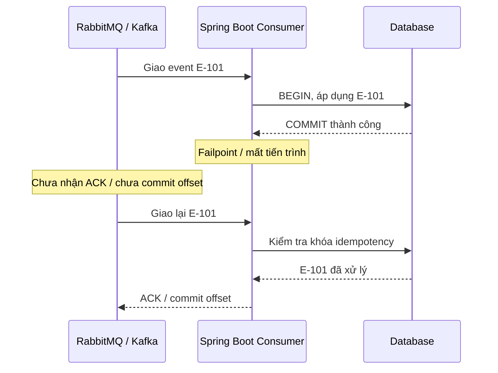

# Mô phỏng commit thành công nhưng chưa kịp acknowledge

## 1. Vì sao đây là lỗi biên quan trọng?

Trong một ứng dụng Spring Boot tích hợp với cơ sở dữ liệu và message broker, một consumer thường thực hiện hai việc:

1. **Ghi thay đổi nghiệp vụ và commit giao dịch trong database.**
2. **Xác nhận (acknowledge, ACK) với broker rằng message đã được xử lý.**

Hai thao tác thuộc **hai hệ thống có trạng thái riêng**. Khi dùng transaction thông thường của PostgreSQL/MySQL kết hợp với RabbitMQ hoặc Kafka, Spring Boot không mặc nhiên tạo ra một giao dịch nguyên tử bao trùm cả database và broker.

Điều gì xảy ra nếu bước 1 đã thành công nhưng ứng dụng bị dừng, mất kết nối hoặc lỗi đúng trước bước 2?

- Database đã có kết quả của lần xử lý thứ nhất.
- Broker chưa nhận được xác nhận hoàn tất, hoặc Kafka chưa ghi nhận offset tiêu thụ tương ứng.
- Khi consumer khởi động lại hoặc phân phối được thử lại, **cùng một thông điệp có thể được giao thêm lần nữa**.
- Nếu consumer thực hiện lại tác dụng phụ một cách mù quáng, có thể trừ tồn kho hai lần, ghi hai bút toán hoặc tăng số dư hai lần.

Đây là một trường hợp điển hình của **at-least-once delivery**: hệ thống có thể giao lại một message để tránh bỏ sót, nên ứng dụng phải chịu được việc xử lý lặp. Bài học thuộc nhóm *Hợp đồng và lỗi biên* của mô-đun tích hợp Spring Boot: cần kiểm tra ranh giới giữa hợp đồng dữ liệu, giao dịch, cơ chế xác nhận broker, xử lý trùng lặp, kiểm thử và quan sát luồng tích hợp.

### Đường thời gian của sự cố



**Kết luận kỹ thuật cần chứng minh trong bài:** một message có thể được giao hai lần trong khi thay đổi nghiệp vụ được **áp dụng đúng một lần**. Không suy luận từ số lần gọi listener rằng database cũng bị cập nhật cùng số lần.

## 2. Phân biệt ba mốc dễ bị đánh đồng

| Mốc | Ý nghĩa | Điều chưa được bảo đảm |
| --- | --- | --- |
| Consumer **nhận** message | Broker đưa message tới ứng dụng. | Database chưa chắc đã thay đổi. |
| Database **COMMIT** thành công | Những thay đổi trong giao dịch DB đã bền vững theo bảo đảm của DB. | Broker chưa chắc biết consumer đã xử lý. |
| Broker **ghi nhận ACK** / Kafka **commit offset** | Broker có thể ngừng giao lại message theo tiến độ đã xác nhận. | Bản thân ACK không làm database commit. |

Với RabbitMQ, *consumer acknowledgment* cho một delivery thường được gửi qua `basicAck(deliveryTag, false)`. Delivery tag thuộc phạm vi **channel nhận message**, không phải ID nghiệp vụ dùng để chống trùng lặp. Trong Kafka, `Acknowledgment.acknowledge()` là API của Spring Kafka phục vụ việc quản lý commit offset theo `AckMode`; gọi phương thức này không đồng nghĩa tại mọi cấu hình offset đã được broker ghi nhận đồng bộ ngay lập tức.

Đừng nhầm các khái niệm sau:

- **Database COMMIT**: hoàn tất transaction cơ sở dữ liệu.
- **Consumer ACK**: xác nhận một delivery đã được xử lý.
- **Producer confirm** của RabbitMQ: broker xác nhận việc nhà sản xuất publish message; đây là luồng khác với consumer ACK.
- **Kafka offset commit**: đánh dấu tiến độ tiêu thụ; không tự biến cập nhật database thành một phần của Kafka transaction.

## 3. Ma trận lỗi theo thời điểm

| Điểm xảy ra lỗi | Database | Broker | Hậu quả khi retry |
| --- | --- | --- | --- |
| Trước DB commit | Giao dịch có thể rollback. | Chưa ACK. | Xử lý lại từ đầu; phải kiểm tra kết quả DB khi trạng thái commit không rõ. |
| **Sau DB commit, trước ACK** | **Đã có kết quả.** | **Chưa ghi nhận hoàn tất.** | **Thông điệp có thể bị giao lại; dễ tạo tác dụng phụ trùng.** |
| Khi gửi ACK / commit offset | Đã có kết quả. | Trạng thái xác nhận có thể chưa rõ vì lỗi mạng. | Vẫn phải coi redelivery là có thể xảy ra. |
| Sau khi broker xác nhận tiến độ | Đã có kết quả. | Broker có trạng thái đã xử lý. | Thông thường không cần giao lại cùng delivery theo tiến độ đó. |

Một thứ tự nguy hiểm là **ACK trước, DB commit sau**. Nếu ACK đã được broker ghi nhận nhưng DB transaction thất bại, message có thể mất cơ hội xử lý lại. Nguyên tắc nền tảng của consumer thông thường:

> Chỉ xác nhận broker **sau khi** giao dịch DB đã hoàn tất thành công, đồng thời bảo đảm việc xử lý lại message là idempotent.

Nguyên tắc này hướng đến tính **at-least-once + idempotency**, không tạo ra cơ chế exactly-once phân tán một cách tự động.

## 4. Hợp đồng sự kiện và cơ sở dữ liệu dùng trong bài mô phỏng

Ví dụ dùng Spring Boot, Spring AMQP, RabbitMQ, Spring JDBC và PostgreSQL. Một event `PaymentConfirmed` xác nhận khoản thanh toán cho đơn hàng, có:

| Trường | Ý nghĩa | Ràng buộc |
| --- | --- | --- |
| `eventId` | ID duy nhất của **sự kiện**, giữ nguyên qua retry/redelivery. | UUID bắt buộc. |
| `paymentId` | ID nghiệp vụ của **khoản thanh toán**. | UUID bắt buộc, không dùng lại cho khoản khác. |
| `orderId` | Đơn hàng nhận thanh toán. | UUID và đơn hàng phải tồn tại. |
| `amountMinor` | Số tiền ở đơn vị nhỏ nhất (ví dụ xu), tránh sai số số thực. | Số nguyên dương. |

JSON mẫu:

```json
{
  "eventId": "11111111-1111-4111-8111-111111111111",
  "paymentId": "22222222-2222-4222-8222-222222222222",
  "orderId": "33333333-3333-4333-8333-333333333333",
  "amountMinor": 5000
}
```

Database sử dụng hai lớp bảo vệ:

- `processed_inbox` chặn xử lý lại cùng `(consumer_id, event_id)`.
- `applied_payments` chặn ghi nhận một **paymentId** nhiều lần, kể cả khi producer vô tình phát hai event ID khác nhau cho cùng khoản thanh toán.

```sql
CREATE TABLE payment_orders (
    order_id UUID PRIMARY KEY,
    paid_minor BIGINT NOT NULL DEFAULT 0
        CHECK (paid_minor >= 0)
);

CREATE TABLE processed_inbox (
    consumer_id TEXT NOT NULL,
    event_id UUID NOT NULL,
    processed_at TIMESTAMPTZ NOT NULL DEFAULT now(),
    PRIMARY KEY (consumer_id, event_id)
);

CREATE TABLE applied_payments (
    payment_id UUID PRIMARY KEY,
    order_id UUID NOT NULL REFERENCES payment_orders(order_id),
    amount_minor BIGINT NOT NULL CHECK (amount_minor > 0)
);

INSERT INTO payment_orders(order_id, paid_minor)
VALUES ('33333333-3333-4333-8333-333333333333', 0);
```

Các bảng này được trình bày để chạy trên PostgreSQL. Với MySQL, cú pháp upsert và kiểu dữ liệu cần thay đổi. Mọi thao tác ghi vào `processed_inbox`, `applied_payments` và `payment_orders` phải diễn ra **trong cùng một DB transaction**: nếu cập nhật đơn hàng lỗi, cả dấu vết đã xử lý cũng phải rollback.

## 5. Cấu hình RabbitMQ để quan sát ACK thủ công

Để chủ động đặt failpoint ngay trước ACK, dùng `AcknowledgeMode.MANUAL`. Dưới đây là cấu hình mẫu dành cho Spring Boot sử dụng Spring AMQP; queue `payments.confirmed` phải được khai báo bằng cấu hình hạ tầng hoặc `Queue` bean tương ứng.

```java
import org.springframework.amqp.core.AcknowledgeMode;
import org.springframework.amqp.rabbit.annotation.EnableRabbit;
import org.springframework.amqp.rabbit.config.SimpleRabbitListenerContainerFactory;
import org.springframework.amqp.rabbit.connection.ConnectionFactory;
import org.springframework.context.annotation.Bean;
import org.springframework.context.annotation.Configuration;

@Configuration
@EnableRabbit
public class RabbitConsumerConfig {

    @Bean
    public SimpleRabbitListenerContainerFactory rabbitListenerContainerFactory(
            ConnectionFactory connectionFactory) {

        var factory = new SimpleRabbitListenerContainerFactory();
        factory.setConnectionFactory(connectionFactory);
        factory.setAcknowledgeMode(AcknowledgeMode.MANUAL);
        factory.setConcurrentConsumers(1); // Cố định để bài thử dễ quan sát
        factory.setDefaultRequeueRejected(true); // Demo: xử lý lỗi thì giao lại
        return factory;
    }
}
```

Chú ý: `defaultRequeueRejected(true)` giúp quan sát redelivery trong **mô phỏng lỗi tạm thời**. Trong production, không nên giao lại vô hạn các message hỏng vĩnh viễn; cần phân loại lỗi, retry có giới hạn và dead-letter queue (DLQ).

### Consumer: transaction kết thúc trước ACK

Mẫu dưới đây dùng `TransactionTemplate` để ranh giới giao dịch dễ nhìn. Khi `executeWithoutResult(...)` trở về bình thường, transaction manager đã hoàn tất commit. Nếu đặt `@Transactional` lên toàn bộ listener nhưng gọi `basicAck(...)` **bên trong listener**, ACK có thể được thực hiện trước khi transaction interceptor commit lúc method return; mẫu đó **không tạo được thứ tự mong muốn một cách rõ ràng**.

```java
import com.fasterxml.jackson.core.JsonProcessingException;
import com.fasterxml.jackson.databind.ObjectMapper;
import com.rabbitmq.client.Channel;
import java.util.UUID;
import java.util.concurrent.atomic.AtomicBoolean;
import org.springframework.amqp.AmqpRejectAndDontRequeueException;
import org.springframework.amqp.core.Message;
import org.springframework.amqp.rabbit.annotation.RabbitListener;
import org.springframework.beans.factory.annotation.Value;
import org.springframework.jdbc.core.JdbcTemplate;
import org.springframework.stereotype.Component;
import org.springframework.transaction.PlatformTransactionManager;
import org.springframework.transaction.support.TransactionTemplate;

@Component
public class PaymentConfirmedConsumer {
    private static final String CONSUMER_ID = "payment-projection-v1";

    private final JdbcTemplate jdbc;
    private final ObjectMapper json;
    private final TransactionTemplate tx;
    private final AtomicBoolean failAfterCommitOnce;

    public PaymentConfirmedConsumer(
            JdbcTemplate jdbc,
            ObjectMapper json,
            PlatformTransactionManager transactionManager,
            @Value("${demo.fail-after-commit-once:false}") boolean failOnce) {
        this.jdbc = jdbc;
        this.json = json;
        this.tx = new TransactionTemplate(transactionManager);
        this.failAfterCommitOnce = new AtomicBoolean(failOnce);
    }

    @RabbitListener(queues = "payments.confirmed")
    public void consume(Message raw, Channel channel) throws Exception {
        PaymentConfirmed event = decodeAndValidate(raw);
        long tag = raw.getMessageProperties().getDeliveryTag();

        // BEGIN -> cập nhật tất cả các bảng -> COMMIT.
        tx.executeWithoutResult(status -> applyOnce(event));

        // Chỉ bật trong môi trường test. DB đã commit tại đây.
        if (failAfterCommitOnce.compareAndSet(true, false)) {
            throw new IllegalStateException(
                    "INJECTED: DB committed, RabbitMQ ACK not yet sent");
        }

        // ACK được gửi sau khi transaction trả về thành công.
        channel.basicAck(tag, false);
    }

    private void applyOnce(PaymentConfirmed event) {
        int firstEvent = jdbc.update("""
                INSERT INTO processed_inbox(consumer_id, event_id)
                VALUES (?, ?)
                ON CONFLICT DO NOTHING
                """, CONSUMER_ID, event.eventId());

        if (firstEvent == 0) {
            return; // Đã commit event này trong lần nhận trước.
        }

        int firstPayment = jdbc.update("""
                INSERT INTO applied_payments(
                    payment_id, order_id, amount_minor)
                VALUES (?, ?, ?)
                ON CONFLICT DO NOTHING
                """, event.paymentId(), event.orderId(), event.amountMinor());

        if (firstPayment == 0) {
            // Cùng paymentId xuất hiện ở event khác: kiểm tra tính nhất quán.
            AppliedPayment saved = jdbc.queryForObject("""
                    SELECT order_id, amount_minor
                    FROM applied_payments
                    WHERE payment_id = ?
                    """, (rs, rowNum) -> new AppliedPayment(
                            rs.getObject("order_id", UUID.class),
                            rs.getLong("amount_minor")), event.paymentId());

            if (saved == null
                    || !saved.orderId().equals(event.orderId())
                    || saved.amountMinor() != event.amountMinor()) {
                throw new IllegalStateException(
                        "Conflicting paymentId: " + event.paymentId());
            }
            return;
        }

        int updatedOrders = jdbc.update("""
                UPDATE payment_orders
                   SET paid_minor = paid_minor + ?
                 WHERE order_id = ?
                """, event.amountMinor(), event.orderId());

        if (updatedOrders != 1) {
            // Exception làm rollback cả inbox và applied_payments.
            throw new IllegalStateException(
                    "Order not found: " + event.orderId());
        }
    }

    private PaymentConfirmed decodeAndValidate(Message raw) {
        try {
            PaymentConfirmed event =
                    json.readValue(raw.getBody(), PaymentConfirmed.class);

            if (event.eventId() == null
                    || event.paymentId() == null
                    || event.orderId() == null
                    || event.amountMinor() <= 0) {
                throw new IllegalArgumentException("Missing/invalid fields");
            }
            return event;
        } catch (JsonProcessingException | IllegalArgumentException ex) {
            // Lỗi schema cố định: không retry vô hạn; cấu hình DLQ để lưu lại.
            throw new AmqpRejectAndDontRequeueException(
                    "Invalid PaymentConfirmed event", ex);
        }
    }

    public record PaymentConfirmed(
            UUID eventId,
            UUID paymentId,
            UUID orderId,
            long amountMinor) {}

    private record AppliedPayment(UUID orderId, long amountMinor) {}
}
```

Đoạn mã dùng các API phổ biến trong hệ Spring Boot 3.x, Java 17+, Spring AMQP và PostgreSQL. Dự án cần các dependency tương ứng: `spring-boot-starter-amqp`, `spring-boot-starter-jdbc`, PostgreSQL JDBC driver và Jackson được ứng dụng cấu hình. Một `DataSource` cùng `PlatformTransactionManager` phải quản lý các thao tác JDBC. Mã minh họa **một consumer cụ thể**; luồng nghiệp vụ thực tế còn cần kiểm tra tính hợp lệ của trạng thái đơn hàng và định nghĩa rõ cơ chế xử lý lỗi lâu dài.

### Tại sao khử trùng lặp phải nằm trong transaction?

Giả sử đã ghi `processed_inbox` rồi process chết trước khi cộng số tiền. Nếu hai thao tác không cùng transaction, lần giao lại nhìn thấy sự kiện đã xử lý và bỏ qua, làm mất khoản cập nhật. Khi dùng cùng một transaction:

- Lần đầu thành công: cả `processed_inbox`, `applied_payments` và `payment_orders` cùng commit.
- Lần đầu lỗi trước commit: tất cả thay đổi rollback, lần giao lại có thể thực hiện lại.
- Lần đầu commit nhưng chưa ACK: dấu vết đã tồn tại bền vững, lần giao lại bỏ qua cập nhật tiền và vẫn ACK.

Unique constraint trong database bảo vệ cả tình huống **hai consumer xử lý trùng đồng thời** tốt hơn một thao tác `SELECT` rồi `INSERT` không có ràng buộc. Nếu áp dụng một khóa idempotency được producer cung cấp, phải đảm bảo khóa đó có ý nghĩa ổn định và không bị tạo mới cho mỗi lần retry.

## 6. Thực hiện mô phỏng theo từng bước

Trên môi trường thử nghiệm tách biệt, chạy PostgreSQL và RabbitMQ, tạo ba bảng ở mục 4, tạo queue `payments.confirmed` và cấu hình:

```yaml
demo:
  fail-after-commit-once: true

spring:
  rabbitmq:
    host: localhost
    port: 5672
  datasource:
    url: jdbc:postgresql://localhost:5432/integration_demo
    username: demo
    password: demo
```

Đây là **đoạn cấu hình ví dụ**, không phải yêu cầu ghi thêm `application.yml` trong repository. Chỉ dùng tài khoản mẫu trong môi trường cục bộ. Publish JSON ở mục 4 với content type `application/json` vào queue qua RabbitTemplate, công cụ quản trị RabbitMQ hoặc test publisher.

Diễn tiến kỳ vọng:

| Mốc | Listener | Trạng thái database | Trạng thái broker |
| --- | --- | --- | --- |
| T0 | Nhận message lần 1. | `paid_minor = 0` | Delivery chưa ACK. |
| T1 | `applyOnce` ghi inbox, payment và cộng tiền. | Transaction **commit**: `paid_minor = 5000`. | Vẫn chưa ACK. |
| **T2** | **Failpoint ném exception sau commit, trước `basicAck`.** | **Giữ nguyên 5000.** | Container xử lý lỗi; cấu hình demo cho phép requeue. |
| T3 | Cùng event được giao lại. | Thấy khóa inbox đã tồn tại, không cộng tiền. | Delivery thứ hai đang chờ ACK. |
| T4 | Transaction thứ hai hoàn tất, consumer ACK. | `paid_minor = 5000`. | Xác nhận tiến độ xử lý. |

Failpoint `AtomicBoolean` chỉ bắn **một lần trong một instance** để lần giao lại có cơ hội thành công. Trong trường hợp này, exception mô phỏng đúng **điểm lỗi logic**, nhưng Java process vẫn sống và container có thể gửi negative acknowledgment/requeue. Một sự cố **crash thực sự** khác về cách broker phát hiện lỗi: channel/connection đóng hoặc timeout, sau đó message chưa ACK được requeue. Cả hai đều kiểm tra giả định cốt lõi: **DB đã commit, broker chưa xác nhận thành công**.

### Chứng minh kết quả bằng SQL

Sau khi đợi consumer xử lý xong, kiểm tra:

```sql
SELECT paid_minor
FROM payment_orders
WHERE order_id = '33333333-3333-4333-8333-333333333333';
-- Mong đợi: 5000

SELECT COUNT(*) AS inbox_rows
FROM processed_inbox
WHERE consumer_id = 'payment-projection-v1'
  AND event_id = '11111111-1111-4111-8111-111111111111';
-- Mong đợi: 1

SELECT COUNT(*) AS receipt_rows
FROM applied_payments
WHERE payment_id = '22222222-2222-4222-8222-222222222222';
-- Mong đợi: 1
```

Nếu số lần gọi consumer là 2 nhưng cả ba kiểm tra trả về `5000 / 1 / 1`, chương trình đã chứng minh **duplicate delivery không tạo duplicate effect** trong ví dụ này. Cần kiểm tra thêm queue không còn message ready/unacked sau khi ACK được xử lý và không có message bị chuyển DLQ ngoài dự kiến.

**Kiểm thử không đạt** nếu `paid_minor = 10000`; điều đó cho thấy cùng một khoản tiền đã bị áp dụng hai lần. Nếu `paid_minor = 0` nhưng inbox đã có dấu vết, transaction đang bị tách sai hoặc logic ghi nhận đã xử lý chạy quá sớm.

## 7. Mô phỏng crash thật ở đúng cửa sổ lỗi

Ném exception giúp kiểm thử nhanh đường redelivery, nhưng để kiểm chứng ứng dụng khởi động lại, dùng một **barrier** được bật riêng trong bài test tích hợp:

```java
// Pseudocode trong test-only failpoint, ngay sau tx.executeWithoutResult(...).
signalTestHarness("DB_COMMITTED_BEFORE_ACK", event.eventId());
waitUntilTestHarnessReleasesOrProcessStops();
channel.basicAck(tag, false);
```

Trình tự test:

1. Chạy ứng dụng consumer như **một process/container riêng** và bật barrier sau commit.
2. Publish một message duy nhất, đợi test harness nhận tín hiệu `DB_COMMITTED_BEFORE_ACK`.
3. Dùng một kết nối database độc lập kiểm tra rằng transaction đã commit và `paid_minor = 5000`. Đây là cách chứng minh commit nhìn thấy được **trước khi** đóng process.
4. Dừng cưỡng bức process/container consumer tại barrier, khi `basicAck` chưa được gọi. Chỉ làm trên hạ tầng test.
5. Khởi động lại consumer với failpoint tắt. Broker sẽ có cơ hội giao lại delivery chưa ACK.
6. Chờ consumer ACK lần giao lại; xác minh `paid_minor = 5000`, inbox chỉ một dòng, payment chỉ một dòng.

Test này mạnh hơn việc chỉ tạo exception vì nó thực sự bao phủ restart, reconnect, trạng thái ACK chưa chắc chắn và sự bền vững của database. Hãy đặt thời hạn chờ hữu hạn cho barrier và từng bước xác minh để tránh test treo vô hạn.

Lưu ý: **không tạo failpoint bằng cách ném exception bên trong `@Transactional` hoặc `TransactionTemplate` trước khi transaction hoàn tất**. Lúc đó database rollback và ta đang thử một sự cố hoàn toàn khác.

## 8. Thiết kế kiểm thử tự động và assertions

Một bài integration test có thể dùng Testcontainers cho PostgreSQL, RabbitMQ và một Spring Boot test application. Thử nghiệm quan trọng nhất không phải listener được gọi bao nhiêu lần, mà là **tính bền vững và duy nhất của tác dụng phụ**.

```java
// Skeleton minh họa ý tưởng kiểm thử tích hợp với fixture đã khởi tạo.
@Test
void committedButNotAcked_isRedeliveredWithoutDoublePayment() {
    // Arrange: order tồn tại với paid_minor = 0, inbox trống.
    // consumer được cấu hình fail-after-commit-once=true.
    rabbitTemplate.convertAndSend("payments.confirmed", PAYMENT_EVENT_JSON);

    // Assert eventual: sau lần lỗi được requeue và lần nhận tiếp theo ACK.
    await().atMost(Duration.ofSeconds(15)).untilAsserted(() -> {
        assertThat(jdbc.queryForObject(
                "SELECT paid_minor FROM payment_orders WHERE order_id = ?",
                Long.class, ORDER_ID)).isEqualTo(5000L);
        assertThat(countInbox(EVENT_ID)).isEqualTo(1);
        assertThat(countAppliedPayments(PAYMENT_ID)).isEqualTo(1);
        assertThat(readyAndUnackedMessageCount()).isZero();
    });

    assertThat(deliveriesObserved(EVENT_ID)).isGreaterThanOrEqualTo(2);
}
```

Đây là **skeleton**, chưa phải một test chạy độc lập: các tên `countInbox`, `countAppliedPayments`, `readyAndUnackedMessageCount`, `deliveriesObserved` và các hằng số là helper cần hiện thực trong test fixture. Có thể dùng Awaitility cho kiểm tra bất đồng bộ, nhưng cần cấu hình kiểm tra queue và ghi số lần delivery đáng tin cậy. Tránh dùng `Thread.sleep` cố định hoặc kiểm tra trạng thái ngay khi publish vì có thể tạo test chập chờn.

Mở rộng bộ kiểm thử tối thiểu:

| Case | Cách gây lỗi | Kết quả cần chứng minh |
| --- | --- | --- |
| Commit rồi mất ACK | Failpoint sau `TransactionTemplate`; hoặc kill process tại barrier. | Event có thể được giao lại; DB chỉ áp dụng một lần. |
| Lỗi trước commit | Ném exception khi cập nhật `payment_orders`. | Transaction rollback cả inbox; retry áp dụng thành công. |
| Lặp cùng `eventId` | Publish cùng JSON hai lần. | Hai lần nhận, một lần thay đổi nghiệp vụ. |
| Hai `eventId` cho cùng `paymentId` | Publish hai event khác ID nhưng cùng khoản tiền. | Ràng buộc payment ID chặn cộng tiền lần hai. |
| Trùng payload nhưng giá trị mâu thuẫn | Cùng `paymentId`, `orderId` hoặc số tiền khác. | Phát hiện conflict; không âm thầm chấp nhận dữ liệu sai. |
| Message hỏng schema | Thiếu `eventId` hoặc sai JSON. | Reject không requeue vô hạn, đi tới DLQ nếu đã cấu hình. |
| DB tạm thời mất kết nối | Chặn hoặc ngắt DB trong một lần xử lý. | Không ACK thành công trước commit; retry có kiểm soát. |
| Restart và nhiều consumer | Kill/restart process, chạy nhiều replica trên queue. | Đảm bảo khóa unique, không ghi trùng trong race. |

Nên tách **delivery count** (đo số lần nhận từ broker) và **applied count** (số giao dịch đã tạo side effect). Khi ứng dụng nhận bản sao vì retry, delivery count tăng là bình thường; applied count vẫn phải là 1.

## 9. Khi thay RabbitMQ bằng Kafka

Bài toán tương tự xảy ra với Kafka, nhưng tín hiệu hoàn tất là **tiến độ commit offset**, thay vì RabbitMQ `basicAck`:

```java
// Minh họa ranh giới: listener container phải cấu hình
// AckMode.MANUAL hoặc MANUAL_IMMEDIATE, auto-commit bị tắt.
@KafkaListener(topics = "payment-confirmed", groupId = "payments-projection")
public void onPayment(
        PaymentConfirmed event,
        Acknowledgment acknowledgment) {

    tx.executeWithoutResult(status -> applyOnce(event));
    faultInjector.failAfterCommitBeforeAckIfEnabled();
    acknowledgment.acknowledge();
}
```

Trong Spring Kafka, cách `acknowledge()` dẫn đến offset commit phụ thuộc `AckMode`, thiết lập sync/async commit và cấu hình listener container; vì vậy phải quan sát **offset đã commit thực tế**, không chỉ dòng log cho biết method `acknowledge()` đã được gọi. Nếu process mất sau khi DB commit nhưng trước khi offset cần thiết được lưu, sau rebalance/restart cùng record có thể được đọc lại.

Ngay cả khi sử dụng Kafka transaction để đạt exactly-once cho một chuỗi xử lý **Kafka → Kafka**, kết quả cập nhật vào cơ sở dữ liệu ngoài Kafka vẫn cần một mô hình nhất quán riêng, thường dựa vào idempotency, outbox/inbox hoặc cơ chế phối hợp giao dịch đã được thiết kế và kiểm thử kỹ. Không được suy từ tên cấu hình `exactly_once` rằng hiệu ứng SQL sẽ chắc chắn không lặp.

Với JMS, ý tưởng tương tự nhưng phạm vi session transaction và kiểu acknowledge có ngữ nghĩa riêng. Không chuyển nguyên xi mã `basicAck` của RabbitMQ sang JMS.

## 10. Những điểm khiến mô phỏng kết luận sai

### ACK đã xảy ra trước khi database commit

Một lỗi cài đặt thường gặp là:

```java
// Ví dụ SAI về ranh giới giao dịch:
@Transactional
public void onMessage(..., Channel channel) throws IOException {
    jdbc.update("UPDATE ..."); // Chưa chắc đã commit.
    channel.basicAck(tag, false); // ACK trước khi method return/commit.
}
```

Với transaction interceptor bao quanh method, commit thường diễn ra **sau khi method trả về**. Mẫu này có thể mất dữ liệu nếu DB commit thất bại sau khi ACK đã gửi. Thay bằng transaction ngắn rõ ranh giới, transaction ở service được gọi từ listener qua proxy Spring, hoặc cơ chế xử lý sau commit được thiết kế kỹ và kiểm tra thực tế.

### Chỉ kiểm tra trạng thái `redelivered` để chống trùng

RabbitMQ có cờ redelivery, nhưng cờ này là tín hiệu về lần phân phối, không phải khóa nghiệp vụ ổn định. Duplicate có thể xuất hiện qua publish lặp của producer, DLQ replay hoặc sự kiện được phát lại với delivery mới. Khóa kiểm soát phải xuất phát từ **hợp đồng event/business ID**, được bảo vệ bởi unique constraint hoặc kho idempotency bền vững.

### Ghi audit “đã xử lý” trong một transaction riêng

Nếu đã commit audit nhưng chưa cập nhật nghiệp vụ, message giao lại sẽ bị nhận nhầm là đã hoàn tất. Với các bước SQL phụ thuộc nhau, phải dùng một transaction cho dấu vết idempotency và tác dụng phụ nghiệp vụ. Những bước ngoài database như gọi HTTP, gửi email hoặc publish broker khác cần thiết kế bổ sung như transactional outbox, idempotency key tại API đích hoặc saga.

### Dùng retry vô hạn cho mọi loại lỗi

JSON sai schema hoặc mã đơn hàng không tồn tại không nhất thiết hồi phục nhờ retry liên tục. Phân loại lỗi tạm thời (DB unavailable, deadlock) và lỗi cố định (hợp đồng dữ liệu không hợp lệ), cấu hình retry/backoff, DLQ và cảnh báo. Trong ví dụ, `AmqpRejectAndDontRequeueException` dành cho payload hỏng; **cần cấu hình DLX/DLQ cụ thể** nếu muốn giữ message để tra soát thay vì bị loại bỏ.

### Trùng business key nhưng nội dung khác nhau

Ràng buộc unique trên `paymentId` chặn đếm trùng, nhưng nếu hai message chứa cùng payment ID mà số tiền hoặc order ID khác nhau, đó là **xung đột hợp đồng**, không phải bản sao vô hại. Bản mẫu ở trên truy vấn thanh toán đã lưu và ném exception khi không khớp. Trong production cần phân loại exception này là lỗi nghiệp vụ cố định, ghi metric và đưa sang luồng tra soát hoặc DLQ với retry có giới hạn.

### Kết luận “exactly once” từ một lần test

Một kết quả SQL đúng sau một lần mô phỏng là **bằng chứng cục bộ cho tình huống đã thử**, không chứng minh mọi thất bại đều được xử lý exactly-once. Phải thử cạnh tranh giữa replica, retry sau crash, mất kết nối sau ACK, giao dịch trạng thái chưa rõ, giữ khóa idempotency và replay sau thời gian dài.

## 11. Cách quan sát và xử lý sự cố ở production

Tối thiểu nên ghi và đo:

- `eventId`, `paymentId`, `orderId`, `consumerId` và trace ID xuyên suốt bước nhận, commit và ACK.
- Số lần delivery, số event được áp dụng, số event bị nhận diện trùng và số message tới DLQ.
- Thời gian xử lý database, thời gian từ commit tới ACK, số transaction rollback và số lỗi gửi ACK/commit offset.
- Với Kafka: consumer lag, partition, offset đã xử lý và offset đã commit; với RabbitMQ: messages ready/unacked, redelivery và trạng thái channel.
- Tỷ lệ xung đột business key và độ tuổi lưu trữ các khóa idempotency.

Sử dụng log có cấu trúc, tránh ghi payload nhạy cảm như thông tin thanh toán hoặc dữ liệu cá nhân. Một chuỗi log mẫu dễ tra cứu:

```text
event=E-101 phase=RECEIVED attempt=1
event=E-101 phase=DB_COMMITTED paymentApplied=true
event=E-101 phase=BEFORE_ACK faultInjected=true
event=E-101 phase=RECEIVED attempt=2
event=E-101 phase=DB_COMMITTED paymentApplied=false duplicate=true
event=E-101 phase=ACK_SENT
```

`ACK_SENT` chỉ chứng minh ứng dụng đã gọi API gửi ACK; khi có lỗi kết nối, cần đối chiếu thêm dữ liệu phía broker để xác định trạng thái thực tế. Trong ví dụ Kafka, hãy quan sát offset commit thay vì coi ACK API đồng nghĩa tiến độ đã được broker lưu.

Khi ứng dụng gặp sự cố:

1. Xác định ID message và điểm lỗi bằng trace/log.
2. Kiểm tra DB có side effect và khóa idempotency đã commit hay chưa.
3. Kiểm tra trạng thái delivery/offset broker cùng DLQ, tránh replay thủ công khi message vẫn đang tự retry.
4. Nếu cần replay, giữ nguyên business ID và event ID thích hợp; quan sát duplicate count và trạng thái cuối.
5. Nếu phát hiện xung đột dữ liệu hoặc side effect bên ngoài database, thực hiện quy trình tra soát/bù nghiệp vụ có kiểm soát.

## 12. Câu hỏi tự kiểm tra

1. Tại sao `COMMIT` thành công vẫn không chứng minh RabbitMQ đã nhận `basicAck`?
2. Nếu ném exception **trong** `TransactionTemplate` thay vì **sau khi** hàm này trả về, đang mô phỏng loại lỗi nào?
3. Vì sao một hàng `processed_inbox` không được commit trước khi cập nhật nghiệp vụ?
4. Cần ràng buộc gì để hai consumer cùng nhận bản sao không cộng tiền hai lần?
5. Trường hợp cùng `paymentId` nhưng khác `amountMinor` nên được xử lý thế nào?
6. Trong Spring Kafka, điều gì còn cần kiểm chứng sau lời gọi `acknowledgment.acknowledge()`?
7. Làm sao thiết kế test crash thật để chắc chắn process bị dừng **sau DB commit nhưng trước ACK**?

## Tổng kết

Khoảng thời gian giữa **database commit thành công** và **broker acknowledge thành công** là một lỗi biên phải được chủ động thử nghiệm trong hệ thống tích hợp Spring Boot. Mô phỏng bằng failpoint sau transaction, xác nhận giao lại message, và kiểm tra database chỉ áp dụng tác dụng phụ một lần. Thiết kế production nên dùng hợp đồng sự kiện ổn định, khóa idempotency bền vững với unique constraint, transaction chung cho inbox và thay đổi nghiệp vụ, ACK sau commit, cùng retry/DLQ, theo dõi và kiểm thử recovery rõ ràng.

### Tài liệu tham khảo

- [Spring AMQP Reference — Message Listener Container Configuration](https://docs.spring.io/spring-amqp/reference/amqp/containerAttributes.html)
- [Spring AMQP Reference — Exception Handling](https://docs.spring.io/spring-amqp/reference/amqp/exception-handling.html)
- [Spring for Apache Kafka Reference — Committing Offsets](https://docs.spring.io/spring-kafka/reference/kafka/receiving-messages/message-listener-container.html)
- [Spring Framework Reference — Programmatic Transaction Management](https://docs.spring.io/spring-framework/reference/data-access/transaction/programmatic.html)
