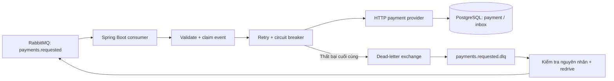
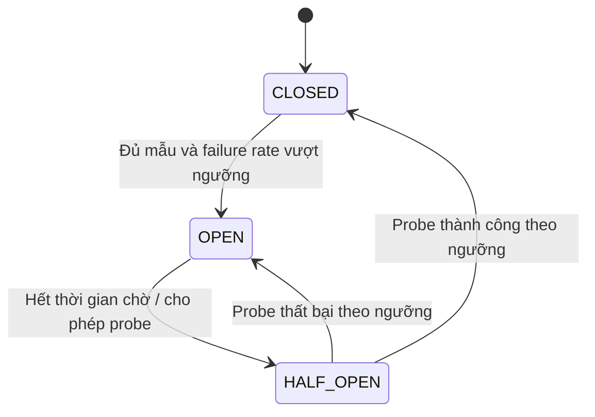
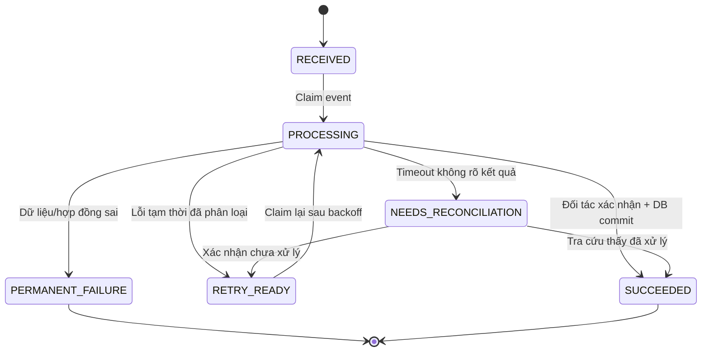

# Kiểm thử retry, circuit breaker, dead-letter và khôi phục

Một luồng tích hợp Spring Boot có thể chạy ổn trong trường hợp thuận lợi nhưng vẫn mất dữ liệu khi gặp timeout, lỗi tạm thời, HTTP 4xx, broker gửi lại message hoặc ứng dụng chết giữa hai bước ghi. Vì thế, kiểm thử một flow tích hợp không dừng ở việc gọi API thành công. Cần chứng minh **hợp đồng xử lý lỗi**: khi nào thử lại, khi nào ngừng gọi hệ thống ngoài, message thất bại được đưa đi đâu, và làm sao tiếp tục sau khi một phần công việc đã hoàn tất.

Bài học thuộc chương **Hợp đồng và lỗi biên** của module `SPRING_BOOT_INTEGRATION`, nơi Spring Boot kết nối HTTP client, database, cache, broker và các adapter Spring Integration. Ta dùng một luồng thanh toán giả định để kiểm thử đồng thời cấu hình retry, circuit breaker, dead-letter queue (DLQ), giao dịch, idempotency và khả năng khôi phục. Ví dụ minh họa bằng Java, Resilience4j, Spring AMQP/RabbitMQ và PostgreSQL; các nguyên tắc tương tự áp dụng cho Kafka, JMS hoặc các integration flow khác nếu diễn giải lại đúng cơ chế ACK, retry và DLQ của từng nền tảng.

## 1. Định nghĩa hợp đồng trước khi viết test

Giả sử hệ thống nhận sự kiện `PaymentRequested` từ RabbitMQ, kiểm tra trạng thái đơn hàng, gửi HTTP request sang nhà cung cấp thanh toán và lưu kết quả. Có ba bản sao của ứng dụng cùng tiêu thụ hàng đợi.



Đường đi trên là sơ đồ logic. Trong thực tế, **gọi HTTP và commit PostgreSQL không thuộc cùng một transaction nguyên tử**. Nếu HTTP đã tạo thanh toán rồi ứng dụng chết trước khi ghi database, lần xử lý sau phải nhận diện yêu cầu cũ bằng idempotency key và đối soát kết quả thay vì tạo thanh toán mới.

### Hợp đồng message và HTTP

Ví dụ payload:

```json
{
  "eventId": "evt-7001",
  "orderId": "order-839",
  "amountMinor": 125000,
  "currency": "VND",
  "occurredAt": "2026-11-20T08:30:00Z",
  "schemaVersion": 1
}
```

Một số quyết định bắt buộc phải ghi rõ trong hợp đồng:

| Thuộc tính | Quy tắc đề xuất | Cách kiểm thử |
| --- | --- | --- |
| `eventId` | ID sự kiện ổn định khi broker redeliver hoặc khi redrive | Gửi lại cùng ID, xác minh chỉ một lần cập nhật nghiệp vụ. |
| `orderId` | Định danh đối tượng nghiệp vụ; kiểm tra đã tồn tại/đúng trạng thái | Đơn hàng sai trạng thái bị từ chối có lý do. |
| `amountMinor`, `currency` | Số tiền theo đơn vị nhỏ nhất, kiểm tra currency và giới hạn | Âm, bằng 0, overflow, currency không hỗ trợ. |
| `schemaVersion` | Có quy tắc tương thích và từ chối version không được hỗ trợ | Consumer cũ gặp payload mới, không mất message âm thầm. |
| `idempotencyKey` gửi đối tác | Ổn định theo lệnh thanh toán, ví dụ `payment:order-839` | Nhiều lần gọi HTTP vẫn cùng key. |
| Trạng thái cuối | `SUCCEEDED`, `PERMANENT_FAILURE` hoặc trạng thái cần khôi phục rõ ràng | Crash/retry không biến trạng thái chưa rõ thành thành công. |
| ACK broker | Chỉ ACK khi xử lý hoặc quyết định chuyển lỗi đã được xác nhận theo hợp đồng | Crash trước ACK dẫn tới redelivery nhưng không gây side effect trùng. |

Để test có ý nghĩa, cần phân biệt **message delivery**, **lượt gọi logic** và **HTTP attempt**. Một message được deliver một lần có thể tạo ba HTTP attempt do retry; một message đã ACK lỗi có thể được nhân viên redrive và trở thành một delivery mới; crash sau commit có thể làm broker deliver lại cùng event. Gộp cả ba thành một biến “số lần retry” sẽ gây kiểm chứng sai.

## 2. Phân loại lỗi và quyết định xử lý

Không phải exception nào cũng đáng retry. Hợp đồng nên dựa trên nguyên nhân, khả năng thay đổi sau một khoảng chờ và mức an toàn khi gửi lại:

| Tín hiệu | Loại lỗi | Retry trực tiếp? | Circuit breaker? | Hướng xử lý cuối cùng |
| --- | --- | --- | --- | --- |
| HTTP 502/503/504 hoặc kết nối bị từ chối | Tạm thời, phía ngoài không sẵn sàng | Có giới hạn, kèm backoff | Có | Trì hoãn hoặc DLQ nếu hết ngân sách thử. |
| HTTP 429 | Rate limit | Có nếu hợp đồng cho phép, tôn trọng `Retry-After` khi hợp lệ | Có thể theo chính sách riêng | Delay hợp lệ; không retry nóng. |
| HTTP read timeout sau POST | **Kết quả không chắc chắn**: đối tác có thể đã xử lý | Chỉ khi có idempotency/reconciliation | Có thể | Tra cứu trạng thái theo request ID/key rồi mới quyết định gửi lại. |
| HTTP 400 do payload không hợp lệ | Lỗi dữ liệu/hợp đồng | Không | Thông thường không tính là lỗi sẵn sàng hệ thống | DLQ/quarantine kèm nguyên nhân và dữ liệu để sửa. |
| HTTP 401/403 | Cấu hình, quyền hoặc credential | Không lặp liên tục | Cần cảnh báo vận hành | Dừng luồng liên quan, sửa cấu hình/secret. |
| HTTP 404 | Phụ thuộc ngữ nghĩa endpoint | Không mặc định | Tùy hợp đồng | Chỉ retry nếu đối tác công bố tính nhất quán eventual. |
| HTTP 409 | Xung đột trạng thái hoặc trùng yêu cầu | Tùy mã lỗi nghiệp vụ | Thường không | Tra cứu trạng thái, so khớp key và cập nhật idempotently. |
| Validation exception trong ứng dụng | Dữ liệu đầu vào không hợp lệ | Không | Không | DLQ và ghi lý do chuẩn hóa. |
| Database deadlock/timeout | Tạm thời, có khả năng tự phục hồi | Có giới hạn ở **phạm vi transaction phù hợp** | Circuit cho DB riêng nếu cần | Rollback rồi retry cả đơn vị giao dịch an toàn. |
| `CallNotPermittedException` khi breaker OPEN | Bảo vệ hệ thống ngoài | Không retry ngay qua cùng breaker | Breaker đang hoạt động | Delay/retry về sau; cân nhắc tạm dừng consumer. |
| Bug lập trình, cấu hình sai, sai schema | Khó tự phục hồi | Không retry nóng | Không dùng breaker để che lỗi | Cảnh báo, DLQ/quarantine và sửa phiên bản phát hành. |

Ba nguyên tắc:

1. **Retry có giới hạn.** `maxAttempts = 3` của Resilience4j tính cả lần đầu; không phải ba lần thử lại sau lần đầu. Cần đo cả attempt, elapsed time và tổng thời gian xử lý.
2. **Circuit breaker bảo vệ tài nguyên bị lỗi.** Nó không sửa message sai, không tự phục hồi dữ liệu và không thay thế timeout của HTTP client.
3. **DLQ là nơi giữ thông tin cần xử lý tiếp.** Message vào DLQ chưa được xem là nghiệp vụ hoàn tất; cần quy trình quan sát, phân loại, sửa lỗi và phát lại.

## 3. Lập ma trận kiểm thử theo ranh giới

Thay vì viết toàn bộ test ở cấp `@SpringBootTest`, hãy phân lớp cho rõ mục tiêu:

| Lớp kiểm thử | Công cụ phù hợp | Cần quan sát |
| --- | --- | --- |
| Unit test chính sách retry | JUnit 5 + fake HTTP client / Resilience4j thật | Attempt count, loại exception retry, số lần gọi thực tế. |
| Unit test circuit breaker | JUnit 5 + fake operation | CLOSED → OPEN → HALF_OPEN, call bị từ chối, số request thật. |
| HTTP contract test | WireMock hoặc MockWebServer | Method, URL, header, idempotency key, mã lỗi, body và timeout. |
| Integration test broker | Testcontainers RabbitMQ + Spring AMQP | ACK/NACK, DLX route, message body/headers, consumer không loop. |
| Integration test database | Testcontainers PostgreSQL | Inbox/unique constraint, rollback, claim, checkpoint, transaction. |
| Recovery/chaos test | Hai process/pod hoặc harness có thể kill | Crash point, redelivery, stale state, side effect sau restart. |
| End-to-end staging | Downstream sandbox + broker/DB thật hoặc tương đương | Giới hạn thời gian, alert, runbook redrive, rolling deployment. |

Unit test nhanh xác minh luật phân loại lỗi. Integration test kiểm tra điều mà mock không chứng minh được: cấu hình topology RabbitMQ, transaction commit, ACK của listener container, cạnh tranh nhiều replica và lỗi kết nối thật.

## 4. Thiết kế retry có thể kiểm thử

### 4.1. Đặt chính sách gần HTTP adapter

Ví dụ sử dụng Resilience4j trong Java. Hai exception biểu thị hai kết quả phân loại từ HTTP adapter:

```java
public final class TemporaryPartnerFailure extends RuntimeException {
    public TemporaryPartnerFailure(String message) {
        super(message);
    }
    public TemporaryPartnerFailure(String message, Throwable cause) {
        super(message, cause);
    }
}

public final class PermanentPartnerFailure extends RuntimeException {
    public PermanentPartnerFailure(String message) {
        super(message);
    }
}
```

Đây là hai kiểu minh họa, đặt mỗi `public` class vào tệp Java riêng theo quy tắc ngôn ngữ. HTTP adapter cần ánh xạ 5xx, một số 429 và lỗi mạng có thể thử lại sang `TemporaryPartnerFailure`, còn lỗi validation vĩnh viễn sang `PermanentPartnerFailure`. Với read timeout sau POST, adapter phải giữ thông tin rằng kết quả **chưa rõ** và chỉ cho phép thử lại nếu API đối tác hỗ trợ idempotency. Không mặc định `SocketTimeoutException` đồng nghĩa với request chưa tới server.

```java
import java.time.Duration;
import io.github.resilience4j.retry.Retry;
import io.github.resilience4j.retry.RetryConfig;

Retry retry = Retry.of(
        "payment-partner",
        RetryConfig.custom()
                .maxAttempts(3)
                .waitDuration(Duration.ofMillis(200))
                .retryExceptions(TemporaryPartnerFailure.class)
                .ignoreExceptions(PermanentPartnerFailure.class)
                .build()
);
```

Lưu ý `waitDuration` cố định trong ví dụ chỉ để dễ hiểu; thực tế cân nhắc exponential backoff có jitter và giới hạn thời gian toàn luồng. Nếu HTTP client timeout 5 giây mỗi attempt, ba attempt có thể tiêu tốn hơn 15 giây trước khi tính backoff, lock/transaction hoặc thời gian broker chờ. Với HTTP 429, client phải parse `Retry-After` và đưa vào chính sách delay nếu được hỗ trợ; cấu hình trên **không tự động đọc header đó**.

### 4.2. Test số attempt và điều kiện dừng

Đây là unit test chạy Resilience4j thật với fake operation; không cần mạng hoặc Docker:

```java
import static org.junit.jupiter.api.Assertions.*;

import java.time.Duration;
import java.util.concurrent.atomic.AtomicInteger;
import java.util.function.Supplier;
import org.junit.jupiter.api.Test;
import io.github.resilience4j.retry.Retry;
import io.github.resilience4j.retry.RetryConfig;

class RetryPolicyTest {
    private Retry newRetry() {
        return Retry.of("partner", RetryConfig.custom()
                .maxAttempts(3)
                .waitDuration(Duration.ZERO) // unit test không cần chờ
                .retryExceptions(TemporaryPartnerFailure.class)
                .ignoreExceptions(PermanentPartnerFailure.class)
                .build());
    }

    @Test
    void transientFailureThenSuccess() {
        AtomicInteger attempts = new AtomicInteger();
        Supplier<String> httpCall = () -> {
            if (attempts.incrementAndGet() < 3) {
                throw new TemporaryPartnerFailure("503");
            }
            return "accepted";
        };

        String result = Retry.decorateSupplier(newRetry(), httpCall).get();

        assertEquals("accepted", result);
        assertEquals(3, attempts.get()); // 1 ban đầu + 2 retry
    }

    @Test
    void transientFailureStopsAfterThreeAttempts() {
        AtomicInteger attempts = new AtomicInteger();
        Supplier<String> httpCall = () -> {
            attempts.incrementAndGet();
            throw new TemporaryPartnerFailure("503");
        };

        assertThrows(TemporaryPartnerFailure.class,
                () -> Retry.decorateSupplier(newRetry(), httpCall).get());
        assertEquals(3, attempts.get());
    }

    @Test
    void permanentFailureDoesNotRetry() {
        AtomicInteger attempts = new AtomicInteger();
        Supplier<String> httpCall = () -> {
            attempts.incrementAndGet();
            throw new PermanentPartnerFailure("400");
        };

        assertThrows(PermanentPartnerFailure.class,
                () -> Retry.decorateSupplier(newRetry(), httpCall).get());
        assertEquals(1, attempts.get());
    }
}
```

Những assertion quan trọng là **số lần thật sự gọi hàm HTTP**, exception cuối cùng và số lần không nên retry. Đừng kiểm tra duy nhất giá trị trả về: một code path có thể trả `accepted` sau nhiều lần gửi thanh toán mà không giữ nguyên idempotency key.

### 4.3. Kiểm thử backoff và giới hạn thời gian

Ở unit test, đặt thời gian chờ bằng 0 để tránh test chậm và phụ thuộc scheduler. Ở integration test, dùng fake HTTP server để ghi thời điểm request, bật timeout thực và xác minh:

- Request thứ hai xuất hiện **sau** khoảng backoff cho phép, không tạo retry nóng.
- Không vượt `maxAttempts`, kể cả khi HTTP 429/503 lặp nhiều lần.
- HTTP client có connect/read/response timeout; tổng budget không vượt deadline của request hoặc message.
- Mỗi attempt của cùng một lệnh thanh toán dùng **chính cùng idempotency key**.
- Hủy request hoặc thread bị interrupt được xử lý theo contract; không nuốt interruption rồi tiếp tục gửi.

Không nên khẳng định chính xác mỗi khoảng chờ đến từng mili giây trong integration test vì CI có độ trễ lịch trình và GC. Dùng khoảng dung sai, đo theo đồng hồ đơn điệu và kiểm tra bất biến tổng thể. Để kiểm tra chiến lược backoff tùy biến, tách hàm tính delay và test giá trị/ranh giới của hàm đó theo dữ liệu đầu vào cố định.

## 5. Test circuit breaker như một máy trạng thái

Circuit breaker thường có ba trạng thái chính:



Khi **CLOSED**, call được phép và lỗi được ghi vào sliding window. Khi **OPEN**, call bị từ chối nhanh (Resilience4j ném `CallNotPermittedException`) nên số request thật tới đối tác không tăng. Khi **HALF_OPEN**, chỉ một số request thăm dò được phép; kết quả quyết định đóng hoặc mở lại breaker. Việc chuyển từ OPEN sang HALF_OPEN phụ thuộc cấu hình: tự chuyển ở background hay kiểm tra trạng thái khi call đến.

Ví dụ cấu hình:

```java
import java.time.Duration;
import io.github.resilience4j.circuitbreaker.CircuitBreaker;
import io.github.resilience4j.circuitbreaker.CircuitBreakerConfig;

CircuitBreaker breaker = CircuitBreaker.of(
        "payment-partner",
        CircuitBreakerConfig.custom()
                .slidingWindowSize(4)
                .minimumNumberOfCalls(4)
                .failureRateThreshold(50.0f)
                .waitDurationInOpenState(Duration.ofSeconds(5))
                .permittedNumberOfCallsInHalfOpenState(1)
                .recordExceptions(TemporaryPartnerFailure.class)
                .ignoreExceptions(PermanentPartnerFailure.class)
                .build()
);
```

Ví dụ chỉ ghi nhận một số lỗi tạm thời là failure đối với breaker; ngoại lệ nghiệp vụ vĩnh viễn được bỏ qua. Hệ thống thật phải quyết định cách phân loại timeout, authentication, HTTP 4xx và `CallNotPermittedException` dựa trên contract, không mặc định mọi exception đều thể hiện đối tác bị hỏng.

### 5.1. Test OPEN, từ chối call và HALF_OPEN

```java
import static org.junit.jupiter.api.Assertions.*;

import java.time.Duration;
import java.util.concurrent.atomic.AtomicInteger;
import java.util.function.Supplier;
import org.junit.jupiter.api.Test;
import io.github.resilience4j.circuitbreaker.CallNotPermittedException;
import io.github.resilience4j.circuitbreaker.CircuitBreaker;
import io.github.resilience4j.circuitbreaker.CircuitBreakerConfig;

class CircuitBreakerPolicyTest {

    @Test
    void opensAfterFailuresAndClosesAfterHealthyProbe() {
        CircuitBreaker breaker = CircuitBreaker.of("partner-test",
                CircuitBreakerConfig.custom()
                        .slidingWindowSize(2)
                        .minimumNumberOfCalls(2)
                        .failureRateThreshold(50.0f)
                        .permittedNumberOfCallsInHalfOpenState(1)
                        .waitDurationInOpenState(Duration.ofSeconds(30))
                        .build());

        AtomicInteger httpAttempts = new AtomicInteger();
        Supplier<String> failingHttp = CircuitBreaker.decorateSupplier(
                breaker, () -> {
                    httpAttempts.incrementAndGet();
                    throw new TemporaryPartnerFailure("503");
                });

        assertThrows(TemporaryPartnerFailure.class, failingHttp::get);
        assertThrows(TemporaryPartnerFailure.class, failingHttp::get);
        assertEquals(CircuitBreaker.State.OPEN, breaker.getState());

        assertThrows(CallNotPermittedException.class, failingHttp::get);
        assertEquals(2, httpAttempts.get()); // OPEN đã chặn request thứ ba

        // Bước chuyển tường minh để test logic HALF_OPEN, không chờ 30 giây.
        breaker.transitionToHalfOpenState();

        Supplier<String> healthyHttp =
                CircuitBreaker.decorateSupplier(breaker, () -> "ok");
        assertEquals("ok", healthyHttp.get());
        assertEquals(CircuitBreaker.State.CLOSED, breaker.getState());
    }
}
```

Test này xác minh máy trạng thái và nhánh từ chối. Nó **không kiểm tra thời gian tự chuyển trạng thái** vì chủ động gọi `transitionToHalfOpenState()`. Viết thêm integration test với wait duration ngắn, `Awaitility` và chế độ tự chuyển (nếu được bật) hoặc call thăm dò đầu tiên sau thời hạn, để xác nhận cấu hình production.

Các test bổ sung:

1. Khi số call chưa đạt `minimumNumberOfCalls`, breaker không mở sớm.
2. Khi có cả success/failure, ngưỡng failure rate được tính trên **cửa sổ đúng kiểu** (`COUNT_BASED`/`TIME_BASED`).
3. Khi OPEN, không có HTTP request thật; fallback không bị nhầm thành thanh toán đã thành công.
4. Khi HALF_OPEN, chỉ đúng số call thăm dò được cho phép; các call còn lại bị từ chối.
5. Một probe lỗi dẫn đến mở lại theo cấu hình; probe thành công đủ số lượng mới đóng.
6. Nếu mỗi replica có breaker riêng, chúng có trạng thái riêng; không giả định một pod mở breaker sẽ làm tất cả pod cùng OPEN.

## 6. Thứ tự kết hợp retry và circuit breaker

Retry và circuit breaker đều có thể bọc một call. **Thứ tự bọc quyết định đơn vị mà breaker đếm**, nên cần thể hiện tường minh trong test:

```java
Supplier<Receipt> original = () -> partnerClient.charge(command);

// Circuit breaker ở ngoài: mỗi lượt xử lý logic có thể có nhiều HTTP attempt.
Supplier<Receipt> retried = Retry.decorateSupplier(retry, original);
Supplier<Receipt> protectedCall =
        CircuitBreaker.decorateSupplier(breaker, retried);

Receipt receipt = protectedCall.get();
```

Với thứ tự trên, nếu một lượt logic thử HTTP ba lần và cuối cùng thất bại, breaker quan sát **một lần thất bại của lượt logic**. Khi breaker OPEN, retry nằm bên trong sẽ không được chạy. Nếu đảo chiều thành `Retry.decorateSupplier(retry, CircuitBreaker.decorateSupplier(breaker, original))`, breaker sẽ quan sát từng HTTP attempt; retry cũng có thể thử gọi khi breaker đã mở nếu exception `CallNotPermittedException` bị cấu hình là retryable.

Trong Spring Boot, `@Retry` và `@CircuitBreaker` qua AOP chịu ảnh hưởng của thứ tự aspect và cấu hình. Khi cần kiểm soát chặt số attempt, dùng decorator tường minh như ví dụ hoặc viết test xác nhận thứ tự aspect thực tế. **Không** đồng thời bật Resilience4j retry, Spring Retry ở listener container và một retry trong HTTP client mà không tính ngân sách tổng: ba lớp mỗi lớp ba attempt có thể tạo tới 27 lời gọi HTTP trong một tình huống xấu.

| Cấu hình | Breaker ghi nhận | Test cần chứng minh |
| --- | --- | --- |
| `Breaker(Retry(HTTP))` | Một kết quả sau cả chuỗi retry | Một lượt thất bại cuối cùng tính một call; breaker OPEN ngăn toàn bộ chuỗi. |
| `Retry(Breaker(HTTP))` | Từng attempt tới breaker | Breaker có thể mở giữa chuỗi; cấu hình không retry `CallNotPermittedException`. |
| Retry ở listener container và ở HTTP | Nhiều lượt xử lý message, mỗi lượt nhiều HTTP attempts | Có giới hạn tổng; không lặp side effect và không vòng lặp vô hạn. |

Đối với POST thanh toán, thử lại an toàn phụ thuộc **đúng một idempotency key cho mọi attempt và mọi redelivery**, không phụ thuộc thứ tự decorator.

## 7. Tạo dead-letter queue có thể kiểm chứng

Một queue thường có thể khai báo dead-letter exchange (DLX) và routing key để broker chuyển message khi consumer **reject/nack không requeue**, message hết hạn hoặc queue vượt giới hạn theo cơ chế của queue. Với RabbitMQ, DLX chỉ hoạt động nếu exchange, binding và quyền publish tương ứng được cấu hình đúng; DLQ không tự xuất hiện chỉ vì listener ném exception.

Ví dụ Spring AMQP:

```java
import org.springframework.amqp.core.*;
import org.springframework.context.annotation.Bean;
import org.springframework.context.annotation.Configuration;

@Configuration(proxyBeanMethods = false)
public class PaymentRabbitTopology {
    @Bean
    DirectExchange paymentExchange() {
        return new DirectExchange("payments.main", true, false);
    }

    @Bean
    DirectExchange paymentDeadExchange() {
        return new DirectExchange("payments.dlx", true, false);
    }

    @Bean
    Queue paymentQueue() {
        return QueueBuilder.durable("payments.requested")
                .deadLetterExchange("payments.dlx")
                .deadLetterRoutingKey("payments.dead")
                .build();
    }

    @Bean
    Queue paymentDeadQueue() {
        return QueueBuilder.durable("payments.requested.dlq").build();
    }

    @Bean
    Binding paymentBinding(Queue paymentQueue,
                           DirectExchange paymentExchange) {
        return BindingBuilder.bind(paymentQueue)
                .to(paymentExchange).with("payments.requested");
    }

    @Bean
    Binding deadBinding(Queue paymentDeadQueue,
                        DirectExchange paymentDeadExchange) {
        return BindingBuilder.bind(paymentDeadQueue)
                .to(paymentDeadExchange).with("payments.dead");
    }
}
```

Với ví dụ này, `payments.requested` nhận message từ `payments.main` theo key `payments.requested`; khi bị dead-letter, message chuyển qua `payments.dlx` đến `payments.requested.dlq`.

Mẫu `application.yml` cho `SimpleRabbitListenerContainerFactory` mặc định:

```yaml
spring:
  rabbitmq:
    listener:
      simple:
        acknowledge-mode: auto
        default-requeue-rejected: false
```

Ở chế độ `AUTO`, listener **trả về bình thường** thì container ACK; listener ném exception và container được cấu hình không requeue thì message bị reject/nack với `requeue=false`. Trên queue có DLX phù hợp, broker sẽ dead-letter message. Với exception/chính sách đặc biệt hoặc retry advice, đường xử lý có thể khác; test topology và container thực tế là bằng chứng cuối.

```java
import org.springframework.amqp.AmqpRejectAndDontRequeueException;
import org.springframework.amqp.rabbit.annotation.RabbitListener;
import org.springframework.stereotype.Component;

@Component
public class PaymentListener {
    private final PaymentProcessor processor;

    public PaymentListener(PaymentProcessor processor) {
        this.processor = processor;
    }

    @RabbitListener(queues = "payments.requested")
    public void receive(PaymentRequested event) {
        try {
            processor.process(event);
        } catch (RuntimeException error) {
            // Chính sách minh họa: sau các retry có giới hạn ở service,
            // trả message về DLQ để điều tra và redrive có kiểm soát.
            throw new AmqpRejectAndDontRequeueException(
                    "Payment event failed: " + event.eventId(), error);
        }
    }
}
```

Đây là **chính sách một bước**: lỗi cuối cùng chuyển tới DLQ, không quay lại hàng đợi chính ngay lập tức. Nếu breaker OPEN do đối tác ngừng hoạt động, chuyển hàng nghìn message sang DLQ có thể không phù hợp; hệ thống lớn nên tạm ngưng consumer hoặc dùng retry queue với delay/budget rõ ràng. Không tạo vòng `main → retry → main` vô hạn nếu không có retry count, giới hạn số lượt và chỗ giữ lỗi cuối cùng.

Ví dụ giả định dự án có `PaymentRequested` record/DTO, `PaymentProcessor` service và JSON message converter tương ứng. Cần cấu hình converter, validation và schema/version thật khi triển khai. Trong môi trường production, chính sách DLX qua RabbitMQ policy có thể dễ thay đổi hơn việc cố định `x-dead-letter-*` ngay trong queue arguments; nếu đổi policy, hãy cập nhật test topology.

### ACK, reject, retry và dead-letter không giống nhau

| Hành động listener/container | Ý nghĩa | Kết quả thường gặp |
| --- | --- | --- |
| ACK sau khi công việc thành công | Xóa delivery đã xử lý khỏi queue | Không còn delivery đó; crash trước ACK vẫn có thể redeliver. |
| `basicNack(..., requeue=true)` | Gửi lại queue để xử lý | Có thể tạo vòng retry nóng nếu lỗi còn tồn tại. |
| `basicReject(..., requeue=false)` hoặc cấu hình tương đương | Từ chối không đưa lại queue chính | Broker dead-letter nếu queue có DLX hợp lệ; nếu không, có nguy cơ mất message. |
| Retry ngay trong listener | Một delivery, nhiều lần thực thi code | Chưa chắc tạo thêm delivery hay thay đổi `x-death`. |
| Delay queue/redrive | Delivery ở thời điểm khác | Cần budget và idempotency; có thể thay đổi thứ tự xử lý. |

Với `MANUAL` acknowledgment, ứng dụng phải gọi `basicAck` hoặc `basicNack/basicReject` phù hợp trên `Channel` và delivery tag, bảo đảm không ACK khi transaction nghiệp vụ chưa hoàn tất. Không trộn code ACK thủ công với mẫu `AUTO` ở trên nếu chưa đổi container config. ACK RabbitMQ và commit database không phải một transaction nguyên tử xuyên hệ thống theo mặc định.

## 8. Integration test RabbitMQ: message thất bại thật sự vào DLQ

Một test chỉ verify `processor.process()` ném exception không chứng minh broker đã dead-letter. Cần RabbitMQ thật, queue/binding thật và một listener đang chạy.

Dependency test thường gồm JUnit/Spring Boot Test, Testcontainers RabbitMQ và Awaitility; pin version phù hợp BOM của dự án. Ví dụ khung test:

```java
import static org.junit.jupiter.api.Assertions.*;
import static org.awaitility.Awaitility.await;

import java.time.Duration;
import org.junit.jupiter.api.Test;
import org.springframework.amqp.core.Message;
import org.springframework.amqp.rabbit.core.RabbitTemplate;
import org.springframework.beans.factory.annotation.Autowired;
import org.springframework.boot.test.context.SpringBootTest;
import org.springframework.test.context.DynamicPropertyRegistry;
import org.springframework.test.context.DynamicPropertySource;
import org.testcontainers.containers.RabbitMQContainer;
import org.testcontainers.junit.jupiter.Container;
import org.testcontainers.junit.jupiter.Testcontainers;

@SpringBootTest
@Testcontainers
class PaymentDeadLetterIT {

    @Container
    static final RabbitMQContainer rabbit =
            new RabbitMQContainer("rabbitmq:4.1-management");

    @DynamicPropertySource
    static void rabbitProperties(DynamicPropertyRegistry registry) {
        registry.add("spring.rabbitmq.addresses", rabbit::getAmqpUrl);
    }

    @Autowired
    RabbitTemplate rabbitTemplate;

    @Test
    void poisonMessageIsDeadLettered() {
        // Dàn xếp fake HTTP/processor trả lỗi vĩnh viễn cho event này.
        PaymentRequested event = invalidPaymentRequested("evt-poison-1");
        rabbitTemplate.convertAndSend(
                "payments.main", "payments.requested", event);

        await().atMost(Duration.ofSeconds(10)).untilAsserted(() -> {
            Message dead = rabbitTemplate.receive("payments.requested.dlq");
            assertNotNull(dead);
            assertNotNull(dead.getMessageProperties()
                    .getHeaders().get("x-death"));
            // Deserialize và so sánh eventId, schemaVersion, payload...
        });
    }
}
```

Đây là **khung integration test**, không phải tệp test độc lập có thể chạy ngay: `invalidPaymentRequested(...)` là helper dữ liệu của dự án và fake HTTP/processor phải được cấu hình để tạo lỗi xác định. Ví dụ cũng giả định queue/binding được `RabbitAdmin` khai báo khi context chạy, consumer dùng đúng JSON converter và test có namespace broker riêng. Việc gọi `receive()` trong test **tiêu thụ message khỏi DLQ**; mỗi test cần dữ liệu/queue tách biệt hoặc chủ động làm sạch có kiểm soát.

Khi test chạy, cần xác minh thêm:

- `eventId` và payload trong DLQ là event đã gửi, không bị mất thông tin cần điều tra.
- Header `x-death` có nguyên nhân/nguồn tương ứng khi broker phát sinh header này; không coi giá trị đếm trong `x-death` là số attempt của Resilience4j.
- Message không quay lại queue chính sau khi đã dead-letter theo chính sách một bước.
- Consumer chỉ tạo số HTTP attempt đã cấu hình; không có vòng `nack(requeue=true)` không giới hạn.
- Message **thành công** không xuất hiện trong DLQ và được ACK sau commit.
- Nếu đổi routing key hoặc bỏ DLX, test phải thất bại và phát hiện topology không đúng.

RabbitMQ queue có thể gặp tình huống message không được định tuyến nếu DLX/binding/permission không đúng. Vì vậy cần kiểm tra end-to-end qua broker, metric unroutable/dead-letter và quyền publish; chỉ assert listener ném exception là chưa đủ.

## 9. Trạng thái bền vững và idempotency để phục hồi

Giả sử đối tác đã tạo thanh toán nhưng ứng dụng crash trước khi ghi `SUCCEEDED`. Broker giao lại message; nếu ứng dụng gửi POST mới với key khác, nguy cơ thu tiền hai lần. Retry và DLQ đều không giải quyết được lỗi này một mình.

Thiết kế trạng thái tối thiểu cho mỗi `eventId`:



Hợp đồng quan trọng:

1. Có unique constraint trên `event_id` hoặc khóa nghiệp vụ phù hợp để tránh hai bản ghi logic trùng nhau.
2. Claim `PROCESSING` là thao tác nguyên tử, có lease/timeout và cơ chế phục hồi job bị chết; một row `PROCESSING` tồn tại mãi là lỗi thiết kế.
3. `SUCCEEDED` chỉ được ghi khi kết quả bên ngoài đã được xác nhận và dữ liệu nghiệp vụ commit thành công.
4. Với response không chắc chắn, **tra cứu theo idempotency key hoặc transaction ID** trước khi quyết định phát lại POST.
5. Khi nhiều worker có thể chiếm lại job hết lease, dùng `generation`/optimistic version để worker cũ không ghi đè worker mới.

Ví dụ schema PostgreSQL:

```sql
CREATE TABLE payment_job (
    event_id          VARCHAR(100) PRIMARY KEY,
    order_id          VARCHAR(100) NOT NULL,
    idempotency_key   VARCHAR(150) NOT NULL UNIQUE,
    status            VARCHAR(32) NOT NULL,
    generation        BIGINT NOT NULL DEFAULT 0,
    claim_until       TIMESTAMPTZ,
    attempts_total    INTEGER NOT NULL DEFAULT 0,
    partner_txn_id    VARCHAR(150),
    last_error_code   VARCHAR(80),
    updated_at        TIMESTAMPTZ NOT NULL DEFAULT CURRENT_TIMESTAMP
);
```

Ví dụ câu lệnh claim cho job đã tạo trước:

```sql
UPDATE payment_job
SET status = 'PROCESSING',
    generation = generation + 1,
    claim_until = CURRENT_TIMESTAMP + INTERVAL '2 minutes',
    updated_at = CURRENT_TIMESTAMP
WHERE event_id = :eventId
  AND (
       status = 'RETRY_READY'
       OR (status = 'PROCESSING' AND claim_until < CURRENT_TIMESTAMP)
  )
RETURNING generation;
```

Hệ thống cần xử lý riêng trạng thái `RECEIVED` (ví dụ cho phép claim trạng thái này bằng cùng điều kiện), cũng như kiểm tra job đã `SUCCEEDED` trước khi xử lý. `generation` trả về là thế hệ hiện tại của worker. Trước khi ghi kết quả, dùng điều kiện `WHERE event_id = :eventId AND generation = :generation AND status = 'PROCESSING'`; cập nhật 0 row có thể cho biết quyền sở hữu đã chuyển sang worker khác. Hết lease không tự hủy request HTTP đang chạy, nên phía đối tác vẫn cần idempotency.

**Không** chỉ chèn marker `processed_event` rồi commit trước HTTP call; nếu chết sau khi chèn marker nhưng trước khi gọi đối tác, retry có thể nhầm là đã hoàn thành. Marker và thay đổi database cục bộ nên nằm trong một transaction; phần giao tiếp HTTP phải có trạng thái đang xử lý, reconciliation và idempotency riêng. Không có một transaction cục bộ nào tự bao trùm RabbitMQ ACK, PostgreSQL commit và HTTP gateway.

## 10. Kiểm thử những điểm crash và redelivery

Phần khó của recovery là kiểm chứng **khoảng trống giữa hai thao tác**. Với cùng một `PaymentRequested`, chủ động gây crash/exception ở các điểm sau:

| Điểm lỗi | Có thể còn gì trên hệ thống? | Hành vi khi khôi phục cần chứng minh |
| --- | --- | --- |
| Trước claim database | Message chưa ACK, chưa có trạng thái job mới | Nhận lại có thể claim và xử lý bình thường. |
| Sau claim, trước HTTP | `PROCESSING` tồn tại nhưng chưa gửi HTTP | Claim hết lease hoặc recovery job; không bỏ sót sự kiện. |
| Sau HTTP gửi đi, trước response | Đối tác có thể đã thành công | Tra cứu theo idempotency key/partner reference; không gửi lệnh khác key. |
| Sau HTTP success, trước DB commit | Đối tác đã có side effect, DB chưa có `SUCCEEDED` | Nhận lại tra cứu được kết quả và commit đúng một bản ghi nghiệp vụ. |
| Sau DB commit, trước ACK broker | DB đã `SUCCEEDED`, broker có thể redeliver | Handler phát hiện hoàn thành và ACK, không gọi lại HTTP. |
| Sau reject, trước khi kiểm tra DLQ | Broker có thể dead-letter nhưng observability chưa cập nhật | Dựa vào queue thực và message ID; không coi log local là nguồn sự thật. |
| Sau khi publish redrive, trước ACK/xóa bản gốc DLQ | Cùng event có thể có hai delivery | Idempotency ngăn side effect trùng; thao tác redrive có audit trail. |
| Worker A mất lease, worker B claim lại | Hai worker có thể tiếp tục chạy một lúc | Generation/version check bảo vệ DB, idempotency bảo vệ HTTP. |

Cách test thiết thực là fake HTTP server có **counter theo idempotency key**; có thể trả timeout cho client nhưng vẫn ghi nhận request đã tạo transaction ở server giả. Sau crash/retry, assert transaction của key đó chỉ có một bản ghi, còn trạng thái local cuối cùng là `SUCCEEDED`.

Để mô phỏng crash đúng nghĩa, kill process/container sau khi checkpoint được ghi, rồi khởi động process mới với cùng broker/database. Ném exception trong cùng JVM có ích cho unit/integration test nhưng không mô phỏng hoàn toàn việc mất connection, ACK chưa gửi hoặc thread bị ngắt khi process chết.

## 11. Recovery và redrive từ DLQ

Redrive là hành động đưa message đã được cách ly trở lại pipeline **sau khi kiểm tra nguyên nhân**. Nó khác với retry tự động vì có bước đánh giá, chọn phạm vi và kiểm soát ảnh hưởng tới dữ liệu hiện tại.

Một runbook redrive tối thiểu:

1. Thu thập `eventId`, `orderId`, `schemaVersion`, error code, thời gian nhận và lịch sử thử đã có; phân loại transient, poison message, bug, sai version hay lỗi credential.
2. Kiểm tra hoặc sửa nguyên nhân gốc: partner sẵn sàng, schema được hỗ trợ, dữ liệu được sửa theo quy trình, secret đúng hoặc đã deploy hotfix.
3. Đối chiếu trạng thái hiện tại trong `payment_job` và phía đối tác. Nếu đã `SUCCEEDED`, không chạy lại side effect; đánh dấu hoàn tất/đã bỏ qua với audit.
4. Chọn một lô nhỏ, giữ **cùng `eventId` và idempotency key**, bảo toàn dữ liệu để truy vết. Tăng `replayCount` ở metadata vận hành và đặt giới hạn replay.
5. Publish vào exchange/routing key hợp lệ với publisher confirms và kiểm tra routing; chỉ sau khi publish được xác nhận mới xác nhận/xóa bản gốc khỏi DLQ theo cơ chế công cụ redrive.
6. Quan sát lô replay, so sánh trạng thái database/đối tác trước-sau; nếu lại thất bại, dừng lô và điều tra, không phát lại vô hạn.

Không nên chỉnh tay payload ở DLQ rồi gửi lại mà bỏ `eventId`, vì việc thay đổi danh tính sẽ vô hiệu hóa idempotency. Nếu nghiệp vụ bắt buộc tạo lệnh mới sau khi sửa dữ liệu, hãy phát **sự kiện mới** theo hợp đồng rõ ràng, liên kết với sự kiện cũ để audit, thay vì giả mạo replay.

### Redrive cũng có failure window

`publish(new message)` và `ACK(original DLQ delivery)` thường không phải một transaction nguyên tử toàn cục. Nếu ACK trước rồi publish lỗi sẽ mất message; nếu publish thành công nhưng crash trước ACK, message cũ còn và có nguy cơ publish lại. Publisher confirms, audit/redrive status và idempotency giúp đạt hành vi có thể phục hồi trong trường hợp thứ hai.

Trong production nên có giao diện/quy trình redrive với quyền truy cập giới hạn, dry run, lựa chọn theo error code/time window, rate limit, trạng thái phê duyệt nếu có yêu cầu và cơ chế tạm dừng. DLQ không phải nơi lưu trữ vĩnh viễn vô hạn: cần chính sách retention, dung lượng, cảnh báo và cách xuất dữ liệu phục vụ điều tra.

## 12. Một ma trận end-to-end nên có trước khi release

| Kịch bản | Input/giả lập | Assertion quan trọng |
| --- | --- | --- |
| Thành công lần đầu | HTTP 200, DB sẵn sàng | Một HTTP attempt, `SUCCEEDED`, một ACK, DLQ trống. |
| Thành công sau lỗi tạm thời | HTTP 503, 503, 200 | Ba attempt theo backoff, **cùng idempotency key**, `SUCCEEDED`. |
| Hết retry | HTTP 503 liên tục | Không vượt ba attempt/lượt, message đi đúng tuyến delay/DLQ. |
| Lỗi vĩnh viễn | HTTP 400 do payload | Một attempt, không làm mở breaker, DLQ có reason chuẩn hóa. |
| Rate limit | HTTP 429, `Retry-After` | Delay phù hợp hợp đồng, không tạo request storm. |
| Timeout POST nhưng đối tác đã xử lý | Fake server commit rồi timeout | Reconciliation giữ một transaction phía đối tác. |
| Breaker OPEN | Đủ ngưỡng failure | `CallNotPermittedException`, **0 HTTP attempt** cho call bị từ chối. |
| Breaker HALF_OPEN | Sau thời hạn chờ | Chỉ số probe cho phép; success/failure chuyển trạng thái đúng. |
| DLX cấu hình sai | Binding/routing không khớp | Test phát hiện unroutable/missing DLQ; không báo thành công giả. |
| Consumer crash trước ACK | Kill process sau DB commit | Redelivery có thể xảy ra nhưng HTTP không được gọi lần nữa. |
| Duplicate delivery | Gửi hai message cùng `eventId` | Một kết quả nghiệp vụ; cả hai delivery kết thúc an toàn. |
| Poison message | Payload/schemaVersion sai | Bị quarantine, không loop, đủ metadata để điều tra. |
| Redrive sau sửa lỗi | Replay một message DLQ | Cùng ID/key, audit replay, thành công hoặc quay lại DLQ có kiểm soát. |
| Redrive lặp do crash | Publish thành công rồi crash trước ACK DLQ | Không có side effect trùng dù có nhiều delivery. |
| Hai replica cùng nhận event logic | Đồng thời cùng `orderId` | Claim/unique constraint/version check bảo vệ trạng thái. |
| Downstream outage dài | Breaker liên tục OPEN | Consumer không tạo hot loop; backlog/alert/quota có giới hạn. |

Một số test nên chạy cả với **schema cũ và schema mới** trong giai đoạn rolling deployment. Ví dụ, thêm trường JSON mới cần xác định consumer cũ có bỏ qua unknown field được không, còn thay ý nghĩa trường cũ có thể đòi hỏi `schemaVersion` mới và bước migration. Retry thành công trên dữ liệu sai schema vẫn có thể tạo hiệu ứng sai, nên hợp đồng dữ liệu được kiểm thử cùng hợp đồng lỗi.

## 13. Tránh bài test sai hoặc quá mong manh

Một số lỗi thường gặp khi kiểm thử:

- **Mock toàn bộ Resilience4j.** Khi mock cả retry/circuit breaker, test chỉ xác minh nhánh do mình dựng, không xác minh cấu hình resilience thật.
- **Chỉ assert `@RabbitListener` ném exception.** Điều này không chứng minh message đã tới DLQ; cần RabbitMQ thật.
- **Dùng `Thread.sleep(5000)` để mong breaker mở/đóng.** Test chậm, dễ flaky; dùng chuyển trạng thái tường minh trong unit test, `Awaitility` và clock/delay có kiểm soát trong integration test.
- **Đếm retry bằng `x-death`.** Header này mô tả sự kiện dead-letter của broker, không phải số HTTP attempt của client.
- **Dùng cùng database/queue giữa các test song song.** Trạng thái breaker, message và inbox cũ làm kết quả phụ thuộc thứ tự chạy; cần định danh và tài nguyên cô lập.
- **ACK trước khi commit.** Test có thể xanh khi chạy bình thường nhưng mất message nếu DB lỗi ngay sau ACK.
- **Thấy `SUCCEEDED` là kết luận không gửi hai lần.** Phải đo số side effect ở fake partner, đối chiếu idempotency key và kiểm tra điểm crash.
- **Nhầm timeout với thất bại chắc chắn.** Response timeout có thể xảy ra sau khi server đã commit; cần ca giả lập “server thành công, client không biết”.
- **Retry trong transaction dài.** Mỗi attempt có thể giữ lock/connection quá lâu; thiết kế transaction boundary rõ và thử tải khi downstream chậm.
- **Test retry ba lần nhưng không tính retry tầng broker.** Tổng số HTTP attempt trong sự cố kéo dài có thể cao hơn nhiều khi listener redelivery hoặc redrive.

Trong các luồng Spring Integration, error handling còn phụ thuộc channel và adapter. Lỗi trong `DirectChannel` thường truyền về caller đồng bộ; lỗi của task bất đồng bộ có thể xuất hiện dưới dạng `ErrorMessage` ở error channel tương ứng. Một lỗi được `errorChannel` ghi log chưa đồng nghĩa message broker đã ACK/NACK đúng. Khi test, phải đi tới tận ranh giới broker/HTTP/database mà hợp đồng cam kết, bao gồm header, transaction và acknowledgement.

## 14. Quan sát và cảnh báo để phục hồi có căn cứ

Kiểm thử cũng cần chứng minh hệ thống để lại đủ dấu vết:

| Metric/log | Vai trò |
| --- | --- |
| `retry.attempts`, `retry.exhausted` theo loại lỗi/đối tác | Phân biệt call thành công lần đầu với call thành công sau retry. |
| `circuitbreaker.state` và tỷ lệ call bị từ chối | Phát hiện OPEN kéo dài hoặc HALF_OPEN thất bại liên tiếp. |
| `http.client.duration`, timeout, status class | Quan sát deadline, 429 và 5xx; không ghi payload nhạy cảm. |
| `rabbitmq.queue.depth`, `dlq.depth`, `oldest.message.age` | Phát hiện backlog, DLQ tăng hoặc thông điệp chưa được xử lý lâu. |
| `payment_job.status`, `claim_until`, `last_error_code`, `updated_at` | Tìm việc kẹt ở PROCESSING và xác định bước cần đối soát. |
| `eventId`, `orderId`, `traceId`, `idempotencyKey` trong log có kiểm soát | Liên kết request, delivery, database và đối tác để điều tra. |
| `redrive.count`, `redrive.outcome`, operator/batch ID | Audit hoạt động phục hồi và ngăn replay vô hạn. |

Không đưa `eventId` hoặc `orderId` thành metric label có cardinality cao; dùng trace/log có chính sách dữ liệu phù hợp. Mật khẩu, access token, thông tin thẻ và payload nhạy cảm không được ghi vào log hoặc DLQ ở dạng không kiểm soát. Có thể cần mã hóa, masking và retention cho DLQ theo yêu cầu vận hành.

Cảnh báo hữu ích là sự kết hợp **DLQ tăng + tuổi message tăng + tỷ lệ error/rate limit** thay vì chỉ có một metric exception. Một breaker OPEN vài giây trong sự cố thoáng qua có thể bình thường; OPEN kéo dài cùng backlog tăng là dấu hiệu cần can thiệp.

## 15. Checklist thực hành

Trước khi kết luận flow đạt yêu cầu về hợp đồng và lỗi biên, xác nhận:

- [ ] Có bảng phân loại lỗi retryable, permanent, ambiguous và chính sách riêng cho từng loại.
- [ ] `maxAttempts`, backoff, timeout và deadline tổng được kiểm thử; không có nhiều tầng retry nhân số attempt ngoài ý muốn.
- [ ] Retry cùng một lệnh ghi dùng idempotency key ổn định xuyên mọi attempt/redelivery.
- [ ] Circuit breaker có test CLOSED, OPEN, HALF_OPEN; đo request thật bị chặn và quyết định xử lý khi breaker OPEN.
- [ ] Topology DLX/DLQ, quyền và ACK/NACK được kiểm chứng bằng broker thật; poison message không loop.
- [ ] Có inbox/unique constraint, trạng thái bền vững và cơ chế xử lý PROCESSING hết lease.
- [ ] Đã mô phỏng crash sau HTTP success, sau DB commit trước ACK và trong lúc redrive.
- [ ] Quy trình redrive có nguyên nhân, batch, publisher confirms, audit, giới hạn replay và phép đối soát trước khi phát lại.
- [ ] Contract payload/schemaVersion vẫn tương thích khi triển khai rolling update.
- [ ] Test có đủ metric/log để phát hiện retry storm, DLQ tăng, breaker OPEN lâu và job kẹt.

**Bài tập:** dựng một dịch vụ Spring Boot tiêu thụ `PaymentRequested` từ RabbitMQ, gọi fake payment HTTP server và lưu kết quả vào PostgreSQL. Cấu hình Resilience4j ba attempt với backoff, breaker ngưỡng 50% sau bốn call logic và một DLQ. Viết bốn nhóm test: (1) 503 → 503 → 200 nhưng chỉ một thanh toán theo idempotency key; (2) 400 không retry và vào DLQ; (3) breaker OPEN chặn HTTP, HALF_OPEN phục hồi qua probe; (4) kill consumer sau khi giả lập đối tác đã thanh toán nhưng trước DB commit, khởi động lại và đối soát để đạt `SUCCEEDED` mà không tạo giao dịch thứ hai. Hoàn thành bằng một lần redrive từ DLQ có kiểm soát và ghi nhận audit.

Một hệ thống tích hợp có thể đưa ra bảo đảm đáng tin cậy khi **mỗi hành vi lỗi đều có hợp đồng quan sát được và có test tại đúng ranh giới**. Retry hỗ trợ lỗi tạm thời, circuit breaker giới hạn sự cố lan rộng, dead-letter giữ message cần can thiệp, còn idempotency, trạng thái bền vững và redrive có kiểm soát quyết định khả năng khôi phục đúng sau những thất bại không thể tránh khỏi.
