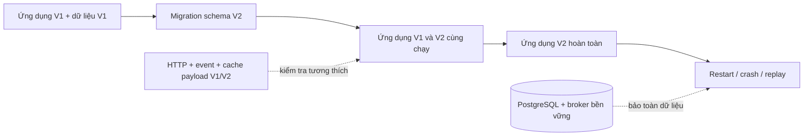
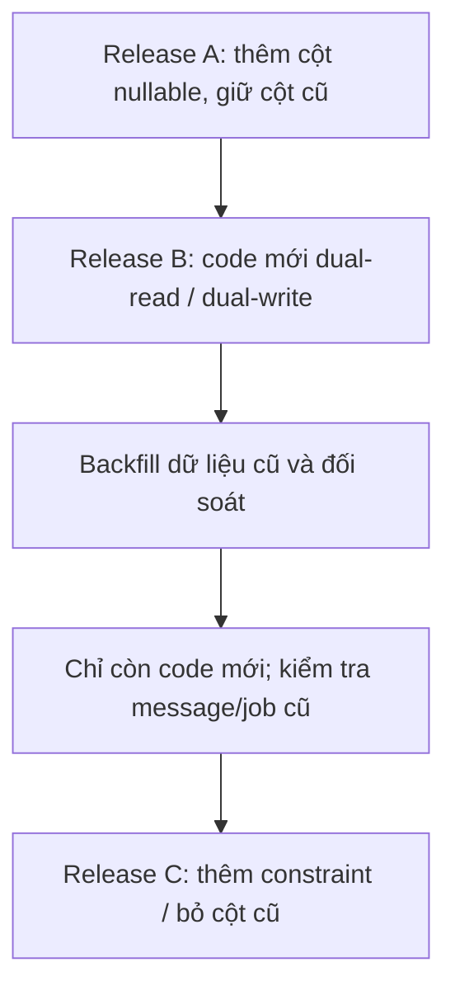
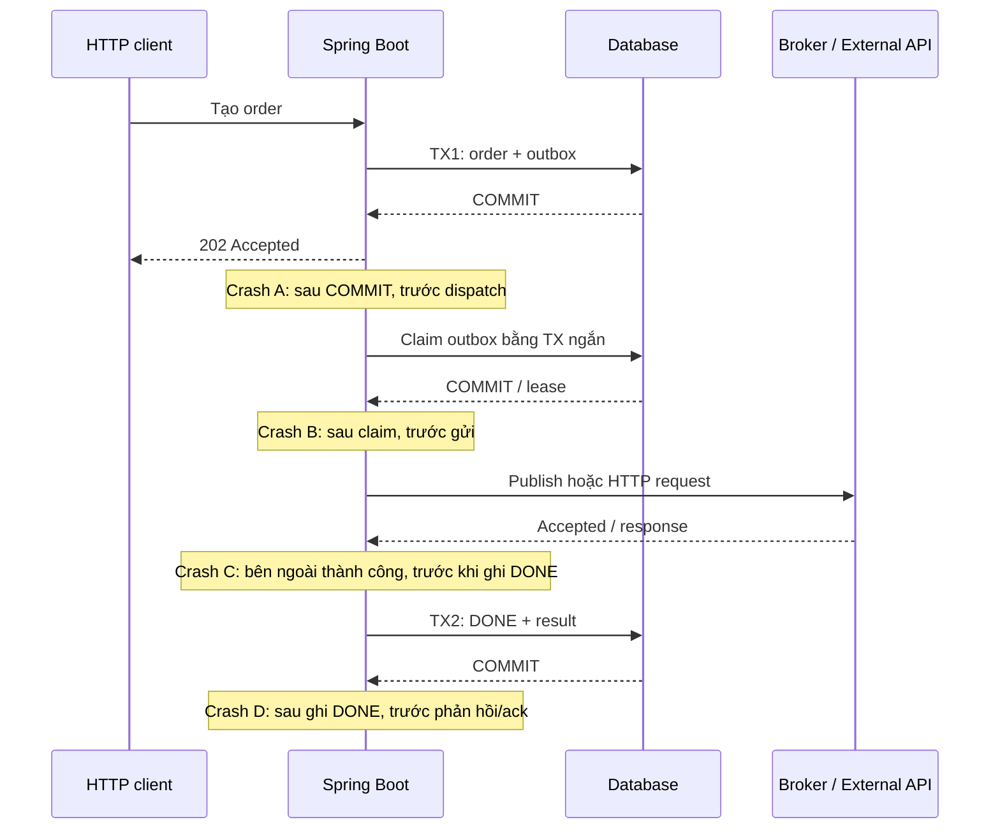

# Kiểm thử migration, phiên bản dữ liệu và khởi động lại ứng dụng

## 1. Vì sao kiểm thử khởi động thành công vẫn chưa đủ?

Trong **SPRING_BOOT_INTEGRATION**, Spring Boot có thể kết hợp JDBC/JPA, Redis, Kafka/RabbitMQ, HTTP client và adapter của Spring Integration trong một quy trình. Mỗi thành phần có dữ liệu và vòng đời riêng. Khi nâng phiên bản ứng dụng, một migration thay đổi bảng SQL có thể thành công nhưng một consumer cũ vẫn không đọc được event mới; một service có thể khởi động lại bình thường nhưng bỏ quên message đã nhận trước khi crash.

Ba nhóm thay đổi cần kiểm thử cùng nhau:

1. **Migration dữ liệu/schema:** cấu trúc và các bản ghi đang tồn tại trong cơ sở dữ liệu được chuyển từ trạng thái cũ sang trạng thái mới mà vẫn bảo toàn ý nghĩa nghiệp vụ.
2. **Phiên bản hợp đồng dữ liệu:** payload HTTP, event broker, outbox/inbox và giá trị cache có thể được tạo bởi nhiều phiên bản ứng dụng cùng lúc; producer và consumer phải hiểu đúng những phiên bản còn được hỗ trợ.
3. **Khởi động lại/khôi phục:** sau khi process chết hoặc triển khai phiên bản mới, dữ liệu đã commit, công việc chưa hoàn tất và trạng thái retry vẫn được xử lý đúng.

Một bài test chỉ tạo **database trống rồi chạy migration mới nhất** mới chứng minh khả năng khởi tạo mới (*fresh install*). Nó chưa chứng minh migration trên database có dữ liệu lịch sử, chưa kiểm tra tương thích khi rolling deployment và chưa kiểm tra khôi phục sau crash.



**Mục tiêu:** sau mỗi bước, hệ thống vẫn giữ được các bất biến nghiệp vụ, kể cả khi có dữ liệu cũ, nhiều phiên bản chạy đồng thời hoặc các sự cố xảy ra giữa những lần `COMMIT`.

## 2. Phân biệt các loại version

“Phiên bản dữ liệu” không phải chỉ là một con số duy nhất. Tùy lớp tích hợp, cùng một release có thể liên quan tới các phiên bản khác nhau:

| Loại | Được quản lý ở đâu? | Ví dụ | Điều có thể hỏng |
| --- | --- | --- | --- |
| **Database schema version** | Flyway/Liquibase migration history | `V1__create_orders.sql` → `V2__add_payment_state.sql` | Cột mới không tương thích mã cũ, backfill sai |
| **HTTP API version** | URI, media type, header hoặc hợp đồng của đối tác | `/api/v1/orders`, `/api/v2/orders` | Caller mới/đối tác cũ không hiểu field hoặc status |
| **Event schema version** | Envelope/message header/schema registry | `schemaVersion: 1` hoặc `2` | Consumer cũ deserialize hoặc diễn giải sai event mới |
| **Stored payload version** | Bản ghi JSON outbox/inbox, job table | `payload_version = 2` | Worker mới không đọc được job đang chờ từ release cũ |
| **Cache data format** | Serialization + namespace/key prefix | `catalog:v2:productDetails::SKU-1` | Class đổi, cache cũ không deserialize được |
| **Application release** | Artifact/container image | `order-service 2.4` | Code mới chạy với database/message format không phù hợp |

Không suy ra rằng **app V2 luôn cần DB V2 và chỉ đọc event V2**. Trong rolling deployment, app V1 và V2 có thể chạy đồng thời. Những message cũ cũng có thể còn nằm trong broker sau khi toàn bộ ứng dụng đã được nâng cấp.

Những bất biến cần xác định trước khi viết test gồm:

- Một `orderId` luôn tham chiếu đúng một đơn hàng; đổi cột không tạo bản ghi trùng hoặc làm mất khóa ngoại.
- Tiền dùng kiểu decimal chính xác, không bị làm tròn sai khi chuyển dữ liệu.
- Mỗi `operationId` chỉ đại diện cho một side effect nghiệp vụ; retry không tạo thanh toán mới.
- Một message đã commit vào outbox vẫn có thể được xử lý sau restart.
- Giá trị không xác định như `UNKNOWN` không được tự biến thành `FAILED` chỉ vì dữ liệu thiếu field.
- Mã cũ không bị hỏng trong giai đoạn còn chạy chung với schema đã mở rộng.

## 3. Migration database: kiểm thử cả dữ liệu cũ lẫn schema mới

Spring Boot thường tích hợp Flyway hoặc Liquibase để quản lý migration; nên chọn một công cụ chính với quy ước version, triển khai và điều kiện khởi động rõ ràng. Ví dụ bên dưới dùng **Flyway** và PostgreSQL, vì PostgreSQL cho phép kiểm tra kiểu cột, constraint và nhiều đặc tính transaction thực tế.

### 3.1. Ví dụ V1: bảng đơn hàng đang dùng thực tế

Giả sử file `db/migration/V1__create_orders.sql` có nội dung:

```sql
CREATE TABLE orders (
    id UUID PRIMARY KEY,
    legacy_status VARCHAR(24) NOT NULL,
    amount NUMERIC(18, 2) NOT NULL CHECK (amount >= 0)
);
```

Dữ liệu V1 đã có hàng triệu bản ghi, trong đó `legacy_status` là `NEW` hoặc `PAID`. Bản phát hành mới muốn thêm `payment_state` với ngữ nghĩa rõ hơn: `PENDING`, `CAPTURED` hoặc `UNKNOWN`. Nếu ngay lập tức xóa `legacy_status` hay ép `payment_state NOT NULL`, mã cũ đang chạy có thể lỗi khi đọc/ghi.

Một migration **mở rộng trước** có thể là `db/migration/V2__add_payment_state.sql`:

```sql
ALTER TABLE orders
    ADD COLUMN payment_state VARCHAR(24);

UPDATE orders
SET payment_state = CASE legacy_status
    WHEN 'NEW' THEN 'PENDING'
    WHEN 'PAID' THEN 'CAPTURED'
    ELSE 'UNKNOWN'
END
WHERE payment_state IS NULL;
```

Tại thời điểm V2, vẫn giữ cột cũ để application V1 có thể hoạt động. `payment_state` tạm cho phép `NULL` vì application V1 vẫn có thể tạo bản ghi mới **sau khi migration đã chạy**, nhưng không biết cách điền cột mới.

**Điểm thường bị bỏ sót:** backfill thực hiện một lần không bảo đảm mọi bản ghi trong tương lai đều có `payment_state`. Test phải bao gồm tình huống V1 tiếp tục ghi vào database đã nâng schema, sau đó V2 đọc lại. Mã V2 cần tương thích với null/legacy value trong giai đoạn chuyển tiếp hoặc có cơ chế dual-write/synchronize phù hợp.

### 3.2. Expand → migrate data → contract

Một quy trình thay đổi schema an toàn thường có nhiều release:



| Giai đoạn | Thay đổi schema/app | Điều cần kiểm thử |
| --- | --- | --- |
| **Expand** | Thêm cột/bảng/index tương thích, giữ đường đọc/ghi cũ | V1 vẫn đọc/ghi; V2 đọc được cả bản ghi cũ và mới |
| **Migrate data** | Backfill theo batch, có checkpoint và đối soát | Không bỏ sót, không tạo duplicate; chạy lại an toàn |
| **Switch readers/writers** | V2 ghi định dạng mới và xử lý fallback khi cần | Không trộn `null` với trạng thái nghiệp vụ; rollback app vẫn khả thi theo cửa sổ hỗ trợ |
| **Contract** | Sau khi hết V1 và dữ liệu đã hội tụ, thêm `NOT NULL` hoặc bỏ cột cũ | Không còn code, job hoặc consumer cần field cũ |

**Không được tự coi Flyway undo/rollback SQL là đường phục hồi mặc định.** Khi đã áp dụng migration và tiếp tục ghi dữ liệu mới, việc đảo schema thường khó hơn rollback artifact. Trong nhiều trường hợp cần một migration tiến lên (*forward fix*) và kế hoạch backup/restore được kiểm thử. Tính transactional của DDL khác nhau giữa PostgreSQL, MySQL và những công cụ/loại câu lệnh cụ thể.

### 3.3. Những migration dễ làm test xanh giả

- **Thêm cột với default:** test chỉ thấy cột tồn tại, nhưng dữ liệu lịch sử chưa được backfill đúng ngữ nghĩa.
- **Đổi `VARCHAR` → `ENUM`:** test fixture chỉ có giá trị hợp lệ; production còn giá trị lạ hoặc legacy alias.
- **Thêm unique constraint:** database test sạch không có duplicate; production sẽ thất bại khi tạo index.
- **Thêm foreign key:** bản ghi lịch sử có orphan hoặc sai mã định danh.
- **Đổi kiểu tiền/timestamp:** overflow, timezone hoặc precision mất dữ liệu.
- **Rename/drop:** ứng dụng V1 trong rolling deployment vẫn tham chiếu field cũ.
- **Backfill toàn bảng:** có thể giữ lock quá lâu, tăng WAL, chậm replication hoặc vượt thời gian triển khai.

Bộ fixture cần có **hàng cũ, giá trị biên, null nếu schema cũ cho phép, duplicate, timezone, số tiền lớn và chuỗi Unicode**. Nếu migration mang tính phá vỡ, phải làm sạch/dedupe dữ liệu bằng bước có chủ đích trước khi siết constraint.

## 4. Test migration V1 → V2 bằng Testcontainers

Không nên chỉ dùng H2 để xác minh migration PostgreSQL: type, index, DDL transaction, locking, JSONB và constraint có thể khác đáng kể. **Testcontainers** chạy PostgreSQL thật trong môi trường tách biệt để thử schema và dữ liệu.

Giả sử ứng dụng sử dụng Maven với `spring-boot-starter-jdbc`, Flyway và các dependency test:

```xml
<dependencies>
    <dependency>
        <groupId>org.springframework.boot</groupId>
        <artifactId>spring-boot-starter-jdbc</artifactId>
    </dependency>
    <dependency>
        <groupId>org.flywaydb</groupId>
        <artifactId>flyway-core</artifactId>
    </dependency>
    <!-- Với Flyway hiện đại có database module riêng cho PostgreSQL. -->
    <dependency>
        <groupId>org.flywaydb</groupId>
        <artifactId>flyway-database-postgresql</artifactId>
    </dependency>
    <dependency>
        <groupId>org.springframework.boot</groupId>
        <artifactId>spring-boot-starter-test</artifactId>
        <scope>test</scope>
    </dependency>
    <dependency>
        <groupId>org.testcontainers</groupId>
        <artifactId>junit-jupiter</artifactId>
        <scope>test</scope>
    </dependency>
    <dependency>
        <groupId>org.testcontainers</groupId>
        <artifactId>postgresql</artifactId>
        <scope>test</scope>
    </dependency>
</dependencies>
```

Trong ứng dụng thực tế, quản lý version Flyway/Testcontainers qua BOM và tương thích với dòng Spring Boot đang dùng. Không tự khai báo version tùy tiện giữa các module.

### 4.1. Kiểm thử nâng từ database thật sự ở V1

Một test JUnit độc lập tạo database sạch **chỉ trong container thử nghiệm**, chạy migration đến V1, chèn dữ liệu V1 và tiếp tục migration đến V2:

```java
import static org.assertj.core.api.Assertions.assertThat;

import java.sql.Connection;
import java.sql.DriverManager;
import java.sql.ResultSet;
import java.sql.Statement;
import java.util.UUID;

import org.flywaydb.core.Flyway;
import org.junit.jupiter.api.Test;
import org.testcontainers.containers.PostgreSQLContainer;
import org.testcontainers.junit.jupiter.Container;
import org.testcontainers.junit.jupiter.Testcontainers;

@Testcontainers
class SchemaUpgradeTest {

    @Container
    static final PostgreSQLContainer<?> postgres =
            new PostgreSQLContainer<>("postgres:16-alpine");

    private Flyway flywayTo(String targetVersion) {
        return Flyway.configure()
                .dataSource(
                        postgres.getJdbcUrl(),
                        postgres.getUsername(),
                        postgres.getPassword())
                .locations("classpath:db/migration")
                .target(targetVersion)
                .load();
    }

    @Test
    void upgradesOldOrdersWithoutLosingState() throws Exception {
        flywayTo("1").migrate();

        UUID orderId = UUID.randomUUID();
        try (Connection connection = DriverManager.getConnection(
                    postgres.getJdbcUrl(),
                    postgres.getUsername(),
                    postgres.getPassword());
             var ps = connection.prepareStatement(
                    "INSERT INTO orders(id, legacy_status, amount) " +
                    "VALUES (?, 'PAID', 120000.50)")) {
            ps.setObject(1, orderId);
            assertThat(ps.executeUpdate()).isEqualTo(1);
        }

        // Một Flyway instance mới chạy các migration còn lại trên cùng DB.
        flywayTo("2").migrate();
        flywayTo("2").validate();

        try (Connection connection = DriverManager.getConnection(
                    postgres.getJdbcUrl(),
                    postgres.getUsername(),
                    postgres.getPassword());
             var ps = connection.prepareStatement(
                    "SELECT legacy_status, payment_state, amount " +
                    "FROM orders WHERE id = ?")) {
            ps.setObject(1, orderId);
            try (ResultSet rs = ps.executeQuery()) {
                assertThat(rs.next()).isTrue();
                assertThat(rs.getString("legacy_status")).isEqualTo("PAID");
                assertThat(rs.getString("payment_state")).isEqualTo("CAPTURED");
                assertThat(rs.getBigDecimal("amount"))
                        .isEqualByComparingTo("120000.50");
                assertThat(rs.next()).isFalse();
            }
        }
    }
}
```

Test này giả định chỉ có `V1__create_orders.sql` và `V2__add_payment_state.sql` trong tập migration đang minh họa; nếu dự án có nhiều version khác, điều chỉnh phạm vi target/fixture tương ứng. Với một test duy nhất trong class, container được khởi tạo một lần cho test đó; nếu thêm nhiều test dùng chung container, phải **cách ly dữ liệu giữa các case** (database/schema riêng hoặc lifecycle phù hợp), tránh làm các test phụ thuộc thứ tự.

Những thứ test vừa kiểm tra:

- Migration V1 khởi tạo schema cũ đúng nghĩa.
- Dữ liệu được **ghi trước V2** rồi vẫn còn sau khi migrate.
- Mapping `PAID → CAPTURED` đúng; số tiền không biến đổi.
- Các migration V1/V2 có checksum và history hợp lệ theo `Flyway.validate()`.
- Không cần DB server production hay test chạy trực tiếp trên dữ liệu thật.

Những thứ **chưa** được test: app V1 có thật sự chạy với DB V2, V1 chèn hàng mới sau V2, migration khi có đồng thời nhiều instance, performance khi bảng lớn và rollback khi fail.

### 4.2. Cần thêm test kiểu “V1 vẫn ghi sau V2”

Một bài kiểm thử compatibility quan trọng:

1. Chạy V1 → V2 như trên.
2. Dùng đường SQL/DAO của ứng dụng V1, chỉ ghi `id`, `legacy_status`, `amount` vào bảng đã có cột `payment_state`.
3. Đọc bằng code V2; xác minh bản ghi có `payment_state = NULL` được hiểu theo `legacy_status`, không gây lỗi `NullPointerException` và không tự nhận trạng thái `FAILED`.
4. Kích hoạt backfill lần sau hoặc cơ chế dual-write đã chọn; kiểm tra bản ghi mới được hội tụ sang giá trị V2.
5. Khi không còn writer V1, mới kiểm tra có thể đặt `NOT NULL` hoặc bỏ cột cũ.

Đây chính là khác biệt giữa **migration chạy xong** và **nâng cấp an toàn trong thời gian chạy song song nhiều phiên bản**.

## 5. Kiểm thử startup bằng chính Spring Boot auto-configuration

Test ở phần trước gọi Flyway trực tiếp. Thêm một test Spring Boot integration để xác minh ứng dụng sử dụng cấu hình đúng: datasource, Flyway migration location, JPA mapping, bean khởi tạo và các listener chỉ khởi chạy sau khi schema sẵn sàng.

```java
import static org.assertj.core.api.Assertions.assertThat;

import org.junit.jupiter.api.Test;
import org.springframework.beans.factory.annotation.Autowired;
import org.springframework.boot.test.context.SpringBootTest;
import org.springframework.jdbc.core.JdbcTemplate;
import org.springframework.test.context.DynamicPropertyRegistry;
import org.springframework.test.context.DynamicPropertySource;
import org.testcontainers.containers.PostgreSQLContainer;
import org.testcontainers.junit.jupiter.Container;
import org.testcontainers.junit.jupiter.Testcontainers;

@Testcontainers
@SpringBootTest
class ApplicationStartupWithMigrationTest {

    @Container
    static final PostgreSQLContainer<?> postgres =
            new PostgreSQLContainer<>("postgres:16-alpine");

    @DynamicPropertySource
    static void databaseProperties(DynamicPropertyRegistry registry) {
        registry.add("spring.datasource.url", postgres::getJdbcUrl);
        registry.add("spring.datasource.username", postgres::getUsername);
        registry.add("spring.datasource.password", postgres::getPassword);
        registry.add("spring.flyway.enabled", () -> true);
    }

    @Autowired
    JdbcTemplate jdbc;

    @Test
    void startsAfterApplyingMigrations() {
        Integer count = jdbc.queryForObject(
                "SELECT count(*) FROM flyway_schema_history " +
                "WHERE success = true",
                Integer.class);

        assertThat(count).isGreaterThanOrEqualTo(2);

        Integer columns = jdbc.queryForObject(
                "SELECT count(*) FROM information_schema.columns " +
                "WHERE table_name = 'orders' " +
                "AND column_name = 'payment_state'",
                Integer.class);
        assertThat(columns).isEqualTo(1);
    }
}
```

Ví dụ dùng PostgreSQL mặc định với schema `public` và giả định classpath chứa hai migration minh họa. Nếu ứng dụng có nhiều schema hoặc lịch sử migration phức tạp, query cần lọc thêm schema và không cố định số migration thiếu căn cứ.

Nếu ứng dụng dùng Hibernate/JPA, cần **đảm bảo schema được Flyway/Liquibase quản lý**; một cấu hình test dùng `spring.jpa.hibernate.ddl-auto=create` có thể vô tình tạo lại bảng, che giấu migration thiếu. Đặt `validate` khi thích hợp để Hibernate kiểm tra mapping so với schema đã migrate, thay vì tự tạo schema trong bài test migration.

### Không nhầm các dạng khởi động lại

| Phương thức kiểm thử | Nó thực sự kiểm tra gì? | Nó chưa chứng minh gì? |
| --- | --- | --- |
| `@SpringBootTest` một lần | Khởi tạo context, auto-configuration, migration và bean wiring | Không chứng minh restart hay crash recovery |
| `@DirtiesContext` rồi tạo context mới | Context mới được tạo trong cùng JVM | Không tương đương process crash; static memory/process resources có thể còn |
| Dừng context rồi chạy lại cùng database | App startup lại với dữ liệu vẫn còn | Không nhất thiết thử mất điện/process kill |
| Khởi động **process A**, kill rồi chạy **process B** trên cùng DB/broker | Khôi phục qua process boundary thật | Chưa đủ nếu không kiểm tra các checkpoint crash |
| Dừng luôn DB container rồi tạo DB mới sạch | Khởi tạo một môi trường mới | Không kiểm tra persistence sau restart |

Dùng loại test đúng mục tiêu. Khi cần kiểm chứng `SIGKILL` hoặc container runtime restart, tạo harness chạy hai tiến trình và **giữ DB/broker volume bền vững**. Đừng coi test chỉ đóng/mở Spring context là bằng chứng đã thử khôi phục từ crash.

## 6. Kiểm thử phiên bản hợp đồng API và event

Schema database và schema message thay đổi ở nhịp khác nhau. Một event V1 có thể còn trong Kafka/RabbitMQ khi consumer V2 được deploy; một HTTP client V1 cũng có thể tiếp tục gọi API V2 trong khoảng rolling deployment.

### 6.1. Một ví dụ event V1 và V2

Giả sử V1 phát:

```json
{
  "schemaVersion": 1,
  "eventId": "evt-42",
  "orderId": "order-42",
  "status": "PAID"
}
```

V2 phát:

```json
{
  "schemaVersion": 2,
  "eventId": "evt-43",
  "orderId": "order-43",
  "payment": {
    "state": "CAPTURED",
    "currency": "VND"
  }
}
```

Đây là **thay đổi cấu trúc và ngữ nghĩa**; consumer V1 chỉ biết `status` có thể không hiểu `payment.state`. Một consumer V2 có thể đọc cả hai nếu có logic normalization tương thích. Khi rolling deployment, **chưa được phát event V2 cho consumer V1 chưa nâng cấp** nếu hợp đồng chưa bảo đảm tương thích. Cần nâng consumer trước, duy trì format V1 trong giai đoạn chuyển tiếp hoặc dùng topic/version mới.

### 6.2. Chuẩn hóa dữ liệu theo version

Ví dụ Java/Jackson (rút gọn để tập trung vào giải mã version):

```java
import com.fasterxml.jackson.core.JsonProcessingException;
import com.fasterxml.jackson.databind.JsonNode;
import com.fasterxml.jackson.databind.ObjectMapper;

public final class OrderEventReader {

    private final ObjectMapper mapper;

    public OrderEventReader(ObjectMapper mapper) {
        this.mapper = mapper;
    }

    public NormalizedOrderEvent decode(String json)
            throws JsonProcessingException {
        JsonNode root = mapper.readTree(json);
        if (root == null || !root.isObject()) {
            throw new IllegalArgumentException("Event phải là JSON object");
        }

        int version = root.path("schemaVersion").asInt(-1);
        String eventId = requiredText(root, "eventId");
        String orderId = requiredText(root, "orderId");

        String state = switch (version) {
            case 1 -> switch (requiredText(root, "status")) {
                case "PAID" -> "CAPTURED";
                case "NEW" -> "PENDING";
                default -> throw new IllegalArgumentException(
                        "Unknown V1 order status");
            };
            case 2 -> requiredText(
                    root.path("payment"), "state");
            default -> throw new UnsupportedSchemaVersionException(version);
        };

        return new NormalizedOrderEvent(eventId, orderId, state);
    }

    private static String requiredText(JsonNode object, String field) {
        JsonNode value = object.path(field);
        if (!value.isTextual() || value.textValue().isBlank()) {
            throw new IllegalArgumentException(
                    "Thiếu hoặc sai field: " + field);
        }
        return value.textValue();
    }

    public record NormalizedOrderEvent(
            String eventId, String orderId, String paymentState) {}

    public static final class UnsupportedSchemaVersionException
            extends RuntimeException {
        public UnsupportedSchemaVersionException(int version) {
            super("Unsupported schemaVersion: " + version);
        }
    }
}
```

Đây là lớp **adapter giải mã event**, không phải mã tạo bảng DB. Đối với producer/consumer thực tế còn cần kiểm tra enum state hợp lệ, duplicate `eventId`, timestamp/timezone, currency, thông tin tenant, giới hạn payload và tính xác thực nguồn gửi.

Không tự động chấp nhận một phiên bản chưa biết bằng cách ép nó thành V2. Khi gặp `schemaVersion = 3` không được hỗ trợ, cần chuyển sang quarantine/dead-letter hoặc báo lỗi theo hợp đồng; tuyệt đối không âm thầm diễn giải các trường quan trọng theo default “thành công”.

### 6.3. Ma trận compatibility

| Producer | Consumer | Kỳ vọng và test cần thiết |
| --- | --- | --- |
| V1 | V1 | Dữ liệu V1 tiếp tục hoạt động |
| V1 | V2 | Consumer V2 giải mã và chuẩn hóa V1 đúng |
| V2 | V2 | Cả field mới và ràng buộc mới được kiểm tra |
| V2 | V1 | Chỉ được xem là hợp lệ nếu V1 có forward compatibility thật sự; nếu không phải chặn việc phát V2 cho V1 |
| Version không hỗ trợ | V2 | Phân loại lỗi, không xử lý side effect với dữ liệu sai |
| V1 có field tùy chọn bổ sung | V2 | Hành vi với unknown field đúng theo hợp đồng |
| V2 thiếu field bắt buộc | V2 | Fail rõ ràng, không dùng default nguy hiểm |
| Event trùng `eventId` | Bất kỳ consumer | Chỉ áp dụng side effect một lần theo khóa nghiệp vụ |

**Schema compatibility** (cấu trúc parse được) khác với **semantic compatibility** (nghĩa nghiệp vụ không bị đổi). Thêm một enum value có thể không phá JSON decoder nhưng làm vỡ `switch` của consumer. Thay đổi số tiền từ đơn vị đồng sang xu có thể parse được nhưng sai 100 lần. Vì vậy test phải assert **ý nghĩa sau normalize**, không chỉ “deserialize thành công”.

## 7. HTTP contract, dữ liệu lưu trong queue và cache cũng phải version hóa

### 7.1. HTTP API: status code, media type và các giá trị biên

Khi đổi hợp đồng HTTP, test ít nhất các tình huống:

- Client V1 gửi request đến endpoint hiện tại; server còn nhận field cũ không?
- Client V2 nhận response từ server V1; field mới vắng mặt được xử lý thế nào?
- HTTP `404`, `409`, `422`, `429` hoặc `503` có nghĩa giữ nguyên hay đã thay đổi?
- Pagination, timezone, decimal, encoding, media type và unknown enum value có còn tương thích?
- Nếu endpoint mới dùng idempotency key, có giữ ổn định key khi retry sau timeout không?
- Nếu dùng version trong URI/header, server có chặn version không hỗ trợ một cách rõ ràng không?

Các test với `MockRestServiceServer` (RestTemplate/RestClient đồng bộ) hoặc HTTP stub server (WebClient) giúp xác minh từng phía hợp đồng. Khi hai nhóm phát triển API độc lập, bổ sung **consumer-driven contract testing** hoặc schema validation trong CI với các phiên bản đang được hỗ trợ.

### 7.2. Outbox, inbox và công việc chờ từ release cũ

Một job đã được ghi vào DB nhưng chưa xử lý có thể còn tồn tại sau nhiều lần deploy:

```text
outbox:
  id = evt-42
  payload_version = 1
  payload_json = {"schemaVersion":1,...}
  state = PENDING
```

Worker V2 cần biết cách giải mã payload V1 cho đến khi chắc chắn không còn job V1. Nếu đổi Java class/serialized bytes mà không giữ adapter tương thích, worker mới có thể thất bại ngay khi khởi động lại.

Nên lưu định danh bất biến (`eventId`/`operationId`), version format và payload có thể đọc độc lập với object runtime. Đối với Kafka, RabbitMQ hoặc Spring Integration persistent MessageStore, phải kiểm tra **message tồn đọng** trên broker/store trước và sau nâng cấp.

### 7.3. Redis cache: key/version và serialization

Một cache entry có thể tồn tại lâu hơn process đã tạo ra nó. Khi đổi DTO hoặc serializer, hãy test ứng dụng V2 đọc entry được viết bởi V1. Nếu không có khả năng tương thích, có thể dùng namespace/key prefix version mới, ví dụ:

```text
catalog:v1:productDetails::SKU-100
catalog:v2:productDetails::SKU-100
```

Cách này tách định dạng cũ/mới, nhưng làm tăng key và nhu cầu bộ nhớ trong giai đoạn chuyển tiếp; cần TTL và kế hoạch dọn dẹp. **Không xem cache là nguồn sự thật**: xóa cache có thể giải quyết format cũ, nhưng không giải quyết migration trong DB/outbox/broker vốn cần bảo toàn dữ liệu.

## 8. Khởi động lại: những cửa sổ crash cần kiểm thử

Một luồng tích hợp đáng tin cậy thường thực hiện nhiều bước độc lập:



Bốn cửa sổ có hậu quả khác nhau:

| Cửa sổ | Trạng thái có thể còn sau restart | Hành vi đúng |
| --- | --- | --- |
| **A:** DB commit, chưa dispatch | Outbox `PENDING` | Worker mới tìm được job và tiếp tục |
| **B:** Claim rồi crash trước gửi | Job `PROCESSING` còn lease | Lease hết hạn; worker khác claim lại có điều kiện |
| **C:** Downstream thành công, chưa lưu `DONE` | Job có thể bị xử lý lại | Dùng cùng operation ID/idempotency key hoặc đối soát, không tạo side effect mới |
| **D:** Đã lưu `DONE` nhưng caller/consumer chưa nhận phản hồi/ack | Retry/duplicate có thể đến | Trả kết quả có sẵn; dùng dedup, không xử lý hai lần |
| DB transaction rollback trước commit | Không có business record/outbox đã commit | Không phát công việc giả; không đọc dữ liệu chưa commit |
| App dừng khi đang migrate | Schema có thể ở trạng thái tùy DB/loại DDL | Flyway/Liquibase phải phát hiện tình trạng lỗi, chặn startup hoặc yêu cầu repair có kiểm soát |

Với **at-least-once delivery**, xử lý trùng là tình huống bình thường. Một bảng `inbox_processed` có unique constraint theo `(consumer_name, event_id)` hoặc khóa tương đương là cách ghi dấu bền vững. Phải áp dụng **dedup và thay đổi nghiệp vụ trong cùng transaction cục bộ** khi cả hai nằm trong cùng DB. Nếu side effect nằm ở hệ thống ngoài, unique constraint ở DB không thay thế idempotency phía đối tác.

### Ví dụ trạng thái job

```text
PENDING -> PROCESSING -> DONE
                |         ^
                +-> UNKNOWN -> RECONCILE -> DONE / FAILED
                |
                +-> RETRY (sau backoff)
```

Không được tự chuyển `UNKNOWN` sang `FAILED` vì response timeout. Downstream có thể đã thực thi thao tác nhưng phản hồi bị mất. Mọi retry của POST gây side effect cần operation ID ổn định và điều kiện retry an toàn.

## 9. Viết test restart thực sự có giá trị

### 9.1. Giữ DB/broker qua các lần restart ứng dụng

Một test khôi phục cần **giữ nguyên những tài nguyên bền vững** qua lúc ứng dụng dừng và chạy lại. Với Testcontainers, có thể giữ một container PostgreSQL và một broker phục vụ cả hai vòng đời process. Test không nên xóa volume hoặc chạy `flyway.clean()` giữa chừng.

Kịch bản kiểm thử hai process:

1. Khởi chạy PostgreSQL và broker test; áp dụng schema V1 hoặc schema chuẩn của release kiểm thử.
2. Khởi chạy **app process A** với một cờ test fault-injection có kiểm soát.
3. Tạo yêu cầu nghiệp vụ; chờ bằng assertion đến khi hàng `order + outbox` **đã commit**.
4. Buộc A dừng ở checkpoint, ví dụ sau external HTTP success nhưng trước ghi `DONE`.
5. Khởi chạy **app process B** trên cùng DB/broker, có thể dùng version mới hơn.
6. Chờ B claim/recover và xử lý việc tồn đọng.
7. Assert trạng thái DB cuối cùng, số lần side effect ở stub HTTP/broker, idempotency key, không duplicate.
8. Dừng B và tài nguyên test theo thứ tự phù hợp.

Để test định hướng một cách xác định, dùng latch, điểm chặn/sự kiện test và trạng thái DB đã commit thay vì `Thread.sleep(5000)`. Với **process kill** thật, nên có cơ chế signal ngoài tiến trình (test HTTP endpoint/cờ test chuyên dụng) để harness biết checkpoint đã tới trước khi kill; không dựa vào log chưa flush. Dùng giới hạn thời gian cho mọi bước chờ.

### 9.2. Phân biệt việc khởi động lại app và reset dữ liệu

Nếu test khởi động lại nhưng đồng thời tạo database sạch, nó chỉ kiểm tra **khởi tạo mới**, không kiểm tra khôi phục. Nếu dùng `@Transactional` ở test method, fixture chưa commit có thể bị rollback khi kết thúc test và worker thread riêng không nhìn thấy. Với bài test restart, hãy commit fixture bằng `TransactionTemplate` hoặc transaction boundary rõ ràng, rồi kiểm tra từ kết nối khác.

Để kiểm tra lỗi do bộ nhớ tạm còn sót, phải dùng process riêng hoặc ít nhất xác nhận static cache/in-memory queue đã được xây mới. `@DirtiesContext` trong cùng JVM không mô phỏng hoàn toàn việc mất toàn bộ bộ nhớ tiến trình.

### 9.3. Ma trận restart và version

| DB trước khi restart | App trước → sau | Data/job còn tồn | Điều cần assert |
| --- | --- | --- | --- |
| V1 → migrate V2 | V1 → V2 | Bản ghi V1 | Migrate đúng và V2 đọc được dữ liệu lịch sử |
| V2 | V1 → V2 | V1 tiếp tục ghi trong rolling window | V2 xử lý được dữ liệu thiếu field mới |
| V2 | V2 → V1 rollback app | Bản ghi mới đã được V2 ghi | Rollback app chỉ khi được thiết kế backward-compatible |
| V2 | V2 → V2 | Outbox `PENDING` | Worker mới tiếp tục job |
| V2 | V2 → V2 | `PROCESSING` lease hết hạn | Retry/claim an toàn, không mất job |
| V2 | V1 → V2 | Event V1 chưa consume | Consumer V2 giải mã và dedup đúng |
| V2 | V2 → V2 | Broker đã giao message nhưng chưa ack | Message có thể giao lại; nghiệp vụ không thực hiện trùng |

Rollback **binary** không đồng nghĩa rollback **database schema**. Một schema mới có thể tương thích với app cũ nếu đã triển khai theo expand-contract, nhưng không mặc định như vậy.

## 10. Migration khi nhiều instance cùng khởi động

Khi triển khai ứng dụng trên Kubernetes hoặc nhiều VM, thường có nhiều instance Spring Boot khởi động gần nhau. Với Flyway/Liquibase, migration history/locking giúp điều phối, nhưng phải kiểm thử theo đúng database, timeout và deployment topology của ứng dụng.

Tình huống cần mô phỏng:

- Hai instance cùng cố chạy migration; chỉ một bên thực hiện thay đổi schema hợp lệ, bên còn lại đợi/khởi động tiếp hoặc báo lỗi có kiểm soát.
- Migration dài hơn readiness/startup probe: hệ thống có thể kill container trong khi migration đang chạy.
- App mới lên sớm nhưng các app cũ vẫn phục vụ request; thay đổi schema không được làm app cũ lỗi ngay lập tức.
- Một migration lỗi ở môi trường giống production, ứng dụng không được đánh dấu ready và nhận traffic với schema không phù hợp.
- Có backfill dữ liệu lớn, job backfill cần checkpoint/batch/retry và không tạo lock kéo dài.

Nếu môi trường yêu cầu migration chạy **trước** khi các pod ứng dụng nhận traffic, có thể chạy một migration job riêng, với quyền DB riêng và quy trình giám sát. Khi làm vậy, phải kiểm tra thứ tự deploy, điều kiện readiness và khả năng app cũ chạy với schema vừa mở rộng.

**Không chạy `repair` tự động để bỏ qua checksum mismatch** chỉ nhằm đưa ứng dụng vào trạng thái ready. Flyway checksum thay đổi có thể chỉ ra migration lịch sử đã bị sửa; cần điều tra nguyên nhân và triển khai sửa chữa có kiểm soát. Tương tự, không bật `clean` trên database môi trường dùng dữ liệu thật để giải quyết một migration bị lỗi.

## 11. Data migration thất bại giữa chừng: rollback hay tiếp tục?

Một số DB/DDL có thể rollback toàn bộ migration trong transaction; một số thao tác khác có thể commit riêng, không rollback hoàn toàn hoặc bị giới hạn hỗ trợ transaction. Ngoài ra, **backfill lớn chạy theo batch** thường chủ động commit từng phần. Vì thế cần test idempotency và checkpoint thay vì chỉ kỳ vọng “migrate hoặc hoàn toàn rollback”.

Ví dụ một job chuyển đổi dữ liệu:

```text
Bước 1: chọn 500 orders chưa có payment_state
Bước 2: cập nhật theo quy tắc mapping đã kiểm chứng
Bước 3: commit batch + checkpoint
Bước 4: lặp tới khi hết
```

Nếu process crash sau batch số 37, khi restart không nên chạy lại từ đầu bằng một thao tác có side effect không an toàn. Dùng điều kiện như `WHERE payment_state IS NULL`, checkpoint hoặc cập nhật có version để chạy lại an toàn. Cần tính race với writer mới: khi dữ liệu đã thay đổi song song, backfill không được ghi đè kết quả mới bằng snapshot cũ.

Các kiểm tra có giá trị:

1. Dừng backfill sau một phần dữ liệu, khởi động lại và chạy tiếp.
2. Đếm bản ghi còn thiếu `payment_state`; chỉ được về 0 trước khi siết `NOT NULL`.
3. Kiểm tra mapping từng trạng thái/edge case; không chỉ assert tổng số hàng.
4. Tạo writer V1 chạy song song; V2 không được giả định mọi bản ghi luôn đã backfill.
5. Chạy lại backfill nhiều lần; kết quả phải bất biến và không tạo duplicate.
6. Kiểm tra mức lock wait, thời gian mỗi batch, transaction log/WAL và tải replica theo môi trường gần production.

Với migration **destructive**, thiết lập cơ chế backup/restore, kiểm tra cách phục hồi trong staging và lưu bằng chứng kiểm tra. Không coi snapshot đã tạo nhưng chưa thử restore là kế hoạch recovery hoàn chỉnh.

## 12. Ma trận kiểm thử lỗi biên cần có trong CI

| Nhóm | Fixture/kích thích | Kỳ vọng |
| --- | --- | --- |
| Fresh install | Database mới, migration đến latest | Schema và ứng dụng khởi động thành công |
| Upgrade từ phiên bản cũ | Schema V1 có dữ liệu thật dạng rút gọn | Dữ liệu được bảo toàn, trạng thái được map đúng |
| Schema compatibility | V1 writer trên schema đã mở rộng V2 | Không lỗi; V2 reader giải thích được row mới |
| Constraint | Duplicate, orphan, null, giá trị lạ | Migration từ chối có thông báo rõ hoặc xử lý bằng bước dọn dữ liệu |
| Monetary/timezone | BigDecimal lớn, timestamp nhiều timezone | Không mất độ chính xác/ngữ nghĩa |
| Migration rerun | Restart ứng dụng sau migrate | Không áp dụng lại migration thành công hoặc làm mất dữ liệu |
| Migration checksum | Sửa một migration đã apply trong fixture thử nghiệm | Validate phát hiện chênh lệch |
| Multiple startup | Hai instance chạy migration gần nhau | Khóa/điều phối hợp lệ; không duplicate DDL |
| Event backward compatibility | Consumer V2 đọc event V1 | Chuẩn hóa đúng trạng thái |
| Event forward compatibility | Consumer V1 gặp event V2 | Chỉ hợp lệ nếu có hợp đồng rõ; nếu không, không phát V2 quá sớm |
| Unsupported schema | `schemaVersion=99` | Quarantine/error, không phát side effect |
| Stored job V1 | Pending outbox/inbox từ bản cũ | Worker mới phục hồi và giải mã được |
| Crash after commit | Order + outbox đã commit, chưa publish | Job vẫn được xử lý sau restart |
| Crash after external success | Downstream thành công, DB chưa DONE | Đối soát/retry cùng operation ID, không có side effect trùng |
| Duplicate delivery | Broker giao lại cùng eventId | Dedup dựa vào unique constraint/trạng thái |
| Cache version | V2 đọc key/format V1 | Tương thích hoặc chủ động tách namespace |
| Partial backfill | Crash sau vài batch | Resume/idempotent, không ghi đè dữ liệu mới |
| Readiness | Migration chưa xong/đang lỗi | App chưa nhận traffic với schema không sẵn sàng |

Không phải bài kiểm thử nào cũng cần chạy trên mỗi commit. Phân tầng giúp CI vừa nhanh vừa có ý nghĩa: unit/contract tests trên mỗi commit, migration với Testcontainers trên PR và trước release, multi-process chaos/restart trên pipeline chuyên biệt. Tuy nhiên, những lỗi migration có thể gây mất dữ liệu cần được kiểm thử trước khi phát hành.

## 13. Quan sát và checklist triển khai

### Theo dõi sau migration/restart

Các metric và log có ích bao gồm:

- Migration version hiện tại, thời lượng áp dụng, checksum/validation status và số instance đang chờ lock.
- Số row đã backfill/chưa backfill, số record mapping lỗi, số batch retry.
- Version event nhận được theo consumer, số message không hỗ trợ schema, số trường hợp quarantine.
- Độ tuổi outbox/inbox `PENDING`, `PROCESSING` quá hạn, retry count và dead-letter count.
- Tỷ lệ message duplicate được bỏ qua, side effect đối soát và thời gian hội tụ từ `UNKNOWN` đến trạng thái cuối.
- Readiness/startup failures sau deploy; lỗi serializer/DTO ở Redis, broker và HTTP client.
- Database connection pool/lock wait, broker lag, downstream timeout trong giai đoạn rolling deployment.

Log phải có correlation ID, event ID và operation ID để truy vết, nhưng không ghi token, body nhạy cảm hoặc thông tin cá nhân chưa được kiểm soát. Với event schema lạ, giữ metadata/đối tượng lỗi theo chính sách bảo mật và retention để đối soát; đừng silently drop rồi báo xử lý thành công.

### Checklist dành cho reviewer

1. Đã xác định **schema version DB**, phiên bản payload/event, app release và những tổ hợp phải chạy chung.
2. Có test **upgrade trên DB mang dữ liệu V1**, ngoài test tạo DB mới.
3. Test V1 writer hoạt động sau **expand migration** và V2 reader hiểu row thiếu field mới.
4. Có chiến lược backfill có thể resume, đối soát số lượng và xử lý các giá trị biên.
5. Chỉ bỏ cột/đổi type hoặc siết constraint sau khi không còn phiên bản code/job cần dữ liệu cũ.
6. Consumer mới đọc được event/job cũ; consumer cũ không bị ép đọc event format mới chưa tương thích.
7. Cache serialization và namespace key được kiểm tra khi deploy/rollback.
8. Đã kiểm thử crash trước/sau `COMMIT`, trước/sau publish, trước/sau downstream side effect.
9. Outbox/inbox/ack có trạng thái bền vững, dedup và idempotency; không dựa vào memory queue để phục hồi công việc bắt buộc.
10. Restart test giữ nguyên DB/broker; có test multi-process nếu phải chứng minh mất process thật.
11. Có kế hoạch migration concurrent startup, readiness, rollback artifact và forward fix/restore schema.
12. CI và dashboard cho thấy các invariant chính còn đúng sau khi triển khai.

**Quy tắc thực hành:** một release an toàn phải chứng minh **dữ liệu cũ vẫn có nghĩa**, **phiên bản cũ/mới trao đổi được trong cửa sổ hỗ trợ** và **công việc đã commit vẫn được phục hồi sau restart**. Kiểm thử migration, phiên bản dữ liệu và khởi động lại cần dựa trên nguồn dữ liệu bền vững và những điểm crash thực tế của luồng Spring Boot Integration, thay vì chỉ kiểm tra ứng dụng có khởi động trên database rỗng hay không.

### Tài liệu tham khảo

- [Spring Boot Reference — Database Initialization](https://docs.spring.io/spring-boot/reference/how-to/data-initialization.html): Flyway, Liquibase và khởi tạo schema.
- [Flyway Documentation](https://documentation.red-gate.com/fd): migration history, validation, target, repair và workflow.
- [Liquibase Documentation](https://docs.liquibase.com/): changelog, update, validation, rollback và locks.
- [Testcontainers for Java](https://java.testcontainers.org/): khởi tạo PostgreSQL/broker thật trong bài kiểm thử.
- [Spring Framework Reference — Transaction Management](https://docs.spring.io/spring-framework/reference/data-access/transaction.html): commit/rollback và transaction boundaries.
- [Spring Integration Reference — Message Store](https://docs.spring.io/spring-integration/reference/message-store.html): lưu message bền vững và khôi phục luồng.
