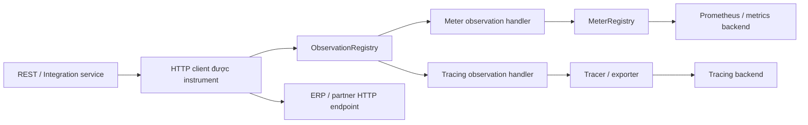
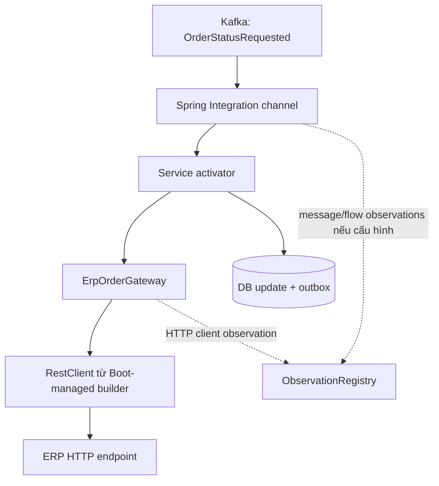

# HTTP client metrics và điều kiện dùng builder được quản lý

## 1. Vì sao HTTP client phải được quan sát ở tầng tích hợp?

Trong một hệ thống Spring Boot, một request tới API có thể kéo theo nhiều bước: lấy đơn hàng từ PostgreSQL, tra Redis, gọi ERP qua HTTP hoặc SOAP, sau đó đưa sự kiện lên Kafka/RabbitMQ. Nếu API chậm, chỉ nhìn metric của **HTTP server** không trả lời được thời gian bị tiêu tốn ở đâu. Cần có tín hiệu cho từng **HTTP client outbound**: gọi dịch vụ nào, bao nhiêu lần, độ trễ ra sao, lỗi nào xuất hiện và chúng thuộc về trace nào.

Trong module **SPRING_BOOT_INTEGRATION**, quan sát HTTP client là một phần của việc tổ chức tích hợp qua HTTP client, database, cache, broker thông điệp và adapter Spring Integration. Metric phải phục vụ các quyết định thực tế: điều chỉnh timeout và concurrency, phân biệt lỗi hợp đồng với lỗi mạng, đánh giá retry, phát hiện tình trạng cạn connection pool và đối soát giao dịch có kết quả chưa xác định.

**Câu hỏi trọng tâm của bài:** Vì sao hai HTTP client đều gọi thành công nhưng chỉ một client có metric/tracing? Một nguyên nhân quan trọng là ứng dụng **có dùng builder do Spring Boot quản lý hay tự tạo client bằng API thuần**.

Ví dụ xuyên suốt: `order-api` gọi endpoint `GET /orders/{id}/status` của ERP bằng `RestClient`. Bảng giám sát cần thể hiện số cuộc gọi outbound theo phương thức, URI mẫu, mã trạng thái, latency và lỗi mà không tạo thêm nhãn cho từng `orderId`. Khi ERP chậm hoặc gateway trả HTTP 503, đội vận hành phải phân biệt chuyện **upstream phản hồi chậm**, **không lấy được connection** và **caller retry nhiều lần**.

Sau bài học, bạn có thể:

- Phân biệt metric, observation, tracing và log trong luồng HTTP client.
- Giải thích điều kiện để Boot tự gắn quan sát vào `RestTemplate`, `RestClient` và `WebClient`.
- Dùng `RestTemplateBuilder`, `RestClient.Builder` và `WebClient.Builder` được inject từ Spring context để giữ customizers của Boot.
- Nhận diện tình huống tự tạo client làm mất HTTP client metrics/tracing.
- Thiết kế URI tag có cardinality thấp, gắn timeout, retry, exception và correlation ID đúng ngữ nghĩa.
- Kiểm tra dữ liệu đo thực tế bằng test, metrics endpoint, trace và dashboard.

## 2. Ba tín hiệu: metrics, traces và logs

| Tín hiệu | Câu hỏi trả lời | Ví dụ khi gọi ERP |
|---|---|---|
| **Metrics** | Tỷ lệ, độ trễ, xu hướng và độ bão hòa thay đổi thế nào? | Rate 50 calls/s, p95 350 ms, 2% HTTP 5xx. |
| **Distributed traces** | Một request đã đi qua những bước nào, mất thời gian ở đâu? | HTTP inbound → JDBC → HTTP client tới ERP → outbox. |
| **Logs** | Tại thời điểm lỗi cụ thể hệ thống đã ghi nhận điều gì? | Timeout ở lần thử thứ hai, request ID, mã lỗi đã chuẩn hóa. |

Spring Framework 6+ xây dựng nhiều tín hiệu này dựa trên abstraction **Micrometer Observation**. Một observation đại diện cho hoạt động có thời điểm bắt đầu/kết thúc, name, contextual data và tags. Khi được kết nối với các handler thích hợp, cùng một observation có thể tạo **timer/counter metric** và **trace span**.

Tuy nhiên, ba tầng cần được tách bạch:

1. **Instrumentation:** HTTP client thực sự phát observation khi gửi request.
2. **Observation registry và handlers:** Có `ObservationRegistry` và cơ chế chuyển observation thành metric/tracing.
3. **Registry/exporter/collector:** Metric hoặc trace được lưu/export tới nơi có thể tra cứu như Prometheus hay hệ thống tracing.

Nếu thiếu bất kỳ tầng nào, dashboard có thể không xuất hiện dữ liệu. Chẳng hạn, có bean HTTP client được instrument nhưng không có `MeterRegistry`/handler phù hợp thì không có số liệu metric để xuất; có Micrometer registry nhưng tự tạo client không qua instrumentation thì metric inbound vẫn có, metric outbound lại vắng.



**Observation không đồng nghĩa tự động export.** Tên metric, các tag chuẩn, sampling trace và hành vi export còn phụ thuộc phiên bản Spring Boot, Micrometer, driver HTTP và cấu hình registry.

## 3. Các điều kiện chung để HTTP client có metrics

Trong cấu hình điển hình của Spring Boot 3.x, cần xác nhận:

- Có các dependency Spring HTTP client và Micrometer/Actuator phù hợp trên classpath.
- Spring context có `ObservationRegistry` được cấu hình để nhận HTTP observations.
- Client được **xây dựng hoặc tùy biến qua cơ chế có gắn registry**; thường là builder được Boot cung cấp.
- Có `MeterRegistry` phù hợp và cơ chế thu thập/export nếu muốn quan sát metrics trong hệ thống ngoài.
- Request **thực sự được thực thi**. Việc khởi tạo bean hoặc tạo `Mono` chưa được subscribe không tự tạo HTTP client request metric.
- Không có filter, customizer, configuration hoặc hệ thống metric filtering loại bỏ tín hiệu cần kiểm tra.

Dependency ví dụ với Maven cho ứng dụng Spring Boot 3.x:

```xml
<dependency>
    <groupId>org.springframework.boot</groupId>
    <artifactId>spring-boot-starter-actuator</artifactId>
</dependency>
<dependency>
    <groupId>io.micrometer</groupId>
    <artifactId>micrometer-registry-prometheus</artifactId>
    <scope>runtime</scope>
</dependency>
```

`spring-boot-starter-actuator` mang tới phần lớn hạ tầng Micrometer/observability thường dùng của Boot. `micrometer-registry-prometheus` là lựa chọn **nếu** cần scrape Prometheus; nếu dùng registry khác, chọn dependency/exporter tương ứng. HTTP client dependency vẫn cần được khai báo phù hợp: `spring-boot-starter-web` cho các client đồng bộ phổ biến, hoặc `spring-boot-starter-webflux` nếu dùng `WebClient`.

Ví dụ cấu hình môi trường phát triển:

```yaml
management:
  endpoints:
    web:
      exposure:
        include: health,info,metrics,prometheus
```

Endpoint `/actuator/metrics` phục vụ kiểm tra metric nếu được bật, `/actuator/prometheus` chỉ có dữ liệu khi registry Prometheus đã được cấu hình. Trong production, endpoint quản trị cần được bảo vệ bằng network/security và chính sách truy cập; không công khai telemetry nhạy cảm tùy tiện.

## 4. Builder nào được Spring Boot quản lý?

Trong thế hệ Spring Boot 3.x có ba con đường HTTP client phổ biến:

| Client | Builder nên lấy từ Spring | Điều kiện phiên bản và đặc điểm |
|---|---|---|
| `RestTemplate` | `RestTemplateBuilder` | Có từ các thế hệ Boot trước; Boot thường cung cấp builder thay vì một `RestTemplate` mặc định dùng chung. |
| `RestClient` | `RestClient.Builder` | `RestClient` xuất hiện ở Spring Framework 6.1, tương ứng Spring Boot 3.2+ trong Boot 3.x. |
| `WebClient` | `WebClient.Builder` | Cần Spring WebFlux trên classpath; builder do Boot cấu hình khi điều kiện auto-configuration phù hợp. |

Trong cấu hình tiêu chuẩn, các builder được Boot quản lý có thể đã được áp dụng **observation registry**, message converters/codecs, connector/request factory, customizer và các cấu hình khác. Do đó, cách khởi tạo client ảnh hưởng không chỉ tới metric mà còn cả timeout, proxy, SSL, authentication interceptor, tracer và resource sharing.

Hãy xem hai cách sau:

```java
// Có cơ hội nhận đầy đủ customizer/observation của Spring Boot:
public ErpGateway(RestClient.Builder bootBuilder) {
    this.client = bootBuilder.baseUrl(erpUrl).build();
}
```

```java
// Tự tạo ngoài cơ chế Boot: không mặc nhiên có observation của Boot.
RestClient client = RestClient.create(erpUrl);
// Tương tự, new RestTemplate() hoặc WebClient.create(erpUrl)
// không mặc nhiên kế thừa các customizers từ Boot-managed builders.
```

**Không có nghĩa tạo thủ công luôn không thể quan sát.** Có thể cấu hình `ObservationRegistry` và các cơ chế instrumentation tương ứng bằng tay. Nhưng khi dùng Spring Boot, lấy builder được inject thường ít bỏ sót thành phần cấu hình hơn.

### 4.1. Cẩn thận với các bean tự khai báo

Spring Boot auto-configuration hoạt động có điều kiện. Nếu ứng dụng tự định nghĩa builder hoặc các bean `Executor`/client/registry liên quan, một nhánh auto-configuration có thể **back off** hoặc customizer không được áp dụng. Để biết chính xác, bật **Condition Evaluation Report** của phiên bản đang chạy và kiểm tra bean thực tế. Đừng dựa vào giả định rằng mọi object có kiểu `RestClient.Builder` hoặc `WebClient.Builder` đều đã được Boot instrument.

## 5. `RestClient.Builder`: ví dụ client đồng bộ có observation

`RestClient` là API đồng bộ theo phong cách fluent của Spring Framework 6.1+. Dưới đây là cấu hình thích hợp với Spring Boot 3.2+ khi Boot cung cấp `RestClient.Builder`:

```java
import org.springframework.beans.factory.annotation.Value;
import org.springframework.context.annotation.Bean;
import org.springframework.context.annotation.Configuration;
import org.springframework.web.client.RestClient;

@Configuration
public class ErpClientConfiguration {

    @Bean
    RestClient erpRestClient(
            RestClient.Builder builder,
            @Value("${integration.erp.base-url}") String baseUrl) {

        return builder
                .baseUrl(baseUrl)
                .defaultHeader("Accept", "application/json")
                .build();
    }
}
```

`application.yml`:

```yaml
integration:
  erp:
    base-url: ${ERP_BASE_URL}
```

Sử dụng bean `erpRestClient` trong adapter:

```java
import org.springframework.stereotype.Component;
import org.springframework.web.client.RestClient;

@Component
public class ErpOrderGateway {

    private final RestClient erpRestClient;

    public ErpOrderGateway(RestClient erpRestClient) {
        this.erpRestClient = erpRestClient;
    }

    public OrderStatusResponse getStatus(String orderId) {
        return erpRestClient.get()
                .uri("/orders/{id}/status", orderId)
                .retrieve()
                .body(OrderStatusResponse.class);
    }
}
```

`OrderStatusResponse` là DTO do ứng dụng định nghĩa. Ví dụ không xử lý mọi tình huống HTTP status, mapping error và retry; ở production cần phân loại `4xx`, `5xx`, timeout và kết quả bất định theo hợp đồng ERP.

Dòng `.uri("/orders/{id}/status", orderId)` đặc biệt hữu ích: **giữ URI template** để các thẻ metric có thể biểu diễn tuyến đường ổn định, tránh mỗi `orderId` tạo một chuỗi tag mới. Đây vẫn là một **HTTP client blocking**: timer không giúp biến `getStatus` thành thao tác bất đồng bộ.

### Khi thay request factory

Có thể cần Apache HttpClient, JDK HttpClient hoặc transport khác để thiết lập connection pool, TLS, proxy, timeout. Khi tùy biến transport, hãy **bắt đầu từ builder được Boot inject** rồi áp dụng request factory cụ thể. Đừng bỏ qua builder Boot để tự tạo từ đầu chỉ vì phải cấu hình timeout.

Nếu transport có metric riêng (connections leased/pending, acquire timeout...), đó là **tín hiệu bổ sung** cho HTTP client request metric. Một timer chỉ đo request không giải thích được client đang chờ connection pool hay upstream đang xử lý chậm.

## 6. `RestTemplateBuilder`: giữ quan sát cho RestTemplate cũ

`RestTemplate` còn được dùng rộng rãi trong codebase cũ và nhiều SOAP/integration adapter. Với Spring Boot, thường inject `RestTemplateBuilder` rồi tạo bean:

```java
import org.springframework.beans.factory.annotation.Value;
import org.springframework.boot.web.client.RestTemplateBuilder;
import org.springframework.context.annotation.Bean;
import org.springframework.context.annotation.Configuration;
import org.springframework.web.client.RestTemplate;

@Configuration
class LegacyErpRestTemplateConfiguration {

    @Bean
    RestTemplate legacyErpRestTemplate(
            RestTemplateBuilder builder,
            @Value("${integration.erp.base-url}") String baseUrl) {

        return builder
                .rootUri(baseUrl)
                .build();
    }
}
```

Khi builder được Boot auto-configure, nó có thể được áp các `RestTemplateCustomizer` tương ứng, trong đó có phần cấu hình observation nếu hạ tầng đáp ứng điều kiện. Ngược lại, viết trực tiếp `new RestTemplate()` ở khắp codebase có thể làm mất customization và khiến các request ấy không xuất hiện trong biểu đồ outbound.

Một điểm dễ bỏ sót: **Spring Boot không nhất thiết tạo sẵn một bean `RestTemplate` duy nhất**. Nó thường tạo `RestTemplateBuilder` để ứng dụng xây `RestTemplate` theo từng nhu cầu. Nếu codebase có nhiều bean RestTemplate, phải kiểm tra **từng cách khởi tạo**, đặc biệt các client do thư viện nội bộ tạo bằng `new`.

### Cẩn thận khi thay customizers

Một cấu hình tự tạo `RestTemplateBuilder`, hoặc một helper tạo client bỏ qua builder đã được quản lý, có thể không chạy các customizer của Boot. Khi thêm timeout/authentication customizer, kiểm tra logic có **giữ các customizer đã tồn tại** hay vô tình thay cả tập customization. Không xem “HTTP trả 200” là đủ để xác nhận observation còn hoạt động.

## 7. `WebClient.Builder`: reactive client và thời điểm thực thi

Với `WebClient`, Spring Boot có thể tự cấu hình một `WebClient.Builder` đã mang các thiết lập cần thiết. Khai báo:

```java
import org.springframework.beans.factory.annotation.Value;
import org.springframework.context.annotation.Bean;
import org.springframework.context.annotation.Configuration;
import org.springframework.web.reactive.function.client.WebClient;

@Configuration
class ErpWebClientConfiguration {

    @Bean
    WebClient erpWebClient(
            WebClient.Builder builder,
            @Value("${integration.erp.base-url}") String baseUrl) {

        return builder
                .baseUrl(baseUrl)
                .build();
    }
}
```

Client:

```java
import reactor.core.publisher.Mono;
import org.springframework.web.reactive.function.client.WebClient;

public Mono<OrderStatusResponse> getStatus(String orderId, WebClient client) {
    return client.get()
            .uri("/orders/{id}/status", orderId)
            .retrieve()
            .bodyToMono(OrderStatusResponse.class);
}
```

**Request reactive chỉ bắt đầu khi publisher được subscribe.** Việc tạo `Mono` trong method nhưng không ai subscribe không thực thi HTTP request và không tạo số đo tương ứng. Đặt `.block()` vào Netty event loop để “lấy kết quả ngay” có thể làm nghẽn hệ thống; nếu phần còn lại là blocking MVC/JDBC, cần chọn rõ boundary để tránh trộn mô hình thiếu kiểm soát.

`WebClient.Builder` là đối tượng mutable khi được cấu hình; Boot thường cung cấp builder theo scope cho phép các injection point tùy biến tương đối độc lập. Với builder được chia sẻ một cách thủ công, hãy dùng `builder.clone()` nếu cần nhánh cấu hình độc lập và tránh mutate builder đang được các thành phần khác dùng đồng thời.

### Reactor Netty metrics khác gì HTTP client observation?

Nếu `WebClient` chạy trên Reactor Netty, có thể bật/thu thập các tín hiệu transport: active/idle/pending connections, pending acquire, connection errors, TLS/network. Chúng không thay thế **HTTP client request observations** của `WebClient`.

| Tín hiệu | Ý nghĩa |
|---|---|
| HTTP client request timer | Thời lượng và kết quả gọi HTTP theo method/URI template/status. |
| Reactor Netty connection provider metrics | Số kết nối active/idle, thời gian chờ hoặc lỗi pool tùy instrumentation. |
| Reactor Netty byte/event-loop metrics | Đặc tính network/runtime; phụ thuộc cấu hình và version. |
| Trace outbound span | Vị trí của lời gọi trong chuỗi hoạt động, metadata và propagation. |

Không nên bật mọi loại metric Netty mà không xem chi phí cardinality và lượng dữ liệu phát ra.

## 8. Khi nào builder được quản lý thực sự quan trọng?

Các cách khởi tạo có thể dẫn tới kết quả khác nhau:

| Cách khởi tạo | Khả năng nhận customization/observation của Boot | Ghi chú |
|---|---|---|
| Inject `RestClient.Builder` từ context rồi `build()` | Thường nhận theo auto-configuration phù hợp. | Lựa chọn ưu tiên cho RestClient trong Boot 3.2+. |
| Inject `RestTemplateBuilder` rồi `build()` | Thường nhận `RestTemplateCustomizer`. | Phù hợp RestTemplate. |
| Inject `WebClient.Builder` rồi `build()` | Thường nhận `WebClientCustomizer`. | Phù hợp WebClient. |
| `RestClient.create(...)` hoặc `RestClient.builder()` độc lập | Không mặc nhiên kế thừa customizer Boot. | Cần explicit instrumentation nếu vẫn dùng. |
| `new RestTemplate()` | Không mặc nhiên được gắn observation Boot. | Dễ gặp ở code cũ hoặc client do thư viện tạo. |
| `WebClient.create(...)` hoặc `WebClient.builder()` độc lập | Không mặc nhiên kế thừa builder tùy biến của Boot. | Kiểm tra connection provider, observation registry. |
| Tự tạo bean builder mới | Tùy bean có chạy customizer hay không. | Có thể khiến auto-configuration back off. |
| Dùng thư viện HTTP khác (Feign, OkHttp trực tiếp, Apache HttpClient trực tiếp...) | Phụ thuộc instrumentation riêng của thư viện. | Không suy ra từ cấu hình RestClient/WebClient của Boot. |

Câu hỏi kiểm tra quan trọng: **object thực hiện HTTP call cuối cùng có phải là client được tạo từ builder đã có observation registry không?** Tên class xuất hiện trên dependency graph hoặc có Actuator trong ứng dụng chưa đủ để trả lời.

### 8.1. Khi cần tạo client thủ công

`RestClient.Builder` có API gắn observation registry trong Spring Framework 6.1+:

```java
import io.micrometer.observation.ObservationRegistry;
import org.springframework.web.client.RestClient;

RestClient createManually(
        ObservationRegistry observationRegistry,
        String endpoint) {

    return RestClient.builder()
            .baseUrl(endpoint)
            .observationRegistry(observationRegistry)
            .build();
}
```

Đoạn này minh họa cách **gắn registry thủ công** nếu thật sự cần khởi tạo trực tiếp. Nó không bảo đảm nhận các customizer khác do Boot cung cấp: transport, SSL, codecs, security, interceptors hoặc pooling vẫn cần cấu hình riêng. Trong ứng dụng Boot chuẩn, inject builder phù hợp thường đơn giản và nhất quán hơn.

Với `WebClient.Builder` có API tương đương để gắn `ObservationRegistry`; với `RestTemplate` có thể cấu hình observation registry trên instance theo API Spring tương ứng. Không dùng cách thủ công lẫn cách Boot mà không kiểm tra, vì có thể thêm instrumentation nhiều lần, dẫn tới **double counting** hoặc trace span bị lồng sai.

## 9. URI template và cardinality: quyết định sống còn của metrics

Một metric có nhãn (tags/labels). Mỗi tổ hợp các giá trị nhãn khác nhau có thể tạo một time series mới. Nếu ghi `uri=/orders/123`, `uri=/orders/124`, v.v. thì số time series tăng theo số đơn hàng.

Nên viết:

```java
restClient.get()
    .uri("/orders/{id}/status", orderId)
    .retrieve()
    .body(OrderStatusResponse.class);
```

Cần tránh:

```java
// Không tốt: URI đã ghép ID động có thể làm mất thông tin template.
String endpoint = "/orders/" + orderId + "/status";
restClient.get().uri(endpoint).retrieve().body(OrderStatusResponse.class);
```

Tùy client và đường API, khi không còn template framework có thể gán URI là `UNKNOWN`/`none` hoặc sử dụng thông tin không đủ ổn định. Không dựa vào một quy tắc suy đoán duy nhất: hãy **xem tag thực tế** trong hệ metric đang sử dụng.

| Tag thường gặp | Giá trị nên dùng | Không nên dùng |
|---|---|---|
| `method` | `GET`, `POST`, `PUT`. | Dữ liệu từ payload. |
| `uri` | `/orders/{id}/status`, `/customers/{id}`. | ID cụ thể, URL có query chứa thông tin cá nhân. |
| `client.name` hoặc host tương đương | Tên host/alias hữu hạn theo hệ thống. | Host do người dùng nhập tùy ý tạo vô số series. |
| `status` hoặc nhóm outcome | `200`, `404`, `5xx` tùy convention. | Toàn bộ response body. |
| `exception` | Tên exception class hữu hạn đã được chuẩn hóa. | Error message, stack trace, thông tin tài khoản. |
| Tag nghiệp vụ tự thêm | `partner=erp-a`, `operation=order-status`. | `orderId`, `customerId`, `requestId`, correlation ID. |

**Low-cardinality tags** thích hợp để tổng hợp và cảnh báo; **high-cardinality contextual data** nên đi vào trace/log có quyền truy cập phù hợp, không đẩy mặc định vào metric labels. Trước khi thêm custom observation convention, cần hiểu các tag đã được framework cung cấp và quy tắc giới hạn cardinality.

### 9.1. Không lấy toàn bộ URL làm tên metric

Tên metric nên ổn định theo loại hoạt động, ví dụ tên HTTP client observation chuẩn của framework. URL cụ thể nên được chuẩn hóa thành template/host tag hữu hạn. Tạo metric tên `http.client.erp.order-123` hoặc mỗi operation một metric theo ID làm dashboard và retention khó quản lý.

## 10. Metric mặc định: đo cái gì và chưa đo cái gì?

Trong các cấu hình Spring Boot 3.x/Micrometer phổ biến, HTTP client observation thường có **observation name** như `http.client.requests`; timer được xuất ra backend có thể mang tên được biến đổi theo convention của registry, ví dụ Prometheus thêm hậu tố `_seconds_count` và `_seconds_sum`. Ở một số phiên bản và semantic convention khác, tên instrument có thể được chuẩn hóa khác. **Kiểm tra output thực tế của phiên bản đang chạy** thay vì hard-code truy vấn dashboard từ ví dụ không cùng version.

Một HTTP client timer thường cho thấy số lượt gọi và phân phối thời gian theo tag. Nó **không nhất thiết cho biết**:

- Toàn bộ thời gian xử lý HTTP inbound của caller, gồm queue trong ứng dụng.
- Thời gian chờ connection pool riêng lẻ nếu instrumentation không phân đoạn.
- Tổng số attempt nghiệp vụ khi một logical operation retry nhiều HTTP calls; thường **mỗi HTTP attempt** có observation riêng.
- Đã commit hay chưa ở phía ERP khi xảy ra timeout sau request ghi.
- Thành công nghiệp vụ khi HTTP 200 chứa mã lỗi trong body.

Vì vậy cần thêm **business-operation observations/metrics** cho hành động quan trọng, tách khỏi HTTP transport.

Ví dụ minh họa:

```text
order.status.lookup
  ├─ attempt 1: HTTP GET ERP → 503 (120 ms)
  ├─ backoff → 60 ms
  └─ attempt 2: HTTP GET ERP → 200 (280 ms)

HTTP client metrics: 2 HTTP requests
Business operation metric: 1 lookup, khoảng 460 ms nếu tính cả backoff
```

Hai tập số liệu đều đúng nhưng trả lời câu hỏi khác nhau. Dashboard không nên chia hai HTTP calls cho một nghiệp vụ rồi diễn giải thành hai đơn hàng đã được xử lý.

### 10.1. Latency percentile và histogram

Từ timer có thể xem count, sum, max và percentile/histogram theo hỗ trợ của registry. Khi cần tổng hợp p95/p99 nhiều instance, percentile dạng histogram phù hợp hơn việc trung bình cộng percentile trên từng instance. Cần cân nhắc memory và chi phí series khi bật histogram cho từng tag combination.

Không dùng mỗi p50 để kết luận upstream khỏe: một số ít request chờ pool hoặc timeout có thể làm p99 tăng mạnh trong khi trung vị không thay đổi.

## 11. Bổ sung business metric mà không trùng số đếm HTTP

Giả sử `ErpOrderGateway` có phương thức `getStatus` dùng retry. Có thể ghi timer ở **tầng adapter nghiệp vụ** để đo toàn bộ khoảng thời gian người dùng chờ, bao gồm cả attempt/backoff/parse result.

Ví dụ với `MeterRegistry`:

```java
import io.micrometer.core.instrument.MeterRegistry;
import io.micrometer.core.instrument.Timer;
import java.util.function.Supplier;

public class ObservedErpService {
    private final MeterRegistry registry;
    private final ErpOrderGateway gateway;

    public ObservedErpService(
            MeterRegistry registry,
            ErpOrderGateway gateway) {
        this.registry = registry;
        this.gateway = gateway;
    }

    public OrderStatusResponse fetch(String orderId) {
        Timer.Sample sample = Timer.start(registry);
        String outcome = "failure";

        try {
            OrderStatusResponse result = gateway.getStatus(orderId);
            outcome = "success";
            return result;
        } finally {
            sample.stop(Timer.builder("integration.erp.lookup.duration")
                    .tag("operation", "order-status")
                    .tag("outcome", outcome)
                    .register(registry));
        }
    }
}
```

Trong ví dụ, `orderId` **không** được đưa vào tag. Nếu exception xảy ra, `finally` vẫn ghi duration với outcome failure. Với pipeline có fallback hoặc trả dữ liệu stale, nên phân biệt kết quả như `success`, `fallback`, `timeout` hoặc `rejected` nếu nhóm label hữu hạn và phản ánh đúng hợp đồng nghiệp vụ.

Với hệ thống đã dùng Micrometer Observation, có thể tạo một **observation cấp nghiệp vụ** thay vì tự ghi timer, để gắn metrics và trace theo một chuẩn thống nhất. Không chồng thêm observation cùng tên lên HTTP instrumentation mà không có mục đích, vì có thể làm tăng số series hoặc đếm nhầm số attempt.

## 12. Cách phân loại kết quả HTTP đúng ngữ nghĩa

| Tình huống | HTTP client signal | Business signal cần bổ sung |
|---|---|---|
| HTTP 200, dữ liệu hợp lệ | Status 200, request timer. | Hoàn thành một lookup/command. |
| HTTP 200 nhưng body có `businessError` | Status 200, có thể không có exception. | Ghi rõ `business_rejected`/error code đã chuẩn hóa. |
| HTTP 404 tra cứu entity không tồn tại | HTTP 404, tùy client có exception khi `retrieve`. | Có thể là kết quả bình thường, không nhất thiết incident. |
| HTTP 429 từ đối tác | Status 429 và latency. | Upstream throttling, retry budget, quota. |
| HTTP 503 rồi retry thành công | Có ít nhất hai HTTP attempts. | Một nghiệp vụ thành công sau retry, kèm attempt count. |
| Connect timeout | Có thể không có HTTP response status. | Lỗi transport, phù hợp chính sách retry nếu an toàn. |
| Read/response timeout sau lệnh ghi | Có thể có observation lỗi dù server đã commit. | Kết quả nghiệp vụ `UNKNOWN` và cần đối soát. |
| Bulkhead reject trước HTTP call | Không nhất thiết tạo HTTP client metric. | Ghi riêng rejection/saturation ở tầng admission. |
| Request bị hủy trước khi subscribe reactive `Mono` | Không có HTTP outbound request. | Ghi cancellation ở tầng business nếu cần. |

**Không đánh đồng status HTTP với tính đúng đắn của nghiệp vụ.** Trường hợp tạo thanh toán rồi client timeout cần metric về trạng thái không xác định và số lượng giao dịch đang chờ đối soát; chỉ đếm timeout không đủ để đảm bảo hệ thống an toàn.

## 13. Retry, circuit breaker và timeout ảnh hưởng cách đọc metrics

Các thư viện như Resilience4j có thể bao quanh HTTP client để cung cấp retry, circuit breaker, rate limiter và bulkhead. Khi kết hợp instrumentation:

- **Request timer** thường đo từng HTTP attempt, có thể gồm network latency hoặc client overhead được instrument.
- **Retry metric** cho biết số lần thử lại, số retry bỏ qua vì lỗi không retry được và số attempt vượt budget nếu có instrumentation.
- **Circuit breaker metric** cho biết trạng thái breaker, lời gọi được chặn trước khi chạm HTTP client và phân phối outcome.
- **Bulkhead metric** cho biết số in-flight, permit chờ và rejected requests.
- **Business timer** ở ngoài resilience wrapper đo trọn logical operation, gồm cả retry/backoff/fallback.

Vị trí instrumentation ảnh hưởng ngữ nghĩa. Nếu bạn đặt timer bên trong một callback retry, timer có thể đếm **mỗi attempt**; nếu đặt ngoài retry, timer đo **một lần gọi logic**. Hai cách đều hữu ích nếu đặt tên rõ và không đếm hai nguồn như nhau.

### 13.1. Phân biệt các timeout

```text
caller deadline
  ├─ xin permit bulkhead
  ├─ chờ connection từ pool
  ├─ DNS / TCP connect / TLS
  ├─ gửi HTTP request, chờ và đọc response
  ├─ deserialize payload
  └─ retry/backoff nếu còn ngân sách
```

Một HTTP client timer có thể không chia tách được toàn bộ các pha này. Muốn biết nghẽn do đâu cần ghép thêm connection pool metrics, thread/queue metrics, trace spans và log lỗi phân loại theo `connect`, `acquire`, `read`, `overall deadline`.

Không chỉ đặt socket timeout rồi tin đã giới hạn toàn bộ thời gian request. Đối với endpoint phục vụ người dùng, hãy có deadline đầu-cuối và phân bổ ngân sách cho mỗi dependency, kể cả số lần retry.

## 14. Tracing HTTP client: correlation và header propagation

Khi tracing được cấu hình, một HTTP client được instrument có thể tạo **client span** và truyền trace context sang dịch vụ downstream qua header hỗ trợ, ví dụ theo W3C Trace Context. Đây là phần thiết yếu để gắn:

```text
traceId = 4bf92f...
  span: HTTP GET /orders/{id}
    span: database lookup
    span: ERP HTTP GET /orders/{id}/status
    span: outbox insert
```

Việc có trace span **không bảo đảm** phía ERP xuất hiện dưới dạng downstream server span: ERP phải hỗ trợ context propagation và có telemetry tương ứng. Nếu ERP không instrument, ta vẫn thấy client span và thời gian outbound, nhưng không nhìn được các bước nội bộ ERP.

Trong Spring Boot 3.x, tracing có thể dùng Micrometer Tracing bridge với OpenTelemetry hoặc Brave và exporter phù hợp. Cần cấu hình dependency/exporter và sampling riêng; thêm Actuator **không mặc nhiên tạo distributed trace gửi tới một backend**.

### Truyền correlation ID không thay thế trace context

`correlationId` nghiệp vụ dùng để tìm log/đối soát; `traceId` dùng để liên kết spans. Hai giá trị có thể được ghi chung nhưng mang ý nghĩa khác nhau. Không đẩy `traceId` hoặc `correlationId` vào metric tag có cardinality cao. Nếu cần truyền một header nghiệp vụ sang đối tác, dùng interceptor/filter có kiểm soát và không sao chép token/PII vào header tracing.

### 14.1. Trường hợp async và reactive

Khi xử lý qua `@Async`, `TaskExecutor`, `ExecutorChannel` hoặc callback trên thread khác, **MDC/ThreadLocal của caller không tự xuất hiện đầy đủ**. Có thể cần `TaskDecorator` hoặc cơ chế context propagation phù hợp, trong khi Reactor dùng Reactor Context cho pipeline reactive. Thiếu propagation có thể làm trace tách rời dù HTTP client vẫn có metric. Cần kiểm thử cụ thể qua các ranh giới async.

## 15. Spring Integration, broker và ranh giới instrumentation

Spring Integration có thể gọi outbound HTTP qua adapter, service activator sử dụng `RestClient`/`WebClient` hoặc client do thư viện khác cung cấp. Mỗi cách có đường instrumentation riêng.

Ví dụ flow:



Khi service activator dùng `ErpOrderGateway` đã instrument, outbound HTTP metric có thể xuất hiện **dù nguồn gọi là Kafka chứ không phải HTTP server**. Tuy nhiên trace liên kết tới Kafka message còn phụ thuộc listener instrumentation và context propagation.

Nếu code gọi HTTP qua một adapter của Spring Integration không dùng `RestClient`/`WebClient`/`RestTemplate` được Boot xây dựng, đừng khẳng định nó có cùng metric mặc định. Hãy kiểm tra stack HTTP thực tế và instrumentation riêng của adapter. Tương tự, JDBC metrics, broker consumer lag và cache metrics là **tín hiệu độc lập**, không tự sinh chỉ vì đã bật HTTP client observation.

## 16. Kiểm thử việc builder được quản lý thật sự phát observation

Một kiểm thử có ý nghĩa cần gọi **client được Spring inject** tới HTTP stub và xác minh metric/observation được ghi sau khi request kết thúc. Đơn thuần kiểm tra bean `RestClient` tồn tại không chứng minh instrumentation đã hoạt động.

Đề xuất các lớp kiểm thử:

| Bài kiểm thử | Điều cần chứng minh |
|---|---|
| Application context | Có bean builder đúng loại, `ObservationRegistry` và registry khi cấu hình yêu cầu. |
| HTTP stub thành công | Gọi URI mẫu trả 200, observation/timer được ghi sau một request thật. |
| HTTP 500/timeout | Lỗi được ghi theo cách framework và business layer kỳ vọng. |
| URI template | Hai order ID khác nhau sử dụng cùng một giá trị tag URI chuẩn hóa. |
| Client khởi tạo thủ công | Chứng minh có/không instrumentation đúng cấu hình; tránh giả định. |
| Retry | Hai HTTP attempts nhưng chỉ một business operation. |
| Multiple clients | `erpRestClient` và `partnerWebClient` đều giữ instrumentation sau custom transport. |
| Tracing | Span outbound xuất hiện và trace context được truyền khi test bật tracing. |
| Async | Context không bị mất khi qua `@Async`/executor nếu hệ thống yêu cầu trace liên tục. |

Một ví dụ khung test Spring Boot 3.x (cần HTTP stub và thư viện assertion phù hợp do dự án cung cấp):

```java
@SpringBootTest
@AutoConfigureObservability
class ErpClientObservabilityTest {

    @Autowired RestClient erpRestClient;
    @Autowired MeterRegistry registry;

    @Test
    void recordsOutboundHttpClientMetric() {
        // HTTP stub trả response xác định cho /orders/42/status.
        erpRestClient.get()
                .uri("/orders/{id}/status", "42")
                .retrieve()
                .toBodilessEntity();

        // Lấy tên metric và tags thực tế phù hợp với phiên bản.
        assertThat(registry.find("http.client.requests").timers())
                .isNotEmpty();
    }
}
```

Đây là **khung minh họa**: phải cung cấp import, HTTP stub, base URL test và test dependencies, đồng thời bảo đảm registry được dùng trong test thực sự nhận metric. Trong một số cấu hình Spring Boot test, observability/exporter bị hạn chế để tránh gửi telemetry thật; `@AutoConfigureObservability` có thể cần thiết nhưng chi tiết còn phụ thuộc phiên bản. Không để test tự gửi trace/metric ra môi trường production.

Với `WebClient`, cần subscribe tới publisher và chờ nó hoàn tất trước khi assert; nếu test chỉ tạo `Mono` rồi đọc metric ngay, kết luận “instrumentation không hoạt động” sẽ sai.

### Test cardinality

Gọi `/orders/42/status` và `/orders/99/status` bằng cùng template, sau đó kiểm tra số series được tạo cho `uri`. Không chỉ khẳng định tổng count bằng hai; hãy xác nhận **tag không chứa ID cụ thể**. Khi test cần kiểm tra percentiles/histograms, registry đo thực tế và cấu hình histogram trong test phải khớp môi trường mục tiêu.

## 17. Troubleshooting khi không thấy HTTP client metrics

| Triệu chứng | Kiểm tra đầu tiên | Cách xử lý |
|---|---|---|
| Có server metrics, không có outbound client metrics | Client tạo bằng `new`/`create`/builder thủ công? | Inject Boot-managed builder hoặc gắn observation registry có chủ đích. |
| Không thấy `/actuator/prometheus` | Có Prometheus registry và endpoint exposure chưa? | Thêm dependency/configuration phù hợp, bảo vệ endpoint. |
| Builder được inject nhưng client không có metric | HTTP call có thực thi? Registry/handlers có hoạt động? | Xem context, registry và test bằng HTTP stub. |
| WebClient không ghi metric | `Mono` chưa được subscribe; custom connector/filter? | Subscribe, kiểm tra instrumentation và transport. |
| Một bean RestTemplate có metrics, bean khác không | Hai cách tạo client khác nhau. | Kiểm tra từng factory/builder và customizers. |
| Mất metrics sau khi thay SSL/timeout configuration | Custom builder/request factory thay luôn cấu hình Boot. | Giữ builder đã instrument, áp custom transport trên cùng builder. |
| Metric có quá nhiều series | URI/host/tag custom chứa ID hoặc URL động. | Dùng URI template, allowlist tags và kiểm toán cardinality. |
| Timer tăng nhưng trace không xuất hiện | Chưa bật tracing bridge/exporter hoặc sampling. | Xác minh tracing config, exporter, sampling và propagation. |
| Trace bị đứt khi chuyển thread | `@Async`, executor, Reactor context không được truyền. | Thiết kế context propagation qua async boundary. |
| HTTP 200 nhưng business dashboard báo lỗi | Response chứa business error hoặc mapping bị lỗi. | Đo business outcome riêng HTTP status. |
| Số HTTP request cao gấp nhiều lần số nghiệp vụ | Retry, follow-up redirect hoặc fan-out. | Tách HTTP attempt rate và logical operation rate. |
| Connection pool cạn nhưng HTTP timer khó giải thích | Thiếu pool metrics hoặc thời gian chờ acquire riêng. | Bật instrumentation transport/pool, xem pending/active. |

### 17.1. Xem điều kiện auto-configuration

Trong môi trường phát triển, có thể chạy:

```bash
java -jar integration-app.jar --debug
```

Dùng Condition Evaluation Report để kiểm tra các nhánh liên quan `RestClient`, `RestTemplate`, `WebClient`, `ObservationRegistry`, metrics và tracing. Tên auto-configuration cụ thể có thể thay đổi giữa phiên bản Boot; hãy dựa vào thông báo điều kiện đã khớp hoặc chưa khớp của application thực tế.

Một thứ tự kiểm tra hợp lý:

1. Xác nhận dependency, phiên bản Spring Boot/Spring Framework/Micrometer.
2. Xác nhận bean builder đến từ context và được tạo vào thời điểm observation infrastructure sẵn sàng.
3. Xác nhận client được tạo từ **đúng** builder đó; không có nhánh `new` ở adapter.
4. Gọi một request thật tới stub và kiểm tra timer trong `MeterRegistry`.
5. Kiểm tra URI tag, status/error tags, retry và metric filtering.
6. Nếu cần trace, kiểm tra exporter, sampler và propagation sang downstream.

## 18. Bảo mật, dữ liệu nhạy cảm và chi phí telemetry

Một outbound HTTP request có thể chứa API token, số tài khoản, CCCD, dữ liệu đơn hàng hoặc payload của hệ thống đối tác. Không ghi giá trị này vào metrics, trace attributes hoặc log chỉ để dễ debug.

Nguyên tắc:

- Không gắn `Authorization`, cookie, query token, request/response body hoặc ID khách hàng thành tag metric.
- Không sử dụng full URL chứa thông tin nhạy cảm làm span name. Nếu cần ghi URL, dùng cơ chế sanitization và phân quyền phù hợp.
- Với `client.name` hoặc partner alias, chuẩn hóa số lượng giá trị; các host tùy ý do user cung cấp có thể tạo cardinality rất lớn.
- Áp dụng sampling, hạn mức export, retention và redaction theo môi trường; tracing sampling thấp không đồng nghĩa metrics cũng được sampling như vậy.
- Khi cần payload để điều tra sự cố, sử dụng chế độ debug có kiểm soát, che bí mật và đặt thời gian lưu ngắn.
- Bảo vệ endpoint Actuator/metrics và tracing backend theo quyền truy cập; telemetry có thể tiết lộ topology nội bộ.

**Instrumentation có overhead.** Histogram, tag tự tạo, body logging, HTTP wire logging và export không giới hạn có thể tăng CPU, heap, network và chi phí lưu trữ. Chọn tín hiệu từ mục tiêu vận hành thay vì bật tất cả.

## 19. Dashboard và cảnh báo theo dependency

Đối với `erp-order-status`, nên có dashboard tách **HTTP transport** và **business workflow**:

| Nhóm | Metric/khía cạnh cần theo dõi | Câu hỏi vận hành |
|---|---|---|
| Request rate | Outbound requests/s theo operation/method. | Lưu lượng tăng do người dùng hay retry storm? |
| HTTP errors | `4xx`, `429`, `5xx`, connection/timeout errors. | Lỗi contract, quota hay upstream? |
| Latency | p50/p95/p99 của HTTP request và business operation. | Độ trễ tăng ở attempt hay do retry/backoff? |
| Saturation | HTTP pool active/pending/acquire timeout, bulkhead rejected. | Client hết connection hay ERP hết capacity? |
| Workflow correctness | Số lệnh `PENDING`/`UNKNOWN` chờ đối soát. | Lệnh có side effect chưa rõ đã commit chưa? |
| Retry | Attempt count, retry rate, circuit breaker state. | Retry đang cứu hệ thống hay nhân tải? |
| Correlation | Trace link/correlation ID trong log có kiểm soát. | Có lần theo dấu vết một request lỗi cụ thể không? |

Ví dụ: p99 tăng và pool pending cao nhưng ERP status chủ yếu là 200. Chỉ xem `http.client.requests` có thể kết luận sai là ERP chậm, trong khi nghẽn thực sự nằm ở **connection acquisition**. Ngược lại, pool nhàn rỗi nhưng thời gian upstream response tăng thì cần xem ERP và network.

Cảnh báo nên dựa trên SLO và dấu hiệu saturation đã được xác thực, không tăng pool/retry mù quáng khi số lỗi tăng. Khi một hệ thống đối tác suy giảm, phải có runbook cho timeout, giới hạn đồng thời, lỗi chưa xác định, fallback hợp đồng cho phép và đối soát.

## 20. Checklist áp dụng HTTP client observability

- [ ] Xác nhận Spring Boot/Spring Framework/Micrometer version; `RestClient` cần thế hệ Framework hỗ trợ.
- [ ] Có Actuator, `ObservationRegistry`, `MeterRegistry` và exporter/registry theo nhu cầu.
- [ ] Tạo `RestClient` từ `RestClient.Builder` được Spring Boot inject.
- [ ] Tạo `RestTemplate` từ `RestTemplateBuilder` đã được Boot cấu hình.
- [ ] Tạo `WebClient` từ `WebClient.Builder` do Boot quản lý; reactive publisher phải được subscribe.
- [ ] Kiểm tra client có custom request factory/connector vẫn giữ observation registry và các customizer thiết yếu.
- [ ] Dùng URI templates; không gắn order ID, user ID, token hoặc request ID làm metric tag.
- [ ] Tách metrics của từng HTTP attempt khỏi một business operation có retry/fallback.
- [ ] Đo timeout/acquisition, connection pool saturation, bulkhead rejection và circuit breaker bên cạnh HTTP timer.
- [ ] Thiết kế rõ HTTP status khác business status; lệnh ghi timeout có thể cần đối soát.
- [ ] Tracing bridge/exporter và context propagation được cấu hình/test nếu cần distributed trace.
- [ ] Test request thật tới stub để xác nhận timer/span, URI cardinality và exception behavior.
- [ ] Dùng Condition Evaluation Report để tìm nhánh auto-configuration bị back off.
- [ ] Bảo vệ endpoint Actuator và dữ liệu telemetry; giới hạn histogram/cardinality/retention.
- [ ] Có dashboard, SLO và runbook cho từng dependency quan trọng.

## 21. Kết luận

**HTTP client metrics trong Spring Boot phụ thuộc vào cả hạ tầng observation lẫn cách tạo HTTP client.** Ứng dụng có Actuator không tự bảo đảm mọi outbound call đều được đo. Với cấu hình Boot tiêu chuẩn, `RestTemplateBuilder`, `RestClient.Builder` và `WebClient.Builder` được inject là con đường quan trọng để giữ observation registry cùng các customizer khác; tự tạo client bằng `new`, `create` hoặc builder thuần có thể làm mất cơ chế đó.

Để quan sát tích hợp đáng tin cậy, cần kết hợp **URI tag ổn định, metric HTTP attempt, metric kết quả nghiệp vụ, tracing, connection pool signals, retry và deadline**. Khi một request đi qua database, cache, broker và API đối tác, telemetry phải cho biết **đang nghẽn ở đâu và tác dụng phụ nào đã được xác nhận**, giúp vận hành và phục hồi luồng tích hợp an toàn.
