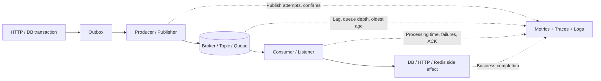
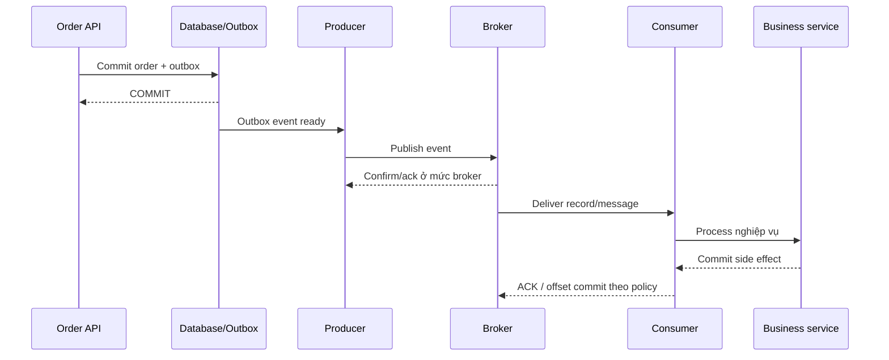
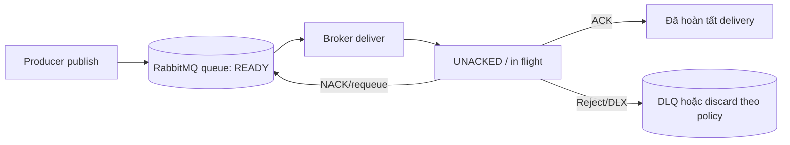
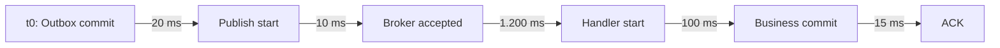
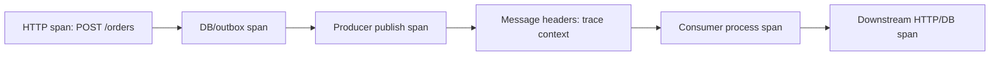
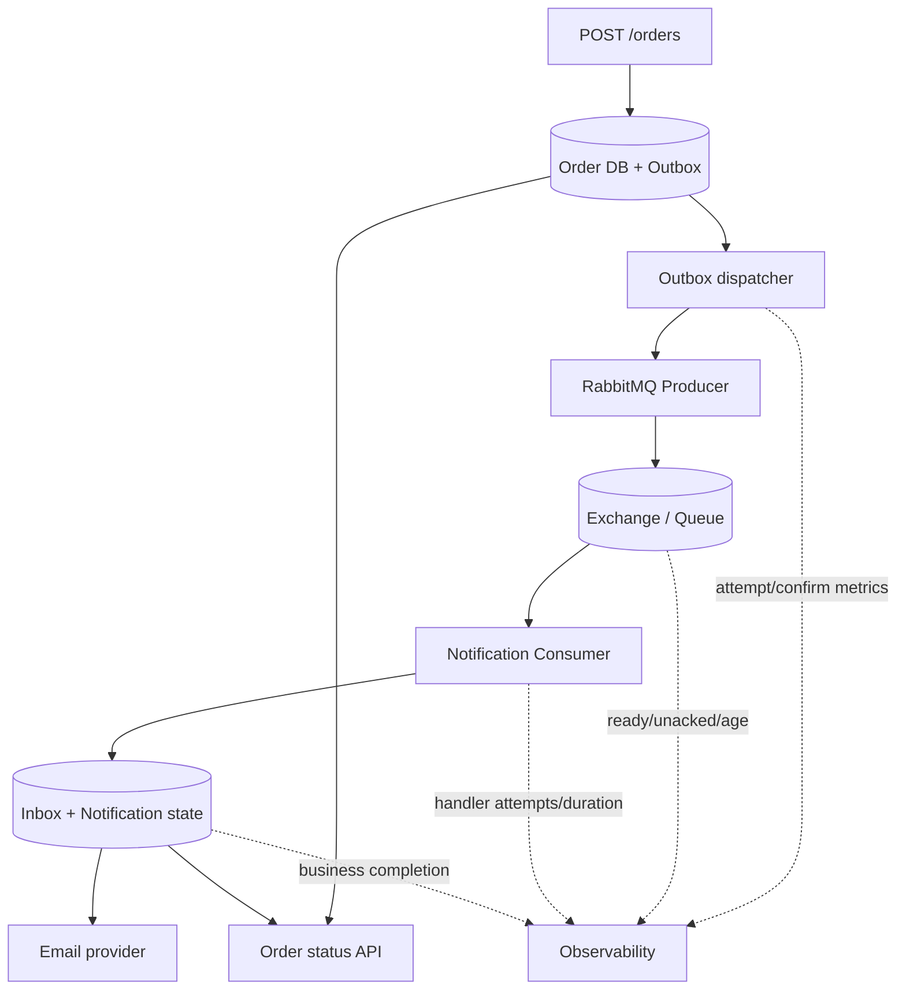

# Producer, consumer, lag, hàng đợi và thời gian xử lý

## 1. Quan sát tích hợp là quan sát một công việc xuyên nhiều ranh giới

Trong mô-đun **SPRING_BOOT_INTEGRATION**, Spring Boot không chỉ trả lời HTTP request: nó gọi downstream APIs, truy cập cơ sở dữ liệu và Redis, xuất bản sự kiện qua broker, nhận message trong Spring Integration và chạy các công việc bất đồng bộ. Khi một đơn hàng đã được tạo nhưng email chưa tới, câu hỏi quan trọng không phải chỉ là **“RabbitMQ/Kafka có đang chạy không?”**, mà là:

- Producer có thực sự phát sinh sự kiện và broker có xác nhận nhận publish không?
- Sự kiện đã được route vào queue/topic/partition đúng chưa?
- Consumer đã nhận message chưa, đang xử lý, lỗi hay chờ redelivery?
- Backlog/lag đang tăng vì producer nhanh hơn consumer, vì consumer dừng, hay vì downstream database/API chậm?
- **Thời gian chờ trong queue** và **thời gian xử lý thực** chiếm bao nhiêu trong tổng độ trễ?
- Message đã được ACK/commit offset có đồng nghĩa nghiệp vụ đã hoàn thành chưa?
- Khi một message được xử lý lại, metric đếm **attempt** hay **business operation duy nhất**?

Một cách nhìn đầy đủ phải nối **producer → broker/queue → consumer → business side effect** và đo tại từng ranh giới. Với hệ thống quan trọng, còn cần trạng thái bền vững của business operation (order, report job, outbox/inbox) để đối chiếu kết quả cuối.



Bài tập trung vào đề bài **“Producer, consumer, lag, hàng đợi và thời gian xử lý”** của chương **Quan sát tích hợp**. Các minh họa chủ yếu dùng **Spring Boot 3.x**, Spring AMQP/RabbitMQ, Spring for Apache Kafka, Spring Integration và **Micrometer/Actuator**. Tên metric tích hợp sẵn khác nhau theo thư viện, phiên bản và monitoring backend; những metric tự tạo trong bài có tên riêng để tránh nhầm với tên framework bảo đảm mặc định.

## 2. Xác định các mốc thời gian trước khi viết dashboard

Một sự kiện có thể đi qua nhiều bước:



Các mốc cần phân biệt:

| Mốc | Ý nghĩa | Đo/quan sát bằng gì? |
| --- | --- | --- |
| `t_created` | Sự kiện nghiệp vụ được tạo, ví dụ OrderCreated | Outbox/event metadata |
| `t_publish_start` | Producer bắt đầu một lần publish | Timer tại adapter |
| `t_broker_accepted` | Broker xác nhận publish theo cơ chế của transport | Publisher confirm/callback hoặc producer acknowledgment |
| `t_delivered` | Broker giao record/message cho consumer | Listener/container hoặc client instrumentation |
| `t_handler_start` | Business handler bắt đầu công việc | Timer tại handler |
| `t_business_commit` | Business state được commit | Database/service instrumentation |
| `t_ack_or_commit` | Consumer ACK message hoặc commit offset | Broker/client/consumer instrumentation |
| `t_completed` | Logical business operation đạt trạng thái cuối đã định nghĩa | Business database/job status |

**Không trộn các mốc này thành một loại “thành công”.** Producer publish thành công không có nghĩa queue đã được tiêu thụ; consumer nhận message không có nghĩa business transaction đã commit; ACK/offset commit cũng không tự chứng minh side effect HTTP/email của downstream đã hoàn tất.

### 2.1. Ba loại latency quan trọng

- **Publish latency:** khoảng thời gian từ khi gửi publish attempt đến tín hiệu được định nghĩa (ví dụ broker confirm). Đừng gộp thời gian outbox nằm chờ vào latency của RabbitTemplate nếu mục tiêu là đo riêng broker.
- **Queueing/wait latency:** khoảng thời gian message đã sẵn sàng để consume nhưng chưa bắt đầu handler. Với Kafka, phải định nghĩa rõ timestamp của record và thời điểm bắt đầu xử lý.
- **Processing latency:** thời gian thực thi handler, hoặc thời gian từ handler start đến **business commit**, tùy SLI. Hai mốc này có thể khác nhau khi có async callback.
- **End-to-end completion latency:** từ lúc nhận/tạo logical operation đến khi trạng thái nghiệp vụ thực sự hoàn thành; bao gồm outbox wait, publish, queue, retry và side effects.

Một dashboard chỉ có **handler duration = 50 ms** có thể cho kết quả đẹp trong khi message đã nằm chờ **20 phút** trong queue. Đo từng tầng và tổng thể để nhìn ra nghẽn.

## 3. Đo producer: invocation, publish result và broker acknowledgment

Producer thường được viết với `RabbitTemplate`, `KafkaTemplate`, JMS template hoặc Spring Integration outbound adapter. Tối thiểu nên phân biệt:

1. **Logical events created:** số event mới được tạo trong business/outbox, mỗi event ID chỉ tính một lần.
2. **Publish attempts:** số lần producer cố gửi, bao gồm retry.
3. **Publish invocation errors:** exception xảy ra khi encode/submit/sending.
4. **Broker acknowledgments/confirms:** broker báo chấp nhận hoặc từ chối publish theo cơ chế tương ứng.
5. **Unroutable/returned messages:** broker nhận publish nhưng không tìm được queue phù hợp khi có return mechanism.
6. **Publish retries/exhaustion:** số attempts bổ sung và sự kiện không thể gửi theo budget.
7. **Outbox backlog:** số event đã commit trong DB nhưng chưa được phát thành công theo tiêu chí đã định.

### 3.1. Bảng tránh đánh đồng các tín hiệu

| Tín hiệu | Chứng minh điều gì? | Chưa chứng minh điều gì? |
| --- | --- | --- |
| `RabbitTemplate.convertAndSend` trả về | Lời gọi đã kết thúc mà không ném exception đồng bộ | Broker đã lưu, route, consumer xử lý |
| RabbitMQ publisher confirm ACK | Broker xác nhận publish theo cơ chế confirm | Consumer đã xử lý thành công |
| RabbitMQ returned message | Trong điều kiện mandatory/returns, publish không route được như kỳ vọng | Một consumer khác có thể xử lý một publish khác |
| Kafka producer callback thành công | Record được broker xác nhận theo producer `acks`/configuration | Consumer group đã xử lý, business DB đã commit |
| Outbox row `PENDING` | Event đã được ghi nhận bền vững trong DB nếu transaction commit | Đã publish hoặc sẽ được xử lý ngay |
| HTTP 202 từ API | API tuyên bố đã nhận công việc theo contract | Worker đã hoàn thành |

**Số publish attempts có thể lớn hơn số logical events** khi network timeout, broker failover hoặc producer retry. Nên đo cả hai và không tính mỗi attempt là một đơn hàng mới.

### 3.2. Đếm producer thành công sai cách

Sai:

```java
rabbitTemplate.convertAndSend(exchange, routingKey, event);
meterRegistry.counter("orders.published.success").increment();
```

Bộ đếm trên đúng nhất chỉ diễn đạt **method không ném lỗi đồng bộ**; tên `published.success` dễ khiến người vận hành hiểu rằng broker đã xác nhận và event đã đến queue. Tốt hơn là đặt tên metric theo **giai đoạn thực sự quan sát được** như `integration.publish.invocations` và đo xác nhận broker qua callback/future độc lập.

### 3.3. Những lỗi có thể xảy ra trước broker

- Serialize JSON thất bại: event payload/schema sai.
- Secret/TLS/DNS sai: không thiết lập được kết nối.
- Channel/connection pool cạn: blocked hoặc timeout.
- Producer bị rate-limit/backpressure ở adapter.
- Broker accepted nhưng ACK/confirm đến muộn hoặc thất lạc.
- Routing key/exchange/binding sai làm message không đến queue mong muốn.

Cần phân loại các lỗi này; tăng retry không giúp chữa JSON schema lỗi vĩnh viễn hoặc credential sai.

## 4. RabbitMQ producer: confirms, returns, rate và độ trễ

Một cấu hình Spring Boot minh họa cho publisher confirm và return:

```yaml
spring:
  rabbitmq:
    publisher-confirm-type: correlated
    publisher-returns: true
    template:
      mandatory: true
```

- **Confirm ACK/NACK** giúp theo dõi trạng thái broker chấp nhận publish.
- **Return** hữu ích khi publish không route vào queue nào theo điều kiện `mandatory` phù hợp.
- Một publish có thể được confirm ACK trong khi bị return vì exchange đã xử lý publish nhưng không route được.
- Nếu producer mất confirm sau khi broker đã nhận message, một retry có thể gửi **bản trùng**. Consumer phải có idempotency.

Ví dụ callback được cấu hình **một lần tại điểm sở hữu telemetry**:

```java
package example.integration.observability;

import io.micrometer.core.instrument.MeterRegistry;
import org.springframework.amqp.rabbit.core.RabbitTemplate;
import org.springframework.stereotype.Component;

@Component
public class RabbitPublisherSignals {

    public RabbitPublisherSignals(
            RabbitTemplate template,
            MeterRegistry meters) {

        template.setConfirmCallback((correlation, ack, cause) -> {
            meters.counter(
                "integration.publish.confirmations",
                "broker", "rabbitmq",
                "result", ack ? "ack" : "nack"
            ).increment();

            // correlation.getId() có thể dùng để tìm outbox event
            // trong logs/traces; không làm metric tag.
        });

        template.setReturnsCallback(returned -> {
            meters.counter(
                "integration.publish.returns",
                "broker", "rabbitmq",
                "reason", "unroutable"
            ).increment();
        });
    }
}
```

Code chỉ ghi nhận **broker signals**. Nó chưa triển khai outbox transition, publisher thread-safety, confirm timeout hoặc xử lý lỗi cập nhật DB. `RabbitTemplate` có callback chung; nếu dự án đã có component khác gọi `setConfirmCallback`/`setReturnsCallback`, phải phối hợp thay vì âm thầm ghi đè. Với các phiên bản hỗ trợ `CorrelationData#getFuture()`, có thể tổ chức theo dõi confirm cho từng publish.

### 4.1. Độ trễ producer cần đo đến đâu?

Timer gọi `convertAndSend(...)` đo thời gian **từ trước đến sau method return**, nhưng broker confirm thường đến bất đồng bộ. Nếu muốn đo **publish-to-confirm**, phải lưu mốc bắt đầu theo publish correlation ID và dừng timer khi nhận confirm/future, có cleanup khi timeout hoặc khi process restart.

Không gắn `eventId` lên metric timer. Có thể dùng correlation data để tìm event trên logs/traces và chỉ tag metric bằng các giá trị ít cardinality như `broker=rabbitmq`, `operation=order_created`, `result=ack/nack/timeout`.

### 4.2. Tình huống broker blocked

RabbitMQ có thể áp memory/disk alarms và chặn hoặc làm chậm producer. Khi đó cần xem **publish-to-confirm latency**, số connection bị block, queue ingress và disk/memory broker. Tăng số producer instances có thể khiến áp lực broker lớn hơn. Cần rate limiting, outbox backlog, retry budget và cảnh báo capacity.

## 5. Kafka producer: retries, acks và thời gian đợi tại client

Với Spring Kafka, `KafkaTemplate.send(...)` thường trả `CompletableFuture<SendResult<K,V>>` trong dòng API tương thích. Một future hoàn tất thành công là tín hiệu producer nhận được response theo Kafka producer configuration; đó **không phải** consumer completion.

Ví dụ:

```java
package example.integration.observability;

import io.micrometer.core.instrument.MeterRegistry;
import java.util.concurrent.CompletableFuture;
import org.apache.kafka.clients.producer.ProducerRecord;
import org.springframework.kafka.core.KafkaTemplate;
import org.springframework.stereotype.Component;

@Component
public class OrderKafkaPublisher {

    private final KafkaTemplate<String, String> kafka;
    private final MeterRegistry meters;

    public OrderKafkaPublisher(
            KafkaTemplate<String, String> kafka,
            MeterRegistry meters) {
        this.kafka = kafka;
        this.meters = meters;
    }

    public CompletableFuture<Void> publish(
            String eventId, String json) {

        ProducerRecord<String, String> record =
            new ProducerRecord<>(
                "orders.events",
                eventId,
                json
            );

        meters.counter(
            "integration.publish.invocations",
            "broker", "kafka",
            "operation", "order_created"
        ).increment();

        return kafka.send(record)
            .handle((result, error) -> {
                meters.counter(
                    "integration.publish.outcomes",
                    "broker", "kafka",
                    "result", error == null ? "ack" : "error"
                ).increment();

                if (error != null) {
                    throw new java.util.concurrent.CompletionException(
                        error
                    );
                }
                return null;
            });
    }
}
```

Ví dụ giả định Kafka producer và serializer đã được cấu hình để nhận `String` key/value; `json` là JSON đã được validate/serialize theo contract. `eventId` được dùng làm key để hỗ trợ partitioning/deduplication, **không bảo đảm Kafka tự loại mọi bản trùng ở consumer**.

### 5.1. Kafka client metrics không đồng nghĩa metric nghiệp vụ

Kafka producer/JMX/Micrometer có thể cung cấp các tín hiệu như:

- record send rate, record error rate và retry rate;
- request latency, batch size, buffer pool wait;
- record queue time trong client trước khi gửi;
- số record/batches được broker phản hồi theo `acks`.

Tên meter thực tế, tags và mức độ được Spring Boot/Kafka client expose phụ thuộc version và instrumentation. **Không tự viết alert theo một metric name chưa xuất hiện trên endpoint monitoring thực tế**.

### 5.2. Producer acks khác durability theo SLA

`acks=all` và idempotent producer có thể nâng độ tin cậy ở tầng Kafka tùy broker/topic configuration. Nhưng vẫn có failure windows giữa **database commit – Kafka publish – consumer side effect**. Với business event quan trọng, transactional outbox và consumer inbox/reconciliation vẫn là những công cụ hữu ích.

Nếu callback thất bại sau timeout, phải phân biệt “broker chắc chắn từ chối” và “không biết chắc đã ghi hay chưa”. Retry cần giữ business `eventId` ổn định.

## 6. Quan sát consumer: received, processing, commit/ack và final outcome

Consumer không chỉ có số message “đọc được”. Một listener có thể:

- Nhận message nhưng chưa bắt đầu business logic.
- Decode JSON thất bại **trước khi handler được gọi**.
- Gọi downstream HTTP và chờ timeout.
- Commit database thành công, sau đó chết trước broker ACK.
- ACK/commit offset nhưng job thực sự vẫn `PENDING` ở một hệ thống khác.
- Nhận lại cùng event ID và bỏ qua nhờ inbox/deduplication.
- Hết retry và chuyển message sang DLQ.

Vì vậy cần đo **ít nhất hai lớp**:

1. **Transport attempts:** deliveries/polls, listener invocations, acks/commits, retries, redeliveries.
2. **Business outcomes:** số event duy nhất được xử lý thành công, duplicate được bỏ qua, permanently failed, retry pending và completion latency.

| Tín hiệu | Ý nghĩa | Có thể gây nhầm |
| --- | --- | --- |
| Messages delivered | Broker giao message cho consumer | Chưa có xử lý |
| Listener invocations | Handler bắt đầu chạy | Có thể là cùng message lần thứ N |
| Business commits | Ghi nhận thay đổi nghiệp vụ bền vững | Chưa chắc broker ACK thành công |
| Broker ACK / committed offset | Consumer tiến trạng thái giao nhận | Không chứng minh mọi side effect bên ngoài đã hoàn tất |
| Redelivery/retry | Message được chạy lại | Không nhất thiết là một logical event mới |
| DLQ count | Message đã được cách ly theo policy | Không chứng minh đã được người vận hành xử lý |
| Inbox duplicates | Nhận lại một event đã xử lý | Có thể là cơ chế bảo vệ đang hoạt động đúng |

### 6.1. Timer đặt trước hay sau chuyển đổi JSON?

Đo timer **trong method `@RabbitListener`** thường bỏ qua thời gian broker delivery, adapter conversion và những lỗi xảy ra trước khi method được gọi. Nếu cần latency của toàn listener container, sử dụng instrumentation ở mức container/observation được cấu hình tương ứng.

Tương tự, timer quanh `@KafkaListener` có thể đo business handler, nhưng không mặc nhiên bao gồm poll, deserialization, rebalance, fetch wait hoặc commit offset.

**Đặt tên metric theo phạm vi đo thực tế**: `consumer.handler.duration` khác `consumer.end_to_end.duration`.

## 7. Kafka consumer lag: công thức, cách đọc và giới hạn

**Kafka consumer lag** thường được hiểu là số records của một consumer group **chưa được đánh dấu đã xử lý qua committed offsets**, tính theo từng partition.

Một cách tính thông dụng:

\[
\text{lag}_{g,p} =
\max(0,\; \text{endOffset}_{p} - \text{committedOffset}_{g,p})
\]

Trong đó:

- `g`: consumer group;
- `p`: partition;
- `endOffset`: offset cuối theo API được dùng để đo (thường là offset của record tiếp theo tại cuối log có thể thấy, không phải ID event);
- `committedOffset`: offset **tiếp theo cần đọc** mà group đã lưu;
- `lag`: số lượng record còn nằm sau điểm committed theo cách tính đó.

Ví dụ:

```text
Topic: orders.events, partition 2
End offset              = 1.250
Committed group offset  = 1.200
Lag group/partition     =    50 records
```

Nếu topic có ba partitions, lag tổng của group thường là tổng các partition **khi tất cả cùng được quan sát nhất quán**. Partition có lag lớn có thể bị che khuất khi chỉ nhìn tổng.

### 7.1. Lag dựa trên committed offset khác lag tại vị trí poll

Kafka consumer có `position` (vị trí tiếp theo consumer sẽ fetch) và `committed offset` (vị trí đã lưu cho group). Hai giá trị **không phải lúc nào cũng giống nhau**.

Ví dụ consumer đã poll 100 records vào memory, nên position có thể tiến nhanh; nhưng nếu business handler còn xử lý và offset chưa commit, lag theo committed offset vẫn cao. Một số Kafka client metrics (ví dụ `records-lag-max`) phản ánh lag tại consumer theo cách đo riêng của client, **không nhất thiết trùng** với phép tính exporter dựa trên committed offsets.

Khi đọc dashboard, cần biết metric đến từ:

- Broker/consumer group offset exporter;
- Kafka consumer client/JMX;
- Spring Kafka listener/observation;
- Monitoring platform tự tính từ partitions/offsets.

Không gộp những con số đó thành một loại SLI nếu chưa xác nhận cách tính.

### 7.2. Lag bằng 0 có thể là tín hiệu giả yên tâm

Các trường hợp:

1. Topic đang không có dữ liệu mới nhưng job nghiệp vụ vẫn ở trạng thái `FAILED`.
2. Consumer commit offset **trước** khi transaction/business side effect hoàn tất.
3. Message đã bị filter/drop theo policy mà không tạo outcome cần thiết.
4. Consumer đang chạy nhanh nhưng producer source/outbox bị kẹt nên không có event mới vào Kafka.
5. Consumer group không tồn tại hoặc chưa commit offset; monitoring cần xử lý trạng thái **unknown** thay vì hiển thị 0 một cách mặc định.

**Kafka lag đo tiến độ tiêu thụ log, không tự đo business completeness.** Với event quan trọng, dùng inbox/outbox cùng metric business result để đối chiếu.

### 7.3. Lag theo số records khác lag theo thời gian

`lag = 1.000` có thể là vài giây trong nhóm xử lý 10.000 records/s, nhưng là nhiều giờ nếu xử lý 1 record/s. Muốn đo độ trễ người dùng cảm nhận, cần thêm:

- **Age của record cũ nhất chưa xử lý**, theo timestamp/processing checkpoint có hợp đồng rõ;
- **Time behind head**, tính theo thời gian khi dữ liệu được tạo/đưa vào log;
- **End-to-end completion age** từ business event đến business status cuối.

Kafka record timestamp có thể là `CreateTime` hoặc `LogAppendTime` tùy topic/broker; đồng hồ producer và consumer có thể lệch. Không xem một timestamp tùy ý là đo queueing latency chính xác tuyệt đối.

## 8. RabbitMQ: ready, unacked và hàng đợi khác Kafka lag

RabbitMQ queue thường cung cấp:

- **Ready messages:** message đang nằm trong queue, sẵn sàng để giao cho consumer.
- **Unacknowledged messages:** message đã giao nhưng chưa được ACK/NACK hoàn tất theo trạng thái broker.
- **Total messages:** trong cách hiển thị phổ biến, gần với tổng `ready + unacked`; tùy API/queue type và snapshot thời điểm có thể có khác biệt quan sát.
- **Publish/deliver/ack/redeliver rates:** tốc độ ở từng điểm.
- **Consumers/connection/channel state:** hiện có consumer nào và broker có gặp giới hạn tài nguyên không.



RabbitMQ **không dùng consumer group committed offsets như Kafka**, nên không có “lag records” tương đương trực tiếp. Hãy diễn đạt RabbitMQ backlog bằng `ready`, `unacked`, tuổi message và tốc độ xử lý.

### 8.1. Queue ready = 0 chưa chắc là khỏe

Giả sử:

```text
ready             = 0
unacked           = 500
consumer count    = 5
ack rate          = 0 messages/s
oldest inflight   = 10 minutes
```

Broker đã giao hết message, nhưng consumer có thể đang bị treo ở HTTP/DB hoặc prefetch quá lớn. Chỉ nhìn `ready=0` sẽ che vấn đề. Cần theo dõi đồng thời `unacked`, handler duration, timeouts, acknowledgments và consumer concurrency/prefetch.

### 8.2. Ready cao, unacked thấp nói điều gì?

Có thể:

- Không có consumer hoặc consumer chưa subscribe được.
- Consumer quá ít so với tốc độ producer.
- Broker tạm dừng giao do connection/channel/flow control.
- Queue binding/routing có lưu lượng bất thường.
- Listener crash, requeue loop hoặc dependency downstream chậm.

Không tự tăng prefetch/concurrency khi database đang quá tải. Tăng unacked có thể làm số message giữ trong memory của consumer lớn hơn mà không tăng số business commits.

### 8.3. Tuổi message không phải lúc nào cũng có sẵn

Nhiều monitoring setups có `messages_ready` và `messages_unacknowledged` nhưng **không cung cấp ngay tuổi message đầu queue theo đúng business event time**. Muốn đo tuổi, có thể:

- Mang `occurredAt`/`enqueuedAt` trong hợp đồng event;
- Đo tại consumer lúc bắt đầu xử lý;
- Ghi event/job status trong database và đo oldest pending age;
- Dùng plugin/queue telemetry được hỗ trợ và kiểm chứng semantics.

Không tạo một Prometheus alert “oldest_message_age” từ metric không tồn tại hoặc từ timestamp không thể so sánh qua host clocks.

## 9. JMS/Artemis và Spring Integration: backlog phải theo đúng transport

JMS có `JMSMessageID`, `JMSCorrelationID` và semantics acknowledgment/transaction riêng. Artemis/ActiveMQ có queue depth, delivering count, consumer count, scheduled messages và DLQ theo cơ chế quản trị broker.

Không copy công thức Kafka `end offset - committed offset` sang JMS queue. Khi lập dashboard cho JMS:

- Đếm messages enqueued/dequeued/acknowledged theo broker;
- Quan sát queued/delivering/expired/DLQ;
- Đo handler/transaction processing time ở ứng dụng;
- Theo dõi transaction rollback/redelivery, broker failover;
- Gắn business message ID ổn định khi cần deduplication.

Với **Spring Integration** trong cùng process:

| Channel | Đo điều gì? | Rủi ro quan sát |
| --- | --- | --- |
| `DirectChannel` | Send/handler duration, exception ở caller | Gọi sync, không có queue backlog |
| `ExecutorChannel` | Task acceptance, executor active/queue/rejections, worker errors | `send()` thành công không chứng minh handler đã xong |
| `QueueChannel` | Channel queue depth, receive wait, poller rate | In-memory queue không tự bền qua restart |
| `PublishSubscribeChannel` | Fan-out/subscriber latency, error handling | Một logical message có thể tạo nhiều handler attempts |
| JDBC/AMQP/Kafka adapter | Adapter I/O, broker/client metrics, error channel | Handler metrics và broker metrics có thể đếm khác giai đoạn |

Spring Integration có khả năng quản lý, đo lường và observation cho nhiều endpoint/channel tùy cấu hình. Trên phiên bản đang dùng, hãy xác minh **component instrumentation thực sự bật** và có meter/observation cụ thể, thay vì tin mỗi channel được tạo sẽ tự xuất mọi metric.

## 10. Phân rã latency: publish, queue wait, processing và end-to-end

Một timeline minh họa cho sự kiện `OrderCreated`:

| Mốc thời gian | Hành động |
| --- | --- |
| 09:00:00.000 | Order DB commit và outbox event `evt-1024` sẵn sàng |
| 09:00:00.020 | Publisher bắt đầu gửi |
| 09:00:00.030 | Broker chấp nhận/confirm |
| 09:00:01.230 | Consumer bắt đầu handler |
| 09:00:01.330 | Business DB commit |
| 09:00:01.345 | ACK/offset commit hoàn tất |

Với giả định đồng hồ các thành phần đồng bộ và các mốc phản ánh chính xác giai đoạn cần đo:

- **Outbox-to-publish-start:** 20 ms.
- **Publish-to-confirm:** 10 ms.
- **Broker-accept-to-handler-start:** 1.200 ms.
- **Handler-start-to-business-commit:** 100 ms.
- **Commit-to-ack:** 15 ms.
- **Outbox-to-ack:** 1.345 ms.



Nhìn chỉ số **handler = 100 ms** có thể khiến ta tối ưu database vô ích; phần lớn độ trễ là **queue wait = 1.200 ms**.

### 10.1. Dùng đồng hồ đúng cách

Trong **cùng JVM**, đo duration bằng `Timer`/clock đơn điệu do instrumentation hỗ trợ thay vì trừ hai chuỗi timestamp từ system clock. Trong **hai máy khác nhau**, lấy timestamp producer rồi trừ timestamp consumer phụ thuộc NTP/clock skew và semantics của timestamp.

Khi đo cross-process duration:

1. Định nghĩa event `occurredAt` và mốc “enqueued/accepted” rõ.
2. Giám sát độ lệch đồng hồ.
3. Gắn metric với mức sai số chấp nhận được.
4. Không cho duration âm vì clock skew làm hỏng thống kê.
5. Với SLO cực chặt, cân nhắc hệ thống ghi mốc trạng thái trong một nguồn authoritative hoặc dùng trace có ngữ nghĩa được kiểm chứng.

### 10.2. Queueing delay có thể gồm nhiều hàng chờ

Trong một workflow có outbox và broker:

```text
DB outbox PENDING
   ↓ chờ dispatcher
Producer client buffer
   ↓ chờ gửi/ACK
Broker queue / topic
   ↓ chờ consumer
Consumer poll/prefetch buffer
   ↓ chờ worker
Handler
   ↓ chờ HTTP/DB/Redis
Business commit
```

Không gọi tổng các hàng chờ đó là “RabbitMQ queue wait” nếu dữ liệu chỉ cho thấy event được tạo lâu trước lúc consumer bắt đầu. Đặt nhãn metric đủ cụ thể để hành động khắc phục đúng tầng.

## 11. Công suất xử lý: arrival rate, service rate và tốc độ tích lũy backlog

Một công thức thực dụng khi có dòng dữ liệu đến liên tục:

\[
\Delta B \approx (\lambda - \mu)\times \Delta t
\]

Trong đó:

- `B`: số công việc còn tồn;
- `λ`: producer arrival rate (events/s);
- `μ`: consumer **completion rate** (events/s), tốt nhất là business completion chứ không chỉ delivery;
- `Δt`: khoảng thời gian quan sát.

Ví dụ producer gửi 900 events/s nhưng consumer hoàn thành 600 events/s. Trong 10 phút, nếu tốc độ giữ ổn định và không có throttle/drop:

\[
\Delta B \approx (900-600)\times 600=180{,}000
\]

Backlog tăng khoảng **180.000 events**, dù cả producer và consumer vẫn “UP”.

### 11.1. Ước lượng thời gian xả hàng đợi

Nếu producer dừng và consumer hoàn thành ổn định 600 events/s, backlog 180.000 events cần khoảng:

\[
T_{\text{drain}}\approx \frac{180{,}000}{600}=300\text{ s}=5\text{ phút}
\]

Nếu producer vẫn gửi 400 events/s, **tốc độ xả ròng** chỉ còn 200 events/s, nên thời gian khoảng 900 giây (15 phút), bỏ qua retry, burst và thay đổi capacity.

Con số này là **dự báo có điều kiện**, không nên coi là thời gian thực đảm bảo. Kafka partitions, DB locks, poison messages, retry delays và nhu cầu giữ ordering đều có thể làm throughput biến động.

### 11.2. Little's Law: đừng dùng không điều kiện

Ở hệ thống tương đối ổn định, với arrival/completion rate `λ` và thời gian trung bình một item ở hệ thống `W`:

\[
L=\lambda W
\]

`L` là số item trung bình ở phạm vi đo; `W` là thời gian trung bình từ vào đến ra ở **cùng phạm vi**. Công thức cần giả định steady state/flow conservation và số đo nhất quán. Không dùng trực tiếp khi backlog đang tăng nhanh, có retry amplification hoặc job bị mất mà không đối chiếu.

### 11.3. Lựa chọn scale

| Dấu hiệu | Hành động đáng cân nhắc | Cảnh báo |
| --- | --- | --- |
| Kafka lag tăng trên tất cả partitions | Thêm capacity consumer, tối ưu handler | Consumer group có giới hạn song song theo partition |
| Một partition lag vượt trội | Xem key skew, slow record, ordering | Thêm consumer không giúp nếu partition vẫn chỉ một assignment |
| RabbitMQ ready tăng, unacked thấp | Xem consumer count/connection, rate | Chưa chắc chỉ cần tăng prefetch |
| RabbitMQ unacked tăng, ACK rate giảm | Xem handler timeout, database/HTTP saturation | Tăng prefetch làm dữ liệu in-flight nhiều hơn |
| Consumer CPU cao | Tối ưu JSON, batch I/O, tăng worker khi có headroom | Kiểm tra GC/memory |
| DB pool wait cao | Tune query/connection/throughput, backpressure | Tăng consumer chỉ tăng tranh chấp |
| Producer confirm latency tăng | Xem broker memory/disk alarms, network | Retry nóng làm nặng sự cố |

**Scale consumer chỉ có tác dụng nếu bottleneck thực sự nằm tại consumer và downstream còn capacity**. Muốn giữ thứ tự theo một business key, tăng partitions/consumers còn phải xét semantics ordering và migration keys.

## 12. Spring Boot Actuator và Micrometer: nền tảng đo lường

Một ứng dụng Spring Boot nên có cơ chế thống nhất xuất metrics, traces và logs. **Micrometer** cung cấp API meter, Spring Boot Actuator tích hợp xuất chỉ số theo registry phù hợp.

Dependency Maven minh họa:

```xml
<dependency>
    <groupId>org.springframework.boot</groupId>
    <artifactId>spring-boot-starter-actuator</artifactId>
</dependency>
<dependency>
    <groupId>io.micrometer</groupId>
    <artifactId>micrometer-registry-prometheus</artifactId>
    <scope>runtime</scope>
</dependency>
```

Có thể dùng backend khác như OTLP/Graphite/Datadog theo hạ tầng; không bắt buộc Prometheus. Cấu hình ví dụ:

```yaml
spring:
  application:
    name: order-service

management:
  endpoints:
    web:
      exposure:
        include: health,info,prometheus
  metrics:
    tags:
      application: ${spring.application.name}
```

Cấu hình trên chỉ minh họa xuất `/actuator/prometheus` khi có Prometheus registry phù hợp. **Không công khai endpoint Actuator/Prometheus ra Internet không có xác thực hoặc giới hạn mạng.** Trong production, có thể dùng management port/network riêng, authentication và scraping policy.

### 12.1. Counter, Timer, Gauge, DistributionSummary dùng đúng mục đích

| Meter | Dùng cho | Ví dụ |
| --- | --- | --- |
| `Counter` | Sự kiện tích lũy; hệ thống giám sát tính rate trên khoảng thời gian | publish attempts, consumer failures, DLQ sends |
| `Timer` | Thời gian xử lý một phạm vi cụ thể; có count/total time | handler duration, publish-to-confirm |
| `Gauge` | Trạng thái tức thời do một nguồn cập nhật | current outbox pending, active jobs |
| `DistributionSummary` | Phân phối giá trị không phải duration | payload byte size, batch item count |
| `LongTaskTimer` | Công việc kéo dài mà muốn xem đang chạy, elapsed time | batch job chạy nhiều phút |

Không lấy `Timer.count` để thay số business events duy nhất nếu handler có retry; nó đo số lần timer được dừng, tức thường là **số invocations/attempts**.

### 12.2. Mẫu tên meter và tags

Các tên **do ứng dụng tự định nghĩa** trong bài:

```text
integration.publish.invocations
integration.publish.confirmations
integration.publish.returns
integration.consumer.attempts
integration.consumer.processing.duration
integration.business.completions
integration.outbox.pending
integration.jobs.active
```

Tags ít cardinality nên là:

```text
broker = rabbitmq | kafka
operation = order_created | notification_sent | report_exported
result = success | transient_failure | permanent_failure | duplicate
consumer = notification_service | billing_service
```

Tránh:

```text
eventId = evt-1024
orderId = ord-1024
userId = cus-17
url = /orders/ord-1024
exceptionMessage = "requestId=..."
```

Những giá trị này tạo hàng triệu time series, có thể gây quá tải metrics backend và rò PII. Đưa ID vào trace/log có kiểm soát, không dùng làm metric label.

## 13. Ví dụ code: đo consumer business handler bằng Timer và Counter

Giả sử Notification Service nhận `OrderCreatedEvent` qua RabbitMQ. Một metric cần trả lời: **handler mất bao lâu và tỷ lệ thành công/thất bại theo từng attempt?**

DTO và business service:

```java
package example.integration.notifications;

public record OrderCreatedEvent(
    String eventId,
    String orderId,
    int schemaVersion
) {}

public interface OrderHandler {
    void processIdempotently(OrderCreatedEvent event);
}
```

Listener minh họa:

```java
package example.integration.notifications;

import io.micrometer.core.instrument.MeterRegistry;
import io.micrometer.core.instrument.Timer;
import org.springframework.amqp.rabbit.annotation.RabbitListener;
import org.springframework.stereotype.Component;

@Component
public class OrderEventConsumer {

    private final OrderHandler handler;
    private final MeterRegistry meters;

    public OrderEventConsumer(
            OrderHandler handler,
            MeterRegistry meters) {
        this.handler = handler;
        this.meters = meters;
    }

    @RabbitListener(queues = "notification.order-created")
    public void onEvent(OrderCreatedEvent event) {
        Timer.Sample sample = Timer.start(meters);
        String outcome = "success";

        try {
            if (event == null
                    || event.eventId() == null
                    || event.schemaVersion() != 1) {
                outcome = "permanent_failure";
                throw new IllegalArgumentException(
                    "Invalid OrderCreated event"
                );
            }

            handler.processIdempotently(event);
        } catch (RuntimeException ex) {
            if ("success".equals(outcome)) {
                outcome = "failure";
            }
            throw ex;
        } finally {
            sample.stop(
                Timer.builder(
                    "integration.consumer.processing.duration"
                )
                .description("Time spent in OrderCreated handler")
                .tag("consumer", "notification_service")
                .tag("result", outcome)
                .register(meters)
            );

            meters.counter(
                "integration.consumer.attempts",
                "consumer", "notification_service",
                "result", outcome
            ).increment();
        }
    }
}
```

**Phạm vi đo:** từ lúc method được gọi đến khi handler return/throw. Timer chưa bao gồm message nằm chờ trong broker, JSON conversion trước method, broker acknowledgment sau method hoặc email thực sự được gửi nếu `handler` chỉ enqueue thêm một tác vụ.

Nếu `processIdempotently` trả về kết quả phân biệt **newly_processed** với **duplicate_skipped**, hãy ghi outcome riêng cho duplicate; không xem duplicate redelivery là một business event thành công mới. Với lỗi vĩnh viễn, container cần policy DLQ/quarantine; ném `IllegalArgumentException` **không tự tạo DLQ**.

### 13.1. Không dùng high-cardinality tags

Sai:

```java
Timer.builder("integration.consumer.processing.duration")
    .tag("eventId", event.eventId())
    .register(meters);
```

Đúng hơn: tag `consumer`, `event_type` và `result` với allowlist có giới hạn, còn `eventId` được ghi vào structured log/span trong phạm vi quyền và retention đã định.

### 13.2. Đo completion riêng khỏi attempt

Một consumer có thể nhận cùng `eventId` ba lần: attempt 1 timeout, attempt 2 commit thành công, attempt 3 là redelivery duplicate. Khi đó:

```text
consumer attempts                  = 3
business completions (new event)   = 1
duplicate skips                    = 1
transient failures                 = 1
```

Tăng counter `integration.business.completions` **tại điểm business commit thực tế**, sau khi idempotency check và kết quả durable được xác nhận. Nếu tăng trước commit, rollback làm metric ghi success giả. Nếu lấy count từ database success state, phải tránh đếm lại khi job reprocess.

## 14. Đo outbox backlog và “tuổi” sự kiện chưa publish

Nhiều hệ thống có một hàng chờ **trước broker**: transactional outbox table. Nếu publisher chết, Kafka lag có thể bằng 0 và RabbitMQ ready bằng 0, nhưng đơn hàng mới vẫn không phát event.

Bảng outbox minh họa:

```sql
CREATE TABLE integration_outbox (
    event_id VARCHAR(64) PRIMARY KEY,
    event_type VARCHAR(80) NOT NULL,
    status VARCHAR(24) NOT NULL,
    created_at TIMESTAMP WITH TIME ZONE NOT NULL,
    next_attempt_at TIMESTAMP WITH TIME ZONE,
    attempts INTEGER NOT NULL DEFAULT 0,
    payload_json TEXT NOT NULL
);
```

Các truy vấn hữu ích:

```sql
-- Số event còn đợi:
SELECT COUNT(*)
FROM integration_outbox
WHERE status IN ('PENDING', 'RETRY_PENDING');

-- Event đang chờ lâu nhất:
SELECT MIN(created_at)
FROM integration_outbox
WHERE status IN ('PENDING', 'RETRY_PENDING');

-- Số event thất bại theo loại:
SELECT event_type, COUNT(*)
FROM integration_outbox
WHERE status = 'FAILED'
GROUP BY event_type;
```

Đặt tên rõ rằng phép `MIN(created_at)` lấy **thời điểm tạo cũ nhất**, không phải duration. Tuổi `oldest_pending_age` cần tính theo thời điểm quan sát, ví dụ ở DB/query service, với timezone rõ ràng.

### 14.1. Gauge qua query DB phải cẩn thận

Một `Gauge` có callback query `COUNT(*)` trên mỗi lần scrape có thể khiến nhiều replicas đồng thời chạy query đắt trên bảng outbox lớn. Trong production có thể:

- Tạo index phù hợp status/time;
- Lưu/cập nhật một snapshot số lượng/age theo lịch có giới hạn;
- Dùng truy vấn định kỳ có cache và timeout;
- Scrape qua một exporter/job chuyên trách thay vì mọi app instance;
- Phân biệt tổng hợp theo DB với metric per-instance để không cộng trùng.

Nếu mỗi instance trả **cùng số pending toàn bảng**, Prometheus `sum` qua instances sẽ đếm gấp N lần. Hãy xác định ownership và aggregation semantics.

### 14.2. Reconciliation là thước đo correctness

Ngoài `outbox pending`, nên có một job đối soát:

- Order đã commit nhưng không có outbox row tương ứng;
- Outbox marked SENT nhưng không tìm thấy downstream completion sau SLA;
- Business operation FAILED quá lâu chưa được reprocess;
- Duplicate side effect dù inbox đã được thiết kế.

Một hệ thống có queue và lag “đẹp” vẫn có thể mất dữ liệu nghiệp vụ do lỗi ở ranh giới transaction; reconciliation giúp phát hiện.

## 15. Trace và correlation qua producer, broker, consumer

Metrics cho biết xu hướng; **distributed traces** giúp lần theo một logical operation qua nhiều hop. Khi dùng Spring Boot Actuator, Micrometer Observation/Tracing và một tracing bridge/exporter được cấu hình, HTTP clients và một số messaging instrumentations có thể tạo spans/propagate context.

Nhưng **không mặc định mọi Spring Integration adapter, RabbitMQ listener hay Kafka listener đều có tracing được bật**. Tùy phiên bản và cách cấu hình, phải bật observation/instrumentation cho các thành phần tương ứng và xác minh trace context được truyền qua header mapper.



### 15.1. Ba loại ID không nên nhập làm một

| ID | Nguồn tạo | Mục đích |
| --- | --- | --- |
| `traceId` | Tracing instrumentation | Liên hệ spans cho việc chẩn đoán |
| `correlationId` | Gateway/integration contract | Gom các bước theo một request/workflow |
| `eventId` | Business producer/outbox | Dedupe/replay một sự kiện ổn định |
| `messageId` | Transport/framework hoặc app | Định danh message/record theo tầng kỹ thuật |
| `jobId` | Job API/batch store | Truy vấn trạng thái một công việc |

Một event được publish lại có thể tạo **trace span mới** nhưng vẫn phải giữ **eventId** để chống trùng. Không dùng traceId thay thế unique constraint trong inbox.

### 15.2. Propagation đúng và an toàn

Khi gửi message qua broker:

1. Đặt trace context theo instrumentation được hỗ trợ, không tự copy mọi HTTP header.
2. Chỉ forward allowlist headers; không phát tán `Authorization`, cookies hoặc security context object.
3. Giữ `eventId`/`schemaVersion` trong business contract để consumer độc lập với framework tracing.
4. Với retry/redelivery, ghi span/attempt mới phù hợp, liên hệ với event gốc.
5. Nếu tracing bị sampling hoặc exporter down, business flow vẫn phải chạy được.

**MDC/ThreadLocal có thể không tự đi qua ExecutorChannel, Reactor pipeline hoặc thread của listener**. Cần context propagation đúng thư viện và test async boundary, không dựa vào giá trị còn tình cờ trên thread.

### 15.3. Không log raw payload để “điều tra nhanh”

Event có thể chứa PII, dữ liệu thanh toán, credentials hoặc thông tin tenant. Logs/traces nên ghi fields cho phép như event type, schema version, sanitized error category và business IDs với retention/phân quyền phù hợp; không dump tất cả headers, stack traces chứa secrets hoặc raw JSON bodies theo mặc định.

## 16. Dashboard và SLI/SLO theo business outcome

Một dashboard vận hành nên mở theo thứ tự **tình trạng nghiệp vụ → backlog → nguyên nhân kỹ thuật**.

| Panel | Dữ liệu | Câu hỏi trả lời |
| --- | --- | --- |
| Business completion rate | Unique events/jobs hoàn thành theo thời gian | Người dùng có nhận kết quả cuối đúng hạn? |
| End-to-end latency p50/p95/p99 | Từ accepted/created đến completed | SLO có bị vi phạm? |
| Outbox pending + oldest age | Count và tuổi sự kiện chờ publish | Có bị kẹt trước broker không? |
| Producer attempts vs confirmed | Attempts, ACK/NACK, return, timeout | Broker/route có nhận publish không? |
| Broker backlog | Kafka committed-offset lag hoặc RabbitMQ ready/unacked | Event đang chờ/đang in-flight ở đâu? |
| Consumer processing duration | Handler timer by bounded event type/result | Handler chậm hay queue chậm? |
| Consumer success/error/duplicate | Attempts và business outcomes riêng | Retry có làm nhiều side effect không? |
| DLQ / permanent failures | Counts, oldest failed age | Có poison message cần can thiệp? |
| DB/HTTP/Redis dependency health | Latency, error, connection saturation | Bước downstream nào giới hạn throughput? |
| Capacity/utilization | Consumer threads, Kafka partitions, pool wait | Scale có thực sự giúp không? |

### 16.1. Ví dụ SLO có thể kiểm chứng

Thay vì “broker phải nhanh”, hãy định nghĩa:

- **99% `OrderCreated` được Notification Service xử lý thành công trong 2 phút từ lúc order commit.**
- **Không có outbox event PENDING lâu hơn 5 phút**, ngoại trừ cửa sổ bảo trì đã công bố.
- **Tỷ lệ consumer permanent failures nhỏ hơn 0,1%** trên tổng logical events, không tính retries như event mới.
- **Kafka lag/queue age** được giới hạn theo từng consumer quan trọng, không chỉ tổng toàn cluster.

SLO cần định nghĩa denominator, nguồn dữ liệu, timestamp, exclusion rules và cửa sổ thời gian. Nếu chỉ đo các event đã hoàn thành, job “mất tích” sẽ biến khỏi phân phối latency; cần bổ sung oldest pending age và reconciliation.

### 16.2. Alert kết hợp tốt hơn alert một số đơn lẻ

Ví dụ:

- **RabbitMQ ready tăng + ack rate thấp + handler latency tăng** → nghi downstream slow/consumer saturation.
- **RabbitMQ ready tăng + consumer count = 0** → nghi listener down hoặc mất connection.
- **Unacked cao + ack rate gần 0** → kiểm tra stuck handler/prefetch.
- **Kafka committed lag tăng liên tục + consumer rebalance/error** → kiểm tra group assignment và failures.
- **Outbox oldest age tăng + broker backlog vẫn 0** → producer/dispatcher là điểm nghẽn.
- **Business completion thấp + broker lag = 0** → kiểm tra ack/commit semantics, filter/drop và downstream failure.

Không dùng một threshold `lag > 1000` cho mọi topic/queue: throughput và SLO khác nhau. Kết hợp backlog **age**, growth rate và business criticality.

## 17. Kiểm thử instrumentation và đo thời gian đúng phạm vi

### 17.1. Unit test với SimpleMeterRegistry

`SimpleMeterRegistry` giúp xác minh code cập nhật metric mà không cần Prometheus server. Với `OrderEventConsumer` ở mục 13:

```java
package example.integration.notifications;

import static org.assertj.core.api.Assertions.assertThat;

import io.micrometer.core.instrument.simple.SimpleMeterRegistry;
import org.junit.jupiter.api.Test;

class OrderEventConsumerMetricsTest {

    @Test
    void recordsSuccessfulInvocation() {
        SimpleMeterRegistry meters = new SimpleMeterRegistry();

        OrderHandler handler = event -> {
            // Fake business operation chỉ cho unit test.
        };

        OrderEventConsumer consumer =
            new OrderEventConsumer(handler, meters);

        consumer.onEvent(
            new OrderCreatedEvent("evt-1024", "ord-1024", 1)
        );

        var attempts = meters.find(
            "integration.consumer.attempts"
        )
            .tag("consumer", "notification_service")
            .tag("result", "success")
            .counter();

        var duration = meters.find(
            "integration.consumer.processing.duration"
        )
            .tag("consumer", "notification_service")
            .tag("result", "success")
            .timer();

        assertThat(attempts).isNotNull();
        assertThat(attempts.count()).isEqualTo(1.0);

        assertThat(duration).isNotNull();
        assertThat(duration.count()).isEqualTo(1);
    }
}
```

Test này xác minh **custom metrics trong handler**. Nó không kiểm tra JSON conversion trước listener, RabbitMQ delivery/ACK, Kafka offsets hay exporter. Một test failures cần assert metric `result=failure` và rằng exception không bị nuốt.

### 17.2. Integration test với broker thực

Dùng Testcontainers hoặc test broker được quản lý để kiểm tra:

1. Producer gửi event có `eventId` ổn định và schema hợp lệ.
2. Broker xác nhận publish/route theo policy; queue/topic thực sự nhận dữ liệu.
3. Listener nhận, decode, xử lý và commit state.
4. Dùng cùng event ID gửi lại → inbox dedupe; business count vẫn 1.
5. Tạo lỗi handler trước commit → message retry/redelivery có giới hạn.
6. Tạo lỗi JSON trước handler → DLQ/quarantine; handler timer không có mẫu cho message lỗi đó.
7. Producer dừng → outbox pending/oldest age tăng, **broker lag có thể không tăng**.
8. Consumer dừng → RabbitMQ ready hoặc Kafka group lag tăng theo semantics.
9. Handler chậm → RabbitMQ unacked/Kafka in-flight và processing duration thay đổi.
10. Khởi động lại broker/consumer → hoàn thành đúng logical operation, không duplicate side effect.

### 17.3. Không test latency bằng Thread.sleep cứng nhắc

Nếu cần test handler duration, dùng fake dependency có thời gian điều khiển được, `Clock` abstraction cho business timestamps, hoặc đo theo khoảng có sai số cho integration tests. Với queueing latency, tạo tình huống consumer tạm dừng và publish một số message; không giả định scheduler/CI chính xác đến từng millisecond.

Với Kafka lag, dùng APIs tìm beginning/end/committed offsets và chờ điều kiện với timeout hữu hạn; không assert lag luôn đúng ngay thời điểm publish do producer flush, fetch và commit đều bất đồng bộ.

## 18. Runbook: điều tra “message đã gửi nhưng chưa được xử lý”

**Bước 1 — Xác định logical event.** Lấy `eventId`/`jobId` từ request hoặc outbox, không tìm bằng một Kafka offset ngẫu nhiên. Xác nhận source transaction đã commit.

**Bước 2 — Kiểm tra trước broker.** Outbox row có tồn tại? `PENDING` hay `SENT`? Có publisher attempt, broker confirm/return, lỗi serialization hoặc credentials không?

**Bước 3 — Kiểm tra route và broker.** Với RabbitMQ, exchange/binding/routing key có đúng không, queue ready/unacked thế nào? Với Kafka, topic/partition/key có đúng, producer ACK và consumer group committed offsets/lag ra sao?

**Bước 4 — Kiểm tra consumer.** Listener/container đang chạy không? Có consumer count/group assignment/rebalance? Handler đã bắt đầu, đang chờ database/HTTP hay lỗi decode trước method?

**Bước 5 — Kiểm tra side effect.** Business DB/inbox/job store có kết quả và audit không? Lỗi có xảy ra sau commit trước ACK không? Có duplicate redelivery được bỏ qua đúng không?

**Bước 6 — Kiểm tra recovery.** Retry budget, delayed queue, DLQ/parking lot, Kafka DLT hoặc trạng thái FAILED có được công bố đúng? Có công cụ reprocess giữ `eventId` và bảo đảm idempotency không?

### 18.1. Những kết luận sai phổ biến

| Câu nói dễ nghe | Vì sao chưa đủ? | Điều cần đo thêm |
| --- | --- | --- |
| “HTTP 202 rồi, đã xử lý xong.” | 202 chỉ xác nhận nhận việc theo contract | Durable job state/completion |
| “Producer không throw, message chắc chắn đã ở queue.” | Publish có thể chưa được confirm hoặc không route | Confirms/returns, queue ingress |
| “Kafka lag 0, không còn vấn đề.” | Offset có thể commit trước business completion | Inbox/business status, failures |
| “RabbitMQ ready 0, queue đã sạch.” | Có thể còn nhiều unacked bị kẹt | Unacked, ACK rate, handler duration |
| “Consumer nhận 10.000 message/s, throughput là 10.000.” | Có thể retry/duplicate hoặc fail | Unique business completions/s |
| “p95 handler 30 ms, end-to-end rất nhanh.” | Queue/outbox wait không nằm trong timer | Oldest age, completion latency |
| “Tăng concurrency sẽ xả hết backlog.” | Downstream DB/HTTP có thể đã bão hòa | Pool wait, dependency latency |
| “Một event ID làm metric tag để tiện điều tra.” | Cardinality/chi phí và PII | Dùng trace/log thay vì metric label |

## 19. Tình huống tổng hợp: Order Service → RabbitMQ → Notification Service

Giả sử Order Service dùng Spring Boot MVC, JPA/PostgreSQL và transactional outbox. Sau khi ghi đơn, publisher gửi `OrderCreated` dạng JSON đến RabbitMQ. Notification Service đọc từ queue, ghi inbox và gọi Email API. Redis được dùng làm cache trạng thái đơn nhưng DB là nguồn sự thật.



### 19.1. Bộ SLI tối thiểu

| SLI | Điểm đo | Ý nghĩa |
| --- | --- | --- |
| `order_created_total` | Sau Order DB commit | Số logical orders mới |
| `outbox_pending` + `oldest_age` | Outbox store | Publish đang mắc ở đâu |
| `publish_attempts_total` | Dispatcher | Số gửi thực |
| `publish_confirm_ack/nack` + returns | Producer callbacks | Broker nhận/routing ra sao |
| `rabbit_queue_ready/unacked` | RabbitMQ management/exporter | Chờ giao hay đã giao nhưng chưa ACK |
| `notification_handler_seconds` | Consumer handler | Thời gian xử lý mỗi invocation |
| `notification_completed_total` | Business state sau commit | Số notification duy nhất thành công |
| `notification_failed/duplicate_total` | Inbox/error recovery | Lỗi thật và dedupe |
| `created_to_notification_completed_seconds` | Business operation lifecycle | SLO end-to-end |

Các tên trên là **mô tả SLI/meter quy ước**, không khẳng định RabbitMQ exporter hay Spring Boot tự tạo đúng những tên ấy. Khi triển khai phải map sang tên exporter/registry thực tế và kiểm tra label/aggregation.

### 19.2. Hai sự cố có thể cho dashboard khác hẳn nhau

**Sự cố A — RabbitMQ ổn, consumer HTTP downstream chậm:**

```text
publish confirms: bình thường
RabbitMQ ready:   có thể tăng
RabbitMQ unacked: tăng
consumer ACK:     giảm
handler p99:      tăng
Email API p99:    tăng
business completion: giảm
```

Ưu tiên điều tra Email API, deadline, pool, prefetch, retries và backpressure. Tăng producer hoặc retry nóng là giải pháp không phù hợp.

**Sự cố B — Outbox dispatcher chết trước publish:**

```text
orders DB commit: tăng
outbox pending:   tăng
oldest pending:   tăng
publish attempts: giảm về 0
RabbitMQ ready:   có thể bằng 0
consumer lag:     có thể bằng 0
business completion: giảm
```

Ưu tiên điều tra dispatcher, DB claim/lease, broker connection và schedule. Nếu chỉ có dashboard queue RabbitMQ, sự cố này dễ bị bỏ sót.

### 19.3. Checklist triển khai observability

- [ ] Phân biệt logical events với publish attempts và consumer deliveries?
- [ ] Có broker confirms/returns hoặc Kafka producer acknowledgments phù hợp?
- [ ] Đã đo outbox pending và oldest age, không chỉ broker metrics?
- [ ] Kafka lag được xác định theo committed offset/position đúng exporter?
- [ ] RabbitMQ ready và unacked được quan sát cùng ACK/redelivery rate?
- [ ] Consumer handler timer có phạm vi đo rõ; conversion error và ACK được đo riêng?
- [ ] Có phân biệt queue wait, handler duration, publish-to-confirm và end-to-end completion?
- [ ] Timestamps giữa các process có quy tắc đồng bộ và giới hạn clock skew?
- [ ] Có đo retry exhaustion, DLQ, duplicates và unique business completions?
- [ ] Có dashboard theo SLO nghiệp vụ và alert theo age/growth rate, không chỉ count?
- [ ] Meter tags là allowlist cardinality thấp, không chứa event/user/order ID?
- [ ] Actuator/metrics endpoint, trace context và logs không lộ secrets/PII?
- [ ] Đã test producer down, consumer down, broker failover, poison message và after-commit-before-ack?
- [ ] Có runbook tìm event theo business ID và reprocess an toàn?

## 20. Kết luận và nguyên tắc chọn chỉ số

**Producer**, **broker**, **consumer** và **business outcome** là bốn giai đoạn khác nhau của một luồng tích hợp Spring Boot. Mỗi giai đoạn cần một câu hỏi và một loại chỉ số tương ứng:

- Producer: **đã tạo bao nhiêu logical events, đã cố gửi bao nhiêu lần, broker đã xác nhận thế nào?**
- Broker: **message đang chờ, đang in-flight hay còn chưa được group tiêu thụ?** Với Kafka dùng offset-based lag đúng semantics; với RabbitMQ dùng ready/unacked/age; với JMS xem queued/delivering/DLQ.
- Consumer: **mỗi delivery/attempt mất bao lâu, lỗi ở decode hay handler, đã ACK/commit hay retry?**
- Business: **bao nhiêu event duy nhất đã hoàn tất, mất bao lâu từ lúc yêu cầu được nhận, có bản ghi nào bị mắc hoặc thất lạc không?**

Trong hệ thống tích hợp thực tế, **lag thấp không đồng nghĩa xử lý đúng**, **queue rỗng không đồng nghĩa không có việc**, và **handler nhanh không đồng nghĩa người dùng nhận kết quả nhanh**. Hãy kết hợp producer confirms, backlog/age, consumer attempt metrics, tracing/correlation, outbox/inbox và business completion SLO. Khi những số đo cùng trả lời được “công việc này đang ở đâu, vì sao chậm và đã commit chưa?”, hệ thống mới thực sự quan sát được.
