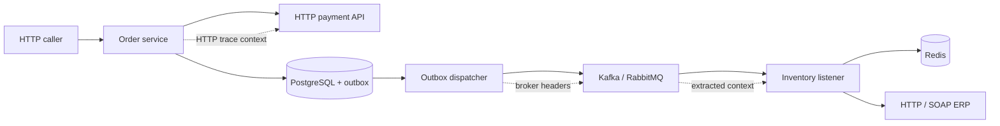
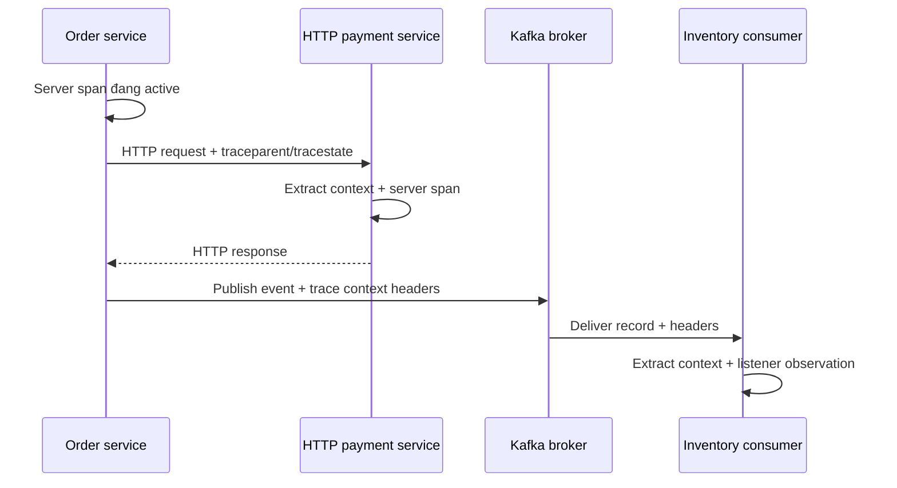
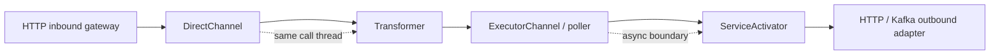
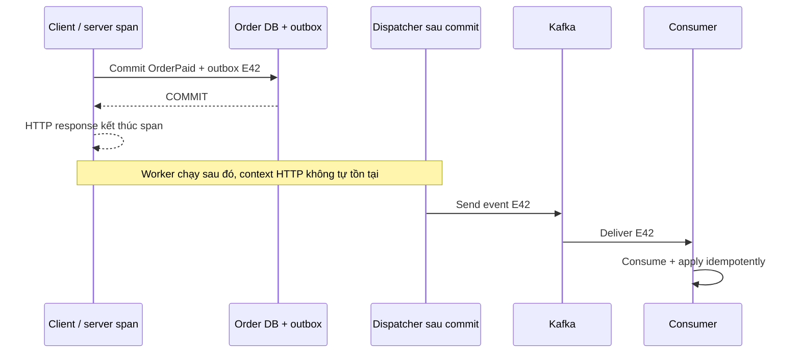

# Trace qua HTTP và header thông điệp theo thư viện hỗ trợ

## 1. Bài toán: một yêu cầu đi qua nhiều giao thức, trace có nối được không?

Một người dùng gửi `POST /orders` tới dịch vụ Order chạy Spring Boot. Dịch vụ gọi HTTP API thanh toán, ghi PostgreSQL, phát sự kiện `OrderCreated` sang Kafka hoặc RabbitMQ. Inventory nhận message, dùng Redis kiểm tra trạng thái rồi gọi HTTP/SOAP tới ERP. Một sự cố có thể xảy ra ở bất kỳ bước nào: HTTP timeout, pool cạn, broker giao trùng, consumer chậm hoặc một message bị đưa vào DLT.

Chỉ có log “Order service xử lý xong” và “ERP timeout” là chưa đủ để biết hai sự kiện có liên quan hay không. **Distributed tracing** giúp liên kết các operations qua tiến trình và giao thức bằng trace context, trong khi **metrics** cho biết tỉ lệ lỗi/độ trễ và **logs** chứa thông tin chẩn đoán chi tiết. Nhưng trace không tự lan truyền chỉ vì mọi service đều dùng Spring.

Chương **Quan sát tích hợp** trong module **SPRING_BOOT_INTEGRATION** tập trung vào kết nối HTTP client, cơ sở dữ liệu, cache, broker thông điệp và Spring Integration adapters với hợp đồng dữ liệu, giao dịch, lỗi, idempotency, kiểm thử và vận hành. Bài này trả lời câu hỏi cụ thể: **trace được truyền từ HTTP sang HTTP và từ producer sang consumer qua headers như thế nào khi thư viện được sử dụng hỗ trợ instrumentation và propagation?**

Ví dụ logic:



**Mục tiêu thực tế:** mỗi service ghi nhận span thích hợp, thư viện HTTP/messaging **inject và extract context tại ranh giới** khi được cấu hình đúng; business operation vẫn có định danh ổn định để đối soát khi trace bị cắt bởi outbox, retry kéo dài, sampling hoặc quá thời hạn lưu trữ.

Sau bài học, bạn có thể:

- Phân biệt **trace ID, span ID, correlation ID, idempotency key** và message/event ID.
- Thiết lập nền tảng Micrometer Observation/Tracing trong Spring Boot, hiểu exporter và sampler.
- Giữ instrumentation khi tạo `RestClient`/`WebClient` bằng builder Boot quản lý.
- Xác minh trace context qua HTTP headers và Kafka/RabbitMQ message headers, không tự viết propagation thiếu chuẩn.
- Nhận biết chỗ mất context do `@Async`, Reactor, Spring Integration, DLT hoặc transactional outbox.
- Thiết kế log/metrics/traces an toàn và kiểm thử đầu-cuối bằng những assertions phù hợp.

## 2. Trace, span và context không phải một khái niệm

| Khái niệm | Ý nghĩa | Phạm vi |
|---|---|---|
| **Trace** | Tập các hoạt động có quan hệ nhân quả được quan sát. | Có thể qua nhiều services, processes và giao thức. |
| **Trace ID** | Định danh trace, ví dụ dạng 128-bit theo W3C. | Dùng để truy tìm những spans cùng trace khi context được nối. |
| **Span** | Một hoạt động có điểm bắt đầu, kết thúc, thời lượng và attributes. | HTTP server, HTTP client, Kafka producer/consumer, một bước nghiệp vụ. |
| **Span ID** | Định danh riêng của span trong trace. | Không phải event ID hay operation ID. |
| **Parent/child hoặc span link** | Quan hệ phụ thuộc/nhân quả giữa các spans. | Cách biểu diễn phụ thuộc loại instrumentation và asynchronous messaging semantics. |
| **Trace context** | Thông tin tối thiểu để tiếp tục hoặc liên kết trace. | Được inject vào HTTP/messaging headers theo propagator. |
| **Baggage** | Các key/value được chọn để mang theo context qua ranh giới. | Không nên chứa bí mật hoặc giá trị có cardinality/size lớn. |
| **Correlation ID** | ID nghiệp vụ/luồng để ghép logs và các bước xử lý. | Có thể tồn tại qua outbox, restart và nhiều traces. |
| **Idempotency key** | Khóa xác định một ý định nghiệp vụ để ngăn side effect trùng. | Phải ổn định giữa retries; trace ID không thay thế. |

Một HTTP request có thể tạo nhiều client spans khi lần lượt gọi payment, inventory và shipping. Một Kafka event được xử lý lại sau ba ngày có thể tạo **trace mới** liên kết với workflow cũ qua event ID; không nhất thiết nó phải là child span trong trace của HTTP request ban đầu.

### 2.1. Không dùng trace ID thay business operation ID

`traceId` có thể thay đổi do sampling, retry sau restart, hoạt động schedule hoặc trace boundary khác. `operationId` và `eventId` do ứng dụng quản lý mới là khóa cho **idempotency, outbox/inbox, audit và reconciliation**. Hãy đưa những ID đó vào envelope nghiệp vụ và log có kiểm soát, nhưng không mặc định biến chúng thành metrics labels.

## 3. Context propagation diễn ra tại ranh giới nào?

Có hai nửa của một bước propagation:

1. **Inject:** producer/client lấy trace context hiện tại rồi ghi nó vào một carrier như HTTP headers hoặc Kafka record headers.
2. **Extract:** server/consumer đọc headers, kiểm tra format và tạo observation/span tiếp nối theo chính sách instrumentation.



Đoạn sơ đồ minh họa **một lời gọi publish trực tiếp trong context hiện hành**. Nếu producer nằm trong outbox dispatcher chạy sau commit trên thread hoặc process khác, **context của HTTP request không còn tự động ở đó**. Phải quyết định có lưu/khôi phục context có kiểm soát, thêm span link khi thư viện hỗ trợ, hoặc tạo trace mới kèm business correlation.

### 3.1. “Có header” chưa chắc “có trace nối”

Một request có header `traceparent` nhưng ứng dụng không cấu hình tracer/propagator hoặc server không extract context có thể bắt đầu trace mới. Ngược lại, trace context có thể được truyền bằng format khác như B3 và không xuất hiện dưới đúng tên `traceparent`.

Vì vậy, khi kiểm thử phải xem **trace/span relationship** theo cấu hình thực tế, không chỉ kiểm tra sự tồn tại của một chuỗi header bất kỳ.

## 4. Các lớp instrumentation trong Spring Boot

Trong hệ Spring Boot 3.x, chuỗi thường gặp gồm:

| Lớp | Trách nhiệm |
|---|---|
| **Micrometer Observation API** | Tạo observation, scope, convention, tags và event hooks ở mức framework/ứng dụng. |
| **Micrometer Tracing bridge** | Ánh xạ observations thành tracing spans bằng implementation như OpenTelemetry hoặc Brave. |
| **Tracer / Propagator** | Tạo/đọc context và inject/extract qua carriers. |
| **Tracing/export pipeline** | Gửi spans tới OTLP collector, Jaeger/Tempo hoặc backend tương ứng. |
| **Spring Boot Actuator auto-configuration** | Kết nối registry, tracing properties và các instrumentation được hỗ trợ. |
| **Spring Web / WebFlux / HTTP clients** | Tạo spans server/client và dùng configured propagator. |
| **Spring Kafka / Spring AMQP / Integration** | Cung cấp observation hooks theo thư viện, phiên bản và cấu hình endpoint. |
| **Application observations** | Đo những bước nghiệp vụ/công việc mà framework không tự biết. |

**Một ObservationRegistry không tự tạo spans có thể xem được** nếu không có tracing handler/bridge/exporter phù hợp. Ngược lại, có exporter nhưng dùng một client SDK tự tạo mà không instrument thì vẫn thiếu HTTP client span.

### 4.1. Observation là gì về mặt code?

Một ứng dụng có thể inject `ObservationRegistry`:

```java
import io.micrometer.observation.Observation;
import io.micrometer.observation.ObservationRegistry;
import org.springframework.stereotype.Service;

@Service
class ReservationWorkflow {

    private final ObservationRegistry observations;
    private final ReservationStore store;

    ReservationWorkflow(
            ObservationRegistry observations,
            ReservationStore store) {
        this.observations = observations;
        this.store = store;
    }

    void persistReservation(String operationId) {
        Observation.createNotStarted(
                "integration.reservation.persist", observations)
            .lowCardinalityKeyValue("operation", "reserve-stock")
            .observe(() -> store.persist(operationId));
    }
}
```

`ReservationStore` là abstraction ứng dụng cần triển khai. Observation trên là **bước business**; nó không tự mang trace qua HTTP hoặc Kafka. Khi tracing handler hiện diện, observation có thể tạo span hoặc được liên kết vào trace hiện hành. `operationId` được dùng trong logic để tìm dữ liệu nhưng **không** đưa vào low-cardinality tags.

## 5. Dependency và cấu hình nền tảng

Một ví dụ Gradle Kotlin DSL theo thế hệ Spring Boot 3.x:

```kotlin
dependencies {
    implementation("org.springframework.boot:spring-boot-starter-actuator")
    implementation("org.springframework.boot:spring-boot-starter-web")
    implementation("org.springframework.boot:spring-boot-starter-webflux")
    implementation("org.springframework.kafka:spring-kafka")

    runtimeOnly("io.micrometer:micrometer-tracing-bridge-otel")
    runtimeOnly("io.opentelemetry:opentelemetry-exporter-otlp")

    testImplementation("org.springframework.boot:spring-boot-starter-test")
}
```

Các dependencies web/webflux/Kafka là **tùy nhu cầu ứng dụng**, không bắt buộc cài mọi starter để dùng tracing. Chọn đúng một hướng tracing bridge/provider được BOM quản lý; không thêm đồng thời nhiều tracer implementations chỉ vì muốn “nhiều trace hơn”. Với các đời Spring Boot mới hoặc tổ chức dùng OpenTelemetry Java agent, cách cấu hình exporter/tracer có thể khác; cần thống nhất chiến lược instrumentation, tránh duplicate spans.

Ví dụ cấu hình môi trường **test/staging**:

```yaml
management:
  tracing:
    sampling:
      probability: 1.0
  otlp:
    tracing:
      endpoint: http://localhost:4318/v1/traces
```

Endpoint OTLP và các properties phụ thuộc Spring Boot/exporter version. `probability: 1.0` có thể hữu ích trong test để không mất span vì sampling; **không khuyến nghị áp mù cho production** vì overhead, PII, chi phí lưu trữ và tải backend.

### 5.1. Ba điều kiện để thấy trace đầu-cuối

1. Framework/app **tạo observation hoặc span** tại mỗi điểm cần quan sát.
2. **Propagator inject/extract** context qua giao thức được dùng.
3. Span **được sample, export và backend nhận**; thời gian flush/export/retention phù hợp.

Thiếu một trong ba có thể tạo tình huống “HTTP log có traceId nhưng trên tracing UI không thấy dữ liệu”.

### 5.2. Không nhầm metrics với traces

Actuator/Micrometer metrics có thể vẫn hoạt động khi trace không được sample. Một HTTP timer không chứng minh traceparent được propagate. Bản thân metric có tags hữu hạn; trace có attributes phong phú hơn nhưng vẫn cần data minimization.

## 6. HTTP inbound: server span và header được extract ở đâu?

Với Spring MVC/WebFlux đã có Observation instrumentation và tracing bridge phù hợp, server có thể nhận trace context từ client ở HTTP headers, tạo **server span** và cung cấp context đó cho downstream instrumentation.

Ví dụ incoming request:

```http
POST /orders HTTP/1.1
Host: orders.example
Content-Type: application/json
traceparent: 00-4bf92f3577b34da6a3ce929d0e0e4736-00f067aa0ba902b7-01
tracestate: vendor=value
X-Correlation-Id: order-flow-42

{"orderId":"O-42"}
```

Chuỗi `traceparent` có cấu trúc theo W3C; ví dụ là dữ liệu giả, không được coi là token xác thực. `tracestate` có thể có hoặc không. Hệ thống dùng B3 có thể nhận các headers `b3` hoặc `X-B3-TraceId`/`X-B3-SpanId` tùy propagator.

**Không yêu cầu caller luôn gửi `traceparent`.** Khi không có context hợp lệ, server có thể bắt đầu một trace mới theo tracing/sampling policy. Còn khi nhận inbound header không đáng tin cậy từ Internet, ứng dụng/gateway cần có chính sách trust boundary và không xem trace ID do client chọn là bằng chứng danh tính.

### 6.1. Server span không phải hoàn tất nghiệp vụ

HTTP response `202 Accepted` có thể trả về sau khi ghi một outbox operation `PENDING`. Server span kết thúc khi HTTP exchange kết thúc, **không** kéo dài cho tới khi Kafka consumer hoàn tất workflow sau vài phút. Nên đo business end-to-end latency bằng operation state/timestamps riêng.

## 7. Outbound HTTP với `RestClient.Builder` do Boot quản lý

Đây là cách quan trọng để không làm mất instrumentation:

```java
import org.springframework.beans.factory.annotation.Value;
import org.springframework.context.annotation.Bean;
import org.springframework.context.annotation.Configuration;
import org.springframework.web.client.RestClient;

@Configuration(proxyBeanMethods = false)
class ErpClientConfig {

    @Bean
    RestClient erpRestClient(
            RestClient.Builder bootManagedBuilder,
            @Value("${integration.erp.base-url}") String baseUrl) {

        return bootManagedBuilder
                .baseUrl(baseUrl)
                .build();
    }
}
```

Bean này giả định Spring Boot có `RestClient.Builder` được auto-configure và dependency Spring Web tương thích (ví dụ Boot 3.2+). Khi gọi client trong một active observation/tracing context, instrumentation được Boot cấu hình có thể tạo **HTTP client observation/span** và tự inject trace headers theo propagator.

```java
import org.springframework.stereotype.Component;
import org.springframework.web.client.RestClient;

@Component
class ErpStatusGateway {

    private final RestClient erp;

    ErpStatusGateway(RestClient erp) {
        this.erp = erp;
    }

    ReservationStatus status(String reservationId) {
        return erp.get()
                .uri("/reservations/{id}", reservationId)
                .retrieve()
                .body(ReservationStatus.class);
    }
}
```

`ReservationStatus` là DTO của ứng dụng. Hãy dùng `@Qualifier` khi có nhiều RestClient beans để không inject nhầm client. Ví dụ minh họa HTTP GET; production cần authentication, timeout, error mapping và TLS.

### 7.1. Phản mẫu: tạo client bỏ qua builder được quản lý

```java
RestClient client = RestClient.create(
        "https://erp.example");
```

Code vẫn có thể gọi HTTP nhưng không mặc nhiên nhận customizers/ObservationRegistry/transport mà Spring Boot đã cấu hình cho builder injection. `RestClient.builder()` thuần cũng có rủi ro tương tự nếu không áp instrumentation riêng.

**Quy tắc:** với bean production, ưu tiên inject `RestClient.Builder` do Boot quản lý rồi chọn base URL cho dependency cụ thể. Không tạo một client mới trong mỗi request chỉ để thay header hoặc correlation ID.

## 8. `WebClient.Builder`, Reactor Context và asynchronous HTTP

Với WebFlux, dùng builder được Boot quản lý:

```java
import org.springframework.beans.factory.annotation.Value;
import org.springframework.context.annotation.Bean;
import org.springframework.context.annotation.Configuration;
import org.springframework.web.reactive.function.client.WebClient;

@Configuration(proxyBeanMethods = false)
class PaymentClientConfig {

    @Bean
    WebClient paymentWebClient(
            WebClient.Builder bootManagedBuilder,
            @Value("${integration.payment.base-url}") String baseUrl) {

        return bootManagedBuilder.baseUrl(baseUrl).build();
    }
}
```

Trong reactive pipeline, **tạo Mono khác với thực sự subscribe Mono**. Thread có thể thay đổi giữa các operators, vì vậy dựa hoàn toàn vào `ThreadLocal`/MDC không phải cách truyền context an toàn. Micrometer Tracing/Reactor context propagation phải được cấu hình tương thích với Spring Boot, Reactor và cách subscription thực tế.

```java
public Mono<PaymentView> findPayment(String paymentId) {
    return paymentWebClient.get()
            .uri("/payments/{id}", paymentId)
            .retrieve()
            .bodyToMono(PaymentView.class);
}
```

`PaymentView` là DTO ứng dụng. Khi `findPayment` được gọi trong một request handler reactive có context được duy trì đúng, HTTP client instrumentation có thể tạo span tương ứng. **Không tự gán `traceparent` trong `ExchangeFilterFunction`** nếu tracer đã instrument WebClient: có thể ghi đè context mới, phá parent/child hoặc tạo hai đường propagation cạnh tranh.

### 8.1. Khi WebClient chạy từ thread không có context

Một scheduled worker, `@Async` task hoặc message adapter có thể tạo `Mono` sau khi context ban đầu đã kết thúc. Khi đó không có parent span từ HTTP inbound để “tự truyền”. Cần tạo observation riêng cho công việc, phục hồi context từ broker headers nếu thư viện hỗ trợ, hoặc liên kết bằng correlation ID. Thêm `.contextWrite(...)` với custom key `correlationId` chỉ truyền **business metadata**, không tự thay thế Micrometer Tracing context.

### 8.2. Không dùng `block()` trên event loop

Nếu gọi `block()` ở Reactor Netty event loop, hệ thống có thể chặn thread và mất throughput. Chuyển giữa imperative, reactive và executor boundary phải có chiến lược context propagation phù hợp; đừng đổi mọi thứ thành blocking chỉ để log trace ID dễ hơn.

## 9. W3C Trace Context, B3 và header propagation

Các format phổ biến:

| Format | Header thường gặp | Ý nghĩa |
|---|---|---|
| **W3C Trace Context** | `traceparent`, `tracestate`. | Chuẩn phổ biến để mang trace ID, parent span ID và flags. |
| **B3 single** | `b3`. | Format có thể chứa trace ID, span ID, sampling state. |
| **B3 multi** | `X-B3-TraceId`, `X-B3-SpanId`, `X-B3-Sampled` và các header tùy chọn. | Được nhiều hệ thống Brave/Zipkin sử dụng. |
| **W3C Baggage** | `baggage`. | Truyền metadata chọn lọc, không phải nơi lưu credential. |
| **Business correlation** | `X-Correlation-Id` hoặc header hợp đồng riêng. | Không phải định dạng tracing tiêu chuẩn; app tự quy định. |

Chọn propagator **thống nhất** giữa các services. Nếu service A inject W3C còn service B chỉ extract B3, request có thể vẫn được xử lý nhưng trace sẽ bị đứt. Nhiều propagators có thể được cấu hình để chuyển tiếp trong giai đoạn migration, nhưng phải kiểm tra precedence và nguy cơ headers có context mâu thuẫn.

### 9.1. Không tự sinh hoặc sửa `traceparent` bằng chuỗi tùy tiện

Phản mẫu:

```java
headers.set("traceparent",
        "00-" + orderId + "-" + requestId + "-01");
```

`orderId` và `requestId` không nhất thiết đúng độ dài/định dạng/span semantics W3C. Trace ID không phải business ID; parent span ID phải phản ánh context tracer hiện hành. Hãy để **tracer/propagator có instrumentation** inject/extract headers.

### 9.2. Không dùng `tracestate` để lưu thông tin nhạy cảm

`tracestate` và baggage có thể đi qua proxies, external vendors và logs. Không đặt JWT, API key, email, tài khoản ngân hàng, customer ID hoặc raw payload vào đó. Trace context truyền nhân quả, không phải kênh xác thực hay lưu business data.

## 10. Message headers khác HTTP headers như thế nào?

Kafka/RabbitMQ/JMS và Spring Messaging đều có header abstractions, nhưng carrier không giống nhau:

| Môi trường | Header carrier | Cách dữ liệu được truyền |
|---|---|---|
| HTTP | `HttpHeaders`/wire headers. | Tên/value ở dạng HTTP header fields. |
| Kafka | `ProducerRecord.headers()`/`ConsumerRecord.headers()`. | Một tên có thể có nhiều values dạng `byte[]`. |
| RabbitMQ AMQP | `MessageProperties.headers`. | AMQP field table, kiểu dữ liệu tương thích protocol. |
| Spring Messaging | `MessageHeaders`. | Map metadata trong JVM hoặc qua adapter mapping. |
| JMS | `JMSCorrelationID`, JMS properties và headers chuẩn. | Theo JMS/provider và naming/type constraints. |

Một key `traceparent` trong `MessageHeaders` của Spring Integration **chưa chắc đã được map ra Kafka record headers** nếu adapter có header mapper/filter rules khác. Ngược lại, không phải mọi Kafka header đều đi vào method listener khi deserializer/converter được cấu hình riêng.

**Propagator của thư viện cần biết carrier và getter/setter tương ứng.** Đừng copy nguyên `MessageHeaders` sang broker để “giữ trace”; có thể chứa Java objects, `replyChannel`, `errorChannel`, tokens hoặc metadata không serialize được.

## 11. Kafka producer và listener: bật observation có chủ đích

Spring Kafka 3.x hỗ trợ Observation cho template/listener containers trong các phiên bản phù hợp. Khi template và container dùng `ObservationRegistry`/tracing handler và observation được bật, Kafka instrumentation có thể tạo producer/consumer observations và inject/extract trace context trong Kafka record headers.

Ví dụ **định hướng cấu hình** với Spring Boot hỗ trợ các thuộc tính tương ứng:

```yaml
spring:
  kafka:
    template:
      observation-enabled: true
    listener:
      observation-enabled: true
```

Cần kiểm tra các property trên tồn tại và được áp vào **đúng factory/template bean** theo Spring Boot version. Nếu ứng dụng dựng `KafkaTemplate` hoặc `ConcurrentKafkaListenerContainerFactory` thủ công mà bỏ qua Boot configurer, các settings trong YAML có thể không tác động tới endpoint thật.

### 11.1. Cấu hình container factory tùy chỉnh mà giữ Boot conventions

```java
import org.springframework.boot.autoconfigure.kafka.ConcurrentKafkaListenerContainerFactoryConfigurer;
import org.springframework.context.annotation.Bean;
import org.springframework.kafka.config.ConcurrentKafkaListenerContainerFactory;
import org.springframework.kafka.core.ConsumerFactory;

@Bean("observedKafkaListenerFactory")
ConcurrentKafkaListenerContainerFactory<String, String>
observedKafkaListenerFactory(
        ConcurrentKafkaListenerContainerFactoryConfigurer configurer,
        ConsumerFactory<String, String> consumers) {

    var factory =
            new ConcurrentKafkaListenerContainerFactory<String, String>();

    configurer.configure(factory, consumers);
    factory.getContainerProperties().setObservationEnabled(true);
    return factory;
}
```

Đoạn code giả định factory được tạo trong Spring configuration class, `ConsumerFactory` đã có config/credentials/deserializer phù hợp và ObservationRegistry được hệ thống quản lý. Nếu tự tạo nhiều cluster/factories, mỗi factory cần chọn đúng consumer factory và observation context.

Nếu cần chỉ định registry không mặc định, dùng APIs `setObservationRegistry` tương ứng mà phiên bản Spring Kafka hỗ trợ, ở component thực tế. Không tạo một `ObservationRegistry.create()` mới biệt lập trong factory rồi kỳ vọng trace được export chung với ứng dụng.

### 11.2. Producer dùng `KafkaTemplate` do Boot quản lý

```java
import org.springframework.kafka.core.KafkaTemplate;
import org.springframework.stereotype.Component;

@Component
class OrderEventPublisher {

    private final KafkaTemplate<String, String> kafka;

    OrderEventPublisher(KafkaTemplate<String, String> kafka) {
        this.kafka = kafka;
    }

    void publish(String orderId, String jsonEnvelope) {
        kafka.send("orders.events", orderId, jsonEnvelope);
    }
}
```

Khi producer instrumentation được bật, send được thực hiện trong một active trace context phù hợp, context có thể được inject vào **Kafka record headers**. Ví dụ không hiển thị explicit `traceparent` vì **không cần tự set header chuẩn bằng tay**.

`send(...)` trả future ở các phiên bản Spring Kafka hiện đại. Code trên chưa xử lý publish failure; production phải quan sát callback/ack, retry có giới hạn và outbox khi cần atomicity với DB.

### 11.3. Consumer với `@KafkaListener`

```java
import org.apache.kafka.clients.consumer.ConsumerRecord;
import org.springframework.kafka.annotation.KafkaListener;
import org.springframework.stereotype.Component;

@Component
class InventoryEventListener {

    private final InventoryApplicationService service;

    InventoryEventListener(InventoryApplicationService service) {
        this.service = service;
    }

    @KafkaListener(
        topics = "orders.events",
        groupId = "inventory-projection",
        containerFactory = "observedKafkaListenerFactory")
    public void onRecord(ConsumerRecord<String, String> record) {
        service.applyIdempotently(record.value());
    }
}
```

`InventoryApplicationService` là bean ứng dụng. Khi listener container được observation-enabled và có tracing implementation, consumer instrumentation có thể extract headers, tạo listener observation và làm context sẵn cho downstream HTTP client/DB observations trong phạm vi listener invocation.

**Không kết luận chỉ nhìn tên annotation:** nếu app dùng custom container không bật observation, chỉ có một `@KafkaListener` không tự bảo đảm trace được extract.

## 12. Kafka headers: những điều phải kiểm chứng thực tế

Kafka record header có tên và byte value, có thể có nhiều bản cùng tên. Khi instrumented producer send:

```text
topic=orders.events
key=O-42
headers:
  traceparent = <bytes của trace context>
  tracestate = <bytes nếu có>
  x-correlation-id = <business metadata nếu hợp đồng yêu cầu>
value = {"eventId":"E42","eventType":"OrderPaid", ...}
```

Đây là dạng **minh họa**. Header names thực tế phụ thuộc propagator (W3C/B3), instrumented client, header mapper và tracing version. Không mặc định mọi record đều có `traceparent`. Các bộ lọc/mappers có thể loại headers không được allowlist, đặc biệt khi chuyển giữa Spring Message và Kafka record.

### 12.1. Đặt header nghiệp vụ tách trace

Nếu cần correlation ID ổn định qua outbox, tạo nó ở business boundary và lưu vào event envelope. Dispatcher có thể đưa `correlationId` vào custom header để consumer log đối soát; đây là hợp đồng ứng dụng, **không** thay trace context của thư viện.

Đừng dùng Kafka `topic/partition/offset` làm event ID; một logical event có thể được republish với offset khác. Trace có thể sinh span mới mỗi lần delivery/attempt nhưng `eventId` giữ nguyên.

### 12.2. Không diễn giải mã hóa header như String tùy ý

Kafka trace headers dạng bytes theo encoding propagator. Nếu kiểm thử, decode bằng UTF-8 **chỉ khi format đã biết**, hoặc dùng getter của propagator để kiểm tra. Không log raw toàn bộ Kafka headers khi có security token, tenant data hoặc payload reference bí mật.

## 13. RabbitMQ/Spring AMQP: observations và header mapping

Spring AMQP có instrumentation cho `RabbitTemplate` và listener containers trong các phiên bản hỗ trợ. Khi observation được bật ở **cả publisher và consumer** cùng tracing registry phù hợp, trace context có thể đi qua AMQP message headers.

Một khung minh họa:

```java
import io.micrometer.observation.ObservationRegistry;
import org.springframework.amqp.rabbit.connection.ConnectionFactory;
import org.springframework.amqp.rabbit.core.RabbitTemplate;
import org.springframework.context.annotation.Bean;

@Bean
RabbitTemplate observedRabbitTemplate(
        ConnectionFactory connectionFactory,
        ObservationRegistry registry) {

    RabbitTemplate template = new RabbitTemplate(connectionFactory);
    template.setObservationEnabled(true);
    template.setObservationRegistry(registry);
    return template;
}
```

Lưu ý: khi tự tạo `RabbitTemplate` như trên, phải bảo toàn **message converter, credentials, retry, mandatory returns/publisher confirms và những customizations** do Boot hoặc ứng dụng yêu cầu. Trong dự án đã có template quản lý, **ưu tiên bật observation trên bean/factory đúng chỗ** thay vì thay thế template một cách vô tình.

Listener containers cũng cần cấu hình observation thông qua factory/container APIs của Spring AMQP version tương ứng. Không tin rằng template observed sẽ tự khiến listener nhận context nếu container chưa bật instrumentation.

### 13.1. AMQP headers và Spring Message không phải một

Rabbit headers được lưu trong `MessageProperties` và có thể được map qua Spring AMQP converters. Nếu ứng dụng tự viết converter, adapter hoặc header allowlist, hãy bảo đảm những propagation headers được giữ theo framework conventions. Không copy toàn bộ HTTP `Authorization` vào AMQP headers để “còn context”.

### 13.2. Acknowledgment khác span completion

Một producer span kết thúc khi operation send theo instrumentation thành công/thất bại, **không** có nghĩa queue consumer đã commit PostgreSQL. Consumer span có thể kết thúc khi listener method return, nhưng nếu method chỉ submit task sang executor RAM thì business effect chưa hoàn thành. Metrics/outcome của operation phải dựa trên durable business state, không suy ra từ trace span là đủ.

## 14. Spring Integration: đâu là điểm trace bị đứt?

Spring Integration có `MessageChannel`, gateways, transformers, routers, splitters, aggregators và adapters qua HTTP/Kafka/JMS/SFTP. Trace context có thể di chuyển trong một integration flow **nếu các components và instrumentations cụ thể hỗ trợ** và context được duy trì đúng giữa threads.



Các tình huống:

- `DirectChannel` đồng bộ thường chạy handler trên thread sender; active scope có cơ hội được giữ trong call stack.
- `ExecutorChannel` chuyển sang executor, nên `ThreadLocal` observation/trace context **không tự được sao chép theo quy tắc Java**.
- `QueueChannel` và poller có thể giữ message lâu; transaction và thread/trace scopes ban đầu kết thúc trước khi poll.
- Kafka/HTTP adapters có thể dùng chính instrumentation từ Spring Kafka/WebClient/RestClient; nhưng phải xác minh adapter path thực tế.
- Splitter/aggregator có nhiều nhánh; quan hệ trace có thể là nhiều spans, span links hoặc traces khác nhau tùy cách xử lý/phiên bản.

Không mặc định một `MessageHeaders` chứa `traceparent` là đủ để mọi Spring Integration channel tự extract/inject. Đối với cross-process carrier, nên dựa vào chính thư viện adapter có observation support hoặc dùng propagator phù hợp và kiểm thử.

### 14.1. Correlation, sequence và tracing có nhiệm vụ khác nhau

Spring Integration headers như `CORRELATION_ID`, `SEQUENCE_NUMBER` hay `replyChannel` phục vụ routing/aggregation/reply trong flow; chúng không phải trace ID. Không serialize `replyChannel`/`errorChannel` object sang broker. Khi flow có aggregator, dùng business correlation key phù hợp với contract, **không lấy traceId làm group key mặc định**.

## 15. Thread context và `@Async`: vì sao trace ID biến mất?

Micrometer/Brave/OpenTelemetry có thể dùng thread-local scope cho imperative execution. Một `@Async` hoặc `ThreadPoolTaskExecutor` tạo thread khác: `MDC`/current span trong thread gốc không tự xuất hiện ở thread worker nếu không có cơ chế capture/restore.

Spring Framework 6.1+ cung cấp `ContextPropagatingTaskDecorator` dựa trên Micrometer Context Propagation để bảo toàn những loại context được đăng ký thích hợp khi chuyển sang task executor.

```java
import org.springframework.context.annotation.Bean;
import org.springframework.context.annotation.Configuration;
import org.springframework.core.task.TaskDecorator;
import org.springframework.core.task.support.ContextPropagatingTaskDecorator;
import org.springframework.scheduling.concurrent.ThreadPoolTaskExecutor;

@Configuration(proxyBeanMethods = false)
class IntegrationExecutorConfiguration {

    @Bean
    TaskDecorator integrationTaskDecorator() {
        return new ContextPropagatingTaskDecorator();
    }

    @Bean("integrationExecutor")
    ThreadPoolTaskExecutor integrationExecutor(
            TaskDecorator integrationTaskDecorator) {

        ThreadPoolTaskExecutor executor = new ThreadPoolTaskExecutor();
        executor.setCorePoolSize(4);
        executor.setMaxPoolSize(8);
        executor.setQueueCapacity(100);
        executor.setTaskDecorator(integrationTaskDecorator);
        executor.initialize();
        return executor;
    }
}
```

Nếu dùng `@Async("integrationExecutor")` và application đã cấu hình Micrometer Context Propagation/ThreadLocal accessors tương thích, decorator có thể capture current context lúc submit và restore khi task chạy.

**Đây không phải lời hứa sao chép mọi business/transaction context**: JDBC transaction gắn thread không được “truyền” thành distributed transaction. Task có thể chạy sau khi inbound request kết thúc; nên đặt observation cho task và dùng durable operation ID thay vì phụ thuộc vào parent span còn active mãi.

### 15.1. Đừng tự copy MDC mà quên cleanup

Một cách thủ công copy `MDC.getCopyOfContextMap()` và `MDC.setContextMap(...)` vào worker có thể làm log ID hiển thị đúng, nhưng **không nhất thiết truyền tracer/Observation Context**, và có nguy cơ rò dữ liệu giữa tasks nếu không restore/clear. Ưu tiên context propagation chính thức khi framework hỗ trợ, tránh tự xây một bản sao không đồng bộ.

## 16. Reactor Context khác ThreadLocal và message headers

| Cơ chế | Nguồn sống | Dùng với | Có tự qua broker? |
|---|---|---|---|
| ThreadLocal/MDC | Thread hiện tại. | Imperative HTTP handler, log scope. | Không. |
| Reactor Context | Reactive subscription. | WebFlux, WebClient, Reactor operators. | Không. |
| Spring `MessageHeaders` | Một `Message<?>` trong integration flow. | Spring Messaging/Integration. | Chỉ khi adapter map/serialize thích hợp. |
| Kafka/AMQP wire headers | Message trong broker protocol. | Cross-process messaging. | Có, nếu producer inject và consumer extract. |
| Outbox metadata trong DB | Bản ghi bền vững sau commit. | Workflow kéo dài/restart. | Có thể được dispatcher chủ động ánh xạ. |

Khi chuyển từ Reactor sang executor imperatively hoặc từ HTTP sang Spring Integration poller, phải kiểm tra việc instrumented components có capture/restore context không. **Không tạo `new Thread(...)` hoặc `subscribe()` lồng nhau rồi giả định Spring WebFlux tự truyền mọi context.**

### 16.1. Tránh `subscribe()` thủ công để “fire-and-forget”

Phản mẫu:

```java
public void dispatch() {
    webClient.post()
        .uri("/erp/reserve")
        .retrieve()
        .toBodilessEntity()
        .subscribe();  // Không có owner của outcome/error/durable state.
}
```

Không chỉ dễ mất context, đoạn này còn có nguy cơ đánh dấu command hoàn thành trước khi HTTP side effect biết kết quả. Trả `Mono` cho caller quản lý hoặc đưa công việc vào durable outbox/job rồi có worker với retry/reconciliation đúng.

## 17. Transactional Outbox: ranh giới trace không tự bền vững

Một mẫu tích hợp quan trọng:



Nếu dispatcher chạy trong thread/process khác, producer instrumentation tạo một span từ **current context của worker**, thường có thể là một trace mới. Không tự động có parent từ HTTP request chỉ vì `outbox_events` có `orderId`.

### 17.1. Có ba cách biểu diễn nhân quả

1. **Business correlation:** lưu `operationId`, `eventId`, `correlationId` trong outbox envelope, nối logs/traces/dashboards dựa trên ID; thường đủ cho vận hành.
2. **Persist trace context có kiểm soát:** lưu một carrier/snapshot được tracing library hỗ trợ và phục hồi ở dispatcher theo chính sách. Cần kiểm tra trust, retention, kích thước, version propagator và thời gian kéo dài bất thường.
3. **Span links:** tạo span mới và liên kết tới context của event/operation gốc nếu tracing implementation hỗ trợ; phù hợp khi quan hệ bất đồng bộ không nên mô hình hóa như parent-child kéo dài.

Không sao chép raw `traceparent`/`tracestate` bằng Java String rồi tự dựng `Span` tùy tiện. Nếu áp cách 2/3, dùng **propagator/SDK API chính thức**, kiểm thử trên implementation/version đang dùng.

### 17.2. Outbox bảo đảm gì, trace bảo đảm gì?

| Yêu cầu | Outbox | Trace |
|---|---|---|
| DB state + event intent cùng commit | **Có**, khi cùng transaction. | Không. |
| Publisher retry sau broker outage | Có nếu dispatcher/recovery được thiết kế. | Không. |
| Consumer chống duplicate | Cần inbox/idempotency bổ sung. | Không. |
| Biết bước nào tốn thời gian | Cần metrics/traces bổ sung. | Có thể đo các bước instrumented. |
| Tìm operation sau vài ngày | Outbox/business IDs có thể còn. | Phụ thuộc sampling/retention, không đáng tin cậy làm source of truth. |

## 18. Retry, redelivery và DLT: trace có thể có nhiều nhánh

Khi producer retry hoặc broker redeliver, một logical event có thể có nhiều lần giao/attempt, mỗi lần tạo spans khác nhau:

```text
eventId=E42
  dispatch attempt #1 -> Kafka timeout (có thể đã publish)
  dispatch attempt #2 -> Kafka ack success
  consumer delivery #1 -> DB commit, ack failed
  consumer delivery #2 -> inbox duplicate, ack success
```

**Không yêu cầu mọi attempt phải có cùng span ID.** Span ID đại diện một hoạt động quan sát, không phải business event. Event ID nên giữ nguyên, còn retry count/error state phản ánh thực tế. Một trace UI có thể chỉ hiển thị một phần vì sampling, async boundaries, exporter failure hoặc retention.

### 18.1. DLT và trace context

Khi Spring Kafka `DefaultErrorHandler` dùng `DeadLetterPublishingRecoverer`, recoverer có thể thêm DLT metadata; tracing propagation phụ thuộc việc DLT producer/template được instrumented và context hoạt động lúc publish. Nếu thiếu, DLT consumer có thể bắt đầu trace mới. Luôn lưu **eventId + original topic/partition/offset + error category** an toàn để điều tra, không phụ thuộc duy nhất vào traceparent.

### 18.2. Producer span không có nghĩa consumer xử lý xong

Một producer span thường đo operation publish; consumer span đo delivery/handler. Nếu consumer nhận record rồi `@Async` enqueue trong RAM và return, span kết thúc nhưng business chưa commit. Nên đo operation status/consumer business outcome riêng; không vẽ một span nhân tạo kéo dài hàng giờ bằng cách giữ scope/memory không cần thiết.

## 19. Logging với trace ID/span ID: hỗ trợ điều tra, không thay metrics

Một log tốt có thể gồm:

```text
traceId=4bf92f3577b34da6a3ce929d0e0e4736
spanId=00f067aa0ba902b7
operation=reserve-stock
eventId=E42
dependency=erp
outcome=timeout
```

Micrometer Tracing/Spring Boot có khả năng tích hợp trace/span IDs vào MDC/log correlation khi đã cấu hình. Không tự tạo global `ThreadLocal<String> traceId` rồi gắn vào mọi request, vì vừa dễ leak cross-request, vừa không tạo distributed spans thật.

### 19.1. Ghi lỗi tại đúng lớp

- HTTP client: method, URI template, status, transport error và latency.
- Messaging producer: topic/exchange, publish outcome/ack và retry attempts.
- Consumer: listener/group, processing outcome, redelivery/DLT, durable business state.
- DB: operation name, SQL error category, connection pool metrics; không log raw SQL parameters.
- Workflow: operationId, eventId, aggregateVersion và state transition.

Không log `Authorization`, cookie, `traceparent` đầy đủ từ request không tin cậy kèm PII, raw Kafka headers hoặc payload có dữ liệu thanh toán. Tracing backend cũng là nơi chứa dữ liệu cần quyền/retention đúng.

## 20. Metrics và traces cần được diễn giải cùng nhau

| Tín hiệu | Câu hỏi nó trả lời | Điều nó không chứng minh |
|---|---|---|
| HTTP server/client latency | API/đối tác chậm đến đâu? | Event đã được consumer xử lý. |
| Kafka consumer lag | Group chậm bao nhiêu records? | Business effect đã commit chính xác. |
| Rabbit queue depth | Có messages chờ trong queue không? | Bao nhiêu operations đã hoàn thành. |
| DB pool pending/active | Connection pool có bão hòa không? | Vì sao cụ thể một SQL transaction thất bại. |
| Outbox oldest pending age | Sự kiện đã commit nhưng chưa phát lâu bao nhiêu? | Tracing có đi liền qua outbox hay không. |
| Traces/spans | Những đoạn instrumented đã thực thi và timing/quan hệ của chúng. | End-to-end exactly-once hoặc durability. |
| Inbox duplicate count | Consumer đã nhìn thấy bao nhiêu duplicate. | Producer phát sai hay broker redelivery nếu không xem metadata. |
| Business status age | Operation `PENDING/UNKNOWN` đã lâu chưa. | Nguyên nhân nếu không ghép logs/traces. |

Một trace chỉ cho thấy **hành vi được instrument**, còn broker lag và DB state có thể phản ánh cả những message mà trace đã bị drop do sampling. Vì thế dashboard vận hành không được chỉ dựa vào tracing UI.

## 21. Semantic conventions và độ ổn định của tag names

Tên span, attributes và semantic conventions của HTTP/messaging có thể thay đổi giữa Micrometer Tracing, OpenTelemetry và những phiên bản instrumentation. Đừng viết monitoring query quá mong manh dựa vào **một raw attribute chưa được chuẩn hóa trong tổ chức** nếu deployment thường nâng version.

Trong app custom observations, nên dùng danh mục operation hữu hạn:

```java
Observation.createNotStarted(
        "integration.outbox.publish", registry)
    .lowCardinalityKeyValue("transport", "kafka")
    .lowCardinalityKeyValue("event.type", "OrderPaid")
    .observe(() -> sender.publish(message));
```

`sender` và `message` là beans/DTO ứng dụng; ví dụ giả định `publish(...)` đồng bộ tới mốc thích hợp. Nếu method chỉ trả Future/Mono, scope observation kết thúc ngay khi method trả, **không tự đo toàn bộ async publish duration**; cần instrument completion callback hoặc dùng observation của thư viện gửi.

### 21.1. Cardinality: khác nhau giữa metrics và trace attributes

- Tags tốt cho metrics: `operation=reserve-stock`, `dependency=erp`, `outcome=success|timeout`.
- Tags không phù hợp cho metrics: `orderId`, `eventId`, `traceId`, raw URL với số định danh, email.
- Trong spans, vẫn phải giảm dữ liệu nhạy cảm và tránh payload lớn; “trace backend chấp nhận nhiều attributes” không có nghĩa được phép log mọi thứ.

Sử dụng URI **template** như `/orders/{id}` thay vì `/orders/O-42` làm low-cardinality key. Với HTTP clients tùy chỉnh, kiểm tra instrumentation có nhận biết template không; nếu không, cần standardize operation name.

## 22. Sampling, exporter và retention: tại sao trace “bị mất”?

Không phải mỗi request đều xuất hiện trên UI:

1. **Sampler** quyết định span được ghi/export theo policy.
2. Collector hoặc exporter có thể backlog, drop, timeout hoặc bị chặn mạng.
3. Backend có retention và indexing policy.
4. Một dịch vụ có bridge/exporter khác khiến trace bị split.
5. Propagator không tương thích khiến server bắt đầu trace mới.
6. Context không được truyền qua executor/messaging/outbox.
7. Observability bị tắt ở Kafka template/listener hoặc HTTP client bypass builder.

### 22.1. Không bật 100% sampling mọi nơi theo thói quen

Trên môi trường có traffic cao, sampling toàn bộ có thể làm tăng CPU, memory, network, storage và nguy cơ lộ thông tin. Chọn xác suất phù hợp và xem head/tail sampling của collector nếu có; vận hành cần metrics bao phủ toàn bộ traffic để phát hiện sự cố dù trace sample ít.

Trong tests, có thể bật sampling cao và dùng in-memory exporter/tracer để assert spans. Không cho integration tests gửi spans sang collector production; nên disable exporter hoặc thay bằng test exporter.

### 22.2. Flush và shutdown

Một span có thể được tạo nhưng chưa kịp export khi test/process kết thúc. Kiểm thử cần đợi backend/test exporter theo deadline, kiểm tra batch processor flush/shutdown phù hợp, không chỉ gọi một HTTP method rồi đọc ngay UI và kết luận “không có span”.

## 23. Kiểm thử propagation qua HTTP

Một integration test HTTP có hai cách kiểm tra bổ sung:

**Kiểm tra carrier:** dùng HTTP stub (WireMock, MockWebServer hoặc Testcontainers custom server) nhận request từ bean `RestClient`/`WebClient` production; assert header propagation đúng format được cấu hình, ví dụ W3C `traceparent` có giá trị hợp lệ.

**Kiểm tra trace relationship:** dùng tracer/test exporter/in-memory span collector để xác minh client span liên quan server/business span như mong đợi, dựa trên chính instrumentation. Không tự đặt `traceparent` trong test rồi kiểm tra đúng chuỗi đó mà bỏ qua framework.

Một khung kiểm thử:

```java
@SpringBootTest
class ErpTracePropagationIT {

    @Autowired OrderApplicationService orders;

    @Test
    void outboundHttpCarriesTraceContext() {
        // 1. Start HTTP stub và đăng ký base-url động.
        // 2. Bật Micrometer Tracing + propagator W3C trong test.
        // 3. Gọi application qua inbound HTTP hoặc tạo observation
        //    của test với scope hợp lệ.
        // 4. Xác nhận stub nhận traceparent hợp lệ.
        // 5. Xác minh client/server spans qua test exporter.
    }
}
```

Đây là **khung thiết kế**, chưa phải class có đủ imports/fixtures/assertions. Nếu framework được cấu hình B3, assert B3 header thay vì ép `traceparent`. Với inbound request không có trace headers, server có thể tự tạo trace mới; nếu có incoming W3C context hợp lệ, server có thể continue/relate trace tùy policy.

### 23.1. Hai lời gọi song song không được trộn context

Tạo hai requests có trace/context khác nhau, cho chúng gọi cùng một singleton HTTP client đồng thời; assert carrier và spans không có trace ID của request còn lại. Đây là test quan trọng chống lại việc đặt trace context trong mutable `WebClient.Builder` hoặc field singleton.

## 24. Kiểm thử trace propagation qua Kafka/RabbitMQ

Với Kafka Testcontainers hoặc RabbitMQ Testcontainers:

1. Khởi tạo broker thật, producer/listener beans production có observation enabled.
2. Bật tracing bridge và test exporter phù hợp phiên bản, sampling 100% trong test.
3. Từ active parent observation, publish một event có `eventId` ổn định.
4. Dùng probe consumer/record capture hoặc interceptor test để đọc **wire headers** nếu cần.
5. Assert context được inject theo W3C/B3 đã cấu hình.
6. Listener xử lý event, ghi DB/test probe, tạo consumer observation.
7. Chờ trạng thái đã commit và spans đã được export bằng polling có deadline.
8. Assert causal relationship phù hợp semantics messaging của thư viện: parent-child **hoặc link**, không hard-code một mô hình duy nhất nếu instrumentation version thay đổi.
9. Publish lại cùng `eventId`, assert idempotency của business state và đánh dấu thêm delivery/attempt.
10. Thử DLT/retry flow, xác nhận business correlation còn nguyên khi trace context không được nối như kỳ vọng.

Đừng dùng `Thread.sleep(2000)` rồi hy vọng listener đã chạy. Dùng synchronization/DB state/await helper có deadline để không tạo flaky test.

### 24.1. Thử khi producer/listener observation chưa bật

Một negative test có thể cố ý tắt producer instrumentation, xem broker record không có trace context do thư viện inject (trừ khi application tự đặt). Listener có thể bắt đầu trace mới. Điều này giúp phát hiện giả định “có Actuator là mọi message tự trace”.

### 24.2. Xác minh Rabbit publisher confirms độc lập

Có trace producer không chứng minh Rabbit message đã route/confirm, cũng như Kafka producer span không chứng minh outbox row đã được mark `PUBLISHED`. Test phải assert producer acknowledgment/returns và tiêu thụ nghiệp vụ như một **hợp đồng delivery** riêng.

## 25. Kiểm thử ranh giới `@Async`, Reactor và Spring Integration

Ma trận test gợi ý:

| Bối cảnh | Kỳ vọng |
|---|---|
| MVC inbound → Boot `RestClient`. | Server/client spans và HTTP carrier đúng. |
| WebFlux inbound → Boot `WebClient`. | Context theo subscription, không phụ thuộc ThreadLocal cố định. |
| Spring Integration `DirectChannel` cùng thread. | Observation scope được duy trì nếu flow/handler instrumented phù hợp. |
| `ExecutorChannel` hoặc `@Async` có TaskDecorator phù hợp. | Trace context được capture/restore hoặc được liên kết theo policy. |
| Poller/QueueChannel sau một khoảng trễ. | Không phụ thuộc inbound ThreadLocal; có business correlation. |
| Transactional outbox dispatcher sau commit. | Có eventId/correlation và trace boundary được biểu diễn có chủ đích. |
| Kafka listener retry/redelivery. | Nhiều spans có thể xuất hiện; business operation không trùng. |
| SOAP/SFTP/custom SDK không instrumented. | Ghi nhận **lỗ hổng** quan sát hoặc thêm manual instrumentation ở đúng adapter. |
| Error channel / DLT. | Có failure category và durable recovery state, dù trace bị split. |

Khi viết test tracing, không làm listener business flow phụ thuộc vào tracer availability. Một collector không chạy không được khiến domain transaction rollback **trừ khi chính sách vận hành yêu cầu điều đó một cách đặc biệt**.

## 26. Lỗi, exception và tracing: span error không thay retry policy

Một HTTP 503 có thể là `ClientResponse` hợp lệ ở transport layer; một `WebClient` filter chỉ dùng `doOnError` chưa chắc thấy 503 nếu mapping status xảy ra sau. Ngược lại, lỗi TCP connection/refused có thể xuất hiện ngay tại client exchange.

Các kiểu lỗi:

| Failure | Span/metric có thể ghi | Business decision cần thêm |
|---|---|---|
| HTTP 429/503 | Status, latency, dependency, error category. | Retry bounded/backoff, quota, deadline. |
| SOAP Fault trả HTTP 500 | HTTP status + adapter fault category. | Phân biệt business fault và transient fault. |
| Kafka serialization/deserialization error | Producer/consumer error theo instrumentation. | Quarantine/DLT, schema compatibility. |
| Broker delivery retry | Nhiều attempts/spans. | Idempotency, ack sau durable handoff. |
| DB deadlock | SQL exception/transaction retry. | Rollback attempt, bounded retry với key ổn định. |
| HTTP POST timeout sau server commit | Client timeout span. | `UNKNOWN` + reconciliation, không retry mù. |
| DLT publish failure | DLT producer error. | Không ack original sai, giữ trạng thái phục hồi. |

**Trace không bảo đảm correctness.** Một trace lỗi có thể thuộc operation đã thành công ở downstream nhưng response bị mất; hãy kiểm tra nguồn dữ liệu có thẩm quyền qua business key. Không dựa vào span status để quyết định chuyển tiền hoặc tạo reservation lần thứ hai.

## 27. Bảo mật và ranh giới tin cậy khi truyền trace context

Các headers propagation đi qua network và đôi khi qua nhiều tổ chức. Chính sách an toàn cần:

- **Không xem traceparent, tracestate hoặc baggage là authentication.** Caller có thể tự dựng trace ID.
- Kiểm tra trust boundary: external inbound có được continue trace, hay gateway tạo trace mới theo policy?
- Giới hạn số lượng/kích thước baggage và headers để tránh tiêu thụ tài nguyên.
- Không đưa bearer token, session cookie, PII, bank details vào baggage/tracestate.
- Không forward toàn bộ inbound headers sang outbound; chỉ những headers đã được hợp đồng/tracer cho phép.
- Giữ client credentials riêng cho từng partner, tránh auth filter chung gửi token sang domain khác.
- Không inject baggage/trace headers vào nơi broker/topic mà người nhận không có quyền đọc dữ liệu liên quan.
- Redact URI query strings, request bodies, Kafka keys/payloads khi instrumentation/logging.
- Bảo vệ collector/trace backend bằng authentication/TLS/retention/access control.
- Nếu có tenant-sensitive traces, phân vùng quyền truy cập và retention theo chính sách tổ chức.
- Không dùng trace ID/order ID làm metric tag gây cardinality cao.

### 27.1. W3C trace context không yêu cầu giữ một trace vô tận

Một workflow qua nhiều ngày, hàng chục retries, nhiều hệ thống ngoài doanh nghiệp có thể tạo nhiều traces. **Business operation ID và causation event IDs** là cầu nối bền vững, trong khi tracing cung cấp các lát quan sát có thời hạn. Không lưu mãi raw W3C headers như một nguồn dữ liệu nghiệp vụ bắt buộc.

## 28. Troubleshooting: tại sao hai service không cùng trace?

| Triệu chứng | Nguyên nhân thường gặp | Kiểm tra |
|---|---|---|
| HTTP server có trace nhưng outbound không có client span. | `RestClient.create()`/`WebClient.builder()` bypass Boot instrumentation. | Client bean được build từ builder nào và ObservationRegistry nào? |
| Downstream HTTP server bắt đầu trace ID mới. | Propagator W3C/B3 không tương thích hoặc header bị proxy lọc. | Wire headers, configured propagators, ingress/egress proxy. |
| Kafka producer span có mà consumer không nối. | Template/listener container observation chưa bật, mapper lọc headers. | Factory thực tế, record.headers(), test exporter. |
| RabbitTemplate observed nhưng listener không có span. | Listener container thiếu observation hoặc AMQP headers không được extract. | Template/container config, converter, wire headers. |
| Trace biến mất sau `@Async`/`ExecutorChannel`. | Context không capture/restore; ThreadLocal scope mất. | TaskDecorator/Context Propagation, subscription/thread boundaries. |
| WebClient log có correlation nhưng tracing UI không có span. | Custom header không phải tracer context hoặc exporter/sampling thiếu. | Observation registry, tracing bridge, sampling, exporter. |
| Tracing UI có HTTP span nhưng không có DB span. | JDBC instrumentation chưa bật/không có cho path đang dùng. | Driver/agent/observation support, custom DB spans. |
| Trace bị split giữa HTTP và outbox consumer. | Outbox dispatcher chạy sau commit trên trace mới. | Event correlation, explicit extraction/span link policy. |
| DLT consumer có trace khác original. | DLT/recoverer không giữ/extract tracing headers như mong đợi. | DLT producer, header mapping, eventId. |
| Hai requests có trace ID trộn lẫn. | Mutable global state hoặc MDC không cleanup. | Concurrency tests, context scope lifecycle. |
| Trace mất ngẫu nhiên trong production. | Sampling, exporter queue drop, backend retention. | Sampling probability, collector health, batch flush. |
| Backend có nhiều client spans trùng. | Java agent và application instrumentation cùng đo. | Instrumentation ownership, duplicated filters/agents. |
| Metrics cardinality tăng theo traffic. | Tag chứa raw URI, orderId, traceId. | Convention/tag allowlist. |
| HTTP 503 không được filter tính là exception. | Status thành `ClientResponse`, lỗi mapping sau filter. | Ghi HTTP status ở observation/gateway. |
| Span kết thúc nhưng workflow vẫn `PENDING`. | Async handoff, outbox, downstream chưa xong. | Business operation state và backlog metrics. |

### 28.1. Runbook điều tra theo từng boundary

1. Xác định HTTP inbound có server observation và trace ID không.
2. Kiểm tra HTTP client **thực tế** được tạo từ Boot-managed builder hay custom SDK.
3. Xem carrier headers ở network ingress/egress, đối chiếu W3C/B3 propagator.
4. Với Kafka/RabbitMQ, xem producer template/container factory observation và record headers.
5. Với Spring Integration, xác định `DirectChannel`, `ExecutorChannel`, poller, async tasks và context propagation.
6. Với outbox, tìm eventId/correlationId và trace của dispatcher, không kỳ vọng HTTP span sống xuyên commit.
7. Kiểm tra sampler, exporter/collector backlog, retention và time synchronization.
8. So business DB state, consumer ack/DLT và retry attempts trước khi kết luận operation đã thành công.
9. Viết regression tests tại **boundary đã mất context** thay vì thêm log trace ID thủ công ở khắp nơi.

## 29. Checklist cấu hình trace qua HTTP và messaging

- [ ] Đã phân biệt trace/span/correlation/event/idempotency IDs.
- [ ] Có ObservationRegistry, Micrometer Tracing bridge và exporter/tracer phù hợp môi trường.
- [ ] Chọn một strategy instrumentation, tránh double Java agent + Boot auto instrumentation.
- [ ] HTTP server nhận/extract đúng propagator W3C/B3 theo trust boundary.
- [ ] `RestClient`/`WebClient` production tạo từ Boot-managed builder, không bypass customization.
- [ ] Không tự dựng `traceparent`/`tracestate` bằng chuỗi tùy ý.
- [ ] Không đặt business operation ID vào trace ID hoặc dùng trace ID để dedupe.
- [ ] Kafka `KafkaTemplate` và listener container có observation support thực sự bật.
- [ ] RabbitTemplate và AMQP listener container có observation support được kiểm tra.
- [ ] Broker headers và Spring `MessageHeaders` mappings giữ propagation fields cần thiết.
- [ ] Spring Integration async/poller boundaries có context strategy rõ ràng.
- [ ] `@Async`/executor dùng Context Propagation khi cần, không copy MDC thiếu cleanup.
- [ ] Reactor pipeline dùng subscription context đúng cách, không `subscribe()` fire-and-forget.
- [ ] Transactional outbox giữ stable eventId/correlation, chấp nhận trace boundary sau commit.
- [ ] Retry, DLT và replay giữ business IDs; không yêu cầu một span ID duy nhất.
- [ ] Có metrics HTTP latency, Kafka lag, Rabbit queue depth, outbox age và business state.
- [ ] Trace attributes, metrics tags và logs không lộ token/PII hoặc tạo cardinality cao.
- [ ] Sampling/export/retention có cấu hình phù hợp với traffic và yêu cầu bảo mật.
- [ ] Tracing backend/collector có quyền truy cập, TLS, capacity và health monitoring.
- [ ] Test HTTP stub kiểm tra propagation carrier **và** trace relationship.
- [ ] Test Kafka/RabbitMQ bằng broker thật, bao gồm headers, error/DLT và duplicates.
- [ ] Test async/thread/Reactor/outbox boundaries và hai requests song song.
- [ ] Runbook phân biệt thiếu instrumentation, thiếu propagation, sampling và exporter failure.

## 30. Tổng kết

**Trace qua HTTP và messaging là kết quả của instrumentation và propagation đúng tại từng ranh giới, không phải tự xuất hiện nhờ `@KafkaListener`, một header tên `traceparent` hay việc thêm Actuator.** Trong Spring Boot, Micrometer Observation/Tracing phối hợp với HTTP server/client và những thư viện messaging có hỗ trợ giúp inject/extract context theo W3C/B3, tạo spans và gửi chúng tới tracing backend. Để các cơ chế ấy hoạt động, hãy dùng builder/factory do Boot quản lý và bật observation ở đúng template/container.

Khi thông điệp đi qua Spring Integration executor, poller, Kafka/RabbitMQ DLT hoặc transactional outbox, **context có thể đổi thread, đổi tiến trình hoặc kết thúc trước khi công việc tiếp tục**. Cần dùng context propagation của framework nơi được hỗ trợ, cùng business correlation/event IDs ổn định để nối workflow bất đồng bộ; không tự kéo dài trace bằng ThreadLocal hoặc tự gán traceparent như một khóa nghiệp vụ.

Trong **SPRING_BOOT_INTEGRATION**, tracing chỉ hữu ích khi được đặt bên cạnh **log an toàn, metrics, giao dịch dữ liệu, broker acknowledgment, retry, idempotency, outbox/inbox và kiểm thử phụ thuộc thực**. Khi đo đúng từng mốc và hiểu phạm vi bảo đảm, hệ thống có thể giải thích vì sao một request chậm, một event bị giao lại hay một operation vẫn `UNKNOWN` mà không làm sai lệch tính đúng đắn nghiệp vụ.
