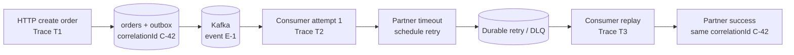
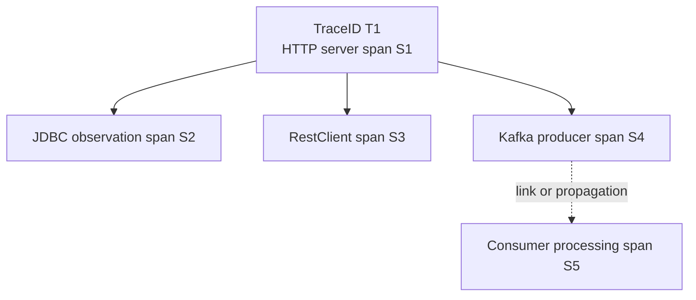
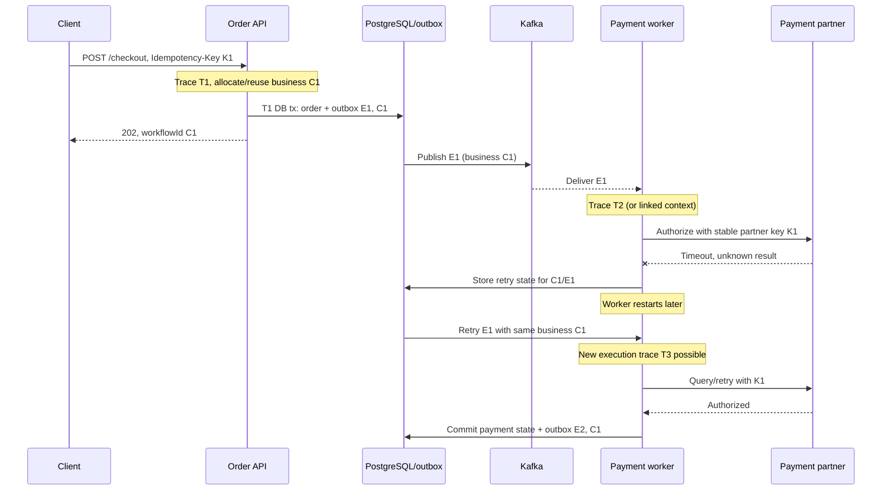
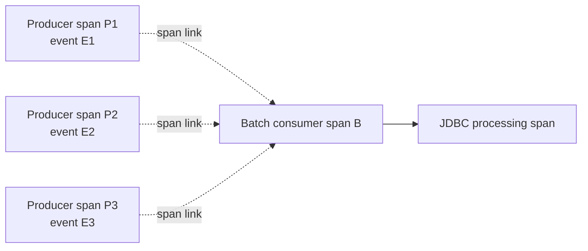

# Phân biệt mã tương quan nghiệp vụ với trace ID

## 1. Bối cảnh: cùng một đơn hàng có thể đi qua nhiều trace

Trong module **SPRING_BOOT_INTEGRATION**, một yêu cầu HTTP có thể được Spring Boot ghi vào PostgreSQL, tạo outbox event, phát Kafka, được Spring Integration định tuyến tới worker, gọi Redis và API đối tác, rồi được xử lý lại sau một lỗi mạng. Khi điều tra sự cố, nhóm vận hành cần trả lời **hai câu hỏi khác nhau**:

1. **Nghiệp vụ nào đang được xử lý?** Ví dụ toàn bộ quy trình hoàn tất đơn hàng `ORD-42`, hay một yêu cầu thanh toán có mã `PAY-REQ-17`.
2. **Một lần thực thi cụ thể đã đi qua những service, thread và thao tác nào?** Ví dụ HTTP request lúc 10:00, Kafka consumer lần đầu, hoặc lần redelivery lúc 10:25.

Để trả lời câu thứ nhất, ứng dụng cần **mã tương quan nghiệp vụ** (*business correlation ID*). Để trả lời câu thứ hai, hệ thống observability cần **trace ID** và các **span ID**.

Một lỗi phổ biến là gán `correlationId = traceId` ở mọi nơi hoặc lấy `traceId` làm khóa để chống xử lý trùng. Điều đó có thể hoạt động trong một request HTTP ngắn nhưng thất bại khi công việc tiếp tục sau restart, retry hoặc nhiều ngày chờ đối tác.



Trong sơ đồ:

- **`C-42` ổn định** theo quy trình nghiệp vụ đã được xác định, kể cả khi T1, T2 và T3 khác nhau.
- **`E-1` ổn định** nếu cùng một business event được gửi lại; đó là khóa quan trọng cho idempotency.
- **T1/T2/T3** là minh họa cho các lần quan sát thực thi có thể thuộc các trace khác nhau. Không có quy tắc rằng mọi lần tiêu thụ Kafka nhất thiết tạo trace ID mới: instrumentation, context propagation, span links và sampling có thể làm chúng liên kết hoặc nằm trong cùng trace. Điều quan trọng là **không dùng topology của trace làm hợp đồng bền vững cho nghiệp vụ**.

### Mục tiêu học tập

Sau bài học, bạn có thể:

1. Phân biệt `businessCorrelationId`, `traceId`, `spanId`, `eventId`, `causationId`, `requestId`, `Idempotency-Key` và aggregate ID.
2. Giải thích cấu trúc W3C `traceparent`/`tracestate`, `baggage` và mối quan hệ giữa trace/span IDs.
3. Thiết kế hợp đồng header/payload để một workflow nhiều bước, retry, fan-out và batch vẫn truy hồi được cùng nghiệp vụ.
4. Dùng Spring Boot Actuator, Micrometer Observation/Tracing và OpenTelemetry hoặc Brave để quan sát HTTP, JDBC và messaging.
5. Truyền **business correlation ID có chủ đích** qua `RestClient`, `WebClient`, Kafka và Spring Integration mà không nhầm với automatic trace propagation.
6. Hiểu MDC, thread handoff qua `ExecutorChannel`, Reactor Context, outbox/inbox và ranh giới tin cậy.
7. Quyết định khi nào nên dùng trace parent-child, khi nào nên có span links hoặc trace riêng cho xử lý bất đồng bộ.
8. Tránh rò rỉ dữ liệu nhạy cảm, metric high-cardinality, header spoofing và trace sampling làm sai kết luận vận hành.
9. Viết test kiểm tra identity propagation, retry/duplicate behavior, sampling, lỗi header và khả năng tra cứu sự cố.

> **Phạm vi ví dụ:** Java 17+, Spring Boot 3.5.x, Spring Integration 6.x, Micrometer Observation/Tracing và các thành phần PostgreSQL, HTTP, Kafka/RabbitMQ/Pulsar. API cụ thể của exporter, client instrumentation và message header mapper có thể thay đổi theo phiên bản. Những mã minh họa như `C-42`, `EVT-1` không phải định dạng ID do Spring tự sinh.

## 2. Bảng phân biệt các loại định danh

| Định danh | Phạm vi ý nghĩa | Ai cấp? | Tuổi thọ hợp lý | Mục đích chính |
| --- | --- | --- | --- | --- |
| **Business correlation ID** (`businessCorrelationId`) | Một workflow/operation nghiệp vụ theo hợp đồng | Ingress hoặc service điều phối có thẩm quyền | Bền qua retry, replay, restart và các bước của workflow | Tìm toàn bộ trạng thái/logs/events cùng nghiệp vụ |
| **Trace ID** (`traceId`) | Một distributed trace/trace graph | Tracing SDK hoặc propagated trace context | Thường gắn với một phạm vi quan sát thực thi; không là business lifetime contract | Nối các spans để phân tích đường đi và latency |
| **Span ID** (`spanId`) | Một thao tác/đoạn công việc trong trace | Tracing SDK | Vòng đời span | Định vị HTTP client call, DB query, message handler... |
| **Aggregate ID** (`orderId`, `paymentId`) | Một thực thể domain | Hệ thống nghiệp vụ | Theo thực thể, có thể tồn tại rất lâu | Lookup và state transitions |
| **Event ID** (`eventId`) | Một sự kiện nghiệp vụ bất biến | Producer/outbox | Stable qua redelivery/republication | Dedupe/idempotency, audit |
| **Causation ID** (`causationId`) | Sự kiện/lệnh trực tiếp khiến sự kiện hiện tại xuất hiện | Producer nghiệp vụ | Bền theo event chain | Dựng quan hệ nhân quả domain |
| **Request ID** (`requestId`) | Một lần gọi HTTP hoặc transport request | Gateway/client/server | Một request/attempt, tùy contract | Support/debug request |
| **Idempotency key** | Một **operation** mà client có thể retry | Client hoặc server theo API contract | Suốt retry/reconciliation window | Không nhân đôi business side effect |
| **Message transport ID** | Một delivery/message do broker cấp | Kafka/Rabbit/Pulsar | Phụ thuộc broker/partition/channel | ACK, offset, transport debug |

Không có quy tắc rằng mỗi loại phải có **một chuỗi khác nhau** trong mọi hệ thống: `operationId` có thể đóng vai business correlation ID hoặc idempotency key **nếu contract cho phép**. Nhưng cần phân biệt **ý nghĩa và scope**. Đặc biệt, `traceId` và `eventId` không được coi là các khóa có thể thay thế cho nhau.

### 2.1. “Correlation ID” có thể bị dùng cho hai nghĩa

Tài liệu Spring Boot về logging gọi một chuỗi được ghép từ MDC `traceId` và `spanId` là **logging correlation ID**. Đó là mã tương quan *log-to-trace* do nền tảng observability cung cấp.

Bài học này dùng **business correlation ID** để chỉ mã do **hợp đồng nghiệp vụ** định nghĩa. Ví dụ:

```text
Spring Boot log correlation:
  [4bf92f3577b34da6a3ce929d0e0e4736-00f067aa0ba902b7]

Business correlation:
  order-flow-2d834c9e
```

Hai khái niệm đều hữu ích, nhưng **không đồng nhất**. Nên đặt field rõ như `businessCorrelationId` hoặc `workflowId`, thay vì để toàn hệ thống có nhiều header đều tên `correlationId` mà không có định nghĩa.

### 2.2. Một trace ID không phải khóa thanh toán

Một HTTP client timeout sau khi đối tác đã charge thành công có thể gửi request mới với trace ID mới. Nếu server/partner dựa vào `traceId` để dedupe, request retry sẽ tạo side effect lần hai. Chống trùng phải dùng **idempotency key hợp đồng** và dữ liệu bền vững, không dùng sample tracing.

### 2.3. Business correlation không bắt buộc là order ID

Một đơn hàng có thể trải qua nhiều workflow:

```text
orderId=ORD-42
  correlationId=FLOW-CREATE-42
  correlationId=FLOW-REFUND-42
  correlationId=FLOW-RETRY-SHIP-42
```

Nếu luôn dùng `orderId` làm `businessCorrelationId`, tất cả workflow bị gộp vào một nhóm, khó xác định một lần hoàn tiền với một lần tạo đơn. **Granularity** của mã tương quan phải được nêu rõ: theo order, theo payment authorization, theo fulfillment attempt, theo saga instance, hay theo tenant-scoped business command.

## 3. W3C Trace Context: traceparent không phải business ID

W3C Trace Context chuẩn hóa cách truyền thông tin tracing qua HTTP:

```http
traceparent: 00-4bf92f3577b34da6a3ce929d0e0e4736-00f067aa0ba902b7-01
tracestate: vendorname=some-value
```

`traceparent` dạng version `00` có bốn phần:

```text
00 - 4bf92f3577b34da6a3ce929d0e0e4736 - 00f067aa0ba902b7 - 01
 |                    |                         |             |
version              trace-id                  parent-id     trace-flags
```

| Field | Cú pháp version 00 | Ý nghĩa |
| --- | --- | --- |
| `version` | 2 ký tự hex; ví dụ `00` | Phiên bản W3C trace context |
| `trace-id` | 32 ký tự hex viết thường, 16 bytes, không được toàn số 0 | Cùng một distributed trace |
| `parent-id` | 16 ký tự hex viết thường, 8 bytes, không được toàn số 0 | ID thao tác ở upstream được dùng làm parent |
| `trace-flags` | 2 ký tự hex | Bit flags, có sampled bit |
| `tracestate` | Optional vendor-specific list | Metadata của tracing vendors, không phải chỗ chứa business payload |

**Lưu ý:** `parent-id` trong HTTP `traceparent` là span ID do **caller** đưa sang; server thường tạo **span ID mới** cho span của nó. Do đó không nên so sánh “incoming parent-id” với span ID server rồi kết luận tracing bị lỗi chỉ vì hai giá trị khác nhau.

### 3.1. Trace và spans là đồ thị thời gian thực thi



Một trace thường chứa nhiều spans. Span có parent-child relationships, nhưng messaging có thể dùng **span links** để mô tả quan hệ không hoàn toàn lồng nhau, nhất là fan-out, batching và long-running asynchronous processing.

### 3.2. trace-flags sampled không bảo đảm có trace ở backend

Bit sampled gợi ý quyết định thu thập, nhưng:

- Upstream/downstream có thể áp dụng sampling riêng theo policy.
- Traces có thể bị drop ở exporter, collector, network hoặc storage.
- Backend có thể thiếu spans dù ứng dụng đã chạy.
- Một trace không xuất hiện trong UI **không có nghĩa operation nghiệp vụ chưa xảy ra**.

Business progress cần có durable state/receipt/business logs và metrics độc lập với việc trace được sample.

### 3.3. Không tự sửa trace-id để gắn mã đơn hàng

Không làm:

```text
traceId = hash(orderId)
traceId = padLeft(idempotencyKey)
```

Đây là coupling sai: trace ID cần tuân quy cách/tracing SDK và entropy/uniqueness phù hợp; order ID có thể bị đoán, trùng scope hoặc là dữ liệu nhạy cảm. Dùng **business correlation field riêng** và để tracer/propagator quản lý `traceparent`.

### 3.4. `tracestate` không chứa business state

`tracestate` dành cho dữ liệu liên quan tracing vendors, không phải nơi cất `orderStatus`, token hoặc kết quả thanh toán. Nếu cần truyền business fields, dùng header có contract hoặc payload có schema. Cũng không dùng `traceparent` làm nguồn xác thực/ủy quyền.

## 4. Business correlation ID là một hợp đồng dữ liệu

Một mã tương quan nghiệp vụ tốt phải trả lời:

- **Scope:** một saga, một order fulfillment workflow, một payment operation hay một request?
- **Ai cấp:** gateway có thẩm quyền hay service khởi tạo workflow?
- **Ổn định khi nào:** retry, timeout, broker redelivery, requeue, DLT replay, cluster restart?
- **Thay đổi khi nào:** workflow hoàn toàn mới, thao tác hoàn tiền mới, command mới?
- **Định dạng:** UUID/ULID/random opaque ID hay mã có namespace?
- **Tin cậy:** client được đề nghị ID không, server có validate/replace hay không?
- **Lưu ở đâu:** payload, outbox, inbox, database workflow state, headers và structured logs?
- **Tra cứu:** hỗ trợ từ ID tới các events, requests, trạng thái, spans trong nhiều traces?

Ví dụ hợp đồng nội bộ:

```yaml
businessCorrelation:
  field: businessCorrelationId
  scope: one-order-fulfillment-workflow
  origin: order-command-service
  required: true
  format: opaque-uuid
  stableAcrossRetries: true
  durableStorage: orders_and_outbox
  visibility: internal
```

YAML trên là **minh họa hợp đồng do team định nghĩa**, không phải cấu hình Spring Boot có hiệu lực tự động.

### 4.1. Quy tắc lifecycle đề xuất

```text
New business workflow
   -> server assigns correlation C1
   -> command accepted into durable state
   -> event E1 with C1
   -> broker delivery and redelivery still C1
   -> downstream creates event E2, inherits C1
   -> partner timeout, replay still C1
   -> workflow COMPLETE, correlation C1 remains searchable

New independent workflow for same order
   -> correlation C2 (by domain policy)
```

Khi tách một workflow thành nhiều jobs, các child jobs có thể giữ `C1` nếu chúng thuộc cùng quy trình, đồng thời có `subOperationId` nếu cần phân biệt chi tiết. Không tạo một business correlation ID mới cho **mỗi retry attempt** rồi làm mất khả năng tìm toàn bộ lịch sử.

### 4.2. Idempotency và correlation giải quyết hai vấn đề

Ví dụ:

```text
businessCorrelationId = C1   # toàn bộ checkout workflow
eventId               = E7   # payment-authorized event
idempotencyKey        = K4   # một charge operation, retry cùng key
traceId               = T9   # một lần thực thi instrumented
```

Một checkout có thể chứa **nhiều events**, **nhiều idempotent operations** và **nhiều traces**. `C1` cho phép điều tra toàn workflow nhưng **không chứng minh event đã được xử lý**. `E7`/unique receipt và `K4` mới là những khóa liên quan dedupe khi contract quy định.

### 4.3. Causation ID giải thích nguyên nhân, correlation ID giải thích nhóm

```text
Command: PlaceOrder (commandId=CMD-1, correlationId=C1)
  -> Event: OrderPlaced (eventId=E1, causationId=CMD-1, correlationId=C1)
     -> Event: PaymentAuthorized (eventId=E2, causationId=E1, correlationId=C1)
        -> Event: ShipmentRequested (eventId=E3, causationId=E2, correlationId=C1)
```

`causationId` là **liên kết trực tiếp** trong domain event graph; `businessCorrelationId` gom cả chuỗi. `traceId` mô tả các lần thực thi công nghệ tạo/tiêu thụ chúng, không thay event graph bền vững này.

### 4.4. Không có correlation ID: tạo mới có điều kiện

Nếu inbound HTTP request là **khởi đầu một workflow mới**, server có thể tạo ID mới và lưu bền vững cùng command. Nếu request chỉ là **retry** của workflow cũ nhưng thiếu ID do lỗi client, đừng tùy tiện tạo workflow mới để “bù header thiếu” trong khi gây duplicate; cần dựa vào operation key/request contract để tìm trạng thái trước đó hoặc báo lỗi.

Với inbound Kafka event thiếu required `businessCorrelationId`, policy có thể là DLT/parking/validation failure; không tự tạo ID mới mỗi redelivery nếu domain cần giữ lineage.

## 5. Một workflow có nhiều trace, nhiều spans và nhiều events

Xét checkout:



Ở các bước:

| Bước | Business correlation | Event/operation ID | Trace/Span |
| --- | --- | --- | --- |
| HTTP checkout | C1 | K1 request idempotency | T1 / HTTP server span |
| SQL order + outbox | C1 | E1 | T1 / JDBC-related spans (nếu instrumented) |
| Kafka publish E1 | C1 | E1 | Có thể thuộc T1 hoặc trace khác của outbox publisher |
| Kafka consume E1 | C1 | E1 | T2 hoặc trace được link từ producer |
| Payment timeout/retry | C1 | K1/E1 | Một hoặc nhiều attempts/spans/traces |
| Reconciliation hôm sau | C1 | K1/E1 | T3 mới có thể xuất hiện |
| Payment result event | C1 | **E2 mới**, causationId=E1 | Trace của publisher/worker hiện tại |

**Chú ý:** khi E1 được **redeliver**, `eventId=E1` giữ nguyên. Khi xử lý E1 tạo **một sự kiện domain mới** PaymentAuthorized, nó nhận `eventId=E2`; `causationId=E1` và `businessCorrelationId=C1` được duy trì.

### 5.1. Quan hệ một-nhiều là bình thường

```text
One businessCorrelationId
    -> many eventIds / causationIds
    -> many HTTP requests and retries
    -> many traceIds
    -> many spanIds in each trace
```

Đôi khi có quan hệ nhiều-nhiều:

- Một batch job gồm nhiều business correlations có **một batch processing span**.
- Một event fan-out tới ba consumer groups tạo ba traces/consumer spans.
- Một workflow được thực hiện một phần trong một request đang có trace do upstream tạo.
- Một tác vụ reconcile xử lý 500 outbox rows, mỗi row thuộc một businessCorrelationId khác nhau.

Vì vậy cơ sở dữ liệu quan sát không nên ép quan hệ **một correlation ID = một trace ID**.

### 5.2. Khi retry, cái gì được giữ lại?

| Thành phần | Redelivery cùng event | Operation mới trong cùng workflow | Workflow mới |
| --- | --- | --- | --- |
| `businessCorrelationId` | **Giữ** | **Giữ** nếu cùng workflow | Thường cấp mới |
| `eventId` | **Giữ** | **Cấp mới** cho event mới | Mới |
| `causationId` | Giữ theo envelope của event | Gắn ID của immediate cause | Theo cause mới |
| `idempotencyKey` | Giữ nếu retry cùng external operation | Key mới nếu operation khác | Theo contract |
| `traceId` | **Không bảo đảm giữ** | Có thể khác | Có thể khác |
| `spanId` | Thường là span mới cho thao tác mới | Mới | Mới |

Các quy tắc này phải được unit/integration test trên serialization, outbox republish, retry topics, DLT replay và restart.

## 6. Thiết kế envelope cho Kafka, AMQP, Pulsar và DB outbox

Trong một hệ thống có nhiều adapters, **businessCorrelationId phải tồn tại bền vững** ở nơi có thể phục hồi, thay vì chỉ nằm trong MDC hoặc HTTP request scope.

Một envelope có schema:

```java
// IntegrationEvent.java
package example.integration.contract;

import java.time.Instant;

public record IntegrationEvent<T>(
        int schemaVersion,
        String eventId,
        String businessCorrelationId,
        String causationId,
        String aggregateId,
        String eventType,
        Instant occurredAt,
        T payload) {
}
```

Payload JSON:

```json
{
  "schemaVersion": 1,
  "eventId": "EVT-ORD42-001",
  "businessCorrelationId": "FLOW-ORD42-20261121",
  "causationId": "CMD-CHECKOUT-42",
  "aggregateId": "ORD-42",
  "eventType": "order.placed",
  "occurredAt": "2026-11-21T10:00:00Z",
  "payload": {
    "orderId": "ORD-42",
    "currency": "VND",
    "amount": 250000
  }
}
```

`schemaVersion` là version của **data contract**, không phải aggregate business version và cũng không phải trace context version. `eventType` nên dùng tên ổn định có registry/compatibility policy; đừng biến nó thành nhãn metric chứa business ID.

### 6.1. Vì sao đặt correlation ID trong envelope?

Broker headers có thể:

- Bị loại bởi một adapter/header mapper hoặc bridge không được cấu hình.
- Bị mất khi dead-letter converter tạo message mới.
- Không được ghi khi outbox chỉ lưu `payload_json`.
- Không xuất hiện trong các bản export/archive để replay.
- Bị thay đổi khi dữ liệu đi qua protocol không có header tương đương.

Do đó với correlation bắt buộc cho nghiệp vụ, đặt ID ở **payload envelope hoặc các trường durable của outbox/inbox**. Có thể **lặp lại** trong message headers để log/routing nhanh, nhưng phải định nghĩa **nguồn chuẩn** và cách xử lý nếu header khác payload.

### 6.2. Source of truth khi header và payload xung đột

```text
Kafka Header: businessCorrelationId=FLOW-A
Payload:      businessCorrelationId=FLOW-B
```

Không âm thầm chọn ngẫu nhiên một giá trị. Policy thường là:

1. Bên ingress/trust boundary kiểm tra required fields và format.
2. Nếu header chỉ là bản sao để tiện quan sát, payload hợp lệ là **nguồn chuẩn**.
3. Nếu hai giá trị khác nhau, báo `CORRELATION_MISMATCH` và DLT/parking/alert theo domain, không gộp logs của hai workflow.
4. Với nguồn external, không cho header tự ý thay tenant/workflow ownership đã xác thực.

### 6.3. Version evolution

Khi đổi `schemaVersion=1` sang `2`:

- Giữ `businessCorrelationId` theo cùng ý nghĩa; tránh đổi từ workflow ID thành request ID mà không version contract.
- Nếu field đổi tên, hỗ trợ transition/compatibility trong consumers và dead-letter replay.
- Không tạo correlation mới khi deserialize event cũ chỉ vì field absent nếu historical event contract có thể xác minh lineage từ persistent source.
- Đặt policy rõ cho legacy events thiếu ID: quarantine hoặc mapping từ authoritative business record, không bịa ID mới rồi gây đứt lịch sử.

## 7. Persistence: ID nghiệp vụ phải sống lâu hơn trace backend retention

Một mẫu PostgreSQL:

```sql
CREATE TABLE order_workflow (
    workflow_id VARCHAR(100) PRIMARY KEY,
    order_id VARCHAR(100) NOT NULL,
    workflow_type VARCHAR(80) NOT NULL,
    workflow_status VARCHAR(40) NOT NULL,
    created_at TIMESTAMPTZ NOT NULL DEFAULT now(),
    updated_at TIMESTAMPTZ NOT NULL DEFAULT now()
);

CREATE TABLE integration_outbox (
    event_id VARCHAR(120) PRIMARY KEY,
    business_correlation_id VARCHAR(100) NOT NULL,
    causation_id VARCHAR(120),
    aggregate_id VARCHAR(100) NOT NULL,
    event_type VARCHAR(100) NOT NULL,
    schema_version INTEGER NOT NULL,
    payload_json JSONB NOT NULL,
    publish_state VARCHAR(30) NOT NULL DEFAULT 'PENDING',
    created_at TIMESTAMPTZ NOT NULL DEFAULT now()
);

CREATE INDEX idx_outbox_correlation
    ON integration_outbox (
        business_correlation_id, created_at
    );

CREATE TABLE integration_inbox (
    consumer_name VARCHAR(100) NOT NULL,
    event_id VARCHAR(120) NOT NULL,
    business_correlation_id VARCHAR(100) NOT NULL,
    processed_at TIMESTAMPTZ NOT NULL DEFAULT now(),
    PRIMARY KEY (consumer_name, event_id)
);
```

Đây là schema học tập; cần migrations (Flyway/Liquibase), partition/retention/index theo workload, và chính sách PII/tenant. Không lưu trace ID làm khóa chính của outbox hay inbox.

### 7.1. Idempotent consumer theo event ID, truy hồi theo correlation ID

```text
UNIQUE(consumer_name,event_id)
    -> Chống áp side effect lần hai

INDEX(business_correlation_id,created_at)
    -> Tìm mọi events cùng workflow
```

Hai database roles của hai ID khác nhau. `businessCorrelationId` không phải unique trong bảng events vì nhiều events hợp lệ cùng workflow.

### 7.2. Transaction correctness khác trace continuity

```text
T1:
  INSERT order_workflow
  INSERT order
  INSERT integration_outbox (same businessCorrelationId)
COMMIT
```

Các SQL writes phải nằm trong một transaction owner phù hợp. Một trace liên tục không giúp rollback nếu các writes thuộc hai DataSources/transactions khác nhau. Ngược lại, một JDBC transaction commit đúng dù trace backend đang outage.

### 7.3. Có nên lưu traceId vào DB?

Có thể lưu **`firstSeenTraceId` hoặc `lastAttemptTraceId` dạng diagnostic metadata** theo privacy/retention policy nếu thực sự cần. Nhưng:

- Không lấy nó làm business key, unique receipt hoặc routing ID.
- Một business event có thể có **nhiều trace IDs** qua attempts/replay.
- Trace bị sampling hoặc retention xóa, nên ID lưu vẫn có thể không truy xuất được trong trace backend.
- Không dùng trường này để quyết định transaction commit, ACK hay authorization.

Nếu cần lịch sử nhiều attempts, có thể có bảng `integration_attempt` chứa `attemptId`, `eventId`, `businessCorrelationId`, `traceId` (optional), trạng thái và thời gian; retention nên phù hợp incident/audit policy.

### 7.4. Query hỗ trợ vận hành

```sql
SELECT event_id, event_type, publish_state, created_at
FROM integration_outbox
WHERE business_correlation_id = :correlationId
ORDER BY created_at, event_id;
```

`:correlationId` là **named parameter** dùng với `NamedParameterJdbcTemplate`/`JdbcClient`; trong `psql` thuần phải thay bằng bind mechanism tương ứng. Hạn chế query xuyên tenants: luôn kết hợp tenant authorization/row-level policy theo thiết kế hệ thống.

## 8. Spring Boot Micrometer Tracing: có traceId mà không biến nó thành business ID

Trong Spring Boot 3.5, Actuator auto-configure Micrometer Observation/Tracing khi có dependencies phù hợp. Có thể dùng bridge OpenTelemetry hoặc Brave và một exporter để gửi spans sang Zipkin/OTLP collector.

Ví dụ Maven (chọn **một** bridge/exporter stack nhất quán):

```xml
<dependency>
    <groupId>org.springframework.boot</groupId>
    <artifactId>spring-boot-starter-actuator</artifactId>
</dependency>
<dependency>
    <groupId>io.micrometer</groupId>
    <artifactId>micrometer-tracing-bridge-otel</artifactId>
</dependency>
<dependency>
    <groupId>io.opentelemetry</groupId>
    <artifactId>opentelemetry-exporter-otlp</artifactId>
</dependency>
```

Khi dùng Spring Boot parent/BOM, để BOM quản lý versions tương thích. Đừng chồng **Brave + OpenTelemetry bridge** mà không có lý do và cấu hình exporter/tracer rõ.

```yaml
spring:
  application:
    name: orders-integration

management:
  tracing:
    sampling:
      probability: 1.0   # Dành cho test/staging; giảm có chủ đích ở production
  otlp:
    tracing:
      endpoint: http://otel-collector:4318/v1/traces
```

`management.otlp.tracing.endpoint` là ví dụ cho đường exporter OTLP trên Boot 3.5; endpoint/port phải phù hợp protocol collector. Trace backend/collector **không** được coi là nguồn truth để quyết định có ACK message.

### 8.1. Sampling không tương đương lưu correlation ID

Trong ví dụ, `probability: 1.0` giúp quan sát đầy đủ hơn trong test, nhưng có thể gây chi phí cao ở production. Nếu sampling 10%, về lâu dài phần lớn workflow có thể không có full trace trong backend. **Business correlation ID vẫn phải xuất hiện trong durable state và business logs** ngay cả khi không có sampled trace.

### 8.2. Observation và Tracer có phạm vi khác nhau

`ObservationRegistry` quản lý observation lifecycle để metrics/tracing handlers xử lý. `io.micrometer.tracing.Tracer` cho phép truy cập current span/trace context. `MeterRegistry` xử lý numeric meters. Không nhầm:

- **Observation**: một hoạt động được instrumented, có thể tạo metrics/tracing theo handlers.
- **Trace/Span**: mô hình distributed execution và latency.
- **Business correlation**: định danh workflow do domain contract quản lý.

### 8.3. Auto instrumentation không đồng nghĩa mọi method có span

Boot có sẵn observations cho một số HTTP components, nhưng một method service tùy ý, Spring Integration channel, Kafka conversion, JDBC query, Redis command hoặc HTTP client thủ công **không nhất thiết có span** chỉ vì bạn thêm Actuator. Cần xem từng thư viện, instrumentation, agent, observation registry, auto-config conditions và test traces thực tế.

### 8.4. RestClient/WebClient builders phải đến từ Boot

Tài liệu Boot 3.5 nêu rõ: với HTTP clients, nên dùng **Boot auto-configured `RestClient.Builder`/`WebClient.Builder`** nếu muốn tự động truyền trace context. Tạo `RestClient.create()`/`WebClient.create()` thủ công có thể bỏ qua instrumentation/propagators.

Không cấu hình application để **tự đặt traceparent từ một business ID**. Để tracing stack quản lý span creation/injection và truyền business field bằng header riêng.

## 9. Đọc traceId trong Spring Boot mà không biến nó thành nguồn truth

Spring Boot/Micrometer có `io.micrometer.tracing.Tracer` để truy cập span đang active. Ví dụ diagnostic service:

```java
// ExecutionLog.java
package example.integration.observability;

import io.micrometer.tracing.Span;
import io.micrometer.tracing.Tracer;
import org.slf4j.Logger;
import org.slf4j.LoggerFactory;
import org.springframework.stereotype.Component;

@Component
public class ExecutionLog {

    private static final Logger log =
            LoggerFactory.getLogger(ExecutionLog.class);

    private final Tracer tracer;

    public ExecutionLog(Tracer tracer) {
        this.tracer = tracer;
    }

    public void businessStep(
            String businessCorrelationId,
            String eventId,
            String step) {

        Span current = tracer.currentSpan();
        String traceId = current == null
                ? "none" : current.context().traceId();
        String spanId = current == null
                ? "none" : current.context().spanId();

        log.info(
                "workflow.step businessCorrelationId={} eventId={} "
                        + "step={} traceId={} spanId={}",
                businessCorrelationId, eventId, step, traceId, spanId);
    }
}
```

Trong code:

- `businessCorrelationId` và `eventId` **được truyền từ business envelope đã validate**.
- `traceId`/`spanId` chỉ phản ánh **span hiện hành**, không được tạo từ business ID.
- `tracer.currentSpan()` có thể trả `null` khi không có span active (ví dụ một worker thread chưa được instrumented); không vì thế mà gán `businessCorrelationId=null`.
- Tự log `traceId` có thể trùng với thông tin MDC mà Boot đã đưa vào log pattern, nên production có thể chọn chỉ log business fields và để log correlation pattern ghi trace/span.

### 9.1. Một method có thể không có active span dù tracing đã bật

Một scheduled reconciliation job, raw executor task, legacy callback hoặc SQL poller chưa instrumented có thể có `currentSpan() == null`. Chỉ vì log thiếu `traceId` không thể kết luận event chưa tồn tại.

Nếu operation đáng instrument, tạo observation/span theo API chính thức; nhưng **không tạo span chỉ để làm ID nghiệp vụ**, và không dùng `traceId` thay event receipt.

### 9.2. Custom Observation cho bước nghiệp vụ

```java
// PaymentObservation.java
package example.integration.observability;

import io.micrometer.observation.Observation;
import io.micrometer.observation.ObservationRegistry;
import org.springframework.stereotype.Component;

@Component
public class PaymentObservation {

    private final ObservationRegistry observationRegistry;
    private final PaymentWorker paymentWorker;

    public PaymentObservation(
            ObservationRegistry observationRegistry,
            PaymentWorker paymentWorker) {
        this.observationRegistry = observationRegistry;
        this.paymentWorker = paymentWorker;
    }

    public void process(IntegrationEvent<?> event) {
        Observation observation = Observation.createNotStarted(
                        "integration.payment.process",
                        observationRegistry)
                .lowCardinalityKeyValue("operation", "payment")
                .lowCardinalityKeyValue("result_kind", "attempt")
                .start();

        try (Observation.Scope scope = observation.openScope()) {
            paymentWorker.apply(event);
        } catch (RuntimeException ex) {
            observation.error(ex);
            throw ex;
        } finally {
            observation.stop();
        }
    }
}
```

`PaymentWorker` là interface/service nghiệp vụ ứng dụng cung cấp; `IntegrationEvent<T>` là DTO ở mục 6 (cần import package tương ứng). Ví dụ tạo một observation có tên **ổn định**, low-cardinality keys có giá trị hữu hạn; nó **không** đưa `businessCorrelationId` vào metric tags.

### 9.3. Khi nào dùng high-cardinality observation field?

Micrometer cho phép `highCardinalityKeyValue(...)` ở một số observation conventions/handlers, thường dành cho tracing data hơn là metric tags. Tuy vậy, một ID nghiệp vụ có thể trở thành **span attribute** trong backend của bên thứ ba. Cần phân loại dữ liệu, kiểm soát truy cập và chi phí trước khi:

```java
observation.highCardinalityKeyValue(
        "business.correlation_id",
        validatedBusinessCorrelationId);
```

Không sử dụng API này như mặc định cho mọi `orderId`, user email, account number hoặc payment token. Cách an toàn cơ bản là giữ ID trong structured logs/DB với policy truy cập phù hợp và chỉ whitelist trường thật sự cần cho trace backend.

## 10. MDC: đặt mã tương quan nghiệp vụ cạnh traceId/spanId

**MDC (Mapped Diagnostic Context)** là map context dùng bởi logging frameworks, thường gắn với thread. Spring Boot khi có Micrometer Tracing có thể đưa `traceId` và `spanId` vào MDC và sử dụng chúng làm **logging correlation ID**.

Mã nghiệp vụ `businessCorrelationId` không tự có trong MDC. Ứng dụng có thể thêm nó tại **ranh giới handler** sau khi validate envelope:

```java
// BusinessLogScope.java
package example.integration.observability;

import java.util.Objects;
import org.slf4j.MDC;

public final class BusinessLogScope implements AutoCloseable {

    private final MDC.MDCCloseable scope;

    private BusinessLogScope(String correlationId) {
        this.scope = MDC.putCloseable(
                "businessCorrelationId",
                Objects.requireNonNull(correlationId));
    }

    public static BusinessLogScope open(String correlationId) {
        return new BusinessLogScope(correlationId);
    }

    @Override
    public void close() {
        scope.close();
    }
}
```

Trong message handler:

```java
try (BusinessLogScope ignored =
        BusinessLogScope.open(event.businessCorrelationId())) {
    log.info("Processing eventId={}", event.eventId());
    orderService.apply(event);
}
```

`MDC.putCloseable()` giúp xóa key khi scope kết thúc. Nhưng nếu bạn lồng nhiều scopes cùng tên MDC key, phiên bản đơn giản trên **xóa** giá trị thay vì restore giá trị trước đó. Nếu ứng dụng có nested scopes, implement restore previous value trong `finally` để tránh mất context parent. Bên dưới có mẫu phù hợp cho nested scopes.

### 10.1. Mẫu MDC scope có restore previous value

```java
public static void withCorrelation(
        String correlationId,
        Runnable action) {

    String previous = MDC.get("businessCorrelationId");
    try {
        MDC.put("businessCorrelationId", correlationId);
        action.run();
    } finally {
        if (previous == null) {
            MDC.remove("businessCorrelationId");
        } else {
            MDC.put("businessCorrelationId", previous);
        }
    }
}
```

Đoạn này là method utility minh họa; `correlationId` cần được validate trước khi gọi. Luôn cleanup trong `finally` vì executor dùng thread pool có thể tái sử dụng thread cho workflow khác. Nếu không, log của khách hàng A có thể bị gắn ID của workflow B.

### 10.2. Log pattern riêng cho business field

Ví dụ Logback pattern có thể thêm:

```yaml
logging:
  pattern:
    correlation: "[%X{traceId:-},%X{spanId:-}] "
    level: "%5p workflow=%X{businessCorrelationId:-}"
```

Đây chỉ là **ví dụ cách đưa MDC vào log layout**, cần kiểm tra toàn bộ Logback pattern ở dự án. Đừng vô tình loại bỏ thông tin logger/time/thread khi override global pattern. Có thể ưu tiên JSON structured logging với fields riêng và suppress duplicates, thay vì ghép rất nhiều ID vào một free-text line.

### 10.3. MDC không durable

```text
Log context in HTTP thread
     ≠ Kafka message stored in broker
     ≠ Outbox row stored in database
     ≠ Reactor Context in async publisher
```

MDC được dùng **để log đúng trong scope**, không làm nơi lưu business correlation qua crash. Sau restart, lấy lại `businessCorrelationId` từ **envelope/inbox/outbox**, không từ một thread-local context đã biến mất.

## 11. HTTP: business header riêng, traceparent do tracing stack xử lý

Đề xuất đặt tên rõ:

```http
X-Business-Correlation-Id: 2d834c9e-5c1a-4fb8-9ab3-498d778ec71e
Idempotency-Key: checkout-tenantA-clientkey-17
traceparent: 00-4bf92f3577b34da6a3ce929d0e0e4736-00f067aa0ba902b7-01
```

`X-Business-Correlation-Id` là header **do ứng dụng định nghĩa**, không phải chuẩn chung của HTTP, W3C Trace Context hay Spring Boot. `traceparent` có chuẩn riêng. `Idempotency-Key` có contract retry/operation riêng. Không thay một header bằng header kia.

### 11.1. REST ingress: server cấp mã cho workflow mới

Ví dụ interface để business service kiểm soát idempotency:

```java
// WorkflowSubmissionService.java
package example.integration.checkout;

public interface WorkflowSubmissionService {

    // Thực hiện claim/reuse Idempotency-Key, validate payload,
    // và commit workflow + outbox trước khi return.
    AcceptedWorkflow submit(String idempotencyKey, CheckoutRequest request);

    record AcceptedWorkflow(String businessCorrelationId) {
    }
}
```

`CheckoutRequest` là DTO ứng dụng. Method `submit` phải được triển khai với **durable unique key** và transaction; interface không tự cung cấp idempotency. Controller:

```java
// CheckoutController.java
package example.integration.checkout;

import org.springframework.http.ResponseEntity;
import org.springframework.web.bind.annotation.PostMapping;
import org.springframework.web.bind.annotation.RequestBody;
import org.springframework.web.bind.annotation.RequestHeader;
import org.springframework.web.bind.annotation.RestController;

@RestController
public class CheckoutController {

    private final WorkflowSubmissionService submissions;

    public CheckoutController(WorkflowSubmissionService submissions) {
        this.submissions = submissions;
    }

    @PostMapping("/checkout")
    public ResponseEntity<Void> checkout(
            @RequestHeader("Idempotency-Key") String key,
            @RequestBody CheckoutRequest request) {

        var accepted = submissions.submit(key, request);
        return ResponseEntity.accepted()
                .header(
                        "X-Business-Correlation-Id",
                        accepted.businessCorrelationId())
                .build();
    }
}
```

Khi client retry cùng `Idempotency-Key` và cùng payload, service **tìm lại mã correlation đã lưu** thay vì tạo workflow mới. Khi cùng key nhưng payload khác, service phải trả conflict theo API contract. Một `202 Accepted` chỉ nên được trả khi server đã lưu work đủ bền vững để tiếp tục xử lý theo cam kết.

**Trace ID của hai HTTP requests có thể khác nhau**, nhưng response header `X-Business-Correlation-Id` vẫn giữ cùng workflow ID. Đây là test quan trọng nhất để phát hiện việc vô tình lấy traceId làm business ID.

### 11.2. RestClient: dùng builder do Spring Boot cấp

```java
// PartnerHttpConfiguration.java
package example.integration.partner;

import org.springframework.context.annotation.Bean;
import org.springframework.context.annotation.Configuration;
import org.springframework.web.client.RestClient;

@Configuration(proxyBeanMethods = false)
public class PartnerHttpConfiguration {

    @Bean
    RestClient partnerRestClient(RestClient.Builder builder) {
        return builder
                .baseUrl("https://partner.example")
                .build();
    }
}
```

`RestClient.Builder` được Spring Boot auto-configured theo điều kiện phù hợp, nên observation/trace propagation customizers có cơ hội được áp. Khi gửi request:

```java
// PartnerGateway.java
package example.integration.partner;

import org.springframework.stereotype.Component;
import org.springframework.web.client.RestClient;

@Component
public class PartnerGateway {

    private final RestClient client;

    public PartnerGateway(RestClient partnerRestClient) {
        this.client = partnerRestClient;
    }

    public void authorize(
            String businessCorrelationId,
            String operationId,
            Object requestBody) {

        client.post()
                .uri("/authorizations")
                .header(
                        "X-Business-Correlation-Id",
                        businessCorrelationId)
                .header("Idempotency-Key", operationId)
                .body(requestBody)
                .retrieve()
                .toBodilessEntity();
    }
}
```

Header business được **đặt thủ công theo contract**. `traceparent`/tracing headers để Boot/Micrometer propagator xử lý khi có active tracing context và HTTP client instrumentation. Một call không có active span có thể tạo client observation/span mới theo instrumentation; không phải mọi execution đều chia sẻ trace của request gốc.

### 11.3. Tạo RestClient thủ công có thể mất automatic propagation

```java
RestClient client = RestClient.create("https://partner.example");
```

Nếu dùng đường tự tạo này thay vì Boot auto-configured builder, có thể không nhận observation/tracing customizers, khiến downstream có business header đúng nhưng không có traceparent. **Đừng fix bằng cách tự gửi một traceparent giả**; dùng builder/instrumentation đúng và kiểm chứng request thực.

### 11.4. Header không làm authorization

Một đối tác gửi lại `X-Business-Correlation-Id` không chứng minh họ được quyền thao tác trên order/tenant tương ứng. Luôn xác thực caller, xác minh workflow owner và mapping operation. Header hữu ích cho support, nhưng không phải access token.

## 12. WebClient và reactive context: cùng ID nghiệp vụ, context thực thi khác

Với WebFlux:

```java
// ReactivePartnerConfiguration.java
package example.integration.partner;

import org.springframework.context.annotation.Bean;
import org.springframework.context.annotation.Configuration;
import org.springframework.web.reactive.function.client.WebClient;

@Configuration(proxyBeanMethods = false)
public class ReactivePartnerConfiguration {

    @Bean
    WebClient reactivePartnerClient(WebClient.Builder builder) {
        return builder
                .baseUrl("https://partner.example")
                .build();
    }
}
```

```java
// ReactivePartnerGateway.java
package example.integration.partner;

import org.springframework.web.reactive.function.client.WebClient;
import reactor.core.publisher.Mono;

public class ReactivePartnerGateway {

    private final WebClient client;

    public ReactivePartnerGateway(WebClient client) {
        this.client = client;
    }

    public Mono<String> checkStatus(
            String businessCorrelationId,
            String paymentId) {

        return client.get()
                .uri("/payments/{id}", paymentId)
                .header(
                        "X-Business-Correlation-Id",
                        businessCorrelationId)
                .retrieve()
                .bodyToMono(String.class);
    }
}
```

Ở đây business ID nằm trong **method argument**, không phụ thuộc vào MDC `ThreadLocal`. Reactive tracing context có thể đi theo Reactor Context qua các operators/subscriptions khi instrumentation đúng; đừng tự kết luận `MDC.get("traceId")` ở một operator bất kỳ sẽ luôn có giá trị.

### 12.1. `subscribe()` fire-and-forget làm thay đổi completion contract

```java
// Nguy hiểm nếu caller trả thành công/ACK ngay sau lệnh này:
reactivePartnerGateway.checkStatus(correlationId, paymentId).subscribe();
```

Kết quả network/trace span có thể hoàn tất sau khi caller ACK Kafka hoặc trả HTTP response. Sử dụng một reactive pipeline được **caller/adapter quản lý đến completion** hoặc durable inbox/outbox, không chạy detached `subscribe()` rồi dùng current trace ID để kết luận đã hoàn tất.

### 12.2. Batching có thể làm trace và correlation thành nhiều-nhiều

Một reactive `Flux` xử lý 100 events từ 20 workflows. Một observation quanh `collectList()` có thể phản ánh batch processing, không phải một businessCorrelationId duy nhất. Trên metrics chỉ tag `batch_size_band`, `status`, `consumer_group`; trên logs/DB giữ per-event correlation, còn spans có thể liên kết các creation contexts bằng **span links**.

## 13. Kafka: phân biệt event envelope, broker headers và trace propagation

Kafka có nhiều loại thông tin:

| Trường | Ví dụ | Ý nghĩa |
| --- | --- | --- |
| Topic/partition/offset | `orders.status/2/1052` | Vị trí record trong Kafka |
| Record key | `ORD-42` | Routing/partitioning key theo contract |
| Record headers | `businessCorrelationId=C1`, tracing headers tùy instrumentation | Metadata truyền qua broker |
| Record value | JSON envelope có `eventId=E1`, `businessCorrelationId=C1` | Business source of truth nếu contract quy định |
| Trace context | Context do producer/consumer instrumentation truyền | Liên kết producer/consumer observations, không phải event identity |

**Một cùng event E1 có thể được publish ở offset khác** khi outbox publisher retry. Vì vậy `(topic,partition,offset)` là vị trí delivery, không phải business idempotency ID. Kafka key `ORD-42` giúp partition/ordering trong điều kiện phù hợp, nhưng không đồng nghĩa workflow ID và cũng không thay `eventId`.

### 13.1. Producer: copy ID nghiệp vụ thành header, giữ trong payload

```java
// OrderEventPublisher.java
package example.integration.messaging;

import java.nio.charset.StandardCharsets;
import org.apache.kafka.clients.producer.ProducerRecord;
import org.springframework.kafka.core.KafkaTemplate;
import org.springframework.stereotype.Component;

@Component
public class OrderEventPublisher {

    private final KafkaTemplate<String, String> kafkaTemplate;

    public OrderEventPublisher(
            KafkaTemplate<String, String> kafkaTemplate) {
        this.kafkaTemplate = kafkaTemplate;
    }

    public void publish(
            IntegrationEvent<?> event,
            String serializedJson) {

        ProducerRecord<String, String> record =
                new ProducerRecord<>(
                        "orders.events.v1",
                        event.aggregateId(),
                        serializedJson);

        record.headers().add(
                "businessCorrelationId",
                event.businessCorrelationId()
                        .getBytes(StandardCharsets.UTF_8));
        record.headers().add(
                "eventId",
                event.eventId().getBytes(StandardCharsets.UTF_8));

        kafkaTemplate.send(record);
    }
}
```

Đoạn này chỉ demo **gắn business headers**; `IntegrationEvent<T>` cần import từ package contract. `serializedJson` phải là JSON của **cùng event**, do serializer có contract tạo ra. Một chương trình production phải:

- Theo dõi `CompletableFuture<SendResult<...>>`/callback từ `KafkaTemplate.send` và xử lý broker ACK/failure.
- Giữ eventId ổn định khi retry outbox publish.
- Chỉ đánh dấu `outbox=PUBLISHED` sau kết quả publish được xác nhận theo policy.
- Kiểm tra tracing instrumentation/observation của Spring Kafka để trace context được inject/extract đúng (bất kể chọn producer API `ProducerRecord`, `Message<?>` hay template converter).
- Không tự đặt `traceparent` bằng eventId/correlationId và không giả định mọi Spring Kafka configuration tự bật tracing.

### 13.2. Consumer: business ID từ envelope, header dùng kiểm tra

```java
// OrderEventListener.java
package example.integration.messaging;

import com.fasterxml.jackson.databind.ObjectMapper;
import java.nio.charset.StandardCharsets;
import java.util.Objects;
import org.apache.kafka.clients.consumer.ConsumerRecord;
import org.apache.kafka.common.header.Header;
import org.springframework.kafka.annotation.KafkaListener;
import org.springframework.stereotype.Component;

@Component
public class OrderEventListener {

    private final ObjectMapper mapper;
    private final OrderEventService orderEventService;

    public OrderEventListener(
            ObjectMapper mapper,
            OrderEventService orderEventService) {
        this.mapper = mapper;
        this.orderEventService = orderEventService;
    }

    @KafkaListener(
            topics = "orders.events.v1",
            groupId = "orders-projection")
    public void consume(ConsumerRecord<String, String> record)
            throws Exception {

        IntegrationEvent<?> event =
                mapper.readValue(record.value(), IntegrationEvent.class);

        Header copiedHeader =
                record.headers().lastHeader("businessCorrelationId");
        if (copiedHeader != null) {
            String copied = new String(
                    copiedHeader.value(), StandardCharsets.UTF_8);
            if (!Objects.equals(
                    copied, event.businessCorrelationId())) {
                throw new IllegalArgumentException(
                        "Correlation ID header/payload mismatch");
            }
        }

        // Method thuộc service bean khác, có DB transaction/inbox.
        orderEventService.applyAndCommit(event);
    }
}
```

`OrderEventService` là service ứng dụng có `applyAndCommit(IntegrationEvent<?> event)` và transaction/receipt phù hợp. JSON record dùng Jackson deserialization nên cần validate required fields, payload schema, size, event type và event ID; với generic payload, hãy dùng type-safe deserializer hoặc `JsonNode` theo contract, không tin dữ liệu deserialize tự hợp lệ.

**Nếu consumer method return thành công sau khi chỉ dispatch sang `ExecutorChannel`**, broker ACK/offset commit có thể đến **trước business DB commit**. Cần xử lý đồng bộ đến durable point, hoặc ghi inbox PENDING rồi ACK, sau đó worker async tự recovery. Business correlation ID tồn tại không làm flow an toàn hơn nếu không có durability.

### 13.3. Không mặc định parent-child trace xuyên Kafka

Spring Kafka Micrometer observation, native Kafka client instrumentation hoặc OpenTelemetry agent có thể tạo các spans producer/consumer và propagators. Kết quả cụ thể có thể dùng **parent-child** hoặc **span links**, và phụ thuộc configuration/version. Một record có business correlation C1 vẫn phải tìm được kể cả khi trace không nối thành một cây liền mạch.

Test nên assert:

1. Envelope chứa C1.
2. Record header C1 (nếu contract yêu cầu) giống envelope.
3. Producer/consumer observations có context truyền đúng theo instrumentation (nếu bật).
4. Redelivery ở offset mới vẫn eventId E1, correlation C1.
5. Consumer idempotency receipt không bị ảnh hưởng khi trace context absent hoặc traceId thay đổi.

## 14. Spring Integration: header `correlationId` của aggregator không phải workflow ID mặc định

Spring Integration có một khái niệm correlation **riêng cho message grouping**. Khi dùng splitter → aggregator, framework có thể dùng:

- `IntegrationMessageHeaderAccessor.CORRELATION_ID` để nhóm các messages thuộc một sequence.
- `IntegrationMessageHeaderAccessor.SEQUENCE_NUMBER` để xác định thứ tự phần.
- `IntegrationMessageHeaderAccessor.SEQUENCE_SIZE` để xác định số phần mong đợi.
- `MessageHeaders.ID` để nhận diện instance của một Spring `Message<?>`.

Những headers này **không tự là business workflow ID**. Ví dụ một workflow `C1` chứa ba splits:

```text
businessCorrelationId=C1          # business workflow
Spring Integration correlationId=G7 # aggregator message group
sequenceNumber=1,2,3              # split sequence
eventId=E1                         # một business event
traceId=T9/T10/...                 # observations tùy scope
```

Một workflow có thể chia nhiều batch/aggregator groups. Cố dùng `businessCorrelationId` làm group key duy nhất có thể khiến các splits của nhiều batch bị gộp sai, aggregator đợi nhầm số phần và phát sinh memory/persistence leak.

### 14.1. Hãy dùng tên header riêng cho ID nghiệp vụ

```java
// BusinessMessageHeaders.java
package example.integration.messaging;

public final class BusinessMessageHeaders {
    public static final String BUSINESS_CORRELATION_ID =
            "businessCorrelationId";
    public static final String EVENT_ID = "eventId";
    public static final String CAUSATION_ID = "causationId";

    private BusinessMessageHeaders() {
    }
}
```

```java
Message<?> message = MessageBuilder.withPayload(event)
        .setHeader(
                BusinessMessageHeaders.BUSINESS_CORRELATION_ID,
                event.businessCorrelationId())
        .setHeader(
                BusinessMessageHeaders.EVENT_ID,
                event.eventId())
        .build();
```

Imports:

```java
import org.springframework.messaging.Message;
import org.springframework.messaging.support.MessageBuilder;
```

Các keys trong `BusinessMessageHeaders` là **custom**, không phải constants do Spring cung cấp. **Không** set `IntegrationMessageHeaderAccessor.CORRELATION_ID` tùy tiện cho business ID trừ khi bạn cũng chủ động thiết kế `CorrelationStrategy` của aggregator tương ứng.

### 14.2. Message ID có thể đổi trong pipeline

Spring Messaging `MessageHeaders.ID` nhận diện một **message instance**; một transformer/enricher tạo message mới có thể có message ID mới. Do đó:

```text
MessageHeaders.ID ≠ stable business eventId
Integration CORRELATION_ID ≠ businessCorrelationId (unless explicitly designed)
traceId ≠ MessageHeaders.ID
```

Nếu dùng `MessageHeaders.ID` làm unique receipt, một event có thể được xử lý lặp sau khi transformer tạo message khác ID. Business eventId phải được giữ riêng ở envelope và durable receipt.

### 14.3. ExecutorChannel đổi thread, không đổi business ID

```text
HTTP caller (trace T1, business C1)
  → DirectChannel
  → ExecutorChannel
      → worker thread (trace may need propagation/observation)
      → business event C1 must still be present in message envelope
```

Một `TaskDecorator` có thể giúp MDC/tracing context qua thread, nhưng **không nên dùng ThreadLocal/MDC làm nguồn chuẩn** cho business ID; nó có thể bị mất hoặc rò context giữa reused worker threads. Handler nên đọc `businessCorrelationId` từ payload đã validate và mở MDC scope của chính nó.

### 14.4. Bật Spring Integration observations có chủ đích

Theo tài liệu **Spring Integration 6.5**, `ObservationRegistry` có mặt **chưa có nghĩa mọi IntegrationManagement component tự được instrumented**. Có thể bật:

```java
// IntegrationObservabilityConfiguration.java
package example.integration.config;

import org.springframework.context.annotation.Configuration;
import org.springframework.integration.config.EnableIntegration;
import org.springframework.integration.config.EnableIntegrationManagement;

@Configuration(proxyBeanMethods = false)
@EnableIntegration
@EnableIntegrationManagement(observationPatterns = "*")
public class IntegrationObservabilityConfiguration {
}
```

`observationPatterns="*"` instrument toàn bộ component phù hợp để minh họa/debug. Với traffic lớn, **chọn patterns cho các channels/handlers cần quan sát**, tránh tạo quá nhiều spans/metrics không cần thiết. Cần có `ObservationRegistry` đúng, handlers/tracing backend phù hợp và kiểm tra output. Một số components/versions có conventions riêng; Spring Integration 6.5 còn instrument `SourcePollingChannelAdapter` theo tài liệu của dòng phiên bản đó.

### 14.5. Observation propagation có thể sửa message headers để truyền trace context

Spring Integration quan sát `MessageChannel` sender và `MessageHandler` receiver bằng Micrometer Observation; khi đúng các endpoints được enable, producer side có thể inject trace metadata vào message headers và consumer side extract rồi tạo observation liên kết. Điều này **khác với việc tự lưu businessCorrelationId**, vốn là trách nhiệm của envelope/hợp đồng ứng dụng.

Nếu giữa hai endpoints có broker, persistent channel hoặc custom adapter/header mapper, cần test **message headers thực được giữ lại**; không giả định tracing context tự vượt qua mọi protocol/custom serializer.

## 15. RabbitMQ và Pulsar: hai lớp metadata vẫn cần tồn tại

Với RabbitMQ/Spring AMQP:

- Exchange, routing key và delivery tag: thông tin vận chuyển.
- AMQP application headers: nơi có thể copy `businessCorrelationId`, `eventId`.
- Payload envelope: nơi business identity phải bền vững nếu contract yêu cầu.
- Tracing context: do instrumentation/header propagator inject và extract khi được cấu hình đúng.

Ví dụ RabbitTemplate:

```java
rabbitTemplate.convertAndSend(
        "orders.events.exchange",
        "order.placed",
        event,
        message -> {
            message.getMessageProperties().setHeader(
                    "businessCorrelationId",
                    event.businessCorrelationId());
            message.getMessageProperties().setHeader(
                    "eventId",
                    event.eventId());
            return message;
        });
```

`rabbitTemplate` và `event` là beans/DTO ứng dụng; JSON message converter cần cấu hình để serialize envelope đúng schema. Khi consumer redeliver sau NACK/connection failure, business ID/eventId phải giữ nguyên. Một broker delivery tag không phải business idempotency key.

Với Pulsar/Spring Pulsar:

- Subscription type (Exclusive, Failover, Shared, Key_Shared) ảnh hưởng parallelism/order theo key.
- Message properties có thể mang business headers nếu producer/consumer converters map phù hợp.
- Pulsar message ID không thay stable `eventId` khi producer republish.
- Tracing propagation và spans phụ thuộc Spring Pulsar/client version/instrumentation; kiểm tra serialization/extraction thực.

### 15.1. DLT và retry topics phải copy lineage

Khi chuyển event sang retry topic/DLT:

```json
{
  "eventId": "EVT-ORD42-001",
  "businessCorrelationId": "FLOW-ORD42-20261121",
  "retryAttempt": 4,
  "originalTopic": "orders.events.v1",
  "errorCategory": "partner.timeout"
}
```

Ví dụ này là **metadata của retry envelope**; nếu tạo một domain event mới để thông báo thất bại, event mới cần eventId mới với `causationId` tương ứng. Với retry của **chính event cũ**, giữ stable eventId, business correlation và payload contract.

### 15.2. Đừng dùng traceparent làm DLT replay key

Trace context cũ có thể đã hết retention hoặc không hợp lệ khi message được replay sau một tuần. Replay phải dựa trên durable business identity/event receipt và recovery policy; tracing context có thể tạo trace mới và link tới origin trace nếu còn metadata và instrumentation phù hợp.

## 16. Baggage: truyền context liên dịch vụ nhưng không thay business envelope

W3C `baggage` là cơ chế truyền một tập key/value của application-defined distributed context, **độc lập** với Trace Context. Ví dụ:

```http
baggage: rollout.group=blue,feature.variant=A
```

Nó khác:

```http
traceparent: 00-4bf92f3577b34da6a3ce929d0e0e4736-00f067aa0ba902b7-01
X-Business-Correlation-Id: FLOW-42
```

### 16.1. Vì sao không đưa mọi ID vào baggage?

- Baggage có thể được gửi tới **mọi downstream** nơi propagation bật, kể cả vendor bên ngoài.
- Nó có thể bị log bởi proxies, agents, error-reporting tools.
- Header size, cardinality và overhead tăng theo số key/value.
- Baggage không phải durable work store; nếu outbox chỉ lưu payload, baggage từ request thread có thể không tồn tại khi replay.
- Một `tenantId`/`userId`/email trong baggage có thể gây lộ dữ liệu hoặc khiến downstream tin sai authorization.

Nên **allowlist** những fields ít nhạy cảm, cần thật sự truyền theo request, có length/type limits. Với businessCorrelationId bắt buộc sống qua outbox/restart, **envelope/DB vẫn là nguồn chuẩn**, kể cả khi cũng copy vào baggage để tracing.

### 16.2. Baggage và MDC là hai việc khác nhau

Một giá trị nằm trong baggage **không mặc định** hiện ở MDC nếu chưa cấu hình tracer/baggage correlation. Spring Boot 3.5 có các properties như:

```yaml
management:
  tracing:
    baggage:
      remote-fields:
        - "x-internal-workflow-hint"
      correlation:
        fields:
          - "x-internal-workflow-hint"
```

Đây là cấu hình ví dụ cho một field **được allowlist và không nhạy cảm**, không phải yêu cầu phổ quát. Semantics baggage wire format và remote header mapping khác nhau giữa OpenTelemetry/Brave/B3/W3C, cần kiểm tra đúng tracer/version. Nếu đã chọn truyền business ID qua **envelope/HTTP custom header**, không nhất thiết cần thêm baggage layer.

### 16.3. Không set baggage trực tiếp từ untrusted HTTP header

Trước khi chấp nhận một giá trị vào baggage, phải xác thực/validate theo nguồn tin cậy. Không cho client đặt `isAdmin=true` hay `tenant=otherTenant` trong baggage rồi để downstream sử dụng như authorization fact. Baggage phục vụ observability/context convenience, không thay identity và authorization boundary.

### 16.4. Baggage không phải metric tag

Một giá trị baggage có thể được khai báo thêm thành span tag hoặc MDC field qua cấu hình. Nhưng **không** coi việc đó cho phép đưa `businessCorrelationId` vào Prometheus metric label. Correlation ID high-cardinality phải nằm trong logs/traces/DB có policy, còn metrics dùng dimensions hữu hạn.

## 17. Span parent-child và span links: đừng ép cả workflow vào một trace

Trong HTTP request ngắn, parent-child thường trực quan:

```text
HTTP server span
  ├── JDBC span
  └── HTTP client span
```

Với event-driven systems:

```text
Producer message creation context P
  -> Kafka / RabbitMQ / Pulsar
  -> Consumer attempt A after 10 seconds
  -> Consumer attempt B after 40 minutes
  -> DLQ replay after two days
```

**Parent-child không phải lúc nào là mô hình phù hợp.** Một consumer có thể xử lý một batch 100 messages thuộc nhiều producer traces; một span chỉ có **một parent**, còn có thể có **nhiều links**. OpenTelemetry semantic conventions cho messaging dùng span links làm cơ chế correlation mặc định cho producer/consumer operations trong nhiều scenarios, đặc biệt batching/fan-out, và cho phép chọn parent trong một số single-message cases.



Không có một trace ID nào tự đại diện cho **toàn bộ các business correlations** trong batch này. Để truy hồi nghiệp vụ, mỗi event vẫn cần `businessCorrelationId` riêng.

### 17.1. Khi nào nối parent-child và khi nào link?

| Tình huống | Mô hình tracing hợp lý | Business identity |
| --- | --- | --- |
| HTTP server gọi RestClient trong cùng request | Child HTTP client span dưới current trace | Cùng C1 nếu cùng workflow |
| Async task ngắn có propagated active context | Có thể child observation/span khi propagation đúng | C1 phải đi qua message/argument |
| Kafka single-message consumer | Parent hoặc link theo instrumentation semantics | C1 và E1 trong envelope |
| Kafka batch consumer từ nhiều producers | Span links tới nhiều producer creation contexts | Nhiều C/E tương ứng |
| Retry sau 2 ngày | Trace mới và link với origin nếu khả thi; không buộc giữ trace cũ | C1/E1 giữ nguyên |
| Scheduled reconciliation đọc 500 rows | Span của reconcile batch, links/per-event spans tùy instrumentation | 500 business IDs có thể khác nhau |
| SAGA compensation | Span của compensation attempt; parent/link theo execution context | Giữ hoặc cấp business ID mới theo domain contract, causation rõ |

### 17.2. OpenTelemetry API cho span links (minh họa khi dùng OTel trực tiếp)

```java
// Ví dụ chỉ dùng khi ứng dụng chủ động instrument OpenTelemetry API.
SpanBuilder builder = otelTracer.spanBuilder("orders.reconcile");

if (originalProducerSpanContext != null
        && originalProducerSpanContext.isValid()) {
    builder.addLink(originalProducerSpanContext);
}

Span span = builder.startSpan();
try (Scope scope = span.makeCurrent()) {
    reconciler.processPendingEvent(event);
} finally {
    span.end();
}
```

Imports:

```java
import io.opentelemetry.api.trace.Span;
import io.opentelemetry.api.trace.SpanBuilder;
import io.opentelemetry.context.Scope;
```

`otelTracer`, `originalProducerSpanContext`, `reconciler`, `event` là các dependencies/values ứng dụng. `originalProducerSpanContext` phải được trích xuất từ **trace context hợp lệ đã được kiểm soát**, không từ business correlation ID. `io.opentelemetry.api.trace.Tracer` khác interface `io.micrometer.tracing.Tracer`; đừng import nhầm. Với Spring Boot Micrometer instrumentation thông thường, **ưu tiên auto observations/propagation trước** rồi mới thêm manual OTel spans nếu thật sự cần; tránh double instrumentation.

### 17.3. Không cố duy trì một span sống suốt nhiều ngày

Một span kéo dài qua 48 giờ chờ đối tác:

- Dễ sai về latency: phần lớn thời gian là **waiting state**, không phải CPU/HTTP request.
- Khó export/retain, có thể không finish khi pod crash.
- Tạo coupling giữa tracing backend retention và business workflow.

Thay vào đó, lưu durable workflow state và tạo **những spans hữu hạn** cho từng action/attempt, liên kết theo trace context khi phù hợp và luôn truy hồi bằng business correlation ID.

## 18. Sampling, retention và incident investigation

Một trace có thể bị mất khỏi backend do:

- Head sampling probability, tail sampling policy hoặc upstream sampling flags.
- Collector drop, exporter timeout, network outage, quá tải backend.
- Backend retention ngắn hơn thời gian workflow tồn tại.
- Instrumentation chưa bật cho một hop HTTP, channel, listener hoặc worker.
- Security gateway chủ động loại trace headers từ nguồn ngoài.

Không trường hợp nào chứng minh work đã thất bại. Business correlation/query DB mới cho biết **trạng thái nghiệp vụ**.

### 18.1. Sampling khác logging/audit retention

| Nguồn dữ liệu | Có sampling không? | Dùng làm nguồn truth nghiệp vụ? |
| --- | --- | --- |
| Trace spans | Thường có sampling | **Không** |
| Application logs | Có thể sampling/filter/retention | Không đủ nếu thay durable workflow state |
| Numeric metrics | Aggregated, không lưu từng event | Không |
| Outbox/inbox/receipt tables | Theo DB transaction/retention | **Có** trong phạm vi contract |
| External partner status | Theo API/partner contract | Cần reconcile khi unknown outcome |
| Business audit ledger | Theo quy định hệ thống | Có thể là authoritative |

`businessCorrelationId` có thể nối records trong logs/DB ngay cả khi trace bị sample. Không nên thiết kế incident workflow chỉ có nút “open trace by traceId” mà không có đường tìm bằng workflow ID.

### 18.2. Không lấy trace ID để báo cáo SLA nghiệp vụ

Một workflow thanh toán có thể gồm ba attempts, mỗi attempt có một trace, tổng wall-clock 30 phút. Nếu tính “payment latency” chỉ bằng duration của một trace 50 ms ở lần retry cuối, SLA thực bị bóp méo.

Để tính end-to-end business latency:

```text
workflow.created_at
workflow.completed_at
workflow.businessCorrelationId
```

Kết quả là **workflow completion latency**; trace spans giúp giải thích **từng đoạn thời gian** ở worker/HTTP/DB nhưng không tự cộng thành SLA đúng cho những khoảng chờ ở queue/retry.

### 18.3. Trace sampling không được quyết định idempotency

Anti-pattern:

```java
if (tracer.currentSpan() == null) {
    // Không có trace thì bỏ qua dedupe?
}
```

Trace span có thể absent do sampling/async/observability disabled. Dedupe phải dựa trên `eventId`, unique constraints, operation idempotency key và transaction receipt, **không phụ thuộc vào việc tracing được bật hay không**.

## 19. Security và trust boundaries: đừng biến correlation thành access token

Một hệ thống mở HTTP API có thể nhận các headers:

```http
X-Business-Correlation-Id: FLOW-42
traceparent: 00-4bf92f3577b34da6a3ce929d0e0e4736-00f067aa0ba902b7-01
baggage: tenant=other-team
```

**Các giá trị đều có thể do client tự gửi.** Không được coi chúng là bằng chứng user được quyền đọc `FLOW-42`, xem dữ liệu tenant khác hoặc được xử lý với sampling ưu tiên.

### 19.1. Phân loại trường trước khi propagate

| Trường | Thường được coi là | Nên xử lý |
| --- | --- | --- |
| `traceparent` | Untrusted incoming trace metadata | Tracer/proxy validate theo W3C, giới hạn và chính sách accept/restart trace |
| `tracestate` | Optional vendor metadata | Validate, giới hạn size, không chứa PII |
| `baggage` | Distributed key-value từ caller | Whitelist; không tin tenant/role tự khai |
| `X-Business-Correlation-Id` | Proposed/echoed business identifier | Validate format, bind với authenticated workflow/tenant |
| `Idempotency-Key` | Client operation key | Scope theo tenant/user/operation và payload fingerprint |
| `Authorization` | Authentication credential | Chỉ xử lý qua auth pipeline; không đưa sang trace/log |
| `eventId` | Business event identity | Validate producer/namespace/immutability, unique receipt |

### 19.2. Validate ID sớm và giới hạn kích thước

Nếu hệ thống cho phép opaque IDs gồm ASCII an toàn:

```java
// CorrelationIds.java
package example.integration.contract;

import java.util.regex.Pattern;

public final class CorrelationIds {

    private static final Pattern SAFE =
            Pattern.compile("[A-Za-z0-9][A-Za-z0-9._:-]{0,127}");

    private CorrelationIds() {
    }

    public static String requireValid(String value) {
        if (value == null || !SAFE.matcher(value).matches()) {
            throw new IllegalArgumentException(
                    "Invalid business correlation ID format");
        }
        return value;
    }
}
```

Regex chỉ là **một ví dụ contract**, không phải bắt buộc cho mọi tổ chức. Nó giới hạn độ dài 1–128 ký tự và tránh CR/LF/control characters có thể gây log/header injection. Nếu dùng UUID, có thể parse bằng `UUID.fromString` và canonicalize; kiểm tra thêm namespace/tenant ownership.

### 19.3. Định danh không đồng nghĩa authorization

Khi khách hàng gọi:

```http
GET /workflows/FLOW-42
```

server phải xác thực caller và xác minh workflow thuộc tenant/account được phép. Một correlation ID khó đoán **không** biến endpoint tra cứu thành an toàn nếu thiếu access checks.

Tương tự, nếu `businessCorrelationId` được đưa vào MDC, log-search UI cũng cần quyền xem logs/records theo tenant và retention policy.

### 19.4. W3C traceparent có thể bị lợi dụng

Các risks:

- Header malformed/oversized gây parser/logging overhead.
- Attacker cố gắng ép sampling hoặc trace context không hợp lệ.
- Trace ID được reuse cố ý để khiến traffic không liên quan trông như cùng trace.
- Baggage/tracestate chứa dữ liệu mà downstream không nên nhận.

Nên để tracing library/proxy kiểm tra W3C format, dùng limits và trust policy trên ingress. Không tự nối raw user-supplied trace ID vào log/DB keys mà không validate. Nếu boundary yêu cầu tạo trace mới, đừng vì thế thay đổi business ID đã được lưu đúng.

### 19.5. Privacy/cardinality

Đừng đặt email, số thẻ, access token, địa chỉ hoặc dữ liệu sức khỏe vào businessCorrelationId để “dễ đọc”. Chọn **opaque ID**. Với trace/span attributes, không đưa raw payload/SQL bind values/Authorization headers lên backend tracing.

`businessCorrelationId` có thể là dữ liệu liên kết người dùng qua nhiều events; vì vậy ngay cả opaque ID cũng cần kiểm soát access và retention.

## 20. Logging và metrics: hai trường correlation nhưng không làm nổ cardinality

Một structured log tốt:

```json
{
  "timestamp": "2026-11-21T10:12:34Z",
  "level": "INFO",
  "service": "orders-integration",
  "event": "payment.retry_scheduled",
  "businessCorrelationId": "FLOW-ORD42-20261121",
  "eventId": "EVT-ORD42-001",
  "traceId": "4bf92f3577b34da6a3ce929d0e0e4736",
  "spanId": "00f067aa0ba902b7",
  "attempt": 2,
  "nextAttemptDelaySeconds": 60,
  "result": "RETRYABLE"
}
```

Đây là **cấu trúc log minh họa**, không phải JSON Boot mặc định. Tùy tracing context, các fields `traceId/spanId` có thể absent; business fields vẫn cần được log ở những mốc nghiệp vụ quan trọng.

### 20.1. Mã nghiệp vụ trong log, không đưa vào meter labels

Không làm:

```text
integration_events_processed_total{
  businessCorrelationId="FLOW-ORD42-20261121",
  eventId="EVT-ORD42-001"
}
```

Mỗi ID mới tạo thêm time series mới, gây **high-cardinality explosion**. Nên dùng:

```text
integration_events_processed_total{
  source="kafka",
  event_type="order.placed",
  outcome="duplicate"
}
```

`source`, `event_type`, `outcome` có tập giá trị hữu hạn theo allowlist. ID cụ thể có thể được giữ trong logs/traces có policy hoặc truy vấn DB trực tiếp.

### 20.2. Đo business completion tách khỏi transport

| Metric | Câu hỏi |
| --- | --- |
| `integration_received_total` | Có bao nhiêu deliveries tới ingress? |
| `integration_executor_accepted_total` | Bao nhiêu tasks được executor nhận? |
| `integration_business_committed_total` | Bao nhiêu effects mới được DB commit? |
| `integration_duplicates_total` | Bao nhiêu deliveries bị xác nhận đã xử lý? |
| `integration_gaps_total` | Có bao nhiêu event thiếu predecessor? |
| `integration_outbox_oldest_age_seconds` | Outbox còn chờ publish bao lâu? |
| `integration_workflow_duration_seconds` | Workflow business hoàn tất sau bao lâu? |
| `http_client_requests_seconds` | Một HTTP call mất bao lâu? |
| `jdbc_pool_pending` | Threads chờ database connections? |

Đây là **tên metric gợi ý**, không bảo đảm đã có sẵn trong Actuator/Micrometer. Chúng khác spans; cần thiết kế metric owner/counters/gauges rõ.

### 20.3. Correlation hỗ trợ truy vấn nhưng không thay SLO

Một workflow C1 trải qua 10 attempts. Log search theo C1 giúp tìm từng retry; metric `workflow_duration_seconds` cần lấy từ state timestamps. Đừng tính 10 attempts thành 10 workflows completed.

### 20.4. Không log mọi event ở DEBUG vô hạn

Spring Integration và HTTP clients có thể phát rất nhiều debug logs khi lưu lượng cao. Chọn mốc quan trọng: `accepted`, `persisted`, `published`, `processed`, `failed`, `retried`, `DLT`, `completed`. Sampling/filter logs theo policy, nhưng **business audit cần durable source riêng** nếu là yêu cầu pháp lý/đối soát.

## 21. Test ID lifecycle: cùng workflow, nhiều attempts và events

Một unit test kiểm tra **hợp đồng dữ liệu**, không phụ thuộc tracer:

```java
// BusinessCorrelationContractTest.java
package example.integration.contract;

import java.time.Instant;
import java.util.Map;
import org.junit.jupiter.api.Test;

import static org.assertj.core.api.Assertions.assertThat;

class BusinessCorrelationContractTest {

    @Test
    void replayKeepsEventIdAndBusinessCorrelation() {
        var first = new IntegrationEvent<>(
                1,
                "EVT-1",
                "FLOW-42",
                "CMD-1",
                "ORD-42",
                "order.placed",
                Instant.parse("2026-11-21T10:00:00Z"),
                Map.of("status", "PLACED"));

        // Mô phỏng chính envelope được lấy lại từ outbox/retry.
        var replay = first;

        assertThat(replay.eventId()).isEqualTo("EVT-1");
        assertThat(replay.businessCorrelationId())
                .isEqualTo("FLOW-42");
        assertThat(replay.causationId()).isEqualTo("CMD-1");
    }

    @Test
    void newEventWithinWorkflowGetsNewEventId() {
        var created = new IntegrationEvent<>(
                1, "EVT-1", "FLOW-42", "CMD-1",
                "ORD-42", "order.placed",
                Instant.parse("2026-11-21T10:00:00Z"),
                Map.of("status", "PLACED"));

        var paymentAuthorized = new IntegrationEvent<>(
                1, "EVT-2", created.businessCorrelationId(),
                created.eventId(), created.aggregateId(),
                "payment.authorized",
                Instant.parse("2026-11-21T10:01:00Z"),
                Map.of("status", "AUTHORIZED"));

        assertThat(paymentAuthorized.eventId())
                .isNotEqualTo(created.eventId());
        assertThat(paymentAuthorized.businessCorrelationId())
                .isEqualTo(created.businessCorrelationId());
        assertThat(paymentAuthorized.causationId())
                .isEqualTo(created.eventId());
    }
}
```

Test này minh họa invariants. Trong production, replay là **deserialize từ persisted envelope** chứ không chỉ gán `var replay = first`. Cần thêm serialization roundtrip test, DLT replay test và restart test với PostgreSQL/Kafka để chứng minh ID được lưu bền vững qua adapters.

## 22. Kiểm thử HTTP: cùng idempotency key, hai request, một workflow

Một test tích hợp quan trọng:

```text
Given:
  POST /checkout dùng Idempotency-Key=K1
  cùng tenant và cùng canonical business payload

When:
  Request A được server chấp nhận và persist workflow C1
  Client bị timeout / mất HTTP response
  Request B retry với K1 và payload y hệt

Then:
  B trả lại X-Business-Correlation-Id=C1
  Không tạo thêm order/outbox business event
  C1 vẫn dùng để tra cứu workflow
  Trace ID của A và B KHÔNG là điều kiện kiểm tra business identity
```

### 22.1. MockMvc test skeleton

```java
// CheckoutCorrelationIT.java
package example.integration.checkout;

import org.junit.jupiter.api.Test;
import org.springframework.beans.factory.annotation.Autowired;
import org.springframework.boot.test.autoconfigure.web.servlet.AutoConfigureMockMvc;
import org.springframework.boot.test.context.SpringBootTest;
import org.springframework.http.MediaType;
import org.springframework.test.web.servlet.MockMvc;

import static org.assertj.core.api.Assertions.assertThat;
import static org.springframework.test.web.servlet.request.MockMvcRequestBuilders.post;
import static org.springframework.test.web.servlet.result.MockMvcResultMatchers.status;

@SpringBootTest
@AutoConfigureMockMvc
class CheckoutCorrelationIT {

    @Autowired
    MockMvc mvc;

    @Test
    void sameOperationRetryKeepsBusinessCorrelationId()
            throws Exception {

        String body = """
                {"orderId":"ORD-42","amount":250000,"currency":"VND"}
                """;

        var first = mvc.perform(
                    post("/checkout")
                        .header("Idempotency-Key", "checkout-key-42")
                        .contentType(MediaType.APPLICATION_JSON)
                        .content(body))
                .andExpect(status().isAccepted())
                .andReturn();

        var second = mvc.perform(
                    post("/checkout")
                        .header("Idempotency-Key", "checkout-key-42")
                        .contentType(MediaType.APPLICATION_JSON)
                        .content(body))
                .andExpect(status().isAccepted())
                .andReturn();

        String a = first.getResponse().getHeader(
                "X-Business-Correlation-Id");
        String b = second.getResponse().getHeader(
                "X-Business-Correlation-Id");

        assertThat(a).isNotBlank();
        assertThat(b).isEqualTo(a);

        // Bổ sung assertion count(*)=1 tại bảng workflow/outbox
        // và payload fingerprint bằng repository thật của dự án.
    }
}
```

Test giả định ứng dụng thực hiện `WorkflowSubmissionService.submit` với **durable idempotency store**. Nếu controller chỉ trả `UUID.randomUUID()` mỗi lần mà không lưu, test phải fail. Đừng sửa test bằng cách mock service trả cố định một ID rồi xem như đã chứng minh DB uniqueness.

### 22.2. Test cùng key, payload khác

```text
Request A: key=K1, amount=250000 -> accepted C1
Request B: key=K1, amount=350000 -> conflict
```

Trong domain này, test kỳ vọng server **không tạo C2 mới** và không âm thầm trả kết quả của A như thể amount=350000 được chấp nhận. Cần canonical request fingerprint/validation và scope key theo tenant/operation.

### 22.3. Test không có tracing backend

Chạy test environment không export spans (hoặc cấu hình sampling phù hợp). Controller vẫn phải sinh/tìm lại **business correlation ID ổn định**, còn inbox/outbox vẫn được ghi. Trong Spring Boot testing, các tracing reporters thường không tự được cấu hình trong `@SpringBootTest`; muốn assert spans/export thực, cần **test-specific tracer/in-memory exporter** thay vì chỉ kỳ vọng backend UI có record.

### 22.4. Không ép traceId khác nhau trong mọi retry test

Nếu client truyền lại một trace context có chủ đích, request B có thể liên quan cùng trace; nếu instrumentation tạo root mới, trace ID có thể khác. Test hợp đồng business phải giữ `C1` **bất kể** traceId A/B bằng hay khác nhau. Có thể dùng test-controlled tracing context để chứng minh hai trường hợp, nhưng không đặt việc “hai trace ID phải khác” thành invariant nghiệp vụ.

## 23. Ma trận kiểm thử propagation qua HTTP, Spring Integration và brokers

| Trường hợp | Điều phải giữ | Điều có thể thay đổi | Điểm kiểm tra |
| --- | --- | --- | --- |
| HTTP → RestClient | Business C1, operation key theo contract | Span ID outbound | WireMock/MockWebServer request headers |
| HTTP → WebClient | Business C1 | Reactive execution thread/span | Reactive integration test + request captured |
| HTTP → JDBC outbox | Business C1, event E1 và causation | Trace ID có thể không lưu | SQL query trong transaction/DB |
| Outbox → Kafka | Envelope C1/E1; header copy đúng nếu quy định | Kafka offset, producer span | Testcontainers Kafka/record inspection |
| Kafka redelivery E1 | C1/E1 ổn định | Delivery attempt, consumer span/trace | Kill/restart consumer và DB receipt |
| Kafka → Spring Integration `ExecutorChannel` | Payload/envelope C1/E1 | Thread/MDC/active span | Latch + handler log/observations |
| Splitter/Aggregator | C1 trong payload | Integration group correlation/sequence | Group key/sequence contract test |
| Kafka → RabbitMQ bridge | C1/E1 | Transport IDs, trace topology | End-to-end headers & payload mapping |
| Pulsar republish | C1/E1 theo event contract | Pulsar message ID | Consumer idempotency test |
| Retry topic/DLT | C1/E1 ổn định khi replay cùng event | attempt ID, trace ID | Serialized retry envelope |
| New domain event E2 | C1 giữ, causation=E1 | eventId=E2, trace/spans | Event contract test |
| Reconciliation after restart | C1/E1 từ DB | Trace/span ID mới có thể xuất hiện | Persistent state + new process |
| Batch nhiều workflows | C1/C2... riêng từng event | One batch span hoặc span links | Per-message metadata/links |
| Sampled-out trace | C1/E1 vẫn tồn tại | Không có span ở backend | DB and logs |
| Invalid business header | Không được gán nhầm workflow | Request bị reject/park | Negative security tests |

### 23.1. Test RestClient: hai headers có chủ sở hữu khác nhau

Trong một HTTP test với fake partner:

1. Khởi động Spring Boot context có Micrometer tracing test configuration và **auto-configured `RestClient.Builder`**.
2. Tạo active observation/trace ở caller.
3. Gọi `PartnerGateway.authorize(C1,K1,...)`.
4. Kiểm tra outgoing `X-Business-Correlation-Id=C1`, `Idempotency-Key=K1`.
5. Kiểm tra `traceparent` hợp lệ khi tracing propagation bật và active context tồn tại; không yêu cầu `traceId=C1`.
6. Thử đường tạo client thủ công thiếu instrumentation để xác định thay đổi trace propagation; business header vẫn đi qua.

Không hard-code một traceId cố định khi dùng sampling/random SDK. Có thể inject một test tracer với ID đã định trước, hoặc assert cấu trúc/quan hệ qua in-memory spans.

### 23.2. Test Kafka headers và dữ liệu bền vững

Để tránh test giả:

```text
Produce E1/C1 with event envelope and business header
  → read actual Kafka record with Testcontainers
  → assert record value C1/E1
  → assert header C1 exactly equals payload C1
  → consume and commit inbox
  → simulate rebalance/retry/new offset with same E1/C1
  → assert inbox receipt count = 1, business effect = 1
```

Không chỉ assert `KafkaTemplate.send()` đã được gọi. Test thật phải kiểm tra serialization/headers/consumer path và phân biệt broker ACK với business DB commit. Tác dụng idempotency thuộc `eventId` và DB constraints, không phụ thuộc tracing.

### 23.3. Test Spring Integration aggregator không gộp workflows

```text
Batch A:
  businessCorrelationId=C1
  integrationGroupId=GA
  sequence 1/2 and 2/2

Batch B:
  businessCorrelationId=C1 (same workflow!)
  integrationGroupId=GB
  sequence 1/2 and 2/2

Expected:
  Aggregator emits two separate batch results GA and GB
  Both outputs retain business C1
```

Đây là test bắt lỗi dùng business correlation ID làm **group key duy nhất** khi một workflow có nhiều batches. Cần custom `CorrelationStrategy` hoặc để framework sequence headers được tạo đúng; không sửa nhầm `IntegrationMessageHeaderAccessor.CORRELATION_ID` để nhét business C1 vào mọi split.

### 23.4. Test MDC khi ExecutorChannel tái sử dụng thread

```text
Worker thread reused:
  Event E1 -> businessCorrelationId=C1
  Event E2 -> businessCorrelationId=C2

Expected logs/scopes:
  E1 logs carry C1, not C2
  E2 logs carry C2, not C1
  after each handler -> previous MDC state restored/removed
```

Trong test, dùng một executor thread (`core=max=1`) và latches/futures có timeout để chắc cùng thread xử lý hai tasks. Đừng chỉ dùng `Thread.sleep()` rồi đọc MDC từ test thread: MDC là thread-local, test phải quan sát **bên trong worker**.

### 23.5. Test W3C header invalid và privacy

```text
traceparent invalid length
traceparent trace-id all zeroes
traceparent parent-id all zeroes
traceparent non-hex characters
baggage oversized / unexpected "tenant" attribute
X-Business-Correlation-Id contains newline/control char
X-Business-Correlation-Id from another tenant
```

Expected:

- Tracing context được library/proxy **validate/reset/reject theo policy**, không crash toàn flow do một header malformed.
- Business correlation hợp lệ vẫn được xác minh từ domain identity và tenant ownership.
- Không log raw dangerous headers, không gắn PII vào spans/metrics.
- Invalid/mismatched business correlation không bị coi là duplicate success.

### 23.6. Fault injection: trace backend outage

Ngắt collector/Zipkin backend tạm thời, sau đó chạy workflow:

- HTTP/outbox/consumer vẫn tuân transaction và ACK contract.
- Business C1 và E1 vẫn ghi bền vững.
- Exporter có lỗi/drop theo telemetry policy nhưng không làm mất business event.
- Monitoring còn business metrics/logs/DB queries cho incident.

Nếu application được cấu hình crash chỉ vì exporter mất kết nối, cần kiểm tra telemetry pipeline coupling. Observability nên hỗ trợ hệ thống, không trở thành single point of failure cho xử lý đơn hàng, trừ yêu cầu audit/compliance chuyên biệt được thiết kế tường minh.

## 24. Tìm lỗi khi trace và business correlation bị “đứt”

### 24.1. Triệu chứng và cách phân biệt nguyên nhân

| Triệu chứng | Nguyên nhân có thể | Điều cần xác minh |
| --- | --- | --- |
| Log có `traceId` nhưng không có business C | Handler không lấy ID từ envelope hoặc MDC scope thiếu | DTO/header mapping, context setup |
| Log có C nhưng không có `traceId` | Span chưa active, tracing disabled/sampled, context không propagate | Tracer, ObservationRegistry, executor/Reactor hop |
| HTTP outbound không có `traceparent` | Dùng `RestClient.create()`/custom `WebClient` bỏ Boot builder | HTTP client bean và observation customizers |
| Kafka consumer C1 đúng nhưng trace khác producer | Async trace/link semantics, sampling hoặc propagation bị ngắt | Record headers, producer/consumer instrumentation |
| Kafka consumer C khác outbox C | Envelope/header mapper, DLT converter, producer bug | Compare payload vs header vs DB row |
| Replay DLT sinh C mới | Consumer tự cấp correlation mỗi attempt | DLT envelope/persistent source of truth |
| Event E1 có nhiều trace IDs | Redelivery/retry/restart, điều này có thể đúng | Unique receipt/eventId và attempt logs |
| Một trace gắn nhiều business IDs | Batch processing/fan-out, có thể đúng | Per-event IDs, span links |
| Aggregator gộp sai các batches | Dùng business C làm Spring Integration group key | Sequence/correlation strategy |
| MDC của event B mang C của event A | Thread pool reuse không cleanup | MDC `finally`, TaskDecorator |
| Metrics quá nhiều series | Tag theo correlation/eventId/userId | Remove high-cardinality meter labels |
| Support không tìm thấy trace cũ | Trace đã hết retention hoặc không sampled | DB workflow/outbox, structured logs |
| Same Idempotency-Key trả workflow ID khác | Không có durable unique key/atomic claim | Checkout idempotency table/transaction |
| Cùng `eventId` payload khác | Producer vi phạm immutable event contract | Compare stored fingerprint, alert |
| Header `baggage` làm lộ tenant | Propagate untrusted PII/identity | Allowlist, trust boundary, tracing configuration |
| `traceId` được dùng làm dedupe key | Nhầm observability với business identity | Unique business receipt và retry test |

### 24.2. Runbook: support chỉ có trace ID

1. Tìm trace ở backend theo ID, kiểm tra thời gian/retention/sampling.
2. Từ spans/logs liên quan, trích `businessCorrelationId`, `eventId` hoặc order ID đã được validate.
3. Kiểm tra workflow record/outbox/inbox theo **business ID**, không suy từ trace đã là toàn bộ lịch sử.
4. Liệt kê những attempts/traces khác cùng C trong log search, kể cả retries/compensation.
5. Kiểm tra trạng thái business cuối cùng và những side effects đã commit.
6. Nếu trace không tồn tại, quay về logs/DB theo external operation key; không kết luận “không có giao dịch”.

### 24.3. Runbook: support chỉ có business correlation ID

1. Xác thực người yêu cầu được phép xem workflow theo tenant/account.
2. Tìm `order_workflow`, outbox/inbox/events theo correlation ID.
3. Sắp events theo business sequence/time, không dựa vào order của trace spans.
4. Từ mỗi event/attempt tìm logs tương ứng và traceId nếu còn.
5. Dùng spans để xác định bottleneck: HTTP partner, DB lock, broker lag, executor queue.
6. Nếu nhiều traces, không cố merge bằng cách sửa trace IDs; giữ business timeline ở DB/audit.
7. Báo business status, retry state và recovery action dựa trên source of truth, không dựa vào một span thành công.

### 24.4. Runbook: business ID đổi sau retry

1. Xác định message gốc và `businessCorrelationId` đã persist.
2. Đọc serializer/envelope mapper ở bước outbox → broker, retry → DLT và worker.
3. Tìm đoạn code gọi `UUID.randomUUID()` trong mỗi listener attempt.
4. Kiểm tra `MessageHeaders.ID` hoặc `traceId` có bị copy nhầm sang business field.
5. Xác minh client retry cùng idempotency key có tìm lại workflow cũ hay không.
6. Sửa mapping/contract; bổ sung test serialization/replay/restart để giữ C ổn định.
7. Với dữ liệu đã phát, tạo kế hoạch reconciliation mapping IDs dựa trên authoritative records, không tự merge hai workflows không được chứng minh liên quan.

### 24.5. Runbook: mất trace context qua Spring Integration

1. Xác định Spring Integration version và `ObservationRegistry`/tracing bridge có trong context.
2. Kiểm tra `@EnableIntegrationManagement` và `observationPatterns` có instrument đúng channel/handler không.
3. Tìm ranh giới `ExecutorChannel`, `QueueChannel`, header mapper, gateway, broker bridge.
4. Xem trace headers/context có thực đi qua message headers khi producer/consumer observation bật không.
5. Phân biệt **trace sampling** với **trace propagation** và **business header copying**.
6. Dùng test tracing exporter/observations có kiểm soát, không đoán từ một log line.
7. Giữ businessCorrelationId từ envelope cho dù phải tạo trace mới.

## 25. Tình huống tổng hợp: ba traces, một quy trình thanh toán

**Bối cảnh giả định:** một đơn hàng `ORD-42` được tạo, payment partner trả timeout, job retry chạy sau 30 phút. Nhóm vận hành nhìn thấy ba trace IDs ở ba lần xử lý và nhầm chúng thành **ba lần thanh toán độc lập**.

### 25.1. Timeline nghiệp vụ thực tế

```text
10:00:00
  POST /checkout
  businessCorrelationId = FLOW-42
  idempotencyKey        = PAY-OP-42
  traceId               = 11111111111111111111111111111111
  -> commit order + outbox event EVT-1

10:00:05
  Kafka consumer processes EVT-1
  businessCorrelationId = FLOW-42
  eventId               = EVT-1
  traceId               = 22222222222222222222222222222222
  -> partner HTTP timeout, unknown outcome
  -> durable retry scheduled

10:30:00
  Retry worker handles same EVT-1
  businessCorrelationId = FLOW-42
  eventId               = EVT-1
  traceId               = 33333333333333333333333333333333
  -> partner status query with PAY-OP-42: already authorized
  -> commit payment state
  -> emit new event EVT-2, causationId=EVT-1, correlation=FLOW-42
```

Các trace IDs trong timeline là chuỗi minh họa không phải dữ liệu collector thật. Chúng có cấu trúc 32 ký tự hex và khác nhau để làm rõ vấn đề; một instrumentation thực có thể nối spans/links khác đi.

### 25.2. Diễn giải sai và diễn giải đúng

| Nhận định | Đúng hay sai? | Vì sao |
| --- | --- | --- |
| “Có ba trace IDs nên có ba checkout workflows.” | **Sai** | Ba traces có thể là ba attempts thuộc C1 |
| “Cùng FLOW-42 thì đã thanh toán ba lần.” | **Sai** | Correlation nhóm công việc, không đếm side effects |
| “EVT-1 có hai deliveries nghĩa là DB phải có hai effects.” | **Sai** | At-least-once delivery cần idempotent receipt |
| “Khi trace backend mất T2, payment chắc chưa xảy ra.” | **Sai** | Sampling/retention/export không là business truth |
| “PAY-OP-42 phải ổn định khi hỏi lại partner.” | **Đúng theo contract** | Cùng payment operation có unknown outcome |
| “EVT-2 nên dùng eventId khác EVT-1, cùng workflow.” | **Đúng** | Đó là một domain event mới do EVT-1 gây ra |
| “Order workflow status có thể tra được từ FLOW-42.” | **Đúng khi được thiết kế** | Cần durable workflow state và authorized query |

### 25.3. Thiết kế truy vấn support

Với quyền hạn phù hợp:

```sql
SELECT workflow_id, order_id, workflow_status,
       created_at, updated_at
FROM order_workflow
WHERE workflow_id = :businessCorrelationId;
```

```sql
SELECT event_id, causation_id, event_type,
       publish_state, created_at
FROM integration_outbox
WHERE business_correlation_id = :businessCorrelationId
ORDER BY created_at, event_id;
```

Các query dùng named parameters của ứng dụng, không ghép chuỗi user input. Có thể kết hợp `tenant_id` nếu schema có multitenancy. Sau khi có event IDs và timestamps, đội vận hành mới tìm các trace IDs khác nhau trong logs để phân tích latency của từng attempt.

### 25.4. Một lỗi kiến trúc sẽ bị bài kiểm thử phát hiện

Nếu consumer thực hiện:

```java
String correlationId = tracer.currentSpan().context().traceId();
```

rồi ghi biến đó vào outbox, lần retry có thể tạo correlation ID khác. Hậu quả:

- Support không nối được các attempts.
- DLT replay bị tính thành workflow mới.
- Dashboard business completion bị đếm trùng.
- Nếu field bị dùng làm idempotency key, **duplicate effect** có thể xảy ra.

**Cách sửa:** chỉ lấy `businessCorrelationId` từ durable event/workflow identity; `traceId` lấy từ tracer **chỉ cho diagnostics**. EventId/operation key riêng xử lý dedupe, không được thay bằng bất cứ trace/span ID nào.

### 25.5. Mẫu log sau khi sửa

```text
INFO workflow.accepted
  businessCorrelationId=FLOW-42 eventId=EVT-1
  traceId=11111111111111111111111111111111

WARN payment.partner_timeout
  businessCorrelationId=FLOW-42 eventId=EVT-1 attempt=1
  traceId=22222222222222222222222222222222

INFO payment.reconciled
  businessCorrelationId=FLOW-42 eventId=EVT-1 attempt=2
  traceId=33333333333333333333333333333333

INFO workflow.completed
  businessCorrelationId=FLOW-42 causationId=EVT-1 eventId=EVT-2
```

Log workflow cuối có thể không có trace/span nếu được ghi bởi một scheduled job chưa instrumented. Thiếu trace ID không khiến completion sai: DB workflow/outbox receipts mới là chứng cứ business state theo contract.

## 26. Checklist thiết kế, kiểm thử và vận hành

1. **Định nghĩa scope** của business correlation: workflow, saga, order fulfillment hay payment operation.
2. **Đặt tên riêng** `businessCorrelationId`/workflowId, không chỉ dùng từ `correlationId` mơ hồ.
3. **Không gán** business ID từ `traceId` hoặc `spanId`.
4. **Tách** `eventId` (dedupe), `causationId` (domain causal link), `Idempotency-Key` (retry operation) và aggregate ID.
5. **Cấp ID tại đúng authority** khi tạo workflow; client-proposed ID cần xác thực/validate.
6. **Ổn định qua retry:** cùng business operation/replay giữ correlation, event và idempotency keys theo contract.
7. **Event mới có eventId mới**, giữ correlation/causation phù hợp.
8. **Lưu bền vững** business correlation trong workflow state, outbox/inbox/event envelope.
9. **Không dùng header/MDC làm nơi lưu duy nhất** của business ID.
10. **Quy định source of truth** nếu envelope và broker header xung đột.
11. **Giữ trace context chuẩn** qua `traceparent`/`tracestate` bằng tracer/propagators, không tự xây từ business ID.
12. **Không coi traceparent là authorization**; validate untrusted headers.
13. **Dùng Boot auto-configured HTTP builders** cho `RestClient`/`WebClient` để được áp tracing customizers.
14. **Kiểm tra Kafka/Rabbit/Pulsar header mapping**, retry/DLT forwarding và serialization thực tế.
15. **Phân biệt Spring Integration group correlation header** với business workflow correlation.
16. **Bật Integration observations có chọn lọc** qua `ObservationRegistry` và `@EnableIntegrationManagement(observationPatterns=...)` khi phù hợp phiên bản.
17. **Dùng span links khi cần** cho fan-out, batches, background retries; đừng ép một trace sống nhiều ngày.
18. **MDC scope có cleanup**, tránh rò giá trị giữa worker threads.
19. **Reactive context propagation** được test; không giả định ThreadLocal luôn còn trong WebFlux.
20. **Baggage allowlist**, tránh dữ liệu nhạy cảm/tenant role không tin cậy và header bloat.
21. **Metric tags low cardinality**; không tag theo eventId/businessCorrelationId/userId.
22. **Traces có sampling/retention**; business completion phải xác định từ durable state.
23. **Idempotency không phụ thuộc sampling**; trace absence không được bỏ qua dedupe.
24. **ACK sau durable boundary**, không sau `ExecutorChannel.send()==true` nếu chưa persist work.
25. **Test HTTP retry** cùng key/cùng payload trả về một workflow ID.
26. **Test payload conflict** cùng key/ID không bị nhận như duplicate hợp lệ.
27. **Test Kafka replay và DLT** giữ C1/E1 nhưng có thể có trace/attempt mới.
28. **Test splitter/aggregator** không dùng C1 gộp nhầm nhiều message groups.
29. **Test MDC/context reuse** trên một executor thread cho hai workflows khác nhau.
30. **Test tracing disabled/collector outage**: business state/receipt/ACK vẫn chính xác.
31. **Kiểm soát quyền tra workflow** bằng authenticated tenant/operation, không chỉ biết opaque ID.
32. **Runbook tra cứu hai chiều**: từ trace ID tìm business correlation, từ business ID tìm tất cả attempts/traces.
33. **Có business SLO độc lập** với span durations, dùng workflow timestamps và backlog age.
34. **Review exporter/backend costs**, sensitive fields, retention, dashboards và audit policy.

### Câu hỏi tự kiểm tra

**1.** Vì sao cùng một business workflow có thể có ba trace IDs mà vẫn chỉ là một nghiệp vụ?

**2.** `traceId` và `spanId` khác nhau ở điểm nào? `parent-id` trong `traceparent` là span ID của ai?

**3.** `businessCorrelationId`, `eventId`, `causationId` và `Idempotency-Key` giải quyết bốn vấn đề nào?

**4.** Vì sao không nên lấy `traceId` làm unique key cho bảng `processed_event`?

**5.** Spring Boot nói “logging correlation ID” làm từ `traceId`/`spanId`. Điều đó có nghĩa `businessCorrelationId` tự động có trong MDC không?

**6.** Nếu client POST hai lần cùng `Idempotency-Key` do timeout, có cần giữ cùng traceId không? ID nào bắt buộc ổn định?

**7.** Với Kafka DLT replay một tuần sau, vì sao business correlation vẫn phải đọc được ngay cả khi không còn trace cũ?

**8.** Spring Integration `IntegrationMessageHeaderAccessor.CORRELATION_ID` được dùng để làm gì trong splitter/aggregator? Nó có luôn bằng workflow ID không?

**9.** Khi `RestClient.create()` không truyền traceparent, nên sửa instrumentation như thế nào?

**10.** Khi nào span links phù hợp hơn parent-child spans trong messaging?

**11.** Có nên đưa email, tenant role, businessCorrelationId vào `baggage` và metric labels không? Vì sao?

**12.** Tại sao một `currentSpan()==null` ở worker không chứng minh worker chưa xử lý message?

**13.** Nếu hai records trong cùng Kafka batch thuộc hai workflows, một batch span nên dùng business ID nào?

**14.** Làm sao kiểm tra client header business C1 không thể dùng để truy cập workflow của tenant khác?

**15.** Khi chỉ có một trace ID cũ nhưng trace backend không còn record, những dữ liệu bền vững nào có thể hỗ trợ điều tra?

**16.** Tracing và distributed transaction khác nhau như thế nào? Một trace liên tục có làm hai database writes atomic không?

## Tài liệu tham khảo

- [W3C Trace Context](https://www.w3.org/TR/trace-context/): cấu trúc `traceparent`/`tracestate`, validation, sampling flags và privacy.
- [W3C Baggage](https://www.w3.org/TR/baggage/): key/value context propagation độc lập với Trace Context, security và privacy.
- [OpenTelemetry — Messaging Spans Semantic Conventions](https://opentelemetry.io/docs/specs/semconv/messaging/messaging-spans/): producer/consumer, batch, span links và parent relationships.
- [OpenTelemetry — Context Propagation](https://opentelemetry.io/docs/concepts/context-propagation/): inject/extract context qua process boundaries.
- [Spring Boot 3.5 — Tracing](https://docs.spring.io/spring-boot/3.5/reference/actuator/tracing.html): Micrometer Tracing auto-configuration, trace/span MDC và HTTP client builders.
- [Spring Boot 3.5 — Observability](https://docs.spring.io/spring-boot/3.5/reference/actuator/observability.html): ObservationRegistry, observations, context propagation.
- [Spring Boot 3.5 — Common Application Properties](https://docs.spring.io/spring-boot/3.5/appendix/application-properties/index.html): management tracing, baggage, sampling và logging options.
- [Spring Integration 6.5 — Metrics and Management](https://docs.spring.io/spring-integration/reference/6.5/metrics.html): `ObservationRegistry`, `@EnableIntegrationManagement`, `observationPatterns` và message observations.
- [Spring Integration 6.5 — Messages](https://docs.spring.io/spring-integration/reference/6.5/message.html): message IDs, correlation/sequence headers và metadata.
- [Spring Integration 6.5 — Aggregator](https://docs.spring.io/spring-integration/reference/6.5/aggregator.html): correlation/release strategies và grouping semantics.
- [Spring Integration 6.5 — Error Handling](https://docs.spring.io/spring-integration/reference/6.5/error-handling.html): errors từ async channels và message headers.
- [Spring Framework — Observability Support](https://docs.spring.io/spring-framework/reference/integration/observability.html): Micrometer Observation abstraction và instrumentation.
- [Spring Kafka — Listener Containers](https://docs.spring.io/spring-kafka/reference/kafka/receiving-messages/message-listener-container.html): consumer/ACK/concurrency/rebalance boundaries.
- [Spring AMQP — Receiving Messages](https://docs.spring.io/spring-amqp/reference/amqp/receiving-messages/async-consumer.html): AMQP listener lifecycle, headers/ACK, redelivery.
- [Spring for Apache Pulsar — Reference](https://docs.spring.io/spring-pulsar/reference/): subscription, message properties và ACK.
- [Micrometer Tracing — Reference](https://docs.micrometer.io/tracing/reference/): Tracer API, baggage và span context.
- [Testcontainers — PostgreSQL](https://java.testcontainers.org/modules/databases/postgres/): kiểm chứng inbox/outbox state thực trong integration tests.

## Kết luận

**Business correlation ID** trả lời “*đây là quy trình nghiệp vụ nào?*”; **trace ID** trả lời “*lần thực thi phân tán này được quan sát qua những spans nào?*”. Một đơn hàng, thanh toán hay saga có thể được xử lý qua nhiều HTTP requests, broker deliveries, workers, retries và nhiều traces; mã tương quan nghiệp vụ phải **ổn định theo hợp đồng và được lưu bền vững** trong workflow state/event envelope/outbox/inbox. Trace ID và span ID là định danh **observability context**, được tracer quản lý qua `traceparent`/`tracestate`, sampling và span links; chúng không thay `eventId`, `Idempotency-Key` hay transaction receipt. Trong Spring Boot, hãy kết hợp Micrometer Tracing, `RestClient.Builder`/`WebClient.Builder`, Spring Integration observations, message header mapping, structured logs và MDC được cleanup đúng; đồng thời giữ logic **authorization, idempotency, ACK, retry và business completion** độc lập với trace backend. Khi thiết kế và kiểm thử được cả hai chiều **business ID → các attempts/traces** và **trace ID → business workflow**, hệ thống tích hợp sẽ dễ điều tra hơn mà không đánh đổi tính đúng đắn của nghiệp vụ.
