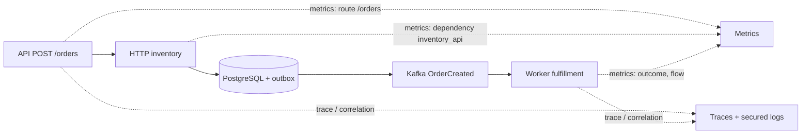

# Giới hạn cardinality của nhãn và không gắn định danh cá nhân vào metrics

## 1. Bối cảnh: quan sát tích hợp nhưng không làm nổ số time series

Một hệ thống **Spring Boot Integration** thường đi qua nhiều ranh giới: REST API gọi đối tác bằng RestClient/WebClient, giao dịch JDBC/JPA, Redis cache, Kafka/RabbitMQ, HTTP inbound/outbound gateway và các adapter của Spring Integration. Nhóm vận hành cần biết lưu lượng, latency, tỷ lệ lỗi, số lần retry, backlog và sức khỏe của từng phụ thuộc. Micrometer cùng Spring Boot Actuator cho phép thu thập **metrics** ở những điểm đó; Prometheus hoặc hệ thống giám sát khác lưu trữ và truy vấn chúng.

Một lỗi thiết kế dễ gặp là thêm `userId`, `orderId`, `correlationId`, `eventId` hoặc cả URL chứa ID vào **tags/labels** của metric để "dễ tra cứu từng yêu cầu". Khi mỗi yêu cầu có một giá trị mới, một metric có thể tạo hàng trăm nghìn hoặc hàng triệu tổ hợp nhãn. Kết quả là tiêu tốn RAM phía ứng dụng, tăng kích thước scrape, tải lưu trữ, độ trễ truy vấn và chi phí của hệ thống quan sát. Đồng thời, việc đưa định danh cá nhân vào nhãn có thể lan truyền dữ liệu không cần thiết sang một hệ thống có chính sách truy cập và lưu giữ khác với database nghiệp vụ.

**Nguyên tắc xuyên suốt bài học:** Metric labels phải là các **nhóm giá trị hữu hạn, được kiểm soát và hữu ích để tổng hợp**. Định danh của một người, request, đơn hàng hoặc sự kiện thuộc về hệ thống nghiệp vụ; chúng chỉ nên xuất hiện trong log/trace có kiểm soát khi thật sự cần và được phép. Hãy thiết kế nhãn dựa trên câu hỏi vận hành cần trả lời, không dựa trên việc dữ liệu nào đang có sẵn trong payload.

Mục tiêu học tập:

1. Giải thích cardinality, cách tổ hợp nhãn tạo số series và ảnh hưởng của histogram.
2. Phân biệt tags của metrics với correlation ID, trace ID và log attributes.
3. Chọn nhãn an toàn cho HTTP client, Redis, JDBC, broker và Spring Integration.
4. Cấu hình Spring Boot/Micrometer, đặt giới hạn phòng vệ và kiểm thử phát sinh series.
5. Ứng phó với nhãn ngoài dự kiến mà không làm mất khả năng theo dõi lỗi và độ trễ.

## 2. Metric name, label và time series khác nhau thế nào?

Một metric mô tả một đại lượng. Ví dụ:

```text
integration_partner_requests_total{
    dependency="quote_api",
    operation="get_quote",
    outcome="success"
} 1642
```

`integration_partner_requests_total` là tên chuỗi trong ví dụ kiểu Prometheus; `dependency`, `operation` và `outcome` là các **label keys**. Các giá trị đi kèm là **label values**. Một tổ hợp duy nhất của tên metric và tập các cặp nhãn xác định một chuỗi thời gian (time series). Thực tế có thể còn các nhãn do hệ thống thu thập thêm như `job`, `instance`, `pod`, `namespace`.

**Cardinality của một nhãn** là số giá trị phân biệt mà nhãn đó nhận. **Cardinality của một metric** thường là số tổ hợp giá trị nhãn thực sự xuất hiện. Nếu có ba nhãn với lần lượt 5, 4 và 8 giá trị, số tổ hợp tối đa trong điều kiện mọi tổ hợp đều xảy ra là:

```text
5 dependency × 4 operation × 8 outcome = 160 series
```

Khi thêm `orderId` với 100.000 giá trị và mỗi đơn có nhiều thao tác, trần tổ hợp lý thuyết tăng lên:

```text
5 × 4 × 8 × 100.000 = 16.000.000 series
```

Đây là **giới hạn minh họa**, không khẳng định mọi tổ hợp sẽ xuất hiện. Nhưng chỉ cần một lượng đáng kể giá trị `orderId` mới cũng đủ làm cardinality tăng liên tục. Trên môi trường Kubernetes, các nhãn `instance` hay `pod` còn nhân thêm số series theo số replica.

### 2.1. Bẫy từ Histogram, Percentile và SLO bucket

Counter với một bộ nhãn thường tạo ít series hơn histogram. Nếu bật xuất histogram cho timer, mỗi tổ hợp nhãn có thể sinh nhiều series: các bucket, tổng thời gian và số phép đo (tùy backend/cấu hình). Nhân số bucket với số tổ hợp nhãn sẽ tăng áp lực lên exporter và storage.

Vì vậy, metric có 200 tổ hợp nhãn **không nhất thiết chỉ có 200 time series xuất ra**. Trước khi bật percentile histogram hoặc nhiều SLO bucket, phải kiểm tra số bucket và số series thực tế tại endpoint xuất metrics và tại backend. Đặc biệt, đừng bật histogram cho metric có URL raw, topic động hoặc định danh người dùng.

### 2.2. Bốn câu hỏi để đánh giá một nhãn

- **Có bao nhiêu giá trị có thể xuất hiện?** Hữu hạn cỡ 3–20 giá trị hay sinh mới mỗi request?
- **Ai kiểm soát giá trị?** Enum/hợp đồng nội bộ, dữ liệu từ tenant, URL đối tác hay input bất kỳ của client?
- **Nhãn có chứa dữ liệu cá nhân/nhạy cảm?** Email, số điện thoại, IP, định danh khách hàng, token, mã đơn có thể liên kết tới người?
- **Cần tổng hợp hay cần truy nguyên một cá thể?** Nếu cần tìm một request, dùng trace/log có kiểm soát; metric nên trả lời xu hướng.

## 3. Nhãn nên dùng và nhãn phải tránh

| Loại trường | Ví dụ | Quyết định | Lý do |
| --- | --- | --- | --- |
| Tên dependency đã đăng ký | `dependency="inventory_api"` | Nên dùng | Danh sách hữu hạn, gắn với runbook |
| Tên operation chuẩn hóa | `operation="reserve_stock"` | Nên dùng | Có contract và số lượng ổn định |
| Outcome theo enum | `outcome="success" / "timeout" / "rejected"` | Nên dùng | Hữu ích cho tỷ lệ lỗi và cảnh báo |
| HTTP method | `method="GET"` | Nên dùng | Số giá trị ít |
| HTTP status class | `status_family="5xx"` | Nên dùng | Rất ít giá trị, hữu ích khi tổng hợp |
| URI pattern | `uri="/orders/{orderId}"` | Nên dùng khi route đã chuẩn hóa | Tránh biến ID thành series |
| Broker topic tĩnh | `topic="orders.events.v1"` | Có điều kiện | Chỉ khi topic nằm trong allowlist hữu hạn |
| Tên cache do hệ thống định nghĩa | `cache="product_lookup"` | Có điều kiện | Chặn cache name do người dùng tự tạo |
| `tenantId`, `customerId`, `userId` | `userId="u-94820"` | Không đưa vào metric labels | Cardinality cao, có thể nhận diện chủ thể |
| `orderId`, `eventId`, `messageId` | `eventId="..."` | Không đưa vào metric labels | Mỗi nghiệp vụ/sự kiện sinh giá trị mới |
| `correlationId`, `traceId`, `spanId` | `traceId="..."` | Không đưa vào metric labels | Dùng để truy vết riêng lẻ, không tổng hợp |
| Email, số điện thoại, IP, session/token | `email="person@example.org"` | Không đưa vào metric labels | Thông tin cá nhân, nhạy cảm hoặc liên kết được |
| URL raw/query string | `uri="/orders/123?email=..."` | Không đưa vào metric labels | Vừa tăng cardinality vừa lộ dữ liệu |
| SQL đầy đủ, Redis key, Kafka record key | `key="inventory:user:123"` | Không đưa vào metric labels | Nội dung động, có thể chứa dữ liệu nghiệp vụ |
| Thông báo exception đầy đủ | `error="User 123 not found"` | Không đưa vào metric labels | Cardinality không kiểm soát và có thể lộ payload |

**Không dùng hashing làm cách giải quyết cardinality.** `hash(userId)` vẫn tạo ra gần như một giá trị mới cho mỗi người, và giá trị có thể liên kết ngược bằng cách so sánh. Định danh băm vẫn không tự trở thành dữ liệu ẩn danh; cũng không tự làm metric phù hợp với chính sách bảo mật.

### 3.1. Có thể gắn tenant vào nhãn không?

Một nhãn `tenant` có vẻ hữu ích khi giám sát SaaS, nhưng nhiều tenant có thể làm cardinality tăng theo quy mô khách hàng. Ngoài ra, ID tenant có thể là dữ liệu cần hạn chế chia sẻ. Chỉ dùng phân nhóm hữu hạn, đã phê duyệt, ví dụ `service_tier="free" / "standard" / "enterprise"` nếu mức gói không tiết lộ thông tin không được phép. Khi cần phân tích một tenant cụ thể, dùng dashboard chuyên trách được phân quyền và hệ thống dữ liệu phù hợp; không biến mọi metric thành truy vấn theo tenant.

## 4. Hợp đồng tên nhãn trong hệ thống tích hợp

Nên đặt một **metric contract** cho từng thành phần, tương tự hợp đồng dữ liệu HTTP hoặc event:

| Metric | Đơn vị | Nhãn được phép | Giới hạn gợi ý | Mục đích |
| --- | --- | --- | --- | --- |
| `integration.partner.requests` | Số request | `dependency`, `operation`, `outcome` | 8 × 10 × 5 | Tỷ lệ lỗi đối tác |
| `integration.partner.duration` | Giây | `dependency`, `operation`, `outcome` | 8 × 10 × 5 | Latency đối tác |
| `integration.message.processed` | Số message | `transport`, `flow`, `outcome` | 4 × 20 × 5 | Tốc độ xử lý và lỗi flow |
| `integration.cache.access` | Số thao tác | `cache`, `result` | 12 × 3 | Cache hit/miss/error |
| `integration.delivery.retries` | Số lần retry | `dependency`, `reason` | 8 × 5 | Đánh giá retry storm |

Các số trên là **ví dụ ngân sách ban đầu**, không phải giới hạn chung cho mọi hệ thống. Với `8 × 10 × 5 = 400` tổ hợp nhãn, nếu histogram xuất thêm 12 series trên mỗi bộ nhãn, riêng metric đó có thể tạo khoảng 4.800 series trước khi tính replica/backend labels. Công thức cần được cập nhật theo số bucket và exporter thực tế.

Quy định kèm mỗi metric:

1. **Owner:** đội nào chịu trách nhiệm tên metric, semantics và dashboard.
2. **Loại instrument:** counter, timer, gauge, distribution summary hay long-task timer.
3. **Đơn vị:** seconds, bytes, records, retries; giữ thống nhất, tránh tên có đơn vị mâu thuẫn backend.
4. **Allowlist tags:** tên key, kiểu giá trị, danh sách giá trị hoặc hàm chuẩn hóa.
5. **Cardinality budget:** số series tối đa ước tính và tiêu chí cảnh báo.
6. **Quy tắc thiếu/sai:** nhãn bắt buộc thiếu được map thành `unknown`, `other` hay từ chối instrumentation, không dùng raw input.
7. **Chính sách thông tin:** metric không chứa ID cá nhân, secrets, tokens hoặc raw payload; tuân thủ retention và RBAC của backend.

Nếu giá trị nhãn nhận từ mã do user điều khiển như tên webhook, URL, tên bảng động, tenant topic hoặc đối tác tùy nhập, **map chúng sang các nhóm được định nghĩa trước**. Không chỉ giới hạn độ dài chuỗi: chuỗi tối đa 20 ký tự vẫn có thể có hàng triệu giá trị phân biệt.

## 5. Spring Boot/Micrometer: cấu hình nền tảng

Ví dụ sử dụng Spring Boot 3.x và Micrometer do BOM Spring Boot quản lý:

```kotlin
// build.gradle.kts — Spring Boot quản lý phiên bản phụ thuộc
implementation("org.springframework.boot:spring-boot-starter-actuator")
runtimeOnly("io.micrometer:micrometer-registry-prometheus")
```

```yaml
# application.yml — chỉ minh họa các endpoint cần thiết
management:
  endpoints:
    web:
      exposure:
        include: health,info,prometheus
  metrics:
    tags:
      application: order-integration
```

Endpoint `GET /actuator/prometheus` cho phép kiểm tra output nếu registry Prometheus được bật. Trong production phải bảo vệ Actuator bằng phân quyền/network policy; metric labels **không được dùng để vận chuyển định danh cá nhân** ngay cả khi endpoint không public. `application` nên là tên service ổn định; không dùng ID deployment, request hoặc người dùng làm common tag.

Spring Boot/Micrometer thường đã xuất các HTTP server/client metrics, JVM, datasource và một số metric framework khác qua instrumentation. Kiểm tra metric thực tế trước khi viết counter trùng nghĩa. Tên meter ở Micrometer và tên time series sau khi chuyển sang Prometheus có thể khác nhau do naming convention; ví dụ timer thường có hậu tố `_seconds_count`, `_seconds_sum` và bucket tùy cấu hình.

### 5.1. Đo lời gọi HTTP đối tác với tag hữu hạn

Một cách dễ kiểm soát là định danh dependency/operation bằng hằng hoặc enum, và outcome bằng tập giá trị được mô tả trong metric contract. Ví dụ service chỉ gọi một API báo giá:

```java
import io.micrometer.core.instrument.MeterRegistry;
import io.micrometer.core.instrument.Timer;
import org.springframework.stereotype.Service;
import org.springframework.web.client.RestClient;
import org.springframework.web.client.RestClientException;
import org.springframework.web.client.RestClientResponseException;

@Service
public class QuoteClient {
    private final RestClient http;
    private final MeterRegistry meters;

    public QuoteClient(RestClient.Builder builder, MeterRegistry meters) {
        this.http = builder.baseUrl("https://quote.example.internal").build();
        this.meters = meters;
    }

    public String getQuote(String sku, String correlationId) {
        Timer.Sample sample = Timer.start(meters);
        String outcome = "success";
        try {
            return http.get()
                    .uri("/quotes/{sku}", sku) // URI template, không ghép raw URL
                    .header("X-Correlation-Id", correlationId)
                    .retrieve()
                    .body(String.class);
        } catch (RestClientResponseException ex) {
            outcome = ex.getStatusCode().is5xxServerError()
                    ? "server_error" : "client_error";
            throw ex;
        } catch (RestClientException ex) {
            outcome = "transport_error";
            throw ex;
        } finally {
            sample.stop(Timer.builder("integration.partner.duration")
                    .description("Latency of quote partner requests")
                    .tag("dependency", "quote_api")
                    .tag("operation", "get_quote")
                    .tag("outcome", outcome)
                    .register(meters));
        }
    }
}
```

Ở đây `correlationId` chỉ được truyền theo hợp đồng HTTP, **không gắn vào timer**. `sku` có thể có hàng trăm nghìn giá trị nên cũng không là nhãn. Bộ nhãn metric luôn thuộc danh sách hữu hạn: `quote_api`, `get_quote` và các loại `outcome` chuẩn hóa.

Đoạn mã minh họa cách kiểm soát tag; trong hệ thống thật cần cấu hình timeout, Retry/Bulkhead/Circuit Breaker và xử lý kết quả null theo hợp đồng. Nếu retry xảy ra ngoài phương thức này, một lần gọi phương thức có thể bao gồm nhiều lần thử; nếu cần đo attempt riêng, đặt instrumentation tại đúng lớp và dùng metric name/operation riêng để tránh đếm sai.

### 5.2. Dùng Observation API khi kết hợp metrics và traces

Micrometer Observation cho phép đặt **low-cardinality key-values** và **high-cardinality key-values** với mục đích khác nhau. Low-cardinality key-values được dùng cho metrics và có thể xuất vào traces; high-cardinality thường phục vụ tracing tùy handler. Tuy nhiên, **high-cardinality không đồng nghĩa an toàn để ghi dữ liệu cá nhân**.

```java
import io.micrometer.observation.Observation;
import io.micrometer.observation.ObservationRegistry;

void observePartnerCall(ObservationRegistry observations, Runnable action) {
    Observation.createNotStarted("integration.partner.call", observations)
            .lowCardinalityKeyValue("dependency", "quote_api")
            .lowCardinalityKeyValue("operation", "get_quote")
            .observe(action);
}
```

Tương tự, không thêm `orderId` hoặc email vào `lowCardinalityKeyValue`. Nếu cần tìm một đơn hàng qua nhiều chặng, nên truyền `correlationId` và truy vấn structured logs/traces theo quyền truy cập. Chỉ đưa định danh vào trace attributes khi đã đánh giá nhu cầu, phân quyền, retention, masking và chính sách dữ liệu; không ngầm cho rằng trace storage cho phép giữ PII.

## 6. Chặn tăng cardinality như lớp phòng vệ cuối

Micrometer cung cấp `MeterFilter` để chấp nhận, từ chối hoặc biến đổi meter ID trong lúc đăng ký. Có thể giới hạn **số giá trị phân biệt của một tag** trong một nhóm metric:

```java
import io.micrometer.core.instrument.config.MeterFilter;
import org.springframework.context.annotation.Bean;
import org.springframework.context.annotation.Configuration;

@Configuration
class MetricCardinalityConfig {

    @Bean
    MeterFilter limitPartnerDependencyValues() {
        return MeterFilter.maximumAllowableTags(
                "integration.partner.",
                "dependency",
                8,
                MeterFilter.deny());
    }
}
```

Với cấu hình này, khi nhóm meter khớp prefix có thêm giá trị `dependency` mới ngoài giới hạn, meter có thể bị từ chối đăng ký theo policy đã chọn. Đây là **cầu chì bảo vệ**, không phải cơ chế tự chuẩn hóa giá trị hay xóa PII. Nó cũng không giới hạn các nhãn khác như `uri`, `topic`, `userId` nếu chúng chưa được kiểm soát.

Các hệ quả cần hiểu:

- Nếu một tag mới chính đáng bị từ chối sau khi chạm ngưỡng, metrics cho nhóm đó có thể **mất dữ liệu**. Phải có cảnh báo hoặc kiểm tra số meter bị từ chối và điều chỉnh contract thay vì âm thầm bỏ số liệu.
- Giới hạn tại registry của một instance không tự thành giới hạn cardinality toàn cụm: tổng số pod/replica và nhãn do monitoring backend thêm vẫn làm tăng series.
- Filter thường áp dụng lúc **meter được đăng ký**, không phải thao tác "dọn" mọi time series cũ đã gửi. Muốn sửa nhãn nguy hiểm đã phát sinh phải cập nhật instrumentation, kiểm tra registry/backend và xử lý retention theo chính sách.
- Không coi một deny filter là biện pháp che PII. Kiểm tra và loại bỏ trường nhạy cảm **trước khi** gọi `Counter.builder()`, `Timer.builder()`, `registry.counter()` hoặc `Observation.lowCardinalityKeyValue()`.

Có thể dùng một kiểm soát ở CI để phát hiện tên tag bị cấm, nhưng phải nhớ rằng PII vẫn có thể lọt qua các key nghe vô hại như `uri`, `resource`, `topic` hoặc `exception`. Do đó, **allowlist về nguồn dữ liệu và giá trị** đáng tin cậy hơn một blacklist theo tên field.

## 7. Tránh nhãn động ở các ranh giới tích hợp

### 7.1. HTTP server và HTTP client

Lỗi thường gặp:

```text
# Nguy hiểm: hàng nghìn orderId sinh ra hàng nghìn label values
uri="/orders/ORD-12345"
uri="/orders/ORD-12346"

# An toàn để tổng hợp theo endpoint logic
uri="/orders/{orderId}"
method="GET"
outcome="success"
```

Với Spring MVC, ưu tiên route pattern/tên endpoint do framework cung cấp; với RestClient/WebClient, truyền URI template khi có thể thay vì nối thẳng path chứa ID trước khi instrumentation. Đường outbound không có template hoặc URL do người dùng nhập cần được **map về logical operation** như `get_order`, `partner_quote`; không đưa hostname raw, query string hoặc token vào label.

Không dùng chuỗi exception message làm tag. Có thể phân loại lỗi thành `timeout`, `connect_error`, `4xx`, `5xx`, `bulkhead_rejected` với tập hữu hạn. Nếu sử dụng class exception, phải kiểm tra danh sách thực tế có ổn định và không chứa class name động.

### 7.2. JDBC, database và Redis

Với JDBC, nhãn nên mô tả **database pool đã đăng ký**, loại operation hoặc tên repository/use case. Không gắn SQL có tham số thực tế, email hoặc khóa record. Một query:

```sql
SELECT status FROM orders WHERE order_id = ?
```

có thể được quan sát qua một operation name tĩnh như `order_lookup`, nhưng không tạo nhãn `sql="SELECT ... order_id=ORD-123"`. Tương tự, Redis key `inventory:tenant-1:sku-123` hoặc cache entry key không nên trở thành label. Có thể dùng `cache="inventory"`, `operation="get"`, `result="hit"/"miss"/"error"`.

Ở các hệ thống multi-tenant, cả tên datasource/pool sinh động theo tenant cũng có thể tăng cardinality. Cần giới hạn số nguồn, gộp metrics theo service tier hoặc đưa phân tích tenant sang nơi khác. Nếu dùng cache manager tạo tên cache động, định nghĩa lại danh sách cache hữu hạn.

### 7.3. Kafka, RabbitMQ/JMS và Spring Integration

Các giá trị tương đối an toàn khi được quản lý:

- `transport="kafka"/"rabbitmq"/"jms"`.
- `flow="order_created_inbound"` hoặc tên flow triển khai ổn định.
- `consumer_group="fulfillment"` nếu tập consumer group được kiểm soát.
- `topic="orders.events.v1"` nếu topic được đăng ký tĩnh, không sinh theo tenant/request.
- `outcome="ack"/"retry"/"dead_letter"/"rejected"` tùy nghiệp vụ.

Các giá trị cần tránh: Kafka record key; partition offset; `eventId`, `messageId`, `correlationId`; RabbitMQ routing key khi key có order/tenant ID; tên queue/topic được tạo theo mỗi người dùng; header tùy ý từ producer.

Ví dụ `order.tenant-123.events` có thể tạo một metric series cho mỗi tenant. Khi đó chọn nhãn `topic_family="order_events"` hoặc `flow="order_events_consumer"` đã chuẩn hóa và theo dõi số lượng topic/queue thực tế bằng kênh quản trị thích hợp. Spring Integration channel/component names nên là tên flow triển khai hữu hạn; cẩn thận nếu framework hoặc ứng dụng tạo channel động dựa trên dữ liệu.

Không dùng broker lag hoặc retry counter theo từng `eventId`. Khi cần điều tra một message cụ thể, dùng envelope (event ID, causation ID), structured logs, tracing và công cụ quản trị broker với phân quyền.

### 7.4. MQTT, TCP, UDP, file và HTTP adapter

MQTT topic thường chứa device ID, ví dụ `devices/sensor-17/telemetry`. Nếu gắn topic nguyên văn, cứ thêm một thiết bị là tạo thêm label value. Chuẩn hóa thành `topic_pattern="devices/{deviceId}/telemetry"` hoặc `message_type="telemetry"`. Với TCP/UDP, không gắn client IP/port, connection ID hoặc device ID vào label; dùng `protocol="tcp"/"udp"`, `adapter="weighing_ingest"`, `result="accepted"/"invalid"/"timeout"`.

Với file/SFTP/FTP adapter, không dùng path/tên file có ngày, mã đơn hoặc tên khách hàng; dùng `adapter="daily_import"`, `file_type="csv"`, `outcome="processed"`. Đường dẫn, địa chỉ và file name chi tiết có thể nằm trong log được bảo vệ nếu thực sự cần.

## 8. Logs và traces hỗ trợ điều tra chi tiết

Metrics, logs và traces phục vụ ba loại câu hỏi khác nhau:

| Tín hiệu | Trả lời tốt nhất | Dữ liệu nhận diện |
| --- | --- | --- |
| **Metrics** | Có bao nhiêu, tăng hay giảm, latency/error rate ra sao? | Nhãn hữu hạn, tổng hợp |
| **Structured logs** | Request/sự kiện cụ thể thất bại ở bước nào? | ID theo nhu cầu, được kiểm soát/masking/RBAC |
| **Distributed traces** | Thời gian từng bước, quan hệ gọi giữa dịch vụ? | Trace/span và attributes đã được chính sách phê duyệt |

Ví dụ workflow tạo đơn:



Một lời gọi có thể mang `X-Correlation-Id` hoặc trace context W3C (`traceparent`) qua HTTP và message broker theo hợp đồng. Hệ thống có thể ghi ID này trong log **khi được phép** nhằm tìm các bước liên quan. Nó vẫn không phải metric label.

### 8.1. Exemplars có thay đổi nguyên tắc?

Một số hệ thống metrics/tracing hỗ trợ **exemplars**: mẫu đo gắn liên kết tới trace ID và được lưu riêng với cấu trúc series chính. Chúng giúp nhảy từ spike latency sang trace minh họa mà không phải tạo nhãn `traceId` trên tất cả time series. Tuy nhiên, khả năng hỗ trợ phụ thuộc exporter/backend và cấu hình, và trace đích vẫn phải được kiểm soát quyền truy cập và retention.

### 8.2. Không mặc định log/trace được phép chứa PII

Tránh đưa email, token, số điện thoại, nội dung message hoặc ID có thể định danh vào log/trace nếu không có lý do hợp pháp và kỹ thuật rõ ràng. Có thể log định danh opaque được cấp phép, nhưng cần policy về phân quyền, masking, retention, xuất dữ liệu và xóa dữ liệu. Nếu cần tương quan mà không lưu ID cá nhân gốc, thiết kế một correlation ID ngẫu nhiên gắn với workflow, với thời hạn và quyền truy cập đã xác định.

Không trông chờ việc có "high cardinality" trong tên API tracing để miễn mọi kiểm soát dữ liệu. Tracing backend vẫn có chi phí index và chính sách bảo mật riêng.

## 9. Đặt cardinality budget và phân loại theo môi trường

Một metric contract có thể đặt ngân sách ở ba tầng:

1. **Theo một metric trên một instance:** số tổ hợp nhãn thực tế và biến động theo thời gian.
2. **Theo service/application:** tổng số meter đã đăng ký, số series exporter sinh ra, số tag values mới mỗi giờ.
3. **Theo monitoring backend:** tổng series active, ingested samples/sec, memory, churn và chi phí theo job/namespace.

Ví dụ nhóm thanh toán giới hạn:

```text
dependency = {quote_api, inventory_api, payment_api}       -> 3
operation  = {get_quote, check_stock, authorize, capture} -> 4
outcome    = {success, client_error, server_error,
              timeout, rejected}                         -> 5
3 × 4 × 5 = tối đa 60 tổ hợp metric labels/service instance
```

Nếu có 20 replica thì cùng một metric có thể tạo tối đa khoảng 1.200 tổ hợp khi tính riêng nhãn instance; nếu histogram phát sinh thêm bucket, số series có thể cao hơn. Nhưng công thức chỉ là dự báo: số instance thực tế, scrape labels và điều kiện phát sinh metric quyết định kết quả cuối cùng.

Điểm cần lưu ý:

- **Hạn chế nhãn riêng theo pod/instance khi không cần thiết** trên các dashboard tổng hợp; backend vẫn có thể giữ để phân biệt target.
- **Bổ sung nhãn mới cần review** cùng dashboard/alert, vì một nhãn 10 giá trị có thể nhân thêm số series lên tối đa 10 lần.
- **Nhãn đến từ user input cần normalization ở nguồn** bằng mapping có kiểm tra; không chỉ gắn giới hạn tag count.
- **Có budget cho metric dài hạn:** lượng time series còn bị tác động bởi churn, tức chuỗi series xuất hiện rồi biến mất liên tục khi workload thay đổi.
- **Không dùng sampling để biện minh cho ID label:** sampling một phần request không loại được cardinality tăng theo thời gian ở những giá trị vẫn được ghi.

## 10. Kiểm tra trên /actuator/prometheus và PromQL

Khi kiểm tra một service ở staging, cần xác nhận cả **mức hiện tại** lẫn **tốc độ phát sinh giá trị mới**:

```bash
# Kiểm tra metrics trên ứng dụng đã chạy và có quyền truy cập
curl -fsS http://localhost:8080/actuator/prometheus
```

Đối với backend Prometheus, một số truy vấn minh họa:

```promql
# Số series đang có theo từng metric name của job này
topk(20, count by (__name__) ({job="order-integration"}))
```

```promql
# Số series còn tồn tại của riêng nhóm integration
count({job="order-integration", __name__=`"integration_.*"})
```

```promql
# Số dependency label value theo metric cụ thể, tùy output thực tế
count(count by (dependency) (
  integration_partner_duration_seconds_count{job="order-integration"}
))
```

Các lệnh/truy vấn này minh họa cách kiểm tra; thay `job` và tên metric bằng những tên đã quan sát được trong Prometheus của dự án. Truy vấn trên hệ thống nhiều dữ liệu có thể đắt, nên giới hạn phạm vi/job và chạy đúng môi trường được phép. Hệ thống lưu trữ khác có cú pháp riêng.

Ngoài số lượng series, theo dõi lỗi scrape, kích thước response, thời gian scrape, tốc độ tạo series mới và chi phí lưu trữ. Một metric đột nhiên bùng từ vài chục thành hàng chục nghìn series sau deploy có thể là dấu hiệu instrument vừa đưa `id` hoặc URL raw vào nhãn.

## 11. Kiểm thử chống rò rỉ ID và chống bùng nổ series

| Kịch bản | Cách thực hiện | Kỳ vọng |
| --- | --- | --- |
| 10.000 request với order ID khác nhau | Gửi request qua route `/orders/{orderId}` | Số series HTTP không tăng tuyến tính theo số order ID |
| 1.000 correlation ID khác nhau | Gọi một operation có cùng outcome | Metric tags không chứa `correlationId` hoặc trace ID |
| Partner thất bại nhiều loại | Tạo timeout, HTTP 4xx, 5xx, connection error | `outcome` chỉ nhận các enum định nghĩa trước |
| Topic MQTT thay đổi theo device | Publish từ nhiều device/topic path | Nhãn chứa topic pattern hoặc message type, không chứa device ID |
| Kafka message với event ID khác | Redeliver và retry nhiều lần | Counter/timer chỉ có nhãn flow/outcome hữu hạn |
| Redis key phân theo tenant | Tạo hàng nghìn key và cache miss | Metric cache theo tên cache/operation/result, không theo key/tenant |
| URI chưa đăng ký | Gửi path lạ, input chứa query, ID | Route chưa biết được chuẩn hóa/loại, không tạo series theo raw URI |
| Một nhãn mới vượt budget | Thêm nhiều value dependency trong test riêng | MeterFilter phản ứng theo policy và có tín hiệu phát hiện mất metrics |
| Nhiều instance/replica | Scale service lên trong staging | Series tăng theo replica/bucket dự kiến, không theo request IDs |
| Input chứa email hoặc token | Gửi dữ liệu nhạy cảm trong URL/header/payload | Không xuất hiện trong /actuator/prometheus, metric exporter hoặc backend |

Trong một integration test, dùng `SimpleMeterRegistry` hoặc registry thử nghiệm tương thích để liệt kê `Meter.Id` và các `Tag` được đăng ký. Sau khi phát nhiều request có ID mới, xác nhận:

- Không có forbidden tag key (ví dụ `userId`, `email`, `orderId`, `correlationId`, `eventId`).
- Không có forbidden value chứa email, token, raw path hoặc ID được gửi vào request.
- Số meter/series mới nằm trong budget đã định; kết quả kiểm tra dựa trên traffic đại diện, không chỉ một request.
- Các tag có cùng metric name có tập key nhất quán, tránh backend từ chối do không đồng nhất.
- Khi gặp unknown dependency/operation, code chuẩn hóa về nhóm đã quy định; không tạo nhãn "unknown:" kèm giá trị raw.

Chỉ tìm forbidden key là chưa đủ. Một developer có thể gắn email vào `name` hoặc đường dẫn chứa ID vào `resource`; test cần quét cả **giá trị** và xem nguồn tag đến từ đâu. Quan trọng hơn, kiểm tra số **series xuất ra thực tế** ở exporter; số object Meter trong registry chưa phản ánh toàn bộ buckets và label do backend bổ sung.

## 12. Khi đã lỡ phát sinh series có PII hoặc cardinality lớn

Một kế hoạch xử lý thực tế:

1. **Dừng nguồn phát sinh:** sửa instrumentation để chuẩn hóa/loại bỏ dynamic tags; ưu tiên phát bản vá trước khi thêm nhãn mới.
2. **Xác định phạm vi:** metric nào, nhãn nào, deployment nào và khoảng thời gian nào đã thu thập giá trị không phù hợp.
3. **Đánh giá dữ liệu:** phân loại PII/secrets, kiểm tra ai có quyền xem dashboard, exporter, remote write và backend; phối hợp quy trình xử lý sự cố dữ liệu của tổ chức nếu cần.
4. **Giới hạn lan rộng:** điều chỉnh scraper/exporter/remote write và chính sách truy cập khi có thể, không chỉ ẩn label khỏi dashboard.
5. **Xử lý lưu trữ:** xác định retention và khả năng xóa/thu hồi dữ liệu ở hệ thống quan sát; sửa code **không tự động xóa** time series cũ.
6. **Phục hồi quan sát:** xác nhận metric mới có giá trị hữu hạn, dashboard/alert vẫn hoạt động và không có lỗ hổng số liệu do deny filter.
7. **Ngăn tái diễn:** cập nhật metric contract, test và code review checklist cho tags mới.

Đối với cardinality cao nhưng không chứa thông tin nhạy cảm, có thể cần giảm histogram buckets hoặc gộp operation/route thành nhóm logic. Tuy nhiên, mọi thay đổi tên nhãn đều phải xem dashboard và alert đang tham chiếu nhãn đó để không làm mất tín hiệu vận hành quan trọng.

## 13. Những lỗi phổ biến cần nhận diện

- **Dùng log ID làm metric tag:** trace ID, correlation ID, event ID được sinh mới theo request và nhanh chóng tăng cardinality.
- **Tin rằng hash đã ẩn danh:** hash vẫn có cardinality cao, có thể liên kết với cá nhân và không phải biện pháp bảo mật đầy đủ.
- **Gắn toàn URL làm `uri`:** raw path, query string và mã đơn tạo series mới, có thể lộ PII.
- **Dùng tên message/topic động:** tên topic/queue/MQTT device hoặc file name thường thay đổi theo business entity.
- **Nhập error message vào nhãn:** thông báo có thể chứa tên khách hàng, mã đơn hoặc giá trị runtime bất kỳ.
- **Nhân nhiều tag low-cardinality mà không tính tích:** 20 × 30 × 15 × 10 vẫn lớn dù từng nhãn không có hàng nghìn giá trị.
- **Bật histogram cho mọi metric:** bucket nhân thêm số series và làm lưu trữ tăng nhanh.
- **Chỉ dựa vào MeterFilter deny:** mất metric mới nhưng vẫn không có quy tắc chọn tag an toàn tại nguồn.
- **Tưởng metric ở private network được phép chứa PII:** dữ liệu có thể được scrape, remote write, backup, chia sẻ và giữ lâu.
- **Không test sau khi thêm một dependency:** "ngoại lệ tạm thời" đưa raw partner URL vào tag có thể tồn tại nhiều năm.

## 14. Checklist triển khai cho Spring Boot Integration

- [ ] Mỗi metric có tên, đơn vị, owner, tập tag được phép, cardinality budget và mục đích cảnh báo.
- [ ] `dependency`, `operation`, `outcome`, `flow` và `topic_family` dùng giá trị từ danh sách hữu hạn hoặc enum đã kiểm soát.
- [ ] Không có user/customer/tenant/order/event/correlation/trace ID, email, IP, token, raw URL, raw SQL, Redis key hoặc broker key trong metric labels.
- [ ] HTTP server dùng route template; HTTP client dùng logical operation thay cho URL ghép từ input.
- [ ] Kafka/RabbitMQ/MQTT và Spring Integration không gắn topic, routing key hoặc channel động chứa định danh vào tag.
- [ ] Histograms/SLO buckets được bật có chọn lọc, với ước lượng series theo số tổ hợp labels và số replica.
- [ ] Instrumentation giữ correlation qua log/trace theo chính sách dữ liệu, không dùng trace ID làm metric label.
- [ ] Có guardrail `MeterFilter` hoặc cơ chế tương đương, cùng cảnh báo khi tag values tăng hoặc meter bị từ chối.
- [ ] CI/integration test gửi nhiều ID động và kiểm tra cả tag names, tag values và số series thực xuất.
- [ ] Actuator/prometheus endpoint được bảo vệ; backend metrics có quyền truy cập, retention và quy trình xóa phù hợp.
- [ ] Dashboard theo dõi series active/churn, scrape và storage cost sau mỗi thay đổi instrumentation.

**Kết quả mong muốn:** các thành phần tích hợp vẫn có đủ metrics để cảnh báo Redis chậm, broker backlog, HTTP partner timeout, adapter lỗi và retry tăng, trong khi số time series được kiểm soát. Khi cần điều tra một người dùng, đơn hàng hay message cụ thể, nhóm vận hành truy qua logs/traces được cấp quyền thay vì tạo một time series riêng cho từng định danh.
