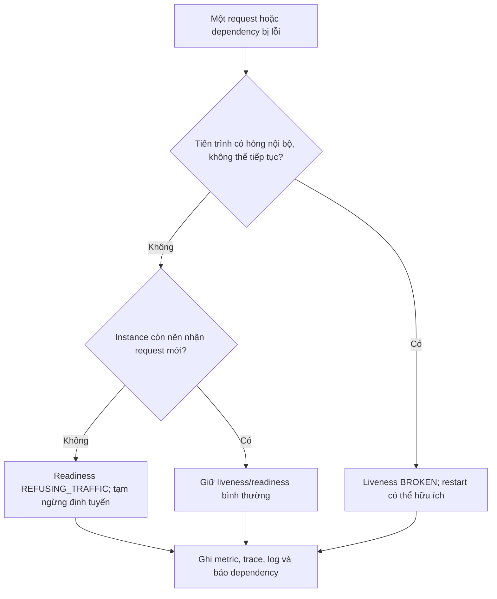

# Không buộc liveness phụ thuộc trực tiếp vào mọi dịch vụ bên ngoài

## 1. Một sự cố đối tác không nên biến thành vòng lặp khởi động lại ứng dụng

Trong **SPRING_BOOT_INTEGRATION**, một ứng dụng Spring Boot thường dùng HTTP client để gọi đối tác, truy cập cơ sở dữ liệu, đọc cache, gửi nhận thông điệp qua broker và vận hành các adapter Spring Integration. Những thành phần đó có thể lỗi độc lập. Nếu ứng dụng coi **bất kỳ** lỗi kết nối bên ngoài nào là lỗi *liveness*, hệ thống điều phối như Kubernetes sẽ liên tục khởi động lại các instance dù bản thân tiến trình vẫn hoạt động bình thường.

Ví dụ dịch vụ đặt hàng có ba pod. Một cổng vận chuyển bên ngoài ngừng phản hồi trong 10 phút:

1. Tất cả pod gọi health endpoint và nhận kết quả DOWN vì phép kiểm tra kết nối cổng vận chuyển thất bại.
2. Nếu kết quả này được dùng làm **liveness probe**, Kubernetes xem pod là không còn sống và khởi động lại.
3. Pod mới vẫn không gọi được cùng cổng vận chuyển. Kiểm tra lại thất bại, chu kỳ restart tiếp diễn.
4. Trong lúc đó, các chức năng không cần cổng vận chuyển (ví dụ tra cứu đơn đã lưu) cũng có thể bị gián đoạn, cache bị làm lạnh, pool kết nối liên tục tái tạo và lượng truy cập hồi phục dồn vào hệ thống đang sự cố.

Đây là hiệu ứng *cascading failure*: sự cố một dependency lan thành gián đoạn ở chính ứng dụng. **Restart ứng dụng chỉ hữu ích khi tình trạng lỗi nằm bên trong ứng dụng và việc khởi động lại có cơ hội khắc phục.** Nếu đối tác chung của mọi pod đang ngừng hoạt động, restart không làm đối tác hồi phục.

Mục tiêu của bài này là phân biệt **liveness**, **readiness** và quan sát **dependency health** trong Spring Boot Actuator; từ đó chọn phép kiểm tra đúng cho mỗi tín hiệu thay vì gom mọi dependency vào một endpoint điều khiển restart.

## 2. Liveness, readiness và startup probe trả lời ba câu hỏi khác nhau

| Loại tín hiệu | Câu hỏi cần trả lời | Hành động điển hình của Kubernetes khi thất bại | Ví dụ |
|---|---|---|---|
| **Liveness** | Tiến trình còn ở trạng thái có thể tiếp tục hoạt động hay cần khởi động lại? | Khởi động lại container sau ngưỡng thất bại | Ứng dụng đi vào trạng thái nội bộ không thể phục hồi |
| **Readiness** | Instance **lúc này** có nên nhận request mới qua Service/load balancer? | Tạm bỏ Pod khỏi tập endpoint sẵn sàng; không tự restart chỉ vì readiness thất bại | Pod đang khởi động, draining hoặc chưa thể phục vụ yêu cầu cốt lõi |
| **Startup** | Ứng dụng đã hoàn tất giai đoạn startup để bắt đầu kiểm tra liveness/readiness chưa? | Cho phép startup trong một cửa sổ, rồi có thể restart nếu startup liên tục thất bại | Khởi động cần load cấu hình/migration/caches trong thời gian dài |
| **Dependency/operational health** | HTTP đối tác, database, cache, broker có đang hoạt động và chất lượng ra sao? | Chủ yếu phục vụ quan sát, cảnh báo và quyết định vận hành | Lỗi kết nối Redis, broker backlog tăng, tỷ lệ HTTP 503 |

**Liveness** nên phản ánh **khả năng phục hồi của bản thân tiến trình**. Khi một HTTP đối tác không phản hồi, tiến trình có thể vẫn sống, nhận request, trả lỗi có kiểm soát, chuyển sang fallback hoặc xử lý queue sau khi dependency phục hồi; do đó không nên đánh DOWN cho liveness chỉ vì lỗi HTTP.

**Readiness** có phạm vi khác: một Pod có thể đang sống nhưng tạm thời không nên nhận lưu lượng. Ví dụ Pod vừa khởi động chưa sẵn sàng, đang graceful shutdown hoặc có trục trặc **cục bộ** khiến nó không xử lý được các yêu cầu quan trọng. Tuy nhiên, gắn readiness trực tiếp với **mọi** dependency cũng có nguy cơ làm toàn bộ pod cùng bị loại khỏi Service khi một dependency dùng chung bị lỗi. Readiness là quyết định tiếp nhận lưu lượng, cần gắn với hợp đồng phục vụ của ứng dụng.

**Startup probe** dành cho giai đoạn khởi động chậm. Khi startup probe được cấu hình, Kubernetes chưa bắt đầu chạy các liveness/readiness probe cho tới khi startup probe thành công; nhờ đó ứng dụng có thời gian khởi tạo mà không bị liveness restart quá sớm.

### Sơ đồ quyết định



Sơ đồ là nguyên tắc thiết kế, không phải code tự động của mọi phiên bản Spring Boot. Ứng dụng phải xác định khi nào một lỗi thực sự là hỏng nội bộ, và cấu hình health group để không biến lỗi bên ngoài thành tín hiệu restart.

## 3. Spring Boot Actuator: các health group và trạng thái ứng dụng

Spring Boot Actuator cung cấp `/actuator/health` và có thể bật các nhóm dành cho Kubernetes:

- `/actuator/health/liveness`: dựa trên `LivenessStateHealthIndicator` và `ApplicationAvailability`.
- `/actuator/health/readiness`: dựa trên `ReadinessStateHealthIndicator` và `ApplicationAvailability`.
- `/actuator/health`: health tổng hợp; thường có thêm các `HealthIndicator` đang đăng ký như DB, disk, Redis hoặc broker nếu các auto-configuration tương ứng tồn tại.

Đừng nhầm **health tổng hợp** với **liveness group**. Một database bị lỗi có thể khiến `/actuator/health` trả DOWN, trong khi `/actuator/health/liveness` vẫn UP. Điều đó hoàn toàn hợp lý: database đang lỗi, nhưng tiến trình Java chưa cần bị restart.

Trong Kubernetes, Spring Boot có thể tự nhận diện môi trường và bật availability probes; cũng có thể bật rõ ràng bằng cấu hình để chạy nhất quán trong test và các môi trường khác. Ví dụ:

```yaml
# application.yml
management:
  endpoint:
    health:
      probes:
        enabled: true
        add-additional-paths: true
      group:
        liveness:
          include: livenessState
        readiness:
          include: readinessState
  endpoints:
    web:
      exposure:
        include: health,info
```

Cần dependency `spring-boot-starter-actuator`; với Gradle:

```groovy
implementation 'org.springframework.boot:spring-boot-starter-actuator'
```

Hai nhóm probe trên được giới hạn rõ: liveness đọc trạng thái sống của ứng dụng, readiness đọc trạng thái nhận lưu lượng. Cấu hình **không** đưa một danh sách mọi dependency vào liveness. Với `add-additional-paths: true`, Spring Boot cho phép kiểm tra các đường `/livez` và `/readyz` trên **cổng ứng dụng chính** khi tính năng/phiên bản hỗ trợ. Điều này hữu ích nếu Actuator được phục vụ ở cổng management riêng: cổng management có thể vẫn phản hồi dù cổng HTTP chính đang không nhận kết nối như mong đợi.

Lưu ý: chỉ riêng `ApplicationAvailability` không phát hiện mọi deadlock hoặc sự cố tài nguyên bên trong JVM. Cần quan sát thread, connection pool, event loop, hàng đợi và các tín hiệu ứng dụng khác để xác định những lỗi mà cơ chế restart thực sự có ích.

### Trạng thái trong Spring Boot

| Loại | Trạng thái | Ý nghĩa điển hình |
|---|---|---|
| `LivenessState` | `CORRECT` | Spring Boot chưa xác định ứng dụng hỏng nội bộ |
| `LivenessState` | `BROKEN` | Ứng dụng ở trạng thái nội bộ cần xử lý, thường cần restart |
| `ReadinessState` | `ACCEPTING_TRAFFIC` | Đã sẵn sàng nhận request |
| `ReadinessState` | `REFUSING_TRAFFIC` | Tạm từ chối traffic mới |

Spring Boot quản lý các chuyển trạng thái theo vòng đời ứng dụng; ngoài ra có thể phát `AvailabilityChangeEvent` trong những trường hợp **nội bộ rõ ràng**. Không nên gán `LivenessState.BROKEN` mỗi khi một HTTP client trả 503 hoặc Redis timeout.

## 4. Cấu hình Kubernetes probe theo đúng tín hiệu

Một phần cấu hình Deployment minh họa cho ứng dụng chạy HTTP port 8080:

```yaml
spec:
  containers:
    - name: order-service
      image: example/order-service:1.0
      ports:
        - name: http
          containerPort: 8080
      startupProbe:
        httpGet:
          path: /livez
          port: http
        periodSeconds: 5
        timeoutSeconds: 2
        failureThreshold: 30
      livenessProbe:
        httpGet:
          path: /livez
          port: http
        periodSeconds: 10
        timeoutSeconds: 2
        failureThreshold: 3
      readinessProbe:
        httpGet:
          path: /readyz
          port: http
        periodSeconds: 5
        timeoutSeconds: 2
        failureThreshold: 2
```

Đây là trích đoạn phần `containers` của một Deployment; cần ghép vào manifest đầy đủ và thay image/port đúng môi trường. Các tham số chỉ minh họa:

- `startupProbe` cho ứng dụng tối đa khoảng 150 giây (30 lần × 5 giây, chưa tính sai số lập lịch/thời gian request) để tiến tới trạng thái khởi chạy thành công; sau đó mới kích hoạt các probe khác.
- `livenessProbe` thất bại liên tiếp đến ngưỡng thì kubelet có thể restart container.
- `readinessProbe` thất bại sẽ làm Pod không sẵn sàng nhận request mới qua Service, nhưng bản thân readiness không yêu cầu restart.
- `timeoutSeconds` ở Kubernetes giới hạn thời gian chờ **HTTP probe**, không phải timeout hay deadline của request nghiệp vụ.

Đối với health endpoint Spring Boot thông thường, trạng thái UP trả HTTP 200, DOWN hoặc OUT_OF_SERVICE thường trả 503 (phụ thuộc status-to-HTTP mapping). Kubernetes xem HTTP response 200–399 là thành công và quyết định trạng thái sau các ngưỡng lỗi liên tiếp.

Nếu không bật additional paths, dùng `/actuator/health/liveness` và `/actuator/health/readiness` trên cổng tương ứng. Phải kiểm tra context path, security filter và cổng thực sự phục vụ probe. Một endpoint trả 401/403 do thiếu quyền không chứng minh ứng dụng chết; cấu hình mạng, xác thực và mức lộ thông tin của health endpoint cần phù hợp với cluster.

## 5. Phân loại dependency theo tác động thay vì gắn chung vào liveness

Không có một quy tắc “mọi dependency đều phải UP thì readiness mới UP” đúng cho tất cả ứng dụng. Cần dựa vào chức năng mà Pod **thực sự cam kết phục vụ** và khả năng degrade có kiểm soát.

| Thành phần | Lỗi thường gặp | Đánh giá liveness | Đánh giá readiness và đường phục hồi |
|---|---|---|---|
| HTTP đối tác vận chuyển | 503, timeout, rate limit | Không đổi vì lỗi ở bên ngoài | Thường giữ Pod ready nếu vẫn nhận đơn/tra cứu và xếp xử lý lại; đo lỗi/circuit breaker riêng |
| Database chính | Hết kết nối, failover, timeout query | Không mặc định restart mọi Pod | Nếu không thể phục vụ bất kỳ request cốt lõi nào, có thể tạm unready; cân nhắc nguy cơ mọi Pod mất endpoint cùng lúc |
| Redis/cache ngoài | Cache miss, timeout | Không đổi | Nếu có fallback DB/cached stale hợp lệ, tiếp tục ready; nếu cache là điều kiện bắt buộc cho mọi request thì đánh giá readiness theo hợp đồng |
| Kafka/RabbitMQ broker | Broker unreachable, publish fail | Không đổi | Với outbox, ứng dụng vẫn có thể tiếp nhận và ghi DB bền vững; monitor backlog/retry thay vì restart |
| Adapter Spring Integration | Inbound poller lỗi, outbound HTTP hỏng | Không đổi nếu flow còn xử lý phục hồi được | Đánh giá riêng khả năng phục vụ của các API liên quan; ghi error channel và số message lỗi |
| Quartz/worker | Một scheduled job lỗi | Không mặc định restart | API vẫn có thể ready; job cần retry, dead-letter hoặc trạng thái failure riêng |
| Hỏng nội bộ không thể phục hồi | Thread chết không có cơ chế khởi động lại, state machine bị kẹt nghiêm trọng | Có thể chuyển BROKEN sau khi xác minh restart hữu ích | Liveness là tín hiệu thích hợp nếu lỗi thật sự không thể tự phục hồi |
| Pod đang graceful shutdown | Ứng dụng chuẩn bị ngừng nhận traffic | Không nhất thiết BROKEN | Chuyển REFUSING_TRAFFIC để drain rồi dừng |

Nếu **mọi** Pod đều phụ thuộc database chung và readiness yêu cầu kết nối database tức thời, một sự cố database sẽ khiến tất cả Pod cùng unready. Điều này có thể đúng nếu thật sự không có request nào còn xử lý được, nhưng cũng có thể làm mất khả năng trả response có kiểm soát, tra cứu dữ liệu cache hoặc thông báo chế độ degrade. Trước khi đưa một dependency vào readiness, phải trả lời: “Khi toàn bộ cụm phụ thuộc này hỏng, hành vi mong muốn của ingress và client là gì?”

Một dependency chung bị lỗi có thể là lý do để **ngừng một chức năng** trong khi vẫn cho phép các chức năng khác. Health probe ở cấp Pod không phân biệt từng HTTP route. Khi cần, sử dụng circuit breaker, fallback, feature-specific availability hoặc chia dịch vụ theo trách nhiệm để giảm liên đới.

## 6. Quan sát dependency riêng mà không bắt liveness gọi trực tiếp ra ngoài

Vấn đề không nằm ở việc “có được kiểm tra HTTP đối tác hay không”, mà ở **mục đích dùng kết quả**:

- Kiểm tra dependency phục vụ dashboard, alert, điều tra sự cố và định tuyến nghiệp vụ là hữu ích.
- Gọi trực tiếp HTTP đối tác mỗi vài giây trong **liveness** để quyết định restart Pod thường là sai.
- Nếu mỗi Pod chủ động probe cùng dịch vụ đang nghẽn, health checks còn có thể khuếch đại lưu lượng khi dependency gặp sự cố.

Một lựa chọn là tạo **health group riêng** cho dependency và đọc trạng thái gần nhất đã được ghi nhận bởi các HTTP call thật, circuit breaker hoặc một kiểm tra nền có timeout/ngưỡng tần suất. Health endpoint chỉ đọc snapshot nhanh trong bộ nhớ, tránh phát sinh I/O ở mỗi lượt Kubernetes probe.

### 6.1. Ví dụ HealthIndicator đọc trạng thái quan sát được

Ví dụ ứng dụng đã có lớp gọi dịch vụ vận chuyển. Lớp đó cập nhật snapshot khi một HTTP call kết thúc hoặc khi circuit breaker thay đổi trạng thái. Định nghĩa dưới đây cố tình không gọi HTTP bên trong `health()`:

```java
import java.time.Instant;
import java.util.concurrent.atomic.AtomicReference;
import org.springframework.boot.actuate.health.Health;
import org.springframework.boot.actuate.health.HealthIndicator;
import org.springframework.stereotype.Component;

record PartnerSnapshot(boolean available, Instant observedAt) {}

@Component
class ShippingPartnerStatus {
    private final AtomicReference<PartnerSnapshot> snapshot =
        new AtomicReference<>(
            new PartnerSnapshot(false, Instant.EPOCH));

    void recordSuccess() {
        snapshot.set(new PartnerSnapshot(true, Instant.now()));
    }

    void recordFailure() {
        snapshot.set(new PartnerSnapshot(false, Instant.now()));
    }

    PartnerSnapshot current() {
        return snapshot.get();
    }
}

@Component("shippingPartnerHealthIndicator")
class ShippingPartnerHealthIndicator implements HealthIndicator {
    private final ShippingPartnerStatus status;

    ShippingPartnerHealthIndicator(ShippingPartnerStatus status) {
        this.status = status;
    }

    @Override
    public Health health() {
        PartnerSnapshot latest = status.current();

        if (latest.observedAt().equals(Instant.EPOCH)) {
            return Health.unknown()
                .withDetail("reason", "No observation yet")
                .build();
        }

        Health.Builder builder = latest.available()
            ? Health.up()
            : Health.down();

        return builder
            .withDetail("lastObservedAt", latest.observedAt().toString())
            .build();
    }
}
```

Cấu hình nhóm health riêng:

```yaml
management:
  endpoint:
    health:
      probes:
        enabled: true
      group:
        liveness:
          include: livenessState
        readiness:
          include: readinessState
        partners:
          include: shippingPartner
          show-details: never
```

Với bean `shippingPartnerHealthIndicator`, Spring Boot đăng ký health contributor ID `shippingPartner`. Khi đó:

| Endpoint | Dữ liệu dùng | Khi đối tác vận chuyển DOWN |
|---|---|---|
| `/actuator/health/liveness` | `livenessState` | Vẫn UP nếu ứng dụng không bị hỏng nội bộ |
| `/actuator/health/readiness` | `readinessState` | Vẫn UP nếu ứng dụng quyết định còn nhận được traffic |
| `/actuator/health/partners` | `shippingPartner` | DOWN; có thể trả 503 để hệ thống quan sát nhận biết |
| `/actuator/health` | Tổng hợp các health contributor mặc định | Có thể DOWN vì partner; **không dùng endpoint tổng hợp này làm liveness** |

Một vấn đề cần giải quyết trước khi đưa ví dụ vào production: **snapshot không tự phân biệt “đối tác hỏng hiện tại” với “đã từng hỏng cách đây nhiều giờ”**. Phải đặt ngưỡng tuổi quan sát (*staleness threshold*) và thể hiện trạng thái UNKNOWN hoặc cảnh báo riêng khi dữ liệu quá cũ. Cũng nên tránh kết luận toàn bộ partner hỏng chỉ vì một request đơn lẻ trả 4xx do dữ liệu sai; trạng thái dependency cần dựa vào loại lỗi và tín hiệu thống kê phù hợp.

Nếu dùng kiểm tra chủ động theo lịch, nên giới hạn timeout ngắn, tần suất hợp lý, jitter và mức đồng thời; có thể chỉ một thành phần chuyên quan sát thực hiện kiểm tra để giảm tải lên đối tác. Không để health endpoint tự gọi service ngoài vô thời hạn.

### 6.2. Chuyển readiness chỉ khi khả năng phục vụ của **instance** thay đổi

Spring Boot hỗ trợ `AvailabilityChangeEvent` để báo readiness thay đổi. Chẳng hạn, khi một instance chủ động draining hoặc phát hiện điều kiện **cục bộ** làm nó không thể nhận thêm việc:

```java
import org.springframework.boot.availability.AvailabilityChangeEvent;
import org.springframework.boot.availability.ReadinessState;
import org.springframework.context.ApplicationEventPublisher;
import org.springframework.stereotype.Component;

@Component
class TrafficAcceptance {
    private final ApplicationEventPublisher events;

    TrafficAcceptance(ApplicationEventPublisher events) {
        this.events = events;
    }

    void beginDraining() {
        AvailabilityChangeEvent.publish(
            events, ReadinessState.REFUSING_TRAFFIC);
    }

    void resumeReceiving() {
        AvailabilityChangeEvent.publish(
            events, ReadinessState.ACCEPTING_TRAFFIC);
    }
}
```

Đây chỉ là **ví dụ về API thay đổi readiness**; ứng dụng vẫn cần điều phối quá trình drain, hoàn thành request đang chạy và trạng thái lifecycle. Không gọi `beginDraining()` ngay mỗi khi đối tác vận chuyển trả 503, vì điều đó có thể khiến mọi Pod cùng rút khỏi Service mà không cải thiện sự cố.

Trong một dịch vụ chuyên xử lý message, không có HTTP traffic nghiệp vụ, readiness có thể đóng vai trò theo dõi khả năng sẵn sàng của worker hoặc không được dùng để định tuyến HTTP. Dù vậy, kiểm tra broker lỗi cũng không nên tự động biến thành liveness hỏng.

## 7. Gắn quan sát lỗi tích hợp vào đúng nơi

Liveness/readiness là **tín hiệu điều khiển vòng đời**, có độ phân giải rất thấp: một kết quả cuối cho cả Pod. Chẩn đoán luồng tích hợp cần dữ liệu chi tiết hơn để biết thành phần nào lỗi, từ lúc nào, ảnh hưởng đến bao nhiêu request/message và có đang phục hồi hay không.

### 7.1. HTTP client và circuit breaker

Theo dõi tối thiểu:

- Số request theo dependency và loại kết quả: thành công, timeout, HTTP 429, 5xx, lỗi kết nối.
- Latency và phân vị, số lần retry, tổng thời gian đã dùng so với deadline còn lại.
- Trạng thái circuit breaker (CLOSED/OPEN/HALF_OPEN), số request bị short-circuit và tỷ lệ phục hồi.
- Số request lỗi có thể đưa sang fallback, và số request không có fallback.

Circuit breaker giúp giảm gọi tới dependency đang hỏng, nhưng trạng thái OPEN của một đối tác **không tự động có nghĩa tiến trình không còn sống**. Health group riêng có thể phản ánh trạng thái đó; liveness vẫn nên dựa vào khả năng vận hành của ứng dụng.

### 7.2. Database, cache, broker và Spring Integration

| Luồng tích hợp | Tín hiệu hữu ích hơn việc restart pod |
|---|---|
| JDBC/JPA | Connection pool active/pending, timeout chờ connection, độ trễ query, lock wait, transaction rollback |
| Redis/cache | Cache hit/miss, timeout, fallback sang DB, độ trễ đọc cache, tỷ lệ dữ liệu stale được phục vụ |
| Kafka/RabbitMQ | Broker connectivity, consumer lag, unacked messages, số lần publish thất bại, retry/DLQ, thời gian message nằm chờ |
| Transactional outbox | Tổng bản ghi PENDING, tuổi bản ghi cũ nhất, số lần gửi lại, số event bị dead-letter hoặc kẹt |
| Spring Integration | Số message qua channel/handler, processing time, error channel, queue depth, failed message và retry |
| Quartz/scheduler | Missed fire, misfire, lần chạy thất bại, thời gian chạy job, checkpoint chưa hoàn tất |

Việc bật metric cụ thể phụ thuộc instrumentation và cấu hình từng adapter. Một số tín hiệu có từ Actuator/Micrometer hoặc client library, số khác cần tự ghi business metric. Đừng đánh đồng “Actuator health endpoint trả 200” với “broker không có lag” hay “outbox đã phát hết”: cả hai vẫn có thể bất thường khi tiến trình và Pod đều khỏe.

### 7.3. Ví dụ ghi metric với Micrometer

Tại nơi xử lý phản hồi HTTP đối tác, có thể ghi counter theo **tên dependency có số lượng hữu hạn**:

```java
import io.micrometer.core.instrument.MeterRegistry;
import org.springframework.stereotype.Component;

@Component
class IntegrationMetrics {
    private final MeterRegistry registry;

    IntegrationMetrics(MeterRegistry registry) {
        this.registry = registry;
    }

    void recordPartnerCall(String partner, String outcome) {
        registry.counter(
            "integration.partner.calls",
            "partner", partner,
            "outcome", outcome
        ).increment();
    }
}
```

Ví dụ các giá trị `partner=shipping` và `outcome=success|timeout|http_5xx` phải được giới hạn trong danh mục được quản lý. Không đặt `orderId`, mã khách hàng, URL tùy ý hoặc `exception.message` làm metric tag vì có thể tạo **cardinality quá lớn**, tăng chi phí và gây quá tải hệ thống metric.

Kết hợp `traceId`, `correlationId`, `operationId` và `messageId` trong log/trace để theo dõi xuyên HTTP, database, broker và Spring Integration. Với việc xử lý retry, trace cần phân biệt một **operation nghiệp vụ** với từng **attempt**; đừng coi request được gửi ba lần là ba đơn hàng khác nhau.

### 7.4. Cảnh báo theo tác động và xu hướng

Ví dụ nên cảnh báo khi tỷ lệ lỗi HTTP đối tác duy trì trên ngưỡng vài phút **và** số giao dịch bị ảnh hưởng vượt ngưỡng; outbox backlog hoặc tuổi bản ghi cũ nhất tăng; consumer lag vượt khả năng xử lý; hoặc request deadline exceeded tăng đột biến. Những cảnh báo này giúp kỹ sư quyết định mở circuit breaker, dùng fallback, xử lý queue hay điều tra dependency.

Không nên dùng cảnh báo dependency lỗi như một thao tác tự động bắt Kubernetes restart tất cả pod. Tình huống cần restart thường liên quan tới tiến trình, cấu hình hoặc tài nguyên cục bộ mà restart có thể thay đổi được.

## 8. Kiểm thử để chứng minh lỗi dependency không làm liveness thất bại

Chỉ đọc cấu hình YAML là chưa đủ. Cần chủ động làm HTTP đối tác, database, cache và broker thất bại, rồi xác minh rằng **mỗi endpoint health thay đổi đúng như chính sách đã định**.

### 8.1. Kiểm thử tích hợp với MockMvc và Spring Boot Actuator

Giả sử ứng dụng có `ShippingPartnerStatus` và `ShippingPartnerHealthIndicator` ở mục 6. Ví dụ kiểm thử dùng JUnit 5, Spring Boot Test và MockMvc, lược bỏ import JUnit/Spring thông dụng:

```java
@SpringBootTest(properties = {
    "management.endpoint.health.probes.enabled=true",
    "management.endpoint.health.group.liveness.include=livenessState",
    "management.endpoint.health.group.readiness.include=readinessState",
    "management.endpoint.health.group.partners.include=shippingPartner"
})
@AutoConfigureMockMvc
class ProbeIsolationIntegrationTest {
    @Autowired
    MockMvc mvc;

    @Autowired
    ShippingPartnerStatus shippingPartner;

    @Autowired
    ApplicationEventPublisher events;

    @BeforeEach
    void partnerIsUnavailableButApplicationIsReady() {
        shippingPartner.recordFailure();
        AvailabilityChangeEvent.publish(
            events, ReadinessState.ACCEPTING_TRAFFIC);
    }

    @AfterEach
    void restorePartnerState() {
        shippingPartner.recordSuccess();
    }

    @Test
    void dependencyFailureDoesNotFailLivenessOrReadiness() throws Exception {
        mvc.perform(get("/actuator/health/partners"))
            .andExpect(status().isServiceUnavailable());

        mvc.perform(get("/actuator/health/liveness"))
            .andExpect(status().isOk());

        mvc.perform(get("/actuator/health/readiness"))
            .andExpect(status().isOk());
    }

    @Test
    void explicitTrafficDrainingChangesReadinessNotLiveness()
            throws Exception {
        AvailabilityChangeEvent.publish(
            events, ReadinessState.REFUSING_TRAFFIC);

        mvc.perform(get("/actuator/health/readiness"))
            .andExpect(status().isServiceUnavailable());

        mvc.perform(get("/actuator/health/liveness"))
            .andExpect(status().isOk());
    }
}
```

Phép thử này xác minh **hợp đồng của health group**, không xác minh HTTP đối tác thật. Test runtime cần có `spring-boot-starter-test` và cấu hình security cho phép test đọc health endpoints tương ứng. Nếu Spring Security giới hạn Actuator, hãy cấu hình test client có quyền thích hợp hoặc chỉ mở các probe paths cần cho kubelet theo chính sách mạng; không vô hiệu hóa bảo mật của toàn bộ API chỉ để test probe.

Vì test thay đổi trạng thái `ApplicationAvailability` và snapshot trong một ApplicationContext dùng chung, cần chạy các test này tuần tự hoặc cô lập context, đồng thời phục hồi trạng thái sau test để tránh ảnh hưởng test khác. Trong môi trường thực, đừng cho phép một request tùy ý phát `AvailabilityChangeEvent` theo user input.

### 8.2. Ma trận lỗi cần kiểm thử

| Sự kiện gây lỗi | Liveness dự kiến | Readiness dự kiến | Quan sát cần có |
|---|---|---|---|
| Partner HTTP trả 503, ứng dụng có fallback/queue | UP | UP nếu vẫn phục vụ được theo hợp đồng | Nhóm partner DOWN, retry/circuit breaker/error metric tăng |
| Broker tạm mất kết nối nhưng outbox vẫn lưu được | UP | Có thể UP cho API tiếp nhận đơn | Backlog outbox tăng, lỗi publish có log/alert |
| Redis timeout nhưng DB fallback đủ khả năng | UP | UP | Cache fallback, latency, DB load và error rate được theo dõi |
| Database chính mất kết nối | UP nếu tiến trình còn chạy | Theo chức năng thực tế; có thể DOWN nếu không thể phục vụ | DB health DOWN, connection pool và error metric |
| Instance chủ động draining | UP | DOWN/OUT_OF_SERVICE | Request mới không tiếp tục đi vào Pod; request đang chạy được hoàn tất theo policy |
| Ứng dụng chưa hoàn thành startup | Theo trạng thái lifecycle | Chưa ready | Startup probe có đủ thời gian, không restart lặp do startup chậm |
| Hỏng nội bộ không thể phục hồi | Có thể DOWN/BROKEN | Thường không ready | Liveness restart trong giới hạn, có bằng chứng nguyên nhân nội bộ |

Các giá trị trên là **kỳ vọng theo chính sách thiết kế minh họa**, không phải kết quả mặc định áp dụng cho mọi cấu hình. Ví dụ một hệ thống chuyên relay broker mà không có khả năng lưu tạm có thể cần readiness DOWN khi không thể nhận thêm message; điều đó cũng không đòi hỏi liveness DOWN.

### 8.3. Kiểm thử trong môi trường Kubernetes

Để chứng minh không xảy ra vòng lặp restart khi dependency lỗi, triển khai ít nhất hai Pod và dùng stub HTTP như WireMock hoặc một môi trường kiểm thử có thể làm đối tác trả 503/timeout. Sau đó:

1. Gửi request qua ứng dụng để kích hoạt lỗi dependency, xác nhận cách trả lỗi hoặc fallback.
2. Kiểm tra `/livez` trên từng Pod vẫn trả kết quả thành công, `/readyz` theo chính sách phục vụ, nhóm partner báo DOWN.
3. Quan sát `restartCount` và Events của Pod trong cửa sổ đủ dài hơn nhiều chu kỳ liveness probe; không có restart chỉ vì partner lỗi.
4. Cho dependency phục hồi, xác nhận circuit breaker/HTTP client có thể thử lại, metric lỗi giảm và quy trình nghiệp vụ tiếp tục.
5. Kiểm tra riêng tình huống readiness mất do draining và tình huống startup chậm; xác nhận Kubernetes xử lý đúng vai trò của từng probe.

Ví dụ các lệnh điều tra dành cho người vận hành có quyền truy cập cluster:

```bash
kubectl get pods -n integration -o wide
kubectl describe pod <pod-name> -n integration
kubectl get endpointslices -n integration

# Thực hiện bên trong pod kiểm thử, nếu image có công cụ curl:
curl -i http://localhost:8080/livez
curl -i http://localhost:8080/readyz
curl -i http://localhost:8080/actuator/health/partners
```

Đây là hướng dẫn kiểm tra thủ công trên môi trường thử nghiệm, không phải lệnh đã chạy trong repository. Cần thay namespace, Pod, cổng và quyền truy cập cho đúng cluster; trên production có thể dùng port-forward, ephemeral debug container hoặc phương thức quan sát phù hợp thay vì giả định image ứng dụng cài sẵn `curl`.

## 9. Các cấu hình sai phổ biến và vì sao chúng nguy hiểm

### Sai lầm 1: dùng health tổng hợp làm liveness

```yaml
# Ví dụ SAI nếu health tổng hợp phụ thuộc mọi hệ thống bên ngoài.
livenessProbe:
  httpGet:
    path: /actuator/health
    port: 8080
```

Khi các health indicator cho DB/Redis/broker/đối tác kéo health tổng hợp xuống DOWN, kubelet có thể restart Pod liên tục, mặc dù ứng dụng vẫn có thể xử lý graceful error hoặc fallback. Sửa bằng cách trỏ liveness vào nhóm `/actuator/health/liveness` hay `/livez` đã tách biệt.

### Sai lầm 2: gọi ping HTTP tới hàng chục dependency trong một liveness check

Một endpoint `/health/live` tùy biến thực hiện 10 network call đồng bộ có thể mất nhiều giây; khi một đối tác timeout, probe cũng timeout. Nếu có 100 Pod, chúng còn có thể tạo 1.000 lần ping vào đúng thời điểm dependency bị nghẽn. Thay bằng tín hiệu nội bộ cho liveness, còn dependency health dùng snapshot hoặc kiểm tra riêng có giới hạn.

### Sai lầm 3: gắn toàn bộ dependency vào readiness mà không cân nhắc toàn cụm

Nếu broker ngừng hoạt động, tất cả Pod có thể cùng unready. Khi ấy Kubernetes Service không còn endpoint ready, kể cả các API chỉ đọc database vẫn có thể hoạt động. Hãy quyết định readiness theo **khả năng phục vụ request quan trọng**, cơ chế fallback và hành vi ingress mong muốn.

### Sai lầm 4: Actuator chạy trên cổng khác nhưng chỉ kiểm tra cổng quản trị

Management server có thể khỏe trong khi cổng ứng dụng chính bị nghẽn hoặc cấu hình sai. Khi cần quan sát trực tiếp khả năng phục vụ trên cổng chính, bật `add-additional-paths` và cho Kubernetes probe `/livez`/`/readyz` trên cổng ứng dụng. Kiểm tra cả việc Spring Security và network policy không vô tình ngăn probe.

### Sai lầm 5: kiểm tra quá nặng ngay trong probe

Ngay cả một truy vấn database đơn giản cũng có thể chiếm connection ở thời điểm pool đã cạn; khi mọi Pod lặp lại, check càng làm hệ thống bận. Một health endpoint điều khiển restart nên nhanh, có tác dụng quan sát rõ và không kéo theo quá nhiều I/O.

### Sai lầm 6: chờ liveness tự phát hiện mọi lỗi runtime

`LivenessState.CORRECT` không phải chứng chỉ rằng ứng dụng không có memory leak, thread starvation, deadlock hoặc lỗi dữ liệu. Liveness là một cơ chế thô, cần bổ sung alert về CPU, memory, GC, thread pool, event loop, queue lag và SLO nghiệp vụ. Khi một Pod quá tải liên tục, chính sách backpressure, autoscaling hoặc sửa logic thường có giá trị hơn chỉ tăng restart.

## 10. Checklist vận hành và tiêu chí hoàn thành

Trước khi triển khai một luồng tích hợp Spring Boot có HTTP client, database, cache, broker và adapter Spring Integration, nên xác nhận:

1. **Liveness** chỉ dựa vào trạng thái sống của ứng dụng và những lỗi nội bộ mà restart có khả năng xử lý; không trực tiếp phụ thuộc vào mọi endpoint bên ngoài.
2. **Readiness** biểu diễn khả năng phục vụ của Pod; với dependency chung, đã xác định rõ nên giữ ready, degrade hay tạm không nhận traffic.
3. **Startup probe** bảo vệ giai đoạn khởi động dài; ngưỡng timeout/failureThreshold phản ánh khả năng khởi động thực tế.
4. Spring Boot Actuator dùng nhóm `liveness`/`readiness` riêng; Kubernetes trỏ đến đúng endpoint và cổng ứng dụng.
5. Health tổng hợp và nhóm dependency phục vụ quan sát độc lập, có timeout/chi phí hợp lý và không làm bão gọi mạng.
6. Có metric và log/trace cho HTTP timeout/503, DB pool, cache fallback, broker lag, outbox backlog, Spring Integration error channel và retry.
7. Đã thử dependency lỗi trong nhiều chu kỳ probe và thấy **Pod không restart vô ích**; đồng thời chức năng có thể degrade/được xử lý lại đúng hợp đồng.
8. Đã thử readiness khi draining, startup chậm và một lỗi nội bộ thực sự để chắc chắn các tín hiệu điều khiển lifecycle có ý nghĩa.
9. Có cảnh báo về tác động nghiệp vụ và cách phục hồi khi dependency bên ngoài trở lại; không chỉ nhìn một giá trị UP/DOWN.

**Nguyên tắc cốt lõi:** liveness trả lời “có cần khởi động lại tiến trình hay không”; readiness trả lời “có nên gửi request mới đến Pod hay không”; health của dependency trả lời “hệ thống bên ngoài đang gặp vấn đề gì”. Tách ba mục tiêu đó giúp Spring Boot tích hợp HTTP, database, cache và message broker tiếp tục vận hành trong chế độ phù hợp, hạn chế restart dây chuyền và cung cấp đủ thông tin để phục hồi sau lỗi.
