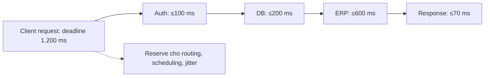
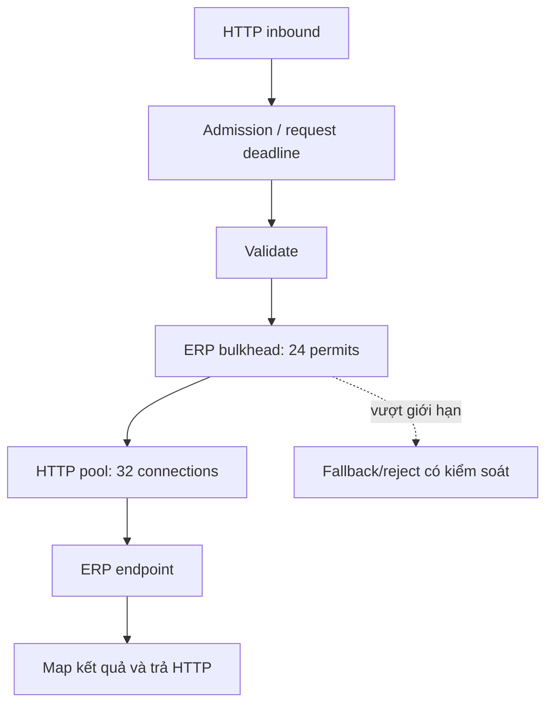

# Ngân sách timeout, số kết nối và giới hạn đồng thời theo từng phụ thuộc

## 1. Vì sao phải quản lý tài nguyên ở ranh giới tích hợp?

Một ứng dụng Spring Boot có thể xử lý nhiều loại tích hợp trong cùng một request: xác thực qua HTTP, đọc PostgreSQL, tra Redis, gọi hệ thống ERP bằng REST/SOAP, rồi phát sự kiện lên Kafka hoặc RabbitMQ. Khi tất cả phụ thuộc đều hoạt động tốt, mỗi lời gọi chỉ mất vài chục đến vài trăm mili giây. Khi một phụ thuộc chậm, **thread, connection, hàng đợi và thời gian chờ** có thể bị chiếm giữ lâu hơn dự kiến, kéo chậm cả những chức năng không liên quan.

Trong module **SPRING_BOOT_INTEGRATION**, mục tiêu vận hành là tổ chức luồng tích hợp qua HTTP client, cơ sở dữ liệu, cache, broker thông điệp và các adapter của Spring Integration, đồng thời kiểm soát cấu hình, hợp đồng dữ liệu, giao dịch, lỗi, trùng lặp, kiểm thử và khả năng quan sát. Ba quyết định cần được thiết kế cùng nhau là:

1. **Ngân sách timeout:** mỗi lần gọi được phép tiêu tốn bao nhiêu thời gian, bao gồm lúc chờ tài nguyên và các lần thử lại?
2. **Số kết nối:** ứng dụng được phép mở và giữ bao nhiêu kết nối tới từng hệ thống phụ thuộc?
3. **Giới hạn đồng thời:** có bao nhiêu công việc được phép cùng lúc sử dụng phụ thuộc đó, và điều gì xảy ra khi vượt giới hạn?

Ba đại lượng có liên quan nhưng **không đồng nghĩa**. Một connection pool có 32 kết nối không đảm bảo chỉ có 32 nghiệp vụ đang chờ: còn có thể có hàng trăm request nằm trong hàng đợi xin kết nối. Một semaphore giới hạn 20 tác vụ không tự đặt thời hạn hoàn thành cho 20 tác vụ ấy. Một timeout 500 ms cũng không tự bảo vệ database khỏi 1.000 yêu cầu bắt đầu cùng lúc.

> **Tình huống xuyên suốt:** API `GET /orders/{id}/status` có mục tiêu trả lời trong khoảng 1,2 giây. Mỗi request đọc PostgreSQL, tra Redis và gọi ERP để kiểm tra trạng thái thanh toán. ERP thỉnh thoảng tăng độ trễ từ 200 ms lên 5 giây. Ta cần duy trì khả năng đáp ứng của API và bảo vệ cả ERP lẫn các tài nguyên nội bộ.

## 2. Phân biệt timeout, connection, concurrency và rate

| Khái niệm | Kiểm soát | Câu hỏi vận hành | Khi vượt ngưỡng |
|---|---|---|---|
| **Timeout/deadline** | Thời gian dành cho một thao tác hoặc toàn bộ request | Lời gọi được chờ đến lúc nào? | Báo lỗi, hủy hoặc ngừng chờ theo khả năng transport. |
| **Connection pool** | Số kết nối có thể sử dụng tới endpoint/database | Có bao nhiêu socket/session được tái sử dụng? | Chờ connection, từ chối hoặc tạo thêm tới giới hạn. |
| **Concurrency limit / bulkhead** | Số công việc đang được phục vụ đồng thời | Có bao nhiêu lời gọi in-flight vào ERP? | Chờ có giới hạn hoặc từ chối nhanh. |
| **Rate limit** | Số yêu cầu có thể khởi phát trong một khoảng thời gian | Mỗi giây được gửi bao nhiêu request? | Delay, throttle hoặc reject. |
| **Queue bound** | Số việc được phép đợi một tài nguyên | Hàng đợi được dài đến đâu? | Backpressure, reject hoặc chuyển sang xử lý sau. |
| **Retry budget** | Số lần và thời gian được phép thử lại | Khi lỗi tạm thời được phép nhân tải bao nhiêu? | Ngừng retry, trả kết quả lỗi/không xác định. |

Ví dụ: ERP chỉ xử lý ổn định khoảng 30 lệnh đồng thời và giới hạn 100 request/giây. Ứng dụng nên có **bulkhead tối đa 24 lời gọi đồng thời**, **rate limit phù hợp quota**, và HTTP connection pool ít nhất đủ phục vụ các lời gọi đó. Cả ba con số đều là **giá trị minh họa**, phải được xác minh qua quota và đo tải thực tế.

### Vì sao Little's Law hữu ích?

Với hệ thống ở trạng thái ổn định, định luật Little cho quan hệ:

\[
L = \lambda W
\]

Trong đó `L` là số công việc trung bình trong hệ thống, `λ` là tốc độ đến trung bình (request/giây) và `W` là thời gian trung bình mỗi công việc ở trong hệ thống (giây). Chẳng hạn 40 request/giây, thời gian trung bình chờ và xử lý 0,3 giây thì **trung bình khoảng 12 request đang tồn tại** trong giai đoạn đó.

Con số 12 **không phải** giới hạn pool nên đặt: độ trễ có đuôi dài, thời điểm tải cao và queueing sẽ làm concurrency cần thiết tăng. Đặc biệt, nếu ERP chậm lên 3 giây mà tốc độ đến vẫn 40 request/giây, số request in-flight trung bình *có thể* tăng tới khoảng 120 nếu không giới hạn; hệ thống sẽ dồn tải thay vì tự phục hồi. Cần dùng latency distribution, burst traffic và load test để chọn giới hạn cuối cùng.

## 3. Bắt đầu từ ngân sách thời gian đầu-cuối

**Deadline** là thời điểm trễ nhất mà yêu cầu còn hữu ích cho người gọi. **Timeout** thường là khoảng thời gian tối đa cho một thao tác kể từ khi bắt đầu thao tác ấy. Nếu mỗi tầng tự dùng timeout 5 giây, một request đi qua bốn tầng có thể chờ lâu hơn SLA đầu-cuối rất nhiều.

Với API mục tiêu 1.200 ms, một bản phân bổ *minh họa*:

| Hạng mục trên đường xử lý tuần tự | Ngân sách |
|---|---:|
| Tiếp nhận, routing, kiểm tra đầu vào | 80 ms |
| Xác thực/ủy quyền | 100 ms |
| Đọc database và biến đổi dữ liệu | 200 ms |
| Gọi ERP (gồm xin kết nối, network, response, retry nếu có) | 600 ms |
| Tạo response và ghi trả client | 70 ms |
| Phần dự phòng cho biến động và overhead | 150 ms |
| **Tổng** | **1.200 ms** |

Ngân sách này là **giới hạn thiết kế ban đầu**, không phải số đo p99 đã được bảo đảm. Không thể cộng các percentile p99 của từng tầng rồi tuyên bố đó là p99 đầu-cuối; cần đo chính request end-to-end trong điều kiện tải thực tế.

Nếu hai lời gọi độc lập chạy **song song**, nhánh giới hạn thời gian là nhánh có thời lượng lớn nhất cộng phần phối hợp, không đơn giản là tổng hai nhánh. Tuy nhiên song song có thể làm tăng số kết nối và độ đồng thời lên nhiều lần; phải tính tải do fan-out tạo ra.



### 3.1. Deadline phải giảm dần khi đi qua các tầng

Nếu lúc bắt đầu request còn 1.200 ms, nhưng việc xếp hàng và kiểm tra đầu vào đã tốn 400 ms, caller **không nên** cho ERP thêm trọn 600 ms nếu còn các bước cuối. Trước mỗi outbound call hãy tính thời gian còn lại:

```text
remaining = requestDeadline - currentTime
allowedForDependency = min(configuredDependencyBudget, remaining - responseReserve)
if allowedForDependency <= 0: fail fast
```

Nên dùng đồng hồ đơn điệu (*monotonic clock*) cho tính thời lượng trong một process; thời điểm deadline được truyền qua network có thể cần chuẩn hóa timestamp và xử lý sai lệch đồng hồ. Nếu giao thức hỗ trợ deadline propagation, truyền thông tin này cho service downstream; nếu không hỗ trợ, caller vẫn phải tự kiểm soát thời gian còn lại.

**Hết thời gian chờ không có nghĩa phía phụ thuộc đã dừng xử lý.** Đặc biệt với lệnh ghi tiền, tạo đơn hoặc ghi broker, sau timeout trạng thái nghiệp vụ có thể *chưa xác định*: phải dùng idempotency key, tra cứu trạng thái hoặc đối soát trước khi gửi lại.

### 3.2. Retry cũng dùng chung ngân sách

Ví dụ ERP được cấp 600 ms. Một retry policy có thể dùng hai lần thử tối đa 250 ms, chờ 50 ms giữa hai lần, chừa 50 ms cho overhead:

```text
Attempt 1 ≤ 250 ms
Backoff     50 ms
Attempt 2 ≤ 250 ms
Reserve     50 ms
-----------------
Budget     600 ms
```

Trong triển khai, lần thử thứ hai cần lấy **thời gian thực sự còn lại**; không tự động bắt đầu retry nếu deadline đã gần hết. Thao tác không idempotent chỉ được retry khi hợp đồng đối tác và cơ chế đối soát cho phép.

## 4. Những loại timeout cần định nghĩa riêng

“HTTP timeout = 500 ms” thường quá mơ hồ. Một outbound request có nhiều giai đoạn khác nhau:

| Giai đoạn | Ví dụ | Ý nghĩa timeout |
|---|---|---|
| Chờ connection từ pool | Tất cả socket đang bận | **Pool acquisition timeout**; nếu vượt quá thì không được âm thầm đợi vô hạn. |
| DNS/name resolution | Tra tên máy chủ | Có thể chịu timeout riêng của resolver/OS; không phải mọi client đều dùng connect timeout để bao phủ DNS. |
| TCP connect | Thiết lập socket | **Connect timeout**; không bao gồm toàn bộ thời gian xử lý phía server. |
| TLS handshake | Thương lượng chứng chỉ và khóa | Một số transport có handshake timeout riêng. |
| Chờ response/đọc socket | Server xử lý chậm hoặc ngừng gửi dữ liệu | Response/read timeout; cần xem rõ là *idle giữa các lần đọc* hay *thời gian tới response*. |
| Toàn bộ request | DNS + acquire + connect + gửi + chờ + đọc + decode + retry | **Overall deadline/timeout**, thường do caller hoặc framework bao ngoài quản lý. |
| Database transaction/query | JDBC đang chờ lock hoặc chạy query | Transaction timeout, statement/query timeout, lock timeout là các cơ chế khác nhau. |
| Xử lý message | Consumer xử lý một message hoặc batch | Deadline xử lý nghiệp vụ; không thay thế cơ chế poll/heartbeat/ack của broker. |

**Không đánh đồng socket read timeout với end-to-end timeout.** Với phản hồi streaming, dữ liệu nhỏ có thể được gửi liên tục và mỗi lần đọc vẫn chưa vượt read timeout, trong khi tổng thời lượng lớn hơn nhiều. Với client reactive, một `Mono.timeout(...)` đặt đúng vị trí có thể giới hạn thời gian từ lúc subscribe đến khi hoàn thành `Mono`, nhưng cancellation không bảo đảm server ngừng tác dụng phụ.

## 5. Lập bảng ngân sách theo từng phụ thuộc

Giới hạn nên gắn với **tên phụ thuộc/operation**, vì một query DB đơn giản, việc kiểm tra trạng thái ERP và một công việc nhập file hàng triệu dòng có đặc tính khác nhau. Không dùng một cặp `timeout=30s`, `pool=100` cho tất cả.

Một bảng thiết kế ban đầu (số liệu **giả định** để minh họa cách ghi nhận quyết định):

| Phụ thuộc/operation | Timeout tổng mỗi lượt | Kết nối/phiên tối đa mỗi instance | Đồng thời tối đa mỗi instance | Hàng đợi/chính sách |
|---|---:|---:|---:|---|
| PostgreSQL truy vấn tra cứu | 250 ms cho phạm vi truy vấn | Hikari `maximumPoolSize=16` | Tối đa 16 kết nối DB tại một thời điểm | Xin kết nối tối đa 300 ms; khi quá tải trả lỗi có kiểm soát. |
| ERP `GetOrderStatus` qua HTTP | 600 ms tính cả retry | Pool 32 kết nối/route | Bulkhead 24 lời gọi | Chờ permit ngắn hoặc reject nhanh; queue kết nối có chặn. |
| Redis đọc cache | 100 ms theo SLA call | Phụ thuộc cơ chế multiplex/pool của driver | Giới hạn request in-flight/queue theo đo đạc | Nếu cache không bắt buộc, có chính sách fallback rõ ràng. |
| Broker publish event | 500 ms cho giai đoạn chờ kết quả publish theo hợp đồng | Theo client/connection của broker | Giới hạn producer pending và buffer | Khi đầy phải backpressure, không đẩy vô hạn vào RAM. |

**Hai timeout DB trong bảng không mâu thuẫn:** timeout xin kết nối 300 ms và ngân sách truy vấn 250 ms là hai giới hạn của hai giai đoạn. Nếu deadline toàn request yêu cầu DB hoàn tất trong 200 ms thì tổng thời gian chờ + thực thi phải bị chặn bởi deadline đó; không được hiểu 300 + 250 = 550 ms là mặc nhiên chấp nhận.

Đừng chỉ lưu bảng trong tài liệu. Một hệ thống vận hành ổn định nên có một nơi sở hữu **cấu hình theo môi trường**, ghi rõ ai phê duyệt quota, cơ sở chọn con số và metric dùng để điều chỉnh.

## 6. HTTP đồng bộ: pool, connect/read timeout và bulkhead

Khi gọi REST/SOAP từ Spring Boot bằng `RestClient`, `RestTemplate` hoặc `WebServiceTemplate`, một thread có thể chờ socket/response. Nếu request vào ồ ạt trong lúc ERP ngừng phản hồi, cả pool HTTP lẫn thread xử lý có thể bị chiếm dụng.

### 6.1. Tạo HTTP connection pool theo phụ thuộc

Với stack Spring Boot 3.x, một lựa chọn là `RestClient` sử dụng Apache HttpClient 5. Pseudocode thiết kế:

```text
erpHttpClient:
  maxTotalConnections = 32
  maxConnectionsPerRoute = 32
  connectionAcquisitionTimeout = 80 ms
  tcpConnectTimeout = 150 ms
  responseTimeout = 450 ms

erpBulkhead:
  maxConcurrentCalls = 24
  maxWait = 0..20 ms

erpOperation:
  overallDeadline = min(600 ms, remainingRequestTime)
```

Các tên trên là **nhãn khái niệm**, không phải property Spring Boot có sẵn. Cần ánh xạ sang API thực tế của HTTP client/Resilience4j theo phiên bản đang dùng. `responseTimeout` ở transport không thay thế `overallDeadline`, và thời gian acquire + connect + response có thể vượt 600 ms nếu không bị kiểm soát từ tầng gọi.

**Tái sử dụng client và connection manager** như singleton bean; đừng tạo `RestClient` kèm pool mới cho mỗi request. Với nhiều dependency, nên tách cấu hình/pool theo nhóm endpoint quan trọng để ERP bị chậm không chiếm hết tài nguyên của dịch vụ xác thực hoặc thanh toán. Nếu một pool được chia sẻ cho nhiều route, kiểm tra kỹ `maxTotal` và `maxPerRoute` thay vì cho rằng hai giá trị giống nhau.

### 6.2. Bulkhead chặn từ trước khi xin kết nối

Bulkhead giới hạn số lượt gọi cùng lúc tới một hệ thống, tương tự các ngăn khoang trên tàu: phụ thuộc A có vấn đề không chiếm toàn bộ tài nguyên của phụ thuộc B. Semaphore bulkhead phù hợp khi muốn giới hạn in-flight call; với blocking code, nếu cần cách ly thread, cân nhắc executor riêng có **queue hữu hạn**.

Ví dụ cấu hình Resilience4j, nếu ứng dụng đã tích hợp module Bulkhead tương ứng:

```yaml
resilience4j:
  bulkhead:
    instances:
      erpStatus:
        maxConcurrentCalls: 24
        maxWaitDuration: 0ms
```

Đây là cấu hình của **thư viện Resilience4j**, không phải property mặc định của Spring Boot starter. Muốn dùng annotation `@Bulkhead(name = "erpStatus")` cần tích hợp dependency và cơ chế AOP phù hợp; self-invocation trong cùng bean có thể không đi qua proxy. Với `maxWaitDuration: 0ms`, request vượt giới hạn sẽ bị từ chối ngay để caller fallback hoặc trả lỗi có kiểm soát.

**Không cần đặt bulkhead bằng kích thước pool**. Nếu pool 32 kết nối và bulkhead 24, 24 lời gọi nghiệp vụ có quyền vào trước, còn số kết nối dư có thể phục vụ health check hoặc tác vụ nền nếu chúng cùng pool. Nếu đã có request chờ permit, cần đo rõ thời gian chờ này có nằm trong deadline không; **có** là lựa chọn an toàn.

### 6.3. Chính sách lỗi và thông tin trả về

Phân biệt `connection pool exhausted`, `bulkhead full`, `connect timeout`, `read timeout`, `overall deadline exceeded` và `HTTP 429/503` từ upstream. Chúng dẫn đến hành động khác nhau. Hệ thống có thể:

- Trả lỗi nhất quán cho caller và đưa `Retry-After` chỉ khi có cơ sở xác định được thời điểm thử lại.
- Trả dữ liệu cache cũ cho tác vụ **đọc** nếu nghiệp vụ cho phép stale data và đã công bố rõ.
- Chuyển lệnh sang queue xử lý sau **chỉ khi** API/hợp đồng cho phép trả kết quả bất đồng bộ.
- Mở circuit breaker khi nhiều lỗi thuộc loại phù hợp để tránh tiếp tục gọi vào upstream đang không đáp ứng.

Không tự fallback thao tác ghi tiền, xác nhận đơn hàng hoặc cập nhật trạng thái quan trọng bằng một giá trị “thành công” giả.

## 7. WebClient/Reactor Netty: giới hạn kết nối và hàng đợi chờ

Trong luồng reactive, thiếu thread block không có nghĩa có thể cho hàng chục nghìn request đồng thời. `WebClient` dùng Reactor Netty (khi cấu hình theo stack đó) vẫn quản lý connection pool và pending-acquire queue. Một ví dụ cấu hình **Spring Boot 3.x + Reactor Netty**:

```java
import java.time.Duration;
import io.netty.channel.ChannelOption;
import org.springframework.context.annotation.Bean;
import org.springframework.context.annotation.Configuration;
import org.springframework.http.client.reactive.ReactorClientHttpConnector;
import org.springframework.web.reactive.function.client.WebClient;
import reactor.netty.http.client.HttpClient;
import reactor.netty.resources.ConnectionProvider;

@Configuration
public class ErpWebClientConfiguration {

    @Bean(destroyMethod = "dispose")
    ConnectionProvider erpConnectionProvider() {
        return ConnectionProvider.builder("erp-status-pool")
                .maxConnections(32)
                .pendingAcquireMaxCount(64)
                .pendingAcquireTimeout(Duration.ofMillis(80))
                .build();
    }

    @Bean
    WebClient erpWebClient(ConnectionProvider erpConnectionProvider) {
        HttpClient client = HttpClient.create(erpConnectionProvider)
                .option(ChannelOption.CONNECT_TIMEOUT_MILLIS, 150)
                .responseTimeout(Duration.ofMillis(450));

        return WebClient.builder()
                .baseUrl("https://erp.example.invalid")
                .clientConnector(new ReactorClientHttpConnector(client))
                .build();
    }
}
```

Địa chỉ `.invalid` ở trên chỉ minh họa; trong thực tế lấy URL từ externalized configuration. `maxConnections` đặt trên `ConnectionProvider` có thể áp dụng theo pool/remote address trong Reactor Netty, nên cần kiểm tra cách dùng provider khi client truy cập nhiều host. `pendingAcquireMaxCount(64)` làm queue hữu hạn; nếu full, acquisition thất bại thay vì tăng vô hạn. `responseTimeout` ở đây là timeout cấp transport, **không bảo đảm toàn bộ pipeline xong trong 450 ms**.

Ở vị trí gọi, có thể ràng buộc thời gian hoàn thành `Mono`:

```java
import java.time.Duration;
import reactor.core.publisher.Mono;

Mono<OrderStatusDto> loadStatus(String orderId, WebClient erpWebClient) {
    return erpWebClient.get()
            .uri("/orders/{id}/status", orderId)
            .retrieve()
            .bodyToMono(OrderStatusDto.class)
            .timeout(Duration.ofMillis(600));
}
```

`OrderStatusDto` là DTO do ứng dụng định nghĩa. `Mono.timeout` giới hạn thời gian của publisher này tính từ khi subscribe, bao gồm các bước HTTP nằm trong publisher; nếu cấp trên có deadline ngắn hơn, cần dùng timeout **được rút từ thời gian còn lại**. Đặt `.timeout(...)` sau `bodyToMono(...)` hữu ích với response đơn; các luồng `Flux` streaming cần thiết kế timeout cho **toàn bộ luồng** và cho khoảng idle theo cách riêng.

Đối với fan-out từ một `Flux`, đặt `flatMap(mapper, concurrency)` hoặc cơ chế bulkhead tương đương để giới hạn số lời gọi hoạt động. Tránh `flatMap` không giới hạn khi nguồn dữ liệu có thể chứa hàng nghìn item. Không gọi `.block()` trên event-loop của WebFlux vì có thể làm nghẽn event-loop và làm sai toàn bộ giả định về tải.

## 8. JDBC và HikariCP: kết nối không thể tăng vô hạn

Hầu hết ứng dụng Spring Boot dùng JDBC/JPA với HikariCP. Mỗi connection tới database có chi phí tài nguyên server, session, memory và khả năng tranh chấp lock. Tăng `maximumPoolSize` vô hạn thường làm database chậm hơn.

Ví dụ cấu hình:

```yaml
spring:
  datasource:
    url: ${ORDERS_DB_URL}
    username: ${ORDERS_DB_USERNAME}
    password: ${ORDERS_DB_PASSWORD}
    hikari:
      maximum-pool-size: 16
      minimum-idle: 4
      connection-timeout: 300
```

`connection-timeout` của HikariCP ở đây tính bằng **mili giây** và đặt 300 ms để tránh thấp hơn mức tối thiểu mà HikariCP thường chấp nhận (250 ms). Đây là thời hạn **xin một connection từ pool**, không giới hạn thời gian SQL query chạy. Để ràng buộc thời gian thực thi SQL cần sử dụng query/statement timeout của JDBC/JPA, transaction timeout phù hợp, và nếu cần, giới hạn ở phía database.

### 8.1. Pool size phải tính trên toàn bộ replica

Nếu ứng dụng có **4 replica** và mỗi replica có Hikari pool **16**, tổng số connection tiềm năng dành cho một datasource là:

\[
C_{\text{app, max}} = 4 \times 16 = 64
\]

Nếu database chỉ dành 80 connection cho ứng dụng này, phần còn lại là **16 connection dự phòng** cho tác vụ vận hành, migration và biến động. Trong thực tế còn phải tính background worker, batch jobs, kết nối quản trị, pool của dịch vụ khác, rolling deployment và số replica tối đa khi autoscale. Không được lấy `max_connections` của database làm ngân sách riêng của từng instance.

### 8.2. Transaction giữ connection bao lâu?

Một giao dịch `@Transactional` có thể giữ connection lâu nếu thực hiện query rồi gọi HTTP tới ERP trong cùng method. Điều này vừa làm tăng thời gian giữ connection vừa kéo dài lock ở database. Tốt hơn nên tách phần remote call khỏi transaction khi tính đúng đắn nghiệp vụ cho phép, lưu trạng thái trung gian/outbox, và dùng giao dịch DB ngắn, có mục đích.

Ví dụ đường xử lý **không nên mặc định áp dụng**:

```text
@Transactional
  read DB
  call ERP (có thể mất vài giây)
  update DB
commit
```

Đối với luồng ghi nhiều hệ thống, giải pháp đúng không chỉ là thêm transaction timeout: HTTP/SOAP và broker thường nằm ngoài giao dịch database; cần thiết kế idempotency, cơ chế bù hoặc đối soát khi kết quả bên ngoài chưa rõ.

## 9. Redis và cache: giới hạn request đang chờ, không chỉ socket

Một Redis client như Lettuce có thể **multiplex nhiều command trên cùng một connection**, nên không thể suy từ “pool 4 connection” thành “chỉ có 4 Redis command đồng thời”. Cần đo command latency, queue/pending request, reconnect và timeout để nhận biết áp lực thực tế.

Với Spring Boot 3.x, những thuộc tính Redis phổ biến cần đánh giá gồm:

```yaml
spring:
  data:
    redis:
      host: ${REDIS_HOST}
      port: ${REDIS_PORT:6379}
      connect-timeout: 200ms
      timeout: 500ms
```

Các giá trị chỉ là ví dụ và phải được kiểm tra trong phiên bản Spring Boot/driver của dự án. `spring.data.redis.timeout` liên quan timeout thao tác Redis theo cơ chế của client đang dùng, **không thay thế deadline đầu-cuối** nếu phía caller còn các bước khác.

Cache fallback phải xuất phát từ đặc tính dữ liệu: trả cache miss để đọc DB có thể làm **dồn tải lên database** đúng lúc Redis lỗi. Với dữ liệu đọc không quan trọng có thể sử dụng stale cache hoặc degrade có kiểm soát; với quyền truy cập, số dư và trạng thái thanh toán phải có chính sách nhất quán nghiêm ngặt hơn. Một cache timeout ngắn chỉ hữu ích khi đường fallback cũng có giới hạn đồng thời và connection budget của riêng nó.

## 10. Broker: concurrency của consumer và số thông điệp in-flight

Messaging không dùng cùng mô hình connection cho mọi hệ thống. Với Kafka, số consumer hoạt động bị ràng buộc bởi partition assignment, poll loop và xử lý record. Với RabbitMQ, mỗi consumer/channel có thể nhận nhiều message chưa ack tùy prefetch. Trong cả hai, **độ đồng thời xử lý nghiệp vụ** có thể lớn hơn hoặc nhỏ hơn số connection.

### 10.1. Kafka: partition, poll và thời gian xử lý

Giả sử topic có **8 partition**, một deployment có 4 replica và mỗi replica cấu hình listener concurrency 3, tổng là **12 consumer threads/containers được tạo** nhưng trong một consumer group chỉ có tối đa **8 consumer nhận partition assignment** để đọc topic này tại một thời điểm, khi không có yếu tố cấu hình khác. Tăng concurrency lên 20 không tạo thêm partition hoặc tự tăng throughput tuyến tính.

Khi consumer gọi ERP cho từng message:

- Giới hạn in-flight call tới ERP ngay trong handler hoặc qua executor hữu hạn; cân nhắc mức độ xử lý song song được phép đối với key/partition order.
- Điều chỉnh `max.poll.records`, `max.poll.interval.ms` và cách ack/commit offset theo thời gian xử lý thực tế; xử lý quá lâu có thể làm consumer bị rebalance.
- Nếu chuyển việc sang executor bất đồng bộ, xác định rõ **khi nào được commit offset** và xử lý lỗi sau khi đã commit.
- Khi lỗi có thể lặp lại, dùng backoff và DLQ/parking topic phù hợp; không tạo retry storm vào ERP.

### 10.2. RabbitMQ: `prefetch` và listener concurrency

Ví dụ cấu hình Spring AMQP listener với container kiểu simple:

```yaml
spring:
  rabbitmq:
    listener:
      simple:
        concurrency: 2
        max-concurrency: 4
        prefetch: 20
```

Trong trường hợp mỗi consumer được phép giữ tối đa 20 thông điệp chưa ack, ở mức 4 consumer có thể có **tới khoảng 80 thông điệp in-flight/unacked** trên một instance. Đây là phép tính minh họa cho prefetch theo consumer, còn chi tiết phân phối phụ thuộc cấu hình broker/container. Nếu mỗi message lại mở HTTP call, 80 message có thể gây áp lực lớn lên ERP; dùng bulkhead và điều chỉnh prefetch để cân bằng throughput với khả năng phục hồi.

Không cấu hình `prefetch` lớn chỉ để “cải thiện tốc độ”: message nằm lâu trong trạng thái unacked tăng độ trễ tái phân phối và chiếm memory. Consumer phải có chính sách ack/nack, retry, DLQ và idempotency rõ ràng khi xử lý thất bại hoặc process bị dừng.

### 10.3. Producer và buffer cũng phải có giới hạn

Producer Kafka/RabbitMQ có buffer, timeout và cơ chế xác nhận gửi tùy client. Nếu upstream chậm, lời gọi publish có thể bị chặn, buffer đầy hoặc trả lỗi bất đồng bộ. Cần theo dõi pending sends và lỗi xác nhận, xác định timeout chờ kết quả từ broker, và không giả định “đã gọi send” đồng nghĩa “message đã được lưu bền vững”. Với outbox, cần kiểm soát cả tốc độ poll từ outbox và backlog chưa phát đi.

## 11. Spring Integration flow và task executor

Spring Integration có thể kết nối HTTP inbound/outbound, JDBC, Redis, JMS, AMQP và các channel/adapter thành một flow. Rủi ro vận hành thường xảy ra ở **ranh giới đồng bộ và bất đồng bộ**:

- `DirectChannel` chuyển message trong thread caller theo cơ chế đồng bộ; downstream chậm làm caller bị chậm.
- Channel/endpoint dựa trên queue hoặc executor có thể tách thread nhưng tạo thêm **hàng đợi** và khả năng nhận tải vượt năng lực xử lý.
- Khi dùng `ExecutorChannel`, cần thiết kế thread pool, queue capacity, rejection policy và cơ chế bảo toàn/khôi phục message tùy yêu cầu độ bền.
- Poller cần có `maxMessagesPerPoll`, trigger/interval và giới hạn concurrency phù hợp; poll dữ liệu nhanh hơn tốc độ xử lý có thể làm hàng đợi tăng mãi.

Một cách thiết kế cho flow đồng bộ:



Trong flow bất đồng bộ, chính sách đưa dữ liệu vào queue phải nói rõ khi queue đầy: **chặn caller**, **từ chối**, **ghi bền vững để xử lý sau** hay **giảm tốc upstream**. Một executor có `unbounded queue` không phải giải pháp chống quá tải; nó chỉ trì hoãn lỗi tới khi memory hoặc độ trễ vượt ngưỡng.

## 12. Tính capacity theo tải, replica và fan-out

Chọn pool size và concurrency phải xuất phát từ **tải mục tiêu** và **năng lực phía phụ thuộc**. Quy trình thực tế:

1. Xác định throughput theo operation ở tải thường, p95/p99 và burst (không chỉ trung bình ngày).
2. Vẽ số lời gọi outbound mà mỗi request inbound tạo ra, bao gồm retry, cache miss và background job.
3. Đo latency và phân phối service time ở phía phụ thuộc; dùng `L ≈ λW` để ước lượng in-flight trung bình cho từng operation.
4. Lấy giới hạn/quota hoặc ngưỡng bền vững của upstream; trừ phần dành cho dịch vụ khác và health/maintenance.
5. Phân bổ capacity theo **số replica lớn nhất có thể hoạt động cùng lúc**, kể cả rolling deployment/autoscaling.
6. Chọn bulkhead, pool size, queue bound và timeout; xác minh bằng load test/fault injection, không điều chỉnh dựa trên công thức duy nhất.

Ví dụ ERP được xác nhận có thể xử lý tối đa 100 lời gọi đồng thời cho toàn hệ thống. Có 4 replica ứng dụng ở mức peak và các hệ thống khác dùng khoảng 20 slot. Ngân sách còn lại cho ứng dụng là **80 slot**, tức bình quân **20 slot mỗi replica** nếu phân đều. Đặt 24 permit ở mỗi replica sẽ cho tổng lý thuyết **96 permit** và có thể vượt phần quota còn lại. Vì vậy phải giảm về khoảng 20 hoặc thấp hơn, hoặc dùng cơ chế quota toàn cục thay vì chỉ limit cục bộ.

| Câu hỏi sizing | Sai lầm thường gặp | Cách kiểm tra đúng |
|---|---|---|
| `pool=100` trên 6 pod có nghĩa gì? | Chỉ tính 100 connection. | Tối đa khoảng 600 connection theo tổng replica, trước khi tính các pool khác. |
| `40 RPS × 0,3 s = 12` thì permit 12 đủ? | Dùng trung bình làm peak limit. | Kiểm tra phân phối latency, burst, queue và quota downstream. |
| ERP có 100 slot, app có 4 pod thì 25/pod? | Quên ứng dụng khác đang dùng ERP. | Trừ capacity dự trữ và tải từ caller khác trước khi chia. |
| Có 100 socket nên chạy 100 job? | Đồng nhất socket với công việc nghiệp vụ. | Giới hạn in-flight theo CPU, DB, rate/quotas và tính idempotency. |
| Tăng replicas sẽ luôn tăng throughput? | Quên shared upstream capacity. | Kiểm tra DB max connections, ERP quota và broker partitions. |

**Tải tự nhân khi retry:** nếu 100 request/giây đều có thể thử tối đa 3 lần, trong sự cố xấu nhất upstream có thể thấy gần 300 attempts/giây, chưa tính retry ở gateway, HTTP client và broker. Chỉ nên có chính sách retry rõ ràng, có giới hạn và phối hợp giữa các tầng; dùng exponential backoff kèm jitter khi phù hợp.

## 13. Admission control, hàng đợi và thứ tự bảo vệ

Khi hệ thống quá tải, thứ tự ra quyết định ảnh hưởng trực tiếp đến mức độ suy giảm:

```text
Incoming request
  ├─ Còn deadline hợp lệ?      Không → fail fast
  ├─ Vượt rate limit?          Có   → throttle/reject
  ├─ Có bulkhead permit?       Không → reject hoặc đợi tối đa vài ms
  ├─ Xin kết nối từ pool       Quá hạn → pool acquisition error
  ├─ Gọi dependency            Quá hạn → timeout/cancel attempt
  ├─ Đủ điều kiện retry?       Có   → xét deadline + retry budget
  └─ Trả response / event     Ghi log/metric outcome
```

Giới hạn chờ permit và kết nối nên đủ ngắn để không biến một sự cố vài trăm mili giây thành hàng nghìn request xếp hàng nhiều giây. Queue có thể giúp hấp thụ burst ngắn, nhưng chỉ khi thời gian chờ vẫn nằm trong SLA; muốn xử lý chậm hơn thì cần hợp đồng bất đồng bộ và lưu message đủ bền.

### Giữ chỗ cho chức năng quan trọng

Một hệ thống có thể cùng dùng ERP cho `GetOrderStatus`, `SubmitPayment` và tác vụ đồng bộ 100.000 đơn hàng lúc nửa đêm. Không nên cho batch job tiêu thụ hết pool khiến request tương tác hết slot. Có thể áp dụng:

- Pool/bulkhead riêng theo **đối tác và nhóm operation** có tính chất khác nhau.
- Giới hạn batch worker nhỏ hơn khả năng dự phòng của upstream trong giờ cao điểm.
- Ưu tiên/degrade truy vấn đọc ít quan trọng khi quota cho nghiệp vụ thanh toán sắp hết.
- Scheduler/circuit breaker hoặc cờ vận hành để giảm lưu lượng batch khi downstream quá tải.

Nếu dùng quota toàn cục trên nhiều replica, cần cân nhắc độ tin cậy và độ trễ của cơ chế phối hợp (ví dụ Redis-backed rate limiter); khi service dùng để giới hạn bị lỗi, phải có fallback và local limits đã được xác định trước.

## 14. Quan sát để biết giới hạn có đang đúng hay không

Chỉ nhìn tỷ lệ HTTP 5xx là không đủ. Trước khi lỗi bùng phát, **connection pool chờ lâu**, bulkhead gần đầy và queue tăng có thể là tín hiệu đầu tiên.

| Nhóm chỉ số | Điều nên theo dõi | Dấu hiệu bất thường |
|---|---|---|
| End-to-end request | p50/p95/p99 latency, error rate, deadline exceeded | p99 tăng trong khi p50 còn bình thường. |
| Bulkhead | In-flight calls, available permits, rejected calls, wait duration | Rejection tăng hoặc nhiều permit bị giữ lâu. |
| HTTP connection pool | Leased/active, idle, pending acquisitions, acquire timeout | Pending cao, active chạm max lâu. |
| JDBC/Hikari | Active, idle, pending, connection acquisition time, timeout | Threads chờ pool dù DB chưa đầy CPU. |
| Dependency transport | Connect/read/response timeout phân loại; 429/503; TLS/DNS errors | Lỗi tập trung vào một pha hoặc một endpoint. |
| Retry/circuit breaker | Số attempt, retry rate, breaker state và short-circuit rate | Retry làm QPS outbound tăng trong khi tỷ lệ thành công giảm. |
| Messaging | Consumer lag, unacked/prefetch, queue depth, processing time, DLQ | Backlog tăng nhanh sau khi tăng concurrency. |
| Tài nguyên chung | JVM threads, heap, GC, CPU, file descriptors, socket states | Queue hoặc thread tăng dù throughput không tăng. |

Trong Spring Boot, có thể dùng Micrometer/Actuator và instrumentation phù hợp để ghi nhận nhiều nhóm metric; tên metric cụ thể phụ thuộc version/client đang tích hợp. Với Hikari, các chỉ số pool hữu ích nếu registry được bật; với Reactor Netty cần cấu hình metrics cho connection provider/client theo phiên bản đang dùng.

Mỗi trace nên thể hiện dependency alias, operation và phần thời gian spent in queue/acquire/connect/remote work **nếu đo được**. Không đưa `customerId`, URL chứa mã đơn, token, full message hoặc transactionId tùy ý vào metric label vì có thể gây cardinality cao và rò rỉ dữ liệu. Nên dùng tên phụ thuộc cố định như `erp-status`, `orders-db`, `redis-cache`.

### 14.1. Ví dụ cảnh báo dựa trên nguyên nhân

- `erp-status` có p95 tăng kèm `pending acquire` cao: kiểm tra pool exhaustion, response latency và upstream availability.
- `orders-db` có pending Hikari cao nhưng active DB thấp: kiểm tra transaction giữ kết nối quá lâu, lock và code gọi remote trong transaction.
- Tỷ lệ bulkhead rejection tăng nhưng latency vẫn thấp: giới hạn có thể đang bảo vệ hệ thống; cần so sánh offered load, quota downstream và tỷ lệ request bị từ chối trước khi tăng permit.
- Kafka consumer lag tăng liên tục: kiểm tra throughput thực tế, downstream saturation, rebalance và exception/retry; tăng consumer concurrency chỉ giúp khi còn partition và tài nguyên.

Một SLO tốt có thể phân biệt **lỗi từ caller**, **lỗi dependency**, **quá tải có kiểm soát** và **timeout đầu-cuối**. Tối ưu chỉ để tỷ lệ 5xx giảm bằng cách tăng queue thường khiến p99 xấu đi và khó phát hiện lỗi hơn.

## 15. Thử nghiệm trước khi áp dụng production

Lập cấu hình ban đầu rồi xác minh bằng một ma trận kiểm thử tải có chủ đích:

| Kịch bản | Cần chứng minh |
|---|---|
| Tải bình thường | Latency trong SLO, pool/bulkhead sử dụng dưới ngưỡng dự kiến. |
| Burst lớn ngắn hạn | Queue không tăng vô hạn; nếu reject thì phản hồi nhanh và nhất quán. |
| ERP response chậm 5 giây | Deadline của API vẫn được tôn trọng; request độc lập còn phục vụ được. |
| ERP trả 429/503 | Retry có backoff, tôn trọng quota và không tạo bão lưu lượng. |
| TCP connect hoặc TLS handshake treo/lỗi | Có timeout phù hợp, không giữ connection/thread vô hạn. |
| Database giảm năng lực 50% | Hikari pending/acquire timeout được ghi nhận; batch bị giới hạn đúng. |
| Redis lỗi hoàn toàn | Fallback không gây thác lũ request xuống DB; chức năng quan trọng có chính sách rõ. |
| Consumer broker nhận backlog lớn | Concurrency, prefetch/lag và unacked giữ trong giới hạn; không mất ack sai thời điểm. |
| Ứng dụng scale từ 2 lên 6 replica | Tổng kết nối và concurrency toàn hệ thống vẫn trong quota. |
| Restart worker khi lệnh ghi chưa có response | Không lặp side effect nhờ idempotency/đối soát; trạng thái chưa xác định được theo dõi. |

Khi kiểm thử fault injection, cần đo **tổng thời gian request**, thời gian chờ acquire, thời gian upstream, số attempt, lượng rejection và throughput duy trì cho các operation khác. Một test chỉ kiểm tra “timeout được ném ra sau 600 ms” chưa chứng minh hệ thống chịu tải an toàn.

## 16. Runbook khi một phụ thuộc bị chậm

Giả sử dashboard báo `erp-status` p99 tăng mạnh. Một chuỗi điều tra:

1. **Xác định phạm vi:** các endpoint khác có tăng latency không, có lỗi 429/5xx hay chỉ timeout ở ERP?
2. **Kiểm tra áp lực:** active/pending HTTP connections, bulkhead in-flight/rejected, số attempt retry và fan-out hiện tại.
3. **Xem deadline:** lỗi xảy ra ở acquisition, connect, TLS, response hay timeout đầu-cuối? Deadline còn lại khi bắt đầu gọi ERP là bao nhiêu?
4. **Bảo vệ hệ thống:** giảm concurrency của batch/operation ít quan trọng; bảo đảm bulkhead, bounded queue và circuit breaker hoạt động theo chính sách.
5. **Kiểm tra nguồn gốc:** ERP chậm thật hay connection leak, DNS, network, pool config và thread starvation trong ứng dụng?
6. **Quản lý trạng thái:** với tác vụ ghi có kết quả chưa xác định, gắn cờ đối soát; không retry thủ công hàng loạt khi chưa rõ đã commit hay chưa.
7. **Phục hồi có kiểm soát:** tăng dần lưu lượng khi upstream ổn định, kiểm tra backlog, DLQ, trạng thái job và đối soát giao dịch.

Không tăng pool size hoặc số worker chỉ vì thấy nhiều request đang chờ: nếu nguyên nhân là upstream bão hòa, tăng áp lực có thể làm sự cố kéo dài hơn.

## 17. Các lỗi thiết kế thường gặp

| Phản mẫu | Hậu quả | Cách thay thế |
|---|---|---|
| Dùng cùng timeout 30 giây cho mọi phụ thuộc | Một backend lỗi giữ nhiều tài nguyên và vượt deadline API. | Timeout theo operation và deadline từ caller. |
| Chỉ đặt read timeout, quên connection acquisition timeout | Request vẫn có thể chờ pool rất lâu. | Giới hạn mọi pha và tổng request. |
| Tạo client/connection pool cho mỗi request | Tốn socket/FD, mất reuse, khó thống kê tổng tải. | Tái sử dụng client/pool và quản lý vòng đời bean. |
| Pool/worker không giới hạn | Hết RAM, connection, CPU hoặc quota downstream. | Bounded pool, queue và bulkhead. |
| Chỉ rate limit, không concurrency limit | Khi latency tăng, in-flight vẫn phình to. | Rate limit **và** bulkhead theo sức chịu tải. |
| Chỉ concurrency limit, không rate limit | Lời gọi nhanh có thể vượt quota request/giây. | Thêm quota/rate limiter khi đối tác yêu cầu. |
| Retry mọi lỗi với 3 lần ở nhiều tầng | Nhân tải, làm chậm phục hồi và trùng side effect. | Retry có phân loại, ngân sách và một chủ sở hữu rõ ràng. |
| Gọi HTTP trong DB transaction dài | Giữ connection/lock, tăng pool pending. | Transaction ngắn, workflow state/outbox và đối soát. |
| Đặt `prefetch` lớn để tăng throughput | Nhiều message unacked, tăng backlog trong process. | Prefetch và worker concurrency theo downstream. |
| Khi cache lỗi, dồn tất cả request xuống DB | DB bị thác tải thứ cấp. | Fallback có rate/concurrency bound và chính sách stale/miss. |

## 18. Checklist cấu hình và vận hành

- [ ] Mỗi dependency/operation có owner, quota/SLA và ngân sách timeout được ghi rõ.
- [ ] API có deadline đầu-cuối; các outbound call lấy ngân sách từ **thời gian còn lại**.
- [ ] Phân biệt pool acquisition, DNS/connect, TLS, response/read, overall timeout và query timeout.
- [ ] HTTP client, JDBC DataSource, Redis client và broker connection được tái sử dụng, có lifecycle rõ ràng.
- [ ] Connection pool và in-flight limit có quota riêng theo phụ thuộc; queue hữu hạn, overload behavior xác định.
- [ ] Tính tổng connection/concurrency theo peak replica, rolling deployment và các ứng dụng cùng gọi upstream.
- [ ] Retry chỉ áp dụng cho lỗi và operation an toàn; backoff, jitter, số lần và thời gian đều có giới hạn.
- [ ] Side effect ghi có idempotency hoặc đối soát; timeout không bị hiểu sai thành thất bại chắc chắn.
- [ ] Spring Integration poller, executor và consumer broker có concurrency, queue và ack policy tương ứng.
- [ ] Transaction DB không giữ connection qua remote call dài khi không thật cần.
- [ ] Dashboard thể hiện latency, pool pending, bulkhead rejection, attempts, errors, consumer lag và deadline exceeded.
- [ ] Load test có burst, slow dependency, network failure, scale-out, retry storm và restart.
- [ ] Runbook mô tả cách giảm tải, xử lý backlog và phục hồi có kiểm soát.

## 19. Tổng kết

**Timeout là giới hạn thời gian, connection pool là giới hạn tài nguyên kết nối, bulkhead là giới hạn số việc đang thực thi, rate limit là giới hạn tốc độ, còn queue là giới hạn số việc chờ.** Không một cơ chế đơn lẻ nào thay thế tất cả cơ chế còn lại. Chúng phải cùng tuân theo deadline đầu-cuối và năng lực thực tế của từng hệ thống phụ thuộc.

Đối với Spring Boot integration, hãy thiết kế theo **từng dependency và từng operation**, đo tải và độ trễ, tính tổng giới hạn theo số replica, quản lý retry/idempotency và quan sát các dấu hiệu bão hòa. Khi một ERP, database, cache hoặc broker chậm, cấu hình đúng giúp ứng dụng suy giảm có kiểm soát, bảo vệ luồng nghiệp vụ quan trọng và cung cấp dữ kiện để phục hồi an toàn.
