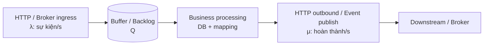
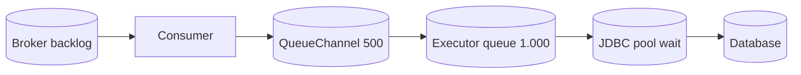
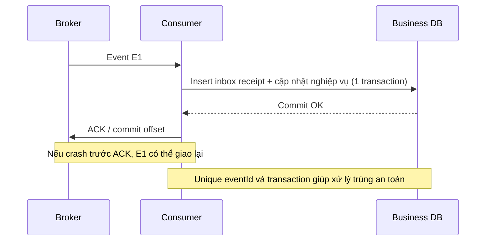

# Cân bằng tốc độ nhận, xử lý và gửi dữ liệu

## 1. Tại sao một hệ thống tích hợp có thể quá tải dù từng thành phần vẫn chạy?

Giả sử ứng dụng Spring Boot nhận sự kiện đơn hàng từ broker, ghi dữ liệu vào PostgreSQL, gọi API thanh toán và phát sự kiện kết quả sang một topic khác. Bình thường, service xử lý được 600 sự kiện mỗi giây. Trong giờ cao điểm, upstream đẩy tới 1.000 sự kiện mỗi giây trong 15 phút.

Một số hiện tượng có thể xuất hiện:

- Broker vẫn nhận sự kiện nhưng **consumer lag/backlog** tăng nhanh.
- Số luồng xử lý tăng, trong khi pool JDBC hết kết nối và HTTP client chờ connection.
- Một phần request tới đối tác bị HTTP 429/503, timeout hoặc phản hồi rất chậm.
- Retry tăng tải lên chính dependency đang chậm; DLQ bắt đầu có dữ liệu.
- Khi consumer được tăng concurrency, database hoặc API đối tác quá tải nặng hơn.

Vấn đề cốt lõi không đơn thuần là “tăng số thread”. Một luồng tích hợp gồm nhiều công đoạn, mỗi công đoạn có **năng lực xử lý, giới hạn tài nguyên và cơ chế chờ** khác nhau. Khi tốc độ nhận vượt tốc độ hoàn thành, công việc chưa xử lý sẽ tích tụ ở đâu đó: broker, hàng đợi trong bộ nhớ, executor, pool kết nối hoặc phía đối tác.

Trong module **SPRING_BOOT_INTEGRATION**, vận hành tích hợp có nghĩa là tổ chức các luồng HTTP, database, cache, broker và adapter Spring Integration sao cho **tốc độ nhận, xử lý và gửi được điều phối theo năng lực yếu nhất**, đồng thời duy trì tính đúng đắn của hợp đồng dữ liệu, giao dịch, ack, retry và xử lý trùng lặp.

### Mục tiêu học tập

Sau bài này, bạn có thể:

1. Phân biệt **ingress rate**, **processing throughput**, **egress rate**, **concurrency**, **latency** và **backlog**.
2. Tính tốc độ tăng hàng đợi, lượng công việc đang thực hiện và thời gian tiêu backlog theo các mô hình đơn giản.
3. Chọn **buffering**, **backpressure**, **rate limiting**, **load shedding** và **bulkhead** cho các ranh giới tích hợp khác nhau.
4. Cấu hình giới hạn rõ ràng trong Spring Integration, Kafka/RabbitMQ/Pulsar và HTTP/JDBC adapter mà không nhầm concurrency với throughput.
5. Thiết kế ack, retry, transaction, idempotency và shutdown để không đánh đổi tính đúng đắn chỉ lấy tốc độ.
6. Xây dashboard/SLO, bài thử tải và quy trình xử lý sự cố backlog.

> **Phạm vi phiên bản:** các ví dụ Java sử dụng Java 17+, Spring Boot 3.x và Spring Integration 6.x tương thích với Spring Boot BOM. Cấu hình Kafka/RabbitMQ và tên class có thể thay đổi theo dòng sản phẩm; luôn xác minh với phiên bản cụ thể khi dùng trên production. Những con số trong bài là giả định để luyện thiết kế, **không phải giá trị tuning chung** cho mọi hệ thống.

## 2. Mô hình ba tốc độ của một pipeline

Xét luồng:



Một số ký hiệu:

| Ký hiệu | Ý nghĩa | Đơn vị |
| --- | --- | --- |
| `λ` (lambda) | Tốc độ sự kiện mới đi vào pipeline | sự kiện/giây |
| `μ` (mu) | Năng lực phục vụ bền vững của hệ ở tải và cấu hình xác định | sự kiện/giây |
| `Q` | Số sự kiện đang chờ xử lý trong buffer hoặc broker backlog | sự kiện |
| `W` | Thời gian một sự kiện ở trong hệ (tùy ranh giới đo) | giây |
| `L` | Số sự kiện trung bình đang ở trong hệ, gồm chờ và đang xử lý | sự kiện |
| `C` | Số tác vụ thực thi đồng thời (in-flight/concurrency) | tác vụ |

Trong hệ **ổn định**, khi số lượng vào và ra dài hạn cân bằng, có thể dùng quan hệ của **Little's Law**:

\[
L=\lambda W
\]

Nếu pipeline hoàn thành trung bình 400 sự kiện/giây và một sự kiện đi từ lúc nhận đến lúc hoàn thành mất trung bình 0,25 giây, số sự kiện trung bình ở trong ranh giới đo đó xấp xỉ:

\[
L=400\times 0{,}25=100
\]

Đây là **định luật cho trung bình của hệ ổn định**, không phải lệnh đặt `maxPoolSize=100`. `L` gồm cả các sự kiện **đang chờ**, trong khi số thread đang làm việc chỉ là một phần và không nhất thiết tương đương số request/sự kiện in-flight. Mạng, async I/O, batching và xử lý song song làm quan hệ với số thread phức tạp hơn.

### 2.1. Khi tốc độ nhận lớn hơn tốc độ hoàn thành

Nếu `λ=1.000` sự kiện/giây nhưng pipeline chỉ hoàn thành `μ=600` sự kiện/giây, backlog tăng gần đúng:

\[
\frac{dQ}{dt}\approx \lambda-\mu=400 \text{ sự kiện/giây}
\]

Sau 15 phút:

\[
\Delta Q\approx400\times15\times60=360.000 \text{ sự kiện}
\]

Giả định ở đây là tốc độ đến và tốc độ hoàn thành gần như cố định trong khoảng thời gian xét, không có drop, DLQ hoặc tác động khác lên backlog. Thực tế, throughput có thể **giảm thêm** khi hệ quá tải do GC, lock contention, timeout và retry.

Nếu sau cao điểm, tốc độ nhận còn 300/giây còn hệ vẫn xử lý 600/giây, năng lực tiêu backlog ròng chỉ là `600-300=300` sự kiện/giây. Với 360.000 sự kiện tồn đọng, thời gian tiêu hết xấp xỉ:

\[
360.000 / 300 = 1.200 \text{ giây} = 20 \text{ phút}
\]

Vì vậy “tăng consumer thêm 50%” không có nghĩa backlog sẽ biến mất sau vài phút nếu downstream vẫn giới hạn tổng throughput.

### 2.2. Bottleneck quyết định throughput dài hạn

Một pipeline tuần tự có ba bước với năng lực:

```text
Nhận từ broker        : 2.000 sự kiện/s
Xử lý DB + nghiệp vụ  :   700 sự kiện/s
Gọi API đối tác       :   400 sự kiện/s
```

Nếu mỗi sự kiện phải qua **cả ba bước**, throughput bền vững tối đa theo mô hình đơn giản không thể vượt khoảng **400 sự kiện/giây**. Thêm consumer chỉ khiến nhiều sự kiện hơn chờ tới API đối tác; không tăng khả năng trả lời của đối tác.

Công thức `min(capacity)` phù hợp khi mỗi input trải qua cùng một chuỗi bước. Nếu một sự kiện fan-out thành ba lời gọi HTTP, cần chuẩn hóa theo lượng công việc:

```text
1 order event → 1 DB transaction + 3 partner API requests
```

Nếu đối tác chỉ đáp ứng tổng 900 request/giây, thì năng lực của bước này tối đa khoảng **300 order event/giây** trước khi xét overhead, retry và những request bổ sung.

## 3. Đừng nhầm các đại lượng vận hành

| Đại lượng | Câu hỏi trả lời | Sai lầm thường gặp |
| --- | --- | --- |
| **Arrival rate** | Bao nhiêu dữ liệu mới đi vào mỗi giây? | Dùng số request HTTP làm đại diện cho lượng event sau fan-out |
| **Completion throughput** | Bao nhiêu công việc hoàn tất thành công? | Đếm số message đã đọc thay cho số giao dịch đã commit |
| **Concurrency** | Có bao nhiêu tác vụ cùng đang xử lý? | Tăng số thread là tăng throughput tuyến tính |
| **Latency** | Mất bao lâu từ lúc bắt đầu đến hoàn thành? | Chỉ đo xử lý CPU, bỏ qua chờ buffer/pool |
| **Backlog/lag** | Có bao nhiêu dữ liệu còn chờ? | Chỉ nhìn độ lớn queue mà không biết tuổi message |
| **Capacity** | Pipeline duy trì tốc độ nào trong điều kiện nào? | Dùng peak ngắn hạn làm năng lực ổn định |
| **Success rate** | Bao nhiêu giao dịch đạt kết quả nghiệp vụ? | Tính DLQ/retry như xử lý thành công |

**Đếm đúng điểm đo** rất quan trọng. Một consumer nhận một sự kiện, parse xong và ack trước khi database commit thì metric “đã consume” tăng, nhưng công việc nghiệp vụ có thể vẫn chưa hoàn thành. Nếu mục tiêu vận hành là “đơn hàng được xử lý”, completion cần được đo sau **ranh giới nghiệp vụ phù hợp**, không chỉ sau nhận message.

### Latency tổng phải kể cả thời gian chờ

Một sự kiện có thể trải qua:

\[
T_{\text{end-to-end}}
=T_{\text{backlog}}+T_{\text{queue}}+T_{\text{processing}}
+T_{\text{downstream}}+T_{\text{retry}}
\]

Các thành phần trên là cách phân rã theo một pipeline cụ thể; một số giai đoạn có thể chồng lấp nếu xử lý async. Dù có chồng lấp, **không nên chỉ đo thời gian trong handler** rồi coi đó là toàn bộ độ trễ người dùng quan tâm.

## 4. Buffering giúp hấp thụ đột biến, không tạo thêm năng lực

**Buffer** cho phép bên nhận tiếp tục nhận trong thời gian ngắn dù phía xử lý chậm tạm thời. Buffer thường gặp:

- Backlog có độ bền của Kafka, Pulsar, RabbitMQ theo cấu hình lưu trữ.
- `QueueChannel` của Spring Integration trong bộ nhớ.
- Hàng đợi task của `ThreadPoolTaskExecutor`.
- Request pending của HTTP client connection pool.
- Hàng đợi chờ connection của HikariCP.
- Bộ đệm batch của producer và network buffers.

Các tầng buffer có thể cùng tồn tại và làm “năng lực chờ” bị phân tán:



Khi queue trong ứng dụng quá lớn, bạn có thể thấy broker lag thấp nhưng latency người dùng rất cao vì công việc đã chuyển sang hàng đợi vô hình ở trong process. Nếu process crash, những message chỉ nằm trong hàng đợi bộ nhớ có thể **mất** trừ khi upstream có cơ chế chưa ack và redelivery đúng.

### 4.1. Tính dung lượng buffer từ burst

Giả sử trong 30 giây ingress tăng từ 400 lên 1.000 sự kiện/giây, còn hệ xử lý ổn định 600 sự kiện/giây:

\[
Q_{\text{burst}}\approx(1.000-600)\times30=12.000
\]

Nếu một message trung bình 8 KiB payload, **chỉ riêng payload thô** là khoảng 96.000 KiB (~93,75 MiB), chưa kể object, metadata, retry và chi phí runtime. Không nên lấy số này làm kích thước heap đủ dùng: memory overhead và GC có thể đáng kể.

Nếu burst kéo dài lâu hơn dự kiến, mọi buffer hữu hạn đều đầy. Vì vậy **buffer phải đi cùng hành động khi đầy**, không phải chỉ nâng `queueCapacity`.

### 4.2. Bounded queue và unbounded queue

| Kiểu | Lợi ích | Rủi ro |
| --- | --- | --- |
| Queue vô hạn hoặc rất lớn | Ít từ chối ngay khi cao điểm ngắn | Tăng latency, OOM, lâu hồi phục, ẩn bottleneck |
| Queue hữu hạn | Giới hạn tài nguyên và làm điểm nghẽn lộ rõ | Phải xử lý từ chối/tạm dừng; nếu ack sai có thể mất message |
| Broker backlog bền vững | Chịu được consumer dừng và hỗ trợ replay theo policy | Cần capacity storage, retention, quota và kế hoạch drain |

Để bảo toàn dữ liệu nghiệp vụ quan trọng, thường ưu tiên **giảm tốc nhận từ broker và giữ công việc chưa ack ở nguồn có độ bền**, hoặc persist vào một hệ bền vững trước khi xác nhận. Đẩy mọi thứ vào `QueueChannel` rồi ack ngay là đánh đổi nguy hiểm nếu process có thể crash.

## 5. Backpressure, rate limiting và load shedding

Ba khái niệm cùng nhằm đối phó quá tải nhưng hoạt động khác nhau.

| Cơ chế | Ý nghĩa | Ví dụ phù hợp |
| --- | --- | --- |
| **Backpressure** | Bên nhận báo hoặc biểu lộ rằng nó không thể nhận nhanh hơn; upstream giảm nhịp | Reactive Streams demand, broker consumer pause/prefetch, bounded channel |
| **Rate limiting** | Giới hạn số request/message được phép đi qua theo một đơn vị thời gian | API partner cho tối đa 200 request/s |
| **Concurrency limiting / bulkhead** | Giới hạn số tác vụ đang chạy đồng thời | Tối đa 16 kết nối gọi API đối tác ở một instance |
| **Load shedding** | Từ chối hoặc bỏ bớt công việc khi vượt khả năng, theo chính sách | HTTP 429/503 cho yêu cầu không thể tiếp nhận |
| **Batching** | Xử lý/gửi nhiều bản ghi trong một thao tác | JDBC batch hoặc producer message batch |

**Backpressure thực sự phải đi qua được ranh giới**. Một `QueueChannel` đầy có thể khiến phương thức `send` trả `false`; nhưng nếu phía trước đã ack message từ broker và không lưu trữ ở đâu, đó là **mất dữ liệu**, không phải backpressure an toàn.

### 5.1. Với HTTP ingress

HTTP request/response không cung cấp một consumer cursor như Kafka. Khi service đầy:

- Trả **429 Too Many Requests** nếu vượt quota/rate limit của client.
- Trả **503 Service Unavailable** nếu capacity tạm thời không đủ, kèm `Retry-After` khi phù hợp.
- Giới hạn request body, thời gian chờ, số request in-flight và kích thước hàng đợi.
- Chỉ trả **202 Accepted** khi đã đạt mức cam kết “accepted” của hợp đồng; nếu cần bảo đảm bền vững, hãy persist message vào database/outbox/broker trước.

Không trả `202` ngay sau khi đưa dữ liệu vào một in-memory queue rồi gọi đó là “đã lưu an toàn”, trừ khi API công khai rõ đây là cơ chế best-effort có thể mất dữ liệu.

### 5.2. Với broker ingress

Broker hỗ trợ một số cách điều tiết phù hợp với delivery semantics của nó:

- Giảm lượng poll/fetch, consumer prefetch hoặc receiver queue.
- Tạm dừng nhận/poll vào ứng dụng trong phạm vi được driver/container hỗ trợ.
- Chỉ ack/commit khi công việc đã đạt trạng thái bền vững phù hợp.
- Tăng backlog ở broker có quản lý quota/retention, thay vì tạo queue bộ nhớ vô hạn.

Chi tiết thay đổi theo Kafka, RabbitMQ, Pulsar và subscription type; không thể áp một property chung để điều tiết mọi broker.

### 5.3. Với reactive pipeline

Reactive Streams có cơ chế demand: downstream yêu cầu một lượng item có thể tiếp nhận. Tuy nhiên, chỉ đổi `RestClient` thành `WebClient` **không làm database hoặc đối tác nhanh hơn**. Hãy giới hạn `flatMap(..., concurrency)`, đặt timeout, giới hạn buffer, và lựa chọn chính sách khi nguồn không tuân thủ hoặc không truyền backpressure.

Ví dụ Reactor minh họa concurrency hữu hạn:

```java
Flux<OrderEvent> incoming = getEvents();

Flux<ProcessingResult> results = incoming
        .flatMap(
            event -> processAsync(event)
                    .timeout(Duration.ofSeconds(2)),
            16
        );
```

`getEvents()` và `processAsync(...)` là hàm của ứng dụng, cần cung cấp implementation. Số 16 là **giới hạn inner publisher đang được subscribe đồng thời** của `flatMap` trong ví dụ, không phải quota toàn cluster. Cần quyết định hướng xử lý timeout/error, scheduler blocking I/O và cách upstream tôn trọng demand. Tránh gọi `.block()` ngay trong event-loop của WebFlux/Netty.

## 6. Chọn concurrency bằng dữ liệu, không bằng cảm giác

Một worker xử lý sự kiện theo tuần tự, mất trung bình 40 ms/sự kiện, có năng lực lý thuyết:

\[
1/0{,}04=25 \text{ sự kiện/giây}
\]

Để xử lý 1.000 sự kiện/giây, theo phép tính đơn giản cần **ít nhất 40 worker** nếu mọi worker độc lập và tài nguyên downstream không bị giới hạn. Nhưng 40 là **cận lý thuyết** khi không có overhead, lock contention, batching, sai lệch latency hay bottleneck chung.

Trong thực tế:

- Nếu 40 ms gồm nhiều thời gian chờ I/O, asynchronous I/O có thể tăng lượng in-flight mà không tương ứng với số thread.
- Nếu database pool chỉ có 20 connection và mỗi sự kiện giữ connection trong suốt bước xử lý, tăng lên 80 worker có thể tạo hàng đợi chờ pool.
- Nếu đối tác cho tối đa 600 request/s, việc tăng 40 lên 80 worker không vượt được quota đó.
- Khi utilization tiến gần 100%, biến thiên thời gian phục vụ có thể làm p95/p99 queueing latency tăng mạnh.

Nên chọn concurrency bằng **load test ở workload và hạ tầng đại diện**, theo dõi completion rate, p95/p99 và error rate, rồi điều chỉnh theo bottleneck quan sát được.

### 6.1. Hai giới hạn cần tách riêng

```text
maxConcurrency = 16       # số tác vụ đang thực hiện
maxQueueSize   = 500      # số tác vụ được phép chờ
```

Nếu chỉ giới hạn concurrency nhưng cho queue vô hạn, khi downstream chậm yêu cầu vẫn tích tụ. Nếu chỉ giới hạn queue nhưng cho concurrency quá lớn, có thể tạo “thundering herd” tới database. Cần **cả hai**, cùng một hành động khi queue đầy.

### 6.2. Per-instance và global limit

Giới hạn bằng `Semaphore(16)` trong một Spring bean singleton là **16 kết nối đồng thời trên một instance**. Với 10 replica, toàn hệ có thể tạo tối đa khoảng 160 kết nối đồng thời tới cùng đối tác. Nếu quota đối tác chỉ là 60 request/s toàn khách hàng, phải có điều phối quota toàn cục, hoặc phân bổ budget cho mỗi replica và cấu hình autoscaling tương ứng.

Đừng nhầm “số kết nối mở”, “số request in-flight” và “request/s”: keep-alive/multiplexing có thể khiến những đại lượng này không tương đương.

## 7. Ví dụ Spring Integration: giới hạn buffer và tốc độ poll

Spring Integration tổ chức pipeline qua `MessageChannel`, `QueueChannel`, poller, endpoint và handler. Đoạn dưới minh họa **một buffer bộ nhớ hữu hạn** và **một flow tiêu thụ có poller**, nhằm thấy rõ nơi cấu hình capacity.

### 7.1. Dependency

```xml
<!-- Maven, ứng dụng có Spring Boot BOM/parent -->
<dependency>
    <groupId>org.springframework.boot</groupId>
    <artifactId>spring-boot-starter-integration</artifactId>
</dependency>
```

### 7.2. Cấu hình channel và flow

```java
package example.integration.flow;

import java.time.Duration;
import org.springframework.context.annotation.Bean;
import org.springframework.context.annotation.Configuration;
import org.springframework.integration.channel.QueueChannel;
import org.springframework.integration.dsl.IntegrationFlow;
import org.springframework.integration.dsl.Pollers;

@Configuration(proxyBeanMethods = false)
public class BoundedFlowConfiguration {

    @Bean
    QueueChannel inboundBuffer() {
        // Tối đa 500 message chờ trong bộ nhớ của instance này.
        return new QueueChannel(500);
    }

    @Bean
    IntegrationFlow orderProcessingFlow(
            QueueChannel inboundBuffer,
            OrderEventHandler orderEventHandler) {

        return IntegrationFlow
                .from(inboundBuffer, endpoint -> endpoint.poller(
                        Pollers.fixedDelay(Duration.ofMillis(100))
                                .maxMessagesPerPoll(10)))
                .handle(orderEventHandler, "handle")
                .get();
    }
}
```

Handler do ứng dụng cung cấp:

```java
package example.integration.flow;

import org.springframework.stereotype.Component;

@Component
public class OrderEventHandler {

    private final OrderBusinessService businessService;

    public OrderEventHandler(OrderBusinessService businessService) {
        this.businessService = businessService;
    }

    public void handle(OrderEvent event) {
        businessService.process(event);
    }
}

record OrderEvent(String eventId, String orderId) {
}
```

`OrderBusinessService` là service nghiệp vụ của ứng dụng. Ví dụ:

```java
package example.integration.flow;

public interface OrderBusinessService {
    void process(OrderEvent event);
}
```

**Giải thích giới hạn**:

- `new QueueChannel(500)`: tối đa 500 message chờ trong channel của **instance**, không phải persistent queue.
- `fixedDelay(100 ms)`: lịch poll tiếp theo được sắp sau lượt xử lý theo semantics scheduler; nếu handler chậm, số lượt poll có thể giảm.
- `maxMessagesPerPoll(10)`: số message tối đa một đợt poll lấy ra. Nó **không phải cam kết 100 message/giây**, vì thời gian xử lý, scheduling và concurrency cũng ảnh hưởng.
- Với flow này, không có worker pool riêng được cấu hình; không nên mặc định endpoint tự xử lý 10 message song song. Cần chọn rõ concurrency và task executor nếu workload yêu cầu.

### 7.3. Gửi vào bounded channel và xử lý trường hợp đầy

```java
package example.integration.flow;

import java.util.concurrent.RejectedExecutionException;
import org.springframework.beans.factory.annotation.Qualifier;
import org.springframework.messaging.MessageChannel;
import org.springframework.messaging.support.MessageBuilder;
import org.springframework.stereotype.Component;

@Component
public class OrderIngressAdapter {

    private final MessageChannel inboundBuffer;

    public OrderIngressAdapter(
            @Qualifier("inboundBuffer") MessageChannel inboundBuffer) {
        this.inboundBuffer = inboundBuffer;
    }

    public void offer(OrderEvent event) {
        boolean accepted = inboundBuffer.send(
                MessageBuilder.withPayload(event).build(),
                100 // tối đa 100 ms chờ nếu QueueChannel đầy
        );

        if (!accepted) {
            throw new RejectedExecutionException(
                    "Local processing buffer is full");
        }
    }
}
```

Điều bắt buộc: `send(..., 100)` chỉ xác nhận message **đã vào buffer bộ nhớ**, không xác nhận nghiệp vụ hoàn thành và **không bảo đảm bền vững**. Nếu nguồn là Kafka/RabbitMQ/Pulsar, **không ack chỉ vì `offer` trả thành công**, trừ khi đã có một bản ghi bền vững khác hoặc business contract chấp nhận mất message khi process crash.

Khi handler ném exception sau khi message bị lấy ra khỏi `QueueChannel`, message không tự quay về broker gốc. Cần thiết kế error flow/retry hoặc dùng broker/durable store làm nguồn sự thật của công việc chưa hoàn thành.

### 7.4. Khi cần worker pool

Có thể dùng `TaskExecutor` hoặc các endpoint có khả năng concurrency để xử lý song song. Mọi executor cần có **giới hạn queue hữu hạn**, reject policy rõ và chỉ số active/queued. Ví dụ một pool:

```java
@Bean
ThreadPoolTaskExecutor integrationWorkerExecutor() {
    var pool = new ThreadPoolTaskExecutor();
    pool.setCorePoolSize(4);
    pool.setMaxPoolSize(8);
    pool.setQueueCapacity(100);
    pool.setThreadNamePrefix("integration-worker-");
    pool.initialize();
    return pool;
}
```

Các import cần thiết là `org.springframework.context.annotation.Bean` và `org.springframework.scheduling.concurrent.ThreadPoolTaskExecutor`. Đoạn này chỉ định nghĩa pool; **chưa tự nối pool vào flow**. Muốn dùng, phải gắn executor vào poller hoặc channel/endpoint phù hợp và kiểm tra semantics khi task bị từ chối. Đặc biệt, không để exception từ executor hoặc việc queue đầy khiến broker consumer ack nhầm.

**Giới hạn của demo:** `QueueChannel` thích hợp để hiểu flow và cho công việc best-effort có thể khôi phục từ nguồn khác. Với message tài chính hoặc đơn hàng không được phép mất, dùng durable broker/inbox/outbox, và chỉ xác nhận upstream sau khi có điểm lưu trữ bền vững hợp lệ.

## 8. Điều tiết consumer ở Kafka, RabbitMQ và Pulsar

Các broker có cơ chế tiếp nhận khác nhau. Nên điều tiết **ngay ở tầng listener/container** trước khi đẩy khối lượng không kiểm soát vào queue nội bộ.

### 8.1. Kafka: poll, partition, concurrency và commit

Một cấu hình khởi điểm minh họa:

```yaml
spring:
  kafka:
    consumer:
      enable-auto-commit: false
      max-poll-records: 100
      properties:
        max.poll.interval.ms: 300000
    listener:
      concurrency: 4
      ack-mode: manual
```

Giải thích:

- `max-poll-records` giới hạn số record trả về mỗi lần `poll()`; **không phải giới hạn request/s** từ broker.
- `listener.concurrency=4` tạo các consumer/listener container đồng thời theo cách Spring Kafka tổ chức. Số partition được gán quyết định giới hạn khả năng xử lý song song trong cùng consumer group.
- `max.poll.interval.ms` giới hạn thời gian giữa các lần poll theo quy tắc Kafka. Nếu handler xử lý batch quá lâu, consumer có thể mất membership/rebalance, khiến message được xử lý lại.
- `ack-mode=manual` cần code ack đúng thời điểm và error handler phù hợp; không bảo đảm exactly-once qua database chỉ vì bật manual.

Ví dụ listener tối giản, chỉ ack **sau khi service đã hoàn tất transaction dữ liệu**:

```java
package example.integration.kafka;

import org.springframework.kafka.annotation.KafkaListener;
import org.springframework.kafka.support.Acknowledgment;
import org.springframework.stereotype.Component;

@Component
public class OrderEventKafkaListener {

    private final OrderProcessingService service;

    public OrderEventKafkaListener(OrderProcessingService service) {
        this.service = service;
    }

    @KafkaListener(
            topics = "${integration.orders.topic}",
            groupId = "${integration.orders.group-id}")
    public void onMessage(String payload, Acknowledgment ack) {
        service.processIdempotently(payload);
        ack.acknowledge();
    }
}
```

Ở đây `OrderProcessingService` phải được ứng dụng định nghĩa. `processIdempotently` cần hoàn tất commit/điểm lưu bền vững phù hợp **trước khi** ack. Nếu process crash ngay sau DB commit nhưng trước khi commit Kafka offset, message có thể được phát lại; service phải xử lý trùng an toàn.

Khi xử lý lâu, không giải quyết bằng cách chỉ tăng `max.poll.interval.ms` vô hạn. Cần tính lại batch size, concurrency, tách work thành công đoạn, giới hạn HTTP/DB call hoặc dùng mô hình transaction/outbox phù hợp. Nếu dùng async handler, cần đặc biệt tránh ack trước khi future hoàn thành.

### 8.2. RabbitMQ: prefetch và manual ack

RabbitMQ push delivery tới consumer trong phạm vi **prefetch** và trạng thái message chưa ack. Ví dụ Spring AMQP listener:

```yaml
spring:
  rabbitmq:
    listener:
      simple:
        prefetch: 20
        concurrency: 4
        max-concurrency: 8
        acknowledge-mode: manual
```

Với container loại `simple`, các giá trị trên điều khiển số consumer và giới hạn số delivery chưa ack theo semantics của Spring AMQP/RabbitMQ. Cần:

- Ack sau khi công việc cần bảo đảm đã commit hoặc đã được persist bền vững ở một nơi phù hợp.
- Nack/requeue có kiểm soát với lỗi tạm thời; tránh vòng lặp requeue tức thời không giới hạn.
- Thiết lập DLX/DLQ và TTL/queue policy phù hợp khi có message không xử lý được.
- Không đặt prefetch quá cao khi mỗi message tốn nhiều bộ nhớ/DB connections.

`prefetch=20` **không có nghĩa tối đa 20 message/giây**. Nó giới hạn số delivery chưa ack trong phạm vi consumer, trong khi throughput phụ thuộc thời gian xử lý, số consumer và broker.

### 8.3. Pulsar: receiver queue, subscription và permits

Pulsar điều tiết delivery bằng receiver queue và flow control ở client, cùng subscription type và broker policy. Với Spring Pulsar, có thể cấu hình consumer/listener qua các nhóm `spring.pulsar.consumer.*` và `spring.pulsar.listener.*`, hoặc dùng builder customizer khi cần các tùy chọn Pulsar Java client chuyên biệt.

Khi chọn subscription:

| Loại | Tác động vận hành |
| --- | --- |
| `Exclusive` | Một consumer active trên subscription; không tự scale nhiều consumer cùng subscription |
| `Failover` | Có consumer standby; tính năng chịu lỗi khác với throughput scale-out |
| `Shared` | Phân phối message tới nhiều consumer, không cam kết thứ tự toàn cục |
| `Key_Shared` | Phân phối theo key trong phạm vi semantics được hỗ trợ; cần kiểm tra batching và ordering |

Giảm receiver queue hoặc số consumer khi downstream quá tải có thể giúp hạn chế số message đang nằm trong process, nhưng cần kiểm tra redelivery/negative acknowledgment và giới hạn tài nguyên. Chỉ giảm queue không tự tăng khả năng ghi của DB hay API đối tác.

### 8.4. So sánh ngắn

| Broker | Điểm điều tiết thường dùng | Ranh giới an toàn dữ liệu |
| --- | --- | --- |
| Kafka | `max.poll.records`, consumer concurrency, pause/resume, commit offset | Commit sau xử lý/persist theo semantics; lưu ý rebalance |
| RabbitMQ | Prefetch, số consumer, ack/nack, DLQ | Ack sau commit/điểm bền vững; tránh requeue loop |
| Pulsar | Receiver queue, subscription, consumer count, ack/redelivery | Ack theo hợp đồng sau xử lý; idempotency khi redelivery |

**Không nên chọn một trị số concurrency chung cho mọi broker.** Mẫu workload, partitioning, số consumer, thời gian handler và kiểu delivery khác nhau dẫn tới giới hạn thực tế khác nhau.

## 9. Bảo vệ downstream HTTP bằng concurrency limit và timeout

Một hệ thống có thể nhận 1.000 event/s nhưng đối tác chỉ chịu được 100 request/s hoặc 20 request đồng thời. Nếu mỗi listener tự gọi `RestClient` không giới hạn, timeout và retry có thể đẩy đối tác vào vòng quá tải.

### 9.1. Ví dụ bulkhead đơn giản với `Semaphore`

```java
package example.integration.partner;

import java.util.concurrent.Semaphore;
import java.util.concurrent.RejectedExecutionException;
import org.springframework.stereotype.Component;
import org.springframework.web.client.RestClient;

@Component
public class BoundedPartnerClient {

    private final RestClient client;
    private final Semaphore inFlight = new Semaphore(16);

    public BoundedPartnerClient(RestClient.Builder builder) {
        this.client = builder
                .baseUrl("https://partner.example.test")
                .build();
    }

    public PartnerStatus fetchStatus(String id) {
        if (!inFlight.tryAcquire()) {
            throw new RejectedExecutionException(
                    "Partner bulkhead is saturated");
        }

        try {
            PartnerStatus body = client.get()
                    .uri("/v1/status/{id}", id)
                    .retrieve()
                    .body(PartnerStatus.class);
            if (body == null) {
                throw new IllegalStateException("Empty partner response");
            }
            return body;
        } finally {
            inFlight.release();
        }
    }

    public record PartnerStatus(String id, String state) {
    }
}
```

Trong ví dụ, bean `BoundedPartnerClient` là singleton nên semaphore được chia sẻ giữa các lời gọi **trên cùng instance**. Khi bận hết 16 permit, lệnh mới bị từ chối ngay để **không giữ thêm thread chờ**. Bên gọi phải quyết định retry sau, giữ message ở broker hay trả 503; không được coi reject là xử lý thành công.

Đoạn code minh họa cơ chế giới hạn, chưa cấu hình auth/TLS, connect/read timeout, rate limit toàn cluster và circuit breaker. URL `.example.test` chỉ là endpoint giả lập. Khi đưa vào production cần dùng `RestClient` cấu hình theo `@ConfigurationProperties`, SSL bundle nếu có, timeouts, pooling và instrumentation phù hợp.

### 9.2. Một bulkhead không thay rate limiter

Nếu đối tác có latency rất thấp, 16 request in-flight vẫn có thể tạo throughput lớn hơn 100 request/s. Ngược lại khi latency lên 2 giây, cùng 16 permit chỉ cho tối đa khoảng 8 request/s trong điều kiện đơn giản.

Vì vậy:

- **Concurrency limit** bảo vệ số tác vụ đang chờ phản hồi.
- **Rate limiter** bảo vệ số request theo thời gian.
- **Timeout** giải phóng tài nguyên khi không có phản hồi.
- **Circuit breaker** hạn chế gọi tới dependency lỗi liên tục dựa trên chính sách.

Các cấu hình này phải được thiết kế cùng nhau. Nếu timeout quá dài, các permit bị giữ lâu; nếu retry ngay tức thì sau reject, bạn tạo **retry storm** làm load tăng thêm.

### 9.3. HTTP 429/503 và `Retry-After`

Khi đối tác trả 429, cần tôn trọng chính sách retry nếu có, bao gồm `Retry-After` và giới hạn tổng số lần thử. Lệnh không idempotent như ghi thanh toán cần **idempotency key** hoặc cơ chế đối soát; timeout không chứng minh server chưa thực hiện thao tác.

Khi chính ứng dụng nhận HTTP ingress mà không còn capacity, nên trả lỗi quá tải phù hợp thay vì xếp vô hạn trong thread pool. Đối với công việc bắt buộc xử lý, có thể tách endpoint tiếp nhận để ghi bền vững vào inbox/outbox, trả 202 sau commit và xử lý bằng consumer nền.

## 10. JDBC, connection pool và cache cũng tạo backpressure

### 10.1. JDBC/HikariCP

Spring Boot thường dùng HikariCP khi áp dụng JDBC starter và có dependency phù hợp. Ví dụ:

```yaml
spring:
  datasource:
    hikari:
      maximum-pool-size: 20
      connection-timeout: 2s
```

Hai thuộc tính:

- `maximum-pool-size=20`: giới hạn số kết nối database trong pool **trên mỗi instance**.
- `connection-timeout=2s`: thời gian chờ tối đa khi lấy connection từ pool trước khi lỗi; không phải SQL query timeout.

Nếu 10 replica mỗi replica cho phép 20 kết nối, về mặt lý thuyết ứng dụng có thể tạo tới khoảng 200 kết nối DB, chưa tính các service khác. Database có thể không chịu được con số này. Cần phân bổ ngân sách kết nối **theo toàn cụm** và quan sát pool active/idle/pending.

Tăng số connection **không bảo đảm** DB nhanh hơn: bottleneck có thể ở CPU, IO, index, locks, transaction quá dài hoặc truy vấn N+1.

### 10.2. Giữ transaction ngắn

Mẫu rủi ro:

```java
@Transactional
public void process(OrderEvent event) {
    orderRepository.save(...);
    partnerClient.callExternalApi(...); // có thể chờ nhiều giây
    receiptRepository.save(...);
}
```

Trong mô hình này, một transaction database có thể mở trong lúc chờ HTTP. Điều đó có thể giữ lock và connection lâu, giảm throughput và tăng deadlock/timeout. Đối với giao tiếp bên ngoài, cân nhắc tách transaction, outbox hoặc workflow/saga có trạng thái trung gian; không kỳ vọng `@Transactional` mở rộng thành một transaction nguyên tử xuyên HTTP, DB và broker.

### 10.3. Redis/cache

Redis là dependency I/O. Tăng số consumer đồng thời trong khi Redis bị chậm có thể gây:

- Nhiều request pending, timeout ở driver và bộ đệm tăng.
- Cache stampede khi nhiều request cùng miss một key.
- Tải ghi không đều khi TTL hết hàng loạt.

Các biện pháp: giới hạn in-flight, timeout, policy fallback đã cân nhắc dữ liệu cũ, key TTL có jitter, single-flight cho hot key và đo command latency. **Không dùng cache để che một database không đáp ứng khả năng chịu tải** nếu dữ liệu cache không có chính sách nhất quán và phục hồi rõ ràng.

## 11. Độ bền dữ liệu: ack, retry và idempotency quan trọng hơn tốc độ đọc

Một consumer có thể cải thiện metric “đã nhận” bằng cách ack ngay rồi gửi công việc vào queue trong process. Nhưng khi process crash, công việc có thể biến mất. Đối với đơn hàng, thanh toán hoặc cập nhật tồn kho, **độ bền của điểm tiếp nhận** là phần của hợp đồng nghiệp vụ.

### 11.1. Ranh giới an toàn



Chiến lược này thường tạo **at-least-once delivery** với **idempotent effects**, không phải exactly-once xuyên tất cả hệ thống. Cần kiểm tra cơ chế ack/commit cụ thể của broker và transactional boundary ở database.

### 11.2. Receipt/inbox và unique constraint

Một bảng giả định:

```sql
CREATE TABLE processed_event (
    event_id VARCHAR(80) PRIMARY KEY,
    processed_at TIMESTAMP NOT NULL
);
```

Trong một transaction:

```text
1. Kiểm tra/ghi event_id vào processed_event.
2. Nếu event_id đã được xử lý, không tạo side effect mới.
3. Cập nhật dữ liệu nghiệp vụ cần thiết.
4. Commit.
5. Chỉ sau commit mới ACK upstream.
```

Việc “kiểm tra trước rồi insert” phải xử lý race khi hai consumer cùng nhận event. Unique constraint và transaction isolation/cơ chế insert có điều kiện phù hợp là ranh giới dữ liệu quan trọng. Không dùng một `HashSet` trong JVM để chống trùng trên toàn cụm.

### 11.3. Outbox cho chiều gửi

Ở chiều producer, nếu database commit xong nhưng publish message thất bại, có thể sử dụng **transactional outbox**:

```text
HTTP request → transaction: business row + outbox row
            → commit
            → background outbox publisher
            → broker
            → đánh dấu đã publish
```

Outbox cho phép tách tốc độ ghi nghiệp vụ với tốc độ gửi broker. Nhưng buffer outbox cũng phải được đo **tuổi bản ghi chưa gửi, tốc độ drain, số retry và kích thước bảng**. Nếu broker ngừng nhiều giờ mà ứng dụng vẫn tạo outbox với tốc độ cao, database có thể đầy.

## 12. Retry: công cụ phục hồi hay bộ khuếch đại quá tải?

Khi dependency chậm, retry dễ tăng lượng công việc:

```text
100 request/s × 1 attempt = 100 request/s downstream
100 request/s × (1 + 2 retries) = tối đa 300 attempts/s
```

Con số thực tế phụ thuộc tỷ lệ lỗi và lúc retry; ví dụ trên minh họa rủi ro khi **tất cả** lời gọi đều thất bại và được retry hai lần.

### 12.1. Quy tắc retry an toàn

1. **Phân loại lỗi:** timeout/503 tạm thời có thể retry; sai schema, 401/403, certificate không tin cậy hoặc dữ liệu không hợp lệ thường cần sửa cấu hình/dữ liệu.
2. **Giới hạn số lần thử và tổng thời gian:** retry không được giữ thread hoặc in-flight quá lâu.
3. **Backoff và jitter:** tránh nhiều instance đồng thời retry ngay khi upstream phục hồi.
4. **Tôn trọng `Retry-After`** và quota của downstream khi có.
5. **Idempotency:** trước khi retry side effect, xác định có thể thực hiện lại an toàn không.
6. **Tách retry khỏi luồng nóng khi cần:** đưa vào retry topic/delayed queue hoặc scheduler bền vững thay vì ngủ dài trong listener thread.
7. **DLQ/parking lot:** có khả năng điều tra, sửa dữ liệu và replay theo quy trình.

### 12.2. Retry budget

Một cách vận hành là giới hạn tổng lưu lượng retry theo **ngân sách** (retry budget), thay vì cho mọi client retry vô hạn. Ví dụ chỉ cho phép thêm tối đa một tỷ lệ attempts so với lưu lượng mới trong một cửa sổ đo, đồng thời ưu tiên request mới hoặc công việc có deadline phù hợp.

Không áp dụng cùng một budget cho mọi nghiệp vụ mà bỏ qua độ quan trọng: event đã lưu bền vững có thể chờ lâu hơn, trong khi HTTP request tương tác trực tiếp với người dùng thường cần timeout và thông báo sớm.

### 12.3. Poison message

Một message sai schema có thể bị delivery lặp vô hạn nếu container tự retry không giới hạn. Dấu hiệu là một consumer bận nhưng completion throughput gần bằng 0, lag không giảm và log cùng exception lặp lại.

Cần phân biệt **lỗi tạm thời** với **poison message**, đưa message lỗi không thể xử lý vào DLQ có kiểm soát và không ack nhầm message trước khi đã ghi nhận quyết định xử lý theo policy. DLQ không phải “xóa lỗi”; nó là nguồn công việc cần người vận hành xử lý.

## 13. Batch, bulk operation và tác động lên throughput

Batch thường giúp giảm số round trip:

- JDBC batch insert/update thay vì một câu SQL cho từng record.
- Producer gửi message theo batch phù hợp.
- HTTP bulk endpoint khi đối tác hỗ trợ.
- Cache `MGET`/pipelining phù hợp.

Nhưng batch lớn không miễn phí:

| Tăng batch size | Tác dụng có thể tốt | Tác dụng có thể xấu |
| --- | --- | --- |
| Giảm overhead mỗi record | Throughput tổng tăng | Latency record đầu tiên tăng vì chờ gom batch |
| Giảm số network round trip | Giảm CPU/network overhead | Payload lớn gây timeout/retry cost cao |
| Tận dụng insert theo lô | Hiệu quả DB tăng | Transaction kéo dài, lock và rollback nặng |
| Ít lệnh gửi broker | Sử dụng bandwidth tốt hơn | Thứ tự, routing theo key, dead-letter khó hơn |

Chọn batch size bằng dữ liệu thực tế, kiểm tra thêm **p99 latency và memory**, không chỉ tổng throughput. Nếu một batch chứa cả 100 event nhưng có 1 event lỗi, xác định chính sách partial success/retry và khả năng idempotent trước khi tăng batch size.

## 14. SLO và giám sát: biết hệ đang chậm ở đâu

Một dashboard hữu ích cần theo từng công đoạn, không chỉ tổng CPU:

| Vị trí | Metric cần xem | Diễn giải |
| --- | --- | --- |
| HTTP ingress | Request rate, 429/503, p95/p99 latency, in-flight | Client có bị từ chối hay chờ lâu? |
| Broker ingress | Consumer lag/backlog, tuổi message cũ nhất, deliveries/s | Công việc có đang tích tụ ngoài app? |
| Internal buffer | Queue depth/capacity, time-in-queue, rejected send | Có đang chuyển backlog vào heap? |
| Worker executor | Active threads, queue size, rejections, task duration | Worker bão hòa hay bị chặn I/O? |
| Database | Hikari active/idle/pending, acquire time, query latency, lock wait | Nút thắt ở connection hay SQL thực tế? |
| HTTP outbound | Requests/s, in-flight, pool pending, timeout, 429/503 | Partner API có chậm hay vượt quota? |
| Publisher | Outbox lag/age, send latency, publish failures | Có nghiệp vụ đã commit nhưng event chưa phát? |
| Consumer outcome | Business completion/s, retry rate, DLQ, dedupe | Tốc độ **hoàn thành thật** và lỗi nghiệp vụ |
| JVM/host | CPU, heap, GC pause, threads, network/disk | Tài nguyên local có gây suy giảm throughput? |

### 14.1. Đo backlog bằng thời gian, không chỉ bằng số lượng

Nếu backlog 10.000 message và consumer hoàn thành 5.000 message/s, tình huống khác hẳn backlog 10.000 với tốc độ 5 message/s. Một chỉ số gần đúng:

\[
T_{\text{drain}}\approx\frac{Q}{\mu-\lambda}
\quad \text{khi } \mu>\lambda
\]

Trong đó `λ` là ingress mới, `μ` là completion throughput bền vững dưới điều kiện hiện tại. Đây chỉ là dự báo đơn giản, giả định tốc độ tương đối ổn định và cùng đơn vị công việc.

Ngoài backlog size, nên theo dõi **tuổi message chưa xử lý lâu nhất** hoặc end-to-end age. Một backlog nhỏ nhưng chứa một message bị kẹt nhiều giờ có thể vi phạm SLO nghiêm trọng.

### 14.2. Đặt SLO có ngữ nghĩa nghiệp vụ

Ví dụ (giả định) cho luồng đơn hàng:

| SLO | Định nghĩa ví dụ |
| --- | --- |
| Độ trễ xử lý | 99% sự kiện hợp lệ hoàn thành nghiệp vụ trong vòng 60 giây từ lúc được broker nhận |
| Tính đầy đủ | 99,99% sự kiện hợp lệ cuối cùng được xử lý hoặc có trạng thái lỗi có thể điều tra |
| Sức khỏe backlog | Tuổi event chưa xử lý lâu nhất dưới 5 phút trong điều kiện hoạt động bình thường |
| Tỷ lệ duplicate effects | Không phát sinh cập nhật nghiệp vụ hai lần cho cùng idempotency key |

Giá trị cần được đội sản phẩm, vận hành và đối tác thống nhất theo yêu cầu thực. **SLO “99% message được consume” vô nghĩa** nếu consumer ack trước khi ghi nhận kết quả nghiệp vụ.

### 14.3. Tracing và correlation ID

Để lần theo `HTTP request → DB transaction → outbox → broker → consumer → partner HTTP`, cần:

- Correlation ID hoặc trace context có quy tắc truyền qua header/message properties.
- Event ID, aggregate ID và schema version được mang qua hợp đồng thích hợp.
- Trace span đo thời gian chờ/publish/consume và những nơi có thể đo được.
- Logging có cấu trúc nhưng **không log toàn bộ payload nhạy cảm**, token hoặc dữ liệu cá nhân không cần thiết.

Micrometer/Actuator và instrumentation của từng client có thể cung cấp metric, nhưng một broker adapter hoạt động không đồng nghĩa tất cả metric liên quan backlog, DLQ hoặc age tự xuất hiện. Cần tích hợp thêm dashboard/metrics từ broker, database và ứng dụng.

## 15. Load test và capacity planning

Không tối ưu dựa trên một phép thử “gửi nhanh 10.000 message” rồi kết luận. Cần một kế hoạch có nhiều giai đoạn:

1. **Baseline:** đo throughput và p95/p99 khi upstream thấp hơn capacity.
2. **Ramp:** tăng ingress dần để xác định điểm bắt đầu queue depth/latency tăng liên tục.
3. **Sustained load:** giữ tải trong đủ lâu để lộ lock, GC, leak và compaction.
4. **Burst:** tăng tải ngắn rồi kiểm tra tốc độ và thời gian drain backlog.
5. **Downstream slowdown:** cố tình tăng latency hoặc trả 429/503 từ đối tác.
6. **Broker/db disruption:** restart, mất kết nối, rebalance hoặc cạn pool.
7. **Recovery:** xác nhận không mất message đã cam kết, không tạo duplicate side effects và backlog giảm đúng tốc độ dự kiến.

### 15.1. Một bảng kế hoạch thử tải mẫu

| Giai đoạn | Ingress giả định | Thời lượng | Điều cần quan sát |
| --- | --- | --- | --- |
| Baseline | 200/s | 10 phút | p95, CPU, pool và latency ổn định |
| Ramp | 200 → 800/s | 20 phút | Điểm Q bắt đầu tăng, success throughput |
| Burst | 1.200/s | 2 phút | Backlog tăng bao nhiêu, memory và reject |
| Recovery | 300/s | 15 phút | Drain rate, tuổi message và retry |
| Partner failure | API trả 503/429 | 5 phút | Circuit breaker, retry budget, DLQ/outbox |
| Broker restart | Mất broker ngắn hạn | Theo kế hoạch | Redelivery, duplicate effects, phục hồi |

Các giá trị chỉ là mẫu. Workload tạo tải phải có **phân bố key/tenant và kích thước payload tương tự thực tế**, kể cả message lớn, hot key, tenant chiếm đa số tải, và tỷ lệ request tạo nhiều HTTP calls.

### 15.2. Cách tìm điểm nghẽn

Khi tăng load, thực hiện theo vòng:

```text
Tăng ingress có kiểm soát
     ↓
Đo completion throughput + latency + queue
     ↓
Xác định thành phần đầu tiên bão hòa
     ↓
Chọn một thay đổi phù hợp (query, batch, quota, concurrency...)
     ↓
Test lại và xác minh không đẩy bottleneck sang nơi nguy hiểm hơn
```

Ví dụ:

- Hikari pending tăng, DB CPU thấp: kiểm tra transaction giữ connection lâu, pool size, lock wait và thao tác HTTP nằm trong transaction.
- HTTP 429 tăng: giảm rate gửi và tôn trọng quota; **không** chỉ tăng executor pool.
- CPU JVM 100%, pool DB rảnh: tìm CPU-bound transform/serialization, GC và kích thước payload.
- Broker lag tăng, CPU/DB đều rảnh: kiểm tra số partition, assignment, poll loop, consumer group hoặc cấu hình listener.

## 16. Autoscaling và giới hạn năng lực toàn hệ

Autoscaling chỉ có tác dụng khi workload có thể phân tán và downstream còn dư năng lực:

| Scale component | Khi hữu ích | Khi có thể gây hại |
| --- | --- | --- |
| Thêm Kafka consumer instance | Có đủ partition và xử lý phân tán được | Partition giới hạn; tăng DB connections/HTTP calls |
| Tăng Rabbit/Pulsar consumer | Broker và downstream còn capacity | Prefetch/receiver queue, redelivery và pool bị bão hòa |
| Tăng worker threads | Handler chủ yếu chờ I/O và downstream chịu được | Tăng contention, OOM và latency |
| Tăng database pool | DB chấp nhận thêm connection và đang nghẽn vì thiếu pool | DB CPU/IO bão hòa, lock contention tăng |
| Thêm application replica | Có quota/partition và hạ tầng hỗ trợ | Quota đối tác toàn cluster bị vượt |

Nếu autoscaler dựa trên backlog, nên bổ sung **completion throughput, độ trễ, max replica, cooldown và khả năng downstream**. Scale liên tục theo một backlog không thể drain vì API đối tác chỉ cho 100 request/s sẽ tăng chi phí mà không cải thiện SLO.

### 16.1. Backlog-driven scaling cần nhìn cả tuổi và tốc độ

Hai subscription cùng có 50.000 message:

- Subscription A: consumer drain 10.000/s, ingress 8.000/s → backlog giảm 2.000/s, khoảng 25 giây nếu điều kiện giữ nguyên.
- Subscription B: consumer drain 500/s, ingress 700/s → backlog **tăng** 200/s, scale cần xem bottleneck.

Đếm backlog một mình không phân biệt hai tình huống. Trong vận hành cần thiết lập cảnh báo **khi backlog tăng liên tục hoặc tuổi vượt SLO**, sau đó dựa vào throughput và dependency saturation để quyết định scale hay throttle.

## 17. Startup, shutdown và deploy không làm mất công việc

Khi deploy rolling update hoặc ứng dụng nhận SIGTERM:

1. Ngừng nhận công việc mới hoặc đánh dấu readiness phù hợp để không tiếp tục dồn yêu cầu vào instance sắp đóng.
2. Cho các tác vụ in-flight kết thúc trong **grace period** xác định.
3. Hoàn tất commit/ack đối với các công việc đã thực sự xử lý xong.
4. Để công việc chưa hoàn thành ở nguồn bền vững có thể redeliver, hoặc persisting trước khi shutdown.
5. Đóng HTTP client, connection pool và listener container đúng thứ tự, có timeout.

Một `QueueChannel` không bền vững chứa 500 sự kiện không có cơ chế bảo đảm tự di chuyển sang instance mới. Nếu upstream đã ack trước khi enqueue, shutdown có thể làm mất các sự kiện ấy. Đối với công việc quan trọng, chủ động giữ nguồn công việc tại broker/outbox hoặc sử dụng durable storage.

### 17.1. Readiness khác liveness

- **Liveness:** process còn sống và cần/không cần restart.
- **Readiness:** instance có nên nhận thêm traffic hoặc công việc mới vào thời điểm này không.

Nếu dependency lỗi, **không nên mặc định mọi loại lỗi downstream đều khiến liveness fail**, dẫn tới restart storm. Tùy kiến trúc, có thể giảm readiness, tạm dừng consumer, mở circuit breaker hoặc giữ backlog tại broker, trong khi process vẫn đủ sức phục hồi.

## 18. Tình huống tổng hợp: sự kiện đơn hàng tăng gấp ba

**Bối cảnh (giả định):**

- Bình thường broker nhận 300 event/s.
- Trong khuyến mãi nhận 900 event/s trong 20 phút.
- Hệ xử lý DB được 1.200 event/s nếu không gọi partner, nhưng API partner chỉ chịu 500 request/s.
- Mỗi order event gọi API partner đúng một lần; response p95 khoảng 250 ms.
- Consumer dùng 30 worker, HTTP client không có bulkhead; mỗi worker giữ một transaction DB trong lúc chờ API.

### 18.1. Điều gì sẽ xảy ra?

Năng lực bền vững theo partner không quá khoảng **500 event/s** trước khi xét error/retry. Tốc độ đến vượt năng lực khoảng 400/s; backlog tích lũy trong 20 phút xấp xỉ:

\[
400\times20\times60=480.000 \text{ event}
\]

Với p95 250 ms, số request in-flight cần để giữ 500 req/s còn phụ thuộc trung bình thực và các biến thiên. Không thể lấy p95 làm thời gian phục vụ trung bình rồi suy ra concurrency chính xác. 30 worker có thể trở thành bottleneck **trước** mốc 500/s nếu phần lớn thời gian chờ API, hoặc API có thể giới hạn thấp hơn khi bị burst.

### 18.2. Cách điều tra

1. So sánh arrival rate với **business completion rate**, không dùng “message polled” làm kết quả.
2. Xem 429/503 và outbound p95/p99 của partner.
3. Xem Hikari active/pending, thời gian transaction và lock wait.
4. Xem backlog và tuổi message tại broker, số event retry/DLQ.
5. Kiểm tra ack: consumer có ack trước khi DB commit/publish event kết quả không?

### 18.3. Thiết kế cải thiện

- Đặt quota/rate limit và bulkhead đối với partner theo năng lực thật, không tăng consumer vô hạn.
- Rút ngắn DB transaction; không giữ connection trong suốt network call khi không cần.
- Dùng outbox/workflow bất đồng bộ nếu yêu cầu nghiệp vụ cho phép, tách ingest khỏi outbound chậm.
- Giữ công việc chưa xử lý bền vững tại broker/inbox/outbox, có idempotency và retry/backoff.
- Cấu hình consumer concurrency phù hợp số partition và quota downstream; giới hạn queue nội bộ.
- Đặt SLO về tuổi event và thời gian drain backlog; thử tải và diễn tập partner trả 429 trước đợt cao điểm.

### 18.4. Sau khuyến mãi cần bao lâu để hồi phục?

Nếu ingress trở lại 300/s, khả năng xử lý thực giữ ở 500/s và không còn retry đáng kể, năng lực drain ròng là 200/s. Với 480.000 event:

\[
480.000/200=2.400\text{ giây}=40\text{ phút}
\]

Nếu business yêu cầu xử lý tất cả trong vòng 15 phút, cách giải quyết không phải “tăng HTTP thread pool” khi partner chỉ hỗ trợ 500 request/s; cần trao đổi tăng quota, giảm số call, batch API, thay đổi quy trình hoặc chủ động phân bổ/giãn tải từ trước.

## 19. Checklist vận hành cân bằng tốc độ

1. **Gắn đơn vị đo:** ingress/s, completion/s, request/s downstream, kích thước payload và fan-out.
2. **Xác định bottleneck:** CPU, DB, HTTP partner, broker partition, cache hay pool/executor.
3. **Bounded resources:** queue capacity, concurrency, HTTP pool, JDBC pool, timeout và retry budget hữu hạn.
4. **Backpressure end-to-end:** khi một tầng đầy, upstream phải giảm tốc hoặc giữ message ở nguồn bền vững.
5. **Ack đúng ranh giới:** chỉ ack/commit sau khi business state đã an toàn theo semantics lựa chọn.
6. **Idempotency:** event ID, unique constraint, inbox/outbox và chính sách khi retry/redelivery.
7. **Hợp đồng dữ liệu:** schema version và hành vi lỗi không được biến message hợp lệ thành poison message vô hạn.
8. **Timeout và circuit breaker:** tránh giữ tài nguyên khi downstream lỗi lâu; không retry ồ ạt.
9. **Scale có kiểm soát:** kiểm tra số partition, global quota và total DB connections khi thêm replica.
10. **Quan sát theo công đoạn:** backlog **và tuổi message**, queue depth, pool pending, completion rate, retries, DLQ, p95/p99.
11. **Load/failure testing:** baseline, ramp, burst, downstream slowdown, broker restart, drain và shutdown.
12. **SLO nghiệp vụ:** định nghĩa rõ khi nào một sự kiện được xem là xử lý xong, không chỉ là đã đọc từ broker.

### Câu hỏi tự kiểm tra

**1.** Nếu inbound là 800 message/s, consumer hoàn thành 500 message/s trong 10 phút, backlog tăng xấp xỉ bao nhiêu? Giả định nào cần nêu?

**2.** Hệ thống có 300 message trong `QueueChannel` nhưng broker lag bằng 0. Vì sao không thể kết luận mọi message đã được xử lý an toàn?

**3.** Sự khác nhau giữa `max.poll.records` của Kafka, `prefetch` của RabbitMQ, concurrency limit của HTTP và rate limit req/s là gì?

**4.** Tại sao tăng Hikari maximum pool size từ 20 lên 100 có thể làm database chậm hơn?

**5.** Một producer timeout sau khi broker đã ghi message nhưng chưa trả ack; retry cần những điều kiện gì để tránh tác động nghiệp vụ lặp?

**6.** Vì sao `maxMessagesPerPoll(10)` kết hợp poller 100 ms không đồng nghĩa throughput cố định 100 message/s?

**7.** Khi backlog tăng nhưng CPU application thấp, bạn cần đo những dependency nào trước khi tăng replica?

**8.** Trong rolling deployment, vì sao cần chú ý readiness, ack và in-memory queue thay vì chỉ đợi process tắt?

## Kết luận

Cân bằng tốc độ nhận, xử lý và gửi dữ liệu trong Spring Boot không phải bài toán chỉnh một `thread pool` cho đủ lớn. Cần định lượng **arrival rate, completion throughput, backlog, latency và năng lực của từng downstream**, rồi áp dụng buffer hữu hạn, backpressure, concurrency/rate limits, timeout và retry có kiểm soát ở đúng ranh giới. Trong hệ thống HTTP, database, cache, broker và Spring Integration, **ack/commit, transaction, inbox/outbox và idempotency** phải đi cùng điều tiết lưu lượng để không đánh đổi tính đúng đắn lấy metric throughput ảo. Cuối cùng, dashboard theo từng công đoạn, SLO tuổi message, load test và diễn tập phục hồi mới chứng minh được luồng tích hợp xử lý ổn định khi tải cao và khi dependency gặp sự cố.
