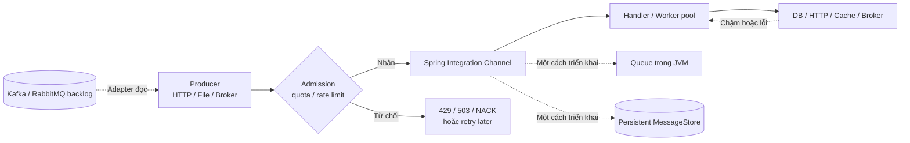
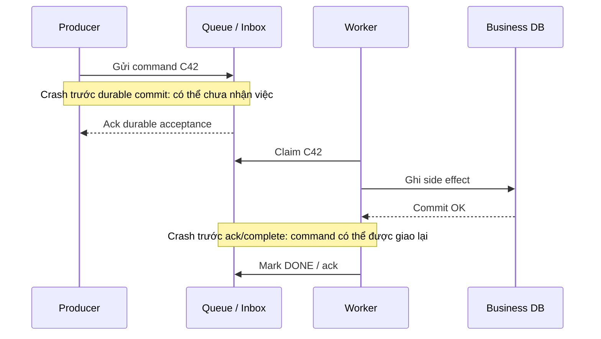

# Giới hạn hàng đợi, bộ nhớ và dung lượng lưu trạng thái

## 1. Vì sao tích hợp chạy đúng về chức năng vẫn có thể sập khi tải tăng?

Giả sử `order-service` nhận 800 yêu cầu/giây qua HTTP, rồi đưa một lệnh vào Spring Integration để gọi `warehouse-service`. Khi Warehouse bình thường, hệ thống xử lý được khoảng 900 lệnh/giây. Nhưng trong một đợt quá tải, tốc độ xử lý giảm còn 600 lệnh/giây. Nếu cứ nhận thêm việc, backlog tăng **200 lệnh/giây**. Sau 10 phút sẽ có khoảng **120.000 lệnh chưa xử lý**.

Nếu các lệnh này nằm trong `QueueChannel` không giới hạn ở heap, JVM có thể hết bộ nhớ. Nếu chuyển sang một message store trong database nhưng không đặt quota, database có thể đầy disk. Nếu chuyển sang Kafka nhưng consumer lag tăng liên tục, log retention và dung lượng broker cũng có giới hạn. **Đổi nơi chứa backlog không loại bỏ bài toán sức chứa.**

Chương **Vận hành tích hợp** của module **SPRING_BOOT_INTEGRATION** tập trung vào vận hành các luồng qua HTTP client, cơ sở dữ liệu, cache, broker và adapter Spring Integration. Hệ thống tích hợp đáng tin cậy phải biết **nhận bao nhiêu việc, giữ ở đâu, giữ bao lâu, lúc đầy thì làm gì, và phục hồi thế nào**. Việc đó liên quan trực tiếp đến hợp đồng dữ liệu, giao dịch, lỗi, xử lý trùng, kiểm thử và quan sát.

**Sau bài học, bạn có thể:**

1. Phân biệt message queue trong JVM, executor task queue, backlog trên broker và trạng thái lưu trong database/cache.
2. Giới hạn `QueueChannel`, `ExecutorChannel` và số thao tác đang chạy đồng thời.
3. Ước lượng sức chứa dựa trên arrival rate, throughput, kích thước message và thời gian chịu quá tải.
4. Thiết kế admission control và backpressure thay vì dùng hàng đợi vô hạn.
5. Chọn cách lưu bền thông điệp/trạng thái qua `MessageStore`, `MetadataStore`, inbox/outbox và broker.
6. Giới hạn message group, idempotency keys, file tạm, retry records và retention.
7. Đặt metric, ngưỡng cảnh báo và kiểm thử cho tình huống đầy queue, cạn heap, disk gần đầy và restart.

> **Phạm vi phiên bản:** Ví dụ dùng Java 17+, Spring Boot 3.x, Spring Integration 6.x và Spring Kafka/Spring AMQP tương thích với BOM của dự án. Các API/thuộc tính thuộc phiên bản khác (đặc biệt Boot 4.x, Integration 7.x) cần đối chiếu tài liệu trước khi áp dụng. Những tên cấu hình dưới `app.integration.*` là **cấu hình ứng dụng tự định nghĩa**, không phải các Spring Boot properties được bind tự động.

## 2. Bốn nơi backlog có thể tồn tại



| Nơi chứa công việc | Ví dụ | Giới hạn chính | Sau khi process crash |
| --- | --- | --- | --- |
| **Heap JVM** | `QueueChannel` dùng queue trong bộ nhớ. | Số message, kích thước object, heap/GC. | Message đang chờ thường mất; không tự bền. |
| **Executor task queue** | `ThreadPoolTaskExecutor` đứng sau `ExecutorChannel`. | Thread pool, queue capacity, heap. | Task đang chờ thường mất. |
| **Broker** | Kafka log, RabbitMQ queue. | Disk, retention, quota, prefetch, consumer lag. | Tùy broker, durability và ack/commit policy. |
| **Persistent store** | JDBC-backed channel, inbox/outbox, message group store. | DB rows, index, WAL/redo log, disk, retention. | Có thể khôi phục tùy transaction và consumer/claim semantics. |
| **Bộ nhớ trạng thái phụ** | Dedup metadata, aggregator group, file checkpoints. | Số key/group, TTL, cache/DB memory/disk. | Tùy store: in-memory thì mất, persistent thì giữ. |

Một flow có thể đồng thời có **nhiều hàng đợi**: Kafka đang backlog, executor giữ các task đang chờ, và service lại tích lũy những request HTTP đang chờ DB connection. Nếu chỉ quan sát một queue, bạn dễ bỏ sót nơi đang gây áp lực thật.

### 2.1. Message channel nào thực sự có hàng đợi?

| Spring Integration channel | Đặc điểm | Điều cần nhớ |
| --- | --- | --- |
| `DirectChannel` | Gọi handler đồng bộ trên thread của sender; không lưu queue theo mô hình thông thường. | Sender bị chặn khi handler chậm; lỗi có thể truyền ngược. |
| `QueueChannel` | Pollable channel có hàng đợi; có thể cấu hình sức chứa hữu hạn. | Nếu dùng in-memory queue, không tự bền qua restart. |
| `ExecutorChannel` | Dispatch handler qua executor; executor có thể queue task. | Kích thước task queue thường là nơi backlog bị che khuất. |
| `PriorityChannel` | Xếp message theo mức ưu tiên. | Ưu tiên không thay quota và có nguy cơ đói tài nguyên cho message mức thấp. |
| `PublishSubscribeChannel` | Phát cho nhiều subscriber. | Không mặc định là persistent queue; executor riêng có thể thêm backlog. |
| `FluxMessageChannel` | Kết hợp với Reactive Streams. | Backpressure phụ thuộc subscriber/operator và từng bridge; không tự biến mọi upstream thành không mất dữ liệu. |

**Không có một nút “bật backpressure” chung** cho tất cả adapter. Với `DirectChannel`, áp lực được truyền bằng thời gian chặn thread. Với `QueueChannel`, sender cần xử lý khi queue đầy. Với Kafka/RabbitMQ, phải phối hợp tốc độ fetch/ack và retention. Với HTTP, việc đã trả `202 Accepted` tạo ra nghĩa vụ giữ công việc bền vững.

## 3. Các phép tính cần biết trước khi đặt capacity

Đặt:

- `λ` (*arrival rate*): số message đến trung bình/giây.
- `μ` (*service rate*): số message một worker xử lý được/giây.
- `c`: số worker có thể chạy song song.
- `μ_total ≈ c × μ`: năng lực xử lý lý thuyết, cần giảm theo overhead và bottleneck thật.
- `Q`: số message đang chờ, không tính đang được xử lý nếu đo riêng.

Khi tốc độ đến lớn hơn tốc độ xử lý thực tế, backlog tăng xấp xỉ:

```text
Backlog tăng trong T giây ≈ max(0, λ - μ_total) × T

Thời gian lấp đầy queue ≈ (capacity - backlog hiện tại)
                         / max(0, λ - μ_total)
```

**Ví dụ:** 800 message/giây đến, 600 message/giây ra, queue capacity 2.000, ban đầu rỗng. Queue có thể đầy sau khoảng **10 giây**. Sau 600 giây, thiếu chỗ chứa 120.000 message. Không thể giải quyết bằng việc tăng capacity từ 2.000 lên 10.000 nếu chênh lệch 200/giây kéo dài: bạn chỉ trì hoãn thời điểm đầy thêm 40 giây.

### 3.1. Kiểm tra trạng thái ổn định

Nếu tốc độ đến dài hạn `λ` luôn lớn hơn khả năng xử lý `μ_total`, **không có queue hữu hạn nào đủ để hệ thống ổn định**. Cần giảm admission rate, thêm năng lực xử lý, tối ưu downstream, chia workload hoặc chuyển các yêu cầu không khẩn cấp sang batch/delayed processing.

Khi hệ thống tương đối ổn định, **Little's Law** đưa ra quan hệ trung bình:

```text
Số công việc trung bình trong hệ thống L = λ × W

λ: throughput dài hạn của hệ thống ổn định (công việc/giây)
W: thời gian một công việc ở trong hệ thống (giây)
```

Ví dụ đạt throughput 100 job/giây, mỗi job mất trung bình 2 giây từ lúc vào đến khi hoàn tất, thì có khoảng 200 job trong hệ thống tính trung bình. Công thức này **không** tự quyết định kích thước queue cần để chịu burst, tail latency hoặc lỗi downstream; cần đo phân phối thực tế.

### 3.2. Ước lượng heap thay vì chỉ đếm message

```text
Heap sử dụng cho queue
  ≈ số message × (payload + headers + object overhead)
     + overhead của queue/metadata/buffer khác
```

Nếu tồn 120.000 message, mỗi payload **2 KiB**, riêng bytes dữ liệu đã gần **234 MiB**, chưa kể message headers, đối tượng Java, queue nodes, reference, metadata, decoder buffer và copies. Nếu payload là JSON `String`, DTO lồng nhau hoặc `byte[]` lớn, footprint thực tế có thể vượt xa kích thước file/network.

Đừng chọn capacity bằng `heapBytes / payloadBytes` thuần túy. Cần để dung lượng cho HTTP server, thread stacks, Jackson, cache, Hibernate, metrics, GC headroom và biến động burst. Hãy đo **heap sau GC, allocation rate và queue occupancy** dưới tải gần production.

### 3.3. Độ lớn là số lượng hay bytes?

Một queue giới hạn 500 message vẫn có thể chứa 500 payload 10 MiB. Số lượng bị chặn nhưng heap vẫn cần nhiều GiB. Tùy rủi ro, đặt **đồng thời**:

1. Giới hạn số message.
2. Giới hạn kích thước payload hoặc số byte đang chờ.
3. Giới hạn số job đang chạy và số request đồng thời tới downstream.
4. Giới hạn thời gian chờ, tuổi backlog và quota mỗi tenant/đối tác.

Đối với file/binary payload, đưa **metadata hoặc URI tham chiếu** vào message; lưu nội dung ở file/object storage đã được quản lý vòng đời, thay vì giữ nguyên nhiều MB trong heap.

## 4. Dùng `QueueChannel` hữu hạn

### 4.1. Khai báo channel có capacity rõ ràng

Đoạn Java DSL sau dùng một queue tối đa 256 message và poller xử lý tuần tự bằng một consumer endpoint. Đây là ví dụ cho **work queue trong JVM**, không phải durable queue:

```java
// ImportQueueConfiguration.java
import java.time.Duration;
import org.springframework.beans.factory.annotation.Qualifier;
import org.springframework.context.annotation.Bean;
import org.springframework.context.annotation.Configuration;
import org.springframework.integration.channel.QueueChannel;
import org.springframework.integration.dsl.IntegrationFlow;
import org.springframework.integration.dsl.Pollers;

@Configuration(proxyBeanMethods = false)
public class ImportQueueConfiguration {

    @Bean("importJobs")
    QueueChannel importJobs() {
        return new QueueChannel(256);
    }

    @Bean
    IntegrationFlow importJobFlow(
        @Qualifier("importJobs") QueueChannel queue,
        ImportJobHandler handler
    ) {
        return IntegrationFlow.from(queue)
            .handle(handler, "process",
                endpoint -> endpoint.poller(
                    Pollers.fixedDelay(Duration.ofMillis(200))
                        .maxMessagesPerPoll(20)
                )
            )
            .get();
    }
}
```

Giả sử `ImportJobHandler` là Spring bean có phương thức `void process(ImportJob job)`. Với handler đồng bộ, `maxMessagesPerPoll(20)` cho biết **mỗi lần poll nhận tối đa 20 message**, không tạo 20 worker song song. Muốn concurrency cần chọn executor hoặc kiến trúc phân vùng/consumer riêng, đồng thời cân nhắc thứ tự và khả năng DB/API downstream.

`QueueChannel(256)` làm queue hữu hạn, nhưng **không làm input durable**. Khi process crash, message chưa được lưu trong broker/database có thể mất. Hãy chỉ dùng thiết kế này nếu message có thể được tái tạo/đẩy lại một cách an toàn hoặc nguồn được ack sau khi đã có lưu trữ bền vững ở một chặng khác.

### 4.2. Sender phải xử lý khi đầy

```java
// ImportJobSubmission.java
import org.springframework.beans.factory.annotation.Qualifier;
import org.springframework.integration.channel.QueueChannel;
import org.springframework.messaging.support.MessageBuilder;
import org.springframework.stereotype.Service;

@Service
public class ImportJobSubmission {
    private final QueueChannel jobs;

    public ImportJobSubmission(
        @Qualifier("importJobs") QueueChannel jobs
    ) {
        this.jobs = jobs;
    }

    public void submit(ImportJob job) {
        boolean accepted = jobs.send(
            MessageBuilder.withPayload(job)
                .setHeader("commandId", job.commandId())
                .build(),
            0L // Không chờ khi queue đầy.
        );

        if (!accepted) {
            throw new QueueCapacityExceededException(
                "Import queue đã đầy, thử lại sau"
            );
        }
    }
}
```

`ImportJob` là DTO chỉ chứa command ID, loại công việc và tham chiếu tới dữ liệu; `QueueCapacityExceededException` là exception ứng dụng tự định nghĩa. Với `send(message, timeout)`, giá trị timeout bằng 0 yêu cầu gửi không chờ khi queue không thể nhận thêm. Trong cùng một hệ thống, không nên chọn một timeout rất dài khiến thread HTTP chờ vô hạn.

**Phân biệt hai loại thành công:**

- `send(...) == true`: queue/channel đã nhận message theo contract của channel.
- **Business success**: handler đã xử lý xong và commit side effect.

Với `QueueChannel` in-memory, ngay cả `send(...) == true` cũng **không** có nghĩa message sống sót sau restart. Nếu HTTP API hứa xử lý job bất đồng bộ và trả `202 Accepted`, trước khi trả 202 phải có một **durable acceptance boundary** như inbox/outbox DB hoặc broker với acknowledgment thích hợp.

### 4.3. Khi queue đầy nên trả lỗi gì?

Với endpoint nhận lệnh từ HTTP:

| Tình huống | Phản ứng hợp lý |
| --- | --- |
| Client vượt quota riêng | `429 Too Many Requests`, có thể kèm `Retry-After`. |
| Toàn hệ thống tạm quá tải | `503 Service Unavailable` hoặc response theo contract. |
| Lệnh đã lưu bền, còn worker chậm | `202 Accepted` kèm job ID/status URL; không báo hoàn tất. |
| Lệnh chưa thể lưu bền | Không trả 202 giả; từ chối hoặc yêu cầu client retry có idempotency key. |
| Quá tải không khắc phục nhanh | Admission control/circuit breaker, mở rộng năng lực hoặc xử lý theo ưu tiên. |

HTTP status là một phần **hợp đồng** với consumer. Với lệnh có side effect, client retry phải giữ cùng business/idempotency key. Không hứa `Retry-After` chính xác nếu ứng dụng không thể dự báo lúc có slot trống.

## 5. `ExecutorChannel` và task queue ẩn phía sau thread pool

Một luồng cần chạy handler trên thread khác có thể dùng `ExecutorChannel`. Khi đó, backlog thường nằm trong **work queue của executor**, không nằm trong `QueueChannel`.

```java
// AsyncChannelConfiguration.java
import java.util.concurrent.ThreadPoolExecutor;
import org.springframework.context.annotation.Bean;
import org.springframework.context.annotation.Configuration;
import org.springframework.integration.channel.ExecutorChannel;
import org.springframework.scheduling.concurrent.ThreadPoolTaskExecutor;

@Configuration(proxyBeanMethods = false)
public class AsyncChannelConfiguration {

    @Bean
    ThreadPoolTaskExecutor integrationExecutor() {
        ThreadPoolTaskExecutor executor = new ThreadPoolTaskExecutor();
        executor.setCorePoolSize(4);
        executor.setMaxPoolSize(8);
        executor.setQueueCapacity(200);
        executor.setThreadNamePrefix("integration-");
        executor.setRejectedExecutionHandler(
            new ThreadPoolExecutor.AbortPolicy()
        );
        executor.setWaitForTasksToCompleteOnShutdown(true);
        return executor;
    }

    @Bean("outboundCommands")
    ExecutorChannel outboundCommands(
        ThreadPoolTaskExecutor integrationExecutor
    ) {
        return new ExecutorChannel(integrationExecutor);
    }
}
```

Giải thích các giới hạn:

- `corePoolSize=4`: số thread lõi duy trì.
- `queueCapacity=200`: số task có thể chờ trước khi executor phải mở rộng tới `maxPoolSize` theo semantics của `ThreadPoolExecutor`.
- `maxPoolSize=8`: giới hạn thread tối đa cho executor.
- `AbortPolicy`: từ chối task khi không còn khả năng nhận; phía producer phải xử lý exception.
- `setWaitForTasksToCompleteOnShutdown(true)`: hỗ trợ shutdown có kiểm soát, **không** tạo độ bền khi process bị kill/crash và không được xem là bảo đảm drain vô hạn.

**Điểm dễ sai:** Khi `queueCapacity` dương, `ThreadPoolExecutor` thường dùng đủ core threads, rồi **lấp queue trước khi tạo thêm threads tới max**. Vì vậy tăng max pool không nhất thiết làm concurrency tăng sớm nếu queue lớn. Cần đo thời gian chờ trong queue và chọn queue capacity phù hợp với latency budget.

### 5.1. `ExecutorChannel.send(...)` không bảo đảm xử lý xong

Sender có thể đưa task vào executor thành công, trong khi handler chưa hề chạy. Nếu handler fail sau đó, exception không tự trở về sender như `DirectChannel` đồng bộ. Cần error channel, tracing và recovery phù hợp.

Nếu application commit Kafka offset hoặc trả HTTP 202 **ngay sau khi gửi vào executor queue trong memory**, thì có thể mất công việc khi pod crash. Đừng đặt acknowledgment boundary ở đó trừ khi nguồn có thể replay và handler idempotent.

### 5.2. Giới hạn thread chưa đủ

Giả sử executor có 8 worker nhưng mỗi handler mở 10 HTTP requests bất đồng bộ hoặc nạp file lớn trước khi gửi, vẫn có thể làm cạn network connections/heap. Cần giới hạn theo **đơn vị tài nguyên đắt nhất**:

- Số request đang bay tới từng upstream (bulkhead/semaphore).
- Số DB connections, Redis connections hoặc Kafka producer buffers.
- Số byte tải lên/xuống đang đệm.
- Số job/tệp đang parse.
- CPU budget/GC và giới hạn memory của container.

## 6. Backpressure: giảm nhận việc trước khi cạn bộ nhớ

**Backpressure** là cách truyền tín hiệu “bên nhận đang chậm” ngược về bên gửi hoặc nguồn để không tích lũy công việc vô hạn.

### 6.1. Phân biệt backpressure, buffering và dropping

| Hành vi | Mô tả | Phù hợp khi |
| --- | --- | --- |
| Buffering | Lưu tạm backlog để hấp thụ burst. | Burst ngắn, có quota rõ và throughput sẽ hồi phục. |
| Backpressure | Làm producer chậm lại, pause nguồn hoặc giảm concurrency. | Producer có thể điều chỉnh tốc độ. |
| Rejection | Không nhận thêm; trả `429/503` hoặc ném lỗi capacity. | Không thể giữ an toàn công việc mới. |
| Durable handoff | Nhận và lưu trong DB/broker, trả job ID. | Cần sống qua restart và xử lý bất đồng bộ. |
| Shedding | Chủ động bỏ công việc ưu tiên thấp theo hợp đồng. | Telemetry, dữ liệu có thể tái tạo; không áp cho payment/order tùy tiện. |

Một queue dài giúp giảm rejection trong burst nhưng làm **tăng độ trễ**. Với dữ liệu có deadline, job cũ trong backlog có thể hết giá trị. Cần theo dõi **tuổi của message cũ nhất** thay vì chỉ đếm queue size.

### 6.2. Bộ điều khiển admission theo quota

Một chiến lược sản xuất có thể áp dụng:

1. Kiểm tra rate limit và quota tenant trước khi deserialize payload lớn.
2. Kiểm tra dung lượng queue/DB/disk và số job đang chạy.
3. Chỉ nhận lệnh khi có khả năng lưu bền hoặc có slot xử lý theo contract.
4. Nếu quá tải, trả lỗi có cấu trúc; client chỉ retry với backoff, jitter và idempotency key ổn định.
5. Giảm `maxMessagesPerPoll` hoặc pause consumer khi downstream quá tải; không cố fetch nhiều hơn chỉ vì broker có sẵn dữ liệu.

Quota per tenant tránh trường hợp một đối tác gửi burst làm toàn bộ công ty không xử lý được đơn hàng của các đối tác khác. Để tránh starvation, có thể chia queue/worker hoặc dùng weighted fair scheduling, nhưng cần kiểm soát tổng quota tài nguyên chung.

## 7. Không nhầm queue trong ứng dụng với Kafka/RabbitMQ backlog

### 7.1. Kafka: backlog thường nên ở broker

Kafka lưu record trong log theo topic/partition và retention/compaction policy. Một consumer xử lý chậm sẽ làm **consumer lag** tăng. Thường không cần kéo một lượng record rất lớn từ Kafka vào một `QueueChannel` heap rồi commit offset trước khi xử lý.

Điểm phải kiểm soát:

| Điều chỉnh | Tác động | Rủi ro khi cấu hình sai |
| --- | --- | --- |
| `max.poll.records` | Giới hạn số record trả về mỗi lần poll của consumer. | Batch quá lớn kéo dài xử lý và memory. |
| `max.poll.interval.ms` | Giới hạn khoảng cách giữa các lần poll thành công theo semantics của Kafka consumer. | Xử lý block quá lâu gây rebalance. |
| Listener concurrency | Tăng số luồng xử lý song song theo partition. | Không vượt số partition hữu ích; dễ quá tải DB/upstream. |
| Pause/resume partitions/container | Tạm ngừng nhận thêm theo backpressure. | Cần vẫn duy trì poll/heartbeat theo cách framework hỗ trợ. |
| Offset commit / acknowledgment | Đánh dấu tiến độ consume. | Commit trước durable processing có thể mất message sau crash. |
| Topic retention / storage quota | Giới hạn thời gian/dung lượng giữ dữ liệu. | Lag vượt retention có thể làm mất khả năng replay dữ liệu cũ. |

Tùy phương án concurrency và container, Spring Kafka có thể pause/resume để giảm nhận việc nhưng phải tránh vượt liveness/poll requirements. Không tự ngủ hàng phút trong listener thread để “giảm tải” mà không kiểm tra rebalance và timeout.

**Bất biến:** offset chỉ được coi là hoàn tất khi side effect đã commit hoặc công việc đã được chuyển vào một vùng lưu bền vững khác với recovery rõ ràng.

### 7.2. RabbitMQ: prefetch và acknowledgment

RabbitMQ phân phối message tới consumer và cho phép giới hạn số message **chưa được ack** bằng prefetch. Nếu prefetch quá lớn so với khả năng xử lý, một consumer có thể giữ nhiều delivery trong bộ nhớ và gây mất cân bằng.

- Chọn prefetch theo concurrency, kích thước message và thời gian xử lý.
- Ack sau khi side effect đã được xử lý theo contract.
- Khi handler lỗi, xác định nack/requeue, delayed retry hay dead-letter, tránh requeue vô hạn cho poison message.
- Chọn durable queue/message persistence/quorum queue theo nhu cầu reliability của broker; tên “queue” không tự bảo đảm mọi message sống qua mất điện.
- Quan sát ready messages, unacked messages, memory/disk alarm và thời gian tồn đọng.

**Prefetch là giới hạn số message chưa ack ở consumer, không phải quota tổng queue trên broker.** Phần broker vẫn cần retention/TTL, max-length/max-length-bytes, dead-letter và storage capacity theo tính năng/version được sử dụng.

### 7.3. Không tạo retry storm nhiều tầng

Ví dụ mỗi tầng cùng retry ba lần: HTTP client, handler Spring Integration, Kafka container và caller. Một lỗi downstream có thể sinh ra số lần gọi nhiều hơn nhiều so với dự kiến. Cần **một chủ sở hữu retry chính theo ranh giới**, retry budget, backoff/jitter và business idempotency.

Một command đã được xử lý nhưng ack bị mất có thể được giao lại. Bounded queue không giải quyết vấn đề này; unique business key/inbox/version guard mới là lớp bảo vệ side effect.

## 8. Khi cần hàng đợi bền vững: `MessageStore`

`QueueChannel` mặc định là in-memory. Spring Integration hỗ trợ dùng **persistent message store** cho một số kiểu channel/queue và các thành phần stateful, thông qua những module JDBC, Redis, MongoDB… tùy trường hợp.

### 8.1. Sự khác nhau giữa một queue in-memory và durable queue

| Đặc tính | In-memory QueueChannel | Message-store-backed channel |
| --- | --- | --- |
| Dữ liệu chờ ở đâu? | Heap JVM. | Store ngoài process hoặc kho lưu bền được cấu hình. |
| Tốc độ truy cập | Thường thấp độ trễ. | Có I/O, serialization và contention. |
| Process crash | Message chờ có thể mất. | Có thể phục hồi nếu store/transaction được thiết kế đúng. |
| Quota | Capacity theo số phần tử. | Phải quản lý rows, bytes, disk, retention riêng. |
| Multi-instance | Không tự chia sẻ queue. | Có thể chia sẻ store, nhưng vẫn cần xác minh claim/concurrency semantics. |
| Tính exactly-once | Không. | Cũng **không** tự có; cần inbox/idempotency và transaction boundary. |

Các lớp như `JdbcChannelMessageStore`, `MessageGroupQueue` và các implementation của `MessageStore` có thể tham gia xây dựng queue dựa trên store. Tên class liên quan cần đúng module/version; ví dụ sử dụng JDBC cần starter JDBC, `spring-integration-jdbc` và schema tables phù hợp với database.

### 8.2. Ví dụ hướng cấu hình persistent channel

Ví dụ sau minh họa ý tưởng dùng JDBC channel store. Sử dụng trong dự án phải tạo bảng của Spring Integration cho đúng database dialect, xác minh transaction và chọn version thư viện phù hợp:

```java
// JdbcQueueConfiguration.java
import javax.sql.DataSource;
import org.springframework.context.annotation.Bean;
import org.springframework.context.annotation.Configuration;
import org.springframework.integration.channel.QueueChannel;
import org.springframework.integration.jdbc.store.JdbcChannelMessageStore;
import org.springframework.integration.store.MessageGroupQueue;

@Configuration(proxyBeanMethods = false)
public class JdbcQueueConfiguration {

    @Bean
    JdbcChannelMessageStore integrationJdbcMessageStore(
        DataSource dataSource
    ) {
        JdbcChannelMessageStore store =
            new JdbcChannelMessageStore(dataSource);
        store.setRegion("orders-integration");
        return store;
    }

    @Bean("durableCommands")
    QueueChannel durableCommands(JdbcChannelMessageStore store) {
        return new QueueChannel(
            new MessageGroupQueue(store, "reserve-stock-commands")
        );
    }
}
```

Đây là **ví dụ cấu trúc**, không phải giải pháp production hoàn chỉnh. Cần trả lời các câu hỏi:

1. Database/message store có durable commit, backup, replication và quota không?
2. Việc `send` vào channel tham gia transaction nào? Có rollback được khi DB transaction gọi `send` thất bại không?
3. Khi consumer lấy message khỏi store rồi crash trước side effect, message có được giao lại hay mất? Transaction/ack/claim được thiết kế ở đâu?
4. Hai pod cùng poll có loại trừ nhau theo implementation và isolation level đang dùng không?
5. Store có index phù hợp và quy trình dọn bản ghi hết hạn không?
6. Serialization có tương thích qua phiên bản code và class name/DTO evolution không?

Không giả định một bảng SQL có nghĩa queue “chính xác một lần”. Với các workflow quan trọng, **application inbox/outbox** có trạng thái rõ ràng thường dễ audit/replay hơn một generic message queue khi cần quản lý tiến độ nghiệp vụ.

### 8.3. Đừng đổi từ heap OOM sang disk full

Nếu producer tiếp tục ghi 1.000 event/giây và consumer chỉ xử lý 600 event/giây, persistent queue vẫn tăng 400 event/giây. Khi disk/DB quota cạn, hệ thống sẽ fail ở chặng lưu công việc.

Phải đặt giới hạn tổng:

- Số message/bytes chờ được phép nhận.
- Quota per tenant/workflow/priority.
- Cảnh báo watermark thấp/cao cho disk và WAL/transaction log.
- Giới hạn tốc độ producer hoặc cơ chế từ chối an toàn khi quota gần đầy.
- Khả năng replay/đối soát khi cần xoá hoặc chuyển dữ liệu lâu ngày.

## 9. Lưu trạng thái flow: `MessageStore`, `MessageGroupStore`, `MetadataStore`

Không phải trạng thái nào cũng là “message đang chờ”. Spring Integration có các thành phần stateful:

| Trạng thái | Ví dụ | Dung lượng tăng theo |
| --- | --- | --- |
| **Queued message** | Lệnh chờ handler xử lý. | Arrival - throughput, payload size. |
| **Message group** | `Aggregator` chờ đủ message theo correlation key. | Số nhóm đang mở × số message mỗi nhóm. |
| **Resequencer state** | Đợi các message thiếu sequence. | Tỷ lệ out-of-order, thời gian thiếu message. |
| **Filter/checkpoint metadata** | `AcceptOnce` cho file, remote file sync metadata. | Số path/key từng thấy, chính sách xóa. |
| **Idempotency/inbox marker** | `eventId` đã xử lý. | Throughput × dedup retention. |
| **Outbox/retry record** | Event chưa publish, `nextAttemptAt`, attempt count. | Backlog trong thời gian lỗi + dead-letter retention. |
| **In-flight operation** | HTTP request, DB transaction, upload. | Concurrency × payload/buffer/connection. |

### 9.1. `MessageGroupStore` và aggregator/resequencer

`Aggregator` chờ nhiều message có chung correlation key, ví dụ `batch-42` gồm 100 dòng. Nếu một phần tử không bao giờ tới, message group có thể tồn tại lâu.

```text
Group batch-42:
  expected sequence: 1..100
  arrived: 1..99
  missing: 100
  => group chưa complete; vẫn giữ 99 message + metadata
```

Nếu có 10.000 batch như vậy, state lớn dần dù queue đầu vào không còn backlog. Cần quy định:

- Correlation key có kiểm soát cardinality; không dùng một UUID mới mỗi retry khiến group mới liên tục.
- Giới hạn số nhóm mở và số message/kích thước trong mỗi nhóm.
- Release strategy, timeout, incomplete-group handling và chính sách discard/partial results.
- Chính sách expire/remove nhóm đã hoàn tất và trạng thái còn lại.
- Kho lưu state chịu được restart, hoặc upstream có khả năng replay toàn bộ nhóm.

Spring Integration hỗ trợ các cơ chế timeout/expiration và thành phần như `MessageGroupStoreReaper` cho nhu cầu dọn message groups. **Expire một group không tự giải quyết tính đúng đắn của batch**: cần quyết định phát partial result, bỏ/parking group, gửi lỗi hoặc yêu cầu replay. Với đơn hàng/thanh toán, không được âm thầm coi batch thiếu message là hoàn tất.

### 9.2. `MetadataStore` khác với business inbox

`MetadataStore` được dùng lưu những thông tin như file đã được đọc, khóa checkpoint hoặc dấu `AcceptOnce`. Ví dụ:

- `SimpleMetadataStore`: metadata trong bộ nhớ.
- `PropertiesPersistingMetadataStore`: có khả năng lưu ra file theo cơ chế của implementation.
- `JdbcMetadataStore`/`RedisMetadataStore`: metadata được quản lý ở kho ngoài process; đánh giá cơ chế concurrent update theo version.

Khi nhiều pod cần phối hợp, cần implementation hỗ trợ atomic compare-and-set hoặc cơ chế claim phân tán đúng. Nhưng kể cả khi metadata persistent, một file “đã nhìn thấy” không chứng minh **dữ liệu nghiệp vụ đã commit**. Với thao tác có side effect, lưu **inbox marker** và side effect trong transaction phù hợp hoặc dùng thiết kế lũy đẳng/đối soát.

### 9.3. Trạng thái retry có thể tăng vô hạn

Retry records nên có các trạng thái chẳng hạn `PENDING`, `RETRY_WAIT`, `IN_PROGRESS`, `DONE`, `DEAD`, `UNKNOWN_OUTCOME`, kèm:

```json
{
  "commandId": "reserve-ORD-42",
  "status": "RETRY_WAIT",
  "attemptCount": 3,
  "nextAttemptAt": "2026-11-21T08:05:00Z",
  "lastErrorCategory": "UPSTREAM_503",
  "payloadReference": "obj://commands/reserve-ORD-42.json"
}
```

Đây là một **mô hình ứng dụng ví dụ**, không phải schema nội bộ Spring Integration. Cần đặt max attempts, max age, lease timeout, dead-letter/parking, quota và retention riêng cho các trạng thái. Nếu mỗi lần lỗi tạo một record mới mà không cập nhật/dọn record cũ, storage sẽ tăng ngay cả khi message cuối cùng thành công.

## 10. Tính dung lượng lưu trạng thái theo retention

### 10.1. Dung lượng dedup/inbox keys

Giả sử hệ thống xử lý **100 event/giây** và cần giữ dấu dedup **7 ngày**:

```text
Số key ≈ 100 × 86.400 × 7 = 60.480.000 key

Giả định mỗi marker chiếm 100 byte dữ liệu thô:
Raw payload ≈ 6.048.000.000 byte ≈ 6,05 GB
```

Đây **chưa** gồm index, row/page overhead, replication, log/WAL, Redis key-object overhead, fragmentation hoặc backup. Trên storage thật, cần benchmark footprint và dùng margin phù hợp. Nếu tăng tốc độ gấp ba, dung lượng marker cũng tăng xấp xỉ gấp ba.

### 10.2. Retention bao lâu là đủ?

Một idempotency key hoặc inbox marker chỉ có ý nghĩa nếu còn tồn tại khi **cùng lệnh/event có thể quay lại**. Chính sách TTL phải xét:

1. Thời gian retry của producer/client.
2. Kafka retention, RabbitMQ DLT và cửa sổ replay.
3. Khoảng delay lớn nhất giữa event và lần xử lý lại.
4. Thời gian bảo lưu dữ liệu để xử lý sự cố hoặc backfill.
5. Định nghĩa business command identity và khả năng tái sử dụng ID sau nhiều năm.

Nếu giữ marker 24 giờ nhưng DLT có thể được replay sau 7 ngày, một event cũ có thể được coi như mới sau khi marker hết hạn. Khi nghiệp vụ không cho phép điều đó, cần retention dài hơn hoặc version/sequence/invariant có tuổi thọ đủ lâu ở business store.

**Không xóa business facts chỉ vì muốn giảm kích thước dedup store.** Một số khóa như transaction ID, payment ID hoặc đơn hàng cần kiểm tra unique vĩnh viễn theo thiết kế, trong khi metadata “đã polling file tạm” có thể hết hạn ngắn hơn.

### 10.3. Tiêu chí cần đo thay vì dùng TTL cố định

| Loại dữ liệu | Trước khi dọn | Điều cần bảo toàn |
| --- | --- | --- |
| `DONE` work items | Đã audit và hết thời gian replay hợp lệ. | Traceability, idempotency horizon. |
| `RETRY_WAIT` | Không xóa khi chưa đến hạn xử lý. | Công việc chưa hoàn tất. |
| `UNKNOWN_OUTCOME` | Cần đối soát/được phê duyệt chuyển trạng thái. | Không nhân đôi side effect. |
| `DEAD`/quarantine | Đã hết thời gian xử lý sự cố và được lưu theo chính sách. | Khả năng điều tra/replay. |
| Aggregator incomplete group | Đã áp timeout và xử lý partial/discard rõ ràng. | Không báo sai batch complete. |
| File metadata | Không còn cần chống nhận lặp trong cửa sổ replay. | Nguồn vẫn có thể xuất lại cùng file. |
| Temp file `.writing` | Writer được xác định đã chết, hết timeout, không còn lock hợp lệ. | Tránh xóa file đang ghi. |

### 10.4. Quota theo bytes thực tế

Với DB:

- Đo kích thước tables/indexes, WAL/redo/binlog, replication và backup.
- Đánh giá cơ chế VACUUM/compaction, fragmentation, partitioning và cleanup jobs.
- Cân nhắc large payload externalization thay vì giữ toàn bộ JSON/XML trong mỗi row.
- Tạo index theo `status` + `nextAttemptAt` để tìm công việc đến hạn, không scan toàn bảng mỗi poll.

Với Redis/cache:

- Đo `used_memory`, key count, eviction, replication/AOF/RDB memory pressure.
- Không dùng eviction policy loại mất những key idempotency quan trọng.
- TTL của cache không đồng nghĩa TTL của business inbox.

Với Kafka/RabbitMQ:

- Đo bytes/ngày, retention horizon, replication factor, disk watermark và consumer lag/age.
- Broker đã đầy có thể chặn publish/consume; xây runbook trước khi xảy ra.

## 11. Lưu payload ngoài queue: metadata + reference

Hàng đợi không nhất thiết phải chứa toàn bộ file hoặc HTTP body.

### 11.1. Ví dụ lệnh nhẹ

Thay vì gửi:

```java
// Tránh: payload lớn làm copy qua nhiều channel/queue/serializer.
public record ImportJob(
    String commandId,
    byte[] fullCsvBytes
) {}
```

có thể dùng:

```java
// Mỗi public record nên đặt trong file Java riêng.
public record ImportJob(
    String commandId,
    String tenantId,
    String objectKey,
    long expectedSizeBytes,
    String sha256
) {}
```

Producer ghi file vào object storage có checksum và quyền truy cập hạn chế, rồi gửi một command nhỏ trỏ đến object. Consumer đọc stream/chunk thay vì nạp hết dữ liệu vào heap.

**Đổi lại, cần hợp đồng vòng đời dữ liệu:**

- Object đã được ghi xong và đọc được **trước** khi message được công bố.
- Object không bị xóa khi queue/backlog vẫn còn command tham chiếu.
- Checksum/size được kiểm tra trước khi dùng.
- `objectKey` không trở thành lỗ hổng path traversal/SSRF; consumer chỉ truy cập bucket/prefix tin cậy theo quyền.
- Có cleanup cho object mồ côi nếu producer upload xong nhưng không publish, và object đã xử lý xong.

### 11.2. Tránh copy payload qua nhiều bước

Một flow gồm `transform → queue → route → executor → HTTP client` có thể tạo nhiều bản sao JSON/DTO trong heap, nhất là khi serialize/deserialize và logging. Không log full payload, không duy trì các cache không có TTL, không nạp file lớn thành một `String` khi có thể stream.

## 12. Giới hạn dung lượng file adapter và filesystem

File inbound/outbound adapter của Spring Integration thường phải sống với các file đang ghi, file đã hoàn tất, archive và quarantine:

```text
exchange/
├── inbound/       # File đã được producer công bố.
├── processing/    # File đã claim, chờ/đang nhập.
├── archive/       # Đã xử lý thành công.
├── quarantine/    # Sai format hoặc cần kiểm tra thủ công.
└── outbound/      # Report + *.writing tạm.
```

Rủi ro storage:

| Rủi ro | Hệ quả | Biện pháp |
| --- | --- | --- |
| Input đến nhanh hơn parser | Landing đầy disk/inodes. | Quota, backpressure với producer, cảnh báo oldest file age. |
| `.writing` không được dọn | Writer crash để lại file tạm rất lớn. | Cleanup có timeout/lease và kiểm tra writer còn sống. |
| Archive giữ vô hạn | Disk tăng dù queue rỗng. | Retention/đẩy archive sang storage phù hợp. |
| Quarantine không có owner | File lỗi chất đống, không ai xử lý. | Alert, ticket, SLA replay và retention. |
| Cùng file bị đọc hai lần sau restart | Side effect trùng. | Durable batch ID/inbox, không chỉ `AcceptOnce` in-memory. |
| File quá lớn | Parse/deserialize vượt memory. | Streaming, max file size, chunking và giới hạn concurrency. |

**Atomic rename** từ `.writing` sang tên cuối có thể ngăn consumer đọc file chưa hoàn tất **nếu** cùng filesystem hỗ trợ semantics mong đợi. Nó không ngăn disk đầy, không thay checksum và không bảo đảm rename + database commit là một transaction chung.

## 13. Retry, timeout và circuit breaker có thể làm tăng backlog

Khi HTTP downstream chậm, một handler có thể retry ba lần với backoff. Điều đó làm **service time** tăng, khiến năng lực xử lý thực tế giảm. Với bounded queue, queue sẽ đầy nhanh hơn:

```text
Thời gian xử lý hiệu dụng một command
  = tổng thời gian các attempt
    + backoff giữa attempts
    + deserialize/DB/commit overhead
```

Ví dụ 3 lần HTTP read timeout 5 giây cộng 250 + 500 ms backoff có thể kéo dài trên 15 giây cho một job. Nếu chỉ có 8 worker, tối đa throughput do những job này có thể rơi xuống rất thấp. Do đó:

1. Tính **deadline tổng**, không chỉ timeout mỗi attempt.
2. Chỉ retry lỗi transient và command có idempotency/inquiry.
3. Dùng backoff/jitter, circuit breaker và concurrency limit để tránh thundering herd.
4. Với lỗi kéo dài, đưa job về durable `RETRY_WAIT` có `nextAttemptAt` thay vì giữ thread sleep hàng phút.
5. Không commit Kafka offset/ack RabbitMQ chỉ vì job đã được đặt vào executor in-memory.

Một circuit breaker mở làm giảm áp lực lên downstream, nhưng backlog ở upstream **vẫn** phải được quản lý. Nếu chỉ mở breaker mà tiếp tục nhận vô hạn, hệ thống sẽ tích tụ công việc ở queue/disk.

## 14. Crash, transaction và bảo đảm công việc không bị mất

### 14.1. Ba cửa sổ thất bại



Giải pháp không phải “không retry” mà là **thiết kế idempotency ở ranh giới business**:

1. Producer dùng `commandId` ổn định qua retry.
2. Durable store/queue ghi nhận việc đã nhận trước khi xác nhận thành công.
3. Worker xử lý side effect có kiểm soát transaction.
4. Nếu crash sau side effect nhưng trước ack, message được giao lại và **không tạo side effect trùng**.
5. Có reconciler cho những lệnh `IN_PROGRESS` quá hạn và `UNKNOWN_OUTCOME`.

### 14.2. Transactional inbox/outbox

Với tích hợp database + Kafka hoặc HTTP:

- **Inbox:** lưu `eventId/commandId` và business update trong một transaction local để loại xử lý lặp.
- **Outbox:** lưu business change và event cần publish trong một transaction local; worker sau đó publish và đánh dấu trạng thái.
- **Lease/fencing/version:** ngăn hai worker đồng thời xử lý hoặc worker cũ ghi kết quả sau khi đã mất quyền claim.

Những cơ chế này cần unique constraints và transaction/locking được kiểm thử. Một queue persistent **không** tự thay thế inbox/outbox khi side effect ở nhiều hệ thống không cùng transaction.

### 14.3. Khi nào được xóa message/trạng thái?

Không xóa ở thời điểm “handler đã bắt đầu”. Chỉ xóa/mark `DONE` sau khi nghĩa vụ xử lý tương ứng đã được hoàn tất hoặc chuyển trách nhiệm sang chặng durable khác. Với exception hoặc timeout không rõ kết quả, giữ trạng thái để đối soát.

Nếu một cleanup job xóa message quá sớm, không thể khôi phục bằng việc tăng queue capacity sau đó.

## 15. Giám sát capacity bằng cả số lượng, tuổi và bytes

### 15.1. Các chỉ số nên đo

| Nhóm | Metrics/tín hiệu | Cần biết |
| --- | --- | --- |
| In-memory queue | Queue depth, capacity, remaining slots, enqueue failures. | Sắp đầy hay chưa? |
| Executor | Active threads, queue size, rejected tasks, task wait time. | Có đang nghẽn ở executor không? |
| JVM | Heap used **sau GC**, allocation rate, GC pause, OOM, container memory. | Queue có gây memory pressure không? |
| Throughput | Arrival rate, completion rate, p95/p99 processing time. | Hệ thống ổn định hay đang nợ việc? |
| Backlog age | Tuổi job cũ nhất, time-in-queue p95/p99. | Có vi phạm SLA dù queue chưa đầy không? |
| Broker | Kafka consumer lag/lag age, RabbitMQ ready/unacked, broker disk. | Sắp vượt retention hoặc quota? |
| DB store | Queued rows/bytes, active groups, stale leases, WAL/disk, slow queries. | Storage có tăng vô hạn không? |
| Dedup | Marker count, TTL distributions, duplicate/replay rate. | Retention có đủ và quá tốn không? |
| File | Input/archived/quarantine bytes, stale `.writing`, inode/free disk. | File adapter có cạn storage không? |
| Recovery | Retry-wait, dead-letter, unknown-outcome age, replay success. | Có việc mắc kẹt không được xử lý? |

Spring Boot Actuator/Micrometer có thể expose JVM/executor/HTTP metrics tùy cấu hình. Đối với Spring Integration, có thể cấu hình observation/management và gắn meter riêng cho channel/backlog. **Không giả định tất cả các metric trong bảng được tạo tự động**: với inbox/outbox, oldest-age, durable message store, thường cần query/instrumentation do ứng dụng xây.

Không dùng `commandId`, `tenantId` từng giá trị riêng hoặc tên file không giới hạn làm metric tags; chúng gây high cardinality và có thể lộ dữ liệu. Dùng tên flow, channel, error category, status, tenant tier hoặc traffic class đã chuẩn hóa.

### 15.2. Watermark và cảnh báo

Một chính sách ví dụ, cần hiệu chỉnh theo SLO:

| Trạng thái | Dấu hiệu | Hành động |
| --- | --- | --- |
| Normal | Queue depth thấp, arrival ≤ throughput, oldest-age ổn. | Theo dõi xu hướng. |
| Warning | Capacity >70% trong thời gian liên tục hoặc lag age tăng. | Giảm concurrency không thiết yếu, kiểm tra upstream, tăng capacity có đo lường. |
| Critical | Capacity >90%, oldest-age gần SLA hoặc disk free thấp. | Hạn chế admission, alert on-call, chuyển delayed retry/đối soát. |
| Exhausted | Send rejected, disk limit, OOM risk. | Trả 429/503/NACK theo contract, bảo toàn dữ liệu bền vững, không nuốt lỗi. |

Các ngưỡng 70%/90% **chỉ minh họa**, không phải chuẩn chung. Cảnh báo dựa trên *time-to-full* đôi khi có giá trị hơn tỷ lệ hiện tại: queue đang 30% nhưng tăng 200/s và sắp đầy sau 10 giây còn nguy hiểm hơn queue 80% nhưng đang giảm đều.

```text
Estimated time-to-full =
  (capacity - depth) / max(arrival_rate - completion_rate, ε)

Chỉ diễn giải khi backlog đang tăng và tốc độ đo đủ ổn định.
```

## 16. Kiểm thử capacity và hành vi từ chối

Không chỉ test “handler xử lý một message thành công”. Kiểm thử phải chứng minh hệ thống **không nhận vô hạn, không im lặng làm mất việc, và phục hồi được** khi ranh giới tài nguyên gặp lỗi.

### 16.1. Test `QueueChannel` đầy

```java
import static org.junit.jupiter.api.Assertions.assertEquals;
import static org.junit.jupiter.api.Assertions.assertFalse;
import static org.junit.jupiter.api.Assertions.assertTrue;

import org.junit.jupiter.api.Test;
import org.springframework.integration.channel.QueueChannel;
import org.springframework.messaging.support.MessageBuilder;

class BoundedQueueChannelTest {

    @Test
    void rejectsNewMessageWhenCapacityIsFull() {
        QueueChannel queue = new QueueChannel(2);

        assertTrue(queue.send(
            MessageBuilder.withPayload("cmd-1").build(), 0L
        ));
        assertTrue(queue.send(
            MessageBuilder.withPayload("cmd-2").build(), 0L
        ));
        assertFalse(queue.send(
            MessageBuilder.withPayload("cmd-3").build(), 0L
        ));

        assertEquals(2, queue.getQueueSize());
        assertEquals("cmd-1", queue.receive(0L).getPayload());

        assertTrue(queue.send(
            MessageBuilder.withPayload("cmd-3").build(), 0L
        ));
    }
}
```

Test này chứng minh giới hạn số message và khả năng nhận thêm sau khi lấy khỏi queue, **không** chứng minh tính bền, acknowledgment, transaction hoặc concurrency khi nhiều pod cùng gửi.

### 16.2. Test executor rejection

Tạo executor ít worker, queue nhỏ và dùng `CountDownLatch` làm handler giữ thread bận. Gửi nhiều hơn capacity và khẳng định task tiếp theo bị từ chối **theo exception/policy đã chọn**. Sau đó giải phóng latch và kiểm tra số job đã chạy. Tránh dùng `Thread.sleep` cố định vì test dễ flaky.

### 16.3. Ma trận integration/failure tests

| Kịch bản | Điều phải chứng minh |
| --- | --- |
| Producer burst > consumer throughput | Bounded capacity và rejection/backpressure xuất hiện trước OOM. |
| Một payload quá lớn | Message size limit từ chối trước khi tích lũy vào heap. |
| Downstream 503 trong 10 phút | Retry có ngân sách; queue/DB không tăng ngoài quota. |
| Kafka lag tăng gần retention | Cảnh báo và hành động phục hồi trước khi mất khả năng replay. |
| RabbitMQ prefetch quá lớn | Sau tuning, unacked count và memory trong giới hạn. |
| DB message store full | Không trả durable acceptance giả; lỗi được phát hiện và đưa vào runbook. |
| Crash sau enqueue nhưng trước ack | Bản durable có thể được recover; in-memory-only không được hứa bảo đảm. |
| Crash sau business commit, trước ack | Replay không nhân đôi side effect. |
| Hai worker claim cùng job | Unique key/lease/fencing bảo vệ trạng thái. |
| Aggregator thiếu phần tử | Group được timeout/parking theo hợp đồng, không leak vô hạn. |
| Dedup TTL hết hạn trước DLT replay | Test phát hiện nguy cơ side effect trùng. |
| Disk/archive gần đầy | Inbound hoặc output áp quota, không phá dữ liệu đã commit. |
| Graceful shutdown | Worker drain trong deadline; phần còn lại phục hồi sau restart. |
| Hard kill / OOMKill | Có phương án replay từ broker/DB và không mất công việc quan trọng. |

### 16.4. Đo thực tế thay vì chỉ dựa vào unit tests

Với Testcontainers, có thể chạy PostgreSQL/MySQL message store, Kafka, RabbitMQ hoặc Redis để kiểm tra restart, persistence và concurrency. Với file adapter, test volume/storage gần production để xác minh dung lượng, quyền, atomic rename và cleanup.

Load test cần đo cùng lúc: request latency, queue age/depth, throughput, GC, CPU, disk, DB pool và retry count. Nếu chỉ nhìn TPS cuối cùng mà bỏ qua backlog, bạn có thể thấy TPS ổn trong vài phút nhưng hệ thống sắp hết bộ nhớ.

## 17. Runbook khi backlog tăng bất thường

Khi có cảnh báo queue/backlog:

1. **Định vị nút nghẽn:** số nhận so với số hoàn tất, oldest message age, worker utilization, upstream 429/5xx, DB latency, disk.
2. **Giữ an toàn dữ liệu:** kiểm tra acknowledgment boundary, durable store và replay; không xóa queue hoặc commit offset để “giảm lag” khi chưa biết hậu quả.
3. **Kiểm tra nguyên nhân:** downstream outage, mất DNS/TLS/auth, schema mismatch, deadlock, thread pool saturation hay producer burst.
4. **Chặn tăng trưởng:** giảm admission, pause consumer đúng cách hoặc rate-limit producer, ưu tiên traffic quan trọng; không tiếp tục enqueue vô hạn.
5. **Phục hồi có kiểm soát:** mở lại consumer theo tốc độ mà DB/upstream chịu được, dùng jitter để tránh cùng retry.
6. **Giải quyết dữ liệu lâu ngày:** DLT/quarantine/unknown-outcome cần owner và replay ID ổn định; không tự động xóa như cache.
7. **Đánh giá capacity:** dùng arrival/throughput, time-to-full, storage growth và tail latency để điều chỉnh quota, worker và retention.
8. **Ghi nhận sự cố:** lưu metric/log/trace, cập nhật dashboard và fault-injection tests để tránh lặp lại.

Một runbook tốt phải chỉ rõ **ai được quyền xóa/replay dữ liệu**, tác động lên business state và cách kiểm chứng sau phục hồi. Với payment/order, “xóa backlog cho dịch vụ xanh” thường không phải hành động chấp nhận được.

## 18. Những sai lầm thường gặp

| Sai lầm | Hậu quả | Cách khắc phục |
| --- | --- | --- |
| `new QueueChannel()` không giới hạn cho mọi message | Backlog làm cạn heap. | Bounded capacity + size limit + backpressure. |
| Chỉ giới hạn số message, không giới hạn bytes | 100 message rất lớn vẫn gây OOM. | Quota bytes và payload reference/streaming. |
| Đẩy mọi thứ vào `ExecutorChannel` rồi trả HTTP 202 | Crash làm mất task đã được chấp nhận. | Durable acceptance trước response. |
| Tăng queue capacity khi throughput luôn < arrival | Chỉ trì hoãn thời điểm đầy. | Admission control hoặc tăng năng lực thật. |
| Tăng `maxPoolSize` nhưng giữ task queue rất lớn | Executor không mở rộng như kỳ vọng. | Hiểu queue-first semantics và đo active threads. |
| Commit Kafka offset khi việc mới nằm trong heap | Crash gây mất công việc. | Commit sau durable boundary. |
| Chọn Rabbit prefetch cực lớn | Unacked/memory tăng, phân phối kém. | Prefetch theo concurrency/payload. |
| Coi JDBC message store là exactly-once | Replay/partial side effect vẫn trùng. | Transaction/inbox/outbox/unique key. |
| Giữ mọi aggregator group vô thời hạn | Group state/disk tăng không giới hạn. | Group timeout, reaper và handling rõ. |
| Dùng TTL dedup ngắn hơn replay horizon | Event cũ có thể chạy lại. | Retention theo business/replay SLA. |
| Đặt eviction Redis lên critical idempotency keys | Mất dấu xử lý trùng. | Storage đúng độ bền/quota; không eviction bừa. |
| Retry mọi tầng khi downstream 503 | Thundering herd, backlog tăng nhanh. | Retry budget, jitter, một chủ sở hữu. |
| Chỉ đo queue depth mà không đo tuổi | Message chờ quá SLA nhưng chưa đầy. | Oldest age/time-in-queue. |
| Chỉ giám sát heap, quên disk/inodes | File archive/store làm đầy volume. | Disk quota, lifecycle và alert. |
| Nuốt exception khi queue đầy | Producer nghĩ công việc đã được nhận. | Error/ack contract rõ. |
| Dọn `UNKNOWN_OUTCOME` như file cache | Mất khả năng đối soát lệnh có thể đã commit. | Manual/scheduled reconciliation. |
| Tăng số pod mà không xét DB/broker connection quota | Downstream nghẽn nặng hơn. | Budget tổng trên toàn cụm. |

## 19. Checklist thiết kế capacity trước production

1. **Vẽ tất cả backlog points:** channel, executor, broker, inbox/outbox, aggregator, Redis, file archive và HTTP in-flight.
2. **Đo λ/μ và tail latency:** bình thường, peak, outage dài nhất cần chịu.
3. **Đặt quota theo count + bytes + age:** cả ứng dụng và per-tenant nếu cần.
4. **Xác định durable boundary:** lúc nào được trả 202, ack broker hay xác nhận file đã nhận.
5. **Thiết kế khi đầy:** reject/429/503, pause, delayed retry và bảo đảm client không retry tạo trùng.
6. **Giới hạn executor/pool:** concurrency, task queue, connection pool, file size và CPU/memory budget.
7. **Quản lý state:** retention cho message groups, inbox/dedup, DLT, file tạm, archive và unknown outcome.
8. **Kiểm thử crash/replay:** trước và sau durable acceptance, sau DB commit nhưng trước ack.
9. **Quan sát và cảnh báo:** queue capacity, time-to-full, oldest age, disk, GC, rejected sends, retry/DLT lag.
10. **Viết runbook:** ai được pause/replay/delete, SLA khôi phục và cách kiểm chứng dữ liệu sau sự cố.

**Câu hỏi tự kiểm tra**

1. Vì sao bounded `QueueChannel(256)` không đồng nghĩa hàng đợi bền vững?
2. Nếu arrival 800/s và throughput 600/s, queue 2.000 message đầy sau khoảng bao lâu từ trạng thái rỗng?
3. Vì sao giới hạn 500 message vẫn không đủ nếu mỗi payload có thể là 10 MiB?
4. `maxMessagesPerPoll(20)` có tạo ra 20 worker đồng thời không?
5. Vì sao `ExecutorChannel.send(...)` thành công không đủ để trả HTTP 202?
6. Kết hợp `maxPoolSize` và `queueCapacity` trong `ThreadPoolTaskExecutor` ảnh hưởng concurrency ra sao?
7. Sự khác nhau giữa Kafka consumer lag và số message trong local `QueueChannel` là gì?
8. Vì sao dedup TTL phải tính cả DLT replay/backfill, không chỉ retry trong vài phút?
9. Nếu aggregator thiếu một message cuối cùng, cơ chế nào tránh giữ group vô hạn?
10. Tại sao cần theo dõi **oldest message age** ngoài queue depth?
11. Sau khi DB commit nhưng trước broker ack process crash, cơ chế nào ngăn side effect chạy lại?
12. Khi disk message store gần đầy, vì sao tăng heap không giải quyết vấn đề?

## 20. Tài liệu tham khảo

- [Spring Integration — Message Channels](https://docs.spring.io/spring-integration/reference/channel.html): `DirectChannel`, `QueueChannel`, `ExecutorChannel` và các kiểu channel.
- [Spring Integration — Polling Consumer](https://docs.spring.io/spring-integration/reference/endpoint.html#polling-consumer): polling, `maxMessagesPerPoll` và lịch thực thi.
- [Spring Integration — Message Store](https://docs.spring.io/spring-integration/reference/message-store.html): lưu message, message group và các implementation persistent.
- [Spring Integration — Aggregator](https://docs.spring.io/spring-integration/reference/aggregator.html): correlation, release, group timeout và message group lifecycle.
- [Spring Integration — System Management](https://docs.spring.io/spring-integration/reference/metrics.html): observation/metrics cho các thành phần Spring Integration.
- [Spring Framework — Task Execution and Scheduling](https://docs.spring.io/spring-framework/reference/integration/scheduling.html): `ThreadPoolTaskExecutor` và task scheduling.
- [Spring for Apache Kafka — Reference](https://docs.spring.io/spring-kafka/reference/): listener concurrency, pause/resume, acknowledgment và error handling.
- [Spring AMQP — Reference](https://docs.spring.io/spring-amqp/reference/): prefetch, acknowledgment, dead-letter và RabbitMQ listener containers.
- [Spring Boot — Actuator and Metrics](https://docs.spring.io/spring-boot/reference/actuator/metrics.html): JVM, executor, HTTP metrics và Micrometer.
- [Little's Law — Queueing Theory](https://en.wikipedia.org/wiki/Little%27s_law): mối liên hệ giữa throughput, số job trong hệ thống và thời gian lưu lại.
