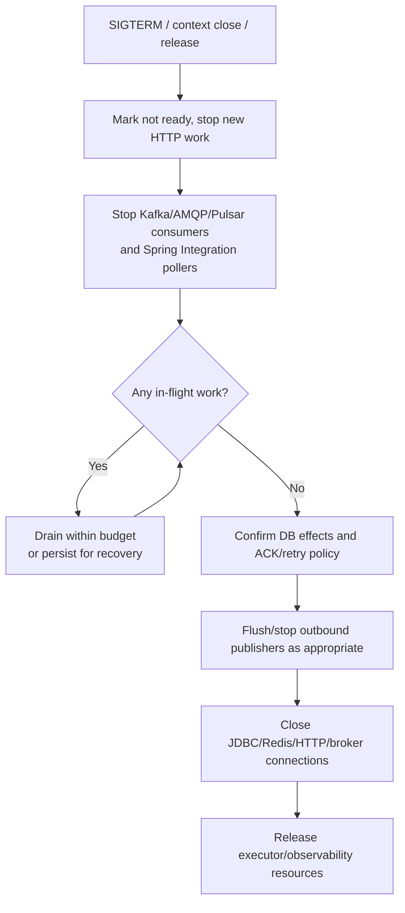
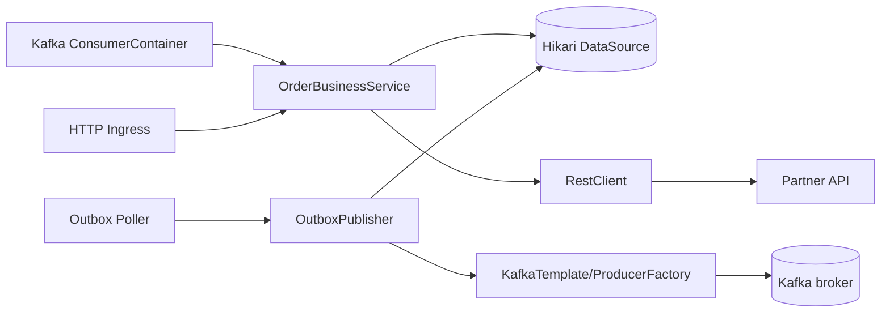
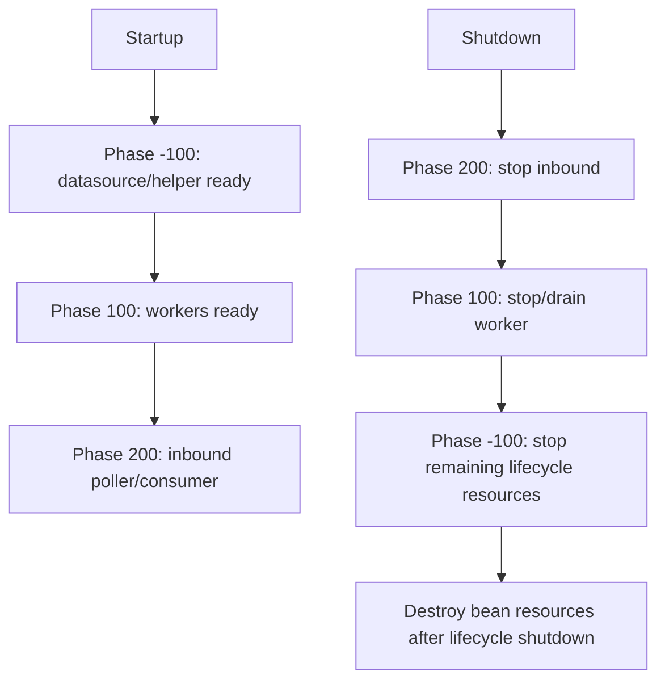
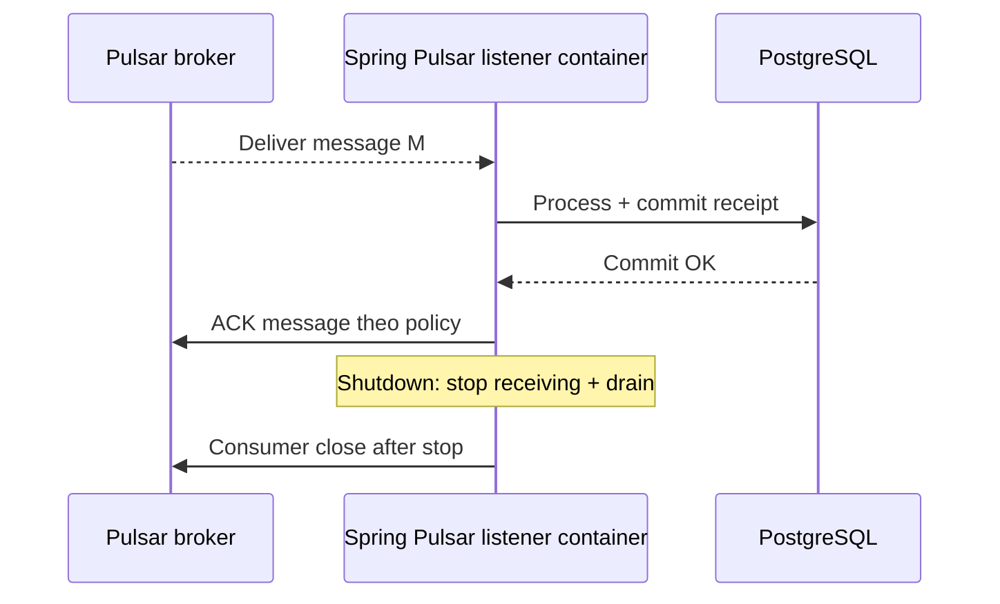
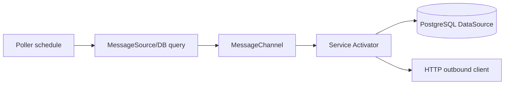
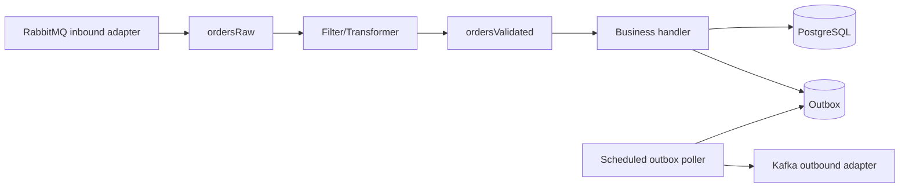
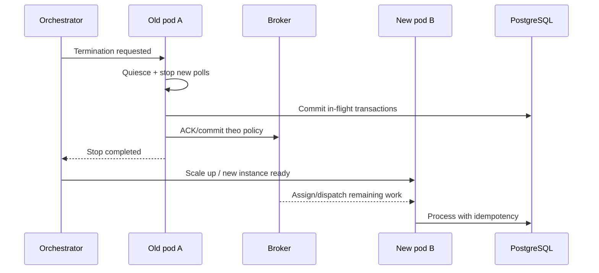

# Dừng consumer hoặc poller trước khi đóng tài nguyên kết nối

## 1. Vấn đề: ứng dụng dừng nhưng công việc vẫn đang chạy

Trong một dịch vụ tích hợp Spring Boot, **đóng ứng dụng** không chỉ là đóng cổng HTTP và giải phóng bộ nhớ. Một instance còn có thể:

- Đọc Kafka records, RabbitMQ deliveries hoặc Pulsar messages rồi ghi vào PostgreSQL.
- Đang thực hiện `@Scheduled` job hoặc Spring Integration poller lấy công việc từ inbox/outbox.
- Sử dụng `WebClient`/`RestClient` gọi API đối tác và chờ kết quả.
- Cập nhật Redis cache, đánh dấu trạng thái giao dịch hoặc phát một event mới qua broker.
- Giữ JDBC connections, broker producer/consumer connections, HTTP connection pool và task executors.

Nếu ứng dụng **đóng `DataSource`, Redis connection factory hoặc HTTP client trước**, trong khi consumer/poller vẫn đang lấy message và xử lý, tác vụ đang chạy có thể gặp:

```text
KafkaListener → đọc OrderCreated
                   ↓
Shutdown thread → HikariDataSource.close()
                   ↓
KafkaListener → ghi inbox/DB → SQLException: pool closed
                   ↓
ACK hoặc retry phụ thuộc policy, có thể gây mất/lặp xử lý
```

Đây là lỗi **shutdown ordering**. Một quy trình đúng phải bảo đảm người tạo công việc mới **dừng trước**, công việc đã nhận **được hoàn tất hoặc chuyển về nơi lưu trữ bền vững**, rồi tài nguyên kết nối mới đóng.

Trong module **SPRING_BOOT_INTEGRATION**, tính đúng đắn của shutdown liên quan trực tiếp tới HTTP client, cơ sở dữ liệu, cache, broker, Spring Integration adapters, transaction, retry, duplicate processing, kiểm thử và khả năng quan sát.

### Mục tiêu học tập

Sau bài này, bạn có thể:

1. Xây dựng thứ tự shutdown: **quiesce ingress → stop consumer/poller → drain → commit/ack/recover → close connections**.
2. Hiểu `SmartLifecycle`, `phase`, `stop(Runnable)`, Spring Boot graceful shutdown và các shutdown timeouts.
3. Dừng đúng đối tượng sở hữu polling/consuming đối với Spring Kafka, RabbitMQ, Pulsar, Spring Integration và `@Scheduled`.
4. Giải thích tại sao một `QueueChannel` hoặc executor nhận task thành công **không có nghĩa** task đã hoàn tất bền vững.
5. Giữ an toàn với DB transaction, broker acknowledgement, idempotency, outbox/inbox và HTTP calls.
6. Lập shutdown budget trong Kubernetes, xử lý trường hợp vượt deadline hoặc bị `SIGKILL`.
7. Kiểm thử thứ tự đóng, redelivery và data consistency thay vì chỉ xác minh JVM thoát.

> **Phạm vi:** Java 17+, Spring Boot 3.x, Spring Integration 6.x và những client tương thích với Spring Boot BOM; ví dụ chi tiết tập trung vào Kafka + PostgreSQL + Spring Integration. Ở các phiên bản khác, API lifecycle, thời gian chờ và thuộc tính framework có thể thay đổi. Các sơ đồ nêu **chiến lược an toàn**, không cam kết tất cả hệ thống tự thực hiện đủ các bước khi không được cấu hình.

## 2. Phân biệt năm thao tác thường bị gọi chung là “stop”

| Thao tác | Làm gì? | Điều chưa được bảo đảm |
| --- | --- | --- |
| **Quiesce / stop accepting** | Ngừng nhận tác vụ mới từ HTTP, broker, scheduler hoặc poller | Công việc đã nhận vẫn có thể đang chạy |
| **Pause** | Tạm ngưng một nguồn, có thể resume sau | Không nhất thiết dừng worker hoặc đóng connection |
| **Stop consumer/poller** | Ngăn endpoint tiếp tục dispatch work theo lifecycle của nó | Không tự chờ tất cả tác vụ bị tách sang executor khác |
| **Drain in-flight** | Chờ công việc đã nhận kết thúc hoặc đạt điểm lưu bền vững | Không đảm bảo công việc không bị lặp nếu upstream redeliver |
| **Destroy / close resources** | Đóng `DataSource`, broker clients, HTTP pools, cache clients, executors | Không thể cứu task còn đang cần những tài nguyên đó |

Quy trình tổng quát:



Trên thực tế, một số bước có thể chồng lấp có kiểm soát: ví dụ cho outbound Kafka producer sống trong khi inbound Kafka consumer đã dừng, để các xử lý in-flight có thể hoàn thành publish. Không thể áp thứ tự cứng như “đóng **mọi** Kafka connection trước DB” nếu consumer vẫn cần producer để gửi kết quả.

### 2.1. Điểm bền vững là tiêu chuẩn chấp nhận

Với event đơn hàng, “xử lý xong” thường có nghĩa một trong các trạng thái:

- DB transaction chứa **business effect + inbox receipt** đã commit.
- Công việc đã được ghi vào **durable inbox/work table** và có worker/retry tiếp quản.
- Outbound event đã được lưu vào **transactional outbox**.
- Một publish tới broker đã có xác nhận theo chính sách, và trạng thái gửi được ghi bền vững hoặc có thể retry an toàn.

Việc `MessageChannel.send()` trả true hoặc task đã được executor queue chấp nhận **chưa đủ** nếu queue ở trong JVM. Đối với nghiệp vụ thanh toán, tồn kho hoặc đơn hàng, không được đánh đồng “đã nhận vào RAM” với “đã được xử lý”.

### 2.2. Shutdown không thể hứa hoàn thành mọi task vô hạn

Một HTTP API đối tác có thể treo, một DB transaction có thể kẹt lock hoặc broker mất kết nối. Thực tế phải đặt **deadline**:

1. Thử dừng intake và chờ công việc có thể hoàn tất.
2. Khi thời gian gần hết, ngừng chờ vô hạn, đưa trạng thái chưa xong về **điểm recovery**.
3. Cho broker redeliver nếu message chưa được ack/commit; hoặc để inbox/outbox còn pending.
4. Cho process kết thúc theo shutdown deadline, bảo đảm lần khởi động sau xử lý trùng an toàn.

**Graceful shutdown là cơ chế giảm mất mát và giảm gián đoạn, không thay thế durability và idempotency.**

## 3. Ai thực sự sở hữu tài nguyên và điểm phát công việc?

Một ứng dụng có thể có nhiều đối tượng dùng cùng loại tài nguyên:



Muốn dừng đúng thứ tự, cần phân biệt:

- **Ingress owner:** HTTP connector/controller, Kafka/Rabbit/Pulsar listener container, `SourcePollingChannelAdapter`, `@Scheduled` task.
- **Work owner:** business handler, message channel, executor, poller worker, callback/future.
- **Resource owner:** `DataSource`, Redis `ConnectionFactory`, HTTP client connection pool, broker producer/consumer factory.
- **Durable owner:** PostgreSQL inbox/outbox, broker queue/topic, transaction log hoặc object storage.

Một `@KafkaListener` không nhất thiết tự tạo `KafkaConsumer`; thường **listener container** do Spring Kafka quản lý mới sở hữu vòng đời consumer. Một Spring Integration flow không tự sở hữu mọi kết nối: Kafka adapter dùng Spring Kafka container/factory, JDBC adapter dùng `DataSource`, HTTP adapter dùng request factory/client thực tế.

### 3.1. Bản đồ shutdown trước khi deploy

| Thành phần | Ai start/stop? | Có phát work mới? | Có cần sống tới cuối drain? |
| --- | --- | --- | --- |
| HTTP server inbound | Embedded server/Spring Boot | Có | Cần ngừng nhận mới, cho in-flight kết thúc |
| Kafka listener | `KafkaListenerEndpointRegistry` / listener container | Có | Dừng sớm; commit/close do container quản lý |
| RabbitMQ listener | Spring AMQP listener container/registry | Có | Dừng sớm, xử lý ACK/NACK đang diễn ra |
| Pulsar listener | Spring Pulsar listener container/client | Có | Dừng sớm, ack/redelivery theo subscription |
| Spring Integration poller | Endpoint `SourcePollingChannelAdapter` hoặc polling consumer | Có | Dừng trước khi đóng DB/HTTP/broker nó dùng |
| `@Scheduled` job | Scheduling infrastructure | Có | Ngừng lên lịch, chờ callback đang chạy |
| Executor worker | `TaskExecutor`/custom executor | Không nhất thiết là ingress | Cần hoàn tất/cancel có kiểm soát |
| JDBC pool | `HikariDataSource` | Không | **Có**, tới khi các transaction đã kết thúc |
| HTTP outbound pool | Client connector/request factory | Không | **Có**, tới khi HTTP calls đã kết thúc |
| Redis connection factory | Lettuce/Jedis connection owner | Không | **Có**, tới khi các cache operations đã xong |
| Broker producer | `KafkaTemplate`/ProducerFactory hoặc SDK client | Không là ingress | Có nếu task đang publish |
| Tracing/metrics/logging | Observability infrastructure | Không | Nên tồn tại đủ lâu để flush dữ liệu vận hành |

Khi một custom bean tự đóng connection của bean khác trong `@PreDestroy`, cần xem lại ownership. Tài nguyên do Spring quản lý thường nên được đóng theo **context lifecycle**, tránh một handler tự `dataSource.close()` khi consumer vẫn chạy.

## 4. Spring `SmartLifecycle`: cơ chế sắp xếp stop

Spring quản lý các thành phần có lifecycle thông qua `Lifecycle` và `SmartLifecycle`. Interface `SmartLifecycle` hỗ trợ:

```java
// Lược đồ những phương thức cốt lõi, không phải khai báo lại Spring interface
public interface SmartLifecycle extends Lifecycle, Phased {
    void stop(Runnable callback);
    boolean isAutoStartup();
    int getPhase();
}
```

Trong Spring, các method có thể có default implementation tùy phiên bản. Điểm cần ghi nhớ:

1. **Startup:** phase thấp hơn thường **start trước** phase cao hơn.
2. **Shutdown:** phase cao hơn thường **stop trước** phase thấp hơn.
3. Với `stop(Runnable callback)`, thành phần bất đồng bộ **phải gọi callback khi đã dừng** để lifecycle processor có thể chuyển sang bước/phases kế tiếp.
4. Spring chỉ đợi tới **shutdown timeout của phase**. Callback bị bỏ quên có thể khiến phase bị chờ tới timeout, sau đó việc đóng tiếp diễn khi công việc có thể còn chạy.
5. Quan hệ dependency giữa beans có thể ảnh hưởng thứ tự và cần được xét bên cạnh phase.



Các phase `-100/100/200` chỉ là **sơ đồ minh họa**. Framework adapters có phase mặc định khác, một số rất gần `Integer.MAX_VALUE`. **Đừng áp một con số phase lấy từ ví dụ vào production mà không xem phase thực tế của listener container và endpoint.**

### 4.1. Ví dụ cấu hình timeout của lifecycle processor

```yaml
spring:
  lifecycle:
    timeout-per-shutdown-phase: 30s
```

`spring.lifecycle.timeout-per-shutdown-phase` giới hạn thời gian Spring Boot chờ **mỗi nhóm phase** khi dừng `SmartLifecycle` beans. Nó **không phải** tổng deadline của toàn JVM và **không đảm bảo** các network calls đang chạy sẽ tự bị hủy sau 30 giây.

Nếu một flow có nhiều phases, tổng thời gian shutdown có thể lớn hơn một lần timeout. Khi deploy bằng Kubernetes hoặc một process manager có deadline chung, phải tính thêm:

- Giai đoạn `preStop` hoặc deregistration.
- Thời gian drain các phase.
- Thời gian đóng connections và flush metrics.
- Safety margin trước thời điểm bị buộc kill.

### 4.2. `stop()` và `stop(Runnable)` không hoàn toàn tương đương

Một listener/poller có thể dừng bất đồng bộ. Gọi `stop()` rồi ngay lập tức đóng Hikari pool trong dòng kế tiếp có thể không chờ đủ in-flight processing. Khi tích hợp vào Spring lifecycle, `stop(Runnable)` cho phép báo **đã dừng xong**, thay vì chỉ “đã yêu cầu dừng”.

Pseudo-code minh họa:

```java
@Override
public void stop(Runnable callback) {
    stopAcceptingNewWork();
    waitOrArrangeDrain(() -> {
        markStopped();
        callback.run(); // callback CHỈ khi quiesce/drain hoàn tất
    });
}
```

Các phương thức `stopAcceptingNewWork`, `waitOrArrangeDrain`, `markStopped` là pseudocode. Một implementation phải có timeout/error handling, và **gọi callback đúng một lần** kể cả khi không có work để tránh làm lifecycle processor kẹt.

### 4.3. `@PreDestroy` không phải công cụ điều phối toàn bộ shutdown

`@PreDestroy` và `DisposableBean.destroy()` thường thuộc giai đoạn **destroy beans** sau lifecycle stop, trong một context Spring bình thường. Chúng phù hợp để giải phóng tài nguyên mà bean **sở hữu**. Nhưng tự viết:

```java
@PreDestroy
void closeEverything() {
    dataSource.close();
    // Sau đó mới cố dừng consumer...
}
```

là anti-pattern khi bean này không kiểm soát đầy đủ consumer lifecycle. Tốt hơn: dùng `SmartLifecycle`/registry để stop ingress trước, rồi để container và resource owner đóng theo vòng đời chuẩn. `@PreDestroy` trên một bean **không phải lời hứa** mọi thread tự tạo ở nơi khác đã dừng.

## 5. HTTP inbound: graceful web shutdown chưa dừng broker consumer

Spring Boot hỗ trợ graceful shutdown cho embedded web server:

```yaml
server:
  shutdown: graceful
spring:
  lifecycle:
    timeout-per-shutdown-phase: 30s
```

Tác dụng cốt lõi là ngừng nhận **HTTP requests mới** và cho requests đang xử lý có cơ hội hoàn tất theo behavior của embedded server/connector. Tuy nhiên:

- Kafka/RabbitMQ/Pulsar consumers có lifecycle **riêng**, không phải HTTP request.
- `@Scheduled` job và Spring Integration poller có thể tiếp tục chạy nếu chưa được stop.
- Một HTTP handler đã đẩy task vào executor rồi trả về **không chứng minh task đã hoàn tất**.
- Graceful web shutdown không tự biến mọi outbound call thành idempotent hay bảo đảm transaction DB + broker nguyên tử.

**Thứ tự mong muốn:** traffic ingress không tiếp tục tăng, broker/pollers không lấy thêm việc mới, công việc đã nhận được xử lý/recover, rồi các tài nguyên outbound mới đóng.

### 5.1. Readiness, liveness và shutdown signal

Readiness thể hiện instance **có nên nhận việc mới**; liveness thể hiện process còn hoạt động. Khi dừng có kế hoạch, cần:

1. Để load balancer/kube-proxy dừng chuyển request mới theo cơ chế readiness/deregistration phù hợp.
2. Chủ động ngừng broker consumer/poller theo lifecycle.
3. Cho đang xử lý hoàn tất hoặc ghi bền vững.
4. Trả/commit ack đúng; sau đó mới đóng tài nguyên.

Không biến một Kafka poison message hoặc lỗi HTTP đối tác tạm thời thành liveness fail liên tục; điều đó tạo restart storm và tăng khả năng redelivery.

## 6. Kafka listener: dừng container, không đóng producer/DB trước

Với `@KafkaListener`, listener container quản lý các Kafka consumer threads và các quyết định poll/commit. Ví dụ:

```java
package example.integration.kafka;

import org.apache.kafka.clients.consumer.ConsumerRecord;
import org.springframework.kafka.annotation.KafkaListener;
import org.springframework.stereotype.Component;

@Component
public class OrdersKafkaConsumer {

    private final OrdersEventService service;

    public OrdersKafkaConsumer(OrdersEventService service) {
        this.service = service;
    }

    @KafkaListener(
            id = "orders-consumer",
            topics = "${integration.kafka.orders-topic:orders.events.v1}",
            groupId = "${spring.kafka.consumer.group-id}")
    public void onOrder(ConsumerRecord<String, OrderCreatedV1> record) {
        service.applyIdempotently(record.value());
    }
}
```

`OrdersEventService` và `OrderCreatedV1` là thành phần ứng dụng cần triển khai. `applyIdempotently` nên xác thực contract, ghi receipt và nghiệp vụ **trong một DB transaction**. Không tự tạo một executor task ở cuối listener nếu container đã được cấu hình để commit offset theo việc listener trả về.

### 6.1. Container lifecycle khác `KafkaTemplate`

| Thành phần | Trách nhiệm | Khi shutdown |
| --- | --- | --- |
| `KafkaListenerEndpointRegistry` | Quản lý listener containers tạo bởi `@KafkaListener` | Container được stop theo lifecycle hoặc API registry |
| `MessageListenerContainer` | Poll, dispatch, offset/ack, group membership | Cần ngừng lấy record và hoàn tất xử lý theo policy |
| `KafkaTemplate` | Publish outbound records | Giữ sống nếu in-flight task còn phải gửi |
| `ProducerFactory` | Sở hữu/cấp producer connections | Đóng sau các publish cần thiết và release |
| `DataSource` | JDBC transactions và pool | Đóng sau DB work đang chạy |

Nếu một Kafka listener xử lý xong DB rồi publish event, **đóng `ProducerFactory` hoặc `DataSource` trước khi listener hoàn tất** có thể gây lỗi dù consumer vẫn đang hoạt động bình thường.

### 6.2. Stop, pause và container registry

Một ứng dụng có thể quản lý listener theo ID:

```java
package example.integration.kafka;

import org.springframework.kafka.config.KafkaListenerEndpointRegistry;
import org.springframework.kafka.listener.MessageListenerContainer;
import org.springframework.stereotype.Service;

@Service
public class OrdersConsumerControl {

    private final KafkaListenerEndpointRegistry registry;

    public OrdersConsumerControl(KafkaListenerEndpointRegistry registry) {
        this.registry = registry;
    }

    public void pause() {
        MessageListenerContainer container =
                registry.getListenerContainer("orders-consumer");
        if (container == null) {
            throw new IllegalStateException("Unknown listener ID");
        }
        container.pause();
    }

    public void resume() {
        MessageListenerContainer container =
                registry.getListenerContainer("orders-consumer");
        if (container == null) {
            throw new IllegalStateException("Unknown listener ID");
        }
        container.resume();
    }
}
```

`pause()` thường được dùng để **tạm dừng nhận mới** khi vẫn duy trì consumer/group lifecycle phù hợp; không phải tương đương việc stop hoàn toàn và đóng connection. Khi cần shutdown process, thường để Spring quản lý **stop listener containers** theo `SmartLifecycle`.

**Không đồng nhất pause với drain:** một record/batch đang xử lý vẫn có thể tiếp tục, và một thread worker do handler tự tạo nằm ngoài vòng đời listener container.

### 6.3. Ack/commit và redelivery

```yaml
spring:
  kafka:
    consumer:
      group-id: orders-worker
      enable-auto-commit: false
    listener:
      ack-mode: record
```

Đây là cấu hình minh họa record listener; policy commit cuối cùng còn chịu ảnh hưởng container transaction, error handler, batch/record mode và version. `enable-auto-commit: false` cho Spring Kafka container điều khiển offset thay vì Kafka auto-commit định kỳ.

Ba thời điểm:

```text
T1: record được poll
T2: DB transaction commit
T3: offset được commit
```

Nếu process dừng sau T2 nhưng trước T3, record có thể được giao lại: **at-least-once redelivery**. Nếu process dừng trước T2 và offset chưa commit, record còn cơ hội được xử lý lại. Điều nguy hiểm là T3 xảy ra khi work chỉ mới được enqueue vào RAM rồi process bị kill trước T2.

### 6.4. Không ép commit để “dọn sạch backlog”

Một số triển khai cố commit offset của mọi record đã poll trong shutdown để listener tắt nhanh. Cách này **có thể mất dữ liệu** nếu chưa có durable receipt hoặc business commit. Khi hết deadline, an toàn hơn là để record chưa commit được redeliver, với idempotency xử lý bản đã commit trước đó.

## 7. RabbitMQ consumer: prefetch và ACK/NACK trước khi đóng connection

Spring AMQP listener container quản lý consumer connection/channel, khả năng nhận message mới và cách acknowledgement. Ví dụ listener:

```java
package example.integration.rabbit;

import org.springframework.amqp.rabbit.annotation.RabbitListener;
import org.springframework.stereotype.Component;

@Component
public class PaymentRabbitConsumer {

    private final PaymentService paymentService;

    public PaymentRabbitConsumer(PaymentService paymentService) {
        this.paymentService = paymentService;
    }

    @RabbitListener(
            id = "payment-inbound",
            queues = "${integration.rabbit.payment-queue:payments.inbound}")
    public void accept(PaymentCommand command) {
        paymentService.processIdempotently(command);
    }
}
```

Đây là ví dụ cấu trúc: `PaymentCommand`, `PaymentService`, serializer/message converter, topology queue, authentication và DLQ policy cần được ứng dụng cung cấp. Với chế độ `AUTO` của Spring AMQP listener, một lần xử lý thành công thường dẫn tới ACK theo cấu hình container; exception có thể dẫn tới reject/requeue/DLQ tùy error handler và policy.

### 7.1. Hành vi cần xác minh khi shutdown

- **Dừng listener container** để ngừng dispatch deliveries mới.
- Cho các deliveries đang xử lý hoàn thành trong phạm vi thời gian cho phép.
- Nếu handler kết thúc thành công, ACK theo policy; nếu thất bại, NACK/requeue/reject/DLQ phù hợp.
- Chỉ sau đó mới để `CachingConnectionFactory`/AMQP connection đóng.
- Với ack `MANUAL`, trách nhiệm ACK/NACK nằm ở application; không để manual ACK bị thất lạc do đóng channel sớm.

### 7.2. Prefetch và in-flight

Nếu listener có `prefetch=100` và nhiều consumer threads, hàng trăm deliveries có thể đã được broker đẩy vào client nhưng chưa xử lý nghiệp vụ. Hạ prefetch/concurrency theo capacity có thể giảm lượng pending khi shutdown.

```yaml
spring:
  rabbitmq:
    listener:
      simple:
        prefetch: 20
        concurrency: 2
        max-concurrency: 4
        acknowledge-mode: auto
```

Đây là ví dụ cho **simple listener container**; nếu project dùng direct container, các thuộc tính nằm trong nhánh `spring.rabbitmq.listener.direct.*` phù hợp. Không nhầm prefetch là giới hạn tổng tuyệt đối của mọi listener trong toàn cluster.

Nếu AMQP connection đóng khi còn **unacked** delivery, broker có thể requeue/redeliver tùy queue/broker configuration. Điều đó giúp phục hồi nhưng có thể lặp side effect đã commit; cần idempotency key và transactional receipt.

### 7.3. Stop và connection factory ownership

Với một `@RabbitListener` được registry quản lý, ưu tiên để Spring AMQP dừng container khi đóng context. Nếu application tự đóng `CachingConnectionFactory` trong `@PreDestroy` của một service, listener còn chạy có thể gặp `ShutdownSignalException`, channel closed hoặc mất khả năng ack.

Không sử dụng `@RabbitListener` như cơ chế dừng toàn bộ RabbitMQ: outbound `RabbitTemplate` còn có thể cần publish kết quả, retry hoặc DLQ trong giai đoạn drain.

## 8. Apache Pulsar: subscription, ACK và client lifecycle

Spring for Apache Pulsar cung cấp các listener containers cho `@PulsarListener`; Pulsar Java client quản lý consumers, subscriptions và acknowledgement. Mô hình tương tự Kafka/RabbitMQ ở cấp ý tưởng, nhưng không được sao chép cấu hình ACK của broker này sang broker khác.



Khi shutdown:

1. Ngừng hoặc tạm dừng nguồn phát message mới bằng lifecycle/control API của **Pulsar listener container đúng phiên bản**.
2. Đợi handler đã nhận message hoàn tất transaction hoặc đạt điểm lưu bền vững.
3. ACK chỉ sau khi policy thành công; khi xử lý chưa hoàn tất, để redelivery/retry hoạt động theo subscription/negative acknowledgement/ack timeout đã chọn.
4. Đóng producer/client connections **sau khi** công việc đã xử lý hoặc được phục hồi an toàn.

Pulsar có nhiều subscription modes như Exclusive, Shared, Failover và Key_Shared; ordering, redelivery, ack timeout và negative ACK có behavior riêng. Một pod mới có thể bắt đầu tiêu thụ trên subscription trong lúc pod cũ shutdown; **idempotency ở business layer vẫn bắt buộc** khi ranh giới DB và broker không nguyên tử.

Không khẳng định một property như `spring.pulsar.listener.shutdown-wait` có ở mọi bản Boot. Hãy kiểm tra API container/lifecycle của **version Spring Pulsar được ứng dụng dùng**, và kiểm thử bằng broker thật.

## 9. Spring Integration: dừng poller trước khi đóng `DataSource`

Trong Spring Integration, `SourcePollingChannelAdapter` và `PollingConsumer` là những endpoint có lịch poll. Một inbound JDBC adapter có thể chạy query theo lịch; một file poller kiểm tra thư mục; một outbox poller gọi repository để lấy những event chưa gửi.



**Sai lầm phổ biến:** hiểu nhầm `MessageChannel` là poller. Channel chỉ truyền message; **endpoint/polling scheduler** mới là nơi chủ động lấy công việc. Để ngừng polling, phải stop **endpoint hoặc scheduler** đúng đối tượng sở hữu nguồn poll.

### 9.1. Ví dụ Java DSL: poller lấy việc outbox

```java
package example.integration.outbox;

import java.time.Duration;
import org.springframework.context.annotation.Bean;
import org.springframework.context.annotation.Configuration;
import org.springframework.integration.dsl.IntegrationFlow;
import org.springframework.integration.dsl.Pollers;

@Configuration(proxyBeanMethods = false)
public class OutboxPollingConfiguration {

    @Bean
    IntegrationFlow outboxPollingFlow(
            OutboxMessageSource source,
            OutboxPublisher publisher) {

        return IntegrationFlow
                .fromSupplier(
                        source::pollNext,
                        endpoint -> endpoint
                                .id("outboxPoller")
                                .poller(Pollers
                                        .fixedDelay(Duration.ofSeconds(2))
                                        .maxMessagesPerPoll(10)))
                .handle(OutboxEvent.class, (event, headers) -> {
                    publisher.publish(event);
                    return null;
                })
                .get();
    }
}
```

`OutboxMessageSource.pollNext()` là API ứng dụng cần triển khai: trả `OutboxEvent` nếu có, hoặc `null` khi không có việc. `OutboxPublisher.publish(...)` phải có semantics rõ: đồng bộ chờ broker xác nhận, hay enqueue async với tracking future. Không đánh dấu row `published` trước điểm xác nhận đã cam kết.

**Bài học ở shutdown:** cần stop `outboxPoller`/polling endpoint trước khi `DataSource` và broker producer bị đóng. Việc hủy một lịch poll chưa chắc chờ các tác vụ đang chạy bất đồng bộ; nếu `publisher.publish` trả về `CompletableFuture` rồi handler không chờ, vẫn cần tracking futures.

### 9.2. Đánh dấu endpoint ID để điều khiển

Với Java DSL, `.id("outboxPoller")` đặt ID endpoint; tên và cách lấy endpoint có thể phụ thuộc registration/context của phiên bản Spring Integration. Một control plane có thể tìm `SmartLifecycle` endpoint theo ID rồi gọi `stop()` hoặc `stop(Runnable)` theo semantics thực.

**Không gọi** `applicationContext.getBean("outboxPoller", MessageChannel.class)` rồi cố `stop`: `outboxPoller` là endpoint, không phải channel. Khi có nhiều polls hoặc integration flows, mỗi endpoint cần tên riêng để tránh stop nhầm.

### 9.3. Poller dùng DB transaction

Một outbox poller có thể chạy trong transaction, claim row và publish. Thứ tự quan trọng:

```text
Stop scheduling new polls
      ↓
Allow current poll transaction/handler finish or roll back
      ↓
Ensure pending rows remain recoverable
      ↓
Close publisher/DB connections
```

Nếu poller đã claim row `SENDING` và process chết trước khi đánh dấu thành công, cần **lease/recovery policy**: row quá hạn được claim lại có kiểm soát, không bị kẹt vĩnh viễn. Đối với nhiều instance, dùng DB constraint/locking như `FOR UPDATE SKIP LOCKED` khi phù hợp PostgreSQL, kèm checkpoint và timeout; chỉ một `QueueChannel` trong RAM không bảo đảm phân phối một lần giữa replicas.

### 9.4. Poller stop có nghĩa gì với current `receive()`?

Stop endpoint thường ngăn **lượt poll mới**. Nhưng một `receive()` đang block vì SQL/socket hoặc một handler đang gọi HTTP có thể chưa kết thúc. Vì vậy phải đặt:

- JDBC query timeout/lock timeout.
- HTTP connect/response timeout.
- Broker send timeout và retry budget.
- Shutdown drain budget cho công việc hiện tại.

Không dùng một `Thread.sleep` cố định rồi giả định mọi poller đã dừng; cần trạng thái lifecycle và các chỉ số in-flight thực.

## 10. `@Scheduled` và `@Async`: nguồn việc ngoài Spring Integration

Một service có thể dùng `@Scheduled` để chạy maintenance hoặc polling mà không khai báo IntegrationFlow:

```java
package example.integration.jobs;

import org.springframework.scheduling.annotation.Scheduled;
import org.springframework.stereotype.Component;

@Component
public class PendingDeliveryJob {

    private final PendingDeliveryService service;

    public PendingDeliveryJob(PendingDeliveryService service) {
        this.service = service;
    }

    @Scheduled(fixedDelayString = "${integration.delivery.poll-ms:2000}")
    public void processPending() {
        service.runOneBoundedBatch();
    }
}
```

Annotation `@Scheduled` cần scheduling infrastructure được bật (ví dụ `@EnableScheduling` phù hợp). Method phải dùng **bounded batch**, không giữ thread vô hạn. Scheduler ngừng lập lịch khi shutdown theo lifecycle/bean destruction, nhưng **không mặc định** mọi callback/blocking operation đã dừng ngay khi nhận SIGTERM.

### 10.1. Cấu hình chờ task executor và scheduler

```yaml
spring:
  task:
    execution:
      shutdown:
        await-termination: true
        await-termination-period: 20s
    scheduling:
      shutdown:
        await-termination: true
        await-termination-period: 20s
```

Các property minh họa nhóm task execution/scheduling được Spring Boot auto-configure. Với **custom** `ThreadPoolTaskExecutor`/`ThreadPoolTaskScheduler`, phải kiểm tra bean và setter lifecycle cụ thể, không giả định property trên áp dụng cho mọi thread pool do code tự tạo.

Ví dụ custom executor:

```java
package example.integration.jobs;

import org.springframework.context.annotation.Bean;
import org.springframework.context.annotation.Configuration;
import org.springframework.scheduling.concurrent.ThreadPoolTaskExecutor;

@Configuration(proxyBeanMethods = false)
public class WorkerExecutorConfiguration {

    @Bean
    ThreadPoolTaskExecutor outboundWorkerExecutor() {
        var executor = new ThreadPoolTaskExecutor();
        executor.setCorePoolSize(4);
        executor.setMaxPoolSize(8);
        executor.setQueueCapacity(100);
        executor.setThreadNamePrefix("outbound-worker-");
        executor.setWaitForTasksToCompleteOnShutdown(true);
        executor.setAwaitTerminationSeconds(20);
        executor.initialize();
        return executor;
    }
}
```

**Cảnh báo:** `setWaitForTasksToCompleteOnShutdown(true)` là lựa chọn cần hiểu kỹ. Nó có thể cho những task đã được queue tiếp tục chạy trong giai đoạn shutdown; nếu các resources mà task cần bị đóng sớm, vẫn có lỗi. Cần phối hợp **ngừng submit tasks mới**, drain với deadline và lifecycle của các resources.

### 10.2. `@Async` trả Future khác với fire-and-forget

Nếu worker nhận một Kafka record rồi gọi:

```java
@Async
public void sendPartnerNotification(OrderCommand command) {
    partnerClient.post(command);
}
```

và listener trả về ngay, listener container có thể ack theo policy trước khi HTTP call hoàn tất. Nếu tác vụ đang chờ trong executor khi process chết, công việc có thể mất. Dùng một durable job/outbox nếu notification là công việc bắt buộc.

Khi method trả `CompletableFuture`, caller có thể theo dõi kết quả, nhưng **phải có owner** giữ reference và phối hợp shutdown; chỉ tạo future rồi bỏ không tạo được recovery.

### 10.3. Không dùng `System.exit(0)` như nút shutdown poller

`System.exit` sẽ kích hoạt shutdown hooks trong tình huống bình thường nhưng còn phụ thuộc JVM/runtime; `SIGKILL`, OOM nghiêm trọng hoặc node chết có thể không cho cleanup. Khi cần dừng có kế hoạch, dùng cơ chế lifecycle của container/ứng dụng, không tự tắt process từ một handler mà không có drain budget và trạng thái ack.

## 11. Khi nào đóng `DataSource`, Redis và HTTP client?

Tài nguyên outbound phải sống đủ lâu cho **in-flight business work**, không chỉ cho đến khi ingress dừng nhận:

| Tài nguyên | Ai còn có thể dùng? | Điều kiện trước close |
| --- | --- | --- |
| Hikari `DataSource` | Listener ghi inbox, poller claim outbox, transaction business | Không còn transaction/handler cần DB, hoặc còn durable work để recover |
| Redis connection factory | Cache invalidation, rate limiter, dedupe cache | Operations cần thiết đã hoàn tất/được phép retry; không dùng Redis volatile thay durable idempotency receipt |
| HTTP `RestClient`/ `WebClient` pool | Partner API calls, webhook sender | In-flight calls đã trả kết quả, timeout hoặc được chuyển sang retry bền vững |
| Kafka/Rabbit/Pulsar producer | Outbox publisher, DLT recoverer | Sends đã được xác nhận hoặc pending data còn có thể phát lại |
| Kafka/Rabbit/Pulsar consumer | Inbound adapter/listener | Đã stop nhận mới và xử lý ACK/recovery theo policy |
| Metrics/tracing exporter | Lấy thông tin shutdown/error/latency | Flush trong budget sau khi work dừng |

### 11.1. `HikariDataSource.close()` không tự drain nghiệp vụ

Gọi `close()` trên Hikari pool dừng khả năng cấp connections mới và bắt đầu đóng pool theo semantics Hikari. Nó **không** hiểu outbox status, Kafka offset hoặc một pending `@Transactional` task của bạn. Không dùng:

```java
@PreDestroy
void stop() {
    dataSource.close();           // đóng resource trước
    consumerControl.pause();      // consumer có thể vẫn đang xử lý
}
```

Đây là anti-pattern về ownership và thứ tự. Với Spring Boot, thường để **container/broker listeners/pollers là managed lifecycle beans**, để Spring dừng chúng trước phase destroy của `DataSource`; custom resource cần được khai báo destroy callback ở **owner bean**.

### 11.2. HTTP client có nhiều kiểu tài nguyên

`RestClient` có thể dùng JDK HTTP client, Apache HttpClient, Jetty hoặc request factory khác; `WebClient` có thể dùng Reactor Netty. Connection pool và SSL context có thể thuộc builder, connector, provider hoặc shared resources.

- Chỉ đóng **resource mà ứng dụng sở hữu**; tránh đóng global Reactor Netty resources dùng chung khi flow khác còn chạy.
- Để provider/bean destruction xử lý theo lifecycle phù hợp nếu client được Boot quản lý.
- Trước khi đóng HTTP pool, bảo đảm các request đang chạy đã có timeout và kết quả/failure được ghi lại theo delivery contract.
- Nếu HTTP partner trả 200 nhưng ứng dụng chết trước khi ghi DB receipt, retry có thể gọi lại. Phải có idempotency key hoặc cơ chế reconcile, không dựa vào shutdown để bảo đảm không lặp.

### 11.3. Redis cache không phải mặc định là nguồn sự thật

Nếu Redis cache đóng trước listener làm cache invalidation lỗi, điều kiện an toàn tùy nghiệp vụ:

- Với cache dẫn xuất có TTL, có thể retry hoặc tái tạo cache theo chính sách.
- Với Redis dùng như distributed lock/rate limiter, cần đánh giá lease expiry và duplicate worker.
- Với thanh toán/đơn hàng, đừng dùng một TTL cache key duy nhất thay database unique constraint cho idempotency quan trọng.

## 12. Dừng outbound publisher: chờ xác nhận, không chờ vô hạn

Kafka producer có thể đang giữ các record chưa được broker xác nhận. Khi drain:

1. Dừng các nguồn tạo thêm publish requests.
2. Đợi các send futures đang theo dõi hoàn tất trong **deadline hữu hạn**.
3. Ghi lại publish result hoặc để outbox rows còn pending nếu không biết kết quả.
4. Để producer factory/container tự đóng sau giai đoạn drain.

```java
// Ví dụ minh họa send-result tracking ở business publisher
CompletableFuture<SendResult<String, OutboxEvent>> future =
        kafkaTemplate.send(topic, event.aggregateId(), event);

future.whenComplete((result, error) -> {
    if (error == null) {
        markAsPublishedAfterBrokerAck(event.eventId());
    } else {
        recordRetryableFailure(event.eventId(), error);
    }
});
```

Những method `markAsPublishedAfterBrokerAck` và `recordRetryableFailure` là service methods của ứng dụng; ví dụ nêu **ý tưởng**, không phải transaction outbox implementation hoàn chỉnh. Nếu callback ghi database sau khi `DataSource` đã đóng, nó có thể fail: phải tính **callback in-flight** vào drain, hoặc cho publisher state được phục hồi từ durable outbox.

### 12.1. `KafkaTemplate.flush()` không thay outbox

`flush()` có thể yêu cầu producer đẩy và chờ các record đã buffer theo semantics Kafka client, nhưng:

- Không tạo transaction nguyên tử với một DB transaction đã commit.
- Không bảo đảm application đã ghi `published_at` cho từng event.
- Không tự biết callback nào vẫn đang ghi DB.
- Không sửa network partition hoặc quyền topic bị từ chối.

Nếu không chắc một send đã thành công, **giữ event ở outbox để retry có kiểm soát**, chấp nhận khả năng gửi lại và dùng idempotency downstream.

### 12.2. Xác định thời điểm DLT recoverer dừng

Kafka/RabbitMQ error handler có thể gửi message hỏng sang DLT/DLQ trong giai đoạn shutdown. Đóng outbound producer/connection trước khi DLT publish hoàn tất sẽ biến một lỗi dữ liệu **có thể recover** thành một lỗi recovery nữa.

Khi có DLT:

- DLT publisher sống ít nhất tới khi in-flight recovery hoàn tất hoặc có cơ chế retry bền vững.
- Nếu DLT publish thất bại, **không tự coi record đã được recover thành công**.
- Ghi metadata topic/partition/offset/error category để điều tra, hạn chế raw payload nhạy cảm.
- Xác nhận behavior ack/offset với error handler cụ thể, không suy đoán từ `send()` của channel.

## 13. Ví dụ điều khiển stop của một Kafka listener bằng callback

Trong trường hợp application cần một **operations API** hoặc runbook điều phối trước khi process tắt, có thể lấy listener container từ registry rồi **chờ callback** thay vì gọi stop và đóng pool ngay lập tức.

```java
package example.integration.operations;

import java.time.Duration;
import java.util.concurrent.CountDownLatch;
import java.util.concurrent.TimeUnit;

import org.springframework.kafka.config.KafkaListenerEndpointRegistry;
import org.springframework.kafka.listener.MessageListenerContainer;
import org.springframework.stereotype.Component;

@Component
public class OrdersConsumerStopControl {

    private final KafkaListenerEndpointRegistry registry;

    public OrdersConsumerStopControl(KafkaListenerEndpointRegistry registry) {
        this.registry = registry;
    }

    public boolean stopAndAwait(Duration timeout)
            throws InterruptedException {

        MessageListenerContainer container =
                registry.getListenerContainer("orders-consumer");

        if (container == null) {
            throw new IllegalStateException(
                    "orders-consumer listener not registered");
        }

        if (!container.isRunning()) {
            return true;
        }

        CountDownLatch stopped = new CountDownLatch(1);
        container.stop(stopped::countDown);

        return stopped.await(timeout.toMillis(), TimeUnit.MILLISECONDS);
    }
}
```

Trong Spring Kafka 3.x, listener container hỗ trợ callback khi stop theo lifecycle API. Ví dụ:

```java
boolean stopped =
        ordersConsumerStopControl.stopAndAwait(Duration.ofSeconds(20));

if (!stopped) {
    // Không gọi đây là drain thành công; báo động hoặc tiếp tục
    // theo recovery policy của deployment.
    throw new IllegalStateException(
            "Kafka consumer did not stop within shutdown budget");
}
```

Đoạn gọi trên minh họa **một bước trong orchestration**, không có nghĩa nên đặt trực tiếp trong `@PreDestroy` của một bean tùy ý. Spring Kafka listener containers đã được tích hợp với lifecycle của ApplicationContext; nếu không có yêu cầu đặc biệt, **để framework quản lý stop** thường an toàn và đơn giản hơn việc gọi stop hai lần.

### 13.1. Callback báo container dừng, không báo mọi việc bên ngoài đã xong

Nếu listener làm:

```java
@KafkaListener(id = "orders-consumer", topics = "orders.events.v1")
public void consume(OrderCreatedV1 event) {
    executor.execute(() -> billingService.process(event));
    // Hàm trả về khi task mới được xếp hàng
}
```

thì container có thể dừng và gọi callback, trong khi task của `executor` vẫn đang chạy. **Stop callback của container không theo dõi công việc mà handler tự tách ra** nếu không tích hợp completion trở lại listener contract.

Do đó, cần xác minh rằng `@KafkaListener` xử lý đồng bộ tới điểm bền vững **hoặc** chỉ trả sau khi persist durable inbox. Nếu đã có tác vụ async ngoài container, phải quản lý drain của executor và recovery của tác vụ đó riêng.

### 13.2. Vì sao không nên tự `Consumer.close()` trong listener?

Client Kafka consumer do Spring listener container sở hữu, và Kafka consumer không được dùng tùy tiện từ nhiều threads. Đóng raw consumer từ business handler khác thread có thể gây race/lifecycle conflict. Sử dụng **listener container/registry API** đã được framework thiết kế cho start/pause/stop.

## 14. Một `SmartLifecycle` stop gate có phase rõ ràng

Trong những ứng dụng đặc biệt, có thể thêm một **gate** chỉ để điều phối stop một inbound listener sớm hơn một số managed components khác. Bản thân Kafka listener container đã có `SmartLifecycle`; ví dụ sau chỉ cần khi bạn **chủ động cần một hook riêng**, không phải cấu hình bắt buộc.

```java
package example.integration.operations;

import java.util.concurrent.atomic.AtomicBoolean;

import org.springframework.context.SmartLifecycle;
import org.springframework.kafka.config.KafkaListenerEndpointRegistry;
import org.springframework.kafka.listener.MessageListenerContainer;
import org.springframework.stereotype.Component;

@Component
public class OrdersIntakeStopGate implements SmartLifecycle {

    private final KafkaListenerEndpointRegistry registry;
    private final AtomicBoolean running = new AtomicBoolean(false);

    public OrdersIntakeStopGate(KafkaListenerEndpointRegistry registry) {
        this.registry = registry;
    }

    @Override
    public void start() {
        // Gate không tự tạo consumer; registry quản lý consumer.
        running.set(true);
    }

    @Override
    public void stop(Runnable callback) {
        if (!running.getAndSet(false)) {
            callback.run();
            return;
        }

        MessageListenerContainer container =
                registry.getListenerContainer("orders-consumer");

        if (container == null || !container.isRunning()) {
            callback.run();
            return;
        }

        container.stop(callback);
    }

    @Override
    public void stop() {
        // Spring lifecycle processor ưu tiên overload có callback.
        stop(() -> {});
    }

    @Override
    public boolean isRunning() {
        return running.get();
    }

    @Override
    public boolean isAutoStartup() {
        return true;
    }

    @Override
    public int getPhase() {
        return Integer.MAX_VALUE - 50;
    }
}
```

**Cần đọc mã với giới hạn của nó:**

1. Phase cao khiến gate được gọi stop **sớm hơn** những `SmartLifecycle` beans có phase thấp hơn. Ví dụ lấy `MAX_VALUE - 50`, nhằm đứng sau phase khởi động của listener container Spring Kafka mặc định thông dụng; **phải xác minh phase thật** nếu registry/container đã bị tùy chỉnh.
2. Gate gọi `container.stop(callback)` và chỉ đánh dấu phase shutdown hoàn tất khi callback được chạy.
3. Việc registry sau đó stop container thêm một lần cần được coi là **idempotent lifecycle operation** và phải kiểm thử với version cụ thể.
4. `stop()` không callback trong ví dụ **không phải API chờ đồng bộ**; nếu vận hành cần chờ bằng lệnh thủ công, sử dụng helper `stopAndAwait` ở mục 13.
5. Một gate kiểu này **không biết** những worker tasks đã tách khỏi listener và không thể bảo đảm mọi HTTP/database callbacks hoàn tất.

Trong production, nếu không cần điều phối đặc thù, ưu tiên **cấu hình managed listener container, phases và executor shutdown** thay vì thêm các coordinator trùng lặp. Ví dụ này giúp hiểu cơ chế callback/phase, không phải pattern bắt buộc cho mọi service.

### 14.1. Khởi động ngược thứ tự

Phase cao **stop sớm** nhưng cũng **start muộn**. Nếu một listener cần DB/migration sẵn sàng trước khi nhận message, hãy kiểm tra cả **startup dependencies**. Đừng chỉ đặt phase để giải quyết shutdown mà vô tình khiến listener start khi database schema chưa migrate xong.

## 15. Theo dõi công việc đang chạy: drain counter không thay durable storage

Nếu một listener hoặc polling endpoint tạo **tác vụ bất đồng bộ ngoài container**, nên đo số công việc đang chạy. Một bộ đếm in-flight giúp đợi trong deadline hữu hạn:

```java
package example.integration.operations;

import java.time.Duration;
import java.util.concurrent.locks.Condition;
import java.util.concurrent.locks.ReentrantLock;

public final class InFlightTracker {

    private final ReentrantLock lock = new ReentrantLock();
    private final Condition empty = lock.newCondition();
    private int active;

    public void begin() {
        lock.lock();
        try {
            active++;
        } finally {
            lock.unlock();
        }
    }

    public void complete() {
        lock.lock();
        try {
            if (active <= 0) {
                throw new IllegalStateException("Unbalanced completion");
            }
            active--;
            if (active == 0) {
                empty.signalAll();
            }
        } finally {
            lock.unlock();
        }
    }

    public boolean awaitEmpty(Duration timeout)
            throws InterruptedException {

        long remaining = timeout.toNanos();
        lock.lockInterruptibly();
        try {
            while (active != 0) {
                if (remaining <= 0L) {
                    return false;
                }
                remaining = empty.awaitNanos(remaining);
            }
            return true;
        } finally {
            lock.unlock();
        }
    }
}
```

Cách sử dụng với executor phải đăng ký in-flight **trước** khi submit và cân bằng nếu submit bị từ chối:

```java
tracker.begin();
try {
    executor.execute(() -> {
        try {
            processor.process(command);
        } finally {
            tracker.complete();
        }
    });
} catch (RuntimeException rejected) {
    tracker.complete();
    throw rejected;
}
```

`tracker`, `executor`, `processor` và `command` là các biến/bean của ứng dụng. Khi shutdown:

```text
1. Stop ingress/stop submitting
2. Wait listener/poller stop callback
3. awaitEmpty(deadline) với không có new submissions
4. Close resources theo lifecycle
```

**Điều kiện tiền đề:** không được có task mới đăng ký **sau khi** thread drain kết luận bộ đếm đã bằng 0. Cần có một ingress gate/quiescing flag phối hợp an toàn, và tracking phải bao phủ cả các futures/callbacks tạo side effect.

**Giới hạn:** counter chỉ đo số task trong process, **không cứu dữ liệu sau crash/SIGKILL**. Các task đã enqueue vào executor nhưng chưa start vẫn phải được tính, và nghiệp vụ bắt buộc phải có durable inbox/outbox hoặc broker redelivery.

### 15.1. Đừng chờ count bằng 0 vô thời hạn

Nếu một HTTP request không có response timeout hoặc DB transaction chờ lock vô hạn, drain có thể không bao giờ về 0. Cần:

- Hard deadlines cho từng IO operation.
- Tổng drain timeout đủ để hoàn tất hợp lệ.
- Circuit breaker/backoff phù hợp để giảm retry storm.
- Cơ chế mark pending/retry và idempotency khi deadline hết.

Vượt shutdown timeout **không có nghĩa** có thể đánh dấu record thành công. Nó là một sự kiện vận hành cần metric, alert và recovery policy.

## 16. Transactional inbox/outbox là lớp bảo hiểm của shutdown

Khi bảo vệ một luồng `HTTP → PostgreSQL → Kafka → consumer`, hãy xác định chỗ nào đang lưu trạng thái bền vững:

```mermaid
sequenceDiagram
    participant HTTP as HTTP ingress
    participant APP as Order service
    participant DB as PostgreSQL
    participant OUT as Outbox publisher
    participant K as Kafka
    HTTP->>APP: CreateOrder
    APP->>DB: BEGIN; insert order + outbox event
    DB-->>APP: COMMIT
    APP-->>HTTP: Accepted/created theo contract
    OUT->>DB: Poll pending outbox
    OUT->>K: Publish event
    K-->>OUT: ACK (hoặc timeout)
    OUT->>DB: Mark published theo kết quả/policy
```

Khi shutdown:

- HTTP ngừng nhận yêu cầu mới.
- Outbox poller ngừng claim rows mới, hoàn thành việc đã claim nếu có thể.
- Nếu một send đang chờ broker, row vẫn cần có trạng thái/lease để phục hồi sau crash.
- Producer và DB phải còn sống cho tới khi in-flight callbacks kết thúc hoặc release theo recovery policy.
- Consumer downstream phải hỗ trợ redelivery/idempotency.

### 16.1. Inbox giúp tách broker ACK khỏi business work dài

Một Kafka listener có thể:

```text
Consume OrderCreated
   → BEGIN DB transaction
   → insert inbox(eventId, payload, status=PENDING) nếu chưa có
   → COMMIT
   → ACK/commit offset theo container policy
   → background worker xử lý inbox
```

Với flow này, nếu process chết **sau khi ACK nhưng trước business work**, row PENDING vẫn còn trong DB để worker tiếp tục ở lần chạy sau. Nếu consumer bị giao lại do commit offset thất bại, unique constraint trên eventId tránh nhân đôi inbox. Chỉ dùng cách này khi đã thiết kế trạng thái, retry, dead-letter, cleanup và giới hạn concurrency của inbox.

### 16.2. Không để `@Transactional` giả lập atomicity giữa DB và broker

Một database transaction và Kafka publish transaction không mặc nhiên thành **một transaction nguyên tử**. Spring Kafka có các khả năng transaction riêng, nhưng cần hiểu cách commit/order và failure modes đúng phiên bản. Với luồng có DB + HTTP đối tác + broker, outbox/inbox/idempotency thường là thiết kế rõ ràng hơn.

### 16.3. Kịch bản crash quan trọng

| Điểm crash | Kết quả có thể xảy ra | Cơ chế bảo vệ |
| --- | --- | --- |
| Trước DB commit | Nghiệp vụ chưa bền vững, message có thể redeliver | Không ack trước commit |
| Sau DB commit, trước ACK broker | Message có thể được giao lại | Inbox receipt + idempotency |
| Sau enqueue JVM queue, trước DB commit | Công việc có thể mất nếu đã ACK | Không dùng volatile queue làm điểm bền vững |
| Sau Kafka publish ACK, trước đánh dấu outbox | Event có thể được gửi lại | EventId ổn định, consumer dedupe |
| Trong HTTP partner call, chưa biết response | Không biết side effect đã xảy ra chưa | Partner idempotency key/reconcile |
| Sau đóng DB pool nhưng callback còn chạy | SQLException/pool closed | Drain callbacks trước resource destroy |

Khi thiết kế shutdown, hãy chủ động **diễn tập từng điểm crash**. Một bài test chỉ gọi `context.close()` và thấy không có exception chưa đủ để chứng minh at-least-once/idempotent business semantics.

## 17. Thứ tự dừng trong một luồng Spring Integration cụ thể

Giả sử flow:



Một thứ tự shutdown hữu ích:

1. Ngừng HTTP/RabbitMQ ingress tạo đơn hàng mới.
2. Cho các `ordersRaw`/DirectChannel handlers đang chạy hoàn thành transaction DB.
3. Ngừng poller outbox claim batch mới.
4. Hoàn tất hoặc ghi lại trạng thái batch outbox đã claim, chờ Kafka send futures trong budget.
5. Dừng/đóng Kafka outbound connection sau khi không còn tác vụ cần publish.
6. Đóng PostgreSQL pool khi không còn handler/poller/callback nào cần DB.
7. Flush metric và kết thúc process.

**Thứ tự giữa bước 1 và 3 có thể thay đổi theo chiến lược:** một số hệ muốn cho outbox publisher tiếp tục drain backlog nhỏ sau khi ingress đã ngừng; hệ khác muốn dừng claim mới ngay để giới hạn thời gian. Điều không đổi là **không đóng database hoặc outbound producer trước khi công việc phụ thuộc đã dừng hoặc được đưa về trạng thái phục hồi**.

### 17.1. `DirectChannel` và `ExecutorChannel` khác nhau khi shutdown

`DirectChannel` đồng bộ thường cho endpoint upstream biết handler đã hoàn tất hoặc throw exception. Với `ExecutorChannel`, send thành công có thể chỉ có nghĩa task được executor chấp nhận:

```text
AMQP delivery → ExecutorChannel.send() → task trong JVM queue
                                 ↘ listener kết thúc / có thể ACK
Task chạy sau → ghi DB
```

Nếu container ack ngay khi listener kết thúc, message đã được giao cho một **RAM queue** không bền vững. Việc shutdown gracefully giúp giảm rủi ro nhưng không bảo đảm không mất trong `SIGKILL` hoặc node crash. Cần durable inbox hoặc giữ ACK gắn với business completion theo khả năng adapter.

## 18. Kubernetes: `preStop`, `SIGTERM` và termination grace period

Kubernetes thường yêu cầu pod terminate bằng một chuỗi sự kiện có deadline:

```text
Pod marked terminating
    → kubelet executes preStop hook (nếu có)
    → sends SIGTERM when hook returns / per termination handling
    → process runs shutdown hooks
    → after terminationGracePeriodSeconds, remaining process may receive SIGKILL
```

**Quan trọng:** thời gian `preStop` cũng dùng **chung ngân sách termination grace period**, không phải thời gian cộng thêm miễn phí. Những thay đổi endpoints/readiness và phân phối traffic qua load balancer có độ trễ; thiết kế nên có buffer phù hợp.

### 18.1. Cấu hình Kubernetes minh họa

```yaml
apiVersion: apps/v1
kind: Deployment
metadata:
  name: orders-worker
spec:
  replicas: 3
  selector:
    matchLabels:
      app: orders-worker
  template:
    metadata:
      labels:
        app: orders-worker
    spec:
      terminationGracePeriodSeconds: 90
      containers:
        - name: orders-worker
          image: example/orders-worker:1.0.0
          ports:
            - containerPort: 8080
          lifecycle:
            preStop:
              httpGet:
                path: /internal/quiesce
                port: 8080
```

`/internal/quiesce` là **endpoint vận hành do ứng dụng phải tự triển khai và bảo vệ**; Spring Boot không tự cung cấp URL này. Nó có thể chủ động ngừng intake/đánh dấu không sẵn sàng và trả về nhanh, để process tiếp tục nhận SIGTERM và chạy lifecycle shutdown. **Không** public endpoint này cho mọi người trên Internet hoặc dùng nó làm một “kill switch” không có xác thực.

Với một worker chỉ nhận Kafka, Kubernetes readiness false **không tự ngăn consumer poll broker**; phải stop/pause Kafka listener container. Kube readiness chủ yếu ảnh hưởng routing qua Services/load balancers, không tự điều phối mọi nguồn work khác.

### 18.2. Boot config phối hợp với pod deadline

```yaml
server:
  shutdown: graceful

spring:
  lifecycle:
    timeout-per-shutdown-phase: 25s
  task:
    execution:
      shutdown:
        await-termination: true
        await-termination-period: 20s
    scheduling:
      shutdown:
        await-termination: true
        await-termination-period: 20s
```

Các giá trị 25/20/90 giây là **minh họa ngân sách**, không phải bộ thông số chuẩn cho mọi production. Hơn một shutdown phase có thể dùng timeout 25 giây; cùng với thời gian preStop, bean destruction, HTTP pool close và flush metrics, tổng thời gian có thể vượt 90 giây nếu không đo.

### 18.3. `preStop` nên làm gì?

- Quiesce ingress sớm và ngừng đưa thêm công việc vào process.
- Có thể đưa readiness về trạng thái không nhận mới theo design.
- Không tự đóng database/publisher pool khi message đang drain.
- Không dùng `sleep 60` một cách mù quáng mà không tính budget.
- Đảm bảo idempotent: preStop có thể được gọi gần thời điểm shutdown lifecycle, và app cần chịu được stop lặp.

Nếu preStop thất bại hoặc không được gọi trong một tình huống crash/node failure, business correctness vẫn phải dựa vào broker redelivery và inbox/outbox, không dựa hoàn toàn vào preStop.

## 19. Tính shutdown budget theo SLO

Một công thức thiết kế:

\[
T_{\mathrm{preStop}}+
T_{\mathrm{stopIngress}}+
T_{\mathrm{drain}}+
T_{\mathrm{close}}+
T_{\mathrm{safety}}
< T_{\mathrm{grace}}
\]

Trong đó:

- `T_preStop`: thời gian hook và propagation delay cần thiết.
- `T_stopIngress`: stop listener/poller và ngừng nhận new work.
- `T_drain`: chờ các công việc in-flight hoặc persist pending state.
- `T_close`: đóng resource pools/flush telemetry.
- `T_safety`: dư địa khi scheduling/kernel/GC chậm.
- `T_grace`: deadline của Kubernetes/service manager.

Ví dụ **minh họa**, nếu `T_grace=90s`: preStop/propagation 8s, ngừng intake 7s, drain 40s, đóng resources 15s, safety 15s → tổng 85s, vẫn còn 5s dự phòng. Trong production, cần đo thời gian thực tế và có thể cần **dư địa lớn hơn**, đặc biệt khi nhiều lifecycle phases chạy tuần tự.

### 19.1. Tính budget từ công việc thực, không từ mong muốn

Giả sử `max.poll.records=500`, mỗi record thường mất 100 ms, xử lý tuần tự:

```text
500 records × 100 ms/record = 50 giây
```

Nếu một consumer đang xử lý batch cuối khi SIGTERM đến, drain budget 10 giây có thể không đủ. Tối ưu có thể gồm:

- Giảm batch/prefetch nếu work tốn thời gian.
- Tăng concurrency **trong giới hạn** DB pool/HTTP quotas.
- Thiết kế record handler ngắn để lưu inbox bền vững rồi ack.
- Dùng deadline IO và cancellation cooperatively; không giữ lock/connection vô hạn.
- Đảm bảo business transaction có thể retry khi bị interrupt.

Một broker consumer có thể dừng poll nhưng vẫn chờ I/O hoặc worker callbacks. Cần đo p95/p99 thời gian in-flight, không chỉ average.

### 19.2. `timeout-per-shutdown-phase` không phải tổng deadline

Nếu có ba phases, mỗi phase được phép đợi 25s, tổng lifecycle stop có thể tiến tới khoảng 75s trước khi tính resource destroy/preStop. Vì vậy không cấu hình mỗi phase 60s khi pod chỉ có 30s grace rồi kỳ vọng đạt graceful shutdown.

### 19.3. Cần cách xử lý khi drain timeout

Nếu `in_flight > 0` khi deadline hết:

1. Log/metric trạng thái với số lượng, endpoint và duration, không log dữ liệu nhạy cảm.
2. Không ack những record chưa đạt điểm bền vững.
3. Đảm bảo inbox/outbox/pending leases có thể phục hồi.
4. Cho client/handler hủy theo semantics framework và bảo toàn transaction rollback khi cần.
5. Không kéo dài process vô hạn, tránh bị SIGKILL khi đang giữ nhiều tài nguyên hơn.

**Không có một API `stop()` duy nhất biến mọi kịch bản lỗi thành “exactly once”.** Mức cam kết phải được mô tả rõ theo business contract.

## 20. Multi-instance shutdown: không để toàn bộ cluster dừng cùng lúc

Một hệ thống có nhiều replicas cần điều phối **trên toàn cụm**, không chỉ một JVM. Khi rolling deployment:



Thứ tự chính xác của việc scale up và terminate tùy deployment strategy và broker group assignment; **new pod có thể bắt đầu trước khi old pod dừng**. Sơ đồ chỉ nhấn mạnh điểm cần quản lý: các replicas đang chồng lấp phải xử lý cùng một hợp đồng dữ liệu và tránh duplicate side effects.

### 20.1. Rolling update và giới hạn khả dụng

Đối với một Deployment có nhiều replicas, các tham số `maxUnavailable`/`maxSurge`, PodDisruptionBudget và readiness giúp kiểm soát số pod khả dụng. Chúng **không tự đảm bảo** business transactions hoàn tất, và PodDisruptionBudget không ngăn mọi trường hợp node crash.

Nếu một hệ chỉ có một Kafka partition nhưng chạy 10 consumer replicas, chỉ một consumer trong cùng group thường được giao partition đó tại một thời điểm; tăng số pods không làm một partition tự xử lý song song vô hạn. Khi stop/rebalance, record chưa commit vẫn cần idempotency để tránh duplicate effect.

### 20.2. Global concurrency và API quotas

Nếu mỗi pod có 20 HTTP outbound workers và rollout làm old/new pods cùng sống, tổng số in-flight HTTP calls có thể tạm tăng mạnh. Shutdown drain có thể tiếp tục gọi đối tác trong khi pod mới đã tăng tải. Cần:

- Global concurrency/rate budget cho API đối tác.
- Backoff có giới hạn và `Retry-After` theo contract.
- Timeouts cho outbound calls.
- DLT/parking/reconciliation cho những outcome không rõ.
- SLO của end-to-end business completion, không chỉ số replicas Ready.

### 20.3. Cron jobs và polling trên nhiều replicas

Nếu mỗi pod có `@Scheduled` outbox poller, dừng một pod không dừng các pollers khác. Các work claims phải có ràng buộc ở DB hoặc distributed coordination để tránh cùng một event bị claim không kiểm soát.

Với PostgreSQL, `SELECT ... FOR UPDATE SKIP LOCKED` có thể là một thành phần của giải pháp claim trong transaction ngắn, nhưng không thay cơ chế lease/retry nếu worker chết sau khi claim. Một scheduled task per node không tự tạo leader election.

## 21. Những số liệu phải theo dõi trước, trong và sau shutdown

Một quy trình có thể “không có exception” nhưng mất dữ liệu nếu app đã ack quá sớm. Hệ thống cần quan sát **đường dữ liệu**, không chỉ JVM exit code.

| Metric/tín hiệu | Mục đích | Dấu hiệu bất thường |
| --- | --- | --- |
| `shutdown_started`, `shutdown_completed` | Ghi nhận mỗi lần shutdown và duration | Không có completed trước pod kill |
| Inbound listener running/stopping state | Biết endpoint còn nhận việc không | Vẫn poll khi DB đã đóng |
| `in_flight` theo integration name | Bao nhiêu việc đang xử lý | Còn lớn khi gần hết grace period |
| Poller scheduled/running | Poller còn tick/query không | DB queries xuất hiện sau khi stop requested |
| Executor active/queued/rejected | Phát hiện RAM queue backlog | Queue tăng khi ingress đang quiesce |
| DB pool active/idle/pending | Xem JDBC còn cần dùng không | “pool closed” khi active work > 0 |
| Kafka consumer lag/offset commit | Quan sát backlog/redelivery | Lag tăng bất thường sau rollout |
| RabbitMQ unacked / redelivered | Theo dõi pending deliveries | Unacked tăng dài hoặc redelivery storm |
| Pulsar subscription backlog / redelivery | Quan sát consumer handoff | Backlog không giảm sau pod mới |
| Outbox/inbox pending age | Đo công việc bền vững còn chờ | Event pending không được resume |
| Producer send futures outstanding | Biết broker publish còn dở | Context close khi còn callback phải ghi DB |
| HTTP partner retries/timeouts | Xác định drain kéo dài vì đâu | Nhiều request không có deadline |
| DLT/parking failures | Không mất dấu recover | DLT publisher đóng khi recoverer vẫn gửi |

Tên metric trong bảng là **khái niệm cần instrument**, không phải những Micrometer metric names được bảo đảm tồn tại với mọi Spring Boot/Integration version. Với Actuator/Micrometer, hãy kiểm tra meter names thật và tạo business metrics nếu framework chưa có.

### 21.1. Log có cấu trúc cho từng giai đoạn

Ví dụ log format:

```text
2026-11-21T02:30:00Z phase=quiesce status=started
  component=orders-http pending=12
2026-11-21T02:30:01Z phase=stop-ingress status=started
  component=orders-kafka-listener
2026-11-21T02:30:04Z phase=stop-ingress status=completed
  component=orders-kafka-listener
2026-11-21T02:30:05Z phase=drain status=started
  inFlight=7
2026-11-21T02:30:10Z phase=drain status=completed
  inFlight=0
2026-11-21T02:30:12Z phase=resource-close status=completed
  component=postgres-hikari-pool
```

Log ví dụ dùng UTC, timestamps nhất quán, integration name và status. Không dùng `orderId`/`eventId` raw làm **metric label high cardinality**; trong log debug có thể dùng correlation ID được kiểm soát, tránh lộ PII, token, cert private key hoặc raw payment data.

### 21.2. Cảnh báo hữu ích

- Pod bị kill vì vượt termination grace period.
- Consumer stop callback không hoàn tất trong budget.
- In-flight tasks còn dở khi connection pool đóng.
- Outbox/inbox pending age tiếp tục tăng sau rollout.
- Kafka/RabbitMQ/Pulsar redelivery và DLT rate tăng đột ngột.
- Số business completions giảm nhưng broker consumed count vẫn cao.
- Retry HTTP partner tăng sau khi pod thay phiên bản.

Một alert “container exited 0” không thay thế những kiểm tra này.

## 22. Kiểm thử shutdown: từ lifecycle unit test tới broker thật

### 22.1. Test thứ tự `SmartLifecycle` và resource destruction

Có thể dùng Spring context nhỏ để chứng minh một bean consumer được stop trước khi resource được destroy:

```java
package example.integration.shutdown;

import java.util.List;
import java.util.concurrent.CopyOnWriteArrayList;

import org.junit.jupiter.api.Test;
import org.springframework.beans.factory.DisposableBean;
import org.springframework.context.SmartLifecycle;
import org.springframework.context.annotation.AnnotationConfigApplicationContext;

import static org.assertj.core.api.Assertions.assertThat;

class LifecycleOrderingTest {

    @Test
    void stopsManagedConsumerBeforeResourceIsDestroyed() {
        List<String> events = new CopyOnWriteArrayList<>();

        try (var context = new AnnotationConfigApplicationContext()) {
            context.registerBean(
                    "testConsumer",
                    TestConsumer.class,
                    () -> new TestConsumer(events));

            context.registerBean(
                    "testConnection",
                    DisposableBean.class,
                    () -> () -> events.add("connection-closed"));

            context.refresh();
        }

        assertThat(events).containsSubsequence(
                "consumer-stopped", "connection-closed");
    }

    static final class TestConsumer implements SmartLifecycle {

        private final List<String> events;
        private volatile boolean running;

        TestConsumer(List<String> events) {
            this.events = events;
        }

        @Override
        public void start() {
            running = true;
        }

        @Override
        public void stop(Runnable callback) {
            running = false;
            events.add("consumer-stopped");
            callback.run();
        }

        @Override
        public void stop() {
            running = false;
            events.add("consumer-stopped");
        }

        @Override
        public boolean isRunning() {
            return running;
        }

        @Override
        public int getPhase() {
            return 200;
        }
    }
}
```

Ví dụ test chỉ dùng **fake beans**, xác minh thứ tự lifecycle processor stop trước destroy. Test này không thay kiểm thử `KafkaListenerEndpointRegistry`, JMS/AMQP/Pulsar containers hay JDBC resource thực; code test thật có thể cần thêm cấu hình context theo project.

### 22.2. Test drain khi handler đang giữ một transaction

Trong integration test:

1. Cho một Kafka record bắt đầu xử lý, dùng `CountDownLatch` để giữ handler tại điểm trước DB commit.
2. Kích hoạt một shutdown có kiểm soát hoặc gọi `stopAndAwait` từ thread **khác**.
3. Xác minh stop **không báo hoàn tất** khi handler còn đang xử lý theo container semantics dự kiến.
4. Release latch, cho DB commit; xác minh stop callback hoàn tất.
5. Kiểm tra `DataSource` vẫn có thể được dùng trong thời gian handler còn chạy.
6. Sau stop, kiểm tra `DataSource` đóng theo context và không còn handler sử dụng.

**Tránh deadlock:** không gọi stop đồng bộ ngay trong thread listener đang chờ xử lý. Dùng test thread riêng và timeout hữu hạn cho cả latch và stop await.

### 22.3. Test crash không graceful

Trong Testcontainers/Kubernetes staging, ngoài SIGTERM nên thử tình huống process bị force-kill hoặc node mất đột ngột. Kỳ vọng không phải “mọi việc đã hoàn tất”, mà là:

- Message chưa ack/commit được broker redeliver theo policy.
- Outbox/inbox pending rows được xử lý lại.
- DB effects đã commit không được áp dụng thêm lần nữa.
- Không có payment double charge/duplicate inventory decrement.
- Trạng thái chưa rõ của HTTP partner được reconcile bằng idempotency key.

Không sử dụng test `context.close()` như bằng chứng hệ thống an toàn với `SIGKILL`, vì SIGKILL không chạy Spring/JVM shutdown callbacks.

### 22.4. Test có nhiều replicas

Một bài test tiến gần production:

```text
1. Khởi động hai consumers cùng Kafka group và một DB.
2. Publish nhiều records có eventId ổn định.
3. Stop một consumer khi còn in-flight record.
4. Quan sát partition rebalance/assignment sang consumer còn lại.
5. Cho consumer còn lại xử lý/redeliver theo policy.
6. Xác minh mỗi eventId có business effect đúng một lần.
7. Khởi động phiên bản mới, xác minh backlog giảm và không có message mất.
```

Với RabbitMQ, dùng queue unacked/redelivery; với Pulsar, dùng subscription backlog/ACK. **Không dùng riêng Kafka offset** để xác minh exactly-once effect, vì một event có thể được publish lại ở offset khác.

### 22.5. Test giới hạn shutdown budget

Hãy thử các tình huống khó:

| Kịch bản | Kỳ vọng |
| --- | --- |
| HTTP partner trả lời sau 1 giây | Drain thành công trước close |
| HTTP partner treo 60 giây trong khi grace 30 giây | Có timeout/recovery; không giữ pool vô hạn |
| DB query chờ lock | Query/transaction timeout và rollback phù hợp |
| QueueChannel còn 100 task trong RAM | Không ack như đã xử lý; dùng durable recovery |
| Kafka listener đang xử lý record khi stop | Container stop/commit/redelivery theo ack mode |
| DLT publisher nhận raw payload lỗi | DLT producer còn sống đủ lâu hoặc recovery fail rõ |
| Redis connection factory đóng trước worker | Test phát hiện lỗi về thứ tự, không bỏ qua |
| `stop(Runnable)` không gọi callback | Phase timeout bị phát hiện và cảnh báo |
| PreStop chạy gần hết grace | App còn quá ít thời gian; giảm hook/dựng lại budget |
| SIGKILL ngay sau DB commit trước ACK | Idempotency xử lý redelivery |

Không chạy thử nghiệm buộc kill trên production nếu chưa có quy trình phù hợp; dùng staging/test và dữ liệu giả.

## 23. Runbook shutdown có kiểm soát

Runbook áp dụng cho một Spring Boot worker đang dùng Kafka, PostgreSQL, Redis và HTTP outbound:

### Trước khi bắt đầu

1. Xác nhận **replicas khỏe mạnh**, broker group assignment và khả năng tiếp quản backlog.
2. Kiểm tra pending Kafka lag, outbox/inbox age, JDBC pending và HTTP partner error rate.
3. Biết rõ grace period, shutdown phase timeout và số tasks có thể drain.
4. Xác nhận không có migration/maintenance job đang khóa DB lâu.
5. Đảm bảo broker, DB, cache, HTTP clients và DLT endpoints có credentials/TLS hợp lệ trong giai đoạn shutdown.

### Khi nhận tín hiệu dừng

1. Đánh dấu quiescing; HTTP không nhận thêm công việc mới theo ingress policy.
2. Gọi stop/pause cho những broker consumers và poller theo lifecycle phù hợp, **không đóng connections ở bước này**.
3. Theo dõi stop callbacks và `in_flight`, ngăn submit task mới.
4. Cho DB transaction/HTTP calls đã nhận kết thúc trong deadline và ghi nhận outcomes.
5. Với công việc chưa xong, giữ unacked broker record hoặc durable inbox/outbox status có thể recover.
6. Đợi pending outbound sends có kết quả trong budget, hoặc giữ event pending để retry.
7. Cho framework/resource owners đóng producer, DB pool, Redis/HTTP connections và executors đúng thứ tự.
8. Flush logs/metrics ở mức phù hợp, sau đó process thoát.

### Sau khi pod được thay thế

1. Xác minh consumer mới đã join group/subscription và có assignments phù hợp.
2. Theo dõi broker lag/age, DLT, duplicate count và business completion rate.
3. Kiểm tra outbox/inbox pending leases được resume hoặc recover.
4. So sánh số events đã nhận, events hoàn thành và rejected/DLT theo hợp đồng.
5. Nếu còn pending bất thường, dùng runbook replay/idempotency thay vì sửa offset hoặc xóa inbox rows thủ công.

### Khi stop callback timeout

1. Ghi rõ endpoint/phase nào chưa stop và còn bao nhiêu in-flight tasks.
2. Kiểm tra SQL lock, API partner timeout, broker publish future và executor queue.
3. Không đóng cưỡng bức DB pool rồi báo “drain thành công”.
4. Ưu tiên bảo toàn điểm recovery (offset chưa ack, inbox/outbox row pending).
5. Cho orchestrator xử lý deadline chung, sau đó xác minh redelivery/idempotency ở pod mới.

## 24. Các lỗi thường gặp và cách chẩn đoán

| Triệu chứng | Nguyên nhân thường gặp | Cách xử lý |
| --- | --- | --- |
| `HikariPool ... has been closed` trong Kafka listener | DataSource đóng trước khi listener kết thúc | Stop/await consumer trước resource destruction; kiểm tra custom `@PreDestroy` |
| `Connection is closed` trong outbox poller | Poller vẫn tick khi DB pool đã đóng | Stop `SourcePollingChannelAdapter`, phối hợp scheduler |
| HTTP client `Connection pool shut down` | Outbound work vẫn chạy sau khi client close | Drain futures/callbacks, quản lý client owner |
| RabbitMQ `channel/connection closed` khi ACK | Connection bị đóng khi deliveries còn in-flight | Dừng listener trước, ACK/NACK theo container policy |
| Kafka offset tiến nhanh nhưng DB ghi thiếu | Handler đẩy vào executor rồi return | Ack sau durable commit/inbox, không chỉ enqueue |
| Kafka redelivery sau restart | Commit offset chưa hoàn tất | Idempotency theo eventId, không coi redelivery là lỗi bất thường |
| DLQ/DLT publish thất bại khi shutdown | Publisher/connection factory đóng sớm | Giữ DLT producer tới recovery completion |
| Shutdown vượt 90 giây | Long SQL/HTTP call, nhiều phases, preStop dài | Đặt IO deadlines, đo budget, giảm in-flight work |
| `SmartLifecycle` chờ tới timeout | Callback không gọi hoặc worker treo | Gọi callback đúng lúc, test timeout/recovery |
| Bị `SIGKILL` dù bật graceful shutdown | Deadline của orchestrator quá ngắn | Tính preStop + phases + resource cleanup + margin |
| Consumer đã stop nhưng worker vẫn ghi DB | Handler tách async tasks không được container tracking | Track in-flight từ lúc submit, drain hoặc persist |
| Outbox backlog kẹt `SENDING` | Worker chết sau claim, thiếu lease/recovery | Job reclaim pending theo expiry và idempotency |
| Redeploy làm partner API nhận request trùng | Unknown HTTP outcome trước khi process chết | Idempotency key, reconcile và retry policy |
| Readiness false nhưng Kafka vẫn poll | Readiness chỉ ảnh hưởng traffic routing | Stop Kafka listener/container riêng |
| QueueChannel còn message sau SIGTERM | Buffer volatile chưa được drain | Giữ work ở broker/inbox; không ACK trước durability |
| Worker mới và cũ cùng ghi một row | Chưa có distributed claim/constraint | DB transaction/lease/unique key và ownership |

### 24.1. Phân biệt lỗi do shutdown và lỗi do hạ tầng

Một `SQLException` khi startup hoặc shutdown có thể đến từ:

- Pool đã bị đóng: **lifecycle ordering**.
- Database thật sự mất mạng: **network/infra outage**.
- Database role bị revoke: **authorization**.
- TLS CA/SAN không khớp: **security configuration**.
- JDBC query bị lock: **transaction/DDL contention**.

Thu thập đầy đủ `phase`, endpoint name, thread, error category, connection state và thời điểm SIGTERM; không kết luận mọi lỗi connection sau deploy đều là “hết thời gian shutdown”.

## 25. Tình huống tổng hợp: outbox poller đóng connection trước khi send callback

**Bối cảnh giả định:**

- `billing-service` nhận message từ RabbitMQ, ghi hóa đơn vào PostgreSQL và lưu event ở outbox.
- Một Spring Integration poller đọc pending outbox mỗi 2 giây.
- Poller gửi Kafka event bằng `KafkaTemplate.send(...)` rồi đăng ký `whenComplete` để đánh dấu published.
- Ứng dụng chạy trên Kubernetes với grace period 30 giây.
- Khi SIGTERM tới, một custom bean `@PreDestroy` gọi `hikariDataSource.close()` và `producerFactory.destroy()`, trong khi poller vẫn có callbacks chưa chạy.

**Hiện tượng:** log cho thấy Kafka send ACK thành công, nhưng callback không ghi được `published_at` vì JDBC pool đã đóng. Một pod mới lại phát event đó. Consumer downstream nhận trùng event và có nguy cơ tạo side effect lần hai.

### 25.1. Phân tích đúng

1. Kafka ACK cho biết record được broker xử lý theo producer config, nhưng **không có atomicity với DB outbox row**.
2. Poller `send()` trả về future; handler có thể kết thúc trước callback.
3. Một custom `@PreDestroy` đã đóng các resources khi callback còn cần chúng.
4. Pod mới retry outbox chưa marked là hành vi phục hồi hợp lý, không tự chứng minh Kafka gửi sai.
5. Nếu consumer downstream dùng `eventId` và inbox constraint, duplicate delivery không tạo duplicate business effect.

### 25.2. Cách sửa

```text
SIGTERM/preStop
    ↓
Quiesce RabbitMQ listener và outbox poller (không claim thêm)
    ↓
Drain invoice DB transactions
    ↓
Wait Kafka send callbacks trong budget
    ↓
Outbox rows có published_at hoặc giữ pending/retry
    ↓
Close producer factory và Hikari pool
    ↓
Pod exit; pod mới resume pending safely
```

Hành động cụ thể:

- Bỏ logic đóng Hikari/producer từ một bean không sở hữu resource.
- Để Spring quản lý listener/poller/resource lifecycle; nếu cần, dùng `SmartLifecycle` callback/phase và in-flight tracking đúng.
- Không đánh dấu outbox row là published trước khi có kết quả broker theo contract.
- Thiết lập HTTP/JDBC/Kafka timeouts và budget có safety margin.
- Thêm integration test SIGTERM/drain và test crash giữa broker ACK với DB update.
- Downstream idempotency theo event ID, không chỉ theo offset.

### 25.3. Dữ liệu được bảo vệ thế nào nếu SIGKILL xảy ra?

Nếu process bị kill ngay sau Kafka ACK nhưng trước DB update, outbox row còn pending và được phát lại. **Đây là at-least-once delivery**, không phải exactly-once. Hệ thống đúng khi duplicate event được consumer nhận và bỏ qua side effect trùng theo bền vững receipt/transaction.

**Bài học:** graceful shutdown cải thiện tỷ lệ hoàn tất, còn **durable state + idempotency** mới là cơ chế đảm bảo tính đúng đắn ngay cả khi không có cơ hội shutdown.

## 26. Checklist vận hành trước production

1. **Liệt kê ingress:** HTTP, Kafka, RabbitMQ, Pulsar, file/JDBC poller, `@Scheduled`.
2. **Xác định owner:** listener container, `SourcePollingChannelAdapter`, task scheduler, task executor, connection factory.
3. **Quiesce trước:** ngừng nhận/claim work mới trước khi đóng resource.
4. **Phân biệt stop và drain:** callback stop của container không nhất thiết theo dõi task async tự tạo.
5. **SmartLifecycle:** kiểm tra phases thực tế, startup reverse order và gọi `stop(Runnable)` đúng.
6. **Không đóng sớm:** Hikari, Redis, HTTP connector, Kafka/Rabbit/Pulsar outbound producers sống đủ lâu cho in-flight work.
7. **ACK đúng:** chỉ ack/commit theo điểm business hoặc durable receipt đã cam kết.
8. **In-flight futures:** track ngay khi submit và drain có timeout, không bỏ sót callbacks ghi DB.
9. **Durable recovery:** inbox/outbox, message store hoặc broker redelivery; không coi QueueChannel RAM là nguồn sự thật.
10. **Idempotency:** event ID, unique constraints và transaction xử lý trùng.
11. **IO deadlines:** query/HTTP/publish timeouts nhỏ hơn shutdown budget thực tế.
12. **Kubernetes:** `preStop`, readiness, grace period và các phase shutdown phải nhất quán.
13. **Nhiều replicas:** consumer group rebalance, DB row claims và API partner quotas toàn cụm.
14. **Observability:** shutdown phases, stop callbacks, `in_flight`, broker lag, pending outbox/inbox, DLT.
15. **Kiểm thử:** context close, SIGTERM, timeout, SIGKILL, redelivery, rolling update, custom resource shutdown.
16. **Runbook:** có quy trình khi drain không xong và kế hoạch replay/reconcile an toàn.

### Câu hỏi tự kiểm tra

**1.** Vì sao `DataSource.close()` phải diễn ra sau khi Kafka listener hoặc Spring Integration poller đã dừng các thao tác cần database?

**2.** Trong Spring `SmartLifecycle`, phase cao **start** và **stop** trước hay sau phase thấp?

**3.** `stop(Runnable callback)` có ích gì đối với listener/poller dừng bất đồng bộ? Nếu quên callback thì điều gì xảy ra?

**4.** Khi `KafkaListenerEndpointRegistry` báo container đã dừng, liệu có chắc một task đã submit tới executor của ứng dụng cũng đã hoàn tất chưa?

**5.** Một Kafka record đã được DB commit nhưng chưa commit offset rồi process chết. Cơ chế nào giúp tránh side effect lặp?

**6.** Một RabbitMQ delivery chưa ACK khi connection đóng có thể được xử lý lại ra sao? Vì sao cần idempotency?

**7.** Tại sao Kubernetes readiness false không tự dừng `@KafkaListener`?

**8.** `spring.lifecycle.timeout-per-shutdown-phase: 30s` có nghĩa toàn JVM chắc chắn đóng xong trong 30 giây không?

**9.** Một outbox publisher đã nhận Kafka ACK nhưng chưa ghi `published_at` rồi crash. Vì sao phát lại có thể là hành vi đúng?

**10.** Nếu consumer `send()` vào `QueueChannel` và ack broker ngay, điều gì xảy ra khi pod bị SIGKILL?

**11.** Vì sao HTTP connection pool cần sống đủ lâu cho các callback/retry, ngay cả khi HTTP server inbound đã ngừng nhận request mới?

**12.** Bạn sẽ kiểm thử thứ tự consumer stop → DB pool close như thế nào, và tại sao phải thêm test không graceful?

## Tài liệu tham khảo

- [Spring Framework — Application Context and Lifecycle](https://docs.spring.io/spring-framework/reference/core/beans/factory-nature.html): `SmartLifecycle`, callbacks, phases và bean destruction.
- [Spring Boot 3.5 — Graceful Shutdown](https://docs.spring.io/spring-boot/3.5/reference/web/graceful-shutdown.html): graceful web shutdown, shutdown budget và lifecycle.
- [Spring Boot 3.5 — Common Application Properties](https://docs.spring.io/spring-boot/3.5/appendix/application-properties/index.html): `spring.lifecycle.timeout-per-shutdown-phase`, task execution/scheduling shutdown.
- [Spring Kafka — Listener Container](https://docs.spring.io/spring-kafka/reference/kafka/receiving-messages/message-listener-container.html): listener container lifecycle, consumer polling, ack và stop.
- [Spring Kafka — Listener Annotation](https://docs.spring.io/spring-kafka/reference/kafka/receiving-messages/listener-annotation.html): `@KafkaListener` và registry.
- [Spring AMQP — Listener Containers](https://docs.spring.io/spring-amqp/reference/amqp/receiving-messages/async-consumer.html): consumer lifecycle, ACK/NACK, prefetch và error handling.
- [Spring for Apache Pulsar — Reference](https://docs.spring.io/spring-pulsar/reference/): subscription, listener containers, acknowledgement và redelivery.
- [Spring Integration — Polling Consumer](https://docs.spring.io/spring-integration/reference/endpoint.html): pollers, endpoints và message handling.
- [Spring Integration — Message Channels](https://docs.spring.io/spring-integration/reference/channel.html): `DirectChannel`, `QueueChannel`, `ExecutorChannel` và ranh giới bất đồng bộ.
- [Kubernetes — Pod Termination](https://kubernetes.io/docs/concepts/workloads/pods/pod-lifecycle/#pod-termination): preStop, SIGTERM, grace period và SIGKILL.

## Kết luận

Dừng một dịch vụ tích hợp Spring Boot an toàn đòi hỏi **ngừng consumer hoặc poller trước khi đóng những tài nguyên mà handler đang sử dụng**. Quy trình cần phân biệt rõ **stop accepting → stop listener/poller → drain in-flight → commit/ack hoặc lưu pending bền vững → close JDBC/Redis/HTTP/broker connections**. `SmartLifecycle` với phase và `stop(Runnable)` giúp Spring điều phối các managed endpoints; graceful web shutdown và Kubernetes preStop hỗ trợ quiescing, nhưng không tự theo dõi mọi `@Async` task hay bảo đảm không có redelivery. Với HTTP, database, cache và broker trong một pipeline, **inbox/outbox, idempotency, error recovery, timeout budgets và kiểm thử crash** mới là lớp bảo vệ để dữ liệu vẫn đúng ngay cả khi shutdown bị ngắt bởi deadline, mất mạng hoặc `SIGKILL`.
