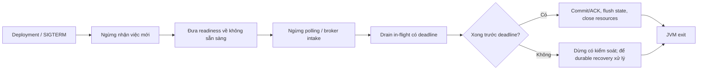
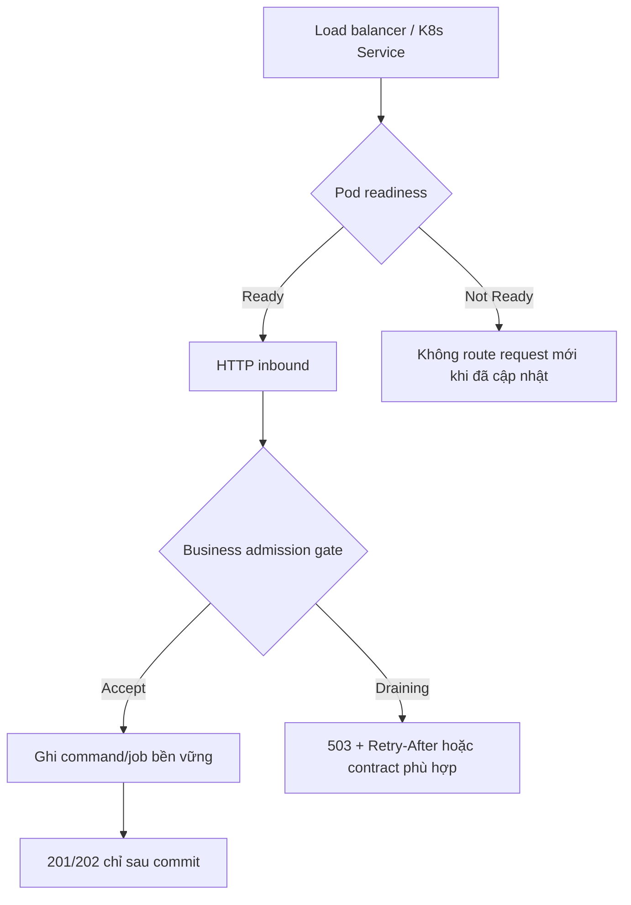
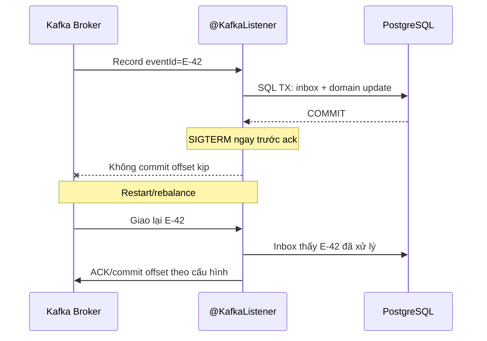
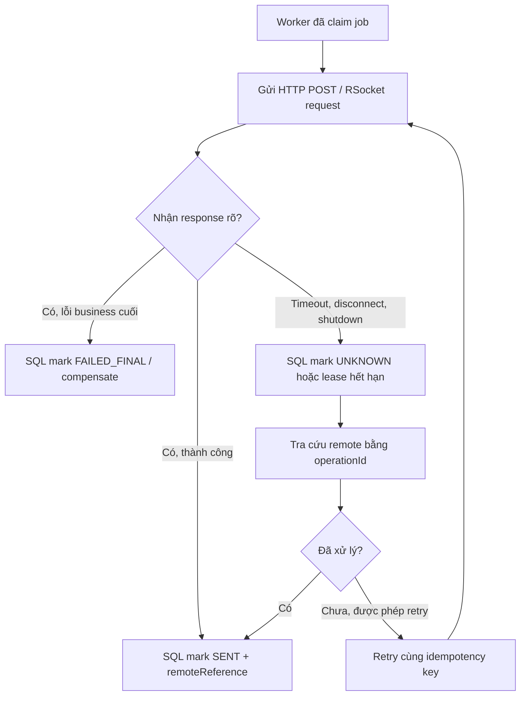
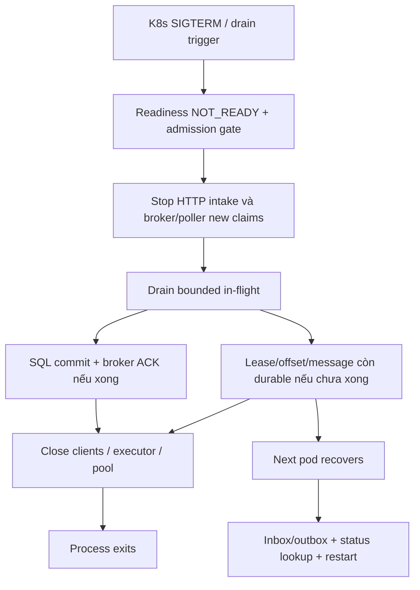

# Graceful shutdown với thông điệp hoặc công việc đang xử lý

> **Chương:** Vận hành tích hợp  
> **Phạm vi:** Trong module **SPRING_BOOT_INTEGRATION**, Spring Boot tích hợp hệ thống qua HTTP client, cơ sở dữ liệu, cache, broker thông điệp và adapter Spring Integration. Bài này giải thích **graceful shutdown** khi ứng dụng còn HTTP request, broker message, batch job, poller, message group hoặc tác vụ gửi ra đối tác đang xử lý; tập trung vào ranh giới giao dịch, xác nhận nhận/gửi, chống trùng, khả năng phục hồi, kiểm thử và quan sát trong triển khai thực tế.

## 1. Vì sao đóng tiến trình không chỉ là tắt server?

Một ứng dụng đang nhận message từ RabbitMQ, đọc outbox PostgreSQL và gọi API thanh toán. Khi Kubernetes thay pod vì rolling deployment, SIGTERM có thể đến đúng lúc:

1. API đang xử lý một request và chưa commit SQL.
2. Kafka listener đã ghi DB nhưng chưa commit offset.
3. RabbitMQ consumer đã nhận message nhưng chưa gửi ACK.
4. Outbox worker đã gửi HTTP POST thành công nhưng chưa đánh dấu `SENT` trong DB.
5. Spring Integration aggregator đã nhận hai trong ba phần nhưng chưa phát kết quả.
6. Spring Batch Job đã commit một số chunk nhưng chưa hoàn tất.

**Graceful shutdown** là nỗ lực có giới hạn thời gian để **ngừng nhận việc mới, cho các việc đang xử lý có cơ hội kết thúc, bảo toàn trạng thái và giải phóng tài nguyên đúng thứ tự**. Nó không chứng minh mọi công việc sẽ hoàn tất trước khi process bị dừng, càng không thay thế cơ chế phục hồi khi `SIGKILL`, mất điện hoặc node crash.



Thứ tự trong sơ đồ là **mô hình điều phối mong muốn**; thứ tự callback thực tế phụ thuộc web server, container, Spring lifecycle phase, broker listener và hạ tầng triển khai. Một số bước diễn ra gần như đồng thời.

### Mục tiêu học tập

Sau bài này, người học có thể:

- Giải thích `SIGTERM`, shutdown grace period, readiness và **drain**.
- Dùng `server.shutdown=graceful` và cấu hình timeout theo phase trong Spring Boot.
- Phân biệt HTTP request đang chạy, message đã lấy khỏi broker, job đã được lưu và side effect remote chưa rõ kết quả.
- Quy định ACK/offset **sau business commit** trong consumer có idempotency.
- Thiết kế dừng poller, scheduler, worker, Spring Batch và aggregator phù hợp.
- Dùng `SmartLifecycle`, `ContextClosedEvent` và executor shutdown đúng ý nghĩa.
- Tránh ACK sai, mất message, ghi trùng, giữ transaction dài và dừng vượt quá deadline.
- Kiểm thử graceful shutdown lẫn **forced termination**, không chỉ đóng Spring context.

## 2. Ba lớp đảm bảo: vận hành, lưu trữ và nghiệp vụ

Một shutdown đúng cần tách:

| Lớp | Câu hỏi | Cơ chế |
| --- | --- | --- |
| **Điều phối tiến trình** | Khi nào ngừng nhận request hoặc message mới? | Readiness, web server graceful stop, container listener stop, scheduler/poller stop |
| **Lưu trạng thái** | Việc đang làm có tồn tại sau khi process chết không? | Broker durable message/offset, SQL job/outbox/inbox, Spring Batch JobRepository, persistent MessageStore |
| **Kết quả nghiệp vụ** | Side effect đã commit chưa, có làm lại an toàn không? | Business transaction, unique constraint, idempotency key, status lookup, reconciliation |

Ví dụ:

```text
Broker delivery nhận lúc 10:00:00
SQL business commit lúc 10:00:04
SIGTERM đến lúc 10:00:05
Broker ACK dự kiến lúc 10:00:06 nhưng process bị kill

Sau restart: broker có thể giao lại message.
Thiết kế đúng: inbox/business key phát hiện đã commit, trả ACK lại.
Thiết kế sai: chỉ dựa vào việc đã có SIGTERM rồi coi message là xong.
```

**Graceful shutdown giảm xác suất gặp cửa sổ lỗi; idempotency và durable recovery xử lý hậu quả khi cửa sổ lỗi vẫn xảy ra.**

## 3. Điều gì xảy ra khi Spring Boot nhận tín hiệu dừng?

Trên môi trường container thông thường, orchestrator yêu cầu container dừng; Java process nhận tín hiệu kết thúc thông thường (nếu entrypoint chuyển tín hiệu đúng). Spring application context đóng, Spring quản lý vòng đời bean và có thể đợi những thành phần hỗ trợ graceful stop.

| Sự kiện | Điều thường xảy ra | Giới hạn |
| --- | --- | --- |
| `SIGTERM` tới JVM | Bắt đầu quy trình shutdown bình thường | Không được đảm bảo với crash, OOM, `SIGKILL` |
| `ContextClosedEvent` | Context thông báo đang đóng | Không tự đợi mọi business task hoàn thành |
| `SmartLifecycle.stop(Runnable)` | Cho phép component báo hoàn tất dừng qua callback | Phải gọi callback đúng khi đã stop; sai phase/order dễ gây race |
| Web server graceful shutdown | Giảm hoặc từ chối nhận HTTP requests mới và xử lý requests đang chạy theo server | Behavior khác nhau giữa Tomcat, Jetty, Reactor Netty, Undertow |
| Listener container stop | Ngừng lấy/nhận thêm message theo semantics container | Message đang chạy, prefetch, poll batch và ACK có chính sách riêng |
| Task executor/scheduler shutdown | Ngừng nhận task mới, có thể đợi task đang chạy nếu cấu hình | Tự tạo executor không tự hưởng mọi property của Boot |
| `@PreDestroy`/bean destroy | Giải phóng resource cuối vòng đời | Không phù hợp để mở một workflow dài không có deadline |
| Grace deadline hết | Container/runtime có thể cưỡng bức dừng | Hook/transaction chưa chạy xong có thể bị ngắt |

**Không dựa vào thứ tự callback mơ hồ.** Đọc lifecycle behavior của những bean thực sự tham gia (web server, Kafka container, Rabbit listener, JMS container, Integration endpoint, Batch launcher, scheduler), và điều phối bằng **ownership + phase + stop contract** khi cần.

### 3.1. Một nguyên tắc giữ được qua các framework

```text
ADMIT (nhận một công việc mới)      → phải có chính sách ngừng
CLAIM (lấy một công việc đã lưu)    → phải có timeout/lease
EXECUTE (xử lý nghiệp vụ)           → phải có transaction và deadline
ACK (xác nhận ở nguồn)              → chỉ khi đã đạt mức bền vững đã cam kết
RECOVER (chạy lại khi mất điện)     → phải idempotent
```

Ví dụ trả HTTP `202 Accepted` mà job chỉ nằm trong một `LinkedBlockingQueue` trong JVM là **cam kết sai** nếu client sẽ không gửi lại. Nếu muốn trả 202 bền vững, ghi job/outbox vào SQL hoặc queue/broker có guarantee phù hợp **trước khi trả HTTP success**.

## 4. Spring Boot graceful shutdown cho HTTP

### 4.1. Cấu hình cơ bản

Ví dụ dành cho Spring Boot 3.x:

```yaml
server:
  port: 8080
  shutdown: graceful

spring:
  lifecycle:
    timeout-per-shutdown-phase: 25s
```

`server.shutdown=graceful` yêu cầu web server thực hiện graceful stop theo khả năng của implementation. `spring.lifecycle.timeout-per-shutdown-phase` là **giới hạn thời gian Spring đợi mỗi shutdown phase**, không phải một deadline toàn ứng dụng và **không phải timeout riêng của HTTP client outbound**.

Khi context đóng, Spring Boot có cơ chế cập nhật availability/readiness và graceful shutdown cho web server được hỗ trợ. Tuy nhiên:

- Request đang xử lý không được bảo đảm hoàn tất nếu kéo dài quá ngân sách dừng.
- Kết nối mới có thể bị từ chối/reset hoặc xử lý khác nhau theo web server.
- Long-lived HTTP streaming, SSE, WebSocket hoặc RSocket không nhất thiết kết thúc theo semantics của một request MVC ngắn.
- Reverse proxy/load balancer có **endpoint propagation delay**: vẫn có request mới gửi về pod một thời gian sau readiness thay đổi.

**Không chỉ chỉnh YAML là đủ** khi ứng dụng còn scheduler, broker consumer hoặc unmanaged threads. Web graceful stop không tự dừng mọi nguồn công việc khác.

### 4.2. Server readiness và business admission

Readiness xác định pod có nên nhận **traffic mới** hay không. Admission gate trong code xác định một **đơn vị nghiệp vụ mới có được nhận** khi hệ thống đang drain hay không. Hai lớp này bổ sung nhau:



Admission gate hữu ích trong **khoảng trễ** từ lúc pod bắt đầu drain đến lúc proxy ngừng gửi request, và khi request vào qua các đường không tuân theo K8s readiness. Nó không thay authentication, rate limit hay durability.

## 5. Dùng trạng thái drain để từ chối việc mới

Một gate đơn giản cho **request đồng bộ** có thể dùng cùng lock để ngăn race giữa thao tác nhận việc và đổi trạng thái drain.

### 5.1. Cơ chế ghi nhận số công việc đang được tiếp nhận

```java
package com.example.integration.operations;

import org.springframework.context.event.ContextClosedEvent;
import org.springframework.context.event.EventListener;
import org.springframework.stereotype.Component;

@Component
public final class WorkAdmissionGate {
    private boolean accepting = true;
    private int active = 0;

    public synchronized boolean tryEnter() {
        if (!accepting) {
            return false;
        }
        active++;
        return true;
    }

    public synchronized void leave() {
        if (active <= 0) {
            throw new IllegalStateException("Unbalanced work counter");
        }
        active--;
    }

    public synchronized int activeCount() {
        return active;
    }

    public synchronized boolean isAccepting() {
        return accepting;
    }

    @EventListener(ContextClosedEvent.class)
    public synchronized void stopAccepting() {
        accepting = false;
    }
}
```

Đây là **admission/counter** dành cho các công việc đi qua gate; nó không tự can thiệp vào web server, message listener hoặc scheduler và không tự chờ `activeCount()==0`. Một HTTP request khác đã được web server accept có thể đi vào controller sau khi gate đóng và phải nhận kết quả từ chối theo hợp đồng.

Để đánh dấu readiness trước lúc context đóng (ví dụ qua một drain endpoint nội bộ được bảo vệ), có thể phối hợp với Spring Boot availability events. Không được công khai endpoint drain cho caller bên ngoài hoặc cho người không có quyền vận hành.

### 5.2. HTTP boundary chỉ trả 202 sau lưu bền vững

```java
package com.example.integration.operations;

import org.springframework.http.HttpHeaders;
import org.springframework.http.HttpStatus;
import org.springframework.http.ResponseEntity;
import org.springframework.web.bind.annotation.PostMapping;
import org.springframework.web.bind.annotation.RequestBody;
import org.springframework.web.bind.annotation.RestController;

record CreateExportCommand(String operationId, String batchDate) {}
record AcceptedExport(String operationId, String state) {}

@RestController
class ExportRequestController {
    private final WorkAdmissionGate gate;
    private final ExportSubmissionService submissions;

    ExportRequestController(
            WorkAdmissionGate gate,
            ExportSubmissionService submissions) {
        this.gate = gate;
        this.submissions = submissions;
    }

    @PostMapping("/integration/exports")
    ResponseEntity<?> accept(@RequestBody CreateExportCommand command) {
        if (!gate.tryEnter()) {
            return ResponseEntity.status(HttpStatus.SERVICE_UNAVAILABLE)
                    .header(HttpHeaders.RETRY_AFTER, "10")
                    .body("instance is draining");
        }
        try {
            submissions.persistAccepted(command);
            return ResponseEntity.accepted()
                    .body(new AcceptedExport(
                            command.operationId(), "PENDING"));
        } finally {
            gate.leave();
        }
    }
}
```

`ExportSubmissionService.persistAccepted(...)` là service khác, cần được triển khai với **validation/authorization, business idempotency key và transaction SQL/broker phù hợp**. Nếu ghi thất bại, controller phải ánh xạ exception thành response lỗi, **không trả 202**. Với request nhiều tenant, không dùng `operationId` do caller nhập mà bỏ qua scope/fingerprint.

**Ý nghĩa bộ đếm:** ở ví dụ này `activeCount` đếm những **lần tiếp nhận đang chạy**, không đếm toàn bộ job nền đã được ghi và trả 202. Những job nền cần **một tracker và một stop/recovery policy riêng**.

### 5.3. WebFlux và async Servlet cần cách đo khác

`try/finally` bao quanh một method trả `Mono<?>` hoặc một `Callable/DeferredResult` có thể kết thúc **trước khi request thực sự hoàn tất**. Với reactive pipeline, theo dõi active work bằng operator gắn với **subscription termination/cancellation** (ví dụ `doFinally`) hoặc WebFilter phù hợp, nhưng không đếm mỗi lần tạo publisher như một request đã xử lý.

Đừng copy bộ đếm của ví dụ MVC đồng bộ sang WebFlux rồi kết luận đã drain hết khi pipeline vẫn đang chạy.

## 6. Thứ tự dừng: stop admission → stop intake → drain → close

Một quy trình an toàn theo mục tiêu:

| Giai đoạn | Hành động | Vì sao |
| --- | --- | --- |
| 1. Quiesce | Đổi readiness/admission sang draining | Hạn chế công việc mới |
| 2. Stop intake | Dừng poller, listener, scheduler, upstream fetch | Không tăng backlog in-flight trong tiến trình sắp dừng |
| 3. Drain | Cho công việc hiện tại kết thúc trong deadline | Giảm rollback/requeue |
| 4. Persist/ack | Commit SQL, ghi trạng thái và ACK theo contract | Không xác nhận trước durability |
| 5. Close | Giải phóng HTTP client, broker connection, DataSource, executor, file stream | Tránh resource leak |
| 6. Exit | JVM kết thúc, hoặc bị runtime kill khi hết hạn | Recovery phải xử lý phần chưa xong |

Với `SmartLifecycle`, các bean có **phase cao thường start muộn và stop sớm** hơn bean phase thấp. Điều này giúp phối hợp **dừng producer/intake trước consumer/resource**. Tuy nhiên, phase của các thành phần do framework tự tạo có thể khác giữa version; đừng chỉ đoán một con số cực đại là “chắc chắn dừng đầu tiên”.

### 6.1. Tại sao @PreDestroy không thay SmartLifecycle?

`@PreDestroy` phù hợp đóng resource do bean sở hữu, nhưng nếu bên trong nó bắt đầu chờ 90 giây cho worker thì:

- Nó có thể được gọi **sau** một số phase stop khiến dependency đã bị đóng.
- Dễ block thread đóng context mà không có deadline rõ.
- Không có callback báo hoàn tất asynchronous stop như `SmartLifecycle.stop(Runnable)`.

Khi cần điều phối dừng các worker lâu, sử dụng lifecycle component có owner/phase và **callback được gọi đúng khi dừng xong**. Chỉ dùng destructor để đóng tài nguyên còn thuộc ownership của bean.

## 7. Ví dụ SmartLifecycle điều phối một worker

Ví dụ dưới đây minh họa **stop request và callback**, không phải một hệ thống worker đầy đủ:

```java
package com.example.integration.operations;

import java.util.concurrent.atomic.AtomicBoolean;

import org.springframework.context.SmartLifecycle;
import org.springframework.stereotype.Component;

@Component
public final class OutboxIntakeLifecycle implements SmartLifecycle {
    private final AtomicBoolean running = new AtomicBoolean(false);

    @Override
    public void start() {
        running.set(true);
    }

    @Override
    public void stop() {
        running.set(false);
    }

    @Override
    public void stop(Runnable callback) {
        // Báo đã NGỪNG nhận batch mới; xử lý in-flight do
        // executor/worker owner riêng đảm nhận.
        running.set(false);
        callback.run();
    }

    @Override
    public boolean isRunning() {
        return running.get();
    }

    @Override
    public int getPhase() {
        return 100;
    }

    public boolean canClaimNextJob() {
        return running.get();
    }
}
```

**Giới hạn chủ ý:** bean này chỉ **đóng cổng claim công việc mới**, không chờ job đang chạy. Vì vậy callback gọi ngay là đúng với phạm vi trách nhiệm hẹp ấy. Nếu owner đồng thời phải drain executor, callback phải được gọi **sau khi drain thực sự hoàn tất** hoặc sau khi áp dụng chính sách timeout/abort; không gọi callback ngay rồi báo “đã drain”.

Đừng chọn `getPhase()=100` như một giá trị kỳ diệu áp dụng cho mọi dự án. Cần kiểm tra phase của scheduler, listener container, DataSource và resource phụ thuộc. Nếu owner có nhiều dependency, chọn lifecycle để **worker ngừng trước khi DataSource/broker connection bị đóng**.

### 7.1. Async stop và callback

Một component có tác vụ chờ dài có thể thực hiện stop bất đồng bộ:

```java
@Override
public void stop(Runnable callback) {
    accepting.set(false);
    executor.execute(() -> {
        try {
            drainOrAbortWithinDeadline();
        } finally {
            callback.run();
        }
    });
}
```

Đây là **pseudocode thiết kế**, có `accepting`, `executor` và `drainOrAbortWithinDeadline()` cần triển khai. Phải bảo đảm executor **còn sống lúc callback được schedule**; nếu chính executor đã shutdown hoặc reject task, callback có thể không chạy và lifecycle phase bị kéo đến timeout. Trong implementation thực, xử lý rejection/fallback để luôn hoàn thành stop callback theo contract, đồng thời không báo done khi còn tài nguyên chưa được giải phóng.

## 8. Scheduler và Spring Integration poller

### 8.1. Cấu hình executor/scheduler tự động

Spring Boot 3.x có properties điều khiển shutdown cho các executor/scheduler **do Boot tự cấu hình**:

```yaml
spring:
  task:
    execution:
      shutdown:
        await-termination: true
        await-termination-period: 20s
    scheduling:
      shutdown:
        await-termination: true
        await-termination-period: 20s
```

Điều này có thể cho phép những task đang chạy kết thúc khi executor/scheduler shutdown, nhưng không có nghĩa **ngừng nhận task và drain** đã được điều phối đúng business deadline trong mọi trường hợp.

Nếu ứng dụng khai báo `ThreadPoolTaskExecutor`, `TaskScheduler` hoặc `ScheduledExecutorService` riêng, phải cấu hình shutdown/await-termination của **chính bean ấy**. Một thread tự tạo bằng `new Thread(...)` không tự trở thành task do Spring quản lý.

### 8.2. Poller có thể tiếp tục lấy message khi ứng dụng đang drain

Trong Spring Integration:

```java
@Bean
IntegrationFlow pendingOutboxFlow(
        OutboxHandler handler) {
    return IntegrationFlow.from(
            "outboxQueue",
            endpoint -> endpoint.poller(
                    Pollers.fixedDelay(500)
                            .maxMessagesPerPoll(10)))
            .handle(handler, "handle")
            .get();
}
```

Đây là snippet minh họa một `PollableChannel` có tên `outboxQueue` đã được định nghĩa, và một handler do ứng dụng triển khai. Khi shutdown, cần biết endpoint/poller này có được quản lý qua Spring lifecycle và stop đúng phase không. `maxMessagesPerPoll(10)` giới hạn số message mỗi poll cycle, **không phải giới hạn tổng in-flight** nếu còn concurrency/executor khác.

**Nguyên tắc:** đừng tiếp tục lấy message mới khi thời gian còn lại không đủ xử lý một message bình thường. Nếu có durable queue, để message chưa claim lại cho instance khác thay vì đẩy vào một executor local đang chuẩn bị dừng.

### 8.3. QueueChannel RAM vs persistent channel

| Nguồn | Shutdown hợp lý |
| --- | --- |
| `QueueChannel` in-memory | Có thể mất pending messages khi process dừng/crash; chỉ dùng cho việc mất được hoặc có upstream replay |
| JDBC-backed `QueueChannel` qua `JdbcChannelMessageStore` | Stop poller; pending row đã commit còn để instance sau lấy |
| Broker queue/topic | Stop consumer; broker lưu/rewind theo ack/offset và retention được cấu hình |
| SQL outbox table | Stop claim; jobs còn `PENDING/RETRY_WAIT` được worker khác xử lý |

**Không gọi `queue.clear()` để “shutdown sạch”** nếu queue chứa nghĩa vụ nghiệp vụ. Xóa state trong memory hay store có thể làm mất việc; chỉ cleanup sau khi có trạng thái/bằng chứng xử lý đúng.

## 9. Kafka consumer: offset phải đi sau business commit

Kafka giữ dữ liệu trong log theo retention, consumer group lưu offset tiến độ. Khi dừng consumer, những records đã poll nhưng chưa được xử lý cần được quyết định theo **ack mode, offset commit và error handler**.



### 9.1. Ví dụ manual acknowledgment

```yaml
spring:
  kafka:
    consumer:
      enable-auto-commit: false
      group-id: inventory-projection
    listener:
      ack-mode: manual_immediate
```

```java
package com.example.integration.operations;

import org.apache.kafka.clients.consumer.ConsumerRecord;
import org.springframework.kafka.annotation.KafkaListener;
import org.springframework.kafka.support.Acknowledgment;
import org.springframework.stereotype.Component;

@Component
public class OrderEventListener {
    private final OrderEventService service;

    public OrderEventListener(OrderEventService service) {
        this.service = service;
    }

    @KafkaListener(
        topics = "orders.confirmed.v1",
        groupId = "inventory-projection")
    public void onRecord(
            ConsumerRecord<String, String> record,
            Acknowledgment acknowledgment) {
        service.processOnce(record.value()); // transaction phải commit khi method return
        acknowledgment.acknowledge();
    }
}
```

`OrderEventService.processOnce(...)` là service được ứng dụng cài đặt với schema validation, business event ID và **SQL transaction inbox + side effect**. Listener phải được gọi sau khi transaction service đã commit, rồi mới ACK. Nếu service ném exception thì chưa ACK; error handler/retry/DLT của Spring Kafka quyết định tiếp theo. **Đừng mặc định cùng lúc dùng auto-commit rồi ACK bằng tay mà vẫn đạt semantics mong muốn.**

**Hạn chế cần nhớ:**

- `acknowledgment.acknowledge()` là yêu cầu commit theo container policy; độ bền/đồng bộ commit phụ thuộc cấu hình.
- Container có thể xử lý nhiều record từ một poll hoặc có các container threads đồng thời; shutdown không chắc cắt chính xác ngay sau record hiện tại.
- Rebalance và mất ACK vẫn tạo khả năng redelivery.
- Kafka transaction/“exactly once” trong phạm vi Kafka không tự mở rộng sang PostgreSQL, HTTP POST hoặc SFTP.

### 9.2. Stop/pause container khác consumer hoàn tất nghiệp vụ

Spring Kafka listener container có lifecycle và có thể được điều khiển qua `KafkaListenerEndpointRegistry`. **Pause** giữ consumer sống nhưng tạm ngừng fetch/delivery theo cơ chế container; **stop** chấm dứt vòng xử lý theo semantics và deadline đã cấu hình. Khi rolling deploy, ưu tiên phối hợp shutdown với Spring và để consumer group rebalance đúng cách.

Không tự gọi `System.exit(0)` trong listener khi gặp SIGTERM và cũng không tự commit offset cho toàn bộ polled batch nếu mới xử lý một nửa. Các tham số như immediate stop/current record vs remaining records cần được kiểm tra ở **Spring Kafka version thực tế** và bằng test có controlled slow handler.

## 10. RabbitMQ/AMQP: unacked delivery và prefetch

Với RabbitMQ, consumer nhận delivery và xác nhận bằng ACK (tùy acknowledge mode). Nếu connection/channel bị đóng trước ACK, **unacked messages có thể được broker requeue/redeliver** khi queue durable/persistence/consumer setup phù hợp. Tuy nhiên, producer publish guarantee và queue persistence là vấn đề riêng với consumer ACK.

### 10.1. Consumer logic

```text
RabbitMQ delivery
  -> validate envelope/schema
  -> SQL transaction: insert inbox unique + business write
  -> COMMIT
  -> ACK broker

Khi lỗi trước SQL commit:
  -> chưa ACK; retry/requeue/DLQ theo policy

Khi SQL commit rồi app chết trước ACK:
  -> broker redeliver; inbox no-op/đối chiếu; ACK lại
```

Ví dụ cấu hình manual ACK:

```yaml
spring:
  rabbitmq:
    listener:
      simple:
        acknowledge-mode: manual
        prefetch: 20
        concurrency: 2
        max-concurrency: 4
```

`prefetch=20` chỉ mô tả số delivery broker cho phép client giữ chưa ACK theo phạm vi QoS; thực tế có thể có nhiều container/consumer. **Số message đang in-flight của một pod có thể lớn hơn một** và không thể giả định một grace period ngắn sẽ đủ xử lý hết mọi delivery.

Khi dùng manual ACK:

- ACK **sau** khi side effect bền vững, dùng đúng delivery tag/channel.
- Nếu xử lý thất bại vĩnh viễn, dùng reject/nack/DLQ strategy, không requeue vô hạn.
- Phân biệt **consumer ACK** với **publisher confirm**: một bên xác nhận tiêu thụ, một bên xác nhận publish.
- Khi shutdown, listener container và channel có thể bị đóng sau timeout; handler phải chấp nhận redelivery.

**Rabbit listener stop chưa chắc đã drain cả queue**. Mục tiêu là dừng nhận thêm và xử lý các delivery được cấp trong deadline; backlog còn trong broker phải do instance sau đảm nhận.

### 10.2. Vì sao auto-ack nguy hiểm cho nghiệp vụ quan trọng?

Nếu một đường xử lý xác nhận delivery trước khi SQL commit, process crash có thể làm mất message đối với consumer group mà không có retry. Chọn acknowledge mode theo semantics framework/broker và test đúng đường lỗi; manual mode cũng **không tự an toàn** nếu code ACK quá sớm.

## 11. JMS: session transaction và redelivery

Với JMS/Artemis/ActiveMQ:

- `@JmsListener` thường chạy trong listener container do Spring quản lý, có lifecycle stop.
- Một transacted JMS session có thể phối hợp receive/ack theo JMS session transaction; rollback có thể dẫn đến redelivery.
- **JMS local transaction không tự là một transaction SQL** với PostgreSQL business DB.
- XA/JTA có thể tồn tại trong một số kiến trúc, nhưng cần đánh giá hạ tầng, chi phí và recovery; không giả định Spring Boot tự bật distributed transaction.

Với luồng JMS → SQL:

```text
Receive JMS message
  → SQL TX: unique inbox + business effect
  → SQL COMMIT
  → JMS ACK/SESSION COMMIT
```

Nếu application chết giữa hai commit, message có thể quay lại. Vì thế **inbox idempotency** vẫn là tuyến phòng thủ quan trọng.

**Không dùng một log “JMS listener returned” làm bằng chứng broker đã commit session** nếu transaction/error handler còn đang diễn ra.

## 12. HTTP outbound, RSocket và trạng thái remote chưa rõ

Một in-flight HTTP POST hoặc RSocket request–response có thể gây side effect ở **hệ thống ngoài**. Khi shutdown đến, có ba kết quả:

1. Remote trả xác nhận rõ ràng trước deadline.
2. Chưa gửi request, có thể đặt lại trạng thái công việc để retry sau.
3. Request đã có thể đến remote nhưng response mất hoặc deadline hết: **outcome UNKNOWN**.



**Không kết luận “remote chưa làm gì” chỉ vì client có `CancellationException` hoặc timeout**. Cancel subscription/hủy HTTP client connection không rollback payment, order hoặc message đã được partner ghi.

### 12.1. RSocket stream dài

RSocket request-stream hoặc request-channel có thể giữ connection và nhiều logical streams lâu dài. Khi ứng dụng dừng:

- Ngừng tạo stream mới, phát tín hiệu kết thúc/cancel theo protocol khi phù hợp.
- Lưu checkpoint/sequence riêng nếu business cần resume.
- Dispose requester **do owner quản lý** khi các stream đã drain hoặc deadline hết.
- Không dispose requester chung trong `doFinally` của từng request, vì sẽ phá stream của các caller khác.

RSocket **resumption** là tính năng protocol tùy cấu hình và buffer, không mặc định được bật; nó không thay durable outbox hoặc broker log.

### 12.2. HTTP client timeout cần nhỏ hơn deadline còn lại

Ví dụ tổng shutdown budget còn 15 giây nhưng outbound read timeout là 60 giây: worker có thể bị kill trước khi client kết thúc. Với tác vụ mới trước shutdown, đặt **end-to-end deadline** và connect/response timeout theo SLA; khi đang drain, không bắt đầu side effect mới nếu không còn thời gian xử lý/reconcile hợp lý.

**Không giữ SQL transaction mở trong lúc chờ HTTP/RSocket** để “bảo đảm đóng sạch”. SQL rollback không đảo ngược remote side effect, còn transaction dài chiếm connection và lock.

## 13. SQL outbox: mô hình thuận lợi cho graceful và crash recovery

Một **transactional outbox** cho phép công việc gửi ra ngoài tồn tại trong DB trước khi worker bắt đầu.

### 13.1. Bảng job/outbox có trạng thái rõ

```sql
CREATE TABLE integration_outbox (
    job_id UUID PRIMARY KEY,
    tenant_id VARCHAR(80) NOT NULL,
    operation_type VARCHAR(80) NOT NULL,
    payload_json JSONB NOT NULL,
    payload_sha256 VARCHAR(64) NOT NULL,
    status VARCHAR(24) NOT NULL,
    attempt_count INT NOT NULL DEFAULT 0,
    next_attempt_at TIMESTAMPTZ,
    lease_token UUID,
    lease_until TIMESTAMPTZ,
    remote_reference VARCHAR(180),
    updated_at TIMESTAMPTZ NOT NULL DEFAULT CURRENT_TIMESTAMP
);

CREATE INDEX idx_outbox_ready
    ON integration_outbox(status, next_attempt_at);
```

Ví dụ các trạng thái:

| Status | Ý nghĩa |
| --- | --- |
| `PENDING` | Công việc đã được ghi bền vững, chưa claim |
| `IN_FLIGHT` | Worker có lease và đang xử lý |
| `RETRY_WAIT` | Lỗi transient, chờ lịch retry |
| `SENT` | Có bằng chứng gửi/được remote xác nhận theo hợp đồng |
| `UNKNOWN` | Remote có thể đã xử lý, cần reconciliation |
| `FAILED_FINAL` | Lỗi nghiệp vụ cuối hoặc quá chính sách retry, cần thao tác rõ |

### 13.2. Claim theo lease, đừng giữ row lock qua HTTP

Một flow an toàn thường:

1. Transaction ngắn **claim** một số job, gắn `lease_token` và `lease_until`.
2. **Commit** claim, thả SQL row lock.
3. Gọi HTTP/broker ngoài transaction.
4. Transaction ngắn ghi kết quả, kiểm tra `lease_token` hiện tại và trạng thái/attempt.
5. Khi shutdown, ngừng claim job mới và cho các job đang gửi kết thúc trong deadline.
6. Job có lease hết hạn được **reconciliation** rồi claim lại theo policy, không tự POST lần nữa khi outcome còn UNKNOWN.

**Lease token không tự ngăn remote side effect từ một worker cũ**: worker có thể tiếp tục chạy sau khi lease hết hạn do pause hoặc network. Để tránh ghi state sai, cần compare-and-set bằng token/generation trên update SQL; với remote writes cần idempotency/fencing hoặc status lookup phù hợp.

### 13.3. Tại sao “đợi queue rỗng” có thể sai?

Một service đang drain không cần tự xử lý hết **hàng triệu** outbox jobs. Mục tiêu là:

- Không nhận thêm công việc mới **vào instance đang dừng**.
- Cho những công việc đã claim có cơ hội commit/ghi trạng thái.
- Không biến pending jobs thành mất dữ liệu.
- Để worker khác hoặc instance sau tiếp tục xử lý backlog.

**Độ bền và khả năng phân phối** quan trọng hơn việc ép queue về 0 trước khi cho JVM exit.

## 14. MessageStore và aggregator khi shutdown

Spring Integration có stateful components như `QueueChannel` và aggregator/resequencer:

| Trạng thái | Khi shutdown | Điều cần bảo đảm |
| --- | --- | --- |
| `QueueChannel` in-memory | Chưa lấy message thì state có thể mất | Upstream replay hoặc không dùng cho durable jobs |
| JDBC-backed `QueueChannel` | Dừng poller, message đã commit còn trong store | Transaction khi send/dequeue, restart và idempotency |
| Aggregator trong memory | Group đang tích lũy có thể mất | Chỉ dùng khi chấp nhận hoặc có thể rebuild từ nguồn |
| Persistent `MessageGroupStore` | Group có thể được đọc lại sau restart | Serializer/schema, correlation key, release/expiry |
| `MessageGroupStoreReaper` | Cleanup chạy trong lúc dừng có thể cạnh tranh với add/release | Chính sách expiry/ownership, không purge bừa |

Một aggregator đã nhận part 1 và 2/3 có thể **không cần hoàn tất trước shutdown** nếu state group được lưu bền vững và flow sau restart có cách tiếp tục khi part 3 đến. Nhưng nếu group chỉ nằm trong RAM, `graceful stop` của web server không bảo toàn state đó.

### 14.1. Release rồi nhưng output chưa durable

```text
Group đủ 3 phần
  → Aggregator release output
  → Output đi qua DirectChannel/ExecutorChannel in-memory
  → JVM bị kill trước khi downstream commit
```

Persistent group store giúp **trữ phần trước release**, nhưng **không tự tạo bảo đảm durable cho output** sau release. Nếu kết quả quan trọng, dùng transaction phù hợp và **business result + outbox** hoặc một channel/queue bền vững tiếp theo.

**Không tắt group cleanup và tuyên bố xong**: cần test mốc crash giữa release, output delivery và business commit.

## 15. Spring Batch: hoàn thành chunk hay để Job restart?

Spring Batch có `JobRepository` và `ExecutionContext` để ghi tiến độ. Khi shutdown, một Job đang chạy có thể:

- Hoàn tất Step/Job trong grace period.
- Dừng có kiểm soát qua cơ chế JobOperator/JobExecution stop khi được hỗ trợ.
- Bị cắt giữa Step/chunk do runtime kill.

**Không giả định Job đang chạy dở sau `SIGKILL` sẽ tự động mang status `FAILED` rồi restart được ngay.** Metadata có thể vẫn báo `STARTED` hoặc trạng thái cần can thiệp vì process chết mà không kịp cập nhật. Cần quy trình operator/automated recovery được kiểm thử và không ghi đè metadata tùy tiện.

### 15.1. Chunk Step

```text
Chunk 1 (items 1-200)   -> SQL COMMIT + checkpoint
Chunk 2 (201-400)       -> SQL COMMIT + checkpoint
Chunk 3 (401-600)       -> SIGTERM / possible force kill
Restart                 -> resume theo JobRepository/reader state
```

Nếu writer ghi vào **cùng SQL resource** và checkpoint theo contract, rollback/restart có thể tránh mất state. Nếu writer gửi HTTP hoặc ghi file remote, một chunk retry có thể lặp side effect vì remote không tham gia JDBC transaction.

### 15.2. Tasklet Step

Một Tasklet lặp bằng `RepeatStatus.CONTINUABLE` có thể commit từng invocation nếu Step được cấu hình transaction phù hợp. Khi shutdown, Tasklet phải có **điểm dừng hữu hạn**. Không chờ trong một vòng `while(true)` với transaction mở cho đến khi hết Job.

### 15.3. JobParameters và replay

Cùng `Job name + identifying JobParameters` là cùng JobInstance. Thay `runId` ngẫu nhiên để bỏ qua một JobInstance bị kẹt có thể tạo **instance mới**, không phải restart, làm xuất lại file hoặc ghi lại thanh toán.

Với batch import/export, business ID như `batchDate`, `tenantId`, `batchVersion` và manifest checksum cần ổn định qua retry; trạng thái đối tác đã nhận file nên được lưu trong business ledger riêng, không suy ra chỉ từ `BatchStatus.COMPLETED`.

## 16. Readiness, liveness và Kubernetes termination

### 16.1. Phân biệt ba tín hiệu

| Tín hiệu | Mục đích | Trong shutdown |
| --- | --- | --- |
| **Readiness** | Pod có nên nhận request mới? | Chuyển sang không sẵn sàng sớm, trước khi destroy resource |
| **Liveness** | Process có đang hoạt động đúng để nên restart nếu lỗi? | Không dùng downstream outage ngắn làm lý do kill liên tục |
| **Startup** | Cho ứng dụng thời gian khởi động và warmup | Không thay drain khi shutdown |

Spring Boot Actuator có `/actuator/health/readiness` và `/actuator/health/liveness` khi probes được bật và exposure phù hợp. Đặt đúng port/path cho container, đồng thời nhớ **readiness của HTTP không tự kiểm soát traffic broker**: Kafka/RabbitMQ consumers vẫn hoạt động nếu listener chưa stop.

### 16.2. Deployment snippet

```yaml
apiVersion: apps/v1
kind: Deployment
metadata:
  name: orders-integration
spec:
  replicas: 3
  selector:
    matchLabels:
      app: orders-integration
  template:
    metadata:
      labels:
        app: orders-integration
    spec:
      terminationGracePeriodSeconds: 90
      containers:
        - name: app
          image: example/orders-integration:1.0.0
          ports:
            - containerPort: 8080
          readinessProbe:
            httpGet:
              path: /actuator/health/readiness
              port: 8080
            periodSeconds: 5
            failureThreshold: 1
          livenessProbe:
            httpGet:
              path: /actuator/health/liveness
              port: 8080
            periodSeconds: 10
            failureThreshold: 3
```

Đây là snippet minh họa, **chưa** bao gồm resources, ServiceAccount, secrets, NetworkPolicy hoặc rollout strategy của production. Đường dẫn health phải có hiệu lực trong Spring Boot app:

```yaml
management:
  endpoint:
    health:
      probes:
        enabled: true
```

**`terminationGracePeriodSeconds=90` là ngân sách tổng của Kubernetes từ khi bắt đầu tiến trình termination**, bao gồm preStop hook nếu có, SIGTERM, JVM shutdown và cleanup. Nó **không** tự bảo đảm ứng dụng sẽ được xử lý đủ 90 giây; runtime/container hoặc hạ tầng có thể bị lỗi/cắt trước.

### 16.3. preStop không phải bảo đảm cho graceful shutdown

Một số hệ thống đặt preStop hook `sleep 5` để chờ load balancer ngừng route request. Điều này có thể giảm race trong một số môi trường, nhưng:

- Hook chạy trong **cùng ngân sách termination grace period**; ngủ quá lâu làm giảm thời gian cho JVM thực sự drain.
- preStop không thay việc đóng admission gate hoặc stop broker consumers.
- Request vẫn có thể đến từ proxy khác, long-lived connection hoặc direct call.
- Khi node crash/`SIGKILL`, preStop và shutdown hook có thể không chạy.

Nếu dùng drain endpoint ở preStop, bảo vệ chặt quyền truy cập và idempotency. **Không tạo một lệnh publish/xóa dữ liệu mới trong hook chỉ để “flush”.**

### 16.4. Rolling deployment và sức chứa còn lại

Khi một pod dừng, những pod còn lại phải nhận thêm HTTP requests/message partitions. Nếu tất cả pod cùng bị drain hoặc phụ thuộc vào một DB đã quá tải, graceful shutdown riêng từng pod không đủ.

Cần xét:

- `maxUnavailable`, `maxSurge`, replica count và PodDisruptionBudget.
- Kafka partition count/consumer group rebalancing.
- RabbitMQ prefetch, consumer concurrency, queue depth.
- DB connection pool tổng khi old/new pods cùng tồn tại.
- Outbox lease timeout và tốc độ reclaim job.
- Readiness chỉ bật khi bean/connection/contract cần thiết thực sự sẵn sàng.

## 17. Tính deadline: đừng cộng timeout tùy tiện

Ví dụ một pod có 90 giây tổng grace:

```text
Kubernetes terminationGracePeriodSeconds      90s
  ├── Hook/pre-stop + routing propagation        ~5s (nếu dùng)
  ├── Web/Broker/Integration shutdown phases    tùy phase
  ├── Worker finalization                        tùy work
  ├── Database/executor/socket close             cần margin
  └── JVM exit                                   trước forced kill
```

Không được coi `spring.lifecycle.timeout-per-shutdown-phase=25s` là “toàn Spring chỉ dừng trong 25 giây”. Nhiều phase có thể được đợi tuần tự, executor await-termination cũng có thời gian của nó, và các bean tự viết có thể chặn.

### 17.1. Cách đặt ngân sách đúng hơn

1. Đo p95/p99 latency của **một đơn vị công việc đã claim** và thời gian commit/ACK.
2. Đặt giới hạn số công việc in-flight trên một instance.
3. Dừng **nhận mới** trước khi drain các công việc đang chạy.
4. Timeout outbound HTTP, SQL và broker operations theo deadline còn lại.
5. Giữ margin cho close resources và JVM exit.
6. Kiểm thử cả thời gian khi dependency chậm, không chỉ ở trạng thái khỏe.

Nếu một batch chạy 30 phút và pod chỉ có 90 giây, **không thể** đảm bảo “đợi batch hoàn tất” chỉ bằng tăng bean timeout vài giây. Phải thiết kế checkpoint và restart, hoặc dùng một kiến trúc worker/job scheduling có lifecycle phù hợp.

### 17.2. Deadline của caller khác deadline shutdown

HTTP caller có thể bỏ cuộc sau 5 giây trong khi worker đã được giao xử lý 60 giây. Nếu công việc bền vững, caller nên nhận `202 Accepted` cùng operation ID và API tra cứu trạng thái; nếu API cần đồng bộ, phải xác định policy khi quá thời hạn. Shutdown không tự chuyển request đồng bộ thành durable asynchronous job.

## 18. Trùng lặp và exactly-once: bảng tình huống sau restart

| Crash window | Kết quả có thể xảy ra | Phòng vệ cần thiết |
| --- | --- | --- |
| Trước SQL commit lưu job | Job chưa tồn tại | Không trả 202/ACK thành công |
| Sau SQL commit job, trước HTTP 202 response | Caller timeout rồi retry | Unique operation ID + response replay |
| Sau broker delivery, trước business SQL commit | Message được redeliver | Retry transaction/idempotent handler |
| Sau SQL commit, trước Kafka offset commit | Record được đọc lại | Inbox unique key, kiểm tra fingerprint |
| Sau SQL commit, trước Rabbit ACK | Delivery có thể được requeue | Inbox + ACK sau khi xác nhận đã xử lý |
| Sau HTTP POST remote thành công, trước local DONE | Local thấy outcome chưa rõ | Idempotency key ổn định + status lookup/reconcile |
| Sau file công bố, trước Step COMPLETED | Restart có thể chạy publish lại | Manifest/checksum và tên file ổn định |
| Sau aggregator release, trước durable output | Output có thể mất | Persist business result + outbox |
| Trong shutdown khi lease expire | Hai worker có thể tin đang sở hữu job | Lease token/fencing + remote idempotency |

**At-least-once delivery** và **idempotent processing** là mô hình thường thực tế hơn lời hứa “xử lý đúng một lần ở mọi nơi”. Một transaction SQL không thể rollback đồng thời Kafka ACK, HTTP charge, Redis write và SFTP publish nếu không có giao thức phối hợp chuyên biệt.

### 18.1. Idempotency key khác trace ID

- `eventId`: nhận diện message/event cần dedup.
- `operationId`: nhận diện một business command với side effect.
- `batchId`: nhận diện batch import/export theo file/manifest.
- `traceId`: liên kết log/traces xuyên services, **không tự là khóa nghiệp vụ**.

Tất cả cần scope phù hợp với tenant, operation type và request fingerprint. Khi caller retry **cùng một operation**, phải giữ nguyên key; nếu cùng key nhưng payload khác, trả conflict chứ không im lặng lấy kết quả không tương thích.

## 19. Graceful shutdown không bảo đảm các tài nguyên tự được flush

### 19.1. Logging, tracing, metrics

Các exporter có thể có buffer; nếu app dừng quá nhanh, một số telemetry cuối cùng có thể chưa được gửi. Cấu hình exporter shutdown/flush phù hợp và giữ deadline, nhưng **không để telemetry block toàn bộ shutdown quá lâu**.

Không log raw payload có token/PII chỉ vì cần chứng minh drain. Correlation và business ID có thể được log trong hệ thống có phân quyền và retention phù hợp.

### 19.2. Cache và Redis

Caffeine local cache thường không cần “flush” thành business store; cache có thể bị mất sau restart theo thiết kế. Redis cache có TTL/eviction và không nên được coi là durable ledger chỉ vì server Redis độc lập với JVM.

**Không phát lệnh `FLUSHALL`/clear cache trong shutdown** nếu nhiều replica đang dùng chung Redis hoặc cache còn phục vụ traffic: thao tác đó có thể gây thundering herd và ảnh hưởng các instance khỏe.

### 19.3. HTTP client / connection pool

Một `RestClient`/`WebClient`/RSocketRequester có connection resource cần đóng theo bean ownership sau khi các worker đã ngừng dùng nó. Đóng HTTP client/pool quá sớm có thể biến các request đang drain thành lỗi. Ngược lại, không đóng một custom resource/executor có thể giữ JVM sống quá deadline.

**Ownership là mấu chốt:** bean tạo tài nguyên chịu trách nhiệm dispose; caller mượn client không đóng nó sau mỗi request.

## 20. Khả năng quan sát shutdown

Một hệ thống khó biết shutdown có an toàn không nếu chỉ log “Application stopped”.

| Tín hiệu | Điều cần quan sát |
| --- | --- |
| Drain started timestamp | Biết chính xác khi bắt đầu ngừng admission |
| Readiness state | Pod có ngừng nhận HTTP traffic mới không |
| Active HTTP requests/streams | Bao nhiêu request còn in-flight tại từng thời điểm |
| Active Kafka/Rabbit/JMS deliveries | Bao nhiêu message đã nhận nhưng chưa commit/ACK |
| In-flight outbox jobs | Có job nào chưa được ghi trạng thái/lease không |
| Pending outbox oldest age | Công việc bền vững có backlog bất thường không |
| Integration poller active | Poller có ngừng claim job mới khi drain không |
| Batch Job/Step running | Job nào cần stop/restart, checkpoint tiến độ ở đâu |
| Shutdown duration từng component/phase | Bước nào dùng hết grace budget |
| Forced termination / `OOMKilled` | Có shutdown nào không chạy hoàn chỉnh |
| Duplicate/reconciliation after restart | Hậu quả của mốc crash bị phát hiện hay không |

Các metric là **đề xuất instrumentation**, không phải tên sẵn có mặc định của Spring Boot. Có thể dùng Actuator/Micrometer, broker metrics, SQL metrics, Kubernetes events và tracing của HTTP client.

### 20.1. Metric và log mẫu

```text
event=drain_start component=orders-integration instance=pod-12
event=intake_stopped source=kafka active_deliveries=8
event=outbox_stop_claim pending_jobs=193 in_flight=4
event=drain_progress active_http=2 active_broker=3 active_outbox=1
event=shutdown_completed drain_ms=17800 unfinished_jobs=0
```

**Cẩn thận với chữ “unfinished_jobs=0”**: chỉ có nghĩa số việc mà instance **đang trực tiếp theo dõi** đã kết thúc, không chứng minh toàn bộ backlog broker/outbox toàn cluster bằng 0 hoặc remote partner đã hoàn tất nghiệp vụ.

### 20.2. Cảnh báo nên gắn với mục tiêu vận hành

- Shutdown thường xuyên chạm deadline/forced kill.
- In-flight count không giảm sau khi admission đóng.
- Pending/UNKNOWN outbox jobs tăng sau rollout.
- Broker redelivery và inbox dedup tăng đột ngột.
- Batch Job executions kẹt `STARTED` sau pod chết.
- Aggregator group tăng sau restart hoặc không release đúng.
- HTTP 503 tăng ngoài cửa sổ rolling deployment.

Metric tags nên là component, operation, route template và error class hữu hạn; không dùng event ID, order ID, token hay URL chứa dữ liệu nhạy cảm làm label.

## 21. Ma trận kiểm thử shutdown: phải tạo lỗi ở đúng thời điểm

| Ca kiểm thử | Kết quả cần chứng minh |
| --- | --- |
| HTTP GET ngắn đang chạy khi SIGTERM | Request đã accept có cơ hội hoàn tất, request mới ngừng vào |
| HTTP POST vừa commit job trước SIGTERM | 202 chỉ trả sau commit; retry cùng operation ID không tạo job thứ hai |
| Broker consumer chưa SQL commit | Không ACK thành công; message được retry/redeliver theo policy |
| SQL commit rồi mất ACK/offset | Inbox xử lý replay mà không lặp side effect |
| Outbox lease đã claim, HTTP chưa gửi | Job còn durable và có thể reclaim theo lease |
| Outbox remote POST thành công nhưng local DONE chưa ghi | Reconciliation hoặc retry cùng key, không charge hai lần |
| Integration QueueChannel in-memory | Nhận diện state có thể mất; không hứa durability |
| Persistent QueueChannel | Message đã commit còn sau process restart |
| Aggregator nhận 2/3 parts | Group phục hồi sau restart nếu store persistent |
| Group release rồi output chưa durable | Test phát hiện cửa sổ mất output và thiết kế xử lý |
| Spring Batch giữa chunk | Checkpoint/restart đúng khi source ổn định |
| Spring Batch sau file publish trước Step completed | Publish lại idempotent theo checksum/manifest |
| Scheduler custom chưa shutdown | Test phát hiện process giữ thread hoặc task mới vẫn chạy |
| Grace deadline ngắn hơn handler slow | Runtime force kill; recovery vẫn đúng |
| Hai pod rolling cùng lúc | Readiness, broker assignment/DB pool không gây overload |
| Một pod bị OOM/SIGKILL | Không có shutdown hook; dữ liệu vẫn recover |

**Khác nhau giữa test đóng context và test kill process:** `applicationContext.close()` chạy các lifecycle hooks. `SIGKILL`/OOM/host crash không cho cơ hội chạy chúng. Một thiết kế chỉ pass graceful close mà mất message khi hard kill **chưa đạt độ tin cậy** cho job quan trọng.

## 22. Cách kiểm thử HTTP graceful shutdown bằng integration test

Một bài test nên chạy **Spring Boot app như process hoặc container riêng**:

1. Gọi endpoint có handler được điều khiển bằng latch để biết request đã vào xử lý.
2. Bắt đầu một request đồng bộ, giữ nó in-flight.
3. Gửi tín hiệu dừng bình thường cho process (ví dụ `SIGTERM` trong Linux/container).
4. Trong lúc drain, gửi request mới và quan sát bị từ chối/route sang pod khác theo config.
5. Giải phóng latch trước deadline; xác minh request cũ nhận response hợp lệ.
6. Kiểm tra process exit theo grace budget, không giữ thread/connection lạc.
7. Lặp test với handler vượt deadline và buộc kill; xác minh không mất công việc đã cam kết.

Một test dùng `@SpringBootTest` đơn thuần có thể kiểm tra bean/lifecycle, nhưng **không hoàn toàn mô phỏng reverse proxy và Kubernetes termination**. Với test process thật, tách database/test environment an toàn, không dùng production endpoint và giới hạn thời gian để tránh treo CI.

### 22.1. Ví dụ kiểm tra admission gate

```java
@Test
void drainRejectsNewWorkButLetsAcceptedWorkLeave() {
    WorkAdmissionGate gate = new WorkAdmissionGate();

    assertThat(gate.tryEnter()).isTrue(); // Work A đã được nhận
    gate.stopAccepting();                  // Bắt đầu drain

    assertThat(gate.tryEnter()).isFalse(); // Work B không được nhận
    assertThat(gate.activeCount()).isEqualTo(1);

    gate.leave();                          // Work A hoàn tất
    assertThat(gate.activeCount()).isZero();
}
```

Đây là **unit test logic gate**, chưa chứng minh Spring event wiring, HTTP graceful stop hoặc ACK broker. Cần tests ở bảng trên cho integration flow thật.

## 23. Kiểm thử broker và outbox với crash injection

### 23.1. Kafka

1. Dùng Testcontainers hoặc broker test đáng tin cậy, auto-commit tắt.
2. Consumer ghi inbox/domain row vào PostgreSQL và commit.
3. Tiêm lỗi **trước offset commit** hoặc cưỡng bức dừng process.
4. Khởi động consumer cùng group; xác minh record được redeliver (khi offset chưa commit) và DB chỉ có một business result.
5. Kiểm tra commit/rebalance không làm mất event sau rolling update.

### 23.2. RabbitMQ/JMS

1. Gửi message có business `eventId` ổn định.
2. Dừng consumer trước ACK/JMS session commit.
3. Xác minh redelivery theo topology/ack settings.
4. Replay cùng event ID không tạo kết quả thứ hai.
5. Test poison message/DLQ để tránh một message hỏng bị requeue mãi.

### 23.3. Outbox

```text
T1: Worker A claim jobId=J-42, leaseToken=L1
T2: A gửi POST sang đối tác
T3: Đối tác commit kết quả nhưng A mất response
T4: A nhận SIGTERM, không ghi được SENT
T5: lease L1 hết hạn
T6: Worker B claim với token L2
T7: B tra status partner bằng operationId của J-42
T8: B xác nhận đã xử lý và ghi SENT, không POST lại vô điều kiện
```

Test phải kiểm tra **update fencing theo lease token**: nếu A sống lại hoặc bị pause lâu rồi cố cập nhật bằng L1, DB phải không cho nó ghi đè state của worker B. Nếu remote không có status lookup/idempotency, phải thừa nhận giới hạn consistency, không viết tài liệu hứa exactly-once.

## 24. Những anti-pattern cần tránh

1. **“Đã bật `server.shutdown=graceful` là mọi message được xử lý hết.”** Sai: web server không tự điều khiển toàn bộ broker/poller/batch.
2. **“SIGTERM luôn chạy đầy đủ mọi hook.”** Sai: `SIGKILL`, OOM, power loss và deadline có thể cắt.
3. **“ACK broker ngay khi nhận message giúp shutdown nhanh.”** Sai: có thể mất message nếu SQL chưa commit.
4. **“SQL commit xong thì broker chắc chắn biết đã xử lý.”** Sai: ACK/offset có thể mất.
5. **“Chỉ cần đợi `QueueChannel.size()==0`.”** Sai: có thể còn in-flight, output chưa commit hoặc backend state UNKNOWN.
6. **“Đợi hết hàng triệu outbox jobs trước shutdown.”** Sai: backlog bền vững có thể cho worker khác xử lý.
7. **“Gọi `@PreDestroy` rồi ngủ một phút là drain.”** Sai: không có owner, phase, deadline và ACK policy rõ.
8. **“Kafka pause tương đương stop/rebalance.”** Sai: pause và stop có semantics riêng.
9. **“Consumer ACK có nghĩa publisher đã bảo đảm lưu dữ liệu.”** Sai: publisher confirm và consumer ACK là hai ranh giới khác nhau.
10. **“Đóng RestClient/WebClient/RSocketRequester trước worker giúp giải phóng nhanh.”** Sai: có thể phá request đang chạy.
11. **“HTTP timeout/cancel chứng minh remote chưa commit.”** Sai: kết quả có thể UNKNOWN.
12. **“Sau SQL commit có thể retry POST bằng key mới.”** Sai: dễ lặp side effect.
13. **“Kubernetes sleep preStop bảo đảm request cũ hoàn tất.”** Sai: chỉ hoãn, ăn vào deadline.
14. **“Một `@Transactional` bao trùm PostgreSQL, Kafka, Redis và SFTP.”** Sai nếu không có coordination chuyên biệt.
15. **“Spring Batch STARTED sau hard kill nghĩa là job vẫn thực sự chạy.”** Sai: metadata có thể stale, cần recovery.
16. **“Persistent aggregator store tự giữ mọi output đã release.”** Sai: output cần ranh giới durability riêng.
17. **“Chỉ thử đóng context là đủ.”** Sai: phải test forced kill và retry/reconciliation.
18. **“Graceful shutdown không liên quan bảo mật.”** Sai: drain endpoint, logs, secrets, tenant scope và API traffic vẫn là trust boundaries.

## 25. Bài thực hành: rolling deployment cho dịch vụ tích hợp đơn hàng

### Đề bài

Một Spring Boot service có:

- HTTP POST `/orders`, trả 202 sau khi lưu job/outbox.
- Kafka listener xử lý `OrderConfirmed` với PostgreSQL inbox.
- RabbitMQ listener nhận command có ACK manual.
- Scheduler quét outbox và gọi REST API đối tác.
- Spring Batch xuất file hằng đêm.
- Ba replica chạy trên Kubernetes, rolling deployment mỗi ngày.

Yêu cầu: **Không mất một công việc đã accepted**, cho phép redelivery/retry nhưng không được tạo duplicate business side effect, có thể phục hồi khi pod bị kill sau 60 giây.

### Thiết kế gợi ý



### Tiêu chí nghiệm thu

| Tiêu chí | Bằng chứng cần cung cấp |
| --- | --- |
| Admission đóng trước khi process exit | HTTP calls mới bị route sang pod khác hoặc từ chối có kiểm soát |
| HTTP 202 không báo nhận trước commit | Test DB down/rollback không nhận 202 |
| Kafka replay an toàn | Inject crash sau SQL commit trước offset commit, business result chỉ một |
| Rabbit redelivery an toàn | Manual ACK sau DB commit, retry và DLQ policy được test |
| Outbox claim không mất | Lease/attempt/payload còn sau kill, worker khác có thể reclaim |
| Remote write không lặp | Stable operation key + reconciliation khi mất response |
| Batch không tạo file trùng | Manifest/checksum/JobInstance ID ổn định qua restart |
| Forced kill vẫn recover | Test `SIGKILL` hoặc container kill trước grace completion |
| Telemetry đủ điều tra | In-flight/unfinished/UNKNOWN, duration, broker replays có metric/log |

### Bài mở rộng

1. Tạo một Kafka handler chậm 20 giây, kiểm tra stop policy khi còn 15 giây grace.
2. Dùng Rabbit prefetch 50, đánh giá active deliveries có vượt drain budget không.
3. Cho outbox worker bị pause vượt lease rồi trở lại, kiểm tra fencing token.
4. Để Batch Job đang ghi chunk thứ 4 khi SIGTERM; restart với cùng JobParameters.
5. Thử RSocket stream dài, xác nhận cancellation không dispose requester dùng chung quá sớm.
6. Đo p99 shutdown duration với 1, 3 và 10 pods trong rolling deployment.

## 26. Checklist production

1. **Chốt SLO:** công việc nào phải được bảo toàn, công việc nào có thể cancel, deadline bao lâu?
2. **Phân loại nguồn:** HTTP, Kafka, RabbitMQ/JMS, scheduler, Integration poller, Batch, RSocket.
3. **Ngừng admission:** readiness/drain state và không claim việc mới khi sắp dừng.
4. **Chọn ACK đúng thời điểm:** chỉ sau side effect bền vững, với redelivery/idempotency.
5. **Chọn storage bền vững:** broker, SQL outbox/inbox, persistent channel/group store, Batch JobRepository.
6. **Chốt transaction:** đúng DataSource/manager; không mặc định remote tham gia JDBC.
7. **Giới hạn in-flight:** concurrency, prefetch, maxMessagesPerPoll, HTTP timeout, job lease.
8. **Đặt lifecycle order:** `SmartLifecycle`/container stop/executor close theo dependency.
9. **Đặt ngân sách:** `server.shutdown`, shutdown phases, executor await, Kubernetes grace, margin.
10. **Tránh result UNKNOWN bị coi FAILED:** dùng operation ID và reconciliation.
11. **Bảo mật:** drain endpoint, credentials, log payload và tenant scope.
12. **Quan sát:** drain duration, active work, ACK lag, queue/outbox backlog, forced kills.
13. **Kiểm thử:** graceful stop, hard kill, restart, redelivery, duplicate, slow dependency, multi-pod rollout.
14. **Runbook:** cách phát hiện/bù pending job, Kafka offset, Rabbit DLQ, Batch STARTED stale và group state.

### Câu hỏi tự kiểm tra

1. Graceful shutdown khác crash recovery ở đâu?
2. Vì sao bật graceful HTTP shutdown không đủ để ngừng Kafka/Rabbit listeners hoặc Spring Integration poller?
3. `spring.lifecycle.timeout-per-shutdown-phase` có phải deadline toàn tiến trình không?
4. Khi HTTP POST đã ghi job rồi mất response vì SIGTERM, client retry thế nào để không tạo duplicate?
5. Tại sao ACK Kafka/Rabbit cần sau business SQL commit khi dùng mô hình at-least-once?
6. Spring Kafka pause khác stop ở điểm nào?
7. Vì sao Rabbit prefetch/concurrency ảnh hưởng số in-flight khi shutdown?
8. JMS transacted session có tự commit cùng PostgreSQL JDBC transaction không?
9. Với outbox, vì sao cần lease token/fencing và status lookup khi một worker bị kill?
10. Vì sao không nhất thiết phải xử lý hết backlog outbox trước khi pod thoát?
11. Một `QueueChannel` trong memory có thể bảo đảm accepted work qua `SIGKILL` không?
12. Aggregator có persistent MessageGroupStore thì output sau release có tự durable không?
13. Spring Batch Job bị kill khi metadata `STARTED` nên xử lý recovery như thế nào?
14. Vì sao `preStop sleep` không thay admission gate và durability?
15. Những phép thử nào phân biệt ứng dụng “đóng đẹp” với ứng dụng “không mất dữ liệu khi mất điện”?

## 27. Tài liệu tham khảo

- [Spring Boot — Graceful Shutdown](https://docs.spring.io/spring-boot/reference/web/graceful-shutdown.html): web server shutdown và shutdown phase.
- [Spring Framework — Lifecycle](https://docs.spring.io/spring-framework/reference/core/beans/factory-nature.html): `SmartLifecycle`, stop callback và bean destruction.
- [Spring for Apache Kafka — Listener Containers](https://docs.spring.io/spring-kafka/reference/kafka/receiving-messages/message-listener-container.html): ack mode, stop và listener behavior.
- [Spring AMQP — Listener Container](https://docs.spring.io/spring-amqp/reference/amqp/receiving-messages/async-consumer.html): Rabbit listener lifecycle, acknowledgment, concurrency và prefetch.
- [Spring Integration — Message Store](https://docs.spring.io/spring-integration/reference/message-store.html): persistent channel và aggregator state.
- [Spring Batch — Reference](https://docs.spring.io/spring-batch/reference/): Job/Step metadata, checkpoint, restart và stop.
- [Kubernetes — Pod Termination](https://kubernetes.io/docs/concepts/workloads/pods/pod-lifecycle/#pod-termination): preStop, grace period và SIGTERM.

**Ghi nhớ:** **Graceful shutdown** là một quá trình **ngừng nhận công việc mới → drain có deadline → commit/ACK đúng thời điểm → đóng tài nguyên theo ownership**. Nó làm giảm lỗi khi rolling deployment nhưng **không thể thay thế durability và idempotency**. Với HTTP, broker, Spring Integration, SQL outbox và Spring Batch, luôn thiết kế như thể JVM **có thể bị kill ở bất kỳ dòng code nào**. Khi message, job hoặc remote side effect còn chưa rõ kết quả, hãy để **trạng thái bền vững, retry có kiểm soát và reconciliation** quyết định tiếp diễn thay vì tự coi shutdown đã xử lý tất cả.
