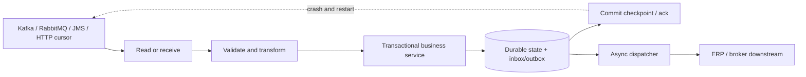
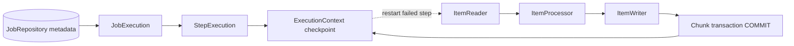
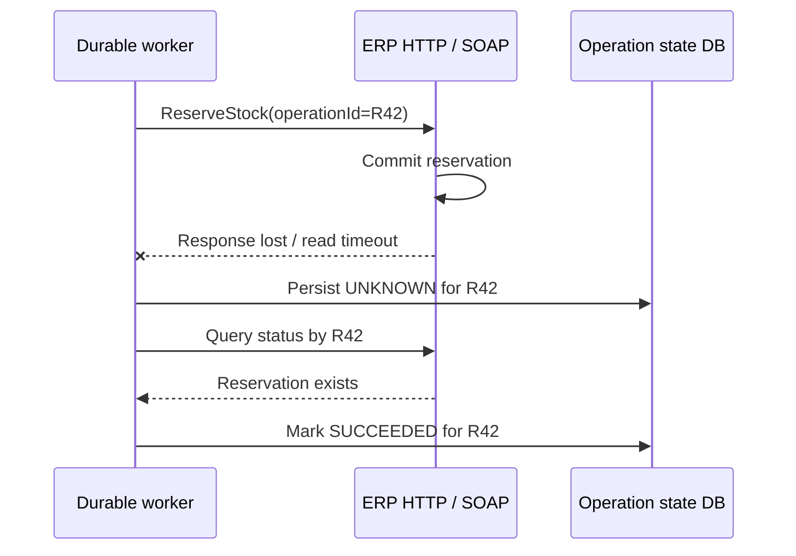

# Khởi động lại sau lỗi và tiếp tục từ checkpoint hợp lệ

## 1. Khi tích hợp bị ngắt giữa chừng, hệ thống phải tiếp tục từ đâu?

Một Spring Boot service tiêu thụ sự kiện `OrderPaid` từ Kafka, cập nhật PostgreSQL, ghi transactional outbox để phát `InventoryReservationRequested` rồi gọi hệ thống ERP ở worker khác. Lúc 10:15, JVM crash sau khi cập nhật database nhưng trước khi Kafka offset được commit. Khi restart, consumer có thể nhận lại đúng sự kiện vừa xử lý.

Nếu chỉ nhìn log “đã đọc offset 158” rồi khởi động từ offset 159, hệ thống có thể bỏ qua công việc chưa commit. Nếu luôn đọc lại từ đầu mà không chống trùng, một lệnh thanh toán hay gửi ERP có thể tạo side effect hai lần.

**Checkpoint** là thông tin bền vững chỉ ra **mốc có thể tiếp tục xử lý an toàn**. Mốc này phải liên hệ với những hiệu ứng đã được commit, không chỉ với dữ liệu đã nhận hoặc đã thử xử lý. Khi khởi động lại, runtime có thể phát lại phần việc sau mốc ấy; ứng dụng cần chịu được duplicate và tình huống kết quả ở dependency chưa rõ.

Ví dụ:



Bài **“Khởi động lại sau lỗi và tiếp tục từ checkpoint hợp lệ”** thuộc chương **“Vận hành tích hợp”**, module **SPRING_BOOT_INTEGRATION**. Module hướng đến tích hợp HTTP clients, database, cache, broker và Spring Integration adapters, đặt trọng tâm vào cấu hình, hợp đồng dữ liệu, giao dịch, lỗi, chống trùng, kiểm thử và quan sát luồng thực tế.

Sau bài, bạn sẽ biết cách:

1. Định nghĩa checkpoint hợp lệ theo nguồn dữ liệu và ranh giới transaction.
2. Xác định vị trí tiếp tục với Kafka offsets, AMQP/JMS delivery, HTTP cursors, file pollers và Spring Batch.
3. Phối hợp inbox/outbox, lease, fencing token, idempotency và ordering khi có crash/replay.
4. Thiết kế runbook restart, recovery, quarantine và replay có kiểm soát.
5. Kiểm thử các cửa sổ lỗi bằng Testcontainers, thay vì chỉ thử happy path.

**Điểm mấu chốt:** không có một “checkpoint toàn cục” tự động cho PostgreSQL, Kafka, RabbitMQ, HTTP API và ERP. Hệ thống cần chọn **nguồn sự thật của tiến độ** và mốc xác nhận bền vững cho từng bước.

## 2. Những khái niệm phải tách biệt trước khi nói đến restart

| Thuật ngữ | Nội dung | Tại sao khác checkpoint? |
|---|---|---|
| **Read position** | Vị trí vừa được đọc/nhận từ nguồn. | Chưa chứng minh business work đã xong. |
| **Processed position** | Vị trí handler đã chạy xong theo logic ứng dụng. | Nếu chỉ ở RAM/log, mất sau crash. |
| **Durable effect** | Giao dịch database, persistent job hoặc tác động ngoài đã được xác nhận theo hợp đồng. | Có thể commit trước hoặc sau broker acknowledgment. |
| **Checkpoint** | Mốc lưu bền vững dùng để quyết định bắt đầu lại. | Phải gắn với durable effect, không đơn thuần last seen. |
| **Acknowledgment** | Tín hiệu trả lại broker rằng message được xử lý theo policy. | Không đồng nghĩa business state đã commit nếu ack quá sớm. |
| **Offset** | Vị trí một record trong Kafka partition. | Broker position, không phải business event ID. |
| **Cursor/page token** | Dấu vị trí trong API hoặc pagination. | Có thể hết hạn hoặc không gắn với snapshot bất biến. |
| **Inbox marker** | Dấu đã xử lý một logical event trong database của consumer. | Chỉ có ý nghĩa nếu commit cùng effect cần bảo vệ. |
| **Outbox row** | Ý định phát sự kiện được lưu cùng business transaction. | Publisher phải dispatch và ghi nhận tiến độ riêng. |
| **Lease/fencing token** | Quyền sở hữu tạm thời và thế hệ của worker. | Ngăn stale worker cập nhật checkpoint của worker mới. |
| **Watermark** | Giới hạn thời gian/ID dữ liệu đã xử lý hoặc đã quan sát. | Không bảo đảm không có record đến trễ nếu nguồn không có cam kết. |

Một message có thể có đồng thời `eventId=E42`, Kafka `partition=2, offset=158` và workflow `operationId=R42`. Chúng phục vụ **ba loại identity** khác nhau. Đừng sử dụng offset làm event ID khi event có thể được republish vào partition/offset khác; đừng dùng trace ID làm idempotency key.

### 2.1. “Đã đọc” không bằng “đã xử lý”

```text
source record 158 read
  -> JSON parsed
  -> database update started
  -> JVM crash before COMMIT
```

Nếu checkpoint đã tiến tới 159 ở bước parse, record 158 sẽ bị bỏ qua khi restart mặc dù database chưa đổi. Một checkpoint an toàn chỉ tiến **sau mốc durable được định nghĩa rõ**.

### 2.2. “Đã gửi” không bằng “bên kia đã hoàn thành”

Với HTTP client hoặc Kafka producer, send thành công có thể là mốc phía client/broker; đó không phải xác nhận inventory đã trừ kho hoặc ERP đã commit. Phân biệt `PUBLISHED`, `DELIVERED`, `CONSUMED` và `BUSINESS_SUCCEEDED` trong state machine nếu nghiệp vụ cần theo dõi từng mốc.

## 3. Tiêu chí của một checkpoint hợp lệ

Một checkpoint đáng tin cậy phải đáp ứng các tiêu chí:

1. **Durable:** lưu ở nguồn có thể tồn tại qua JVM restart/pod reschedule, hoặc broker quản lý tiến độ bền vững.
2. **Consistent:** không vượt quá mốc business effect đã commit hoặc durable handoff đã được xác nhận.
3. **Scoped:** xác định đúng job/consumer group/partition/tenant/query/version; không dùng chung một số thứ tự cho mọi nguồn.
4. **Replayable:** nguồn còn giữ dữ liệu sau checkpoint, hoặc có nơi khác để rebuild/đối soát.
5. **Unambiguous:** rõ checkpoint biểu thị “đã xử lý record nào” hay “vị trí bắt đầu record tiếp theo”.
6. **Gap-aware:** xử lý trường hợp records hoàn thành không theo thứ tự; không chỉ lưu max ID.
7. **Ownership-safe:** worker cũ không thể ghi checkpoint sau khi lease đã bị thu hồi hoặc partition đã bị rebalance.
8. **Compatible:** schema, serializer, job parameters và cách giải nghĩa checkpoint còn hợp lệ sau deploy.
9. **Observable:** có metrics tuổi checkpoint, độ trễ, lỗi, duplicate và phương án recovery.
10. **Auditable:** các thao tác reset, skip, replay và advance thủ công có lý do, quyền và dấu vết.

Một checkpoint có giá trị số lớn **không nhất thiết là hợp lệ**. Nếu worker xử lý thành công offset 160 nhưng 159 còn thất bại, commit 161 có thể bỏ qua 159 trong một consumer group, vì Kafka committed offset là vị trí tiếp theo sẽ fetch sau restart.

### 3.1. Phạm vi của bảo đảm

Cần ghi vào tài liệu vận hành: hệ thống đang cam kết **at-least-once processing**, **at-most-once**, hay một dạng exactly-once trong phạm vi hẹp? Kafka transactions có cơ chế exactly-once cho những thao tác Kafka được cấu hình đúng; một câu `@Transactional` JDBC không tự làm cho HTTP ERP + PostgreSQL + Kafka atomic.

Với tích hợp thực tế, mẫu thường an toàn là **at-least-once delivery + idempotent processing + local transaction + durable retry/reconciliation**.

## 4. Hai cửa sổ lỗi kinh điển: mất việc hoặc xử lý trùng

Giả sử xử lý Kafka event E42 và cập nhật PostgreSQL.

**Thứ tự sai:**

```text
commit source offset
  -> update database
  -> crash giữa hai bước
  -> restart sau offset
  => MẤT hiệu ứng nghiệp vụ
```

**Thứ tự thường an toàn hơn:**

```text
BEGIN database transaction
  INSERT inbox marker
  UPDATE business state
  INSERT outbox event
COMMIT
  -> commit Kafka offset
  -> crash giữa COMMIT và offset
  -> restart, E42 đến lại
  -> inbox phát hiện duplicate và không áp thêm effect
```

```mermaid
sequenceDiagram
    participant K as Kafka
    participant C as Consumer
    participant D as PostgreSQL
    K->>C: Deliver E42, offset 158
    C->>D: BEGIN; inbox + business + outbox
    D-->>C: COMMIT success
    Note over C: Crash before offset commit
    K->>C: Redeliver E42 after restart
    C->>D: Check inbox E42
    D-->>C: Already committed / same payload
    C->>K: Commit next offset when safe
```

| DB effect | Source checkpoint/ack | Nếu crash sau đó | Kỳ vọng |
|---|---|---|---|
| Chưa commit | Chưa ack | Source giao lại. | Xử lý lại bình thường. |
| Đã commit | Chưa ack | Source có thể giao lại. | Inbox/idempotency tránh duplicate. |
| Đã commit | Đã ack | Source tiến tiếp. | Thành công nếu effect đúng và durable. |
| Chưa commit | Đã ack | Source có thể không giao lại. | **Mất việc**, phải tránh thiết kế này. |
| Commit không rõ do network disconnect | Chưa ack | Có thể giao lại. | Tra key/inbox sau reconnect; không tạo intent ID mới. |

Ngay cả khi “DB commit thành công” được application nhìn thấy, một hệ thống khác có thể chưa đồng bộ. Chọn checkpoint theo **mốc hoàn thành mà hợp đồng yêu cầu**, không theo một log line tùy ý.

## 5. Kafka checkpoint: committed offset là vị trí tiếp theo

Kafka quản lý tiến độ theo **consumer group và từng topic-partition**. Nếu record ở offset `158` đã được xử lý thành công, giá trị committed offset thường là **`159`**, tức vị trí tiếp theo consumer bắt đầu đọc khi assignment/restart.

```text
topic: orders.paid
partition: 2

offset   156   157   158   159   160   161
         [OK]  [OK]  [OK]  [? ]  [OK]  [ ?]
                          ^
                   safe next offset 159
```

Không lưu một biến `lastOffset=160` cho tất cả partitions. Kafka không có tổng thứ tự chung cho cả topic: mỗi partition có sequence riêng; event cùng aggregate nên dùng partition key phù hợp nếu cần ordering.

### 5.1. Commit position không phải offset cuối đã fetch

Consumer có thể `poll()` nhận một batch 100 records nhưng chỉ xử lý xong 20. Commit offset theo toàn batch trước khi hoàn thành 80 records còn lại là nguy cơ mất việc. Spring Kafka ack modes và handler mode cần được cấu hình theo mốc commit mong đợi.

### 5.2. Retention giới hạn khả năng replay

Một committed offset cũ không đảm bảo broker còn record ở đó sau retention/truncation. Nếu record không còn, cần rebuild từ source of truth, snapshot + changelog, hoặc recovery procedure khác. `auto-offset-reset=earliest` chỉ chọn **earliest hiện còn** khi không có offset hợp lệ; nó không phục hồi dữ liệu đã bị xóa.

## 6. Spring Kafka: cấu hình checkpoint và ack mode rõ ràng

Ví dụ với Spring Boot/Spring Kafka tương thích:

```yaml
spring:
  kafka:
    bootstrap-servers: ${KAFKA_BOOTSTRAP_SERVERS}
    consumer:
      group-id: order-projection
      enable-auto-commit: false
      auto-offset-reset: earliest
      max-poll-records: 100
    listener:
      ack-mode: record
      concurrency: 3
```

`AckMode.RECORD` thường khiến container xử lý/commit tiến độ theo record sau khi listener method return thành công. Nó **không** kiểm tra database transaction của application nếu listener chỉ enqueue work in-memory rồi return.

Các điểm cần xác minh:

- `enable-auto-commit: false` để tiến độ do container/chính sách ứng dụng kiểm soát.
- `ack-mode` thực sự được áp lên **listener container đang dùng**. Custom factory/Integration adapter có thể không nhận hết Boot properties.
- Concurrency không vượt partitions hữu ích và giới hạn DB/HTTP downstream.
- `max.poll.interval.ms` và duration xử lý không gây rebalance liên tục.
- Error handler, retries, DLT và commit-after-recovery behavior được kiểm thử riêng.

### 6.1. Kafka ack sau commit database

Với listener manual acknowledgment, làm rõ thứ tự:

```java
import org.apache.kafka.clients.consumer.ConsumerRecord;
import org.springframework.kafka.annotation.KafkaListener;
import org.springframework.kafka.support.Acknowledgment;
import org.springframework.stereotype.Component;

@Component
class OrderPaidKafkaListener {

    private final OrderPaidApplicationService service;
    private final OrderPaidJsonDecoder decoder;

    OrderPaidKafkaListener(
            OrderPaidApplicationService service,
            OrderPaidJsonDecoder decoder) {
        this.service = service;
        this.decoder = decoder;
    }

    @KafkaListener(
        topics = "orders.paid",
        groupId = "order-projection",
        containerFactory = "manualAckKafkaListenerFactory")
    public void handle(
            ConsumerRecord<String, String> record,
            Acknowledgment ack) {

        OrderPaidEvent event = decoder.decode(record.value());

        // @Transactional nằm ở bean service khác;
        // method return nghĩa là transaction đã kết thúc bình thường.
        service.applyIdempotently(event);

        // Chỉ ack sau khi durable business transaction hoàn tất.
        ack.acknowledge();
    }
}
```

`OrderPaidEvent` và `OrderPaidJsonDecoder` là types của ứng dụng. `applyIdempotently` phải cập nhật DB + inbox trong một local transaction, ném exception nếu chưa commit. Nếu `decode` hoặc service lỗi, method không ack; container error handler quyết định retry/reseek/DLT.

Một factory:

```java
import org.springframework.boot.autoconfigure.kafka.ConcurrentKafkaListenerContainerFactoryConfigurer;
import org.springframework.context.annotation.Bean;
import org.springframework.kafka.config.ConcurrentKafkaListenerContainerFactory;
import org.springframework.kafka.core.ConsumerFactory;
import org.springframework.kafka.listener.ContainerProperties;

@Bean("manualAckKafkaListenerFactory")
ConcurrentKafkaListenerContainerFactory<String, String>
manualAckKafkaListenerFactory(
        ConcurrentKafkaListenerContainerFactoryConfigurer configurer,
        ConsumerFactory<String, String> consumers) {

    var factory =
        new ConcurrentKafkaListenerContainerFactory<String, String>();
    configurer.configure(factory, consumers);
    factory.getContainerProperties()
        .setAckMode(ContainerProperties.AckMode.MANUAL_IMMEDIATE);
    return factory;
}
```

Đoạn bean giả định nằm trong Spring configuration class và consumer factory đã có serializers/auth/TLS phù hợp. `MANUAL_IMMEDIATE` thực hiện commit khi acknowledgment được gọi trên consumer thread theo semantics container; không biến nó thành atomic commit với DB, cũng không khuyên đem `Acknowledgment` sang thread khác.

## 7. Kafka rebalance: một partition bị thu hồi là ranh giới ownership

Khi consumer group rebalance, partition có thể chuyển từ instance A sang B. Một handler của A vẫn đang gọi ERP hoặc giữ một `CompletableFuture`; nếu A ghi checkpoint trễ sau khi quyền sở hữu mất, tiến độ có thể sai.

Cần thiết kế:

- Tránh xử lý lâu trực tiếp trong listener poll thread nếu vượt `max.poll.interval.ms`.
- Hoàn thành đồng bộ hoặc **durable handoff** trước ack.
- Không giữ Kafka `Acknowledgment` làm business task ID xuyên restart.
- Với per-partition async processing, theo dõi gap và commit **contiguous completed offsets**, không commit max offset.
- Dừng nhận thêm trong quá trình shutdown/rebalance theo container lifecycle; drain có timeout.
- Nếu sử dụng seek/rebalance listeners, không tự cập nhật offset từ nhiều luồng không được Kafka Consumer API hỗ trợ.
- Đo số lần rebalance và phân biệt chúng với network/DB outage.

### 7.1. Offset commit không đảm bảo đúng thứ tự side effects

Consumer một partition có thứ tự record trong log; nhưng handler dispatch jobs song song có thể hoàn thành offset 159 trước 158. Nếu commit 160, offset 158 có thể bị bỏ sau crash. Phải có **completion bitmap/contiguous watermark** hoặc chỉ sử dụng sequential processing trong mỗi partition, đồng thời có version guard theo aggregate.

## 8. Kafka transactions và phạm vi của exactly-once

Kafka producer transactions và `sendOffsetsToTransaction` có thể ghép output Kafka records cùng consumed offsets vào một Kafka transaction khi cấu hình đúng. Điều này rất hữu ích cho **Kafka → Kafka** processing.

Nhưng:

```text
Kafka consumer -> PostgreSQL update -> Kafka output
```

không trở thành một transaction nguyên tử chỉ bằng bật Kafka transaction manager. PostgreSQL có commit boundary riêng; crash giữa DB và Kafka vẫn phải được giải quyết bằng idempotency/outbox. Tương tự, Redis cache invalidation hoặc SOAP/ERP remote call không tự được rollback bởi Kafka transaction.

Hãy ghi chính xác scope của “exactly once” trong thiết kế: Kafka broker visibility/offset atomicity không có nghĩa external side effects được áp duy nhất một lần.

## 9. Inbox: checkpoint nghiệp vụ cho duplicate delivery

Một cách thực tế là để PostgreSQL sở hữu **mốc xử lý logical event**:

```sql
CREATE TABLE consumed_events (
    consumer_name VARCHAR(80) NOT NULL,
    event_id UUID NOT NULL,
    payload_hash VARCHAR(64) NOT NULL,
    processed_at TIMESTAMPTZ NOT NULL DEFAULT now(),
    PRIMARY KEY (consumer_name, event_id)
);
```

Mỗi event envelope có `eventId` ổn định và `aggregateVersion`. Trong một `@Transactional`:

1. Insert inbox row với unique key.
2. Nếu key đã tồn tại, kiểm tra payload hash/outcome trước khi coi là duplicate đã xử lý.
3. Nếu event mới, cập nhật business state/projection.
4. Ghi outbox event tiếp theo nếu có.
5. Commit; sau đó Kafka listener ack/commit offset.

Pseudocode:

```java
import org.springframework.jdbc.core.simple.JdbcClient;
import org.springframework.stereotype.Service;
import org.springframework.transaction.annotation.Transactional;

@Service
class OrderPaidApplicationService {

    private final JdbcClient jdbc;
    private final EventFingerprint fingerprint;

    OrderPaidApplicationService(
            JdbcClient jdbc, EventFingerprint fingerprint) {
        this.jdbc = jdbc;
        this.fingerprint = fingerprint;
    }

    @Transactional
    public void applyIdempotently(OrderPaidEvent event) {
        String hash = fingerprint.sha256Canonical(event);

        int inserted = jdbc.sql("""
            INSERT INTO consumed_events(
                consumer_name, event_id, payload_hash)
            VALUES ('order-projection', :id, :hash)
            ON CONFLICT (consumer_name, event_id) DO NOTHING
            """)
            .param("id", event.eventId())
            .param("hash", hash)
            .update();

        if (inserted == 0) {
            verifySameEventAndCommittedOutcome(event, hash);
            return;
        }

        applyBusinessProjection(event);
        // Nếu có integration event mới:
        // outbox.insertInCurrentTransaction(...);
    }

    private void verifySameEventAndCommittedOutcome(
            OrderPaidEvent event, String hash) {
        // Query hash/outcome đã commit; cùng ID khác content => conflict.
    }

    private void applyBusinessProjection(OrderPaidEvent event) {
        // DB update theo aggregateVersion và schema contract.
    }
}
```

`EventFingerprint`, `OrderPaidEvent` và helper methods là abstractions phải triển khai. Hash cần được tính từ canonical payload đáng tin, không chỉ tin field do sender đưa. Code dùng PostgreSQL `ON CONFLICT`, không mặc định chạy nguyên trên mọi RDBMS.

**Không lưu inbox marker ở transaction khác rồi mới cập nhật projection.** Crash sau marker, trước effect sẽ khiến redelivery bị bỏ sai.

## 10. Source checkpoint và inbox: hai lớp bổ sung, không đối thủ

Kafka committed offset giúp consumer **không phải đọc lại mọi record**, trong khi inbox giúp chống duplicate khi redelivery, replay hoặc publish lại. Một record Kafka có thể được chuyển sang retry topic với offset mới nhưng **eventId cũ**.

| Lớp | Khóa/mốc | Khi restart |
|---|---|---|
| Kafka group | Topic-partition + committed next offset. | Fetch tiếp từ mốc broker lưu. |
| Consumer inbox | (consumerName, eventId) + hash/outcome. | Nhận diện duplicate logical event. |
| Domain projection | Aggregate ID + version/state. | Ngăn state lùi hoặc xử lý out-of-order. |
| Outbox dispatcher | Event ID + publish state/lease. | Gửi lại event chưa confirmed. |
| External ERP | Operation ID/idempotency key + remote outcome. | Đối soát side effect có thể đã commit. |

Không “reset offset về mới nhất” để tránh duplicate nếu không biết các hiệu ứng còn thiếu. Đó là bỏ việc, không phải recovery.

## 11. RabbitMQ: acknowledgment là tiến độ giao hàng, không có consumer offset

RabbitMQ AMQP 0-9-1 queue dùng delivery acknowledgment, không phải committed offset theo topic-partition. Broker theo dõi messages còn ready/unacked; khi channel/connection đóng trước ack, message chưa được ack có thể được **redeliver** theo broker semantics.

### 11.1. Mốc ack an toàn

```text
RabbitMQ delivery
  -> deserialize / validate
  -> DB transaction + inbox / durable job COMMIT
  -> basicAck(deliveryTag)
```

Với manual acknowledgment trong Spring AMQP:

```java
import com.rabbitmq.client.Channel;
import org.springframework.amqp.core.Message;
import org.springframework.amqp.rabbit.annotation.RabbitListener;
import org.springframework.stereotype.Component;

@Component
class OrderCommandRabbitListener {

    private final OrderCommandService service;
    private final OrderCommandDecoder decoder;

    OrderCommandRabbitListener(
            OrderCommandService service,
            OrderCommandDecoder decoder) {
        this.service = service;
        this.decoder = decoder;
    }

    @RabbitListener(
        queues = "orders.commands",
        ackMode = "MANUAL")
    public void handle(
            Message message, Channel channel) throws Exception {

        long tag = message.getMessageProperties().getDeliveryTag();

        try {
            OrderCommand command = decoder.decode(message.getBody());
            service.persistDurably(command);
            channel.basicAck(tag, false);
        } catch (InvalidOrderContractException ex) {
            // Chỉ reject không requeue khi DLX/quarantine đã được
            // cấu hình và policy mất dữ liệu được kiểm tra.
            channel.basicReject(tag, false);
        }
        // Lỗi transient khác propagate để container/broker recovery
        // xử lý theo policy của ứng dụng.
    }
}
```

Đoạn trên là **khung**: `OrderCommandService`/decoder/exception cần triển khai, cấu hình DLX và container error handler phải được kiểm thử để tránh double-ack/nack. Nếu listener ném exception sau khi đã ack/reject, container error handling cũng cần được hiểu rõ; thiết kế production nên tránh catch-all không kiểm soát.

**Delivery tag chỉ hợp lệ với channel nhận nó.** Không lưu tag vào DB như checkpoint bền vững, không dùng nó sau reconnect/restart.

### 11.2. Đã ack rồi có thể replay không?

Nếu queue đã ack và broker đã loại message theo cơ chế bình thường, việc replay cần DLQ, archive, source event store hoặc producer republish có chủ đích. Không tồn tại `seek(offset=...)` tương đương Kafka trên queue đã ack.

Vì vậy **durable handoff trước ack** là yêu cầu rất quan trọng khi Rabbit source là nguồn dữ liệu không thể rebuild.

## 12. RabbitMQ retry, DLX và poison messages

Khi một message malformed luôn làm handler lỗi, `basicNack(requeue=true)` liên tục có thể tạo hot loop. Một policy nên:

- Phân loại transient, permanent-contract, business-rejected và unknown-result.
- Dùng bounded retries/backoff; khi hết budget, chuyển tới DLX/DLQ/quarantine **đã provision**.
- Không ack original chỉ vì publish DLQ “đã gọi hàm” mà chưa biết publish/routing outcome, nếu app thực hiện republish thủ công.
- Giữ `eventId`, operation ID và original routing metadata được phép lưu.
- Cấu hình retention/quarantine owner để message không nằm quên vô hạn.
- Theo dõi unacked/ready counts và poison redelivery rate.

Nếu DLX topology/broker policy dẫn message đến nowhere, một lệnh reject không requeue có thể làm mất dữ liệu. Định nghĩa và test đường dead-letter thực tế, không chỉ code `basicReject`.

## 13. JMS: session acknowledgment và transaction là checkpoint riêng

JMS cung cấp `Queue`, `Topic`, `JMSMessageID`, `JMSCorrelationID` và nhiều acknowledgment modes. Tiến độ thường gắn **message delivery + JMS session/provider**, không phải offset mà Spring Boot có thể tự tính.

| Cấu hình | Ý nghĩa chính | Cần kiểm thử |
|---|---|---|
| `AUTO_ACKNOWLEDGE` | Provider/container tự xác nhận theo listener semantics. | Exception trong business handler có gây redelivery? |
| `CLIENT_ACKNOWLEDGE` | Client xác nhận theo session semantics. | Một acknowledge có thể xác nhận nhiều messages trong session, không giống Rabbit tag. |
| `SESSION_TRANSACTED` hoặc container sessionTransacted | Commit/rollback JMS session. | Redelivery sau rollback và provider DLQ policy. |
| JTA/XA | Có thể phối hợp XA participants khi thực sự cấu hình. | Recovery log, in-doubt transactions, deployment complexity. |

### 13.1. JMS transacted không tự gộp với JDBC

Một JMS session commit và một PostgreSQL `@Transactional` không tự là cùng transaction. Nếu dùng local JMS transaction + JDBC transaction, thứ tự commit vẫn có gap. JTA/XA có thể được cân nhắc khi thật sự cần và các resources hỗ trợ, nhưng trong nhiều workflow outbox/inbox + reconciliation dễ vận hành hơn. HTTP ERP thông thường không tham gia XA.

### 13.2. JMS message ID và business replay

`JMSMessageID` có thể thay khi app republish, dù logical event giữ nguyên. Dùng business `eventId`/`operationId` có schema ổn định, không chỉ provider message ID để dedupe.

## 14. HTTP pagination: checkpoint là cursor hoặc keyset, không phải trang số

Một integration job định kỳ lấy invoices từ HTTP API:

```http
GET /v1/invoices?limit=100&cursor=eyJwb3MiOi...
```

API trả:

```json
{
  "items": [
    {"invoiceId": "I-41", "updatedAt": "2026-11-21T02:00:01Z"},
    {"invoiceId": "I-42", "updatedAt": "2026-11-21T02:00:02Z"}
  ],
  "nextCursor": "eyJwb3MiOjEwMH0",
  "hasMore": true
}
```

Nếu client nhận cursor kế tiếp, **chưa chắc đã xử lý xong items trang hiện tại**. Một quy trình an toàn:

1. Đọc cursor `C` đã commit từ durable checkpoint store.
2. Gọi API với `C`, nhận `items` và `nextCursor=N`.
3. Validate, normalize và ghi từng batch vào database theo khóa idempotent.
4. **Sau khi commit toàn bộ trang hoặc durable handoff**, ghi checkpoint `N`.
5. Nếu crash trước bước 4, tải lại trang với `C` và dedupe.

### 14.1. Cursor opaque có thể hết hạn hoặc thay đổi nghĩa

Không phải API nào cho phép replay cùng cursor vô hạn. Cần đọc hợp đồng:

- Cursor có TTL không?
- Kết quả thuộc snapshot cố định hay live dataset?
- Sort order có ổn định giữa các lần gọi không?
- API có hỗ trợ `updatedSince`, `asOf`, snapshot ID hoặc keyset không?
- Data có thể bị xóa, sửa, backfill hoặc đến trễ không?
- Rate limits và 429 handling thế nào?

Nếu cursor hết hạn sau outage kéo dài, **không tự nhảy sang trang cuối**. Phải resync từ timestamp/ID an toàn hoặc full scan có bounded overlap, sau đó đối soát.

### 14.2. Tránh offset pagination khi dataset thay đổi

`page=5&size=100` trên dataset có insert/delete đồng thời có thể bỏ/nhân records do vị trí dịch chuyển. Keyset pagination theo một thứ tự tổng xác định như `(updated_at, id)` hoặc snapshot cursor thường đáng tin hơn, nếu upstream cung cấp semantics phù hợp.

## 15. High-watermark theo timestamp và ID: chống mất record cùng thời điểm

Nếu nguồn API/DB chỉ cho truy vấn theo `updated_at`, lưu duy nhất `lastTimestamp` là chưa đủ khi nhiều records có cùng timestamp.

Ví dụ checkpoint:

```json
{
  "source": "erp-invoices",
  "tenantId": "tenant-1",
  "sort": "updatedAt,id",
  "lastUpdatedAt": "2026-11-21T02:00:02Z",
  "lastId": "I-42",
  "schemaVersion": 2
}
```

Truy vấn keyset khi nguồn hỗ trợ ordering tương ứng:

```sql
SELECT invoice_id, updated_at, amount
FROM invoice_source
WHERE (updated_at, invoice_id) >
      (:lastUpdatedAt, :lastId)
ORDER BY updated_at, invoice_id
LIMIT :batchSize;
```

Đây là **minh họa SQL khi truy cập một bảng có thứ tự nhất quán**. Với remote HTTP API, query syntax phụ thuộc provider; không tự nhận nó hỗ trợ tuple comparison hoặc stable snapshot.

### 15.1. Late-arriving updates và overlap window

Nếu dữ liệu có thể được cập nhật lùi timestamp hoặc replication lag, một strict high-watermark có thể bỏ record đến muộn. Có thể dùng cửa sổ overlap, ví dụ đọc lại 10 phút gần nhất, rồi dedupe bằng business key/version. Tuy nhiên overlap **không có bảo đảm tuyệt đối** nếu late arrival vượt 10 phút hoặc upstream không giữ ordering. Cần SLA về lateness, reconciliation/full rescan và metrics số bản ghi bị sửa.

**Không dùng `MAX(updated_at)` của những rows vừa fetch làm checkpoint nếu có gaps.** Chỉ advance khi biết tất cả records trước mốc theo hợp đồng đã xử lý hoặc sẽ được phục hồi an toàn.

## 16. Spring Batch: JobRepository và ExecutionContext là checkpoint quản lý

Spring Batch phù hợp với file imports, batch HTTP sync, database readers/writers và jobs có lượng lớn dữ liệu. Nó lưu `JobInstance`, `JobExecution`, `StepExecution` và `ExecutionContext` qua `JobRepository`; các `ItemStream` readers/writers có thể cập nhật state phục vụ restart.



Một chunk step:

```java
import org.springframework.batch.core.Step;
import org.springframework.batch.core.repository.JobRepository;
import org.springframework.batch.core.step.builder.StepBuilder;
import org.springframework.context.annotation.Bean;
import org.springframework.transaction.PlatformTransactionManager;

@Bean
Step invoiceImportStep(
        JobRepository jobRepository,
        PlatformTransactionManager transactionManager,
        ItemReader<InvoiceSource> reader,
        ItemProcessor<InvoiceSource, InvoiceProjection> processor,
        ItemWriter<InvoiceProjection> writer) {

    return new StepBuilder("invoiceImportStep", jobRepository)
        .<InvoiceSource, InvoiceProjection>chunk(
                100, transactionManager)
        .reader(reader)
        .processor(processor)
        .writer(writer)
        .build();
}
```

Các types `InvoiceSource`, `InvoiceProjection`, reader/processor/writer beans cần triển khai; imports cho `ItemReader`, `ItemProcessor`, `ItemWriter` tương ứng `org.springframework.batch.item.*`. Đoạn code theo Spring Batch 5.x style; **không phải một job đầy đủ** thiếu `Job` bean, schema metadata/migrations và launcher.

### 16.1. Checkpoint và commit chunk

Với một restartable reader thực hiện `ItemStream`/state saving, Spring Batch có thể lưu vị trí đã đọc ở execution context theo chunk/checkpoint cycle. **Điều kiện quan trọng:** JobRepository và business effects cần có transaction/ordering bảo đảm consistency; nếu writer gọi ERP HTTP không transactional, restart sẽ không tự rollback side effect đã thành công ở remote.

### 16.2. Không dùng in-memory JobRepository nếu cần restart sau pod crash

Nếu metadata JobRepository chỉ nằm trong memory hoặc DB ephemeral bị xóa theo pod, restart không biết job instance/step execution context cũ. Dùng persistent repository có backup/migrations, định danh job parameters ổn định và chiến lược deploy/retention phù hợp.

## 17. Spring Batch JobParameters quyết định restart hay tạo job mới

Một `JobInstance` được xác định từ **job name và identifying JobParameters**. Nếu mỗi lần restart tạo timestamp random làm identifying parameter, Spring Batch có thể xem đó là **job instance mới** và bắt đầu lại, không phải restart execution đang thất bại.

| Hành động | Điều kiện |
|---|---|
| Restart failed execution | Gọi job với cùng identifying parameters, step restartable và metadata còn. |
| Chạy đợt import mới | Dùng input/window/run ID mới có chủ đích. |
| Re-run completed job | Không mặc định restart completed instance; cần lựa chọn job instance/logic replay. |
| Thay source schema/cursor format | Cần versioning/migration checkpoint, không giải mã state cũ tùy tiện. |

### 17.1. Reader có save state thật chưa?

Một `ItemReader` tự viết chỉ lưu `int index` trong field sẽ mất vị trí khi JVM chết. Muốn restart theo Spring Batch, reader thường cần cơ chế `ItemStream.open/update/close` (hoặc base implementation hỗ trợ) để đọc/lưu index/cursor vào `ExecutionContext`. `saveState`/reader configuration phải được bật đúng, và reader không được dựa vào thứ tự dữ liệu thay đổi ngẫu nhiên.

Nếu input file không bất biến giữa runs, checkpoint item index 500 có thể trỏ tới record khác sau restart. Cần file identity/size/hash/version hoặc snapshot contract.

## 18. Spring Integration poller và MetadataStore: nhận diện nguồn đã thấy

Spring Integration có pollers cho file/SFTP/FTP, JDBC, JMS và nhiều adapter. Một số filter/metadata stores giúp ghi dấu **đã thấy file hoặc giá trị**, ví dụ family persistent accept-once filters kết hợp `ConcurrentMetadataStore` backend.

**Lỗi nhận thức phổ biến:** “đã thấy file” không đồng nghĩa “đã xử lý và commit file”.

```text
poll SFTP /incoming/orders.csv
  -> persistent accept-once filter marks file as seen
  -> app crashes before parsing / database commit
  -> next poll skips file if marker remains
  => file may be LOST to business processing
```

Một pattern an toàn hơn:

1. Nguồn chỉ publish file **hoàn chỉnh** (atomic rename/ready marker/manifest).
2. Poller ghi nhận identity file có version/mtime/size/hash theo hợp đồng.
3. Trước khi coi là hoàn tất, đưa file vào **durable staging/work queue** hoặc ghi processing state trong database.
4. Parser/worker commit rows theo idempotency key.
5. Chuyển state `SUCCEEDED` rồi archive/move file có kiểm soát.
6. Sau crash, query durable `PENDING/CLAIMED` để retry, không chỉ dựa trên accept-once marker.

### 18.1. MetadataStore được chọn theo yêu cầu durability

In-memory metadata store không đủ cho restart-critical checkpoint. Có thể dùng JDBC hoặc Redis-backed metadata store tùy integration module/version, nhưng durability và eviction/TTL/backup cũng phải phù hợp. Một key trong Redis có TTL hoặc bị eviction **không mặc nhiên là checkpoint bền vững**.

### 18.2. File identity phải tránh false duplicate

Filename `orders.csv` được tái sử dụng mỗi ngày; nếu chỉ dedupe theo filename, import mới bị bỏ. Nếu chỉ dùng mtime, một file replace mà giữ mtime có thể bị coi là cũ. Nên chọn source identity gồm path + version/mtime+size/content hash theo contract và lưu business run ID. Khi tải file lớn, có thể stage bằng tên temp rồi atomic rename sau checksum/EOF được xác nhận.

## 19. `IntegrationFlow` và async channels: checkpoint nằm ở đâu?

Một flow:

```text
Kafka inbound adapter
  -> DirectChannel
  -> validate
  -> ExecutorChannel (in-memory)
  -> HTTP ERP gateway
  -> DB update
```

Nếu inbound adapter trả về thành công ngay khi message đã được submit tới executor, container có thể commit offset/ack trước khi HTTP/DB hoàn tất. Sau JVM crash, message không được fetch lại và executor queue biến mất.

Muốn xử lý bất đồng bộ:

- Viết **durable job** trong database trước khi ack source.
- Hoặc để consumer xử lý đồng bộ tới mốc durable trên `DirectChannel` và trả success.
- Hoặc sử dụng broker/persistent channel có transaction semantics được kiểm chứng, không chỉ tên “queue”.
- Tách stage `ACCEPTED`, `PROCESSING`, `UNKNOWN`, `SUCCEEDED` và `QUARANTINED`.
- Dùng error channel để phân loại/route failures, nhưng **`errorChannel` in-memory không phải DLQ bền vững**.

### 19.1. RequestHandlerRetryAdvice không làm offset transaction nguyên tử

Spring Integration retry advice có thể gọi lại handler khi exception, nhưng không làm Kafka ack, JDBC commit và HTTP side effect cùng rollback. Nếu handler đã phát event hoặc gọi ERP thành công rồi lỗi ở bước kế, retry cả handler có thể lặp business effect. Chọn retry boundary theo idempotent operation.

## 20. Transactional Outbox: checkpoint của publisher sau business commit

Với một event được lưu trong `outbox_events` cùng business DB transaction:

```text
BEGIN
  UPDATE orders ...
  INSERT outbox_events(event_id=E42, status=PENDING)
COMMIT

dispatcher:
  CLAIM E42
  PUBLISH E42
  WAIT producer acknowledgment
  MARK PUBLISHED
```

Nếu dispatcher crash sau broker ack nhưng trước `MARK PUBLISHED`, row còn điều kiện retry, và E42 có thể được phát lại. Đây là **at-least-once** trong phạm vi dispatch khi được thiết kế đúng. Stable `eventId` cho phép consumer dedupe.

### 20.1. PostgreSQL claim bằng lease và fencing

Schema minh họa:

```sql
CREATE TABLE outbox_events (
    event_id UUID PRIMARY KEY,
    event_type TEXT NOT NULL,
    aggregate_id TEXT NOT NULL,
    payload JSONB NOT NULL,
    status TEXT NOT NULL,
    available_at TIMESTAMPTZ NOT NULL DEFAULT now(),
    claimed_by TEXT,
    claimed_until TIMESTAMPTZ,
    claim_generation BIGINT NOT NULL DEFAULT 0,
    attempts INT NOT NULL DEFAULT 0,
    published_at TIMESTAMPTZ
);
```

Một atomic claim transaction (PostgreSQL):

```sql
WITH chosen AS (
  SELECT event_id
  FROM outbox_events
  WHERE
    (status = 'PENDING' AND available_at <= now())
    OR (status = 'CLAIMED' AND claimed_until < now())
  ORDER BY available_at, event_id
  FOR UPDATE SKIP LOCKED
  LIMIT :batchSize
)
UPDATE outbox_events o
SET status = 'CLAIMED',
    claimed_by = :workerId,
    claimed_until =
        now() + (:leaseSeconds * INTERVAL '1 second'),
    claim_generation = claim_generation + 1,
    attempts = attempts + 1
FROM chosen
WHERE o.event_id = chosen.event_id
RETURNING o.event_id, o.payload, o.claim_generation;
```

Commit **claim transaction ngắn** rồi mới publish qua network. Không giữ DB row locks hàng chục giây trong lúc đợi broker.

Completion có fencing:

```sql
UPDATE outbox_events
SET status = 'PUBLISHED',
    published_at = now(),
    claimed_by = NULL,
    claimed_until = NULL
WHERE event_id = :eventId
  AND status = 'CLAIMED'
  AND claimed_by = :workerId
  AND claim_generation = :claimGeneration;
```

Check `updatedRows == 1`; nếu 0, lease ownership đã thay đổi. Fencing bảo vệ **trạng thái row** khỏi stale worker, **không** ngăn hai send trùng khi lease hết hạn trong lúc worker cũ vẫn publish.

### 20.2. Lease là quyền xử lý tạm thời, không phải checkpoint cuối

Một row `CLAIMED` không được xem là xử lý xong. Sau restart, những leases hết hạn phải được claim lại. `PUBLISHED` chỉ được set sau producer acknowledgement/confirm theo hợp đồng; nó **không** chứng minh mọi downstream consumers đã commit.

## 21. CDC và Debezium: connector offset khác business checkpoint

Với change data capture, Debezium đọc log DB (ví dụ PostgreSQL WAL), chuyển events sang Kafka thông qua Kafka Connect. Connector quản lý source positions/offsets/checkpoints theo hệ thống của nó.

- **DB commit** làm transaction xuất hiện trong WAL.
- **Connector offset** cho biết log progress đã được checkpoint theo policy.
- **Kafka record/consumer offset** là vị trí của event phía broker.
- **Business inbox marker** phản ánh consumer đã xử lý logical event.
- **Outbox published state** không nhất thiết tồn tại trong mô hình CDC-only.

Crash sau connector publish nhưng trước khi source offset được checkpoint có thể tạo duplicate trong một số cấu hình/đường xử lý. Không lấy connector source offset làm bằng chứng downstream đã cập nhật business projection.

### 21.1. Restart CDC có rủi ro WAL retention

PostgreSQL replication slot có thể giữ WAL khi connector down. Nếu restart quá muộn hoặc quota WAL chạm giới hạn, nguồn có thể mất khả năng resume/đầy disk. Cần giám sát connector lag, slot retention, disk space, snapshot status và cấu hình recovery.

Không tự sửa Kafka Connect offset store hoặc xóa replication slot để “cho connector chạy lại” khi chưa có runbook vendor/documented recovery, vì có thể mất hoặc nhân events.

## 22. HTTP POST/ERP timeout: checkpoint cần trạng thái `UNKNOWN`

Một lệnh ghi sang ERP có thể thành công ở server nhưng response bị mất.



Không đặt checkpoint “lệnh chưa chạy” chỉ vì client timeout rồi tự tạo `operationId=R43` để retry. Một command HTTP có thể là non-idempotent; cần:

- Stable operation ID/idempotency key trước attempt đầu.
- Remote API hỗ trợ idempotency key hoặc query/reconciliation.
- Durable trạng thái `PENDING`/`UNKNOWN`/`SUCCEEDED`/`REJECTED`.
- Chính sách retry khác nhau cho connect failure trước khi gửi, read timeout sau khi gửi và business rejection.
- Compensation hoặc manual review nếu remote không hỗ trợ query và outcome vẫn mơ hồ.

Đây là checkpoint **nghiệp vụ**, không phải Kafka offset. Một lần retry không thể quay ngược external side effect bằng việc rollback PostgreSQL.

## 23. Multi-stage workflow: mỗi bước cần mốc hoàn tất riêng

Ví dụ saga:

```text
Step 1: OrderCreated
Step 2: ReserveStock at ERP
Step 3: CapturePayment at payment provider
Step 4: ArrangeShipping
Step 5: OrderCompleted event
```

Lưu duy nhất `lastStep=3` là nguy hiểm nếu step 3 trả timeout mà provider thực ra đã capture tiền. Nên có state machine ghi **input ID, attempt, external operation ID, outcome, timestamps** cho từng bước.

| State | Ý nghĩa và khi restart |
|---|---|
| `PENDING` | Chưa bắt đầu hoặc đã durably queued; worker có thể claim. |
| `CLAIMED` | Một worker đang giữ lease; nếu expired, recovery đánh giá lại. |
| `RETRY_WAIT` | Transient error có budget, chờ `availableAt`. |
| `UNKNOWN` | External write outcome không rõ; phải reconcile trước retry. |
| `SUCCEEDED` | Có xác nhận đủ theo business contract. |
| `REJECTED` | Kết quả nghiệp vụ xác định, không tiếp tục step này. |
| `COMPENSATING` | Đang làm hành động bù, có operation ID riêng. |
| `QUARANTINED` | Cần sửa config/data hoặc manual approval. |

Transition state phải **có điều kiện** theo version/owner để tránh hai workers ghi đè nhau. Mỗi step event downstream cần stable ID và at-least-once semantics được kiểm soát.

## 24. Ordering, gaps và high-watermark không được nhảy qua việc lỗi

Giả sử cùng order có:

```text
aggregateVersion 7: Paid
aggregateVersion 8: Refunded
aggregateVersion 9: Closed
```

Nếu version 8 đến trước 7, consumer có thể:

- Buffer/park E8 và chờ E7 nếu workflow cần từng bước.
- Rebuild state từ source of truth nếu contract hỗ trợ.
- Chỉ áp version lớn nhất khi projection là snapshot và có thể bỏ intermediate transitions theo business rule.
- Quarantine/reconcile nếu missing predecessor kéo dài.

```sql
UPDATE order_projection
SET state = :newState,
    aggregate_version = :incomingVersion
WHERE order_id = :orderId
  AND aggregate_version = :incomingVersion - 1;
```

Ví dụ kiểm tra **contiguous version** cho một existing projection row; phải xử lý khởi tạo version đầu và missing row riêng. Điều kiện `currentVersion < incomingVersion` chỉ chống ghi lùi, **không** ngăn nhảy qua events thiếu.

### 24.1. Nhiều partitions tạo nhiều checkpoints

Kafka group có committed offsets riêng theo partition. Nếu một job ingest dữ liệu nhiều tenants/shards, checkpoint cũng cần scope theo shard/source. Chỉ lưu `maxOffset=5000` hoặc `maxTimestamp` của mọi shards có thể bỏ dữ liệu của shard chậm hơn.

## 25. Xử lý lỗi vĩnh viễn: “skip” phải có durable decision

Một poison record không parse được không nên giữ toàn consumer group mãi, nhưng “skip” không được đồng nghĩa mất dữ liệu âm thầm.

Đối với Kafka:

- Dùng `ErrorHandlingDeserializer`/container error handler phù hợp để bắt lỗi deserialize **trước** listener.
- Có thể publish DLT với original topic/partition/offset và business ID nếu parse được.
- Khi recovery xem record là handled, phải biết DLT publish có thực sự thành công theo policy không.
- Có operator, retention, replay và giới hạn số attempts.
- Nếu dữ liệu nghiệp vụ bị reject hợp lệ, có thể ghi trạng thái `REJECTED` và commit progress thay vì retry.

Đối với Rabbit/JMS: DLX/DLQ/provider redelivery policies phải được provision. Không chỉ gửi error message vào `errorChannel` RAM rồi ack source nếu sự cố cần phục hồi sau restart.

### 25.1. Quarantine là một checkpoint nghiệp vụ khác

Nếu record E42 bị đưa vào bảng `quarantined_events` bền vững với payload reference, error category và recovery owner, policy có thể cho phép source checkpoint tiến tiếp, **vì công việc vẫn tồn tại ở một nguồn recovery khác**. Nếu “quarantine” chỉ ghi log và mất payload, checkpoint tiến sẽ biến lỗi thành mất dữ liệu.

## 26. Restart runbook: xác minh trước khi bật lại lưu lượng

Một lần khởi động sau lỗi production nên có thứ tự:

1. **Khoanh vùng:** dịch vụ/pod/job/consumer group nào lỗi, từ thời điểm nào, nguồn nào.
2. **Đóng băng thao tác nguy hiểm:** tạm dừng manual replay, destructive cleanup hoặc double dispatch.
3. **Kiểm tra nguồn sự thật:** PostgreSQL state/inbox/outbox, Kafka offsets/retention, Rabbit queue/DLQ, JMS provider, Batch JobRepository, HTTP cursor store.
4. **Xem checkpoint đã commit** và mốc dữ liệu cuối có durable outcome; không suy từ logs `received`.
5. **Đối chiếu unknown outcomes:** remote HTTP/ERP write timeouts, payment/stock reservations cần reconciliation.
6. **Kiểm tra schema/contract compatibility:** event version, keyspace, DB migration, cursor format, serializer của job metadata.
7. **Kiểm tra ownership:** lease expiry/fencing generation, Kafka partition assignment, stale workers, leader election.
8. **Chọn chiến lược recovery:** restart from last safe checkpoint, replay bounded window, rebuild projection hoặc manual compensation.
9. **Giới hạn tải:** giảm concurrency/rate nếu downstream còn suy yếu.
10. **Bật consumer/worker có kiểm soát**, quan sát lag/duplicate/error/throughput.
11. **Đối soát** số input, committed effects, inbox markers và outbox deliveries; không chỉ nhìn service health xanh.
12. **Lưu audit** ai reset/replay, reason, from/to positions và kết quả.

### 26.1. Không tự reset offset vì “consumer không chạy”

Kafka `auto-offset-reset` là fallback khi không có offset hợp lệ, không phải lệnh sửa backlog. Thao tác reset group offsets phải được thực hiện theo Kafka CLI/Admin procedures phù hợp khi consumers đã dừng và sau khi review source retention/idempotency; chọn target offsets theo từng partition và có phương án rollback/audit.

### 26.2. Sẵn sàng hoạt động không có nghĩa đã bắt kịp nguồn

Readiness nên phản ánh dependency criticality và khả năng nhận việc, còn **backlog catch-up** là một trạng thái vận hành riêng. Một pod có thể healthy nhưng vẫn cần nhiều giờ để replay. Theo dõi oldest unprocessed age và business SLO, không chỉ Kubernetes container Running.

## 27. Tương thích checkpoint qua deploy, migration và thay đổi topology

Checkpoint lưu bền vững có thể được đọc bởi code version mới. Các thay đổi nguy hiểm:

- Đổi schema event/JSON field names hoặc biến IDs.
- Đổi query sort order/cursor encoding.
- Đổi partition key/shard topology khiến vị trí cũ không còn scope giống trước.
- Thay đổi Spring Batch reader name/ExecutionContext keys.
- Đổi job identifying parameters.
- Di chuyển Kafka topic, consumer group hoặc thay số partitions.
- Đổi status semantics của outbox hoặc inbox unique keys.
- Thay đổi cách mã hóa Java objects trong persistent MessageStore.
- Thay đổi quyền/token/TLS khiến worker không thể resume.

### 27.1. Version checkpoint envelope

Một persistent checkpoint tự quản có thể lưu:

```json
{
  "checkpointSchemaVersion": 3,
  "sourceType": "http-api",
  "sourceId": "erp-invoices-v2",
  "tenantId": "tenant-1",
  "ordering": "updatedAt,id",
  "cursor": "opaque-provider-token",
  "completedThrough": "2026-11-21T03:00:00Z",
  "generation": 17,
  "updatedAt": "2026-11-21T03:01:00Z"
}
```

Không lưu raw bearer token/secret trong checkpoint. Mỗi version migration cần fail-fast nếu checkpoint không đọc được hoặc không còn hợp lệ, thay vì silently reset to beginning/latest.

## 28. Kiểm thử crash/restart với Testcontainers: phải chạm ranh giới thật

Unit test với fake `KafkaTemplate` không chứng minh Kafka commit offset, Rabbit redelivery, PostgreSQL rollback hay Spring Batch JobRepository state. Integration tests nên dùng các phụ thuộc thật ở những boundary cần kiểm tra:

| Phụ thuộc | Công cụ minh họa | Cần chứng minh |
|---|---|---|
| PostgreSQL | `PostgreSQLContainer`. | Inbox/outbox + business update commit/rollback cùng transaction. |
| Kafka | `KafkaContainer`/`ConfluentKafkaContainer` theo release. | Group offsets, redelivery, partition assignment, rebalance/replay. |
| RabbitMQ | `RabbitMQContainer`. | Ack/unacked redelivery, DLX routing, publisher confirms. |
| JMS | Artemis container/provider test setup. | Session commit/rollback, durable subscription, DLQ policy. |
| HTTP cursor/ERP | WireMock/MockWebServer hoặc HTTP stub container. | Cursor pagination/restart, timeout sau remote commit, idempotency query. |
| Batch metadata | Persistent JobRepository + test transactions. | Failed job restart đúng JobInstance/ExecutionContext. |
| SFTP/file input | Test SFTP server/container với files/atomic publish. | Accept-once metadata, durable staging, rename/replay. |

### 28.1. Ví dụ test kế hoạch cho Kafka + PostgreSQL

```java
@SpringBootTest
@Testcontainers
class KafkaCheckpointRecoveryIT {

    @Container
    static PostgreSQLContainer<?> postgres =
            new PostgreSQLContainer<>("postgres:16-alpine");

    @Container
    static KafkaContainer kafka =
            new KafkaContainer(
                DockerImageName.parse("apache/kafka:3.8.0"));

    // @DynamicPropertySource hoặc @ServiceConnection
    // cấu hình app dưới test trỏ tới đúng containers.
    //
    // 1. Produce E42.
    // 2. Listener ghi business state + inbox, COMMIT.
    // 3. Inject failure trước acknowledge/offset commit.
    // 4. Restart/recreate listener consumer with same group.
    // 5. Verify redelivery/replay and same eventId.
    // 6. Assert exactly one logical business effect.
    // 7. Assert committed offset progresses only after durable work.
}
```

Đây là **khung**, không phải test hoàn chỉnh: bổ sung imports, Spring Boot Testcontainers dependency/service connection configuration, schema migrations, topic provisioning, failure injection và assertions. Kafka container API/package/image thay đổi theo Testcontainers version; dùng BOM và module phù hợp.

### 28.2. Kiểm soát injection tại điểm đúng

Dùng các hook/test doubles tại boundaries được thiết kế trước:

- Sau DB transaction commit, trước Kafka ack.
- Sau Rabbit delivery, trước durable handoff.
- Sau outbox broker ack, trước DB mark.
- Sau HTTP provider-side commit, trước response.
- Sau Batch writer commit, trước lần metadata update kế tiếp nếu kiến trúc cho phép.
- Sau file accept-once marker, trước business staging.

Nếu chỉ `throw new RuntimeException()` ở đầu handler, bạn chưa kiểm tra cửa sổ lỗi khó nhất.

## 29. Ma trận kiểm thử checkpoint và recovery

| Tình huống | Kỳ vọng quan trọng |
|---|---|
| DB transaction fail trước commit. | Source checkpoint chưa tiến; redelivery xử lý lại. |
| DB commit rồi Kafka ack fail. | Redelivery, inbox cho business effect một lần. |
| Kafka consumer rebalance giữa async tasks. | Không commit vượt contiguous completed offset. |
| Kafka offset bị retention xóa. | Fail/rebuild policy rõ, không silently báo đã catch up. |
| Rabbit consumer crash trước ack. | Message được redeliver theo broker/queue policy. |
| Rabbit ack rồi crash trước DB commit. | Test phát hiện **thiết kế mất việc**, không chấp nhận. |
| JMS session rollback. | Redelivery theo provider đúng config. |
| HTTP cursor page xử lý nửa rồi crash. | Reread page/overlap, dedupe và không bỏ items. |
| HTTP cursor hết hạn. | Reconcile/resync, không tự nhảy vị trí. |
| Timestamp tie. | Không bỏ rows có cùng timestamp nhưng ID lớn hơn. |
| Late event/update. | Overlap/rebuild theo lateness contract. |
| Batch chunk 3 hoàn thành, chunk 4 lỗi. | Restart từ checkpoint sau chunk 3, không nhân effect. |
| Batch job parameters khác khi restart. | Test chỉ rõ tạo instance mới, không nhầm với restart. |
| SFTP accept-once marker rồi process crash. | Durable staging/recovery vẫn phát hiện file cần xử lý. |
| Outbox publish ack rồi mark fail. | Replay cùng eventId, subscriber dedupe. |
| Lease hết hạn, worker cũ mark trễ. | Generation guard từ chối stale update. |
| ERP POST đã commit, response lost. | `UNKNOWN` + query/reconciliation, không gửi intent mới. |
| Quarantine record và advance checkpoint. | Raw input/payload reference + owner/retention còn bền vững. |
| Schema checkpoint đổi sau deploy. | Migration/fail-fast, không reset âm thầm. |
| Hai replicas cùng claim work. | Một ownership hợp lệ tại claim; duplicate vẫn an toàn nếu race. |

Đừng dùng `Thread.sleep(2000)` làm bằng chứng business effect đã hoàn thành; sử dụng polling assertions với deadline và kiểm tra state database/broker/metadata, kể cả log exception khi timeout.

## 30. Observability: biết restart đang “catch up” hay lại bỏ dữ liệu

Các metric **gợi ý để ứng dụng tự instrument** (không phải tên mặc định chắc chắn của Spring Boot):

| Metric / signal | Ý nghĩa |
|---|---|
| `integration.checkpoint.age.seconds` | Tuổi checkpoint durable cuối theo source/job. |
| `integration.checkpoint.commit.failures` | Số lần không thể ghi/commit tiến độ. |
| `integration.replay.records` | Records được đọc lại vì restart/retry. |
| `integration.inbox.duplicates` | Duplicates phát hiện bằng eventId/hash. |
| `integration.outbox.oldest.pending.age` | Tuổi event nghiệp vụ chưa publish. |
| `integration.worker.lease.expired` | Số leases hết hạn/cần recovery. |
| `integration.worker.fencing.rejected` | Stale worker cố ghi completion. |
| `integration.reconciliation.unknown.count` | Số remote writes đang `UNKNOWN`. |
| `integration.quarantine.oldest.age` | Công việc lỗi cần operator xử lý. |
| Kafka consumer lag/rebalances | Khả năng group catch up và stability. |
| Rabbit ready/unacked/DLQ depth | Chênh lệch message nhận và acknowledged. |
| JMS provider pending/redelivery/DLQ | Tình trạng source message recovery. |
| Spring Batch step read/write/skip/restart counts | Chunk progress và retries. |
| PostgreSQL pool/lock/query latency | DB có đang làm nghẽn checkpoint transaction? |

### 30.1. Đo checkpoint correctness, không chỉ “số đã xử lý”

Một dashboard báo consumer throughput 1000 records/s có thể vẫn **sai** nếu 1% được ack trước DB commit. Cần so sánh input watermark, inbox/business rows, outbox pending và downstream outcomes. Với source có count/snapshot, thiết lập reconciliation định kỳ giữa source-of-truth và projections.

### 30.2. Tracing qua restart bị chia thành nhiều traces

Một HTTP request có trace riêng; outbox worker chạy sau một giờ có trace khác. `eventId`/`operationId`/`jobExecutionId` giúp liên kết investigations bền vững. Không dùng `traceId` làm checkpoint key hoặc Micrometer high-cardinality tag.

## 31. Bảo mật thao tác reset, replay và checkpoint store

Replay có thể tác động tiền, tồn kho và dữ liệu khách hàng. Một endpoint “reset checkpoint” không được mở cho mọi admin dashboard hoặc external caller.

Nguyên tắc:

1. Chỉ operator có quyền mới được pause/reset/replay/skip.
2. Có dry-run hiển thị source, scope, from/to position và số records dự tính nếu có cơ sở.
3. Ghi audit người thực hiện, lý do, thời điểm, approval và kết quả.
4. Bảo vệ checkpoint storage khỏi ghi đè trái phép; encryption/ACL/backup theo sensitivity.
5. Không lưu bearer token, client secret, raw PII payload không cần thiết trong checkpoint.
6. Phân tách tenant/group/job IDs để không reset nhầm nguồn.
7. Không cho untrusted input chỉ định Kafka topic/partition/offset hoặc HTTP cursor endpoint arbitrary.
8. Kiểm soát rate/replay batch size để không gây quá tải ERP/Kafka/DB.
9. Với external writes, yêu cầu idempotency/reconciliation trước khi chấp thuận replay.
10. Có retention policy đủ cho DLQ/quarantine, event IDs và audit history.

### 31.1. Manual “advance checkpoint” là một thay đổi nghiệp vụ

Việc bỏ qua một record lỗi có thể đồng nghĩa mất một đơn hàng. Nếu business muốn skip, hãy lưu **decision** có trạng thái `REJECTED/QUARANTINED/COMPENSATED` và bằng chứng trước khi advance, không chỉ sửa số offset vì hệ thống muốn chạy tiếp.

## 32. Hiệu năng: checkpoint quá dày hoặc quá thưa đều có giá

| Lựa chọn | Lợi ích | Đánh đổi |
|---|---|---|
| Commit mỗi record | Giới hạn replay window. | Nhiều commit operations, throughput có thể giảm. |
| Commit theo chunk/batch | Tận dụng throughput, giảm overhead. | Crash phải xử lý lại cả chunk chưa checkpoint. |
| Polling checkpoint store mỗi sự kiện | Trạng thái tiến độ chi tiết. | DB write amplification, contention. |
| Batch checkpoint update | Ít DB writes. | Cần idempotency và contiguous-progress logic. |
| Outbox claim batch lớn | Ít round trips. | Lease có thể hết hạn trước khi worker xử lý hết. |
| HTTP page lớn | Ít requests/token cost. | Crash replay nhiều items; memory/backpressure cao. |

Một lựa chọn hợp lý dựa trên:

- Business effect có idempotent không?
- Retention/replay window dài bao lâu?
- Throughput, p99 downstream latency, database contention?
- SLO cho oldest unprocessed age và recovery time?
- Có owner của retry/quarantine khi crash không?

**Không chọn commit mỗi 1000 messages như con số mặc định tuyệt đối.** Chunk size/commit interval phải được đo với failure injection và backlog scenarios thực tế.

## 33. Những phản mẫu cần tránh

1. **Lưu “last seen offset” làm checkpoint dù business transaction chưa commit.**
2. **Commit Kafka offset sau khi chỉ submit task vào executor in-memory.**
3. **Dùng một offset duy nhất cho topic có nhiều partitions.**
4. **Commit max completed offset khi có record thấp hơn còn pending.**
5. **Dùng Rabbit delivery tag như persistent checkpoint qua reconnect.**
6. **Coi JMS CLIENT_ACKNOWLEDGE giống per-message Rabbit ack.**
7. **Tin `@Transactional` JDBC tự bao Kafka/HTTP/JMS transaction.**
8. **Dùng Kafka exactly-once để khẳng định ERP chỉ bị gọi đúng một lần.**
9. **Ack broker trước khi lưu inbox/durable job, rồi crash.**
10. **Ghi inbox marker và business effect ở hai transaction không liên quan.**
11. **Reset Kafka offsets sang latest để làm lag bằng không, không đối soát mất dữ liệu.**
12. **Lưu cursor page kế tiếp trước khi commit toàn bộ page hiện tại.**
13. **Pagination theo page number trên dữ liệu luôn thay đổi mà không có snapshot.**
14. **Dùng timestamp watermark duy nhất, bỏ records cùng timestamp hoặc đến trễ.**
15. **Khởi động Spring Batch với identifying parameters random khi muốn restart job cũ.**
16. **Tin persistent accept-once file marker nghĩa là đã xử lý thành công file.**
17. **Lưu checkpoint chỉ trong Redis key có TTL/eviction mà không có recovery.**
18. **Dùng `ExecutorChannel` và `QueueChannel` RAM như durable job queue.**
19. **Đánh dấu outbox PUBLISHED trước publisher confirmation.**
20. **Mark completion chỉ theo event ID dù lease đã đổi thế hệ.**
21. **Retry HTTP POST timeout với operation ID mới.**
22. **Dùng max aggregate version để skip các events có side effects bắt buộc từng bước.**
23. **Gửi poison record sang errorChannel RAM rồi commit source.**
24. **Xóa DLQ/quarantine trước khi replay hoặc owner chấp nhận.**
25. **Bỏ qua compatibility của checkpoint schema sau deploy.**
26. **Thử crash chỉ trước business handler, không thử các khoảng sau commit/trước ack.**
27. **Đặt metric tag theo eventId, orderId hoặc traceId, gây cardinality cao.**
28. **Cho phép mọi admin reset/replay mà không audit hoặc dry-run.**
29. **Coi service health xanh là backlog đã xử lý hết.**
30. **Không có runbook cho unknown remote write, WAL retention và missing source records.**

## 34. Checklist thiết kế và vận hành restart an toàn

- [ ] Đã xác định rõ source, durable effect, checkpoint store và recovery owner của từng flow.
- [ ] Mỗi checkpoint có scope group/partition/job/tenant/query/version rõ ràng.
- [ ] Phân biệt last read, last committed, next offset, cursor và event ID.
- [ ] Source checkpoint chỉ tiến sau business commit hoặc durable handoff theo policy.
- [ ] Kafka `enable-auto-commit`/listener ack mode/consumer factory thực tế được kiểm tra.
- [ ] Kafka per-partition contiguous progress và rebalance/long handler behavior được thiết kế.
- [ ] Rabbit ack/nack và DLX đã kiểm thử bằng broker thật; không persist delivery tag.
- [ ] JMS session transaction/ack/redelivery và provider DLQ semantics rõ ràng.
- [ ] PostgreSQL inbox marker + business effect + outbox nằm cùng local transaction.
- [ ] Same logical event giữ stable eventId/hash qua retry, replay và republish.
- [ ] Aggregate version/order policy ngăn stale events hoặc gaps làm sai state.
- [ ] Outbox dispatcher có claim atomic, lease expiry, generation guard và publisher ack.
- [ ] HTTP cursor/page token chỉ advance sau durable page processing.
- [ ] API late-arrival/snapshot/expiry/overlap policy có reconciliation.
- [ ] Spring Batch có persistent JobRepository, ItemStream state và identifying JobParameters ổn định.
- [ ] Spring Integration file poller không dùng seen marker như processed checkpoint cuối.
- [ ] Redis/metadata stores có durability/TTL/eviction/backup phù hợp recovery target.
- [ ] CDC connector offsets/WAL slots được giám sát và có vendor recovery runbook.
- [ ] HTTP/ERP write timeout có state UNKNOWN, idempotency key và query/reconciliation.
- [ ] Có bounded retry, backoff/jitter và quarantine owner; không silent skip.
- [ ] Reset/replay operations có authorization, dry-run, audit và rate limiting.
- [ ] Checkpoint schema/serialization và source topology thay đổi được migration có kiểm thử.
- [ ] Có test crash sau DB commit trước broker ack; duplicate không tạo side effect lần hai.
- [ ] Có test outbox publish ack trước mark; eventId giữ nguyên khi retry.
- [ ] Có test Kafka rebalance, Rabbit redelivery, JMS rollback, Batch chunk restart.
- [ ] Có test HTTP cursor nửa trang, expired cursor, late updates và timestamp tie.
- [ ] Có test SFTP/file accept-once + crash trước durable processing.
- [ ] Có metrics checkpoint age, consumer lag, oldest pending, duplicate/conflict và UNKNOWN age.
- [ ] Runbook xác định ai restart/seek/rebuild/reconcile và cách đối soát kết quả.

## 35. Tổng kết

**Khởi động lại sau lỗi chỉ đúng khi checkpoint thể hiện một mốc đã được xác nhận bền vững và còn khả năng replay từ đó.** Kafka committed offset, Rabbit/JMS ack, HTTP cursor, Spring Batch `ExecutionContext`, Spring Integration metadata marker và outbox state **không đồng nghĩa nhau**. Mỗi loại nguồn có ranh giới, phạm vi, tuổi thọ và semantics riêng.

Với Spring Boot, mẫu an toàn phổ biến là **ghi business state + inbox/outbox trong một local database transaction, sau đó mới ack/commit source progress**. Nếu crash giữa database commit và ack, record có thể được xử lý lại; stable event ID, unique constraints, conditional version updates và idempotency bảo vệ effect. Với outbound publisher, lease/fencing và producer acknowledgment kiểm soát tiến độ; với remote HTTP/SOAP write timeout, trạng thái **UNKNOWN và reconciliation** quan trọng hơn một checkpoint số học.

Trong **SPRING_BOOT_INTEGRATION**, checkpoint không chỉ là một property cấu hình mà là **hợp đồng vận hành giữa dữ liệu nguồn, hiệu ứng nghiệp vụ và cách phục hồi sau crash**. Hãy kiểm chứng bằng tests có failure injection ở đúng commit/ack boundaries, đo backlog/unknown outcomes và vận hành replay có audit. Khi ấy restart sẽ là tiếp tục công việc có kiểm soát, không phải đánh cược giữa mất lệnh và thực hiện lệnh hai lần.
