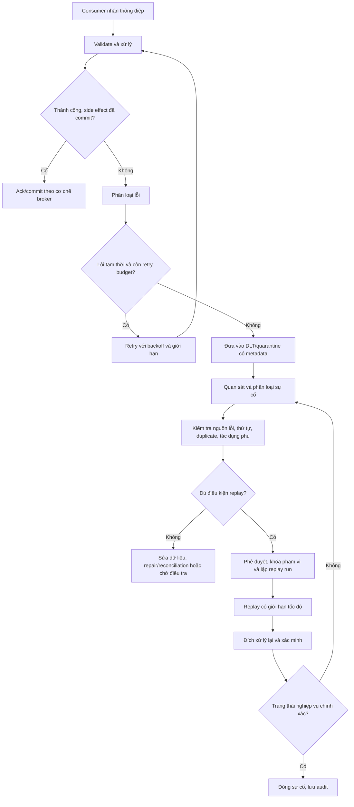

# Quản lý dead-letter, replay và quyền vận hành các thao tác phục hồi

## 1. Vì sao dead-letter và replay là một phần của vận hành tích hợp?

Một hệ thống Spring Boot tích hợp nhiều dịch vụ qua HTTP, cơ sở dữ liệu, Kafka, RabbitMQ hoặc các adapter của Spring Integration không thể giả định rằng mọi thông điệp đều được xử lý thành công ngay lần đầu. Một bản ghi có thể bị lỗi vì database tạm ngừng, API đối tác trả HTTP 503, payload sai schema, dữ liệu tham chiếu chưa xuất hiện hoặc code consumer có lỗi. Khi đó, hệ thống phải trả lời được:

- **Lỗi là tạm thời hay không thể tự phục hồi?** Có nên retry ngay, retry sau hay cách ly thông điệp?
- **Thông điệp thất bại nằm ở đâu?** Có giữ được payload gốc, khóa nghiệp vụ, nguyên nhân lỗi và vị trí trên broker không?
- **Ai có quyền xem, sửa chính sách, phê duyệt và thực hiện replay?** Có lưu vết được từng thao tác vận hành không?
- **Replay có an toàn không?** Liệu cùng thông điệp sẽ ghi trùng database, gửi lại khoản thanh toán hoặc làm trạng thái nghiệp vụ quay về phiên bản cũ?
- **Khi nào được xem là phục hồi thành công?** Đã gửi lại vào broker mới chỉ là một bước; đích phải thực sự xử lý và ghi nhận kết quả.

Bài học thuộc nhóm **Vận hành tích hợp** của module `SPRING_BOOT_INTEGRATION`. Trọng tâm là xây dựng quy trình xử lý sự cố có thể kiểm soát trên toàn luồng tích hợp: tiếp nhận, phân loại lỗi, dead-letter, điều tra, phê duyệt, replay, xác minh hiệu lực nghiệp vụ và kiểm toán.

**Nguyên tắc cốt lõi:** dead-letter giúp giữ lại và cô lập thông điệp không xử lý được; replay là một thao tác vận hành **có thể tạo thêm tác dụng phụ**. Cả hai phải được thiết kế cùng idempotency, chính sách thứ tự, hợp đồng dữ liệu và quyền truy cập.

## 2. Phân biệt retry, dead-letter, quarantine và replay

| Khái niệm | Mục đích | Ví dụ |
| --- | --- | --- |
| **Retry tại chỗ (blocking retry)** | Thử lại khi lỗi có khả năng hết trong thời gian ngắn, thường giữ vị trí xử lý | Gọi lại HTTP khi gặp lỗi 503 sau backoff |
| **Retry trì hoãn** | Hoãn xử lý để giảm tải hoặc đợi dependency hồi phục | Đưa vào retry topic/queue với lịch xử lý sau |
| **Dead-letter queue/topic (DLQ/DLT)** | Chuyển thông điệp thất bại sau khi đã áp dụng chính sách lỗi | `orders.events.DLT` lưu event không xử lý được |
| **Quarantine** | Cách ly để điều tra, hạn chế tự động phát lại | Một sự kiện chứa dữ liệu sai hợp đồng, cần nhóm nguồn sửa |
| **Replay / redrive** | Yêu cầu xử lý lại một hoặc nhiều thông điệp đã lưu | Đưa event từ DLT trở lại luồng xử lý hợp lệ |
| **Reconciliation / repair** | Đối chiếu và sửa trạng thái từ nguồn sự thật | Tải lại trạng thái đơn hàng, tái tạo projection từ dữ liệu nguồn |
| **Compensation** | Tạo hành động nghiệp vụ bù trừ cho side effect đã xảy ra | Phát giao dịch hoàn tiền, thay vì chạy lại lệnh ghi nợ |

Dead-letter **không đồng nghĩa** thông điệp đã được xử lý thành công. Replay **không đồng nghĩa** khôi phục đúng dữ liệu: thông điệp được phát lại có thể đến sau các sự kiện mới hơn, bị consumer từ chối, hoặc đã thực hiện một phần side effect trước lần thất bại đầu.

Cần phân biệt hai loại thông điệp nằm trong DLT:

1. **Thông điệp lỗi kỹ thuật:** payload hợp lệ nhưng dependency tạm thời không sẵn sàng; có thể redrive sau khi dependency khỏe lại.
2. **Thông điệp lỗi dữ liệu/nghiệp vụ:** schema không hợp lệ, phiên bản không tương thích hoặc trạng thái không cho phép; cần sửa nguyên nhân và xác nhận điều kiện replay trước khi đưa trở lại.

Không dùng DLT như kho lưu trữ vĩnh viễn. Retention, TTL, hạn mức lưu trữ và chính sách xóa của broker có thể làm mất bản ghi trước khi vận hành kịp xử lý.

## 3. Vòng đời phục hồi từ lỗi đến xác minh



Một luồng vận hành hoàn chỉnh nên có **mã sự cố (incident ID)**, **mã đợt replay (replay run ID)** và **trạng thái riêng cho từng thông điệp**. Các trạng thái vận hành như `QUARANTINED`, `APPROVED`, `SUBMITTED`, `APPLIED`, `REJECTED` mô tả tiến độ điều tra và phục hồi; chúng **không thay thế** offset Kafka, ack RabbitMQ hoặc trạng thái trong database đích.

Đặc biệt, trạng thái `SUBMITTED` chỉ có nghĩa bước phát lại được chấp nhận theo bằng chứng hiện có. Chỉ khi consumer đích đã áp dụng thành công hoặc đối soát chứng minh kết quả đúng mới được đánh dấu `APPLIED`.

## 4. Chính sách phân loại lỗi trước khi đưa vào dead-letter

| Loại lỗi | Dấu hiệu | Hành động ban đầu | Điều kiện phục hồi |
| --- | --- | --- | --- |
| Mạng, timeout, HTTP 429/503 | Dependency có khả năng hồi phục | Retry hữu hạn, exponential backoff và jitter | Dependency ổn định, có giới hạn tải |
| DB connection unavailable | Kết nối lỗi tạm thời | Retry theo ngưỡng, tránh bão kết nối | Health check và transaction an toàn |
| Payload không deserialize được | JSON sai, Avro/Protobuf schema không nhận | Quarantine sớm, không retry vô hạn | Có parser/schema hoặc nguồn phát bản ghi hợp lệ |
| Vi phạm quy tắc nghiệp vụ | Trạng thái không hợp lệ, ID không tồn tại | Phân biệt dữ liệu đến trễ với lỗi vĩnh viễn | Đã đối chiếu nguyên nhân và trạng thái nguồn |
| Trùng event | `eventId` đã xử lý | Idempotent skip/ack nếu xác minh xử lý trước thành công | Không cần replay tác dụng phụ |
| Thiếu phiên bản trước | Nhận version 12 khi đích mới ở version 10 | Tạm giữ hoặc chặn áp dụng, báo gap | Version 11 đã áp dụng, hoặc có chính sách rebuild |
| Code consumer bị lỗi | Nhiều message cùng stack trace sau deploy | Khoanh vùng phiên bản, rollback/hotfix | Bản sửa đã kiểm thử trên bản sao dữ liệu lỗi |
| Credential bị thu hồi/hết hạn | Lỗi xác thực của connector | Dừng phát lại tự động, xử lý secrets/permission | Thử lại bằng kênh kiểm soát sau khi xác thực hồi phục |

**Retry budget** cần thể hiện số lần thử, tổng thời gian, backoff, timeout và cơ chế dừng. Ví dụ: 3 lần thử ở consumer, sau đó quarantine. Đây là **ví dụ chính sách**, không phải giá trị mặc định áp dụng cho mọi service.

Một số lỗi không thể phân loại bằng HTTP status đơn giản. Chẳng hạn HTTP 409 có thể nghĩa “đã xử lý thành công trước đó” hoặc “xung đột phiên bản chưa giải quyết”; phải đọc hợp đồng API và idempotency key. HTTP 400 có thể xuất phát từ lỗi serializer của client, không nhất thiết là dữ liệu nguồn sai.

Nếu consumer liên tục đẩy hàng nghìn bản ghi vào DLT, cần xem đây là dấu hiệu sự cố diện rộng. Để broker tiếp tục tiêu thụ nhanh có thể gây mất thứ tự nghiệp vụ và làm backlog điều tra tăng không kiểm soát.

## 5. Metadata cần giữ cùng thông điệp dead-letter

Một thông điệp DLT cần đủ thông tin giúp tái hiện đúng sự kiện và lý do thất bại. Ví dụ hồ sơ điều tra tách riêng khỏi bản ghi payload gốc:

```json
{
  "deadLetterRecordId": "dlr-81452",
  "eventId": "evt-227ac9",
  "aggregateType": "Order",
  "aggregateId": "order-4711",
  "aggregateVersion": 17,
  "source": {
    "platform": "kafka",
    "topic": "orders.events",
    "partition": 4,
    "offset": 20987,
    "consumerGroup": "order-projection"
  },
  "failure": {
    "code": "DEPENDENCY_TIMEOUT",
    "classification": "TRANSIENT",
    "firstFailedAt": "2026-11-21T05:15:09Z",
    "lastFailedAt": "2026-11-21T05:16:20Z",
    "attemptCount": 3
  },
  "operations": {
    "status": "QUARANTINED",
    "incidentId": "INC-184",
    "replayRunId": null
  }
}
```

Đây là **mô hình dữ liệu vận hành minh họa**, không phải định dạng header bắt buộc của Kafka/RabbitMQ/SQS. Có thể lưu phần metadata trong header, bảng điều tra hoặc kho sự kiện riêng, nhưng **phải giữ được tham chiếu tới payload gốc** (bytes hoặc bản sao được bảo vệ) và key ban đầu.

Các trường tối thiểu thường gồm:

- **Định danh:** `eventId`, message ID, source system, message type/schema version, khóa nghiệp vụ (aggregate ID).
- **Vị trí nguồn:** topic/partition/offset Kafka; queue/exchange/routing key RabbitMQ; queue URL/ARN/message attributes phù hợp với SQS.
- **Lỗi:** mã phân loại có kiểm soát, lần đầu/lần cuối thất bại, số lần thử, tên component, phiên bản ứng dụng; stack trace chi tiết để trong kho log có phân quyền.
- **Ngữ nghĩa nghiệp vụ:** aggregate version/sequence, correlation ID, idempotency key, thời điểm phát sinh và đối tượng mà message thay đổi.
- **Dấu vết phục hồi:** người tạo yêu cầu, người phê duyệt, phạm vi, ticket, mã replay run, kết quả ở đích.

Các header do broker sinh ra không phải lúc nào cũng giống nhau. Ví dụ Spring Kafka có thể bổ sung thông tin topic/partition/offset gốc vào record DLT; RabbitMQ sử dụng các header liên quan lịch sử dead-letter; SQS cung cấp metadata riêng. Khi xây công cụ vận hành dùng nhiều broker, **chuẩn hóa sang một mô hình chung mà không xóa metadata gốc**.

Payload thường chứa thông tin cá nhân, định danh khách hàng hoặc dữ liệu tài chính. Dashboard mặc định nên hiển thị metadata và bản xem đã che dữ liệu nhạy cảm; chỉ người được cấp quyền mới xem raw payload. Không ghi token, password, nội dung bí mật vào header lỗi hay audit log.

## 6. Spring Boot + Spring Kafka: chuyển lỗi sang DLT

### 6.1. Cấu hình consumer

Giả sử consumer xử lý các sự kiện cập nhật đơn hàng trên topic `orders.events`; khi cần quarantine, sử dụng topic `orders.events.DLT`. Ví dụ Spring Boot 3.x và Spring Kafka 3.x:

```yaml
spring:
  kafka:
    bootstrap-servers: ${KAFKA_BOOTSTRAP_SERVERS}
    consumer:
      group-id: order-projection
      enable-auto-commit: false
      key-deserializer: org.apache.kafka.common.serialization.StringDeserializer
      value-deserializer: org.apache.kafka.common.serialization.StringDeserializer
    listener:
      ack-mode: record
```

Ví dụ sử dụng payload `String` để tập trung vào luồng lỗi. Với JSON/Avro/Protobuf deserialize trực tiếp trước listener, lỗi có thể xảy ra **trước khi method `@KafkaListener` được gọi**; cần cấu hình `ErrorHandlingDeserializer` và đường xuất bản DLT phù hợp kiểu dữ liệu để giữ payload lỗi. Không giả định mọi exception đều được bắt bởi `try/catch` bên trong listener.

### 6.2. Error handler với số lần retry hữu hạn

```java
import org.apache.kafka.common.TopicPartition;
import org.springframework.context.annotation.Bean;
import org.springframework.context.annotation.Configuration;
import org.springframework.kafka.core.KafkaTemplate;
import org.springframework.kafka.listener.DeadLetterPublishingRecoverer;
import org.springframework.kafka.listener.DefaultErrorHandler;
import org.springframework.util.backoff.FixedBackOff;

@Configuration
public class DeadLetterConfiguration {

    @Bean
    DefaultErrorHandler kafkaErrorHandler(KafkaTemplate<Object, Object> template) {
        DeadLetterPublishingRecoverer recoverer =
                new DeadLetterPublishingRecoverer(
                        template,
                        (record, error) -> new TopicPartition(
                                record.topic() + ".DLT", -1));

        DefaultErrorHandler handler =
                new DefaultErrorHandler(recoverer, new FixedBackOff(1_000L, 2L));

        handler.addNotRetryableExceptions(PermanentEventException.class);
        return handler;
    }

    public static class PermanentEventException extends RuntimeException {
        public PermanentEventException(String message) {
            super(message);
        }
    }
}
```

Ở ví dụ trên:

- `FixedBackOff(1_000L, 2L)` thể hiện hai lần retry sau lần xử lý ban đầu, cách nhau 1 giây.
- `PermanentEventException` được đánh dấu không retry để lỗi dữ liệu có thể đi thẳng tới recoverer theo chính sách.
- `DeadLetterPublishingRecoverer` phát bản ghi thất bại sang topic đích; resolver dùng partition `-1` để producer chọn partition cho DLT. Điều này **không giữ cùng partition/ordering với topic nguồn**.
- Topic DLT, serializer của key/value, ACL và retention phải được provision trước. Với payload không deserialize được, serializer của recoverer cần xử lý đúng kiểu payload lỗi.
- Cần kiểm tra cách xác nhận **gửi DLT thành công** trước khi container coi record nguồn là recovered và commit offset; kiểm thử cả tình huống DLT không khả dụng để không “mất” message giữa hai bước.

Đây là ví dụ cấu hình cơ bản, không bao gồm một chính sách retry đa tầng. Spring Kafka có các cơ chế retry topic không chặn tùy phiên bản/cấu hình; **chuyển sang retry topic có thể khiến record mới hơn xử lý trước record lỗi**. Khi cần thứ tự nghiêm ngặt theo aggregate, phải lựa chọn blocking retry hoặc logic chặn theo version.

### 6.3. Listener và transaction/idempotency

```java
import org.apache.kafka.clients.consumer.ConsumerRecord;
import org.springframework.kafka.annotation.KafkaListener;
import org.springframework.stereotype.Component;

@Component
public class OrderProjectionListener {
    private final OrderProjectionService projectionService;
    private final OrderEventCodec codec;

    public OrderProjectionListener(
            OrderProjectionService projectionService,
            OrderEventCodec codec) {
        this.projectionService = projectionService;
        this.codec = codec;
    }

    @KafkaListener(topics = "orders.events")
    public void onRecord(ConsumerRecord<String, String> record) {
        OrderEvent event;
        try {
            event = codec.decode(record.value());
        } catch (InvalidEventSchemaException invalid) {
            throw new DeadLetterConfiguration.PermanentEventException(
                    "Event schema is invalid");
        }

        // Service tự đảm nhiệm DB transaction, duplicate check và version guard.
        projectionService.applyIdempotently(event);
    }
}
```

`OrderEventCodec`, `OrderEvent`, `InvalidEventSchemaException` và `OrderProjectionService` là các thành phần nghiệp vụ minh họa, cần xây dựng trong project. Nếu `applyIdempotently` commit DB rồi ứng dụng chết trước khi commit Kafka offset, record có thể được giao lại; consumer phải bỏ qua duplicate an toàn. Không ack sớm khi transaction hoặc tác vụ async chưa hoàn tất.

Lưu ý quan trọng: default error handler không thay thế chính sách ứng dụng cho HTTP side effect. Nếu đã gửi lệnh thanh toán tới API nhưng lỗi ở bước cập nhật DB, retry/replay có thể gửi lệnh đó lần nữa. Cần idempotency key phía API nhận hoặc thiết kế outbox/reconciliation phù hợp.

## 7. RabbitMQ, SQS và các adapter Spring Integration

### 7.1. RabbitMQ: dead-letter exchange và negative acknowledgement

Với RabbitMQ, queue nguồn có thể được gắn dead-letter exchange (DLX) để broker định tuyến message bị reject/nack với `requeue=false`, hết TTL hoặc vượt điều kiện giới hạn phù hợp sang queue đích.

```text
Producer → exchange: orders.x → queue: orders.q
                                  │
                  reject/nack (requeue=false)
                                  ▼
                             DLX: orders.dlx
                                  │
                                  ▼
                         Queue: orders.dead
```

Ví dụ cấu hình consumer Spring AMQP ở mức đơn giản:

```yaml
spring:
  rabbitmq:
    listener:
      simple:
        default-requeue-rejected: false
```

Cấu hình này làm container tránh requeue mặc định khi listener thất bại theo cơ chế tương ứng. **Broker chỉ lưu message trong dead-letter queue nếu routing DLX, binding, queue đích và chính sách đã được thiết lập đúng**. Nếu không có đường dead-letter hợp lệ, thông điệp có thể bị loại bỏ. Đường dead-letter thường được khai báo bằng **policy** trên broker để dễ vận hành; hard-code `x-dead-letter-exchange` vào queue arguments phải cân nhắc vòng đời queue và cập nhật cấu hình.

Một chính sách retry cần kết hợp với `default-requeue-rejected=false`: có thể dùng retry interceptor, delayed retry queue hoặc cơ chế khác tùy Spring AMQP và topology. Nếu bật requeue lặp lại không giới hạn, một poison message có thể tạo vòng lặp nhanh khiến CPU, network và queue bị quá tải.

Trong RabbitMQ, nhiều competing consumer, prefetch, retry và requeue ảnh hưởng đến thứ tự xử lý. Replay message từ dead-letter queue không mặc nhiên đưa nó trở về **đúng vị trí cũ** trong queue nguồn.

### 7.2. Amazon SQS: DLQ và redrive policy

SQS cấu hình dead-letter queue, ngưỡng `maxReceiveCount` và quyền gửi/nhận thích hợp. Sau nhiều lần nhận nhưng xử lý chưa thành công, source queue chuyển message đến DLQ theo cơ chế SQS.

- Với **SQS Standard**, thứ tự xử lý vốn không được bảo đảm nghiêm ngặt và message có thể bị giao lại.
- Với **SQS FIFO**, các message group giúp giữ thứ tự theo nhóm trong luồng bình thường. Đưa message sang DLQ và sau đó redrive có thể phá vỡ giả định thứ tự ứng dụng nếu message sau trong cùng nhóm đã được xử lý trước.
- Thời gian lưu trữ source queue và DLQ cần được thiết kế hợp lý; không mặc định một message có thể chờ trong DLQ vô thời hạn.
- Công cụ SQS redrive có cơ chế và quyền riêng. Operator cần kiểm tra queue nguồn/đích, số lượng và tốc độ redrive theo khả năng của dịch vụ đang dùng.

### 7.3. Spring Integration: error channel và adapter

Spring Integration có `errorChannel`, `ErrorMessage`, advice và các flow/adapter tích hợp. Lỗi trong flow đồng bộ hay bất đồng bộ có thể được chuyển qua error channel tùy cách cấu hình. **Gửi một `ErrorMessage` tới error channel không tự đồng nghĩa thông điệp đã được lưu bền vững trong DLQ**.

Nếu muốn phục hồi sau restart, cần thiết kế error flow **đưa payload và metadata cần thiết vào một kho bền vững** như broker DLT hoặc bảng quarantine. Phải xác định acknowledgment của inbound adapter (Kafka, AMQP, JMS, HTTP…) diễn ra ở đâu; việc error flow nuốt exception và trả về thành công có thể khiến nguồn thông điệp coi bản ghi đã xử lý.

### 7.4. Bảng so sánh thao tác phục hồi

| Công nghệ | Nơi lưu bản ghi lỗi | Kiểu replay/redrive | Điểm cần chú ý |
| --- | --- | --- | --- |
| Kafka | DLT riêng hoặc topic quarantine | Consumer đọc DLT rồi publish sang topic xử lý/replay; hoặc quản lý offset group | Offset reset là thao tác diện rộng trên partition/group, không chọn chính xác một event |
| RabbitMQ | Dead-letter queue qua DLX | Consumer được kiểm soát đọc queue lỗi và republish đến exchange đích | Ack bản ghi lỗi sau khi publish được xác nhận; requeue không giữ nguyên vị trí ban đầu |
| SQS | DLQ gắn với source queue | SQS redrive hoặc worker được kiểm soát | Retention, giới hạn tốc độ, message group và IAM |
| Spring Integration | Error channel, store hoặc broker bên ngoài | Flow phục hồi do ứng dụng thiết kế | Error channel in-memory không phải lưu trữ bền vững |

## 8. Chọn phương thức replay đúng với phạm vi sự cố

Một lỗi đơn lẻ và một đợt outage làm hàng triệu record lỗi cần hai chiến lược khác nhau.

### 8.1. Replay theo từng message

Phù hợp khi lỗi chỉ ảnh hưởng một vài record. Operator chọn theo `eventId` hoặc ID DLT, xem metadata, xác minh trạng thái hiện tại của aggregate, rồi tạo một yêu cầu replay cụ thể. Cần guard để tránh replay nhầm event của khách hàng khác hoặc gửi lại một side effect đã thành công.

### 8.2. Replay theo lô có bộ lọc

Phù hợp với outage có nguyên nhân chung. Bộ lọc nên theo các tiêu chí đã kiểm chứng:

- Nguồn topic/queue, consumer group hoặc tên luồng tích hợp.
- Khoảng thời gian lỗi và `failureCode` cụ thể.
- Phiên bản ứng dụng hoặc schema version đã sửa.
- Tập event ID xác định được hoặc khóa nghiệp vụ được chấp thuận.

Luôn có **preview số lượng**, ngưỡng tối đa, tốc độ gửi và khả năng dừng. Tránh tiêu chí quá rộng như “tất cả message DLT” nếu chưa chứng minh rằng mọi loại lỗi đã được khắc phục.

### 8.3. Replay bằng cách reset Kafka consumer offset

Kafka lưu offset theo **consumer group + topic + partition**. Reset offset của một group có thể khiến consumer đọc lại *toàn bộ đoạn record* từ offset mới, kể cả những record đã xử lý thành công. Đây là công cụ hữu ích khi rebuild projection, nhưng phạm vi lớn hơn rất nhiều so với replay một message trong DLT.

Trước khi thao tác cần:

1. Xác định group, topic, partition, offset đích và thời điểm bắt đầu.
2. Dừng hoặc điều phối các consumer của group để tránh commit mới trong lúc đổi offset.
3. Ước lượng số record được đọc lại, dữ liệu sẽ ghi và khả năng gây duplicate.
4. Đảm bảo consumer idempotent hoặc dùng group/topic/projection đích tách biệt cho rebuild.
5. Lưu offset cũ, phương án khôi phục, bằng chứng phê duyệt và kết quả.

**Không dùng offset reset để “sửa nhanh” một poison message** nếu hệ thống cần tránh phát lại hàng loạt side effect. Nếu chỉ cần xử lý lại một event, sử dụng replay có định danh từ DLT/quarantine an toàn và dễ audit hơn.

### 8.4. Repair từ nguồn sự thật

Không phải lúc nào cần replay event cũ. Nếu hệ thống lưu trạng thái mới nhất ở source database, có thể đối soát hoặc tái tạo projection bằng snapshot có version.

Ví dụ một projection đã ở version 15 nhưng event version 11 nằm trong DLT: replay version 11 có thể bị từ chối đúng đắn vì stale. Nếu trạng thái hiện tại đã chính xác, có thể đánh dấu `SUPERSEDED` sau khi đối chiếu; nếu vẫn thiếu dữ liệu, dùng snapshot/reconciliation tạo lại kết quả đúng. Quy trình này cần phê duyệt vì thay đổi trạng thái nghiệp vụ, không đơn thuần dịch chuyển message.

## 9. Replay an toàn cần idempotency, transaction và version guard

### 9.1. Replay được thiết kế theo giả định at-least-once

Một workflow replay gồm tối thiểu hai hệ thống: nơi đọc message lỗi và nơi phát message trở lại. Nếu publish thành công nhưng worker chết trước khi ghi trạng thái audit, lần chạy lại có thể publish trùng. Đây là một dạng **dual-write**; không thể giải quyết chỉ bằng việc đặt trạng thái `SENT` sau lời gọi `send`.

Thiết kế tối thiểu:

1. Giữ nguyên `eventId` logic và `aggregateId`; gắn thêm `replayRunId` trong metadata vận hành.
2. Consumer đích có **dedupe theo event ID và tên consumer/side effect**, cập nhật trạng thái trong transaction.
3. Nếu tích hợp HTTP bên ngoài, truyền idempotency key ổn định hoặc dùng outbox để điều phối tác dụng phụ.
4. Replay worker phải chịu được publish trùng và có cách reconciliation bản ghi đang ở trạng thái không rõ kết quả.
5. Chỉ xác nhận `APPLIED` khi có bằng chứng đích đã xử lý hoặc dữ liệu đã đối chiếu đúng.

Ví dụ giản lược bảng idempotency của một consumer PostgreSQL:

```sql
CREATE TABLE processed_integration_event (
    consumer_name VARCHAR(80) NOT NULL,
    event_id VARCHAR(128) NOT NULL,
    processed_at TIMESTAMPTZ NOT NULL DEFAULT CURRENT_TIMESTAMP,
    PRIMARY KEY (consumer_name, event_id)
);
```

**Điều kiện:** insert dedupe marker và thay đổi dữ liệu nghiệp vụ cần nằm trong **cùng transaction DB**. Nếu ghi marker trước rồi thao tác nghiệp vụ thất bại, lần retry có thể bị coi nhầm là đã thành công. Nếu gọi API bên ngoài, phải thiết kế thêm idempotency/đối soát ở ranh giới API vì transaction DB không rollback được request đã xử lý ở dịch vụ khác.

### 9.2. Đặt version guard khi dữ liệu có thứ tự

Giả sử cùng `orderId`:

```text
OrderCreated      version=1  → APPLIED
OrderPaid         version=2  → DLT vì lỗi DB
OrderShipped      version=3  → đã được xử lý hoặc đang chờ
```

Nếu `OrderShipped` đã ghi trạng thái trước, replay `OrderPaid` mà không kiểm tra version có thể làm trạng thái quay về `PAID` sau `SHIPPED`. Phải định nghĩa một trong các chiến lược:

- **Strict sequence:** chỉ áp dụng `version = lastAppliedVersion + 1`. Giữ version mới hơn chờ cho tới khi gap được xử lý.
- **Monotonic projection:** không ghi đè dữ liệu mới hơn bằng event cũ; có quy tắc xử lý event superseded.
- **Rebuild/reconciliation:** tính lại trạng thái từ nguồn sự thật hoặc toàn bộ lịch sử event khi cần khôi phục nhân quả.
- **Compensation:** nếu tác dụng phụ đã hoàn tất nhưng sai nghiệp vụ, tạo hành động sửa tương ứng thay vì chạy lại event cũ.

Một thông điệp từ DLT đưa về cuối Kafka topic sẽ nhận offset **mới**; không thể chen nó vào offset cũ. Giữ nguyên key chỉ giúp record mới vào partition theo routing hiện tại, **không phục hồi vị trí nhân quả ban đầu**. Nếu số partition hoặc partitioner đã đổi, phải đánh giá lại mapping key.

### 9.3. Phân biệt bản ghi lỗi với tác dụng phụ đã xảy ra

Ví dụ payment worker:

1. Đã gửi lệnh `capture` đến cổng thanh toán.
2. Gateway đã thực hiện thành công.
3. Worker timeout trước khi ghi DB và quyết định ném exception.
4. Message vào DLT.

Replay trực tiếp có thể **capture lần hai**. Trước khi replay, tra trạng thái gateway theo payment ID/idempotency key và đối soát ledger. Nếu gateway đã thành công, tiếp tục từ checkpoint/repair trạng thái thay vì phát lại lệnh thanh toán như mới.

## 10. Mô hình quyền vận hành: ai được làm gì?

Dead-letter có thể chứa dữ liệu nhạy cảm và replay có thể sửa trực tiếp trạng thái nghiệp vụ. Do đó **quyền quan sát, quyền đọc payload, quyền phê duyệt và quyền thực thi** cần tách riêng.

| Vai trò | Xem metric / số lượng DLT | Xem payload gốc | Tạo yêu cầu replay | Phê duyệt | Thực thi |
| --- | --- | --- | --- | --- | --- |
| Viewer / On-call L1 | Có | Mặc định che dữ liệu | Có thể đề xuất, không tự thực thi | Không | Không |
| Investigator / On-call L2 | Có | Chỉ phạm vi được cấp | Có | Không hoặc theo chính sách rủi ro thấp | Không |
| Service owner | Có | Theo quyền sở hữu dữ liệu | Có | Có trong phạm vi service | Theo chính sách đã phê duyệt |
| Approver độc lập | Có | Theo nguyên tắc cần biết | Xem yêu cầu | Có | Không cho đợt nhạy cảm |
| Replay operator / Automation | Có | Chỉ dữ liệu tối thiểu cần chạy | Nhận yêu cầu đã phê duyệt | Không tự phê duyệt cùng yêu cầu | Có, trong phạm vi được cấp |
| Security / Audit | Audit và các bằng chứng được phép | Theo quy trình riêng | Không mặc định | Kiểm soát chính sách | Không mặc định |

Bảng là **mô hình tham khảo**, cần điều chỉnh theo tổ chức và quy định truy cập dữ liệu. Một service nhỏ có thể gộp vai trò ít rủi ro, nhưng với sự kiện thanh toán, tài khoản, dữ liệu khách hàng hoặc thay đổi hàng loạt, nên có **phê duyệt hai người** và tách người yêu cầu khỏi người thực thi.

Các nguyên tắc thiết kế quyền:

- **Least privilege:** tài khoản chỉ xem metric không cần quyền `consume` raw DLT hoặc `produce` topic nghiệp vụ.
- **Phạm vi rõ:** giới hạn theo environment (dev/staging/prod), namespace, cluster, topic/queue, loại sự kiện và số record tối đa.
- **Thời hạn quyền:** quyền break-glass khẩn cấp có expiry, lý do, session audit và review sau sự cố.
- **Machine identity:** service account replay chỉ được đọc nguồn DLT cần thiết và ghi vào topic/queue đích được phê duyệt.
- **Không dùng tài khoản cá nhân trong script dùng chung:** thao tác phải gắn identity và token/certificate được quản lý an toàn.
- **Bảo vệ payload:** che thông tin nhạy cảm trong UI/log; chỉ cấp raw payload khi cần điều tra và ghi nhận việc truy cập.
- **Deny by default:** endpoint replay phải yêu cầu xác thực và authorization phía server; không tin vào nút “disabled” trên giao diện.

Với broker, cần kết hợp IAM/RBAC ứng dụng với ACL của Kafka, RabbitMQ permissions/vhost hoặc IAM của AWS SQS. **Chỉ có endpoint API kiểm soát quyền nhưng service account backend được ghi mọi topic vẫn là một điểm rủi ro**; phân quyền ở cả tầng broker và ứng dụng.

## 11. Quy trình phê duyệt và audit của một replay run

Một replay run phải mô tả chính xác **ai**, **cái gì**, **vì sao**, **ở đâu**, **khi nào** và **đã tạo tác động gì**.

Ví dụ yêu cầu vận hành:

```json
{
  "replayRunId": "replay-20261121-0042",
  "incidentId": "INC-184",
  "requestedBy": "operator-L2",
  "approvedBy": "service-owner",
  "reason": "Partner API restored after 503 outage",
  "source": "orders.events.DLT",
  "target": "orders.events",
  "selection": {
    "failureCode": "PARTNER_HTTP_503",
    "from": "2026-11-21T04:30:00Z",
    "to": "2026-11-21T05:00:00Z",
    "expectedCount": 120
  },
  "policy": {
    "maxMessages": 120,
    "maxPerSecond": 5,
    "stopOnErrorRatePercent": 10
  },
  "status": "APPROVED"
}
```

Giá trị định danh, thời gian và ngưỡng trong ví dụ mang tính minh họa. Đừng dùng chuỗi `approvedBy` do client tự gửi làm bằng chứng. Hệ thống phải lấy identity của approver từ authentication context, lưu **quyết định phê duyệt phía server** và xác thực lại trước khi execute.

Dữ liệu audit nên gồm:

1. **Request:** người tạo, thời gian, ticket, nguyên nhân, tiêu chí chọn, số lượng dự kiến, hash/snapshot danh sách record.
2. **Review:** người phê duyệt, thời gian, version chính sách, phạm vi và ngưỡng được phép.
3. **Execution:** identity thực thi, worker/job version, thời gian bắt đầu/dừng, source/target, tốc độ, số record đã gửi và số lỗi.
4. **Outcome:** số được đích xác nhận xử lý, số duplicate được bỏ qua, số stale/gap, số vẫn lỗi, bằng chứng đối soát.
5. **Change history:** ai hủy, tạm dừng, sửa ngưỡng hoặc thử lại; thay đổi phạm vi phải yêu cầu phê duyệt mới.

Thực thi chỉ được dùng **snapshot hoặc tập ID đã được phê duyệt**. Nếu giao diện duyệt “120 event lỗi HTTP 503” nhưng worker chạy lại truy vấn không giới hạn và tìm thấy 10.000 event mới, thao tác đã vượt phạm vi phê duyệt.

## 12. Runbook thực tế: phục hồi một đợt DLT sau outage

### Bước 1 — Dừng làm sự cố lan rộng

Xác định lỗi đã được khắc phục chưa. Nếu consumer tiếp tục tạo DLT nhanh, cân nhắc giảm tốc độ nhận, tạm dừng consumer group hoặc chặn riêng loại sự kiện lỗi theo chính sách vận hành. Tránh tắt toàn bộ integration flow nếu điều đó gây hậu quả lớn hơn; điều phối phạm vi tác động theo business key/partition.

Thu thập snapshot metric: số record DLT, tốc độ tăng, tuổi record cũ nhất, source topic/queue và tỷ lệ lỗi. Lưu incident ID và phiên bản service.

### Bước 2 — Phân nhóm và điều tra dữ liệu

Chọn vài record đại diện theo `failureCode`, schema version, consumer version và khoảng thời gian lỗi; xem payload ở chế độ che dữ liệu trước. Đối chiếu với nguồn sự thật và log/trace.

Không trộn trong một replay run các nhóm có nguyên nhân khác nhau. Chẳng hạn HTTP 503 có thể đủ điều kiện replay, trong khi một tập khác sai schema cần code fix hoặc sửa từ producer.

### Bước 3 — Đánh giá tính hợp lệ của replay

Xác nhận:

- Dependency đã hồi phục, consumer version đã sửa lỗi, schema/adapter tương thích.
- Message chưa bị xử lý thành công qua đường khác; idempotency key vẫn còn hợp lệ.
- Trạng thái aggregate hiện tại cho phép áp dụng lại, hoặc đã có chiến lược repair/superseded.
- Không có side effect thanh toán, gửi email, ghi sổ hoặc webhook thành công một phần mà chưa được đối soát.
- Retention/TTL còn đủ thời gian và source payload có thể truy xuất nguyên vẹn.
- Có sức chứa ở DB, HTTP pool, broker và consumer để nhận thêm tải.

Nếu chưa trả lời được các câu hỏi này, giữ quarantine và điều tra; không vội bấm replay.

### Bước 4 — Tạo đề xuất và phê duyệt

Lưu tập message ID hoặc bộ lọc đã cố định, source/target, tổng số, giới hạn tốc độ, người phụ trách, phương án dừng và điều kiện hoàn tất. Yêu cầu approver trong đúng phạm vi dữ liệu và environment, thêm reviewer độc lập cho đợt có tác động lớn.

### Bước 5 — Chạy thử một nhóm nhỏ

Chọn một tập event đại diện trong staging với dữ liệu đã được bảo vệ hoặc trong production với phạm vi nhỏ theo chính sách. Kiểm tra bản sửa xử lý được nguyên nhân và không làm tăng duplicate/stale data. Quan sát side effect thật khi thử trên production; không đánh đồng “dry run” (chỉ mô phỏng) với “canary replay” (có ghi dữ liệu).

### Bước 6 — Replay theo lô có giới hạn

Dùng một worker replay được kiểm soát với rate limit, batch size, backpressure, stop switch và cơ chế resume từ checkpoint. Ghi riêng trạng thái từng record và đợt replay. Khi lỗi tăng hoặc phát hiện sai dữ liệu, dừng tự động.

### Bước 7 — Xác minh kết quả ở đích

Không chỉ dựa vào số record publish thành công. Đối chiếu `eventId`, phiên bản aggregate, trạng thái DB, phản hồi HTTP, outbox, số DLT mới và lag consumer. Những record bị từ chối vì duplicate có thể là **kết quả hợp lệ** nếu thực sự đã áp dụng; record stale/gap cần phân loại riêng.

### Bước 8 — Đóng sự cố và cải tiến

Lưu bằng chứng, ticket, số lượng đã xác minh, record còn lỗi và người phê duyệt đóng. Cập nhật monitoring, contract/schema validation, retry policy hoặc runbook nếu sự cố có thể tái diễn.

## 13. Thiết kế một replay worker có kiểm soát

Giả sử Spring Boot triển khai một **internal replay service**: đọc dữ liệu từ DLT/quarantine, phát bản ghi sang đường xử lý theo yêu cầu đã được phê duyệt. Có thể áp dụng một luồng điều khiển như sau:

```text
POST /internal/replays             → tạo yêu cầu, trạng thái DRAFT
POST /internal/replays/{id}/review  → approver duyệt, trạng thái APPROVED
POST /internal/replays/{id}/start   → executor bắt đầu chạy
POST /internal/replays/{id}/pause   → tạm dừng trước khi xử lý record mới
GET  /internal/replays/{id}         → tiến độ, lỗi, số record applied
```

Các endpoint trên chỉ là **thiết kế API minh họa**. Trong triển khai thật, API cần xác thực nội bộ, authorization ở cấp bản ghi/phạm vi, chống replay request lặp, audit và giới hạn tài nguyên. Với việc thực thi lâu dài, không nên giữ một HTTP request mở cho cả quá trình.

Pseudocode cho một replay job:

```text
run = loadApprovedReplayRun(runId)
authorizeExecutor(actor, run.environment, run.source, run.target)
assertApprovalStillValid(run)
assertSelectionMatchesApprovedSnapshot(run)
acquireLease(runId)

for record in approvedRecords(run):
    if runPausedOrCancelled(runId):
        break

    enforceRateLimit(run.maxPerSecond)
    state = inspectTargetState(record.aggregateId, record.version)

    if alreadyApplied(record.eventId) or supersededAccordingToPolicy(state, record):
        auditSkip(record, reason)
        continue

    ensureReplayPreconditions(record, state)
    publishWithOriginalKeyAndEventId(
        target=run.target,
        payload=record.originalPayload,
        headers={"replayRunId": runId, "replayAttemptId": stableAttemptId(record)}
    )
    awaitBrokerAcknowledgmentOrPublisherConfirm()
    auditSubmission(record)

releaseLease(runId)
verifyAppliedResultsAndReconcile(runId)
```

Bản thực thi cần thêm xử lý crash giữa `publish` và `auditSubmission`. Một cách tiếp cận là ghi **replay outbox** và dùng worker phát theo trạng thái, chấp nhận khả năng publish lặp rồi dùng idempotent consumer để bảo vệ side effect. Cần có retry và reconciliation cho các attempt có kết quả không rõ.

Không được “sửa payload trực tiếp trên DLQ” rồi coi đó vẫn là sự kiện gốc. Nếu cần chuyển đổi schema, tạo một bản ghi dẫn xuất với quan hệ `derivedFromEventId`, version chuyển đổi và audit rõ ràng. Giữ payload gốc để truy vết.

## 14. Quyền thực thi thấp nhất và kiểm soát bằng hạ tầng

### 14.1. Kafka

Một công cụ replay Kafka có thể cần:

- Quyền `READ` trên topic DLT và consumer group phục vụ điều tra/replay.
- Quyền `WRITE` trên **topic đích cụ thể** được phê duyệt.
- Quyền `DESCRIBE` tối thiểu để lấy metadata phục vụ kiểm tra.

Không cấp quyền admin cluster hoặc alter consumer group offsets chỉ vì worker cần publish vài event. Offset reset nên là một quyền vận hành tách biệt, thường được thực hiện theo runbook và quy trình phê duyệt riêng.

Nếu service dùng nhiều môi trường, phân tách principal và broker ACL giữa staging/prod. Hạn chế đường mạng, certificate/token và secret scope của replay worker.

### 14.2. RabbitMQ

Giới hạn vhost, exchange và queue mà công cụ được phép consume/publish. Không để ứng dụng replay tự tạo hoặc xóa mọi queue/exchange trừ khi thật sự cần và được cấp quyền quản trị. Xác nhận publisher confirms trước khi ack/delete bản ghi trong DLQ; nếu publish thất bại, cần giữ record để thử lại.

### 14.3. SQS

Tách IAM policy cho đọc DLQ, gửi queue đích và thao tác quản trị redrive. Nếu dùng SQS-managed redrive, yêu cầu quyền thích hợp trên source DLQ và destination queue theo tài liệu dịch vụ đang sử dụng. Không cấp wildcard `sqs:*` trên toàn account chỉ để phát lại một hàng đợi.

### 14.4. Ứng dụng và nền tảng

Dùng role hoặc policy trong Spring Security (hay lớp IAM tương đương) để kiểm tra action + resource + môi trường; kiểm tra lại ngay trước execute. Rate limit, quotas, policy ngưỡng và tách người phê duyệt khỏi người thực thi phải được **enforce server-side**. Audit phải nằm trong kho chỉ ghi thêm hoặc có cơ chế chống sửa/xóa theo yêu cầu tổ chức.

## 15. Observability và cảnh báo cho dead-letter

**Số lượng message DLT là chưa đủ.** Cần kết hợp backlog, tuổi record và tình trạng business outcome.

| Chỉ số | Ý nghĩa | Gợi ý sử dụng |
| --- | --- | --- |
| Tốc độ message mới vào DLT | Lỗi đang tiếp diễn hay đã ngừng | Cảnh báo đột biến theo tỷ lệ và thời gian |
| Backlog DLT / quarantine | Khối lượng chờ điều tra | Capacity planning, SLA phục hồi |
| Tuổi record cũ nhất | Nguy cơ vượt thời hạn xử lý/retention | Cảnh báo theo hạn xử lý nghiệp vụ |
| Phân bố `failureCode` | Cô lập loại lỗi phổ biến | Routing incident tới đúng service owner |
| Retry attempts và exhausted retries | Retry policy có hữu hiệu không | Phát hiện vòng lặp hoặc outage kéo dài |
| Replay submitted / applied / skipped / failed | Tiến độ thực sự của đợt phục hồi | Không nhầm submit với applied |
| Version gap / stale / duplicate | Ordering và idempotency | Bắt lỗi dữ liệu dù consumer lag thấp |
| Consumer lag và lỗi tại DB/HTTP | Ảnh hưởng replay lên hệ thống chính | Điều chỉnh rate limit, stop khi quá tải |
| Thao tác replay theo actor/environment | Bất thường quyền vận hành | Security/audit investigation |

Micrometer, Spring Boot Actuator, logs có cấu trúc và distributed tracing có thể nối `correlationId`, `eventId`, `replayRunId` từ nguồn đến đích. Tuy nhiên, `eventId`/`aggregateId` có cardinality rất cao: dùng làm trường log/trace có kiểm soát, tránh làm label cho metric Prometheus thông thường.

Cảnh báo nên gắn mục tiêu thực tế: “DLT tăng liên tục 10 phút”, “record chờ vượt thời hạn nghiệp vụ”, “replay tạo lại lỗi > ngưỡng” hoặc “DLT sắp hết retention”. Ngưỡng cần dựa trên SLA, throughput và thời gian vận hành của hệ thống, không có một con số chuẩn cho mọi broker.

## 16. Kiểm thử chu trình lỗi và phục hồi

Một bài kiểm thử production-like nên có broker và database thật qua Testcontainers khi phù hợp. Với Kafka/Spring Kafka, nên kiểm tra cấu hình deserialize lỗi, DLT publishing, consumer error handler và transaction DB; chỉ mock `DefaultErrorHandler` không chứng minh message thực sự được giữ ở topic lỗi.

| Kịch bản | Bằng chứng cần thu |
| --- | --- |
| Consumer gặp HTTP 503 tạm thời | Retry có giới hạn, backoff được áp dụng, không retry vô hạn |
| Payload sai schema | Bị đưa vào quarantine, giữ payload gốc và metadata cần điều tra |
| Topic/queue DLT không khả dụng | Không ack/commit bản ghi nguồn như đã phục hồi nếu dead-letter chưa bền vững |
| DB commit thành công nhưng ack/offset fail | Redelivery không gây duplicate side effect |
| Replay cùng event hai lần | Consumer dedupe hoặc reconciliation cho kết quả đúng |
| Event version cũ replay sau version mới | Guard chặn ghi đè sai trạng thái hoặc xử lý superseded đúng chính sách |
| Replay lô vượt giới hạn phê duyệt | Hệ thống từ chối hoặc dừng, audit đầy đủ |
| Operator thiếu quyền | Không xem raw payload/không execute, không thể vượt qua bằng API trực tiếp |
| Người tự phê duyệt thao tác rủi ro cao | Hệ thống buộc approver độc lập theo policy |
| Replay worker crash sau publish | Resume an toàn, audit thể hiện attempt không rõ kết quả để đối soát |
| Broker backpressure hoặc HTTP lỗi trở lại | Rate limit và stop switch hoạt động, không dội tải |
| Message quá hạn retention | Cảnh báo và chính sách khôi phục thay thế (snapshot/reconciliation) rõ ràng |

Đừng chỉ kiểm tra “consumer đọc lại message”. Một bài kiểm thử quan trọng phải xác minh **trạng thái cuối ở database/API đích** và số side effect thực tế.

## 17. Tình huống tổng hợp: phục hồi sự kiện thanh toán sau outage

Giả sử `payment-service` phát `PaymentCaptured` vào Kafka. Một Spring Boot consumer `invoice-sync` nhận event, gọi API kế toán và ghi trạng thái đồng bộ vào PostgreSQL. Đúng lúc API kế toán gặp outage, 600 event được đẩy sang `payments.captured.DLT` sau retry hữu hạn.

Nếu vận hành bấm “Replay all” ngay, rủi ro gồm:

- Một số API call đã thành công nhưng client nhận timeout; phát lại gây ghi trùng hóa đơn.
- Có event cũ liên quan hóa đơn đã được hủy hoặc điều chỉnh bằng luồng khác.
- 600 request cùng lúc khiến API kế toán tiếp tục quá tải và lại tạo DLT.
- Người thao tác không có quyền xem hoặc xử lý dữ liệu tài chính, thiếu audit cho thay đổi.

Quy trình có kiểm soát:

1. On-call lập incident, xác minh API kế toán đã hoạt động ổn định và nguồn tạo DLT không còn lỗi.
2. Investigator xem metadata, phân nhóm theo mã lỗi; đối soát với trạng thái hóa đơn ở API đích qua `invoiceId`/idempotency key.
3. Những event đã thực hiện thành công ở phía kế toán được xử lý bằng reconciliation/đánh dấu đã áp dụng, **không gửi lại lệnh tạo hóa đơn**.
4. Nhóm event chưa được áp dụng được chọn thành một snapshot, hạn chế theo nguồn, khoảng thời gian và số lượng.
5. Service owner phê duyệt phạm vi và tốc độ phát lại; người thực thi dùng tài khoản replay chỉ có quyền đọc DLT và publish vào đường xử lý phù hợp.
6. Chạy canary có kiểm soát, sau đó phát theo lô nhỏ có rate limit, theo dõi lỗi API và kết quả DB; dừng nếu phát sinh dấu hiệu trùng hoặc trạng thái bất thường.
7. Đối chiếu tổng số message: đã áp dụng, duplicate hợp lệ, superseded, còn lỗi; giữ audit cho từng record và đóng incident sau khi dữ liệu đúng.

Tình huống này cho thấy replay là **một quy trình khôi phục dữ liệu**, không chỉ là thao tác chuyển message giữa hai queue/topic.

## 18. Checklist đưa dead-letter và replay vào vận hành

- [ ] Có chính sách phân loại transient/permanent, retry budget và điều kiện chuyển DLT.
- [ ] DLQ/DLT đã provision, có retention/TTL, quota, permission và giám sát tương ứng.
- [ ] Message lỗi giữ được payload gốc, key, source location, error code, event ID, schema version và correlation ID.
- [ ] Đã xác định ý nghĩa ack/commit khi dead-letter thành công/thất bại.
- [ ] Consumer đích có idempotency, transaction và ordering/version guard phù hợp.
- [ ] Có phân biệt replay từng message, replay lô, reset offset và repair/reconciliation.
- [ ] Có quyền riêng cho xem metadata, xem raw payload, tạo yêu cầu, phê duyệt và thực thi.
- [ ] Có approved snapshot, giới hạn phạm vi/tốc độ, stop switch và cơ chế resume sau crash.
- [ ] Có kiểm tra side effect bên ngoài như HTTP payment, email, webhook, database và broker.
- [ ] Có audit theo incident/replay run/message, gồm actor, quyết định, lần thử và kết quả đã xác minh.
- [ ] Có metric về DLT mới, tồn đọng, tuổi message, retry, replay applied, duplicate, gap và lỗi tiếp diễn.
- [ ] Đã thực hành runbook với lỗi mô phỏng: poison message, DLT outage, replay trùng, lỗi giữa publish và audit, thiếu quyền.

**Kết quả mong đợi:** khi một thông điệp tích hợp không thể xử lý, nhóm có thể giải thích rõ vì sao nó thất bại, giữ được chứng cứ, quyết định phương án phục hồi thích hợp, giới hạn quyền và phạm vi thao tác, rồi chứng minh được trạng thái nghiệp vụ sau phục hồi là chính xác. Dead-letter, replay, idempotency và kiểm toán phải được thiết kế thành một luồng vận hành thống nhất.
