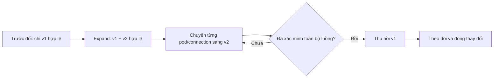
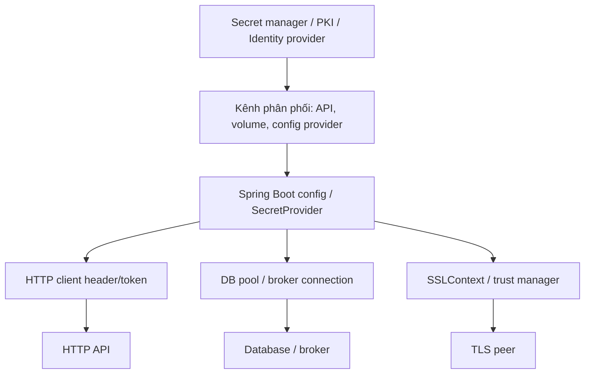
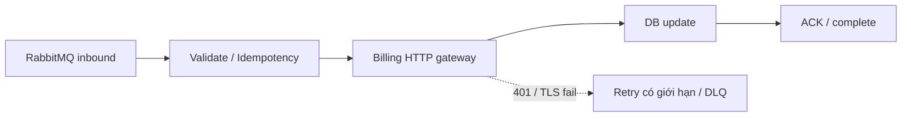
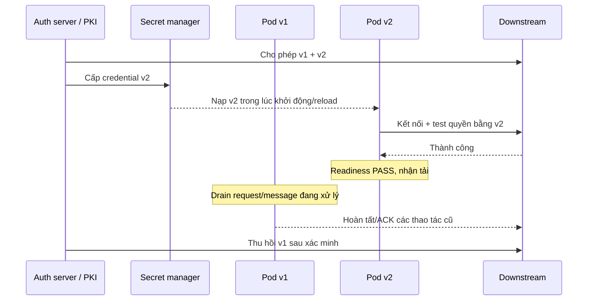

# Luân chuyển secret, khóa và chứng thư mà không ngừng toàn bộ luồng

## 1. Bài toán vận hành: đổi thông tin bảo mật khi hệ thống vẫn đang trao đổi dữ liệu

Trong **Spring Boot Integration**, một ứng dụng có thể đồng thời gọi HTTP API, truy cập PostgreSQL hoặc Redis, tiêu thụ RabbitMQ/Kafka và kết nối tới LDAP. Mỗi kết nối có thể phụ thuộc **mật khẩu**, **API token**, **khóa ký/mã hóa** hoặc **chứng thư TLS**. Những thông tin đó phải được thay đổi định kỳ, khi hết hạn hoặc ngay sau một sự cố lộ lọt, trong khi các luồng đồng bộ, xử lý sự kiện và giao dịch vẫn cần hoạt động.

Ví dụ: dịch vụ xử lý đơn hàng có bốn dependency:

| Luồng tích hợp | Thông tin cần luân chuyển | Hậu quả khi đổi sai thứ tự |
| --- | --- | --- |
| Gọi Billing API qua HTTP | API key hoặc OAuth client secret | Bắt đầu trả `401/403`, retry tăng, đơn hàng chưa được thanh toán |
| Đọc PostgreSQL qua connection pool | Mật khẩu tài khoản DB | Connection cũ còn sống nhưng connection mới bị từ chối; pool cạn dần |
| Đọc RabbitMQ và phát kết quả | Tài khoản/mật khẩu broker hoặc chứng thư mTLS | Consumer ngắt kết nối, queue backlog tăng, message bị phát lại |
| Kết nối LDAP/HTTPS qua TLS | Chứng thư server, CA tin cậy hoặc client certificate | TLS handshake thất bại, xác thực người dùng và đồng bộ dữ liệu bị gián đoạn |

**Mục tiêu vận hành không phải là tránh mọi lần đóng kết nối.** Đổi credential hoặc chứng thư thường đòi hỏi thiết lập kết nối mới. Mục tiêu là duy trì **khả năng xử lý của hệ thống**, thực hiện chuyển đổi từng phần và bảo toàn dữ liệu khi retry hoặc failover. Nếu hạ tầng phụ thuộc chỉ cho phép một credential đang hiệu lực, cần lên kế hoạch dựa trên giới hạn đó thay vì tuyên bố có thể chuyển đổi không gián đoạn trong mọi trường hợp.

### 1.1. Phân biệt các đối tượng luân chuyển

| Đối tượng | Cần thay đổi những gì? | Cơ chế vận hành đặc trưng |
| --- | --- | --- |
| **Secret đăng nhập** | Password DB, API token, broker credential, OAuth client secret | Phía server chấp nhận credential mới; client chuyển credential; thu hồi credential cũ |
| **Khóa mã hóa/ký** | Khóa đối xứng, private/public key, key encryption key | Gắn key ID/version; giữ khóa cũ để giải mã/xác minh dữ liệu cũ; tạo dữ liệu mới bằng khóa mới |
| **Chứng thư máy chủ TLS** | Certificate + private key ở server/proxy | Cấp chứng thư mới đúng SAN, triển khai server, kiểm tra chuỗi CA và hostname |
| **Chứng thư client mTLS** | Client certificate + private key, có thể kèm truststore server | Server tin client cũ/mới; client tải identity mới; kiểm tra handshake rồi thu hồi cũ |
| **CA/trust anchor** | CA được client/server tin tưởng | Phân phối CA mới trước, duy trì giai đoạn tin cậy chồng lấp, loại CA cũ sau khi mọi endpoint chuyển đổi |

**Secret**, **private key** và **certificate** không đồng nghĩa với nhau. Chứng thư X.509 có thể được phân phối công khai, còn **private key** đi kèm phải được bảo vệ. Với khóa mã hóa dữ liệu lưu lâu dài, xóa khóa cũ ngay khi đổi khóa mới có thể khiến dữ liệu cũ không thể giải mã.

## 2. Nguyên tắc chính: mở rộng khả năng chấp nhận trước khi thu hẹp

Trong nhiều hệ thống hỗ trợ song song hai credential, chiến lược an toàn là **expand → switch → verify → contract**:

1. **Expand:** bên xác thực/server cho phép credential hoặc trust anchor **cũ và mới** cùng hợp lệ trong cửa sổ chuyển đổi.
2. **Switch:** cập nhật người tiêu thụ credential từng nhóm instance, client hoặc kết nối; giữ đủ năng lực xử lý trong rollout.
3. **Verify:** xác minh các instance mới đang dùng phiên bản mới và những luồng nghiệp vụ thực sự thành công, gồm lần kết nối mới, retry và xử lý message.
4. **Contract:** thu hồi/loại bỏ credential cũ khi không còn consumer nào phụ thuộc vào nó và đã tính đến TTL, cache, connection pool và công việc đang chạy.



Sơ đồ này **chỉ áp dụng khi hệ thống đích có thể chấp nhận song song**: nhiều API key, hai client identity, nhiều public key xác minh chữ ký, hoặc cả CA cũ và mới. Một số database chỉ có một mật khẩu cho một principal và không hỗ trợ hai password đồng thời; khi đó có thể tạo hai tài khoản dịch vụ cùng quyền rồi chuyển dần, hoặc dùng cơ chế credential rotation native của hệ quản trị và kiểm thử tác động tới connection pool.

### 2.1. Bốn loại thời gian phải tính vào cửa sổ chuyển đổi

- **Thời gian phân phối:** secret mới được ghi vào secret manager, Kubernetes volume hoặc config provider nhưng không phải instance nào cũng nhận ngay.
- **Thời gian cache:** ứng dụng hoặc SDK có thể giữ token, TLS context, DNS, chứng thư hoặc secret trong bộ nhớ.
- **Thời gian sống kết nối:** connection pool DB, HTTP keep-alive, AMQP channel hoặc Kafka client có thể giữ kết nối/identity cũ.
- **Thời gian xử lý công việc:** message đang unacked, transaction đang chạy hoặc job có thời lượng dài cần kết thúc hoặc tiếp tục một cách an toàn.

Không suy ra “đã cập nhật Kubernetes Secret” là “mọi ứng dụng đang dùng secret mới”. Việc dùng secret mới thực sự phụ thuộc **cách ứng dụng đọc và áp dụng** giá trị đó.

## 3. Chuẩn bị: lập bản đồ phụ thuộc và xác định nguồn sự thật

Trước khi đổi, cần biết **secret được dùng ở đâu, ai xác thực nó và cách ứng dụng nạp lại**. Một bản kiểm kê hữu ích:

| Trường cần lưu | Ví dụ | Lý do |
| --- | --- | --- |
| Logical integration | `billing-api`, `orders-db`, `rabbit-primary` | Xác định chính xác luồng chịu ảnh hưởng |
| Credential reference/version | `secret://billing/client-token#v12` | Theo dõi version mà không ghi giá trị nhạy cảm |
| Nguồn cấp và chủ sở hữu | Secret manager, PKI, DBA, broker admin | Biết ai có quyền cấp/thu hồi |
| Cách ứng dụng nạp | Environment, volume, API secret manager, SSLContext | Xác định reload/rolling restart |
| Đối tượng sử dụng | Pods, batch workers, cron jobs, CI tools | Tránh bỏ sót một consumer |
| Kiểu kết nối | HTTP per request, DB pool, TLS, AMQP persistent | Biết lúc nào thông tin mới có hiệu lực |
| Hạn cuối và rollback | Expiry, grace period, cách khôi phục | Chọn thời điểm chuyển an toàn |
| Dấu hiệu thành công | Tỷ lệ `2xx`, DB connection success, consumer lag | Xác minh được tác động thực tế |

Tại đây cần phân biệt **nguồn sự thật** với **bản sao trong bộ nhớ**:



Nếu mã Java lưu mật khẩu hoặc chứng thư thành một trường `final` khi tạo bean, việc thay đổi tệp cấu hình ngoài **không tự làm thay đổi bean đó**. Nếu SDK cache token đến khi gần hết hạn, phải biết cơ chế làm mới của SDK. Nếu certificate được load vào `SSLContext` tại lúc khởi tạo HTTP client, thay file trong volume không chắc làm những kết nối mới chuyển sang khóa mới.

## 4. Secret trong Spring Boot: làm mới giá trị và làm mới kết nối là hai bước riêng

Một số nguồn cấu hình thường gặp:

| Cách cấp cấu hình | Khi secret nguồn thay đổi | Việc ứng dụng thường cần làm |
| --- | --- | --- |
| Biến môi trường của container | Giá trị môi trường trong tiến trình đang chạy **không tự đổi** | Rolling restart/rollout container với cấu hình mới |
| Kubernetes Secret mount thành volume | File mount có thể được cập nhật **bất đồng bộ**; mount kiểu `subPath` không tự nhận bản cập nhật | Theo dõi thay đổi file và tạo lại thành phần dùng secret, hoặc rolling restart |
| Secret manager SDK | Có thể đọc phiên bản mới qua API/cơ chế cache/TTL của SDK | Làm mới cache, kiểm tra đồng bộ đa instance và áp dụng vào client |
| Spring `@ConfigurationProperties` thông thường | Bind giá trị khi tạo bean, không tự tái bind chỉ vì nguồn bên ngoài thay đổi | Cơ chế refresh cụ thể hoặc khởi tạo lại bean qua rollout |
| TLS key/truststore của JVM | `SSLContext`/trust manager có thể đã tải cert vào bộ nhớ | Tạo lại TLS context/connection pool hoặc dùng tính năng reload được kiểm chứng |

Spring Boot thuần **không cam kết hot reload mọi secret cho mọi client**. Một số tích hợp Spring Cloud hoặc SDK có cơ chế refresh riêng; cần kiểm tra theo phiên bản, triển khai và hành vi thực tế của HTTP client/driver/broker. “Đã refresh properties” chưa đủ nếu connection factory hoặc TLS context vẫn giữ credential cũ.

### 4.1. Ví dụ: HTTP Bearer token được lấy theo từng request

Khi API đích cho phép token mới và token cũ cùng hợp lệ, có thể thiết kế một thành phần cung cấp token hiện hành. Interceptor đọc token mỗi khi gửi request, tránh gắn token vĩnh viễn vào cấu hình builder:

```java
import org.springframework.context.annotation.Bean;
import org.springframework.context.annotation.Configuration;
import org.springframework.web.client.RestClient;

public interface BillingTokenProvider {
    String currentToken(); // Lấy token còn hiệu lực từ cache/secret manager.
}

@Configuration
public class BillingClientConfiguration {
    @Bean("billingClient")
    RestClient billingClient(
            RestClient.Builder builder,
            BillingTokenProvider tokenProvider) {
        return builder.clone()
                .baseUrl("https://billing.example.org")
                .requestInterceptor((request, body, execution) -> {
                    request.getHeaders().setBearerAuth(
                            tokenProvider.currentToken());
                    return execution.execute(request, body);
                })
                .build();
    }
}
```

`BillingTokenProvider` là interface minh họa, **chưa phải** một bean triển khai có sẵn. Bản triển khai phải biết TTL, thời gian làm mới, lỗi secret manager, retry/backoff và quyền truy cập secret; nên cache an toàn trong bộ nhớ có kiểm soát thay vì gọi secret manager từ mọi HTTP request. Nếu provider trả token hết hạn hoặc không lấy được token mới, cần có chính sách rõ ràng: lỗi tạm thời có thể xử lý theo timeout/retry có giới hạn; **không** tự chuyển sang token không đáng tin cậy hoặc ghi token vào log.

Trong mô hình này, token dùng ở mỗi request mới có thể thay đổi mà không phải tạo lại `RestClient`, **nếu** cơ chế xác thực chỉ nằm ở HTTP header và client không cache token ở tầng thấp hơn. Với mTLS, OAuth client authentication ở connection factory hoặc HTTP connection pool có TLS identity khác, cần xử lý riêng.

### 4.2. Nếu dùng OAuth 2.0 thay vì token tĩnh

OAuth client credential có thể được luân chuyển tại identity provider, trong khi access token cũ vẫn còn hiệu lực đến khi hết hạn hoặc bị thu hồi. Cần tính đến:

1. Identity provider có cho phép **hai client secret** cùng có hiệu lực tạm thời không?
2. Cơ chế `OAuth2AuthorizedClientManager` hoặc SDK đang lấy token mới lúc nào, lưu token cũ ở đâu và có chủ động refresh theo hạn không?
3. Khi thay client secret, request lấy access token mới có sử dụng secret mới không?
4. `401` do access token hết hạn, `invalid_client` do client secret sai và `403` do thiếu quyền là **ba nguyên nhân khác nhau**, cần metric và xử lý khác nhau.

Không nên retry vô hạn các lỗi `invalid_client`: chúng thường chỉ ra cấu hình sai, credential bị thu hồi hoặc sai quyền. Đối với thao tác POST có side effect, không phát lại mù khi token/authentication lỗi mà thiếu idempotency.

## 5. Luân chuyển mật khẩu database và connection pool

Database connection pool như HikariCP thường thiết lập thông tin xác thực **lúc tạo connection**. Một connection đã xác thực có thể tiếp tục hoạt động sau khi mật khẩu đổi, nhưng mỗi DBMS có quy tắc riêng về việc giữ hay hủy session đã mở. Nếu pool dùng mật khẩu cũ để tạo connection mới, các kết nối mới sẽ thất bại và dịch vụ có thể suy giảm dần.

Quy trình khi database hỗ trợ hai principal cùng quyền:

1. Cấp tài khoản `svc_orders_v2` với quyền tối thiểu tương đương `svc_orders_v1`; xác minh truy cập vào đúng database/schema.
2. Đưa credential mới vào secret manager, thử kết nối **mới** qua client thử nghiệm có giám sát.
3. Triển khai một nhóm pod với cấu hình datasource mới; chờ readiness và kiểm tra query/transaction thực tế.
4. Tăng dần số pod dùng v2 trong khi các pod dùng v1 vẫn phục vụ request.
5. Đảm bảo connection pool v1 đã được đóng/drain và không còn job, instance hoặc tool nào cần tài khoản cũ.
6. Thu hồi v1 theo change window, kiểm tra `authentication failed`, số connection mở và lỗi nghiệp vụ sau thu hồi.

Nếu chỉ có **một principal và một mật khẩu** thì khả năng overlap có thể không tồn tại. Khi đó cần phương án đặc thù của DBMS/identity provider, hoặc tạo principal thay thế nếu chính sách cho phép. Không giả định cập nhật một file secret sẽ lập tức làm connection pool đang chạy đổi credential.

### 5.1. Cấu hình datasource trong Spring Boot

```yaml
spring:
  datasource:
    url: ${ORDERS_JDBC_URL}
    username: ${ORDERS_DB_USER}
    password: ${ORDERS_DB_PASSWORD}
    hikari:
      maximum-pool-size: 12
      connection-timeout: 3000
```

Các placeholder lấy từ môi trường/secret do deployment cung cấp. Với biến môi trường, cách đơn giản, dễ quan sát và tin cậy là **rolling rollout** để các pod mới đọc credential mới khi tạo datasource. `connection-timeout` của Hikari ở ví dụ là **milli giây**. Pool size nên được tính theo tổng số replica và giới hạn database, không sao chép nguyên số minh họa.

Nếu tự viết cơ chế cập nhật password động cho Hikari và soft-evict connection, cần kiểm thử kỹ thời điểm pool dùng cấu hình mới, transaction đang giữ connection cũ và hành vi session sau khi server thu hồi credential. Đối với nhiều hệ thống, rollout theo pod dễ kiểm soát hơn việc thay đổi nhiều resource trong một JVM đang phục vụ request.

## 6. Broker, cache và consumer: phải giữ được tiến độ xử lý

### 6.1. RabbitMQ / AMQP

RabbitMQ consumer thường giữ connection và channel lâu dài. Khi mật khẩu broker được thay:

- Bật credential v2 và quyền trên đúng virtual host/exchange/queue trước khi chuyển consumer.
- Đảm bảo consumer ở pod mới kết nối, đăng ký listener và xử lý message thực sự.
- Drain/stop consumer cũ theo cơ chế container để các message đang xử lý được ACK hoặc khi mất kết nối được redeliver đúng.
- Theo dõi `messages_ready`, `messages_unacknowledged`, số consumer, `redeliver` và DLQ.
- Không kết luận “không mất message” chỉ vì reconnect tự động: message đã xử lý nhưng ACK chưa tới broker có thể được giao lại, đòi hỏi idempotency.

Nếu sử dụng mTLS, cần thay cả client certificate/private key trong connection factory và xác minh broker tin chain/certificate mới. Các connection đang mở có thể chưa dùng identity mới cho đến khi reconnect.

### 6.2. Kafka, Redis và các SDK kết nối lâu dài

Kafka client có thể giữ TCP/TLS connections và trạng thái consumer group; thay SASL credentials hoặc TLS materials đòi hỏi cơ chế reload hoặc tạo lại client được hỗ trợ. Khi member consumer dừng và thay thế, group có thể rebalance; theo dõi lag, rebalances, auth errors và commit offsets. Broker phải chấp nhận identity mới cùng ACL/topic access tương ứng trước khi thu hồi identity cũ.

Với Redis, cơ chế ACL user/password và vòng đời connection pool quyết định khả năng đổi credential. Nếu một ACL user chỉ cho một password hoặc hỗ trợ nhiều password theo phiên bản/cấu hình, phải xác nhận hành vi thật của server và client. Pool có thể giữ connection đã xác thực; tạo kết nối mới sau đổi mới phát hiện credential không hợp lệ.

### 6.3. Tác động tới Spring Integration flow

Một integration flow có thể gồm inbound adapter từ RabbitMQ, transform, gọi HTTP gateway rồi ghi DB. Nếu luân chuyển credential làm **một hop** thất bại, các hop trước đó không tự rollback theo transaction phân tán.



Kế hoạch rollout phải nêu rõ điểm ACK, timeout, backoff và nơi lưu trạng thái đang xử lý. Khi API đích tạm thời từ chối token mới, hạn chế retry nóng và để thông điệp có thể được xử lý lại có kiểm soát. Với những luồng được thiết kế at-least-once, dùng event ID/transaction ID để tránh side effect trùng khi redelivery.

## 7. Luân chuyển chứng thư TLS máy chủ

Đối với HTTPS, LDAPS và TLS broker, client cần **xác minh certificate chain và danh tính endpoint**. Bản chứng thư mới thường phải có:

- SAN chứa DNS/IP đúng mà ứng dụng thực tế kết nối.
- Chữ ký/chuỗi CA được client tin cậy, hiệu lực thời gian hợp lệ.
- Key Usage/Extended Key Usage phù hợp (ví dụ `serverAuth` nếu áp dụng), thuật toán và giao thức TLS theo chính sách.
- Toàn bộ intermediate cần thiết được endpoint cung cấp hoặc client có thể xây dựng trust path hợp lệ.

### 7.1. Khi leaf certificate đổi nhưng CA giữ nguyên

Nếu chứng thư server mới cùng nằm trong chuỗi CA mà client đã tin và có SAN hợp lệ, nhiều client sẽ chấp nhận cert mới trong lần TLS handshake tiếp theo **mà không cần đổi truststore**. Cần kiểm tra cả các endpoint sau load balancer, reverse proxy và các node chưa cập nhật certificate. Kết nối TLS cũ có thể tiếp tục hoạt động cho đến khi đóng; điều này không chứng minh handshake mới đã thành công.

### 7.2. Khi đổi CA/trust anchor: dùng thời gian tin cậy chồng lấp

Đổi CA nội bộ cần phối hợp **hai phía**:

1. Phân phối **CA mới** cho truststore client, **vẫn giữ CA cũ** khi chưa chuyển hết server.
2. Kiểm tra các client sau cập nhật có thể kết nối tới endpoint hiện tại.
3. Cấp và triển khai server certificate mới ký bởi CA mới; làm rolling update trên các node/proxy.
4. Kiểm tra từ **mỗi nhóm client**, kể cả JVM/OS image cũ và consumer đặc biệt.
5. Khi toàn bộ server đã dùng chain mới và không còn trust relationship nào cần CA cũ, mới loại CA cũ theo kế hoạch.

```text
Giai đoạn A          Giai đoạn B                Giai đoạn C
Client trust: CA1    Client trust: CA1 + CA2    Client trust: CA2
Server cert: CA1     Server cert: CA1 -> CA2    Server cert: CA2
                     ^ khoảng chuyển tiếp ^
```

Nếu cert mới được cấp từ CA chưa được client tin và server chuyển trước, một phần luồng sẽ gặp `PKIX path building failed`. Nếu client loại CA cũ trước khi mọi server đổi cert, kết nối tới các node còn chứng thư cũ cũng thất bại.

### 7.3. Kiểm tra handshake mới

Chỉ dùng các lệnh kiểm tra đọc, từ mạng tương đương pod/VM ứng dụng:

```bash
openssl s_client \
  -connect billing.example.org:443 \
  -servername billing.example.org \
  -verify_hostname billing.example.org \
  -verify_return_error \
  -showcerts \
  -CAfile trusted-ca-bundle.pem

# Xem thời hạn và SAN từ tệp chứng thư đã xác minh nguồn:
openssl x509 -in server-cert.pem -noout -dates -ext subjectAltName
```

`openssl s_client` có tập CA, cấu hình TLS và policy khác JVM. Nó hỗ trợ điều tra chứng thư server nhưng **không thay thế** bài test kết nối bằng ứng dụng Java với truststore và HTTP client thực tế. Không dùng `-k`/trust-all hoặc tắt hostname verification để “chữa” lỗi luân chuyển.

## 8. Luân chuyển client certificate và mTLS

Trong mTLS, **client cũng trình bày certificate**. Cần phân biệt:

- **KeyStore/identity của client:** private key và certificate chain mà client dùng.
- **TrustStore của client:** CA để xác minh server.
- **TrustStore/ACL của server:** CA hoặc danh tính được phép xác thực client.

Quy trình đổi client certificate:

1. Cấp cặp key/certificate mới qua PKI có kiểm soát; bảo vệ private key và kiểm tra `clientAuth`/SAN/identity mapping nếu hạ tầng yêu cầu.
2. Server cho phép **cả certificate/CA cũ và mới** trong giai đoạn chuyển nếu được hỗ trợ; cập nhật ACL/quyền theo danh tính mới.
3. Chạy canary client dùng certificate mới; xác minh handshake, quyền nghiệp vụ và đường truyền sau TLS.
4. Thay từng instance HTTP client/broker consumer, tạo TLS context và connection pool mới khi cần.
5. Kiểm tra không còn kết nối hoặc client cần certificate cũ rồi thu hồi chứng thư/identity cũ.

Nếu server xác thực theo **distinguished name** hoặc thumbprint cụ thể, cert mới có thể bị từ chối ngay cả khi được ký bởi CA tin cậy. Cần cập nhật allowlist/mapping ở server cùng kế hoạch. Thu hồi cert cũ qua CRL/OCSP hoặc ACL còn tùy cơ chế kiểm tra revocation thực sự được áp dụng; không được mặc định mọi client/server đều kiểm tra OCSP trực tuyến.

### 8.1. Kiểm tra truststore Java

```bash
keytool -list -v \
  -keystore /etc/app/certs/truststore.p12 \
  -storetype PKCS12
```

Đảm bảo secret của truststore được cấp qua cơ chế an toàn; không đặt password dạng literal trong Git, command line có thể lộ trong process list hoặc log vận hành. Nếu dùng `javax.net.ssl.trustStore` chung cho JVM, thay truststore có thể ảnh hưởng **mọi kết nối TLS sử dụng SSLContext mặc định** trong ứng dụng, không riêng một LDAP/HTTP client. Cần test các outbound integration khác khi đổi tập CA.

## 9. Luân chuyển khóa ký và mã hóa dữ liệu

Thay **khóa** khác với thay mật khẩu đăng nhập. Một dữ liệu được mã hóa bằng khóa `K1` không tự giải mã được bằng `K2`. Token hoặc sự kiện ký bởi private key `K1` cũng cần public key tương ứng để bên nhận xác minh đến khi dữ liệu cũ hết hiệu lực.

### 9.1. Dùng key ID và phiên bản để tránh đoán khóa

Một bản ghi mã hóa hoặc envelope thường lưu metadata không nhạy cảm về phiên bản khóa:

```json
{
  "keyId": "order-data-v2",
  "algorithm": "AES-256-GCM",
  "ciphertext": "<base64 ciphertext>",
  "nonce": "<base64 unique nonce>",
  "tag": "<base64 authentication tag>"
}
```

Đây là **hình dạng dữ liệu minh họa**, không phải mã triển khai crypto hoàn chỉnh. Với AEAD như AES-GCM, nonce phải duy nhất theo quy tắc của key, AAD/tag phải được xử lý đúng; nên dùng thư viện/KMS được kiểm thử thay vì tự ghép primitive.

Các bước luân chuyển:

1. Phân phối `K2` tới **các bên cần giải mã/xác minh** trước; vẫn giữ khả năng đọc dữ liệu bằng `K1`.
2. Chuyển thành phần **ghi mới/ký mới** sang `K2` và gắn `keyId=K2`.
3. Tiếp tục hỗ trợ đọc/xác minh dữ liệu cũ bằng `K1` trong thời gian lưu giữ hoặc chuyển đổi.
4. Nếu chính sách yêu cầu, **re-encrypt** dữ liệu cũ theo batch có kiểm tra và khả năng khôi phục; việc wrap/rewrap data key có thể do KMS thực hiện.
5. Chỉ hủy `K1` khi chứng minh không còn dữ liệu, backup, sự kiện, token hoặc giao dịch cần nó.

Với JWT ký bất đối xứng, publisher có thể phát `kid=v2` trong JOSE header; verifier lấy public key từ JWKS có chứa v1 và v2 trong cửa sổ chuyển đổi. Không dùng giá trị `kid` chưa tin cậy để truy cập URL tùy ý hoặc tải khóa ngoài danh sách issuer/JWKS được cho phép.

### 9.2. Thay khóa sau sự cố lộ lọt là tình huống khác

Nếu private key/secret đã bị lộ, việc duy trì song song credential cũ quá lâu có thể tăng rủi ro. Cần ưu tiên **thu hồi/khóa ngay theo mức độ sự cố**, chấp nhận khả năng giảm dịch vụ để ngăn truy cập trái phép; sau đó khôi phục từ credential mới và điều tra tác động. Chiến lược overlap chỉ phù hợp khi **credential cũ còn được phép tin cậy** trong cửa sổ chuyển đổi.

Đối với dữ liệu cũ mã hóa bằng khóa bị lộ, chỉ đổi khóa cho dữ liệu mới chưa bảo vệ được bản dữ liệu đã bị truy cập. Có thể cần đánh giá re-encryption, phân loại ảnh hưởng và quy trình phản ứng sự cố riêng.

## 10. Rolling rollout và điều kiện an toàn trước khi thu hồi v1

Đối với deployment nhiều pod Spring Boot, có thể chuyển credential bằng rolling update có kiểm soát:



### 10.1. Preflight và canary

Trước khi tiếp tục rollout, cần xác nhận:

- Secret v2 đã tạo và quyền truy cập của service account đúng; không đưa giá trị secret vào log.
- Canary kết nối mới tới đúng server, có quyền đúng và hoàn tất **một tác vụ nghiệp vụ không phá dữ liệu** hoặc test có kiểm soát.
- Readiness probe của pod phản ánh khả năng phục vụ luồng quan trọng, không đánh đồng một TCP connect với việc transaction/authorization thực sự thành công.
- Phần lớn replica cũ vẫn duy trì công suất trong quá trình thay thế; có cấu hình rollout `maxUnavailable`, `maxSurge`, PDB/capacity phù hợp.
- Message đang xử lý được ACK/NACK đúng thiết kế; database transaction đã commit hoặc được phục hồi idempotent nếu pod bị dừng.

Không cần buộc **toàn bộ** integration flow dừng để thay một HTTP credential. Có thể chủ động tạm dừng hoặc giảm concurrency **riêng nhánh phụ thuộc** khi cần, để các nhánh độc lập vẫn chạy. Tuy nhiên, nếu một dịch vụ xác thực trung tâm hoặc CA bị lỗi cho tất cả các luồng, mức gián đoạn có thể rộng hơn dự kiến.

### 10.2. Thu hồi credential cũ dựa trên bằng chứng

Trước khi thu hồi v1, kiểm tra:

1. Inventory của pod, batch job, scheduled task và tool vận hành không còn dùng `version=v1`.
2. Không còn connection mới được xác thực bằng v1; nếu server hỗ trợ audit principal/key version, dùng dữ liệu đó.
3. Các kết nối cũ đã drain/reconnect hoặc có phương án xử lý khi bị đóng.
4. Error rate, auth failures, TLS handshake failures, DB connection wait và queue lag vẫn trong ngưỡng chấp nhận.
5. Có kế hoạch rollback và điều kiện dừng rollout nếu giao dịch quan trọng thất bại.

Không coi chỉ số **pod Ready** là chứng cứ đầy đủ. Một pod có thể Ready nhưng chỉ phát lỗi `401` ở tuyến Billing hiếm gọi, hoặc chưa thử tạo connection DB mới do pool còn đủ connection cũ.

## 11. Quan sát, cảnh báo và bằng chứng thành công

| Loại luồng | Metric/tín hiệu cần theo dõi | Ý nghĩa khi luân chuyển |
| --- | --- | --- |
| HTTP outbound | `401`, `403`, `invalid_client`, `5xx`, timeout, success rate theo integration | Phân biệt lỗi credential với lỗi đích hay nghẽn mạng |
| JDBC/R2DBC | Connection creation errors, pool wait, active/idle connections, SQL error | Phát hiện credential mới sai khi pool tạo connection |
| RabbitMQ | Consumer count, unacked, redelivery, DLQ, reconnect/auth failures | Phát hiện consumer bị ngắt hoặc phát lại hàng loạt |
| Kafka | Authentication errors, consumer lag, rebalance, producer delivery errors | Phát hiện sai SASL/TLS và dịch chuyển nhóm consumer |
| TLS/mTLS | Handshake failures, PKIX/hostname errors, expiry, client identity | Phát hiện CA/cert không tương thích |
| Business workflow | Số đơn xử lý thành công, độ trễ end-to-end, số bản ghi trùng | Xác minh tác động thực, tránh chỉ dựa vào health check |

Có thể đưa **version ID hoặc alias của credential** vào metric/log, nếu bản thân ID không nhạy cảm và cardinality được kiểm soát. **Không log** token, password, private key, connection string chứa password, header `Authorization` hay toàn bộ certificate key material.

### 11.1. Những bước kiểm thử có giá trị

1. **Kiểm thử song song:** dùng credential v1 và v2 từ hai client riêng, đảm bảo cùng có quyền đúng trong giai đoạn overlap.
2. **Kiểm thử kết nối mới:** đóng connection cũ trong môi trường staging, tạo request/query/consumer mới để chứng minh v2 thực sự được dùng.
3. **Kiểm thử âm tính:** cert sai SAN, CA chưa tin hoặc credential bị thu hồi phải bị từ chối, không có fallback plaintext/trust-all.
4. **Kiểm thử rollout:** đổi dần replica khi có traffic/queue message, theo dõi error, latency, redelivery và idempotency.
5. **Kiểm thử rollback:** trước khi v1 bị thu hồi, đưa một nhóm instance trở lại v1 và kiểm tra hệ thống vẫn xử lý; sau khi v1 đã thu hồi cần một phương án rollback khác.
6. **Kiểm thử expiry:** xác minh client có refresh token/secret kịp thời, không chỉ hoạt động vài phút ngay sau deployment.

## 12. Các lỗi phổ biến khi xoay vòng thông tin bảo mật

| Sai lầm | Triệu chứng | Cách tránh |
| --- | --- | --- |
| Thu hồi v1 trước khi cấp quyền và thử v2 | `401`, lỗi bind, consumer mất kết nối | Expand trước, canary, verify rồi revoke |
| Đổi environment secret nhưng không restart ứng dụng | Vẫn dùng mật khẩu/token cũ | Dùng rollout hoặc cơ chế refresh có kiểm chứng |
| Cập nhật file truststore rồi nghĩ SSLContext tự reload | Handshake mới vẫn dùng bộ CA cũ | Rebuild/reload TLS context và pool, kiểm tra trên client thật |
| Thay cert server trước khi mọi client tin CA mới | `PKIX path building failed` | Phân phối CA mới trước, giữ CA cũ trong overlap |
| Gắn token tĩnh vào HTTP client lâu sống | Request vẫn gửi token cũ | Token provider theo request hoặc tạo lại client |
| Đổi password DB khi pool chưa chuyển | Session cũ chạy nhưng connection mới fail | Cấp principal v2, rollout pool, drain v1 |
| Chỉ theo dõi health check chung | Job/consumer ít tải lỗi nhưng pod vẫn Ready | Metric riêng từng integration và end-to-end |
| Retry lỗi `401`/`invalid_client` vô hạn | Tăng tải và backlog, không khắc phục auth | Phân loại lỗi, sửa credential, retry có giới hạn |
| Rollback sau khi v1 đã bị thu hồi | Bản cũ không thể xác thực | Chốt rollback window trước revoke, có hướng cấp lại an toàn |
| Xóa key giải mã cũ ngay khi chuyển mã hóa mới | Không đọc được dữ liệu/backup lịch sử | Key ID, thời gian lưu và kế hoạch re-encryption |
| Thay khóa nhưng giữ tên/key ID cũ | Không biết dữ liệu cần khóa nào để giải mã/xác minh | Version hóa key ID, quản lý vòng đời khóa |
| Bật `trust-all` để vượt lỗi chứng thư | Mất xác thực endpoint, tăng rủi ro MITM | Sửa chain, SAN, trust anchor và TLS config |
| Quên tool, batch job hoặc pod ít chạy | Lỗi bùng phát vài ngày sau khi revoke | Kiểm kê mọi consumer và test job định kỳ |
| Luân chuyển credential khiến retry phát sự kiện lại | Double charge/duplicate message | Idempotency key, outbox, deduplication và kiểm tra recovery |

## 13. Runbook minh họa: đổi API key của Billing mà không dừng xử lý đơn hàng

**Bối cảnh:** sáu pod Spring Boot xử lý `OrderPaid` từ RabbitMQ, gọi Billing API để kiểm tra thanh toán rồi cập nhật database. Billing hỗ trợ hai API key song song. Mỗi pod dùng một HTTP client có interceptor lấy token hiện hành từ provider; khi cập nhật provider cần cơ chế refresh hoặc rollout được kiểm chứng.

| Giai đoạn | Thao tác | Điều kiện để đi tiếp |
| --- | --- | --- |
| **Chuẩn bị** | Kiểm kê client, consumer, secret alias, response code và dashboard; xác minh v1 còn hiệu lực | Có baseline `401`, latency, queue lag, DB errors |
| **Expand** | Tạo key v2 ở Billing, gán đúng quyền và lưu vào secret manager | V1/v2 cùng hợp lệ, v2 test thành công |
| **Canary** | Cho một pod dùng v2, tạo kết nối mới và chạy luồng thử | Billing trả thành công, dữ liệu và ACK đúng |
| **Rollout** | Chuyển lần lượt các pod còn lại; giữ công suất tiêu thụ queue | Tỷ lệ lỗi và backlog không vượt ngưỡng |
| **Xác minh** | Kiểm tra audit key version tại Billing, request thành công, consumer ổn định, không có duplicate side effect | Không còn consumer cần v1 |
| **Thu hồi** | Revoke v1, quan sát tiếp auth errors và các job ít chạy | Không có yêu cầu hợp lệ nào thất bại vì v1 hết hiệu lực |
| **Kết thúc** | Cập nhật inventory, lịch rotation kế tiếp, chứng cứ kiểm thử và runbook | Chủ sở hữu xác nhận hoàn thành |

Nếu trong canary có lỗi `401`, không tiếp tục rollout. Trước tiên kiểm tra quyền của v2, cấu hình token provider và request đầu ra thực tế. Nếu phải rollback khi v1 còn hiệu lực, đưa canary về cấu hình v1. Nếu v1 đã bị thu hồi, rollback phải dùng credential mới còn hợp lệ hoặc cấp credential thay thế theo quy trình, không khôi phục một giá trị đã bị revoke.

### 13.1. Khi cần rotate gấp do secret bị lộ

Trình tự có thể khác hoàn toàn: khóa hoặc thu hồi secret bị lộ ngay theo mức độ ảnh hưởng, phát hành credential mới qua kênh tin cậy, tạm ngừng **nhánh tích hợp phụ thuộc** nếu không thể xác thực an toàn, rồi replay các việc còn chờ theo idempotency/transaction. Trạng thái an toàn và giới hạn quyền truy cập quan trọng hơn việc giữ tuyệt đối không có phút gián đoạn.

## 14. Checklist trước khi đưa kế hoạch luân chuyển vào production

1. Đã có inventory đầy đủ mọi HTTP client, DB pool, broker consumer, cache, LDAP, batch job và certificate endpoint sử dụng thông tin cần đổi chưa?
2. Bên xác thực có hỗ trợ hai credential/cert/CA đồng thời không? Nếu không, phương án có xét đúng giới hạn của hệ thống đích không?
3. Secret mới được phát hành và phân phối bằng kênh được kiểm soát, không xuất hiện trong Git, log, build artifact hoặc command history chứ?
4. Ứng dụng sẽ **lấy giá trị mới** bằng refresh provider, tái tạo client/pool hay rolling restart? Đã kiểm tra kết nối mới thực tế chưa?
5. Có đảm bảo certificate chain, SAN, TLS client identity, quyền trên database/broker và API scope của credential mới tương đương yêu cầu chưa?
6. Có xác định cách drain request, transaction, consumer, scheduled job và những message đang unacked trước khi dừng pod không?
7. Có thử tình huống timeout, reconnect, retry, redelivery và side effect trùng sau khi một phần hệ thống chuyển phiên bản mới chưa?
8. Dashboard và cảnh báo có tách được lỗi auth, TLS, pool, backlog và kết quả nghiệp vụ theo từng integration không?
9. Điều kiện dừng rollout, rollback và **thời điểm cuối cùng được phép dùng credential cũ** đã được công bố chưa?
10. Sau thu hồi, có xác minh không còn consumer dùng v1 và có cập nhật inventory/lịch rotation tiếp theo không?

**Kết luận:** Luân chuyển secret, khóa và chứng thư an toàn là một **quy trình phối hợp giữa nơi phát hành, nơi xác thực, ứng dụng Spring Boot và các hệ thống downstream**. Cần tạo khả năng chấp nhận thông tin mới trước, chuyển từng thành phần dùng thông tin mới, kiểm tra cả kết nối lẫn kết quả nghiệp vụ rồi mới thu hồi thông tin cũ. Với các tích hợp database, HTTP, cache và broker, phải tính đến connection pool, TLS context, thời gian sống token, transaction, retry và idempotency để duy trì luồng xử lý trong thời gian chuyển đổi.
