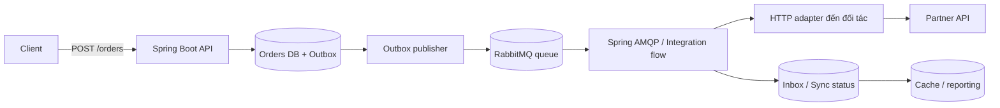
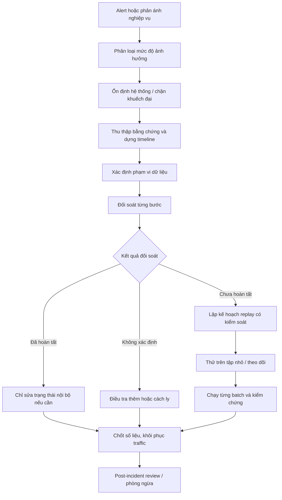
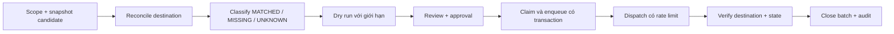

# Quy trình xử lý sự cố, đối soát dữ liệu và khôi phục từng phần trong Spring Boot Integration

## 1. Vì sao vận hành tích hợp phải đi xa hơn việc “chạy lại job”?

Trong module **SPRING_BOOT_INTEGRATION**, dữ liệu đi qua nhiều ranh giới: HTTP client, cơ sở dữ liệu, cache, broker thông điệp và các adapter của Spring Integration. Một sự kiện đơn hàng có thể đã được lưu vào PostgreSQL, đã được RabbitMQ chấp nhận, chưa được consumer xử lý, hoặc đã gửi đến đối tác nhưng phản hồi HTTP bị timeout. Chỉ nhìn log lỗi và nhấn **retry** có thể dẫn đến gửi trùng, cập nhật sai trạng thái hoặc làm thất thoát bản ghi.

Một quy trình vận hành đúng cần phân biệt:

1. **Xử lý sự cố (incident response):** giảm thiểu tác động hiện tại, khoanh vùng nguyên nhân và giữ bằng chứng.
2. **Đối soát dữ liệu (reconciliation):** xác định chính xác bản ghi nào đã/ chưa đạt trạng thái nghiệp vụ mong đợi giữa các hệ thống.
3. **Khôi phục từng phần (partial recovery):** chỉ phát lại hoặc sửa những công việc thiếu, lỗi hoặc không chắc chắn, dưới cơ chế kiểm soát và chống xử lý trùng.
4. **Xác nhận kết quả:** chứng minh các bất biến nghiệp vụ và độ trễ đã trở lại mức cho phép, chứ không chỉ thấy queue trống hoặc HTTP trả 200.

### Tình huống xuyên suốt

Hệ thống nhận yêu cầu đặt hàng, lưu đơn, publish `OrderCreated`, consumer gọi API của đối tác giao nhận rồi cập nhật trạng thái đồng bộ.



Vào một thời điểm, HTTP client của consumer bị timeout. Có ít nhất ba khả năng:

- **A.** Đối tác không nhận request; gửi lại là cần thiết.
- **B.** Đối tác đã tạo vận đơn nhưng phản hồi không về; gửi lại không có idempotency có thể tạo vận đơn thứ hai.
- **C.** Request đã thành công và DB nội bộ cũng đã ghi trạng thái, nhưng message chưa được ack; broker có thể giao lại.

Vì vậy, **“timeout” là kết quả không xác định của thao tác từ xa**, không tự chứng minh thất bại nghiệp vụ. Bài học này thiết kế một quy trình vận hành an toàn cho cả ba trường hợp.

## 2. Những nguyên tắc bất biến trước khi thao tác

| Nguyên tắc | Hành vi cần duy trì |
|---|---|
| **Nguồn sự thật rõ ràng** | Xác định hệ thống sở hữu mỗi trường, ví dụ DB nội bộ sở hữu order ID; đối tác sở hữu mã vận đơn |
| **Không biến lỗi tạm thành mất dữ liệu** | Giữ bản ghi, outbox, message hoặc checkpoint có thể replay cho đến khi xác minh kết quả |
| **Không xử lý lại một cách mù quáng** | Trước khi retry một side effect không đảo ngược, kiểm tra trạng thái đích hoặc dùng idempotency key |
| **Khôi phục theo tập hợp nhỏ** | Khoanh phạm vi bằng tenant, hệ thống đích, mốc thời gian, event ID, status và bằng chứng |
| **Tách detection khỏi remediation** | Chỉ số báo động không mặc nhiên cho phép tự xóa queue, reset offset hay thực hiện giao dịch bù |
| **Có quyền và vết kiểm toán** | Mọi lần replay/repair có lý do, người duyệt, phạm vi, số bản ghi, execution ID, kết quả |
| **Chấp nhận eventual consistency có giới hạn** | Đối soát theo watermark hoặc độ trễ cho phép; không gọi mọi bản ghi chưa kịp đến là mất |
| **Khôi phục phải idempotent** | Chạy lại cùng recovery plan không tạo thêm side effect nghiệp vụ |

**Giả định vận hành quan trọng:** các bước nhận, lưu, gửi và xử lý là những commit riêng. `@Transactional` của Spring chỉ bao phủ tài nguyên được transaction manager đó quản lý, không tự tạo transaction nguyên tử qua database, broker, Redis và HTTP.

## 3. Phân biệt các loại “thành công” và trạng thái công việc

Trạng thái kỹ thuật và trạng thái nghiệp vụ không giống nhau. Nên đặt mốc quan sát có định nghĩa cụ thể:

| Mốc | Tín hiệu có thể đo | Điều **chưa** được bảo đảm |
|---|---|---|
| Request accepted | Spring Boot trả `202 Accepted` hoặc `200 OK` | Outbox đã publish hoặc đối tác đã hoàn thành |
| Data persisted | Database commit đơn hàng + outbox | Broker đã nhận message |
| Published | Có publisher confirm từ RabbitMQ hoặc broker ack tương ứng | Consumer đã chạy; message đã route đúng nếu không kiểm tra điều kiện khác |
| Delivered | Listener nhận message | Consumer xử lý thành công, transaction và ack đã hoàn tất |
| Processing committed | DB hoặc inbox ghi trạng thái sau xử lý | API đối tác đã hoàn tất nếu phản hồi/đối soát chưa xác nhận |
| Business completed | Có bằng chứng trạng thái cuối ở hệ thống sở hữu dữ liệu | Tất cả cache/reporting đã nhất quán tức thời |

Các bảng riêng có thể dùng `RECEIVED`, `PENDING`, `PUBLISHED`, `PROCESSING`, `COMPLETED`, `FAILED` và `UNKNOWN`. Tuy nhiên, một cột `status` toàn cục thường không thể diễn tả đầy đủ nhiều nhánh song song. Với nghiệp vụ quan trọng, lưu **trạng thái theo từng đích/từng bước** và các mốc thời gian của chúng.

Ví dụ một bản ghi trong `integration_delivery`:

```text
event_id          = 0f5b...      // định danh event không đổi
aggregate_id      = ORDER-1042   // định danh nghiệp vụ
destination       = shipping-api
payload_version   = 2
state             = UNKNOWN
last_attempt_at   = 2026-11-21T01:18:03Z
attempt_count     = 3
idempotency_key   = shipping:ORDER-1042:v1
remote_reference  = null
last_error_code   = HTTP_TIMEOUT
correlation_id    = trace-...
updated_at        = ...
```

Trường `UNKNOWN` đặc biệt quan trọng khi một call bị timeout hoặc mất kết nối sau khi đã gửi payload. Không tự đổi nó thành `FAILED` và gửi lại ngay mà không xét trạng thái đích.

## 4. Quy trình ứng phó sự cố từ phát hiện đến đóng incident



### Bước 1 — Phân loại tác động

Nên trả lời nhanh: hệ thống nào, luồng nghiệp vụ nào, khách hàng nào, sự kiện bắt đầu từ lúc nào, số bản ghi nghi ngờ, và tác động đến doanh thu/dữ liệu/khả năng phục vụ.

Có thể phân mức:

- **Critical:** mất hoặc nhân đôi side effect tài chính, nguy cơ lộ dữ liệu, nhiều khách hàng không thể hoàn tất giao dịch.
- **High:** đơn hàng hoặc chứng từ bị kẹt hàng loạt, backlog tiếp tục tăng vượt ngưỡng chịu tải.
- **Medium:** một đích ngoài bị lỗi, dữ liệu chậm nhưng vẫn có trạng thái phục hồi, phạm vi nhỏ.
- **Low:** số ít bản ghi lỗi có thể xử lý theo quy trình thường kỳ.

Đây là ví dụ, không phải ngưỡng sự cố mặc định. Mức độ phải dựa trên SLO và tác động nghiệp vụ thực tế.

### Bước 2 — Ổn định hệ thống

Mục tiêu đầu tiên là **không để sự cố lan rộng**:

- Nếu API ngoài lỗi hàng loạt: bật circuit breaker, giới hạn concurrency, tạm dừng outbound worker hoặc trả về hàng đợi bền vững; không tạo retry storm.
- Nếu producer phát message sai schema: chặn phiên bản producer đó, giữ payload lỗi và không đẩy tiếp vào consumer không tương thích.
- Nếu consumer đang tạo side effect trùng: tạm dừng consumer tương ứng trước khi redelivery tăng; giữ nguyên DLQ và các evidence quan trọng.
- Nếu broker đầy bộ nhớ/đĩa: xác định nguyên nhân tăng tải, kiểm soát tốc độ publish/consume, tránh xóa queue để “giải phóng chỗ” khi chưa có kế hoạch backup/replay.
- Nếu dữ liệu cache sai: có thể chuyển đường đọc sang nguồn tin cậy hoặc vô hiệu cache có kiểm soát; đừng flush toàn Redis dùng chung nếu không có đánh giá phạm vi.

Tạm dừng nên thực hiện tại **đúng điểm nhận hoặc điểm gửi**. Với Spring Integration, stop inbound endpoint không có nghĩa mọi handler đã xong. Cần xem in-flight, executor, poller, transaction và ack boundary trước khi deploy/restart.

### Bước 3 — Giữ bằng chứng

Tạo timeline chuẩn UTC, ghi nhận tại thời điểm sự cố:

- Deployment version, configuration version, feature flag, thời điểm thay đổi hạ tầng/secret/certificate.
- `trace_id`, `correlation_id`, `event_id`, `aggregate_id` hoặc key nghiệp vụ; status của từng hop.
- Tốc độ publish/ack, queue `ready`/`unacked`, DLQ, consumer count, broker alarms.
- HTTP status/timeout, retry count, latency p95/p99, connection pool, thread pool, DB slow query/lock.
- Outbox/inbox/checkpoint, thời điểm commit, transaction lỗi, trạng thái đối tác nếu có API truy vấn.
- Audit log những can thiệp thủ công đã thực hiện.

**Không đưa credential, payload nhạy cảm hoặc PII vào phiếu incident công khai.** Cần phân quyền đọc log và evidence; nếu phải chia sẻ mẫu payload để điều tra, dùng dữ liệu tổng hợp hoặc đã ẩn trường nhạy cảm.

## 5. Khoanh vùng lỗi theo từng ranh giới tích hợp

| Dấu hiệu | Giả thuyết thường gặp | Chứng cứ cần kiểm tra | Hành động ban đầu |
|---|---|---|---|
| HTTP API thành công nhưng không có message | Outbox publisher kẹt, filter/routing lỗi | Outbox `NEW`, publish confirm, exchange/binding | Tạm dừng mở rộng sự cố, kiểm tra publisher và routing |
| Queue `ready` tăng | Thiếu consumer, consumer chậm, scaling sai | Consumer count, publish/ack rates, downstream latency | Kiểm tra listener, broker, pool và giới hạn tải |
| `unacked` cao | Handler đang chậm, prefetch lớn, ack chưa xảy ra | In-flight, thread dump, query/API timeouts | Giảm bottleneck, rà soát ack/retry |
| DLQ tăng | Poison message, schema incompatibility, lỗi không phục hồi | Lỗi converter, header DLX, payload version | Cách ly sample, sửa mapping rồi lập replay |
| HTTP 200 nhưng DB chưa cập nhật | Transaction rollback, handler dừng sau call | Request ID ở đối tác, DB event timeline | Đối soát trạng thái đích, không vội gọi lại |
| HTTP timeout nhưng đối tác có bản ghi | Trạng thái kết quả không xác định khi timeout | API tra cứu bên đích, idempotency key | Xác nhận rồi repair local state |
| DB đã hoàn tất nhưng cache sai | Invalidation/TTL thất bại | Cache key version, DB row version, invalidation event | Invalidate có chọn lọc, đo độ trễ cache |
| Message được xử lý nhiều lần | Redelivery hoặc retry application | Inbox key, unique constraint, retry logs | Kiểm tra idempotency, không xóa evidence |
| File inbound không tiếp tục | File lock, session FTP/SFTP, poller dừng, marker lỗi | Endpoint lifecycle, session pool, staging file | Dừng intake, kiểm tra lease/checkpoint |
| Một số bản ghi biến mất khỏi báo cáo | Paging/watermark bị sai, dedup quá rộng | Query reconciliation, cursor, source IDs | Full scan có giới hạn, sửa logic cursor |

**Quan trọng:** queue depth bằng 0 không có nghĩa luồng tích hợp thành công. Message có thể đã ack rồi mất tác động nghiệp vụ do lỗi sau ack hoặc do handler cố tình bỏ qua. Phải đối chiếu với dữ liệu đích.

## 6. Thiết kế đối soát: dữ liệu nào được so, lấy mốc nào?

### 6.1. Định nghĩa bất biến nghiệp vụ

Với một lệnh đồng bộ vận đơn, bất biến có thể là:

> Mỗi đơn đã được xác nhận hợp lệ phải có **tối đa một** vận đơn tại đối tác cho mỗi phiên bản yêu cầu vận chuyển và có một trạng thái đồng bộ nội bộ tương ứng sau thời gian SLO.

Phát biểu này có hai phần:

1. **Completeness:** mọi công việc hợp lệ phải được hoàn tất hoặc có trạng thái lỗi/cách ly có thể xử lý.
2. **Uniqueness:** một công việc không tạo side effect trùng dù message được giao lại.

Trước khi viết truy vấn, lập bảng các nguồn sự thật:

| Dữ liệu | Nguồn chuẩn | Khóa đối chiếu | Tần suất cập nhật |
|---|---|---|---|
| Đơn hàng nội bộ | Orders DB | `order_id` | Khi API commit |
| Ý định phát sự kiện | Transactional outbox | `event_id` | Cùng transaction tạo đơn |
| Message đến consumer | Broker + inbox/delivery log | `event_id` | Bất đồng bộ |
| Vận đơn đối tác | Partner API/query/export | `idempotency_key` hoặc `partner_ref` | Theo trạng thái API |
| Trạng thái sync nội bộ | `integration_delivery` | `event_id + destination` | Qua từng lần attempt |
| Cache/reporting | Redis/read model | Business key + version | Eventual consistency |

Nếu đối tác không có API tra cứu hoặc key ổn định, một số trường hợp `UNKNOWN` không thể khẳng định an toàn để tự động retry. Cần quy trình xác minh thủ công hoặc hợp đồng API bổ sung.

### 6.2. Watermark và khoảng trễ cho phép

Với luồng bất đồng bộ, một đơn vừa commit chưa có kết quả ở đích **không phải lỗi**. Đối soát nên:

1. Chọn khoảng thời gian đã kết thúc, ví dụ sự kiện tạo trước thời điểm hiện tại trừ ngân sách độ trễ.
2. Chỉ bao gồm những bản ghi thuộc trạng thái nguồn cho phép đồng bộ.
3. Dùng UTC, khóa định danh bền vững và high-water mark/checkpoint; không chỉ dựa vào offset thời gian từ một lần query.
4. Với incremental scan, lưu cả vị trí phân trang và quy tắc xử lý bằng timestamp để tránh mất các bản ghi có cùng `updated_at`.
5. Có **full reconciliation** định kỳ để phát hiện delete/change bị bỏ sót hoặc lỗi giữa các cursor.
6. Ghi phiên bản schema, phạm vi thời gian, tổng số nguồn và đích cho mỗi lượt kiểm toán.

Ví dụ: SLO đồng bộ là 5 phút, nên một job chạy mỗi 10 phút có thể chỉ đối chiếu các đơn đã qua ít nhất 5 phút, nhưng số liệu cho alert và cửa sổ hợp lệ phải được hiệu chỉnh theo traffic, thời điểm downtime và yêu cầu nghiệp vụ.

### 6.3. Phân loại kết quả đối soát

Đừng chia mọi dòng thành “OK” hoặc “FAIL”. Nên có các nhóm:

| Nhóm | Mô tả | Có tự động phát lại được không? |
|---|---|---|
| `MATCHED` | Nguồn và đích khớp đúng business outcome | Không cần |
| `SOURCE_ONLY` | Nguồn đã có, đích không có theo bằng chứng đáng tin | Có thể, sau kiểm tra điều kiện và idempotency |
| `TARGET_ONLY` | Đích có nhưng nguồn không có trong phạm vi đối chiếu | Cần điều tra nguồn hoặc dữ liệu ngoài luồng |
| `MISMATCHED` | Cùng key nhưng trạng thái/số tiền/version khác | Thường cần repair có quy tắc hoặc phê duyệt |
| `DUPLICATED` | Nhiều side effect cho cùng business key | Không retry; áp dụng quy trình bù/đối soát đặc biệt |
| `UNKNOWN` | Thiếu bằng chứng: timeout, API đích không trả, độ trễ vượt dự kiến | Không replay mù quáng |
| `DEFERRED` | Dữ liệu chưa qua watermark/SLO, hoặc đang xử lý hợp lệ | Theo dõi đến chu kỳ sau |

### 6.4. Truy vấn minh họa tìm công việc quá hạn

Ví dụ PostgreSQL, với schema ứng dụng tự định nghĩa:

```sql
-- Minh họa: lấy candidate, chưa kết luận cần replay.
SELECT d.event_id,
       d.aggregate_id,
       d.destination,
       d.state,
       d.attempt_count,
       d.updated_at
FROM integration_delivery AS d
JOIN orders AS o
  ON o.id = d.aggregate_id
WHERE o.status = 'CONFIRMED'
  AND d.destination = 'shipping-api'
  AND d.state IN ('PENDING', 'FAILED', 'UNKNOWN')
  AND d.created_at < :cutoff_utc
ORDER BY d.created_at, d.event_id
LIMIT :batch_size;
```

`:cutoff_utc` và `:batch_size` là tham số bind bởi JDBC/JPA, **không** phải cú pháp SQL có thể copy trực tiếp vào mọi client. Query chỉ sinh **ứng viên cần đối soát**, chưa được dùng như lệnh phát lại: `UNKNOWN` phải truy vấn đối tác trước khi quyết định.

Với lượng dữ liệu lớn, cần index phù hợp cho `destination, state, created_at` và join key, dùng keyset pagination để tránh bỏ/nhân đôi candidate khi dữ liệu thay đổi. Tránh query full-table ở giờ cao điểm không có giới hạn batch/tài nguyên.

## 7. Thiết kế dữ liệu vận hành có thể khôi phục

Để partial recovery có thể kiểm toán, hệ thống nên duy trì ba loại bản ghi tách nhau:

**1. Business record:** đơn hàng/vận đơn có trạng thái nghiệp vụ.

**2. Delivery/outbox/inbox record:** ý định và tiến độ truyền qua từng đích.

**3. Recovery record:** vì sao quyết định phát lại hoặc sửa, ai duyệt, đã thực hiện ra sao.

Ví dụ dữ liệu cho một recovery plan:

```json
{
  "planId": "recovery-20261121-01",
  "incidentId": "INC-218",
  "destination": "shipping-api",
  "scope": {
    "fromUtc": "2026-11-21T00:00:00Z",
    "toUtc": "2026-11-21T01:00:00Z",
    "status": ["FAILED"]
  },
  "mode": "DRY_RUN",
  "candidateCount": 120,
  "approvedBy": null,
  "executionId": null
}
```

Trong thực tế nên lưu cả **snapshot tập event ID** (hoặc hash/bản manifest có thể truy vết) sau khi đối soát thay vì chỉ lưu điều kiện truy vấn. Nếu tái chạy cùng filter sau nhiều giờ, tập candidate có thể đã thay đổi và vượt ngoài phạm vi phê duyệt ban đầu.

Không lưu payload nhạy cảm trong báo cáo công khai; recovery record có thể tham chiếu đến bản lưu bảo mật với checksum để phục vụ điều tra.

## 8. Quy trình khôi phục từng phần có phê duyệt

Một recovery run nên có các giai đoạn rõ ràng:



### 8.1. Dry run

Dry run phải cho biết:

- Danh sách hoặc manifest business key, event ID, tenant, destination, payload version.
- Nhóm nào đã hoàn tất và cần **chỉ sửa trạng thái local**.
- Nhóm nào thiếu kết quả và có thể **phát lại an toàn**.
- Nhóm nào đang `UNKNOWN` phải tạm giữ để xác minh.
- Ước lượng lưu lượng, tác động bên ngoài, thời gian và rủi ro tạo duplicate.
- Dự kiến số bản ghi được cập nhật và điều kiện dừng tự động.

**Dry run không gọi API có side effect, không commit database và không ack/delete message.** Nếu chỉ dùng “dry run” để chạy thật rồi rollback transaction JDBC, các side effect HTTP hoặc broker vẫn có thể xảy ra; cách đó không an toàn.

### 8.2. Can thiệp ít nhất có thể

Thứ tự lựa chọn nên là:

1. **Chỉ đồng bộ lại trạng thái local** nếu đối tác đã hoàn tất và có bằng chứng.
2. **Chỉ phát lại bước chưa hoàn tất** thay vì phát lại từ request gốc.
3. **Retry nguyên tác vụ** khi downstream có idempotency và không thể tách bước an toàn.
4. **Bù giao dịch (compensation)** khi side effect đã sai/nhân đôi, theo quy trình nghiệp vụ và phê duyệt.
5. **Cách ly thủ công** đối với trường hợp không biết chắc kết quả.

Ví dụ: vận đơn đã có ở đối tác nhưng DB chưa có `partner_ref`, hãy nhập lại mã vận đơn và đánh dấu hoàn tất trong một transaction có audit, **không gửi lại yêu cầu tạo vận đơn**.

### 8.3. Claim và fencing để tránh hai worker cùng replay

Một replay job cần đảm bảo nhiều worker không cùng lấy một event:

- Trạng thái `APPROVED → QUEUED → IN_PROGRESS → VERIFIED` theo từng recovery attempt.
- Conditional update hoặc row-level lock khi claim, với `lease_owner`/`lease_until` và recovery token.
- Unique constraint trên `(event_id, destination, operation_version)` hoặc idempotency key nghiệp vụ phù hợp.
- Khi lease hết hạn, worker cũ có thể vẫn đang chạy: dùng **fencing token** hoặc kiểm tra token lúc cập nhật kết quả nếu hạ tầng hỗ trợ, để worker cũ không ghi đè trạng thái của worker mới.
- Không dùng Redis lock hoặc in-memory `synchronized` đơn lẻ như bảo đảm duy nhất xuyên nhiều service, đặc biệt khi có restart/network partition.

Trường hợp recovery job fail giữa chừng, cần lưu trạng thái bền vững đủ để kiểm tra lại trước khi tiếp tục.

## 9. Ví dụ đưa một ứng viên đã duyệt vào outbox khôi phục

Để tránh phát broker event trước khi trạng thái được commit, đặt **thao tác enqueue recovery** và **insert outbox** trong cùng transaction DB. Ví dụ minh họa với `JdbcTemplate`, PostgreSQL và schema tự định nghĩa:

```java
@Service
public class RecoveryCommandService {

    private final JdbcTemplate jdbc;

    public RecoveryCommandService(JdbcTemplate jdbc) {
        this.jdbc = jdbc;
    }

    @Transactional
    public boolean enqueueApprovedEvent(
            UUID eventId, String destination, UUID recoveryToken) {

        int changed = jdbc.update("""
            UPDATE integration_delivery
               SET recovery_state = 'QUEUED',
                   recovery_token = ?,
                   updated_at = CURRENT_TIMESTAMP
             WHERE event_id = ?
               AND destination = ?
               AND recovery_state = 'APPROVED'
            """, recoveryToken, eventId, destination);

        if (changed != 1) {
            return false; // Chưa được duyệt hoặc đã có worker claim.
        }

        // Tạo thêm outbox cùng transaction.
        // Message chứa tham chiếu đến event bền vững, không cần copy secret.
        jdbc.update("""
            INSERT INTO integration_outbox
                (id, event_id, destination, event_type, status, created_at)
            VALUES (?, ?, ?, 'REPLAY_REQUESTED', 'NEW', CURRENT_TIMESTAMP)
            """, recoveryToken, eventId, destination);

        return true;
    }
}
```

**Giả định bắt buộc để ví dụ an toàn:** bảng `integration_delivery` có unique key theo `(event_id, destination)`, `integration_outbox.id` có unique/primary key; method được gọi sau bước đối soát + phê duyệt, các lỗi insert phải làm rollback cả update. Cần import JDBC, transaction, `UUID` và Spring stereotype theo dự án.

Đây chỉ là một phần của quy trình, **không phải toàn bộ engine recovery**. Worker phát outbox cần có retry, backoff, publisher confirmation và cập nhật `status` an toàn. Nếu broker đã nhận nhưng cập nhật outbox thất bại, publish có thể xảy ra lần nữa; consumer vẫn phải idempotent. Khi replay cần tạo attempt mới sau lỗi đã được xác minh, dùng recovery token mới cùng version/approval rõ ràng, không phá unique business invariant.

Không gọi HTTP đối tác ngay trong transaction enqueue kéo dài; transaction chỉ chốt **ý định khôi phục**, còn gọi network xảy ra sau khi commit, qua worker có kiểm soát.

## 10. Idempotency ở consumer và HTTP outbound

### 10.1. Chống lặp ở ranh giới consumer

Broker như RabbitMQ/Kafka có thể giao lại sau crash, rebalance, nack hoặc timeout phù hợp. Số lần listener được gọi không phải số lần nghiệp vụ nên thực hiện.

Một mô hình phổ biến là **inbox** với unique constraint:

```sql
-- Lược đồ ví dụ, thay tên/type theo database ứng dụng.
CREATE TABLE integration_inbox (
    consumer_name  VARCHAR(100) NOT NULL,
    event_id       UUID NOT NULL,
    processed_at   TIMESTAMP WITH TIME ZONE NOT NULL,
    PRIMARY KEY (consumer_name, event_id)
);
```

Khi side effect nghiệp vụ nằm **trong cùng database**, consumer có thể thực hiện insert idempotency marker và thay đổi nghiệp vụ trong cùng transaction. Nếu unique constraint cho thấy đã xử lý, handler bỏ qua phần thay đổi trùng và ack theo thiết kế. Nhưng nếu handler gọi **HTTP bên ngoài**, transaction database không thể làm cho call HTTP trở thành atomic; cần idempotency key ở bên ngoài và đối soát trạng thái khi kết quả không rõ.

**Không đánh dấu inbox là completed trước khi side effect cần thiết đã thực sự có bằng chứng**, trừ khi đã lưu một work item bền vững khác bảo đảm bước tiếp theo sẽ chạy.

### 10.2. HTTP idempotency key

Với thao tác tạo vận đơn, dùng một key ổn định cho cùng ý định nghiệp vụ, ví dụ `shipping:ORDER-1042:v1`, được lưu trong delivery record. Khi retry, truyền **cùng key và cùng payload logic**, không sinh key mới cho mỗi attempt.

```http
POST /shipments HTTP/1.1
Content-Type: application/json
Idempotency-Key: shipping:ORDER-1042:v1

{"orderId":"ORDER-1042","addressCode":"ADDR-7"}
```

Ví dụ chỉ hợp lệ nếu **API đối tác có hỗ trợ và công bố semantics idempotency**; tên header, TTL giữ key và cách xử lý khi body khác nhau phải theo hợp đồng thật. Nếu đối tác không hỗ trợ, cần API query-by-business-key hoặc phương án nghiệp vụ khác để xác minh trước khi retry.

Với HTTP timeout, quy trình đúng là:

1. Ghi `UNKNOWN` cùng idempotency key/request ID.
2. Nếu có thể, query trạng thái bên đích theo key.
3. Nếu đã có kết quả đúng: repair local state, không gọi tạo mới.
4. Nếu xác nhận chưa có và cơ chế idempotency cho phép: retry có backoff, giới hạn lần gọi.
5. Nếu không thể xác nhận: cách ly cho đối soát thủ công; không tạo duplicate vì thiếu chứng cứ.

### 10.3. Xử lý sự kiện đến sai thứ tự

Một bản ghi `OrderUpdated(v3)` có thể đến trước `OrderUpdated(v2)` qua các luồng không giữ thứ tự toàn cục. Recovery không được áp bản cũ lên bản mới. Dùng `aggregate_version`, sequence hoặc kiểm tra trạng thái phù hợp, ví dụ chỉ cập nhật khi `incoming_version > stored_version`. Khi thiếu version, cần quy tắc reconciliation và conflict resolution rõ ràng.

## 11. Khôi phục theo công nghệ tích hợp

| Thành phần | Dữ liệu cần xác minh | Tác vụ recovery an toàn hơn | Điều cần tránh |
|---|---|---|---|
| Spring Boot HTTP client | Request ID, response, trạng thái thật phía đích | GET/query trạng thái, retry với idempotency key | Lặp POST tạo mới khi outcome `UNKNOWN` |
| JDBC/database | Transaction commit, outbox/inbox, unique keys | Repair trạng thái bằng transaction có audit; outbox replay | UPDATE hàng loạt không có WHERE/giới hạn |
| Redis/cache | Nguồn chuẩn, key, version, TTL | Invalidate key có chọn lọc, warm lại từ DB | FlushAll cache dùng chung vì một sự kiện lỗi |
| RabbitMQ | Exchange/binding, publisher confirm, ready/unacked, DLQ | Fix nguyên nhân, re-publish tập DLQ được chọn theo batch | Xóa toàn queue, nack tất cả/requeue loop vô hạn |
| Kafka | Topic-partition-offset, consumer group, trạng thái đích | Replay sang nhóm xử lý riêng/đường bù đã kiểm chứng | Reset group offset production hàng loạt khi chưa khảo sát tác động |
| Spring Integration file/SFTP | Local/remote file, checksum, filter metadata, checkpoint | Claim lại file chưa xử lý, giữ staging/original | Xóa remote/source file chỉ vì download thành công |
| Scheduler/poller | Last successful checkpoint, in-flight, job execution ID | Chạy lại cửa sổ bị thiếu theo cursor bền vững | Kích hoạt nhiều job trùng nhau |
| DLQ/poison message | Payload version, exception, retry history | Sửa schema/handler, chọn batch replay sau khi test | Phát lại vô điều kiện toàn DLQ |

**RabbitMQ:** publisher confirm xác nhận broker xử lý publish theo cơ chế confirm; cần xem thêm routing/returns khi muốn biết message có đến queue đích không. `ack` từ consumer cho biết broker nhận xác nhận delivery, không bảo đảm tác động HTTP bên ngoài đã hoàn tất.

**Kafka:** offset là vị trí đọc của consumer group, không phải trạng thái nghiệp vụ. `commit offset` không có nghĩa transaction ở database hoặc API đối tác đã thành công. Khi muốn phát lại subset của event, nên lập đường reprocessing có kiểm soát, không reset offset của cả consumer group vì có thể làm hàng nghìn message khác được xử lý lại.

**Spring Integration:** với `ExecutorChannel`, `QueueChannel`, splitter/aggregator và poller, phải biết message đang ở in-memory hay persistent store. Restart process có thể mất message chỉ tồn tại trong RAM. Chọn checkpoint, message store bền vững và idempotency để khôi phục.

## 12. Runbook mẫu cho sự cố đồng bộ vận đơn bị timeout

### Pha A — Khoanh vùng

**Giả định:** trong khoảng 09:00–09:20 UTC, `shipping-api` tăng tỷ lệ timeout; đơn nội bộ vẫn tạo được, queue không mất message, nhưng `integration_delivery` có 600 bản ghi `UNKNOWN`.

Ghi nhận:

- Incident ID, thời gian UTC, phiên bản ứng dụng và hợp đồng API đối tác.
- Tổng `UNKNOWN=600` chỉ là số ứng viên, chưa phải số đơn cần gửi lại.
- Trạng thái consumer, retry/circuit breaker, DLQ và outbox.
- Bằng chứng endpoint đối tác trả timeout, không có chứng cứ API đã tạo hay chưa.

**Hành động:** tạm ngưng retry có khả năng tạo trùng, hạn chế gửi mới theo mức an toàn của đối tác, vẫn giữ các request đã được persist để không mất dữ liệu.

### Pha B — Đối soát

Với 600 event, query API đối tác bằng idempotency key/reference trong giới hạn tốc độ cho phép. Ví dụ kết quả **giả định**:

| Kết quả | Số bản ghi | Hành động |
|---|---:|---|
| Đối tác đã tạo vận đơn chính xác | 410 | Cập nhật local `COMPLETED` + partner ref |
| Đối tác xác nhận không tồn tại | 150 | Đề xuất replay theo batch |
| Đối tác trả dữ liệu mâu thuẫn | 10 | Cách ly, kiểm tra nghiệp vụ |
| Đối tác không trả/không truy vấn được | 30 | Giữ `UNKNOWN`, không tự retry |

Tổng 410 + 150 + 10 + 30 = **600**, giúp người vận hành đối chiếu completeness của batch. Những con số này chỉ minh họa để giải thích quy trình, không phải kết quả đo từ hệ thống thật.

### Pha C — Khôi phục

1. Lưu snapshot 150 event `SOURCE_ONLY` và ID kế hoạch.
2. Dry run: xác minh trạng thái DB hiện tại, business key không trùng, không có work item khác đang in-flight.
3. Xin phê duyệt theo mức rủi ro; chọn canary 5–10 event đầu.
4. Enqueue qua transaction/outbox và chạy rate limit với cùng idempotency key.
5. Quan sát response, số sự kiện hoàn tất, retry, latency, duplicate detection, số `UNKNOWN` mới.
6. Nếu canary ổn, chạy từng batch nhỏ; dừng ngay khi duplicate/conflict hoặc tỷ lệ lỗi vượt ngưỡng.
7. Reconcile lại toàn bộ 600 record, gồm 410 repair, 150 replay, 10 conflict và 30 uncertain; ghi trạng thái cuối/owner cho mỗi nhóm.

### Pha D — Đóng incident

Chỉ kết luận phục hồi khi:

- Không còn tác động mất/nhân đôi ngoài dự kiến; duplicate/conflict đã được xử lý theo quy trình.
- Các bản ghi thuộc phạm vi incident có trạng thái kết thúc hoặc trạng thái tồn đọng có owner và deadline rõ ràng.
- Các số liệu source/target/outbox/inbox/DB khớp theo cùng khóa và khoảng thời gian.
- Consumer throughput, backlog, HTTP latency, error rate và nghiệp vụ trở lại mức SLO.
- Có audit của dry run, approval, replay batch, các thao tác repair và bằng chứng kiểm chứng.
- Có postmortem nêu nguyên nhân gốc, lỗ hổng giám sát và hành động ngăn tái diễn.

Không coi “đã phát lại 150 event” là hoàn thành nếu chưa thấy kết quả đích được xác minh.

## 13. Quy trình kỹ thuật cho một batch recovery

| Giai đoạn | Điều kiện vào | Điều kiện ra và bằng chứng |
|---|---|---|
| `DISCOVERED` | Job đối soát phát hiện candidate | Có event ID, destination, watermark, evidence |
| `CLASSIFIED` | Có kết quả so nguồn–đích | `MATCHED`/`MISSING`/`UNKNOWN`/`CONFLICT` rõ ràng |
| `APPROVED` | Có manifest và duyệt phạm vi | Audit người duyệt, batch size, thời hạn, policy |
| `QUEUED` | Conditional claim + transaction outbox commit | Có recovery token và outbox row |
| `IN_PROGRESS` | Worker nhận và có lease/fencing token | Đúng owner, bắt đầu timer và attempt |
| `VERIFIED` | Đích xác nhận outcome hoặc business invariant đạt | Lưu remote reference/phiên bản và bằng chứng |
| `FAILED_RECOVERABLE` | Lỗi tạm, chưa thành công | Backoff, retry budget, không mất checkpoint |
| `NEEDS_REVIEW` | Không đủ chứng cứ hoặc conflict | Không tự động gửi lại, có owner xử lý |
| `CLOSED` | Batch đã đối soát đầy đủ | Tổng hợp count + audit link, giữ retention |

Lưu trạng thái bằng **transition có điều kiện**, ví dụ chỉ đổi `APPROVED → QUEUED` khi event hiện còn được phê duyệt; không cho job cũ ghi `VERIFIED` nếu recovery token đã bị thay bởi attempt khác.

Một batch nên có:

- Giới hạn số event và tổng payload.
- Giới hạn concurrency, rate limit, timeout và retry budget.
- Circuit breaker dừng khi lỗi hàng loạt.
- Cơ chế pause/resume và kill switch.
- Theo dõi `processed/succeeded/failed/unknown/skipped` với tổng khớp số candidate.
- Khả năng chạy lại cùng manifest mà không xử lý trùng side effect.

## 14. Quan sát, cảnh báo và chỉ số quyết định

Một dashboard vận hành nên thể hiện cả **luồng kỹ thuật** lẫn **độ đúng nghiệp vụ**.

| Lớp | SLI hoặc metric gợi ý | Ý nghĩa |
|---|---|---|
| Ingress | Event accepted rate, validation failure | Nguồn có đang nhận và từ chối hợp lý không? |
| Database/outbox | Outbox oldest age, NEW row count, publish-confirm failure | Công việc đã commit có đang kẹt trước broker? |
| Broker | Ready/unacked, publish/ack/redelivery, DLQ count | Có tồn backlog, loop retry hoặc mất consumer? |
| Adapter/HTTP | Request latency p95/p99, timeout, response code, circuit state | Nút nghẽn đang ở đâu? |
| Consumer | Processing duration, in-flight, retry, attempt outcome | Handler hoàn tất hay bị treo? |
| Reconciliation | Source only, target only, mismatched, unknown, last successful run | Có thiếu/mâu thuẫn nghiệp vụ? |
| Recovery | Eligible, queued, verified, needs review, recovery oldest age | Khôi phục đang tiến triển hay dừng? |
| Nghiệp vụ | Tỷ lệ hoàn tất đúng SLO, duplicate side effect, stale data | Kết quả khách hàng thực sự ra sao? |

Đây là **tên nhóm chỉ số đề xuất**, không phải mọi metric đều có sẵn trong Spring Boot/Micrometer. Tên meter và nhãn cần được kiểm tra theo phiên bản, cấu hình exporter và giới hạn cardinality.

Không gắn `order_id`, `event_id`, username, HTTP URL chứa path động hoặc payload vào metric tags. Dùng tag hữu hạn như `flow=shipping-sync`, `destination=shipping-api`, `outcome=success|unknown|failure`; tra cứu chi tiết từng event qua log/tracing/audit có kiểm soát.

### Cảnh báo nên gắn với hành động

- **Outbox oldest age vượt SLO:** kiểm tra publisher và broker; không phát lại DB row đã publish mà không xét confirm/dedup.
- **Số `UNKNOWN` tăng nhanh:** kiểm tra network/partner, tạm dừng retry gây duplicate và bật đối soát.
- **DLQ tăng:** phân tích lỗi hợp đồng dữ liệu và nhóm message lỗi trước khi requeue.
- **Reconciliation không chạy thành công đúng lịch:** chủ động cảnh báo dù HTTP/broker metrics bình thường.
- **Duplicate side effects > 0:** chuyển mức ưu tiên cao, có thể dừng luồng gây trùng và xử lý bù.
- **Recovery stuck:** lease quá hạn, batch không tăng verified, lỗi liên tục; kiểm tra owner và checkpoint.

Đặt thời gian duy trì và ngưỡng theo SLO/traffic thực tế. Một queue rỗng trong đợt ít traffic không có ý nghĩa tương tự một queue rỗng vì consumer đã ack sớm và làm mất công việc.

## 15. Bảo mật và quyền thao tác khi sửa dữ liệu

Khôi phục từng phần là hoạt động **có thể tạo side effect thật**, nên cần ít nhất:

1. **Role tách biệt:** người điều tra chỉ xem dữ liệu; người lập kế hoạch có thể tạo dry run; người phê duyệt và người thực thi có quyền riêng tùy mức rủi ro.
2. **Không dùng production credentials trong môi trường thử nghiệm.** Test/canary dùng đích sandbox khi kiểm tra logic, chỉ replay thực tế khi đã có phê duyệt.
3. **Audit bất biến:** actor, incident ID, plan version, manifest hash, số lượng, thời gian, lý do, kết quả.
4. **Guardrail trong API admin:** giới hạn batch, yêu cầu điều kiện WHERE, xác nhận destination/environment, idempotency key và kiểm tra approval hết hạn.
5. **Không lưu PII trong log tùy tiện.** Có quy trình giữ bằng chứng bảo mật và xóa theo retention.
6. **Đóng quyền sau incident:** thu hồi quyền tạm, tắt feature flag bypass, kiểm tra lại cấu hình bảo mật.

Đặc biệt với thanh toán, chuyển tiền, tồn kho, thông tin khách hàng hoặc hành động không thể hoàn tác: replay có thể yêu cầu phê duyệt hai người, API tra cứu trạng thái từ nhà cung cấp hoặc quy trình nghiệp vụ bù. Không để script admin tự quyết định chỉ bằng `status='FAILED'`.

## 16. Kiểm thử quy trình trước sự cố thật

Bộ integration test nên dùng Spring Boot Test với database/broker thử nghiệm (ví dụ Testcontainers) và HTTP stub, kiểm thử cả đường thông thường lẫn trạng thái không chắc chắn.

| Kịch bản | Cách tạo lỗi | Bất biến cần assert |
|---|---|---|
| DB commit, publish chưa xảy ra | Dừng outbox publisher ngay sau DB transaction | Outbox còn, restart phát lại được |
| Publish thành công nhưng mất confirm | Cắt kết nối sau broker nhận publish | Event có thể được gửi lại nhưng consumer vẫn idempotent |
| Consumer xử lý xong, ack mất | Ngắt channel trước ack | Redelivery không gây duplicate side effect |
| HTTP timeout sau khi đích xử lý | HTTP stub ghi state rồi không trả response | Đối soát nhận diện đã hoàn tất, không POST lại |
| Retry khi đích chưa xử lý | Stub báo không có key, sau đó trả thành công | Cùng idempotency key, xử lý đúng một lần |
| Dữ liệu thiếu/sai schema | Payload version không tương thích | Phân loại poison message, đưa DLQ/cách ly |
| Hai recovery worker cùng claim | Chạy concurrent claim một event | Chỉ một recovery intent hợp lệ |
| Worker crash giữa batch | Dừng sau một nửa event | Replay còn lại, không làm lại event đã verified |
| Đến sai thứ tự | Gửi version mới trước version cũ | Không ghi đè trạng thái mới bằng bản cũ |
| Reconciliation bị lỗi paging | Thay đổi dữ liệu trong lúc scan | Không bỏ sót hoặc gắn nhầm deletion |
| Cache invalidation lỗi | Làm Redis unavailable sau DB commit | Có cơ chế refresh/retry, nguồn DB vẫn đúng |
| Dry-run | Chạy recovery plan ở chế độ preview | Không tạo side effect nào tại DB/broker/API |

Phép thử nên đối chiếu **trạng thái cuối của tất cả hệ thống** chứ không chỉ `verify(mock). Dùng wait có deadline hữu hạn cho flow bất đồng bộ, dữ liệu test riêng, network isolation và assertion số event đã phát/đã xử lý. Không thử “poison message” hay load test trên queue production.

## 17. Checklist vận hành và bàn giao

### Trước khi mở một recovery plan

- [ ] Có incident ID, owner, severity, phạm vi khách hàng/tác động và deadline.
- [ ] Có định nghĩa business invariant cùng source of truth từng trường.
- [ ] Đã tách `FAILED`, `UNKNOWN`, `MISMATCHED` và `DEFERRED`.
- [ ] Đã chạy reconciliation với watermark và lưu manifest event ID.
- [ ] Đã xác nhận đích thực sự thiếu kết quả trước khi phát lại side effect.
- [ ] Có idempotency key hoặc phương án xác minh/compensation đáng tin cậy.
- [ ] Dry run không có side effect, được rà soát và phê duyệt.
- [ ] Có batch size, rate limit, kill switch, rollback/compensation plan, audit.

### Trước khi đóng incident

- [ ] Số lượng `candidate = matched + repaired + replayed_verified + needs_review + deferred` theo quy tắc phân loại không chồng lấn.
- [ ] Không còn event không có owner ở trạng thái `UNKNOWN` hoặc `NEEDS_REVIEW`.
- [ ] Outbox/inbox, queue/DLQ, DB và kết quả đối tác đã được đối chiếu lại.
- [ ] Duplicate/side effect ngoài ý muốn đã được xử lý hoặc bàn giao chính thức.
- [ ] Đã trả traffic, tắt chế độ khẩn cấp và kiểm tra SLO.
- [ ] Có timeline, nguyên nhân gốc, bài test tái hiện và hành động phòng ngừa.
- [ ] Đã lưu chứng cứ theo chính sách bảo mật và retention.

## 18. Những lỗi vận hành phổ biến

**“HTTP timeout nghĩa là request chưa thực hiện.”** Sai. Kết quả có thể không xác định sau khi phía đối tác đã nhận request. Phải đối soát hoặc dùng idempotency có hợp đồng.

**“Đối soát chỉ cần so số lượng hai bảng.”** Sai. Hai bên có thể cùng 1.000 dòng nhưng chứa business key khác nhau hoặc dữ liệu sai. Cần so theo khóa, phiên bản và bất biến nghiệp vụ.

**“Queue đã trống thì mất dữ liệu đã được giải quyết.”** Không chắc. Message có thể đã ack, dead-letter, drop theo policy hoặc xử lý sai. Đối chiếu trạng thái cuối của hệ thống sở hữu kết quả.

**“Reset Kafka offset hoặc requeue toàn DLQ để sửa nhanh.”** Nguy hiểm. Có thể chạy lại nhiều message đã hoàn tất, gây side effect trùng và quá tải. Chọn subset bằng manifest, dedup và rate limit.

**“Đã có `@Transactional` nên outbox, broker và HTTP atomic.”** Sai. Transaction JDBC không tự bảo đảm commit đồng thời ở các hệ thống ngoài; phải thiết kế ranh giới và reconciliation.

**“Chỉ chạy lại các bản ghi `FAILED`.”** Chưa đủ. Một số bản ghi `UNKNOWN` có thể đã hoàn tất ở đích; ngược lại, có bản ghi `COMPLETED` ở local nhưng đích bị rollback/đảo trạng thái. Quy tắc đối soát phải dựa trên bằng chứng nhiều hệ thống.

**“Chỉ cần sửa DB production bằng một câu UPDATE.”** Không đủ khi broker, cache, audit và đối tác đã diverge. Repair phải có transaction, versioning, điều kiện bảo vệ, audit và verification.

**“Khi khôi phục xong thì không cần postmortem.”** Sai. Nếu vẫn giữ lỗ hổng idempotency, thiếu checkpoint hoặc giám sát chỉ dựa vào queue depth, sự cố tương tự có thể tái diễn.

## 19. Kết luận

Trong chương **Vận hành tích hợp** của **SPRING_BOOT_INTEGRATION**, quy trình xử lý sự cố không kết thúc ở restart service hay retry message. Một hệ thống tích hợp Spring Boot đáng tin cậy phải **giảm tác động trước**, **đối soát theo nguồn sự thật và khóa nghiệp vụ**, **phân loại kết quả chắc chắn/không chắc chắn**, rồi **khôi phục đúng phần thiếu trong các batch có kiểm soát**. Outbox/inbox, idempotency key, checkpoint, conditional transition, metrics, audit và kiểm thử lỗi là các thành phần giúp xử lý cả trường hợp database, cache, broker, HTTP client hay adapter Spring Integration thất bại tại những thời điểm khác nhau. Chỉ khi kết quả nghiệp vụ đã được xác minh, backlog trở lại trong SLO và mọi bản ghi tồn đọng có owner rõ ràng mới nên coi incident là đã được xử lý an toàn.
