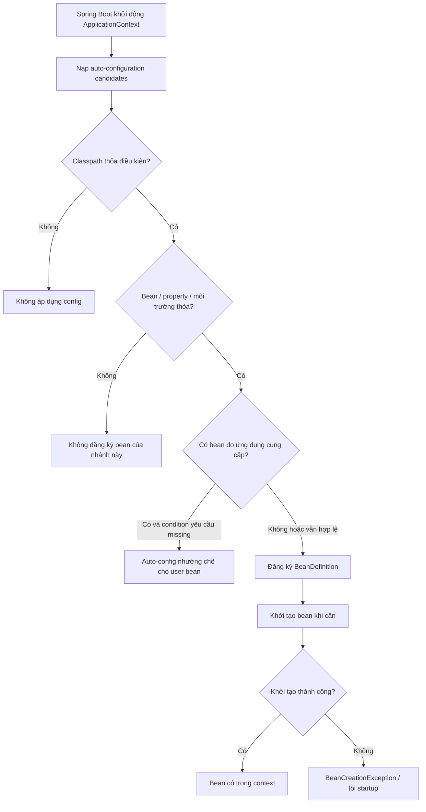
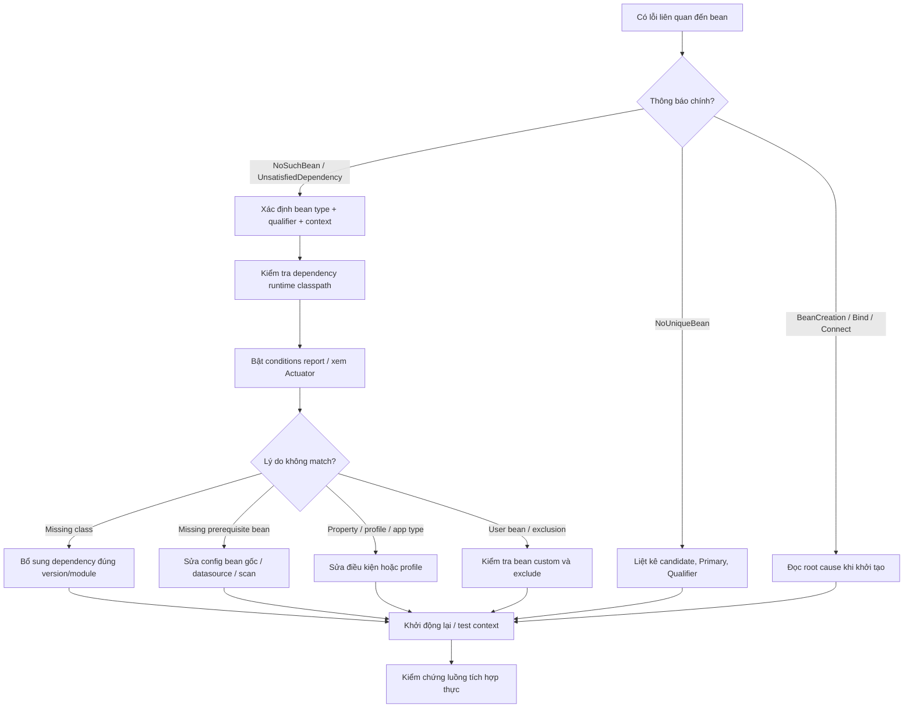
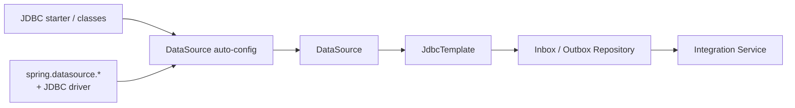

# Bean không được tạo do thiếu starter hoặc điều kiện tự cấu hình

## 1. Bối cảnh: “thiếu bean” có nghĩa gì trong Spring Boot Integration?

Một dịch vụ tích hợp Spring Boot thường phụ thuộc vào các đối tượng do Spring quản lý như `RestClient.Builder`, `WebClient.Builder`, `DataSource`, `JdbcTemplate`, `RabbitTemplate`, `RedisConnectionFactory`, `CacheManager`, `KafkaTemplate`, message channel hoặc adapter của Spring Integration. Khi bean không xuất hiện trong `ApplicationContext`, luồng gọi HTTP, lưu trạng thái, cache hoặc giao nhận thông điệp có thể thất bại từ lúc khởi động.

Ví dụ một service cần gửi sự kiện qua RabbitMQ:

```java
import org.springframework.amqp.rabbit.core.RabbitTemplate;
import org.springframework.stereotype.Service;

@Service
public class OrderEventPublisher {
    private final RabbitTemplate rabbitTemplate;

    public OrderEventPublisher(RabbitTemplate rabbitTemplate) {
        this.rabbitTemplate = rabbitTemplate;
    }
}
```

Nếu context không có bean `RabbitTemplate` có thể inject, Spring thường báo lỗi thuộc nhóm:

```text
UnsatisfiedDependencyException:
  Error creating bean with name 'orderEventPublisher':
  Unsatisfied dependency expressed through constructor parameter 0
...
NoSuchBeanDefinitionException:
  No qualifying bean of type 'org.springframework.amqp.rabbit.core.RabbitTemplate'
  available
```

Thông báo chỉ xác nhận **điểm tiêm dependency không được đáp ứng**. Nó chưa chứng minh lý do gốc là thiếu `spring-boot-starter-amqp`. Có thể starter chưa có trong runtime classpath, auto-configuration không đủ điều kiện, bean bị exclude, profile sai, người dùng tự khai báo cấu hình không hợp lệ hoặc bean đã được tạo trong một context khác.

Bài học thuộc chương **Gỡ lỗi và nâng cấp** của module **SPRING_BOOT_INTEGRATION**. Mục tiêu là chẩn đoán có chứng cứ và sửa đúng nguyên nhân trong các tích hợp HTTP, cơ sở dữ liệu, cache, broker và Spring Integration. Đặc biệt cần tránh “sửa để ứng dụng start được” nhưng làm mất kiểm soát giao dịch, idempotency, retry hoặc hợp đồng dữ liệu của luồng tích hợp.

## 2. Phân biệt bốn loại sự cố trước khi sửa cấu hình

| Dấu hiệu chính | Kết luận ban đầu có thể rút ra | Bước kiểm tra tiếp theo |
| --- | --- | --- |
| `NoSuchBeanDefinitionException`, `No qualifying bean of type...` | Không tìm thấy ứng viên bean đúng kiểu/qualifier tại điểm tiêm | Tìm nguồn đăng ký bean, conditions report, component scan và qualifier |
| `NoUniqueBeanDefinitionException`, `expected single matching bean but found ...` | Có **nhiều** ứng viên, không chọn được một | Kiểm tra `@Qualifier`, `@Primary`, tên bean và datasource/connection factory |
| `BeanCreationException` với `Caused by` là lỗi cấu hình/kết nối | Định nghĩa bean có thể đã được tìm thấy, nhưng khởi tạo thất bại | Đọc nguyên nhân sâu nhất: properties, credential, URL, DNS, TLS, schema, constructor |
| `ClassNotFoundException`, `NoClassDefFoundError` | Thiếu lớp ở classpath runtime hoặc xung đột binary/version | So dependency tree, scope, exclusion và phiên bản thư viện |

Ví dụ `RabbitTemplate` tồn tại nhưng không thể kết nối được RabbitMQ tại thời điểm publish là **lỗi kết nối runtime**, không tự động có nghĩa là auto-configuration thiếu bean. Một `JdbcTemplate` bean có thể được tạo dù SQL sau đó lỗi vì thiếu bảng. Phân loại đúng giúp không sửa sai lớp sự cố.

Trong log startup, đọc từ phần cuối để tìm chuỗi `Caused by`, sau đó quay lại vị trí dependency đầu tiên không được đáp ứng. Đừng lấy dòng “APPLICATION FAILED TO START” làm nguyên nhân; đó chỉ là kết quả cuối cùng.

## 3. Starter là gì, và tại sao thiếu starter khiến bean không xuất hiện?

Spring Boot starter là một gói dependency được thiết kế để kéo vào thư viện chức năng và các thành phần cần thiết tương ứng. **Auto-configuration** là cơ chế của Spring Boot phân tích classpath, bean hiện hữu, properties và môi trường để quyết định những bean nào được cấu hình tự động. Starter và auto-configuration có quan hệ gần nhau, nhưng **không đồng nghĩa**:

- Thêm starter thường làm các class cần thiết xuất hiện trong classpath và cho phép auto-configuration liên quan được xét.
- Một auto-configuration chỉ tạo bean khi **tất cả các điều kiện áp dụng** được thỏa mãn.
- Một bean do người dùng tự định nghĩa có thể làm auto-configuration *lùi lại* qua `@ConditionalOnMissingBean`.
- Một property trong `application.yml` không thể tự sinh class còn thiếu; đổi `spring.rabbitmq.host` không thể thay cho dependency AMQP.
- Không phải mọi loại đối tượng có thể inject đều được starter tạo sẵn; một số phải có `@Bean`, `@Component`, `@Import` hoặc lời gọi đăng ký rõ ràng.

Một số ví dụ kiểm tra dependency theo chức năng:

| Bean hoặc khả năng cần dùng | Dependency thường liên quan | Điều kiện cần xem thêm |
| --- | --- | --- |
| `RabbitTemplate`, `ConnectionFactory` của Spring AMQP | `spring-boot-starter-amqp` | Điều kiện Rabbit auto-config, bean connection factory, custom bean/exclusion |
| `JdbcTemplate`, `DataSource` | `spring-boot-starter-jdbc` hoặc stack JDBC/JPA tương ứng cùng driver | URL/embedded DB, datasource, nhiều candidate, điều kiện JDBC |
| `RedisConnectionFactory`, `RedisTemplate` | `spring-boot-starter-data-redis` | Client Redis, custom connection factory, properties và scope |
| `WebClient.Builder` | Spring WebFlux client classes; thường qua `spring-boot-starter-webflux` ở những dự án phù hợp | Điều kiện auto-config builder; `WebClient` hoàn chỉnh thường cần tự tạo |
| `CacheManager` | `spring-boot-starter-cache` và provider tương ứng | Caching infrastructure, `spring.cache.*`, bean do ứng dụng cung cấp |
| `KafkaTemplate` | Spring Kafka (`spring-kafka`) và cấu hình Kafka của phiên bản Spring Boot | ProducerFactory, bootstrap server, nhiều template/custom bean |
| Spring Integration adapters | Core Spring Integration và module adapter chuyên dụng | Adapter/protocol classpath, endpoint bean/flow, channel, bean scan |

Tên starter và cách chia module có thể thay đổi giữa các thế hệ Spring Boot, nhất là khi nâng cấp lớn. Bảng nhằm định hướng chẩn đoán; **dependency thực tế phải đối chiếu với BOM và tài liệu đúng phiên bản của dự án**. Tránh tự đoán một starter mới chỉ từ tên protocol.

### Kiểm tra dependency tại đúng scope

Ví dụ Maven thêm AMQP khi dùng Spring Boot parent/BOM:

```xml
<dependency>
    <groupId>org.springframework.boot</groupId>
    <artifactId>spring-boot-starter-amqp</artifactId>
</dependency>
```

Ví dụ Gradle:

```groovy
dependencies {
    implementation 'org.springframework.boot:spring-boot-starter-amqp'
}
```

Sau đó kiểm tra dependency graph, không chỉ nhìn một dòng trong `pom.xml` hoặc `build.gradle`:

```bash
# Maven: cây dependency thực tế
./mvnw dependency:tree

# Gradle: classpath chạy ứng dụng
./gradlew dependencies --configuration runtimeClasspath

# Gradle: tìm nguồn đến một dependency cụ thể
./gradlew dependencyInsight --dependency spring-rabbit --configuration runtimeClasspath
```

Đọc kết quả với những câu hỏi cụ thể: starter có thực sự nằm trong module đang khởi chạy không, có bị exclude transitive, đặt nhầm `testImplementation`/`test` hay `provided`, có conflict phiên bản, và packaged artifact có class cần thiết không? Với project đa module, dependency ở một module khác không tự động xuất hiện trong runtime classpath của module triển khai.

## 4. Cơ chế tự cấu hình hoạt động như thế nào?



Đây là mô hình khái quát, không phải mọi auto-configuration đều có đúng cùng thứ tự hay cùng danh sách điều kiện. Điểm quan trọng là phải **tách “không đăng ký” khỏi “đã đăng ký nhưng khởi tạo lỗi”**.

### Những condition thường gặp

| Điều kiện | Câu hỏi mà condition trả lời | Ví dụ ảnh hưởng trong tích hợp |
| --- | --- | --- |
| `@ConditionalOnClass` | Class cần thiết có trên classpath không? | Không có class của RabbitMQ client/Spring AMQP thì config liên quan không match |
| `@ConditionalOnMissingClass` | Một class cụ thể không tồn tại? | Một nhánh fallback chỉ dùng khi không có thư viện khác |
| `@ConditionalOnBean` | Có bean loại/tên cần thiết trong context tại thời điểm xét không? | Cấu hình `JdbcTemplate` cần `DataSource` thích hợp |
| `@ConditionalOnMissingBean` | Chưa có bean tương ứng do người dùng/auto-config khác cung cấp? | Boot không tạo template mặc định vì đã có bean custom cùng loại |
| `@ConditionalOnSingleCandidate` | Có một ứng viên duy nhất hoặc ứng viên chính có thể xác định? | Auto-config cần chọn một `DataSource` trong nhiều datasource |
| `@ConditionalOnProperty` | Thuộc tính có giá trị yêu cầu không? | Tắt endpoint hoặc adapter qua feature flag |
| `@ConditionalOnResource` | Có tài nguyên classpath hoặc file yêu cầu không? | Nhánh cấu hình chỉ bật nếu có script/metadata cụ thể |
| `@ConditionalOnWebApplication` | Đang chạy loại ứng dụng web cần thiết? | Cấu hình servlet không chạy trong reactive/non-web context |
| `@ConditionalOnNotWebApplication` | Có phải ứng dụng không-web không? | Cấu hình riêng cho worker không chạy web |
| `@ConditionalOnExpression` hoặc điều kiện tùy biến | Logic riêng có đạt không? | Phụ thuộc feature flags/bean/environment phức tạp |

Ví dụ condition dựa trên cấu hình:

```java
import org.springframework.boot.autoconfigure.condition.ConditionalOnProperty;
import org.springframework.context.annotation.Bean;
import org.springframework.context.annotation.Configuration;

@Configuration(proxyBeanMethods = false)
class PartnerSyncConfiguration {

    @Bean
    @ConditionalOnProperty(
        prefix = "integration.partner-sync",
        name = "enabled",
        havingValue = "true"
    )
    PartnerSyncMarker partnerSyncMarker() {
        return new PartnerSyncMarker();
    }

    static class PartnerSyncMarker {}
}
```

Với ví dụ này, `integration.partner-sync.enabled=false` hoặc **không khai báo property** thì bean không được đăng ký. `@ConditionalOnProperty` có thể dùng `matchIfMissing = true` khi muốn mặc định bật; điều này cần được thiết kế có chủ đích, nhất là với job nền có thể phát sinh side effect.

Lưu ý tinh tế: `@ConditionalOnBean` và `@ConditionalOnMissingBean` phụ thuộc các bean definition đã được xử lý ở thời điểm xét điều kiện. Chúng đặc biệt thích hợp trong auto-configuration với thứ tự được kiểm soát; đặt tùy tiện trên cấu hình nghiệp vụ thường khiến kết quả khác kỳ vọng.

## 5. Quy trình chẩn đoán có thể lặp lại

Thay vì thêm `@Bean` thử nhiều lần, dùng quy trình sau:



Một lần xử lý chuẩn nên lưu lại bốn bằng chứng: **tên bean cần inject**, **bean/auto-configuration được kỳ vọng tạo ra**, **condition quyết định đăng ký hay bỏ qua**, và **thay đổi tối thiểu có thể kiểm chứng**. Khi có nhiều `ApplicationContext` (parent/child) hoặc Spring test slice, còn phải xác định đang xem context nào.

## 6. Đọc Conditions Evaluation Report

Spring Boot có cơ chế tổng hợp kết quả đánh giá điều kiện. Có thể bật chế độ debug tại startup:

```bash
java -jar integration-service.jar --debug
```

Hoặc trong cấu hình thử nghiệm:

```properties
debug=true
```

Chỉ dùng debug có kiểm soát khi cần điều tra và không log bí mật. Tùy phiên bản/cấu hình logging, startup output có phần **CONDITIONS EVALUATION REPORT** với các nhóm như positive matches, negative matches, unconditional classes và exclusions.

Ví dụ **minh họa dạng kết quả**, không phải log sao chép từ một phiên bản Spring Boot cụ thể:

```text
Negative matches:
  RabbitAutoConfiguration:
    Did not match:
      - @ConditionalOnClass did not find required class
        'org.springframework.amqp.rabbit.core.RabbitTemplate'

Positive matches:
  DataSourceAutoConfiguration:
    Matched:
      - @ConditionalOnClass found required classes
```

Từ báo cáo minh họa trên có thể suy luận:

1. Nhánh Rabbit auto-configuration chưa áp dụng vì thiếu class trên classpath.
2. Nhánh `DataSourceAutoConfiguration` match ở mức nào đó, nhưng **chưa chứng minh** bean `JdbcTemplate` đã khởi tạo thành công.
3. Cần đọc điều kiện chi tiết của đúng auto-configuration, bao gồm các nested configuration, phương thức `@Bean` và các điều kiện âm tính còn lại.

Khi report ghi `@ConditionalOnMissingBean did not match`, hãy tìm **bean đã có** đang chiếm quyền. Đừng vội xóa nó: đó có thể là cấu hình tùy biến cố ý để dùng connection pool, transaction hoặc `MessageConverter` đặc thù.

### Actuator và các endpoint hỗ trợ

Nếu ứng dụng có Spring Boot Actuator và cho phép truy cập phù hợp, các endpoint sau hữu ích:

| Endpoint | Giá trị trong điều tra |
| --- | --- |
| `/actuator/conditions` | Xem outcome của auto-configuration/conditions hiện hành |
| `/actuator/beans` | Xem bean được đăng ký và dependency trong context |
| `/actuator/configprops` | Kiểm tra configuration properties đã bind; phải bảo vệ giá trị nhạy cảm |
| `/actuator/env` | Kiểm tra property source/giá trị effective theo chính sách bảo mật |

Ví dụ chỉ bật trong môi trường chẩn đoán có xác thực:

```yaml
management:
  endpoints:
    web:
      exposure:
        include: health,info,conditions,beans
```

Endpoint có thể cần được enable/expose thêm theo phiên bản và security policy; không có nghĩa tất cả endpoint tự xuất hiện chỉ vì thêm starter Actuator. **Không expose rộng rãi** conditions/beans/env/configprops ra internet vì chúng tiết lộ cấu trúc nội bộ, cấu hình và tên thành phần. Ưu tiên quyền truy cập nội bộ có audit, sau đó thu hẹp exposure.

## 7. Tình huống 1: RabbitTemplate không có dù đã cấu hình spring.rabbitmq.*

Giả sử `application.yml` có:

```yaml
spring:
  rabbitmq:
    host: rabbitmq.internal
    port: 5672
    username: ${RABBITMQ_USERNAME}
    password: ${RABBITMQ_PASSWORD}
```

Nhưng ứng dụng báo không tìm thấy `RabbitTemplate`. Cần kiểm tra:

1. Module chạy ứng dụng có `spring-boot-starter-amqp` và class `RabbitTemplate` trên **runtime classpath** chưa?
2. `RabbitAutoConfiguration` có xuất hiện trong condition report? Nếu bị loại trừ, vì sao?
3. `CachingConnectionFactory` hay `ConnectionFactory` có được cung cấp? Có bean custom không?
4. Code có dùng `@Qualifier` hoặc tên bean khiến không match mặc dù một `RabbitTemplate` khác đã tồn tại?
5. Dependency giữa module producer và module deploy có bị scope `test`/`provided` hoặc exclusion làm thiếu class runtime?

Sau khi sửa dependency, kiểm tra bằng một integration test có RabbitMQ thật: publish một message, kiểm tra exchange/queue/binding và xử lý ack/return. Bean xuất hiện mới chỉ là bước đầu; lỗi routing key, broker authentication hay DLQ cần được kiểm chứng riêng.

**Không thay thế `RabbitTemplate` bằng một bean rỗng** chỉ để khởi động. Một đối tượng không kết nối được broker không đáp ứng hợp đồng publish, và có thể làm ứng dụng báo health tốt giả tạo.

## 8. Tình huống 2: Có WebClient.Builder nhưng không có WebClient

Một nhầm lẫn phổ biến ở HTTP client là Spring Boot có thể tự cấu hình `WebClient.Builder` khi điều kiện classpath phù hợp, nhưng **không mặc nhiên tạo một `WebClient` đã gắn base URL của đối tác**.

Ví dụ lỗi:

```java
import org.springframework.stereotype.Service;
import org.springframework.web.reactive.function.client.WebClient;

@Service
public class PartnerApiClient {
    public PartnerApiClient(WebClient webClient) {
        // Ứng dụng phải cung cấp bean WebClient nếu muốn inject trực tiếp.
    }
}
```

Cách sửa là khai báo bean `WebClient` từ builder được Boot quản lý, với URL và codec/timeout/certificate theo hợp đồng dự án:

```java
import org.springframework.beans.factory.annotation.Value;
import org.springframework.beans.factory.annotation.Qualifier;
import org.springframework.context.annotation.Bean;
import org.springframework.context.annotation.Configuration;
import org.springframework.web.reactive.function.client.WebClient;

@Configuration(proxyBeanMethods = false)
public class PartnerHttpConfiguration {

    @Bean("partnerWebClient")
    WebClient partnerWebClient(
            WebClient.Builder builder,
            @Value("${integration.partner.base-url}") String baseUrl) {
        return builder.baseUrl(baseUrl).build();
    }
}
```

Khi inject:

```java
import org.springframework.beans.factory.annotation.Qualifier;
import org.springframework.stereotype.Service;
import org.springframework.web.reactive.function.client.WebClient;

@Service
public class PartnerApiClient {
    private final WebClient client;

    public PartnerApiClient(
            @Qualifier("partnerWebClient") WebClient client) {
        this.client = client;
    }
}
```

Nếu không có `WebClient.Builder`, cần xem dependency client thuộc Spring WebFlux và điều kiện auto-configuration tương ứng; nếu có builder mà lỗi `Could not resolve placeholder 'integration.partner.base-url'`, nguyên nhân là **thiếu property bắt buộc**, không phải thiếu starter.

Với `RestClient.Builder` hoặc các HTTP client khác, áp dụng cùng nguyên tắc: phân biệt **builder do framework cung cấp** với **client cho một đối tác cụ thể** do ứng dụng phải cấu hình. Lưu ý WebClient có thể dùng trong ứng dụng servlet; thêm WebFlux client classpath không nhất thiết có nghĩa phải chuyển cả server sang reactive.

## 9. Tình huống 3: thiếu DataSource, JdbcTemplate hoặc bean liên quan cơ sở dữ liệu

Một luồng tích hợp thường lưu trạng thái idempotency, checkpoint, inbox/outbox hoặc audit. Khi có lỗi tiêm `JdbcTemplate`, hãy truy theo chuỗi phụ thuộc:



Ví dụ datasource PostgreSQL:

```yaml
spring:
  datasource:
    url: ${DB_URL}
    username: ${DB_USERNAME}
    password: ${DB_PASSWORD}
```

Lộ trình tìm lỗi:

- `JdbcTemplate` class không có: kiểm tra `spring-boot-starter-jdbc` hoặc thư viện tương ứng trên classpath.
- `DataSource` bean không có: xem `DataSourceAutoConfiguration` có match, có custom datasource nào làm nó back off, và JDBC driver/URL có sẵn không.
- Có **hai DataSource** nhưng không chọn được một ứng viên: cần `@Primary`, `@Qualifier` hoặc khai báo `JdbcTemplate` cho datasource đích. Lỗi này là vấn đề **đa ứng viên**, không phải thiếu dependency.
- `DataSource` tạo bean lỗi do URL/credential/driver: sửa nguyên nhân cấu hình; không tắt kiểm tra kết nối bằng cách loại bỏ datasource.
- Bean repository tự định nghĩa nằm ngoài component scan: xem phạm vi scan, `@Repository`, `@Import` và cấu hình JPA/repository nếu có.

Một lỗi nguy hiểm là dùng nhầm datasource của Quartz scheduler thay cho datasource nghiệp vụ. Ngay cả khi inject thành công, luồng inbox/outbox có thể ghi vào database sai. Cần xác định **bean identity và datasource thực tế** của mỗi repository và transaction manager, đặc biệt ở ứng dụng có database cho scheduler, business state và message store riêng.

## 10. Tình huống 4: RedisTemplate/CacheManager vắng mặt

Khi dùng Redis làm cache, phải tách hai lớp:

1. **Kết nối dữ liệu Redis:** `RedisConnectionFactory`, `RedisTemplate`, `StringRedisTemplate`.
2. **Spring Cache abstraction:** `CacheManager`, các annotation như `@Cacheable` và việc kích hoạt caching.

Một cấu hình Redis client có thể tạo `RedisTemplate` nhưng không có `CacheManager` phù hợp nếu caching infrastructure, provider hoặc conditions chưa thỏa. Ngược lại, `CacheManager` có thể là loại in-memory thay vì Redis nếu classpath và điều kiện dẫn đến provider khác.

Ví dụ cấu hình lựa chọn Redis cache:

```yaml
spring:
  cache:
    type: redis
  data:
    redis:
      host: ${REDIS_HOST}
      port: ${REDIS_PORT:6379}
```

Cần dependency Redis phù hợp, caching support, cấu hình caching có chủ đích (thường `@EnableCaching`) và Redis connection factory. Tên `spring.data.redis.*` phản ánh các phiên bản Spring Boot phổ biến hiện nay; nếu nâng cấp từ bản cũ có `spring.redis.*`, phải đối chiếu metadata/migration guide chính xác trước khi kết luận về property.

Chẩn đoán bằng report:

- Cache auto-configuration không match: classpath hoặc caching infrastructure còn thiếu?
- `RedisCacheConfiguration` không match: Redis provider hoặc connection factory không sẵn có? Có một bean `CacheManager` custom khiến Boot không tạo mặc định?
- Bean có nhưng `@Cacheable` không phát huy tác dụng: kiểm tra proxy invocation, phương thức được gọi trực tiếp trong cùng bean, key/TTL/serialization và cấu hình caching; đây không hẳn là lỗi thiếu bean.

Với tích hợp thực tế, cache không thể tự đóng vai trò nguồn sự thật cho trạng thái giao nhận. Nếu dùng Redis để deduplicate message, cần xem TTL, race condition và độ bền dữ liệu; bean xuất hiện không tự bảo đảm tính đúng đắn của khóa idempotency.

## 11. Tình huống 5: adapter Spring Integration không được tạo

Trong Spring Integration, có sự khác biệt giữa **thư viện giao thức**, **bean channel**, và **endpoint/flow** dùng thư viện đó.

Ví dụ:

- Có `spring-integration-core` chưa có nghĩa adapter AMQP, JDBC, FTP hoặc HTTP tự động được khai báo.
- Có `spring-boot-starter-amqp` để dùng RabbitMQ không đồng nghĩa tồn tại một `AmqpInboundChannelAdapter` mong muốn; adapter/endpoint phải được cấu hình bằng Spring Integration và có module tích hợp tương ứng.
- Có class `IntegrationFlow` không đồng nghĩa một flow tên `partnerInboundFlow` đã được tạo.
- Một `MessageChannel` chỉ có tên trong properties không tự được đăng ký thành bean.

Ví dụ tạo channel do ứng dụng sở hữu:

```java
import org.springframework.context.annotation.Bean;
import org.springframework.context.annotation.Configuration;
import org.springframework.integration.channel.DirectChannel;
import org.springframework.messaging.MessageChannel;

@Configuration(proxyBeanMethods = false)
public class IntegrationChannelsConfiguration {

    @Bean
    MessageChannel partnerInboundChannel() {
        return new DirectChannel();
    }
}
```

Nếu một endpoint đang inject `@Qualifier("partnerInboundChannel") MessageChannel`, cần đảm bảo tên bean, package được scan và context chính xác. Nếu ứng dụng nhận lỗi `NoClassDefFoundError` cho class adapter khi startup, hãy kiểm tra module `spring-integration-<protocol>` phù hợp, dependency version và runtime scope.

**Phân biệt lỗi DI với lỗi luồng chạy:** Một channel đã được tạo vẫn có thể không có subscriber; gửi vào `DirectChannel` không có handler có thể gây `MessageDeliveryException` tại runtime. Việc sửa bean creation xong chưa chứng minh flow đã xử lý message.

## 12. Component scan, @Profile, @Conditional và package structure

Không phải bean nào cũng do auto-configuration sinh ra. Các service, repository, converter, job, endpoint và adapter do dự án viết thường được Spring tìm bằng component scan hoặc khai báo `@Bean`.

Ví dụ cây package:

```text
com.example.integration
  IntegrationApplication.java  (@SpringBootApplication)
  http/PartnerClient.java       (@Service)
  amqp/OrderPublisher.java      (@Component)
  config/PartnerConfig.java     (@Configuration)

com.example.external
  LegacyAdapter.java            (@Component)
```

Nếu `IntegrationApplication` ở `com.example.integration`, scan mặc định thường bao phủ package đó và các package con. `LegacyAdapter` ở `com.example.external` không tự được scan. Cần chỉnh package structure, phạm vi scan hoặc import cấu hình có chủ đích.

Đồng thời kiểm tra:

- Class có `@Component`, `@Service`, `@Repository`, `@Configuration` hoặc `@Bean` thật không?
- Có `@Profile("prod")` nhưng test đang chạy profile `test` không?
- Có `@ConditionalOnProperty` hay annotation custom đang chặn đăng ký không?
- Tên bean và `@Qualifier` khớp hoàn toàn không?
- Bean có bị tạo trong context khác (`@WebMvcTest`, child context, management context) không?
- Bean có bị loại khỏi component scan qua filter hoặc `@Import` bị bỏ quên không?

Việc tăng `scanBasePackages` từ một package nhỏ lên toàn ứng dụng có thể kéo vào những component không mong muốn, làm trùng bean hoặc kích hoạt adapter dùng sai môi trường. Ưu tiên cấu trúc package rõ ràng và import có chủ đích.

## 13. Bean custom làm auto-configuration “back off”

Giả sử ứng dụng muốn cung cấp `RabbitTemplate` riêng để đặt message converter, correlation ID hoặc publisher callback. Nhiều auto-configuration của Boot sử dụng điều kiện kiểu `@ConditionalOnMissingBean` để không tạo thêm bean mặc định nếu đã có đối tượng do người dùng cung cấp.

Điều này dẫn đến ba trường hợp:

1. **Có bean custom hợp lệ:** Boot không tạo bean mặc định, injection vẫn hoạt động nếu không có vấn đề qualifier.
2. **Bean custom được khai báo sai:** Boot thấy bean definition và không tạo mặc định; bean custom có thể thất bại khi khởi tạo.
3. **Có nhiều bean custom:** injection thiếu qualifier gây `NoUniqueBeanDefinitionException` hoặc chọn nhầm bean nếu `@Primary` không đúng.

Không nên khắc phục bằng cách bật `spring.main.allow-bean-definition-overriding=true` một cách tùy tiện. Bean overriding theo tên khác với lựa chọn ứng viên theo kiểu; bật nó có thể che giấu cấu hình trùng và thay đổi hành vi bất ngờ.

Với luồng tích hợp, phải giữ được các customizations có chủ đích: JSON converter, HTTP timeout/TLS, publisher confirms, retry, circuit breaker, transaction manager, cache serializer. Một bean mặc định “tự xuất hiện lại” sau khi xóa custom config chưa chắc có hành vi nghiệp vụ đúng.

## 14. Exclude auto-configuration và thay đổi application type

Spring Boot cho phép exclude một hoặc nhiều auto-configuration thông qua annotation hoặc property, ví dụ:

```java
import org.springframework.boot.SpringApplication;
import org.springframework.boot.autoconfigure.SpringBootApplication;
import org.springframework.boot.autoconfigure.jdbc.DataSourceAutoConfiguration;

@SpringBootApplication(exclude = DataSourceAutoConfiguration.class)
public class IntegrationApplication {

    public static void main(String[] args) {
        SpringApplication.run(IntegrationApplication.class, args);
    }
}
```

Đây là ví dụ **cố ý tắt** cấu hình datasource tự động. Nếu một repository sau đó cần `JdbcTemplate`, không thể kỳ vọng Boot vẫn tạo `DataSource` như thường lệ.

Hoặc cấu hình dạng property:

```yaml
spring:
  autoconfigure:
    exclude:
      - org.springframework.boot.autoconfigure.jdbc.DataSourceAutoConfiguration
```

Tên class đầy đủ trong ví dụ này ứng với một số phiên bản Spring Boot; khi nâng cấp lớn, package/auto-configuration module có thể thay đổi và cần dùng tên hợp lệ cho version đang chạy. Nếu loại bỏ một auto-configuration vì môi trường test không có database, cần đảm bảo cấu hình đó **không vô tình lọt vào production**.

Với web application, kiểm tra `spring.main.web-application-type` và dependency servlet/reactive: một auto-configuration chỉ dành cho `SERVLET` không thể được kỳ vọng hoạt động khi ứng dụng chạy `NONE` hoặc `REACTIVE`. Nhiều worker tích hợp không cần web server, nhưng cũng không nên inject các bean chỉ tồn tại trong servlet context.

## 15. Vì sao lỗi thường chỉ xuất hiện trong test?

Spring Boot test slices như `@WebMvcTest`, `@DataJpaTest` hoặc `@JsonTest` cố ý tạo một **phần** application context. Những bean ngoài phạm vi test có thể không được scan hoặc auto-configure dù ứng dụng chạy production bình thường.

| Tình huống | Điều cần hiểu |
| --- | --- |
| `@WebMvcTest` inject controller cần service publish AMQP | Slice tập trung vào web MVC; service/AMQP producer ngoài phạm vi thường phải mock hoặc import cấu hình có chủ đích |
| `@DataJpaTest` thử repository nhưng không có HTTP client | Slice dành cho JPA; không phải toàn bộ integration flow |
| `@SpringBootTest` khởi động full context nhưng thiếu DB/RabbitMQ | Đây có thể là lỗi external dependency/configuration khi test, không phải missing bean |
| `@Profile("prod")` trên một bean nhưng test chạy `test` | Bean bị loại theo profile như thiết kế |
| Test dùng nhiều `@MockBean`/`@MockitoBean` tùy phiên bản | Test có thể thay thế bean thật bằng mock; cần xác định chính sách mock của version đang dùng |

Khi lỗi chỉ xảy ra trong test, **đừng tự động thêm starter vào production** nếu runtime production vốn đã đúng. Phải xác nhận test định kiểm chứng **logic đơn vị** hay **toàn bộ luồng tích hợp**:

- Với controller unit/web slice test, mock một publisher hoặc service có thể hợp lý.
- Với integration test của HTTP → database → RabbitMQ, dùng full context và Testcontainers/database/broker thực để kiểm tra topology, transaction, retry, idempotency và khả năng giao message.
- Với điều kiện tự cấu hình do thư viện của đội phát triển cung cấp, dùng `ApplicationContextRunner` kiểm thử các tổ hợp classpath/bean/property mà không cần khởi động toàn hệ thống.

### Thử điều kiện bằng ApplicationContextRunner

Ví dụ kiểm thử chính xác một bean chỉ xuất hiện khi feature flag bật:

```java
import static org.assertj.core.api.Assertions.assertThat;

import org.junit.jupiter.api.Test;
import org.springframework.boot.test.context.runner.ApplicationContextRunner;

class PartnerSyncConfigurationTest {

    private final ApplicationContextRunner contextRunner =
        new ApplicationContextRunner()
            .withUserConfiguration(PartnerSyncConfiguration.class);

    @Test
    void disabledByDefault() {
        contextRunner.run(context ->
            assertThat(context).doesNotHaveBean(
                PartnerSyncConfiguration.PartnerSyncMarker.class
            )
        );
    }

    @Test
    void enabledWhenPropertyIsTrue() {
        contextRunner
            .withPropertyValues("integration.partner-sync.enabled=true")
            .run(context ->
                assertThat(context).hasSingleBean(
                    PartnerSyncConfiguration.PartnerSyncMarker.class
                )
            );
    }
}
```

Ví dụ giả định test class có thể truy cập `PartnerSyncConfiguration` ở mục 4 và phụ thuộc `spring-boot-starter-test` phù hợp phiên bản. Test này xác minh điều kiện property trên một bean cụ thể; không thay thế test kết nối RabbitMQ, HTTP hay database.

## 16. Nâng cấp Spring Boot: classpath và conditions có thể đổi

Sau khi nâng cấp Spring Boot, ứng dụng có thể gặp một trong ba dạng thay đổi:

1. **Dependency topology đổi:** một class/client/adapter trước kia có mặt qua dependency bắc cầu giờ cần dependency khác, hoặc starter được tổ chức lại.
2. **API/package đổi:** code tự viết import class hoặc customizer từ package cũ; có thể gây lỗi compile hoặc `ClassNotFoundException` khi chạy với artifact không tương thích.
3. **Auto-configuration đổi điều kiện/thứ tự:** một bean được tạo ngầm trước kia không còn tồn tại, hoặc nay đòi một bean/property rõ ràng hơn.

Để điều tra, so sánh **hai phiên bản đang triển khai thật**, tránh trộn tài liệu của phiên bản cũ với dependency mới.

| Hạng mục so sánh trước/sau | Câu hỏi cần trả lời |
| --- | --- |
| Java version và Spring Boot BOM | Nền tảng chạy có đáp ứng phiên bản Boot mới? |
| Runtime dependency tree | Starter, driver, adapter hoặc thư viện transitive nào bị thêm/bỏ/đổi version? |
| Conditions report | Auto-configuration trước kia match, nay fail ở điều kiện nào? |
| Custom `@Bean` | Có bean custom mới làm Boot back off hoặc tên/type thay đổi? |
| `application.yml` và env vars | Property nào đổi tên, chuyển prefix, bị bỏ hoặc thay default? |
| Bean types / package | Import, constructor, `@Qualifier`, `@Primary` còn chính xác? |
| Test context | Test slice và annotation mock/configuration có thay hành vi? |
| Hợp đồng runtime | HTTP TLS, JSON converter, transaction, cache TTL, broker ack/retry vẫn đúng? |

Trong nhiều phiên bản Spring Boot hiện đại, ứng dụng/framework đăng ký auto-configuration thông qua `META-INF/spring/org.springframework.boot.autoconfigure.AutoConfiguration.imports`; các dự án đời cũ có thể sử dụng metadata như `spring.factories`. Khi duy trì **starter nội bộ**, cần kiểm tra cách đăng ký auto-configuration được hỗ trợ ở đúng phiên bản Boot, đồng thời kiểm tra điều kiện `@ConditionalOnClass`, `@ConditionalOnBean` và thứ tự cấu hình. Một thư viện vẫn nằm trên classpath nhưng class auto-configuration không được import đúng sẽ không tự sinh bean.

### Ví dụ: sau nâng cấp WebClient biến mất

Cách tìm nguyên nhân:

1. Xác nhận `WebClient` hoặc `WebClient.Builder` thực sự là kiểu bị thiếu; đây là hai kiểu khác nhau.
2. Kiểm tra runtime classpath còn dependency Spring WebFlux client không.
3. So conditions report cho WebClient auto-configuration ở phiên bản mới.
4. Kiểm tra có bean custom hoặc `spring.autoconfigure.exclude` không.
5. Nếu thiếu `WebClient` do ứng dụng từng phụ thuộc vào một bean tự khai báo, bổ sung/khôi phục cấu hình `@Bean` của client theo hợp đồng URL, timeout, TLS và converter.
6. Chạy test HTTP adapter với stub/mock server để kiểm tra request/response và error mapping, rồi mới kết luận đã xử lý xong lỗi.

Điều quan trọng là phân biệt **breaking change do framework** với **dependency bị mất do build** và **cấu hình do ứng dụng vô tình loại bỏ**. Ba trường hợp yêu cầu ba cách sửa khác nhau.

## 17. Những “cách sửa nhanh” dễ gây lỗi sâu hơn

| Cách sửa hấp tấp | Vì sao không nên | Hướng đúng |
| --- | --- | --- |
| Tạo `@Bean RabbitTemplate` không kiểm tra điều kiện | Có thể dùng nhầm connection factory/virtual host hoặc bỏ mất publisher confirms | Xem report, sửa dependency/bean gốc, cấu hình client theo hợp đồng |
| Thêm tất cả starter có vẻ liên quan | Classpath lớn hơn, nhiều auto-config cùng match, có thể đổi hành vi ngoài ý muốn | Thêm đúng dependency theo API và luồng cần dùng |
| Bật bean overriding toàn cục | Che xung đột bean name, làm kết quả phụ thuộc thứ tự | Xác định rõ bean nào sở hữu chức năng, dùng qualifier/customization |
| Thay `@Autowired(required = true)` bằng optional rồi bỏ qua lỗi | Ứng dụng có thể startup nhưng âm thầm không publish sự kiện | Chỉ dùng optional dependency khi tính năng thực sự tùy chọn và có fallback xác định |
| Bắt mọi exception rồi trả về thành công | Che lỗi gửi broker/ghi DB, có thể ack message đã xử lý thất bại | Để lỗi lan ra đúng lớp, retry/DLQ theo chính sách |
| Exclude `DataSourceAutoConfiguration` để tránh lỗi kết nối | Làm repository/inbox/outbox mất dependency | Sửa datasource URL, quyền, driver hoặc migration |
| Hardcode credential vào `application.yml` | Rò rỉ bí mật và gây lệch môi trường | Dùng secret manager/env và redaction |
| Chỉ sửa test bằng mock khi lỗi production cũng xảy ra | Test pass nhưng lỗi DI thật vẫn tồn tại | Kiểm chứng full integration context và điều kiện production |
| Xóa `@ConditionalOnMissingBean` hoặc profile không hiểu lý do | Có thể tạo nhiều instance adapter cùng consume/publish | Hiểu ý định điều kiện và quản trị bean ownership |

Trong hệ thống tích hợp, việc “bean đã có” không đồng nghĩa luồng đã đúng: `RabbitTemplate` có thể gửi nhầm exchange, `JdbcTemplate` có thể kết nối nhầm database, `CacheManager` có thể chọn sai provider, còn `WebClient` có thể bỏ timeout/TLS. Sau khi sửa DI, phải xác minh **hợp đồng và hành vi** của adapter.

## 18. Kiểm tra sau sửa: từ application context đến luồng tích hợp

Nên kiểm tra ở ba tầng, từ nhanh đến đầy đủ:

**Tầng 1 – Chẩn đoán bean.** Ứng dụng khởi động với đúng profile và property source; condition report ghi nhánh cần thiết đã match; `/actuator/beans` hoặc test xác nhận bean type/name/qualifier và không có nhiều candidate ngoài ý muốn.

**Tầng 2 – Cấu hình phụ thuộc.** Client trỏ đúng URL/virtual host/database, credential/TLS hợp lệ, timeout/retry hợp đồng, converter/serializer tương thích, migration hoàn tất. Với datasource, kiểm tra transaction manager đúng datasource; với RabbitMQ, kiểm tra exchange/queue/binding và publisher confirms; với Redis, kiểm tra TTL và serialization.

**Tầng 3 – Kiểm thử đầu cuối.** Một request hoặc message đi qua HTTP → DB → broker/cache/Spring Integration adapter, có correlation ID, xử lý lỗi, retry, phát hiện trùng và quan sát kết quả. Bài test thất bại phải cho thấy không có tác dụng phụ không mong muốn hoặc cách hệ thống phục hồi sau lỗi.

Bảng kiểm chứng minh họa:

| Thành phần sửa lỗi thiếu bean | Smoke/integration test cần có |
| --- | --- |
| `RabbitTemplate` | Publish tới exchange hợp lệ, nhận confirm/return theo cấu hình, kiểm tra DLQ khi consumer thất bại |
| `WebClient` | Gọi stub server với base URL, header, timeout và mapping 4xx/5xx đã định |
| `JdbcTemplate` | Đọc/ghi bảng idempotency bằng datasource chính xác; kiểm tra transaction rollback |
| `RedisTemplate` / `CacheManager` | Set/get, TTL, serialization, cache hit/miss và fallback theo policy |
| Spring Integration `MessageChannel`/adapter | Flow có subscriber, payload/headers đúng, lỗi được đưa về error channel hoặc cơ chế được thiết kế |
| `KafkaTemplate` | ProducerFactory/config, serialize đúng, topic/partition/key đúng và xử lý xác nhận gửi theo API phù hợp |

## 19. Checklist xử lý nhanh tại hiện trường

1. Ghi chính xác **exception**, `Caused by` sâu nhất, kiểu bean, tên bean và qualifier được yêu cầu.
2. Xác định Spring Boot version, Java version, profile, module build và artifact **thực sự chạy**.
3. Kiểm tra starter và các class bắt buộc có trong `runtimeClasspath`, không chỉ ở test/compile.
4. Xem Conditions Evaluation Report hoặc endpoint Actuator được bảo vệ; ghi rõ **điều kiện nào match/không match**.
5. Kiểm tra `@ConditionalOnMissingBean`, custom bean, `@Primary`, `@Qualifier`, bean name và autoconfiguration exclusions.
6. Kiểm tra component scan, `@Profile`, `@ConditionalOnProperty`, loại web application và phạm vi test slice.
7. Nếu bean definition đã có nhưng tạo lỗi, tập trung vào property binding, credentials, driver, network, TLS hoặc schema; đừng tiếp tục gọi đây là “không có bean”.
8. Áp dụng **thay đổi tối thiểu** ở dependency, property, cấu hình bean hoặc profile đúng nguồn sở hữu.
9. Chạy test application context với profile mục tiêu, sau đó smoke/integration test của HTTP, DB, cache và broker.
10. Theo dõi log startup/health, throughput, timeout, số lần retry, số message trùng và lỗi đối tác sau khi deploy.

## 20. Tình huống tự đánh giá

Một dịch vụ Spring Boot nhận webhook thanh toán, ghi bảng `processed_event` để chống trùng rồi publish sang RabbitMQ. Sau khi nâng phiên bản Spring Boot, ứng dụng dừng khởi động với thông báo `No qualifying bean of type 'RabbitTemplate'`. Nhóm phát triển thấy `spring.rabbitmq.host` vẫn đúng nên quyết định thêm `@Bean RabbitTemplate` thủ công.

Trước khi chấp nhận thay đổi, hãy trả lời:

1. **Tại sao property đúng chưa đủ?** Vì properties chỉ cung cấp dữ liệu cấu hình; classpath, auto-configuration và prerequisites vẫn quyết định bean có được tạo hay không.
2. **Cần kiểm tra bằng chứng gì trước?** Runtime dependency tree, condition report của Rabbit auto-configuration, custom connection factory/template, các exclusions và qualifier tại injection point.
3. **Khi nào thêm `@Bean RabbitTemplate` phù hợp?** Khi ứng dụng chủ động sở hữu cấu hình template đặc thù (converter, publisher callbacks...) và đã có connection factory đúng; không dùng như cách che thiếu starter.
4. **Nếu sửa xong bean nhưng không có message ở queue?** Kiểm tra exchange, routing key, binding, mandatory returns, publisher confirm, credential/vhost và metric broker; đó là lỗi giao nhận khác với DI.
5. **Nếu một webhook tạo hai sự kiện sau reconnect?** Thiết kế at-least-once, khóa idempotency, transaction inbox/outbox và consumer deduplication; bean creation thành công không bảo đảm exactly-once.
6. **Cách xác nhận bản nâng cấp an toàn?** Chạy app với profile thật trên môi trường kiểm thử, so conditions trước/sau, publish một event hợp lệ, phát lại event trùng, mô phỏng broker mất kết nối và kiểm tra log/metrics.

**Ghi nhớ:** Trong Spring Boot, **starter đưa năng lực vào classpath**, còn **auto-configuration quyết định có tạo bean hay không dựa trên điều kiện hiện tại**. Khi gặp lỗi thiếu bean, cần phân loại exception, đọc điều kiện bằng chứng cứ, sửa đúng dependency/cấu hình/context và cuối cùng kiểm chứng toàn bộ luồng tích hợp: HTTP, database, cache, message broker và adapter của Spring Integration.
