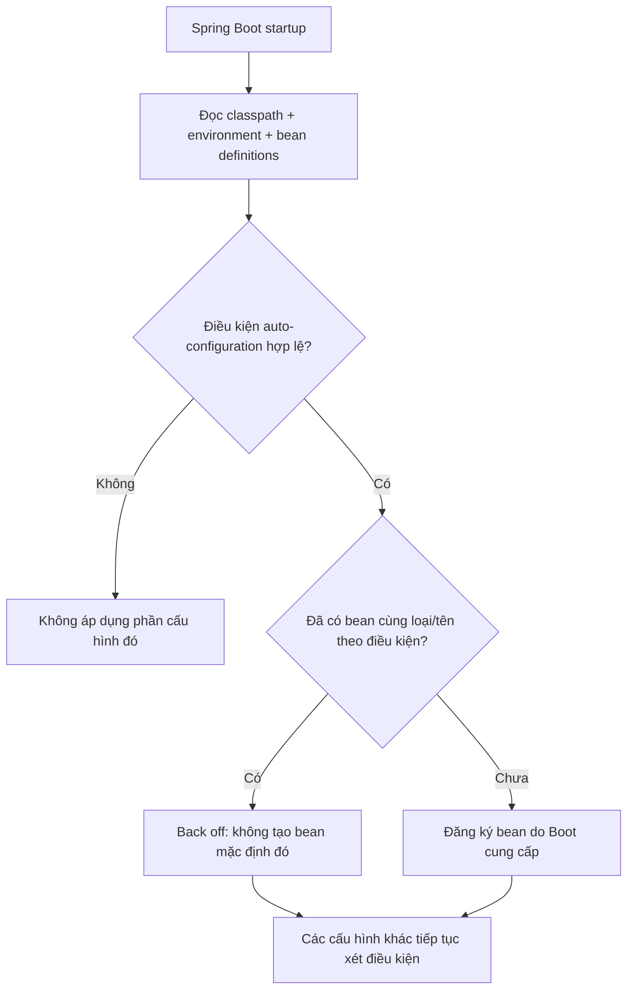
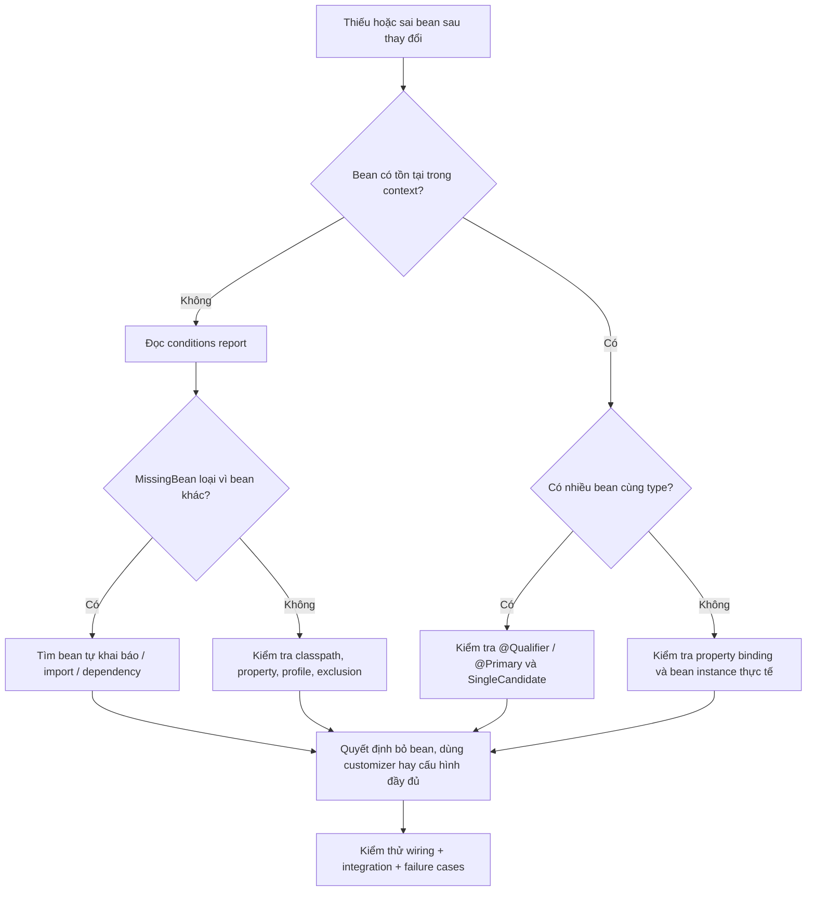
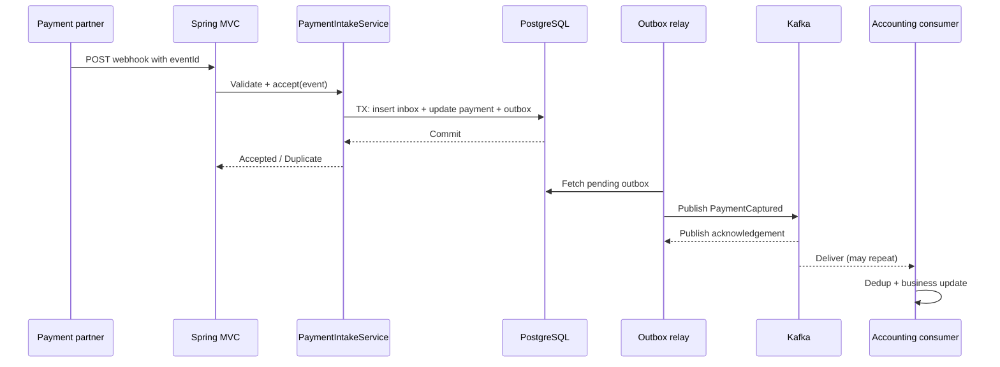

# Bean tự khai báo khiến Boot ngừng cung cấp cấu hình mặc định

> **Chương:** Gỡ lỗi và nâng cấp  
> **Module:** `SPRING_BOOT_INTEGRATION` — tổ chức tích hợp hệ thống trong Spring Boot qua HTTP client, cơ sở dữ liệu, cache, broker thông điệp và adapter Spring Integration, với trọng tâm về cấu hình, hợp đồng dữ liệu, giao dịch, lỗi, xử lý trùng lặp, kiểm thử và quan sát.
>
> **Phạm vi:** Bài mô tả cơ chế có điều kiện của Spring Boot và các tình huống thường gặp trong ứng dụng tích hợp. Tên bean, điều kiện cụ thể và API có thể thay đổi giữa các phiên bản Spring Boot; cần kiểm tra Condition Evaluation Report và tài liệu của phiên bản đang triển khai khi xử lý sự cố.

## 1. Tình huống: thêm một bean rồi cấu hình cũ bỗng không còn tác dụng

Một dịch vụ Spring Boot nhận webhook từ đối tác thanh toán, ghi PostgreSQL, đồng thời phát event sang Kafka. Ứng dụng chạy ổn định với `application.yml`:

```yaml
spring:
  datasource:
    url: ${DB_JDBC_URL}
    username: ${DB_USERNAME}
    password: ${DB_PASSWORD}
  kafka:
    bootstrap-servers: ${KAFKA_BOOTSTRAP_SERVERS}
```

Sau một lần refactor, lập trình viên muốn “kiểm soát connection pool” và thêm:

```java
import javax.sql.DataSource;
import com.zaxxer.hikari.HikariDataSource;
import org.springframework.context.annotation.Bean;
import org.springframework.context.annotation.Configuration;

@Configuration
public class DatabaseConfig {
    @Bean
    public DataSource dataSource() {
        return new HikariDataSource();
    }
}
```

Ứng dụng có thể không còn kết nối database như trước, dù các property `spring.datasource.*` vẫn nguyên vẹn. Vì sao? Một nguyên nhân rất đáng kiểm tra là Spring Boot thấy ứng dụng **đã tự cung cấp bean `DataSource`**, nên phần auto-configuration vốn tạo DataSource mặc định **không tiếp tục tạo bean đó nữa**.

Đoạn code trên cố tình minh họa **cấu hình sai/chưa đầy đủ**: `new HikariDataSource()` không tự động lấy URL, username và password từ YAML. Nó cũng không tự có đầy đủ tuning mà Boot đã từng áp dụng qua đường tự cấu hình mặc định.

Điều tương tự có thể xuất hiện khi tự khai báo `KafkaTemplate`, `ObjectMapper`, `TaskExecutor`, transaction manager hoặc một builder HTTP: một auto-configured bean khác không còn được tạo, hoặc không còn được tùy chỉnh như trước. Tuy nhiên, không phải mọi bean tự khai báo đều khiến Boot “tắt toàn bộ cấu hình”; tác động phụ thuộc **đúng điều kiện** trên từng auto-configuration và từng `@Bean`.

### Mục tiêu học tập

Sau bài này, bạn sẽ:

1. Giải thích cơ chế **conditional auto-configuration** và hành vi **back-off**.
2. Hiểu các điều kiện thường gặp: `@ConditionalOnMissingBean`, `@ConditionalOnBean`, `@ConditionalOnSingleCandidate`, `@ConditionalOnClass` và `@ConditionalOnProperty`.
3. Nhận diện khác biệt giữa **Boot không tạo bean** và **Bean bị override/thay thế bởi Spring**.
4. Tìm đúng nguyên nhân qua Condition Evaluation Report, actuator, dependency và danh sách bean thực tế.
5. Chọn giữa cấu hình bằng property, customizer, `@Primary`/`@Qualifier` và bean tự quản lý.
6. Viết kiểm thử chống hồi quy khi nâng cấp Boot hoặc thêm thư viện tích hợp.

## 2. Spring Boot auto-configuration hoạt động thế nào?

Spring Framework cung cấp container, `@Configuration`, `@Bean`, injection và cơ chế tạo bean. Spring Boot bổ sung **auto-configuration**: các class cấu hình được kích hoạt có điều kiện dựa trên classpath, environment, bean definitions đã có và những điều kiện khác.

Ví dụ ý tưởng:

1. Ứng dụng có dependency JDBC và driver.
2. Boot kiểm tra điều kiện để xem có nên tạo `DataSource` mặc định không.
3. Nếu ứng dụng đã cung cấp `DataSource` tương ứng, điều kiện “chưa có bean” không còn đúng.
4. Boot **lùi lại** (*back off*) ở phần tạo bean bị ảnh hưởng, để ứng dụng có quyền chủ động cấu hình.
5. Các auto-configuration **khác** có thể vẫn hoạt động nếu điều kiện của chúng được đáp ứng.



Sơ đồ là mô hình khái niệm. Trong runtime thật, điều kiện được đánh giá trong quá trình xử lý cấu hình/đăng ký bean, có nhiều loại điều kiện và khả năng tương tác giữa các auto-configuration. Đừng coi nó là một thuật toán “đọc file YAML rồi ghi đè bean” theo từng bước cứng nhắc.

### 2.1. “Back off” nghĩa là gì?

**Back-off** là hành vi có chủ đích: auto-configuration **không cung cấp một bean** khi ứng dụng đã có bean phù hợp hoặc khi điều kiện không cho phép tạo. Đây là nguyên tắc “người viết ứng dụng có quyền quyết định”.

Ví dụ mô phỏng một auto-configuration của ứng dụng/thư viện:

```java
import org.springframework.boot.autoconfigure.AutoConfiguration;
import org.springframework.boot.autoconfigure.condition.ConditionalOnMissingBean;
import org.springframework.context.annotation.Bean;

// PartnerGateway và HttpPartnerGateway là kiểu do dự án/thư viện tự định nghĩa.
// Ví dụ chỉ minh họa cách khai báo điều kiện.
@AutoConfiguration
public class PartnerGatewayAutoConfiguration {

    @Bean
    @ConditionalOnMissingBean(PartnerGateway.class)
    PartnerGateway defaultPartnerGateway() {
        return new HttpPartnerGateway();
    }
}
```

Khi bean `PartnerGateway` đã có trong context, điều kiện trên có thể không match, nên bean `defaultPartnerGateway` không được đăng ký. Muốn auto-configuration của **một thư viện tự viết** được Boot nạp còn cần cơ chế đăng ký auto-configuration phù hợp với phiên bản Boot; chỉ gắn `@AutoConfiguration` lên một class bất kỳ không chứng minh class đó đã được import.

**Điểm mấu chốt:** ứng dụng không “xóa” bean mặc định sau khi Boot tạo nó; phần auto-configuration có thể **không đăng ký bean đó ngay từ đầu**.

### 2.2. Không phải mọi auto-configuration đều dùng cùng điều kiện

Điều kiện có thể được đặt:

- Trên **class auto-configuration**: cả nhóm cấu hình không được áp dụng nếu điều kiện không thỏa.
- Trên **method `@Bean`**: chỉ bean cụ thể không được đăng ký.
- Trên **cấu hình lồng nhau**: chỉ một nhánh cấu hình bị bỏ qua.

Một bean tự khai báo có thể làm thay đổi nhiều bean liên quan thông qua chuỗi điều kiện, nhưng không nên khẳng định “Spring Boot đã tắt Kafka” hay “đã tắt JPA” nếu chưa kiểm tra report.

## 3. Những điều kiện quan trọng cần đọc

| Điều kiện | Ý nghĩa thường gặp | Dấu hiệu khi gỡ lỗi |
|---|---|---|
| `@ConditionalOnClass` | Chỉ áp dụng khi có class/library được yêu cầu | Dependency thiếu hoặc xung đột phiên bản |
| `@ConditionalOnMissingClass` | Chỉ áp dụng khi một class không có mặt | Thêm starter làm nhánh cấu hình thay đổi |
| `@ConditionalOnBean` | Chỉ áp dụng khi có bean phù hợp theo điều kiện | Bean phụ thuộc không được đăng ký |
| `@ConditionalOnMissingBean` | Chỉ tạo bean nếu chưa có bean phù hợp | Bean tự khai báo khiến Boot back off |
| `@ConditionalOnSingleCandidate` | Cần một candidate phù hợp để inject/chọn | Nhiều bean cùng type mà không có primary rõ ràng |
| `@ConditionalOnProperty` | Dựa vào property và điều kiện giá trị/tồn tại | Property sai, thiếu hoặc bị profile/environment override |
| `@ConditionalOnResource` | Dựa vào resource trên classpath | Thiếu file/resource |
| `@ConditionalOnWebApplication` | Phân biệt loại ứng dụng web | MVC/WebFlux/non-web khác kỳ vọng |
| `@ConditionalOnExpression` hoặc điều kiện tùy biến | Đánh giá logic khác | Phải đọc chi tiết điều kiện và phiên bản library |

Các annotation nằm trong hạ tầng điều kiện của Spring Boot; chúng không phải “tất cả” các điều kiện có thể xuất hiện. Đặc biệt, Spring Boot có thể tổ hợp điều kiện theo **classpath + bean + property** trước khi quyết định đăng ký thành phần.

### 3.1. @ConditionalOnMissingBean theo type và theo name

Ví dụ:

```java
@Bean
@ConditionalOnMissingBean(PartnerGateway.class)
PartnerGateway defaultGateway() {
    return new HttpPartnerGateway();
}
```

Đây là kiểm tra **theo type** `PartnerGateway`. Nếu ứng dụng có bean tên `specialGateway` nhưng implement interface đó, điều kiện vẫn có thể bị loại vì tên bean không phải trọng tâm.

Ví dụ khác:

```java
@Bean("defaultPartnerGateway")
@ConditionalOnMissingBean(name = "defaultPartnerGateway")
PartnerGateway defaultGateway() {
    return new HttpPartnerGateway();
}
```

Cấu hình sau kiểm tra **theo tên** theo điều kiện đã viết. Một bean khác type nhưng trùng tên có thể ảnh hưởng, còn bean cùng type với tên khác có thể không khiến điều kiện theo tên bị loại. Các auto-configuration thực có thể kết hợp nhiều thuộc tính hoặc dùng điều kiện khác; cần xem chính xác annotation.

### 3.2. Kiểu trả về của @Bean ảnh hưởng khả năng phát hiện

Không nên khai báo method factory với kiểu trả về quá chung chỉ để “tiện”:

```java
@Bean
Object partnerGateway() {
    return new HttpPartnerGateway();
}
```

So với:

```java
@Bean
PartnerGateway partnerGateway() {
    return new HttpPartnerGateway();
}
```

Đối với một số kiểm tra bean theo type trong giai đoạn xử lý configuration, framework dựa vào **metadata/kiểu khai báo** của factory method. `Object` có thể khiến việc nhận diện trước khi bean được khởi tạo không chính xác theo kỳ vọng. Cách an toàn là trả về type cụ thể hoặc interface đúng hợp đồng, nhất là khi đang phối hợp với `@ConditionalOnMissingBean` của Boot.

### 3.3. Thứ tự đánh giá và phạm vi context

Điều kiện “missing bean” được xác định từ **những bean definitions mà context biết tại thời điểm đánh giá**, không phải một phép dự đoán mọi bean sẽ xuất hiện ở tương lai. Bởi vậy các condition kiểu này thường được dùng trong auto-configuration — nhóm được tổ chức để chạy sau cấu hình người dùng theo cơ chế của Boot.

Ngoài ra, context hierarchy, parent context, bean definitions bị điều kiện khác loại, và các quy tắc tìm kiếm khác có thể thay đổi kết quả. Với lỗi khó, hãy kiểm tra bean thực tế của **đúng ApplicationContext** thay vì chỉ tìm chuỗi `@Bean` trong source code.

## 4. Phân biệt back-off, bean overriding và injection ambiguity

Ba cơ chế sau thường bị gọi chung là “bean bị ghi đè”, nhưng cách xử lý hoàn toàn khác nhau.

| Hiện tượng | Chuyện gì xảy ra? | Dấu hiệu |
|---|---|---|
| **Auto-configuration back-off** | Boot không đăng ký một bean mặc định do điều kiện không thỏa | Condition report báo `@ConditionalOnMissingBean` không match |
| **Bean definition overriding** | Hai định nghĩa bean tranh cùng tên và một định nghĩa thay thế định nghĩa khác (nếu cho phép) | Lỗi conflict bean name hoặc log về overriding |
| **Injection ambiguity** | Context có nhiều bean cùng type nhưng nơi inject không chọn được candidate | `NoUniqueBeanDefinitionException` hoặc lỗi `expected single matching bean` |

### 4.1. @Primary không “bật lại” auto-configuration

Giả sử người dùng khai báo một bean `DataSource` có `@Primary`. `@Primary` giúp Spring chọn một candidate khi có nhiều bean cùng type ở điểm inject; **nó không làm `@ConditionalOnMissingBean(DataSource.class)` trở thành true**. Nếu đã có DataSource, Boot không có lý do để tạo “DataSource mặc định” theo điều kiện thiếu bean đó.

`@Qualifier` cũng chỉ chọn bean khi injection; nó không tự thay đổi điều kiện đăng ký của bean khác.

### 4.2. Đừng bật bean overriding để chữa lỗi back-off

Bật `spring.main.allow-bean-definition-overriding=true` có thể làm mất các lỗi xung đột tên, khiến wiring khó chẩn đoán hơn. Nó **không giải quyết** trường hợp thiếu binding property, thiếu transaction manager hoặc cấu hình sai do manual bean. Dùng option này chỉ khi hiểu rõ lý do tương thích và thứ tự định nghĩa bean, không coi là cách sửa mặc định.

## 5. Ca thực tế số 1: tự khai báo DataSource

### 5.1. Trước thay đổi: Boot tự tạo DataSource

Khi ứng dụng có JDBC/JPA dependency, driver phù hợp và property `spring.datasource.*` hợp lệ, Boot có thể tự cấu hình một `DataSource` và những thành phần liên quan theo điều kiện.

```yaml
spring:
  datasource:
    url: ${DB_JDBC_URL}
    username: ${DB_USERNAME}
    password: ${DB_PASSWORD}
    hikari:
      maximum-pool-size: 12
      connection-timeout: 3000
```

Nếu auto-configuration chọn HikariCP, các thiết lập `spring.datasource.hikari.*` có thể được áp dụng lên pool tương ứng. Khi đưa một `@Bean DataSource` tùy chỉnh vào context, nhánh tạo bean DataSource mặc định có thể back off.

### 5.2. Sau thay đổi: khai báo trực tiếp nhưng quên bind properties

```java
@Configuration
public class ManualDataSourceConfig {
    @Bean
    DataSource dataSource() {
        return new HikariDataSource();
    }
}
```

Đoạn code này khiến Boot thấy một `DataSource` đã được cung cấp. Bean tạo bằng `new` ở đây chưa nhận URL, credential và tuning. Vì thế, chỉ nhìn YAML không chứng minh bean thực tế đang sử dụng cấu hình đó.

**Triệu chứng thường gặp:** lỗi thiếu JDBC URL, kết nối nhầm database, thiếu credential, pool settings không có tác dụng, bean EntityManagerFactory/transaction manager khởi tạo thất bại.

### 5.3. Cách sửa ưu tiên: không tự tạo bean khi chỉ muốn chỉnh pool

Nếu chỉ cần đổi kích thước/timeout của HikariCP, **loại bỏ bean tự khai báo** và dùng các property `spring.datasource.hikari.*` phù hợp với phiên bản đang dùng. Đây là lựa chọn đơn giản, giữ cơ chế auto-configure và giảm mã cần bảo trì.

### 5.4. Khi thực sự cần DataSource riêng

Nếu ứng dụng cần một datasource khác với thông số độc lập, hãy tạo rõ `DataSourceProperties` và sử dụng builder để ánh xạ URL và cấu hình đúng. Ví dụ dành cho **một datasource báo cáo tùy chỉnh**:

```java
import javax.sql.DataSource;
import com.zaxxer.hikari.HikariDataSource;
import org.springframework.boot.autoconfigure.jdbc.DataSourceProperties;
import org.springframework.boot.context.properties.ConfigurationProperties;
import org.springframework.beans.factory.annotation.Qualifier;
import org.springframework.context.annotation.Bean;
import org.springframework.context.annotation.Configuration;

@Configuration(proxyBeanMethods = false)
public class ReportingDataSourceConfig {

    @Bean
    @ConfigurationProperties("app.reporting.datasource")
    DataSourceProperties reportingDataSourceProperties() {
        return new DataSourceProperties();
    }

    @Bean("reportingDataSource")
    @ConfigurationProperties("app.reporting.datasource.configuration")
    HikariDataSource reportingDataSource(
            @Qualifier("reportingDataSourceProperties")
            DataSourceProperties reportingDataSourceProperties) {

        return reportingDataSourceProperties
            .initializeDataSourceBuilder()
            .type(HikariDataSource.class)
            .build();
    }
}
```

```yaml
app:
  reporting:
    datasource:
      url: ${REPORTING_JDBC_URL}
      username: ${REPORTING_DB_USERNAME}
      password: ${REPORTING_DB_PASSWORD}
      configuration:
        maximum-pool-size: 4
        connection-timeout: 3000
```

Ví dụ giúp **bind properties cho manual bean**, nhưng chỉ là một phần của kiến trúc. Khi `reportingDataSource` xuất hiện cùng type `DataSource`, Boot có thể ngừng tạo datasource mặc định theo `@ConditionalOnMissingBean`. Nếu thật sự cần **hai datasource**, phải chủ động cấu hình cả hai (hoặc một cơ chế đã được chứng minh tương thích), cùng `@Primary`/`@Qualifier`, EMF/transaction manager/repository tương ứng và migration đúng database. Không thêm “datasource phụ” rồi ngầm kỳ vọng Boot vẫn tự tạo datasource chính.

### 5.5. Ảnh hưởng dây chuyền đến JPA, Spring Batch và transaction

Một datasource bị thay có thể làm thay đổi:

- Nơi Spring Data JPA/Hibernate truy cập: entity có thể map đúng nhưng schema không tồn tại ở DB đang kết nối.
- Transaction manager: Spring chọn candidate khác hoặc không có bean như kỳ vọng.
- Spring Batch JobRepository: metadata có thể đặt ở database ngoài ý muốn.
- Inbox/outbox: unique constraint chống trùng và transaction có thể chạy ở nguồn dữ liệu khác.
- Hikari metrics, migration và health checks: bean mới có thể yêu cầu cấu hình hoặc instrumentation khác.

Lỗi ở các tầng trên **không chứng minh** Boot đã tắt JPA/Batch hoàn toàn; nó có thể là hệ quả của bean nền tảng bị thay đổi.

## 6. Ca thực tế số 2: tự khai báo KafkaTemplate hoặc ProducerFactory

Trong Spring Boot có Spring Kafka, auto-configuration có thể cung cấp `ProducerFactory`, `KafkaTemplate` và các bean hỗ trợ khác theo điều kiện. Người viết ứng dụng đôi khi tạo template riêng:

```java
import org.springframework.context.annotation.Bean;
import org.springframework.context.annotation.Configuration;
import org.springframework.kafka.core.KafkaTemplate;
import org.springframework.kafka.core.ProducerFactory;

@Configuration(proxyBeanMethods = false)
class KafkaPublisherConfig {

    @Bean
    KafkaTemplate<String, String> kafkaTemplate(
            ProducerFactory<String, String> producerFactory) {
        return new KafkaTemplate<>(producerFactory);
    }
}
```

Nếu điều kiện của Boot là thiếu `KafkaTemplate` phù hợp, bean này làm Boot **không tạo template mặc định đó**. Đoạn mã trên có thể vẫn sử dụng `ProducerFactory` do Boot cung cấp, nên **một phần** property Kafka vẫn có tác dụng. Nhưng đừng giả định mọi tùy chỉnh liên quan template, message converter, observation, transaction hoặc bean name luôn giống đường auto-configuration trước đó.

### 6.1. Phân biệt ba mức custom

| Mục đích | Cách tiếp cận ưu tiên |
|---|---|
| Chỉ đổi bootstrap servers, serializer, acks, security, producer properties | Sử dụng `spring.kafka.*` và cấu hình được hỗ trợ |
| Cần gửi một loại payload với topic/key riêng | Viết **service publisher** sử dụng `KafkaTemplate` đã inject |
| Cần thực sự thay cách tạo producer/template | Khai báo factory/template tùy chỉnh, sau đó kiểm tra toàn bộ bean/condition/property và integration test |

Ví dụ publisher không cần chiếm quyền tạo template:

```java
import java.util.concurrent.CompletableFuture;
import org.springframework.kafka.core.KafkaTemplate;
import org.springframework.kafka.support.SendResult;
import org.springframework.stereotype.Service;

@Service
public class OutboxEventPublisher {

    private final KafkaTemplate<String, String> kafkaTemplate;

    public OutboxEventPublisher(KafkaTemplate<String, String> kafkaTemplate) {
        this.kafkaTemplate = kafkaTemplate;
    }

    public CompletableFuture<SendResult<String, String>> publish(
            String topic, String aggregateId, String json) {

        return kafkaTemplate.send(topic, aggregateId, json);
    }
}
```

Đây là cách **dùng bean Boot đã cấu hình** và bổ sung quy tắc nghiệp vụ tại service. `KafkaTemplate.send(...)` trả future theo API của các phiên bản Spring Kafka hiện đại; phải quan sát kết quả publish. ACK từ broker **không đồng nghĩa** consumer đã xử lý event; nếu database commit trước publish thì phải thiết kế outbox để tránh mất event.

### 6.2. Vì sao lỗi này có thể nguy hiểm hơn “không khởi động”?

Một manual template có thể vẫn gửi message thành công ở local nhưng sai serializer hoặc security trong production. Khi có nhiều cluster/topic, thiếu `@Qualifier` có thể khiến publisher gửi nhầm đích. Nếu ứng dụng thay producer factory, các property `spring.kafka.producer.*` có thể **không tự được áp dụng** nếu code không lấy và bind cấu hình đúng.

Không kết luận “Kafka Boot bị disable”; hãy kiểm tra `KafkaAutoConfiguration`/điều kiện tương ứng **trong đúng phiên bản**, những bean thực tồn tại, cấu hình client hiệu lực và callback/metrics publish.

## 7. Ca thực tế số 3: ObjectMapper và cấu hình JSON không còn giống trước

Khi dùng Spring MVC/WebFlux và Jackson trong một ứng dụng Spring Boot, nhiều serializer/converter được xây dựng từ cấu hình JSON phù hợp với phiên bản. Một manual bean:

```java
import com.fasterxml.jackson.databind.ObjectMapper;
import org.springframework.context.annotation.Bean;
import org.springframework.context.annotation.Configuration;

@Configuration
class CustomJsonConfiguration {

    @Bean
    ObjectMapper objectMapper() {
        return new ObjectMapper();
    }
}
```

có thể khiến việc tạo `ObjectMapper` mặc định của Boot trong đường cấu hình Jackson tương ứng **back off**. `new ObjectMapper()` là một instance khác với instance đã được Boot tùy chỉnh, nên có thể thay đổi hành vi serialize ngày giờ, enum, null, module và những cấu hình do ứng dụng/thư viện đăng ký.

Ví dụ khi nhận webhook có `occurredAt` kiểu `Instant`, cấu hình module JSON khác có thể khiến payload không còn parse giống trước. Trong luồng Kafka, hai consumer/producers khác nhau có thể dùng các mapper khác nhau nếu bean và converter được cấu hình riêng.

**Cảnh báo phiên bản:** hệ Jackson và API customizer của Boot thay đổi theo đời phát hành; không lấy một ví dụ dùng Jackson 2 trong Boot 3 rồi mặc định áp dụng y nguyên cho một nhánh Boot mới dùng Jackson khác.

### 7.1. Cách giải quyết khi chỉ cần đổi cách serialize

- Ưu tiên các property JSON/Jackson mà **phiên bản Boot hiện tại hỗ trợ**.
- Nếu cần module hoặc quy tắc thêm, dùng **builder/module/customizer** đúng phiên bản thay vì thay cả `ObjectMapper` nếu có thể.
- Nếu cố ý cung cấp manual mapper, kiểm tra mọi module, converter, serializer, TimeZone, security rule và hợp đồng schema.
- Kiểm thử JSON thực tế của HTTP input/output và message producer/consumer; kiểm thử cả trường thiếu, `null`, timestamp, field mới và dữ liệu không hợp lệ.

Tình huống này minh họa rủi ro **bean tồn tại, ứng dụng vẫn chạy, nhưng hành vi dữ liệu thay đổi**. Nó thường khó phát hiện hơn lỗi startup.

## 8. Ca thực tế số 4: RestClient.Builder và HTTP client

`RestClient` là API HTTP đồng bộ thuộc Spring Framework; Spring Boot có thể cấu hình `RestClient.Builder`, các customizer/instrumentation liên quan theo dependency và phiên bản.

Một cấu hình thủ công kiểu:

```java
import org.springframework.context.annotation.Bean;
import org.springframework.context.annotation.Configuration;
import org.springframework.web.client.RestClient;

@Configuration
class ManualRestClientConfig {

    @Bean
    RestClient.Builder restClientBuilder() {
        return RestClient.builder();
    }
}
```

có thể khiến phần Boot vốn tạo builder mặc định back off hoặc làm ứng dụng dùng builder không nhận các tùy chỉnh đang kỳ vọng. Cần kiểm tra điều kiện của đúng phiên bản Boot để biết phạm vi ảnh hưởng; **không mặc định** mọi RestClient trong ứng dụng đều bị ảnh hưởng giống nhau.

### 8.1. Cách ưu tiên: inject builder do Boot cấu hình rồi tạo client riêng

```java
import org.springframework.beans.factory.annotation.Qualifier;
import org.springframework.beans.factory.annotation.Value;
import org.springframework.context.annotation.Bean;
import org.springframework.context.annotation.Configuration;
import org.springframework.web.client.RestClient;

@Configuration(proxyBeanMethods = false)
public class ShippingHttpConfiguration {

    @Bean("shippingRestClient")
    RestClient shippingRestClient(
            RestClient.Builder builder,
            @Value("${integration.shipping.base-url}") String baseUrl) {

        return builder.baseUrl(baseUrl).build();
    }
}
```

```yaml
integration:
  shipping:
    base-url: ${SHIPPING_BASE_URL}
```

Cách này **không định nghĩa lại `RestClient.Builder`**, nên các cấu hình/công cụ customizer được Boot áp dụng cho builder sẽ có cơ hội được kế thừa bởi client mới. Nếu có nhiều `RestClient` bean, đặt `@Qualifier("shippingRestClient")` tại điểm inject.

Để dùng production, vẫn cần cấu hình timeout, authentication, connection pool, error handling và policy retry phù hợp. Property `integration.shipping.base-url` là property **do ứng dụng định nghĩa**, không tự ảnh hưởng RestClient nếu code không bind nó.

### 8.2. Custom builder không đồng nghĩa custom client

Tạo một `RestClient` riêng từ builder có sẵn khác với việc tự tạo bean **`RestClient.Builder`**. Lựa chọn đầu thường giữ phần hạ tầng dùng chung tốt hơn. Với `WebClient.Builder` trong WebFlux cũng cần tư duy tương tự: tránh vô tình bypass codec, connector, filter hoặc observability đã được cấu hình.

## 9. Ca thực tế số 5: TaskExecutor và @Async chạy khác dự kiến

Trong các ứng dụng Spring Boot, executor có thể được auto-configure và được những thành phần như `@Async`, MVC async hoặc background tasks sử dụng tùy loại bean, tên bean và phiên bản Boot.

Giả sử đội tích hợp thêm bean:

```java
import java.util.concurrent.Executor;
import java.util.concurrent.Executors;
import org.springframework.context.annotation.Bean;
import org.springframework.context.annotation.Configuration;

@Configuration
class ImportExecutorConfig {

    @Bean("importExecutor")
    Executor importExecutor() {
        return Executors.newFixedThreadPool(4);
    }
}
```

Một bean kiểu `Executor` tự khai báo có thể làm thay đổi điều kiện auto-configuration executor mặc định hoặc cơ chế chọn executor cho các thành phần khác **tùy phiên bản/cấu hình**. Ví dụ này còn dùng `Executors.newFixedThreadPool` với hàng đợi không giới hạn theo triển khai thông thường, thiếu instrumentation và lifecycle quản trị rõ ràng; không nên áp dụng nguyên xi vào production.

### 9.1. Cách thiết kế rõ trách nhiệm

Nếu cần executor riêng cho tích hợp đối tác, dùng `ThreadPoolTaskExecutor` được cấu hình rõ và chỉ định nó tại `@Async`:

```java
import java.util.concurrent.ThreadPoolExecutor;
import org.springframework.context.annotation.Bean;
import org.springframework.context.annotation.Configuration;
import org.springframework.scheduling.concurrent.ThreadPoolTaskExecutor;

@Configuration(proxyBeanMethods = false)
class IntegrationExecutorConfig {

    @Bean("integrationExecutor")
    ThreadPoolTaskExecutor integrationExecutor() {
        ThreadPoolTaskExecutor executor = new ThreadPoolTaskExecutor();
        executor.setCorePoolSize(4);
        executor.setMaxPoolSize(8);
        executor.setQueueCapacity(100);
        executor.setThreadNamePrefix("integration-");
        executor.setRejectedExecutionHandler(
            new ThreadPoolExecutor.AbortPolicy());
        executor.initialize();
        return executor;
    }
}
```

```java
@Async("integrationExecutor")
public CompletableFuture<Void> sendPartnerUpdate(String jobId) {
    // Business logic, timeout và xử lý lỗi nằm trong adapter/service.
    return CompletableFuture.completedFuture(null);
}
```

Code minh họa giả định `@EnableAsync` đã được bật, method được gọi qua Spring proxy và bean nằm trong context. Để production, cần chiến lược shutdown, lỗi submit, queue saturation, thread context propagation và giới hạn số instance.

**Chú ý:** Dù đặt tên executor riêng, cần kiểm tra ứng dụng còn cần executor mặc định hay không. Nếu cần nhiều executor, wiring `@Qualifier`/tên phù hợp và các property executor cần được kiểm thử; đừng suy ra `@Primary` sẽ tự khôi phục bean mà auto-configuration đã không tạo.

## 10. Một bean có thể làm thay đổi nhiều auto-configuration khác

Một dự án có thể vô tình tự đăng ký các bean sau:

| Manual bean | Auto-configuration có thể chịu ảnh hưởng | Hậu quả cần xem xét |
|---|---|---|
| `DataSource` | Tạo datasource mặc định và những bean cần single datasource | URL/pool khác, JPA/Batch/migration nhầm DB |
| `KafkaTemplate` / `ProducerFactory` | Template/factory và wiring Kafka liên quan | Serializer, bootstrap, transaction, observability không như kỳ vọng |
| `ObjectMapper` | Hạ tầng Jackson theo phiên bản | HTTP/JSON message contract thay đổi |
| `RestClient.Builder` hoặc `WebClient.Builder` | Builder/customizer HTTP client | Bỏ sót codec, timeout, instrumentation |
| `Executor` / `TaskExecutor` | Task execution auto-config và async selection | Pool, queue, thread name, context propagation khác |
| `PlatformTransactionManager` | Transaction auto-config/selection và các consumer transaction | Chọn sai DB, giao dịch không đi qua manager mong muốn |
| `CacheManager` | Cache auto-configuration | Dùng cache type khác, TTL/serializer không áp dụng |
| `MessageConverter` / infrastructure bean | Web/Kafka/AMQP adapter theo bean wiring | Serializer, header mapping hoặc schema khác |
| `MessageChannel` / Spring Integration infrastructure | Bean name/type conflict hoặc điều kiện trong integration flow | Handler gửi nhầm channel, poller/error channel không mong muốn |

**Không phải một bảng bảo đảm rằng mỗi bean luôn khiến Boot back off.** Cơ chế phụ thuộc điều kiện cụ thể, vị trí bean, khả năng autowire, classpath và phiên bản. Dùng bảng như **danh sách nghi vấn cần xác minh**, không như chẩn đoán đã kết luận.

### 10.1. @Primary và @Qualifier không thay schema, transaction hay địa chỉ đích

Ví dụ có hai `KafkaTemplate` hoặc hai `DataSource`, dùng `@Primary` giúp Spring inject một candidate khi không có qualifier; `@Qualifier` chọn rõ bean khác. Nhưng điều đó không bảo đảm template/datasource được bind đúng property, và không tự tạo transaction phân tán giữa hai nguồn dữ liệu. Trong luồng **inbox + outbox**, hai repository phải cùng tham gia đúng transaction của **cùng database** nếu muốn ghi nguyên tử.

## 11. Vì sao lỗi chỉ xuất hiện sau khi nâng cấp Spring Boot?

Nâng cấp Boot có thể đồng thời thay:

- Phiên bản Spring Framework, Spring Data, Spring Kafka, Spring AMQP, Jackson và các API tương ứng.
- Tên/kiểu của bean mặc định và điều kiện `@ConditionalOnMissingBean`.
- Property name, namespace, deprecation hoặc default value.
- Hành vi cấu hình auto-configured HTTP client, metrics/tracing và task executor.
- API/serialization hoặc transaction infrastructure của một module.
- Thời điểm và cách phát hiện một bean do auto-configuration khác tạo.

Một bean thủ công trước đây **không đụng** điều kiện nào có thể trở thành bean cạnh tranh sau khi library/auto-configuration đổi. Ngược lại, một starter mới có thể làm classpath chứa thêm type kích hoạt một nhánh tự cấu hình khác.

### 11.1. Nâng cấp từng lớp, không sửa lỗi bằng cách xóa annotation ngẫu nhiên

Khi nâng từ một phiên bản lên phiên bản khác:

1. Ghi nhận phiên bản Boot, Java, Spring Framework và các starter liên quan trước/sau.
2. So sánh dependency tree do build tool cung cấp bằng quy trình kiểm tra được duyệt ở bước tích hợp/test thích hợp.
3. Đọc migration notes và thay đổi cấu hình theo **đúng cặp phiên bản**.
4. So sánh Condition Evaluation Report trước/sau.
5. Liệt kê bean loại `DataSource`, `KafkaTemplate`, `TransactionManager`, `RestClient.Builder`, `ObjectMapper`, `Executor` trước/sau.
6. Kiểm tra các property đang dùng có được bind vào bean hiệu lực hay không.
7. Chạy contract test HTTP/message, integration test database/broker và các ca retry/crash.

Cần cẩn trọng với các lớp tự cấu hình hoặc API cụ thể: ví dụ Jackson 2 và Jackson 3 không phải cùng một nhánh tương thích code; đừng copy cấu hình type/bean từ tài liệu của major version khác rồi mặc định hoạt động giống nhau.

## 12. Chẩn đoán bằng Condition Evaluation Report

Khi xảy ra hiện tượng “Boot không tạo bean”, hãy ưu tiên **bằng chứng runtime** thay vì đoán từ tên starter.

### 12.1. Bật báo cáo điều kiện khi khởi động

Trong môi trường phù hợp, có thể bật chế độ debug:

```bash
java -jar integration-service.jar --debug
```

Spring Boot có thể in **Condition Evaluation Report** giúp thấy auto-configuration nào match, auto-configuration nào không match và lý do. Bản ghi minh họa:

```text
DataSourceAutoConfiguration matched:
  - @ConditionalOnClass found required JDBC/DataSource classes

DataSourceConfiguration.Hikari did not match:
  - @ConditionalOnMissingBean(DataSource) found bean 'dataSource'
```

Đây là **output giả lập để minh họa cách đọc**, không phải cam kết tên auto-configuration, tên nested class hoặc từng dòng sẽ giống trong phiên bản thực tế.

**Cách diễn giải:** presence của dependency JDBC có thể làm điều kiện classpath đạt, nhưng một nhánh tạo DataSource vẫn không đăng ký vì bean thủ công đã tồn tại. Cần đọc cả **positive matches**, **negative matches** và các **unconditional classes/exclusions** khi report cung cấp.

### 12.2. Actuator conditions endpoint

Nếu ứng dụng có Spring Boot Actuator và cho phép exposure/authorization phù hợp, endpoint **`/actuator/conditions`** có thể cung cấp kết quả điều kiện:

```yaml
management:
  endpoints:
    web:
      exposure:
        include: health,info,conditions
```

**Bảo mật:** không phơi bày endpoint chi tiết cấu hình/điều kiện rộng rãi ra Internet. Dùng môi trường kiểm soát, authentication/authorization và network policy phù hợp. Điều kiện hiển thị thông tin package, class, bean name và property; phải coi đó là thông tin vận hành nội bộ.

Endpoint conditions không phải endpoint `/actuator/beans`: một cái giải thích điều kiện tự cấu hình; cái kia có thể giúp quan sát những bean thực tế. Tùy quyền exposure và phiên bản, có thể dùng kết hợp để tránh nhầm “condition match” với “bean được inject đúng chỗ”.

### 12.3. Ba câu hỏi bắt buộc khi xem report

1. **Auto-config nào đáng lẽ cung cấp bean?** Xác định class cấu hình thực tế của đúng phiên bản.
2. **Điều kiện nào không match?** Nếu là `@ConditionalOnMissingBean`, xem **type/name** nào được nêu và bean nào đang tồn tại.
3. **Ai đã đăng ký bean cạnh tranh?** Tìm `@Bean`, `@Configuration`, `@Import`, starter bên thứ ba, test configuration hoặc context hierarchy.

Có thể dùng IDE tìm khai báo `@Bean` theo type, nhưng ưu tiên xác nhận **bean name/bean class/factory method thực tế** trong ApplicationContext. Một type có thể đến từ auto-configuration của thư viện khác chứ không phải mã trực tiếp của đội.

## 13. Quy trình điều tra sự cố có thể lặp lại

### 13.1. Lưu dấu trạng thái trước khi sửa

Thu thập:

- Phiên bản Boot và các dependency liên quan.
- Stack trace gốc, kể cả `Caused by` cuối và tên bean lỗi.
- Condition Evaluation Report.
- Danh sách bean cùng type và name, bean được inject vào đúng service.
- Giá trị configuration **không nhạy cảm** đã hiệu lực; không ghi secret ra log.
- Thay đổi mã và cấu hình gần thời điểm lỗi bắt đầu.

### 13.2. Sơ đồ chẩn đoán



### 13.3. Đọc lỗi theo tầng

| Triệu chứng | Các giả thuyết cần kiểm tra |
|---|---|
| `No qualifying bean of type DataSource` | Không có driver/config, auto-config bị loại, bean bị conditional, context sai |
| `expected single matching bean but found 2` | Có nhiều bean cùng type; thiếu qualifier/primary; auto-config phụ thuộc single candidate |
| `BeanDefinitionOverrideException` | Trùng tên bean definition; không phải back-off thông thường |
| `NoUniqueBeanDefinitionException` | Chọn dependency mơ hồ; cần xem tên/type/primary |
| `NoSuchBeanDefinitionException` khi inject `KafkaTemplate` | Module/auto-config chưa hoạt động, bean thủ công bị condition/profile loại, generic/qualifier không khớp |
| `Failed to configure a DataSource` | Property/driver/connection lỗi hoặc Boot không tìm được config để tạo bean |
| `Not a managed type` (JPA) | Entity scan/EntityManagerFactory/repository mapping, không suy ra chỉ do Boot back-off |
| Cấu hình timeout/JSON không tác dụng | Bean thực tế không sử dụng builder/configurer đã được Boot tùy chỉnh, hoặc property chưa bind |
| Listener Kafka không khởi chạy | Kiểm tra container factory, listener enablement, topic/group/security, bean selection và startup exception |
| Service chạy nhưng metrics mất | Xác minh instrumentation/customizer của instance thực và exposure/registry |

Không sửa mọi lỗi bằng cách thêm `@ComponentScan` hoặc `@SpringBootApplication(exclude=...)`. Cần biết đúng lý do Boot không cung cấp bean và đúng phần nào thực sự bị ảnh hưởng.

## 14. Năm cách can thiệp: chọn mức tối thiểu

Có một phổ lựa chọn từ ít xâm lấn đến toàn quyền quản lý:

### 14.1. Mức 1 — Dùng property của Boot

Ví dụ thay pool Hikari qua `spring.datasource.hikari.maximum-pool-size`, cấu hình producer qua `spring.kafka.producer.*` hoặc cache qua property được hỗ trợ.

**Ưu điểm:** tiếp tục nhận bug fixes và thay đổi phù hợp của auto-configuration; ít code.

**Giới hạn:** không phải mọi nhu cầu chuyên biệt đều có property.

### 14.2. Mức 2 — Dùng customizer/builder/module

Nếu framework cung cấp điểm mở rộng như builder, client customizer, customizer của JSON/HTTP/tracing, hãy dùng thay vì định nghĩa lại bean nền tảng. Cần chọn API phù hợp phiên bản.

**Ví dụ:** inject `RestClient.Builder` do Boot quản lý và tạo `shippingRestClient` riêng như mục 8.

### 14.3. Mức 3 — Viết service/adapter dùng bean có sẵn

Viết `OrderEventPublisher` sử dụng `KafkaTemplate`, `ShippingGateway` sử dụng `RestClient`, hoặc repository tùy chỉnh dùng `JdbcTemplate`/JPA mà không tự chiếm quyền tạo hạ tầng cốt lõi.

Cách này giữ ranh giới rõ giữa **nghiệp vụ** và **kỹ thuật kết nối**.

### 14.4. Mức 4 — Tự khai báo bean hạ tầng có chủ đích

Khi cần multi-datasource, Kafka cluster riêng, HTTP client có TLS/credential đặc biệt hoặc cache manager đặc thù, có thể tự khai báo. Trước đó phải có danh sách những bean/condition ảnh hưởng, property binding, naming, qualifier, lifecycle, metrics và transaction.

### 14.5. Mức 5 — Thay thế hoặc loại hẳn auto-configuration

Chỉ loại auto-configuration khi biết rõ phạm vi và có hạ tầng thay thế:

```java
@SpringBootApplication(
    exclude = { /* AutoConfigurationClass phù hợp */ }
)
public class IntegrationApplication {
}
```

Đây là **khung ý tưởng** không phải code hoàn chỉnh: không nên copy `exclude` trống vào dự án như giải pháp. Exclude sai có thể làm biến mất nhiều bean cần thiết hơn. Nếu phải exclude, cần ghi rõ lý do, kiểm thử đầy đủ và xem lại sau mỗi lần nâng cấp.

**Quy tắc:** thay ít nhất có thể nhưng đủ để đạt yêu cầu. Một bean tự khai báo cần được xem như **một phần cấu hình platform do đội ứng dụng chịu trách nhiệm**, không chỉ là một dòng tiện ích.

## 15. Kiểm thử để phát hiện bean back-off ngoài ý muốn

### 15.1. Kiểm thử ApplicationContext đang dùng đúng bean

Ví dụ đơn giản với `@SpringBootTest`:

```java
import static org.assertj.core.api.Assertions.assertThat;

import java.util.Map;
import javax.sql.DataSource;
import org.junit.jupiter.api.Test;
import org.springframework.beans.factory.annotation.Autowired;
import org.springframework.boot.test.context.SpringBootTest;
import org.springframework.context.ApplicationContext;

@SpringBootTest
class DataSourceWiringTest {

    @Autowired
    ApplicationContext context;

    @Test
    void hasTheExpectedDataSource() {
        Map<String, DataSource> sources =
            context.getBeansOfType(DataSource.class);

        assertThat(sources).containsKey("dataSource");
        assertThat(sources.get("dataSource")).isNotNull();
    }
}
```

Test này chỉ kiểm tra sự hiện diện và tên bean trong **context đang chạy test**, chưa chứng minh URL, transaction manager hoặc database đích là đúng. Nếu ứng dụng dùng tên khác hoặc multi-datasource, đổi assertion cho phù hợp thiết kế. Có thể bổ sung assertion về type, qualifier, cấu hình pool **không nhạy cảm** và kết nối test database.

### 15.2. Dùng ApplicationContextRunner cho custom auto-configuration

Khi tự viết thư viện/auto-configuration, `ApplicationContextRunner` trong bộ test support của Spring Boot có thể kiểm tra tình huống “chưa có bean” và “đã có bean do người dùng cung cấp”.

Giả sử auto-configuration mô phỏng `PartnerGatewayAutoConfiguration` từ mục 2:

```java
import static org.assertj.core.api.Assertions.assertThat;

import org.junit.jupiter.api.Test;
import org.springframework.boot.autoconfigure.AutoConfigurations;
import org.springframework.boot.test.context.runner.ApplicationContextRunner;

class PartnerGatewayAutoConfigurationTest {

    private final ApplicationContextRunner runner =
        new ApplicationContextRunner()
            .withConfiguration(
                AutoConfigurations.of(PartnerGatewayAutoConfiguration.class)
            );

    @Test
    void suppliesGatewayWhenMissing() {
        runner.run(context ->
            assertThat(context).hasSingleBean(PartnerGateway.class)
        );
    }

    @Test
    void backsOffWhenUserSuppliesGateway() {
        runner.withBean(
            PartnerGateway.class,
            () -> new CustomPartnerGateway()
        ).run(context -> {
            assertThat(context).hasSingleBean(PartnerGateway.class);
            assertThat(context.getBean(PartnerGateway.class))
                .isInstanceOf(CustomPartnerGateway.class);
        });
    }
}
```

`PartnerGateway`, `HttpPartnerGateway` và `CustomPartnerGateway` là **các type minh họa do dự án tự định nghĩa**. Cần triển khai chúng và dependency phù hợp thì test mới chạy. Với auto-configuration thực, bổ sung test property, missing class, nhiều bean và điều kiện hierarchical context nếu có.

### 15.3. Kiểm thử hành vi, không chỉ tên bean

| Tầng | Kiểm thử tối thiểu sau khi tự khai báo bean |
|---|---|
| DataSource/JPA | Kết nối đúng DB, schema, transaction rollback, unique constraint inbox, outbox cùng transaction |
| Kafka | Template thật gửi đúng cluster/topic/key, serializer, callback publish, retry/DLT, consumer đọc được schema |
| HTTP client | Base URL, auth, timeout thật, status/error mapping, tracing/correlation headers |
| JSON | Ngày giờ, enum, null, field unknown/missing, version schema HTTP và broker |
| Executor | Pool/queue giới hạn, rejection, `@Async` qua proxy, shutdown và MDC propagation |
| Cache | TTL, key serialization, cache invalidation đúng phiên bản dữ liệu |
| Spring Integration | Routing, transformer, channel subscriber, error channel, thread/ACK phù hợp |
| Nâng cấp | So sánh wiring trước/sau, migration config, integration test với DB/broker giống production |

Khi test lỗi network hoặc crash, cần công cụ và môi trường phù hợp. Trong khuôn khổ bước viết bài, ví dụ mã không được chạy build/test; kiểm thử thực tế dành cho giai đoạn tích hợp và QA.

## 16. Case study: một thay đổi nhỏ phá vỡ luồng webhook → DB → broker

Hệ thống nhận event `PaymentCaptured` từ đối tác. Quy trình mục tiêu:



Sau refactor, đội phát triển thêm một `DataSource` thủ công để “tăng pool” nhưng không bind `spring.datasource.*` đúng cách. Có thể xảy ra:

1. Datasource auto-configuration mặc định không tạo bean như trước vì thấy bean thủ công.
2. JPA hoặc transaction manager lấy datasource sai/chưa có credential, khiến startup fail hoặc kết nối nhầm môi trường.
3. Nếu datasource vẫn kết nối được nhưng trỏ nhầm nơi, unique constraint/inbox schema có thể khác, làm chống trùng thất bại.
4. Outbox relay sử dụng kết nối khác có thể không thấy record pending, gây độ trễ phát event.
5. Người vận hành thấy Kafka consumer “không nhận được event”, nhưng nguyên nhân gốc nằm ở **bean database trước khâu publish**, không phải Kafka.

### 16.1. Cách tìm nguyên nhân theo bằng chứng

- **Bước A:** đối chiếu commit/config thay đổi, phát hiện `@Bean DataSource` mới.
- **Bước B:** xem Condition Evaluation Report để xác minh nhánh tạo DataSource mặc định có bị loại bởi bean này không.
- **Bước C:** kiểm tra datasource thực được inject vào JPA/transaction manager và outbox writer/relay.
- **Bước D:** đo `inbox.accepted`, số outbox pending, publish success và consumer lag để xác định chỗ đứt.
- **Bước E:** nếu chỉ muốn tuning pool, xóa manual bean và quay về property Boot; nếu cần nhiều DB, khai báo đầy đủ từng bean và transaction.
- **Bước F:** chạy integration test duplicate webhook, DB rollback, outbox publish sau commit, retry lặp và consumer dedup.

Không nên vội thêm `@Retryable` cho Kafka consumer hoặc tăng số thread khi producer chưa hề tạo/publish event hợp lệ.

## 17. Checklist khi review PR có khai báo bean hạ tầng

Trước khi merge thay đổi có `@Bean` cho datasource, transaction manager, HTTP client builder, Kafka template, executor, cache hoặc converter, hỏi:

1. **Tại sao cần bean này?** Có giải quyết bằng property, customizer hoặc adapter/service riêng không?
2. **Type và name của bean là gì?** Có trùng type/name mà auto-configuration kiểm tra không?
3. **Điều kiện của Boot phiên bản hiện tại là gì?** Có đọc Condition Evaluation Report trước/sau chưa?
4. **Bean mặc định nào sẽ không được tạo?** Tác động ở phạm vi method, nested config hay cả auto-configuration?
5. **Property nào phải được bind thủ công?** URL, credential, serializer, timeout, pool, SSL, telemetry, transaction?
6. **Có nhiều bean cùng type không?** `@Primary`, `@Qualifier` và `@ConditionalOnSingleCandidate` có hợp lý không?
7. **Nếu dùng hai datasource hoặc hai cluster?** Repository, transaction manager, job repository, listener/publisher được gắn đúng chỗ chưa?
8. **Có làm thay đổi hợp đồng dữ liệu?** JSON/schema/header hoặc thời gian đã khác chưa?
9. **Có làm thay đổi failure semantics?** Timeout, retry, dead-letter, ACK, idempotency và outbox có còn đúng không?
10. **Có chứng cứ kiểm thử và metric không?** Startup, wiring, integration tests, trace và cảnh báo backlog?
11. **Khi nâng cấp Boot, ai sở hữu phần config thủ công?** Có test hồi quy và tài liệu lý do thay thế default không?

### Tự kiểm tra nhanh

**Câu 1:** Vì sao thêm `@Bean DataSource` có thể khiến `spring.datasource.url` “không còn tác dụng”?  
**Đáp án:** Boot có thể back off khỏi việc tạo DataSource mặc định; bean thủ công không tự nhận URL/properties nếu ứng dụng không bind chúng.

**Câu 2:** `@Primary` có khiến Boot tiếp tục tạo thêm `DataSource` mặc định không?  
**Đáp án:** Không. `@Primary` chọn candidate khi inject, không làm điều kiện thiếu bean trở thành đúng.

**Câu 3:** Bean `KafkaTemplate` tùy chỉnh có nghĩa tất cả cấu hình Kafka bị tắt?  
**Đáp án:** Không. Phải xem từng điều kiện. ProducerFactory hoặc thành phần khác có thể vẫn auto-configure, nhưng template mặc định có thể back off.

**Câu 4:** Tại sao `new ObjectMapper()` có thể gây lỗi tích hợp dù ứng dụng vẫn chạy?  
**Đáp án:** Nó có thể thiếu module/setting JSON mà bean được Boot tùy chỉnh trước đó có; việc serialize timestamp/schema có thể đổi.

**Câu 5:** Khi muốn xây HTTP client riêng cho đối tác, nên ưu tiên tự định nghĩa `RestClient.Builder` hay inject builder được Boot cấu hình?  
**Đáp án:** Thường ưu tiên inject builder do Boot cung cấp rồi xây bean `RestClient` riêng, nếu phù hợp nhu cầu.

**Câu 6:** Làm sao biết chắc một auto-configuration không tạo bean vì điều kiện nào?  
**Đáp án:** Đọc Condition Evaluation Report của ứng dụng đúng phiên bản/context và đối chiếu bean definitions thực tế, không chỉ suy đoán theo tên starter.

---

Trong chương **Gỡ lỗi và nâng cấp** của `SPRING_BOOT_INTEGRATION`, nguyên tắc quan trọng là: **Spring Boot auto-configuration hoạt động có điều kiện; bean do ứng dụng tự khai báo có thể khiến một phần bean mặc định không được tạo, nhưng không đồng nghĩa toàn bộ hệ thống tự cấu hình bị tắt**. Khi tích hợp HTTP, database, cache, broker và Spring Integration, hãy hiểu điều kiện, kiểm tra bean thực sự, giữ ranh giới giao dịch/idempotency và chứng minh hành vi bằng kiểm thử cùng observability trước khi nâng cấp hoặc thay thế cấu hình mặc định.
