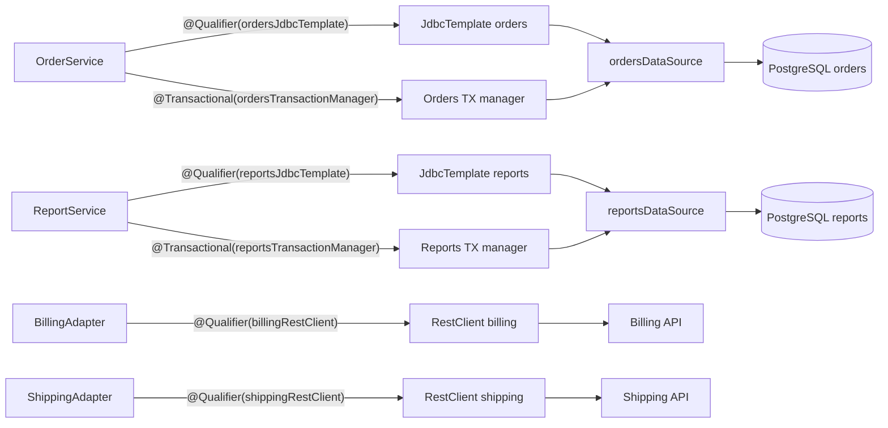

# Nhầm qualifier khi có nhiều DataSource, client hoặc transaction manager

> **Chương:** Gỡ lỗi và nâng cấp  
> **Phạm vi:** Trong module **SPRING_BOOT_INTEGRATION**, ứng dụng Spring Boot có thể kết nối nhiều cơ sở dữ liệu SQL, dịch vụ HTTP, cache, broker và các adapter Spring Integration. Bài này tập trung vào lỗi **chọn sai bean** khi có nhiều `DataSource`, HTTP client hoặc `PlatformTransactionManager`/`ReactiveTransactionManager`; cách dùng `@Qualifier`, `@Primary` và tên bean để ghép đúng tài nguyên; cách phát hiện sai cấu hình trước khi dữ liệu được ghi nhầm; cùng chiến lược kiểm thử, quan sát và nâng cấp.

## 1. Tình huống: ứng dụng vẫn chạy nhưng ghi sai nơi

Giả sử một dịch vụ tích hợp sử dụng:

- PostgreSQL **orders** để lưu đơn hàng và bản ghi outbox.
- PostgreSQL **reports** để đọc dữ liệu báo cáo.
- HTTP client **billing** để gửi yêu cầu thanh toán.
- HTTP client **shipping** để tạo yêu cầu vận chuyển.

Đội phát triển tạo hai `DataSource`, hai `JdbcTemplate`, hai `RestClient` và hai transaction manager. Sau đó một service tiêm `JdbcTemplate` mà không chỉ rõ thuộc database nào, hoặc đánh dấu `@Transactional` nhưng để Spring chọn transaction manager mặc định.

Có hai nhóm lỗi:

1. **Lỗi rõ khi khởi động:** không biết chọn bean nào, tên qualifier không tồn tại, hoặc điều kiện auto-configuration không thỏa.
2. **Lỗi âm thầm nguy hiểm hơn:** một bean được chọn thành công nhờ `@Primary` hoặc vì tên trùng, nhưng truy vấn đi tới database/client **không đúng nghiệp vụ**; transaction khác tài nguyên nên rollback không bảo vệ side effect.

Vì vậy, gỡ lỗi multi-resource không chỉ là “làm sao application context khởi động”, mà còn phải chứng minh **đúng bean, đúng endpoint, đúng transaction và đúng dữ liệu** trong từng luồng.

### Sơ đồ một hệ tích hợp có nhiều tài nguyên



**Nguyên tắc:** Đặt tên rõ cho từng tài nguyên và dùng **cùng một cặp DataSource–TransactionManager** khi thực hiện transaction SQL. `@Primary` chỉ tạo một lựa chọn mặc định cho những vị trí không có qualifier; nó **không** đổi bản chất của tài nguyên.

## 2. Spring chọn bean để inject như thế nào?

Spring Dependency Injection chọn bean theo **kiểu yêu cầu**, sau đó thu hẹp danh sách ứng viên bằng qualifier và các quy tắc chọn ứng viên khác. Khi có nhiều bean cùng kiểu và không có lựa chọn duy nhất, ứng dụng có thể gặp `NoUniqueBeanDefinitionException` hoặc lỗi khởi tạo bean tương đương.

| Công cụ | Vai trò | Giới hạn cần nhớ |
| --- | --- | --- |
| **`@Qualifier("ordersDataSource")`** | Chỉ rõ bean/nhóm bean đủ điều kiện ở injection point | Tên phải khớp bean thực; không tự đổi transaction manager |
| **`@Primary`** | Ưu tiên một bean khi có nhiều ứng viên cùng kiểu ở injection point đơn | Có thể che lỗi wiring: code chạy nhưng sử dụng tài nguyên không mong muốn |
| **Tên bean** | ID của bean, ví dụ `@Bean("ordersDataSource")` | Đổi tên bean mà không sửa qualifier sẽ phá dependency |
| **Tên tham số constructor** | Có thể tham gia lựa chọn trong những điều kiện Spring/bytecode phù hợp | Không nên dùng làm hợp đồng an toàn khi có nhiều database |
| **Generic type** | Có thể phân biệt một số bean `KafkaTemplate<K,V>` hoặc repository cùng loại | Type erasure, khai báo generic rộng và bean factory có thể khiến không đủ để chọn |
| **`@Resource(name = "...")`** | Injection thiên về tên tài nguyên theo annotation tương ứng | Khác semantics `@Autowired`; không tự giải quyết chọn transaction |
| **`@Transactional(transactionManager = "...")`** | Chỉ ra **transaction manager** cần dùng | Không tự chọn đúng `JdbcTemplate`, repository hoặc HTTP client bên trong method |

Ví dụ injection sai vì có hai bean kiểu `JdbcTemplate`:

```java
@Service
class UnsafeReportService {
    UnsafeReportService(JdbcTemplate jdbcTemplate) {
        // Có thể ambiguous; nếu ordersJdbcTemplate là @Primary,
        // biến này còn có thể trỏ nhầm tới DB orders.
    }
}
```

Injection tường minh:

```java
@Service
class ReportService {
    private final JdbcTemplate reports;

    ReportService(
            @Qualifier("reportsJdbcTemplate") JdbcTemplate reports) {
        this.reports = reports;
    }
}
```

**Lưu ý:** `@Qualifier` ở constructor parameter chỉ giải quyết **dependency của tham số đó**. Một phương thức trong class vẫn có thể chạy dưới transaction manager khác nếu đánh dấu `@Transactional` không đúng.

### 2.1. Khi nào dùng `@Primary`?

Trong ứng dụng có một database chính và một database phụ, có thể đánh dấu bean chính bằng `@Primary` để hỗ trợ các thành phần framework vốn mong đợi chỉ một bean mặc định. Nhưng với code nghiệp vụ thuộc luồng đặc thù, vẫn nên ghi rõ `@Qualifier` để người review nhận ra ý định.

`@Primary` không tự động có nghĩa là “database có dữ liệu đúng” hay “transaction an toàn”. Nếu nhầm đặt `@Primary` lên reporting DataSource, hàng loạt injection không có qualifier có thể trỏ vào reporting database mà ứng dụng vẫn khởi động bình thường.

### 2.2. Đừng dựa vào tên biến như một cấu hình đáng tin

Trong một số điều kiện, Spring có thể dùng tên tham số constructor hoặc tên field để thu hẹp ứng viên. Tuy nhiên hành vi này chịu ảnh hưởng của metadata biên dịch và các quy tắc resolution theo phiên bản. Với tài nguyên nguy hiểm như SQL ghi dữ liệu, **tên tham số không thay thế cho qualifier tường minh**.

## 3. Chẩn đoán triệu chứng trước khi sửa code

| Triệu chứng | Nguyên nhân thường gặp | Kiểm tra đầu tiên |
| --- | --- | --- |
| `NoUniqueBeanDefinitionException` cho `DataSource`/`RestClient` | Có hai hoặc nhiều bean cùng kiểu, không có ứng viên duy nhất | Tên bean, `@Primary`, `@Qualifier` tại injection point |
| `NoSuchBeanDefinitionException` với tên qualifier | Bean được đổi tên, cấu hình không được scan hoặc thiếu condition | Tên `@Bean`, package scan, bean profile, condition report |
| Kết nối đúng nhưng truy vấn đi nhầm DB | Injection mặc định chọn `@Primary` không như dự kiến | `JdbcTemplate.getDataSource()` trong test và database identity |
| `@Transactional` không rollback dữ liệu | Manager không quản lý `DataSource` thật sự sử dụng, hoặc proxy chưa áp dụng | Transaction manager bean, call path, Spring AOP/proxy |
| Service báo thành công nhưng gọi nhầm đối tác | Hai `RestClient` cùng kiểu, injector chọn default | Base URL, bean name và test HTTP request thực |
| Repository JPA dùng schema/DB khác | `entityManagerFactoryRef` hoặc `transactionManagerRef` trỏ sai | `@EnableJpaRepositories`, entity scanning, EMF bean |
| Thêm DataSource thứ hai thì Boot không tự tạo bean như trước | Auto-configuration có điều kiện/back off | `@ConditionalOnMissingBean`, `@ConditionalOnSingleCandidate` và dependency tree |
| Flyway chạy nhầm database | Migration tool lấy datasource mặc định | Config datasource của Flyway, migration history ở từng DB |
| Có JDBC nhưng reactive transaction không hoạt động | Nhầm `DataSource` với R2DBC `ConnectionFactory` | Kiểu transaction manager và Reactor context |
| Chỉ lỗi khi chạy profile production | Profile ghi đè URL, khác bean definition hoặc conditional | Effective configuration và môi trường/deployment |

**Không sửa bằng cách thêm `@Primary` bừa bãi.** Khi exception khởi động biến mất, vẫn phải xác minh mọi dependency thực sự đang trỏ đúng tài nguyên.

## 4. Ví dụ đầy đủ: hai PostgreSQL DataSource bằng Spring Boot

Phần thực hành sử dụng **Spring Boot 3.x**, Java 17+, Spring JDBC và HikariCP. Hai database có schema và quyền truy cập độc lập:

- `ordersdb`: đơn hàng, transactional outbox; cho phép đọc/ghi.
- `reportsdb`: dữ liệu báo cáo; tài khoản ứng dụng chỉ cần quyền đọc.

### 4.1. Maven dependencies

```xml
<dependencies>
    <dependency>
        <groupId>org.springframework.boot</groupId>
        <artifactId>spring-boot-starter-jdbc</artifactId>
    </dependency>
    <dependency>
        <groupId>org.postgresql</groupId>
        <artifactId>postgresql</artifactId>
        <scope>runtime</scope>
    </dependency>
    <dependency>
        <groupId>org.springframework.boot</groupId>
        <artifactId>spring-boot-starter-web</artifactId>
    </dependency>
</dependencies>
```

Khi dùng `spring-boot-starter-jdbc`, HikariCP thường có mặt theo dependency được Boot quản lý. Cần kiểm tra runtime dependency tree trước khi chọn loại pool khác.

### 4.2. Cấu hình có namespace riêng

```yaml
app:
  datasource:
    orders:
      url: ${ORDERS_DB_URL:jdbc:postgresql://localhost:5432/ordersdb}
      username: ${ORDERS_DB_USER:orders_app}
      password: ${ORDERS_DB_PASSWORD}
      driver-class-name: org.postgresql.Driver
      configuration:
        pool-name: orders-pool
        maximum-pool-size: 12
        minimum-idle: 2
    reports:
      url: ${REPORTS_DB_URL:jdbc:postgresql://localhost:5432/reportsdb}
      username: ${REPORTS_DB_USER:reports_app}
      password: ${REPORTS_DB_PASSWORD}
      driver-class-name: org.postgresql.Driver
      configuration:
        pool-name: reports-pool
        maximum-pool-size: 6
        minimum-idle: 1

partner:
  billing:
    base-url: ${BILLING_URL:http://localhost:8089}
  shipping:
    base-url: ${SHIPPING_URL:http://localhost:8090}
```

Các tên `app.datasource.*` là **cấu hình của ứng dụng**, không phải các thuộc tính Spring Boot tự dùng để tạo hai `DataSource`. Ta sẽ bind chúng vào các bean riêng ở phần tiếp theo.

**Vì sao không chỉ viết hai `spring.datasource.url`?** Một tập `spring.datasource.*` mặc định diễn đạt một datasource chính. Khi cần hai datasource độc lập, phải tạo các `DataSourceProperties`/`DataSource` riêng hoặc dùng cấu hình multi-tenancy có chủ đích. Dùng namespace riêng giúp code chỉ rõ database nào đọc cấu hình nào.

### 4.3. Tạo hai DataSource, JdbcTemplate và transaction manager

```java
package com.example.integration.config;

import javax.sql.DataSource;
import com.zaxxer.hikari.HikariDataSource;

import org.springframework.beans.factory.annotation.Qualifier;
import org.springframework.boot.autoconfigure.jdbc.DataSourceProperties;
import org.springframework.boot.context.properties.ConfigurationProperties;
import org.springframework.context.annotation.Bean;
import org.springframework.context.annotation.Configuration;
import org.springframework.context.annotation.Primary;
import org.springframework.jdbc.core.JdbcTemplate;
import org.springframework.jdbc.support.JdbcTransactionManager;
import org.springframework.transaction.PlatformTransactionManager;

@Configuration(proxyBeanMethods = false)
public class MultipleDatabaseConfiguration {

    @Bean("ordersDataSourceProperties")
    @Primary
    @ConfigurationProperties("app.datasource.orders")
    public DataSourceProperties ordersProperties() {
        return new DataSourceProperties();
    }

    @Bean("reportsDataSourceProperties")
    @ConfigurationProperties("app.datasource.reports")
    public DataSourceProperties reportsProperties() {
        return new DataSourceProperties();
    }

    @Bean("ordersDataSource")
    @Primary
    @ConfigurationProperties("app.datasource.orders.configuration")
    public HikariDataSource ordersDataSource(
            @Qualifier("ordersDataSourceProperties")
            DataSourceProperties properties) {
        return properties.initializeDataSourceBuilder()
                .type(HikariDataSource.class)
                .build();
    }

    @Bean("reportsDataSource")
    @ConfigurationProperties("app.datasource.reports.configuration")
    public HikariDataSource reportsDataSource(
            @Qualifier("reportsDataSourceProperties")
            DataSourceProperties properties) {
        return properties.initializeDataSourceBuilder()
                .type(HikariDataSource.class)
                .build();
    }

    @Bean("ordersJdbcTemplate")
    @Primary
    public JdbcTemplate ordersJdbcTemplate(
            @Qualifier("ordersDataSource") DataSource source) {
        return new JdbcTemplate(source);
    }

    @Bean("reportsJdbcTemplate")
    public JdbcTemplate reportsJdbcTemplate(
            @Qualifier("reportsDataSource") DataSource source) {
        return new JdbcTemplate(source);
    }

    @Bean("ordersTransactionManager")
    @Primary
    public PlatformTransactionManager ordersTransactionManager(
            @Qualifier("ordersDataSource") DataSource source) {
        return new JdbcTransactionManager(source);
    }

    @Bean("reportsTransactionManager")
    public PlatformTransactionManager reportsTransactionManager(
            @Qualifier("reportsDataSource") DataSource source) {
        return new JdbcTransactionManager(source);
    }
}
```

**Vì sao cần hai `DataSourceProperties`?** Spring Boot dùng `DataSourceProperties` để bind `url`/username/driver và dựng pool phù hợp. `HikariDataSource` vốn có thuộc tính `jdbcUrl`, không phải `url`; dùng `initializeDataSourceBuilder()` giúp tránh lỗi mapping khi chỉ bind trực tiếp một `HikariDataSource` từ trường `url`.

**Vì sao gắn `@ConfigurationProperties` lên bean Hikari?** Các tham số Hikari như `maximumPoolSize`, `minimumIdle` và `poolName` được bind từ nhánh `configuration` riêng. Cần kiểm tra những giá trị đã áp dụng ở integration test; đừng suy ra đúng chỉ từ YAML.

**Vì sao `@Primary` trên cả properties, datasource và template?** Nó thiết lập lựa chọn mặc định nhất quán cho các injection không có qualifier và một số auto-configuration yêu cầu ứng viên duy nhất. Tuy nhiên, code nghiệp vụ vẫn nên chỉ rõ bean, nhất là với database reports hoặc các luồng có side effect.

Trong Java SE, `DataSource` vẫn thuộc `javax.sql.DataSource` khi chạy Spring Boot 3.x. Không nhầm namespace này với các API Jakarta EE đã chuyển từ `javax.persistence` sang `jakarta.persistence`.

### 4.4. Cấu hình mà không có `@Primary`

Nếu bỏ hết `@Primary` và một component inject `DataSource` không qualifier, có thể gặp:

```text
No qualifying bean of type 'javax.sql.DataSource' available:
expected single matching bean but found 2:
ordersDataSource,reportsDataSource
```

Đây là **thông báo minh họa**, chữ và danh sách bean thực tế phụ thuộc Spring version. Đừng thêm `@Primary` lên reports chỉ để làm lỗi biến mất nếu component mặc định cần orders; hãy kiểm tra injection point và sửa cấu hình theo ý định.

## 5. Gắn đúng JdbcTemplate vào đúng service

Tầng dữ liệu phải thể hiện rõ database nào đang được dùng:

```java
package com.example.integration.orders;

import java.util.UUID;
import org.springframework.beans.factory.annotation.Qualifier;
import org.springframework.jdbc.core.JdbcTemplate;
import org.springframework.stereotype.Service;
import org.springframework.transaction.annotation.Transactional;

@Service
public class OrderWriteService {
    private final JdbcTemplate orders;

    public OrderWriteService(
            @Qualifier("ordersJdbcTemplate") JdbcTemplate orders) {
        this.orders = orders;
    }

    @Transactional(transactionManager = "ordersTransactionManager")
    public void confirm(UUID orderId) {
        int changed = orders.update("""
                UPDATE orders
                   SET status = 'CONFIRMED'
                 WHERE id = ? AND status = 'NEW'
                """, orderId);
        if (changed != 1) {
            throw new IllegalStateException(
                    "Order missing or already confirmed");
        }
    }
}
```

Trong ví dụ, `@Qualifier` giải quyết **đích SQL** còn `@Transactional(transactionManager = "ordersTransactionManager")` giải quyết **manager cho transaction**. Hai lựa chọn **phải cùng trỏ vào `ordersDataSource`**.

Service báo cáo tương ứng:

```java
package com.example.integration.reports;

import org.springframework.beans.factory.annotation.Qualifier;
import org.springframework.jdbc.core.JdbcTemplate;
import org.springframework.stereotype.Service;
import org.springframework.transaction.annotation.Transactional;

@Service
public class ReportReadService {
    private final JdbcTemplate reports;

    public ReportReadService(
            @Qualifier("reportsJdbcTemplate") JdbcTemplate reports) {
        this.reports = reports;
    }

    @Transactional(
            transactionManager = "reportsTransactionManager",
            readOnly = true)
    public long countCompletedOrders() {
        Long count = reports.queryForObject(
                "SELECT COUNT(*) FROM order_report WHERE status = 'DONE'",
                Long.class);
        return count == null ? 0L : count;
    }
}
```

`readOnly = true` là chỉ dẫn cho transaction infrastructure/driver và có thể được database thực thi theo những cách khác nhau. Nó **không thay phân quyền SQL**. Tài khoản `reports_app` vẫn nên chỉ có quyền đọc nếu mục đích là reporting.

### 5.1. Thay đổi tên bean cần được kiểm tra đồng bộ

Nếu sửa tên `reportsJdbcTemplate` thành `reportingJdbcTemplate` nhưng quên sửa `@Qualifier("reportsJdbcTemplate")`, application context sẽ lỗi. Vì qualifier là **chuỗi cố định**, có thể quản lý tên bean bằng constant được chia sẻ giữa bean definition và injection annotation; nhiều codebase vẫn giữ tên trực tiếp nhưng nên có test khởi động context.

Tránh dựa vào `@Bean` method name khi việc đổi tên method nằm trong kế hoạch refactor lớn. `@Bean("...")` giúp giữ bean name cố định dù tên phương thức tạo bean thay đổi.

## 6. Nhầm transaction manager: lỗi có thể không xuất hiện ngay

Xét đoạn code sai:

```java
@Transactional(transactionManager = "ordersTransactionManager")
public void updateReportAndFail(UUID orderId) {
    reportsJdbcTemplate.update(
            "UPDATE order_report SET status = 'DONE' WHERE order_id = ?",
            orderId);
    throw new IllegalStateException("Simulated error");
}
```

Ở đây `reportsJdbcTemplate` sử dụng **reportsDataSource**, còn transaction manager quản lý **ordersDataSource**. Trong cấu hình JDBC thông thường, lệnh trên reports datasource không tham gia orders transaction và có thể chạy dưới chế độ autocommit độc lập. Khi exception xảy ra, **orders transaction rollback nhưng update ở reports có thể đã commit**.

Kết quả là test chỉ assert “exception đã được ném” có thể PASS nhưng dữ liệu thực đã sai.

### 6.1. Bảng so sánh

| Code/annotation | DataSource của SQL | Transaction manager | Đánh giá |
| --- | --- | --- | --- |
| `ordersJdbcTemplate` + `ordersTransactionManager` | orders | orders | **Đúng cặp** |
| `reportsJdbcTemplate` + `reportsTransactionManager` | reports | reports | **Đúng cặp** |
| `reportsJdbcTemplate` + `ordersTransactionManager` | reports | orders | **Sai**: reports SQL không nằm trong transaction orders |
| `ordersJdbcTemplate` + `@Transactional` không chỉ định manager | orders | Phụ thuộc chọn manager mặc định | **Mơ hồ** nếu ứng dụng có nhiều manager |
| `ordersJdbcTemplate` + `reportsTransactionManager` | orders | reports | **Sai**, dù bean tên hợp lệ |

**Khuyến nghị:** với nhiều transaction manager, **luôn đặt `transactionManager = "..."` ở method tạo ranh giới giao dịch**, hoặc dùng một cơ chế chọn manager chuẩn hóa được kiểm thử nghiêm ngặt. Tên manager không “đi theo” tên `JdbcTemplate` một cách tự động.

### 6.2. `@Primary` không tạo transaction phân tán

Khi một method cập nhật **cả orders DB lẫn reports DB**, dù transaction manager nào được đánh dấu `@Primary`, một local JDBC transaction **không** bảo đảm commit nguyên tử cả hai nguồn dữ liệu.

Ví dụ:

```text
TX orders: update orders
Write reports DB: autocommit
TX orders: rollback

Kết quả: orders rollback nhưng reports DB vẫn đã thay đổi.
```

Nếu cần đồng bộ dữ liệu giữa hai database, chọn phương án phù hợp như:

1. **Transactional outbox**: commit dữ liệu và bản ghi outbox trong orders DB; worker chuyển dữ liệu sang reports DB theo cách idempotent.
2. **Saga/compensation**: nếu có nhiều bước nghiệp vụ độc lập cần xử lý bù.
3. **XA/JTA phân tán**: chỉ khi hạ tầng và yêu cầu thật sự cần, các resource/transaction manager đều hỗ trợ và nhóm có khả năng vận hành/kiểm thử.

Không dùng một `@Transactional` chung như lời hứa “exactly once” xuyên HTTP, cache, broker và nhiều database.

### 6.3. TransactionalOperator/TransactionTemplate

Khi muốn tạo transaction tường minh bằng code imperative, có thể cấu hình một `TransactionTemplate` trên manager cụ thể:

```java
import org.springframework.beans.factory.annotation.Qualifier;
import org.springframework.transaction.PlatformTransactionManager;
import org.springframework.transaction.support.TransactionTemplate;

public class OrderTransactionRunner {
    private final TransactionTemplate ordersTx;

    public OrderTransactionRunner(
            @Qualifier("ordersTransactionManager")
            PlatformTransactionManager manager) {
        this.ordersTx = new TransactionTemplate(manager);
    }

    public void execute(Runnable task) {
        ordersTx.executeWithoutResult(status -> task.run());
    }
}
```

Đây là lựa chọn khi boundary cần lập trình tường minh. `TransactionTemplate` vẫn chỉ bảo vệ tài nguyên được manager tương ứng quản lý; không biến HTTP hoặc broker thành cùng transaction.

## 7. Hai RestClient cùng kiểu: qualifier cho HTTP client

Với Spring Boot 3.2+ và `spring-boot-starter-web`, `RestClient.Builder` có thể được Boot cấu hình để xây REST client. Khi hai đối tác yêu cầu base URL, auth, timeout và retry khác nhau, nên tạo **hai bean client độc lập**.

```java
package com.example.integration.config;

import org.springframework.beans.factory.annotation.Value;
import org.springframework.context.annotation.Bean;
import org.springframework.context.annotation.Configuration;
import org.springframework.web.client.RestClient;

@Configuration(proxyBeanMethods = false)
public class PartnerClientConfiguration {

    @Bean("billingRestClient")
    public RestClient billingRestClient(
            RestClient.Builder builder,
            @Value("${partner.billing.base-url}") String baseUrl) {
        return builder.clone()
                .baseUrl(baseUrl)
                .build();
    }

    @Bean("shippingRestClient")
    public RestClient shippingRestClient(
            RestClient.Builder builder,
            @Value("${partner.shipping.base-url}") String baseUrl) {
        return builder.clone()
                .baseUrl(baseUrl)
                .build();
    }
}
```

`builder.clone()` giúp mỗi bean client bắt đầu từ cấu hình nền của builder nhưng không dùng chung trạng thái builder đang thay đổi để thiết lập hai base URL. Trong production, cấu hình thêm TLS, credential, timeout, connection pool, interceptor và observability **riêng cho từng đối tác**.

Injection tường minh:

```java
package com.example.integration.billing;

import java.util.UUID;
import org.springframework.beans.factory.annotation.Qualifier;
import org.springframework.stereotype.Service;
import org.springframework.web.client.RestClient;

@Service
public class BillingAdapter {
    private final RestClient client;

    public BillingAdapter(
            @Qualifier("billingRestClient") RestClient client) {
        this.client = client;
    }

    public BillingResult submit(UUID orderId, BillingCommand command) {
        return client.post()
                .uri("/v1/charges")
                .header("Idempotency-Key", orderId.toString())
                .body(command)
                .retrieve()
                .body(BillingResult.class);
    }
}

record BillingCommand(long amountMinor, String currency) {}
record BillingResult(String chargeId, String status) {}
```

Ví dụ giả định `BillingCommand`/`BillingResult` đúng hợp đồng đối tác. Idempotency key ở đây dùng order ID chỉ để minh họa một lần charge cho mỗi order; nếu một order được phép có **nhiều khoản thu hợp lệ**, key cần bao gồm **payment operation ID** độc lập thay vì chặn tất cả lần charge sau.

### 7.1. Vì sao không đặt `@Primary` trên một client bất kỳ?

Đặt `@Primary` trên `billingRestClient` có thể khiến một service vận chuyển không có qualifier gọi API billing mà application vẫn khởi động được. Vấn đề có thể chỉ xuất hiện khi người dùng thực hiện thao tác thanh toán/vận chuyển thực sự.

Với các client gây side effect, tốt hơn là:

- Đặt bean name biểu đạt đối tác.
- Dùng `@Qualifier` ở constructor của adapter.
- Bọc client trong **typed adapter** như `BillingAdapter` hoặc `ShippingAdapter`; domain service phụ thuộc adapter cụ thể, không nhận một `RestClient` chung.
- Kiểm thử địa chỉ đích, header, authentication và payload bằng mock server riêng cho từng đối tác.

**WebClient, WebServiceTemplate, KafkaTemplate, RedisTemplate hoặc broker clients** cũng gặp nguy cơ tương tự khi có nhiều bean cùng kiểu. Đừng coi việc hai client có cùng class nghĩa chúng có cùng mục đích.

## 8. Các trường hợp multi-client khác

| Tài nguyên | Cách phân biệt | Sai lầm dễ mắc |
| --- | --- | --- |
| **`WebClient`** | `@Bean("inventoryWebClient")` và `@Qualifier`; có thể dùng builder clone | Một service dùng nhầm base URL hoặc auth header |
| **`KafkaTemplate<String, Event>`** | Bean name, serializer/producer factory và qualifier | Hai template dùng khác cluster/topic/security nhưng được inject nhầm |
| **`RabbitTemplate`** | ConnectionFactory, virtual host, exchange/routing config | Publish nhầm vhost/cluster, thiếu queue ở đích |
| **`StringRedisTemplate`/`RedisTemplate`** | Tên template và `RedisConnectionFactory` | Cache hoặc idempotency key bị ghi sang Redis khác |
| **`JmsTemplate`** | ConnectionFactory, queue/topic và message converter | Gửi message tới broker hoặc destination không mong muốn |
| **`CacheManager`** | `@CacheConfig(cacheManager=...)`, `@Cacheable(cacheManager=...)` | Annotation dùng cache backend mặc định khác với ý định |
| **Spring Integration channel/handler** | Bean name, `@ServiceActivator(inputChannel=...)`, flow endpoint ID | Thông điệp bị route đến handler sai hoặc không có subscriber |

Generic type trong `KafkaTemplate<String, Event>` có thể hỗ trợ phân biệt một số bean, nhưng **không thay thế cấu hình rõ cluster, security và bean name**, đặc biệt khi nhiều factory có cùng generic type.

## 9. JPA: `EntityManagerFactory` và transaction manager phải cùng database

Với **Spring Data JPA**, nhiều `DataSource` còn đòi hỏi ranh giới rõ cho **EntityManagerFactory** và **repository scanning**. Đừng chỉ tạo hai `DataSource` rồi cho rằng repository JPA sẽ tự biết bảng thuộc database nào.

Mẫu khai báo cho một nhóm repository:

```java
@Configuration
@EnableJpaRepositories(
    basePackages = "com.example.integration.orders.jpa",
    entityManagerFactoryRef = "ordersEntityManagerFactory",
    transactionManagerRef = "ordersJpaTransactionManager")
class OrdersJpaRepositoryConfiguration {
    // Cần định nghĩa ordersEntityManagerFactory gắn
    // với ordersDataSource và ordersJpaTransactionManager
    // gắn với EntityManagerFactory tương ứng.
}
```

Đây là **khung minh họa repository wiring**, không phải cấu hình JPA hoàn chỉnh có thể chạy độc lập. Trong một ứng dụng JPA multi-database, cần:

1. Bean `ordersEntityManagerFactory`, trỏ đúng `ordersDataSource` và scan **đúng nhóm entity**.
2. Bean `ordersJpaTransactionManager` dùng `JpaTransactionManager` gắn vào đúng EntityManagerFactory.
3. `@EnableJpaRepositories` cho orders với `entityManagerFactoryRef` và `transactionManagerRef` đúng tên.
4. Cấu hình tương tự cho reports JPA nếu có; không cho cả hai nhóm repository scan trùng package một cách vô tình.
5. Migration/schema và dialect phù hợp từng database; chạy test query và rollback thật.

Nếu ứng dụng có cả `JdbcTransactionManager` và `JpaTransactionManager` cho cùng nguồn SQL, cần định nghĩa rõ service nào sử dụng manager nào; không mặc định JPA repository hoạt động đúng trong local JDBC transaction không được gắn vào đúng EntityManagerFactory. Với JPA, một transaction manager JPA phù hợp có thể quản lý JDBC access dùng cùng DataSource trong một số điều kiện, nhưng phải xác minh behavior bằng integration test trước khi thiết kế kết hợp.

### 9.1. Bẫy khi nâng cấp JPA

Khi chuyển từ Spring Boot 2.x sang 3.x, nhiều annotation JPA sử dụng `jakarta.persistence.*` thay cho `javax.persistence.*`. Một cấu hình entity scanning thiếu package, sai EntityManagerFactory hoặc thư viện cũ không tương thích có thể làm repository khởi tạo thất bại. Không chữa mọi lỗi bằng cách mở rộng `packagesToScan` ra toàn bộ codebase, vì có thể khiến entity của database reports bị gắn sang orders DB.

## 10. R2DBC và JDBC: qualifier đúng kiểu vẫn chưa đủ

Một ứng dụng tích hợp có thể vừa dùng JDBC/JPA (blocking) vừa dùng **R2DBC** (reactive). Hai nhóm tài nguyên **khác API và khác transaction context**:

| Thành phần | JDBC/JPA | R2DBC |
| --- | --- | --- |
| Kết nối | `javax.sql.DataSource` | `io.r2dbc.spi.ConnectionFactory` |
| API truy vấn | `JdbcTemplate`, `EntityManager`, JPA repository | `DatabaseClient`, `R2dbcEntityTemplate` |
| Manager | `PlatformTransactionManager` | `ReactiveTransactionManager` |
| Context | Thread-bound transaction | Reactor context |
| Cách dùng | Imperative/blocking | `Mono`/`Flux` |

Một method trả `Mono` không tự biến `JdbcTemplate` thành reactive. Tương tự, đặt `@Transactional(transactionManager = "ordersTransactionManager")` trỏ JDBC manager lên một reactive pipeline không đảm bảo SQL R2DBC nằm trong transaction JDBC.

Khi có nhiều `ConnectionFactory` reactive, đặt qualifier riêng cho từng `DatabaseClient`/`R2dbcEntityTemplate` và cho reactive transaction manager. Dùng `TransactionalOperator` được xây từ manager đúng tài nguyên, và giữ các thao tác SQL cần atomic trong cùng publisher transaction.

**Thread switching:** Spring Integration `ExecutorChannel` hoặc `@Async` có thể chuyển việc sang thread khác; transaction JDBC thread-bound ở bước trước **không tự truyền** sang thread mới. Đặt transaction boundary ở method xử lý SQL trên thread thực thi hoặc dùng kiến trúc outbox/inbox phù hợp.

## 11. Auto-configuration Spring Boot: tại sao thêm một bean làm thay đổi cả ứng dụng?

Spring Boot tạo bean theo những điều kiện như `@ConditionalOnClass`, `@ConditionalOnMissingBean`, `@ConditionalOnBean` hoặc `@ConditionalOnSingleCandidate`. Khi bạn thêm một `DataSource` hay HTTP client custom, kết quả khởi tạo mặc định có thể thay đổi.

Ví dụ:

- Khi tự khai báo `DataSource`, Boot có thể không tự dựng datasource mặc định từ `spring.datasource.*` nữa.
- Một auto-configuration chỉ chạy khi tìm được **một candidate duy nhất**. Có hai datasource mà không có `@Primary` thì có thể thiếu bean downstream (template, manager, initializer) chứ không chỉ có lỗi `NoUniqueBeanDefinitionException`.
- Khi tự định nghĩa bean `JdbcTemplate`, logic `@ConditionalOnMissingBean` có thể khiến Boot không dựng template mặc định.
- Khi đổi tên hoặc profile của một `@Bean`, thành phần khác có thể mất dependency ngay cả khi URL/secret vẫn đúng.

Vì vậy, nếu sau một lần nâng cấp hoặc refactor xuất hiện lỗi bean, hãy kiểm tra cả **dependency tree, bean definitions và auto-configuration condition report**, không chỉ sửa annotation trong service đang báo lỗi.

### 11.1. Các công cụ gỡ lỗi

Trong môi trường development có thể bật:

```properties
debug=true
logging.level.org.springframework.transaction=TRACE
logging.level.org.springframework.jdbc.datasource=DEBUG
```

Đây là **cấu hình phục vụ điều tra**, không nên bật log chi tiết không giới hạn trên production vì có thể gây tải hoặc vô tình lộ nội dung giao dịch. Với Spring Boot Actuator và quyền truy cập thích hợp, endpoint `/actuator/beans` cho biết bean hiện diện và dependency; `/actuator/conditions` giải thích auto-configuration nào match/back off. Không mở các endpoint nội bộ này công khai trên Internet.

Chú ý: **`/actuator/beans` cho biết định nghĩa bean và dependency**, nhưng không trực tiếp chứng minh một câu SQL đã đi tới database nào hay một HTTP POST đã được gửi đến đúng server. Cần thêm integration test ở ranh giới thực.

## 12. Quy trình điều tra một sự cố qualifier trong production

Khi thấy “nhầm database”, “gửi sai đối tác” hoặc “rollback không có tác dụng”, làm theo thứ tự:

1. **Khoanh vùng side effect:** tạm dừng worker/consumer đang có nguy cơ ghi sai, hoặc vô hiệu hóa operation liên quan bằng cơ chế vận hành được phép.
2. **Xác định request và bean thực thi:** theo trace ID, tên service, handler, bean qualifier và luồng gọi; không log plaintext credentials.
3. **Kiểm tra bean graph:** tên bean, loại bean, `@Primary`, qualifier ở constructor, profile và auto-configuration.
4. **Đối chiếu tài nguyên thực:** query định danh database bằng câu SQL read-only an toàn; kiểm tra cấu hình base URL/destination mà bean đang dùng.
5. **Xác nhận transaction manager:** xác định manager đang bao method và datasource mà mỗi JDBC/JPA operation dùng.
6. **Đánh giá các side effect đã xảy ra:** DB nào đã commit, HTTP API nào đã xử lý, broker đã ack chưa; không tự retry một lệnh nguy cơ trùng.
7. **Sửa cấu hình, bổ sung regression test:** test cả đường đi thành công và rollback/exception, không chỉ test context khởi động.
8. **Khôi phục có kiểm soát:** đối chiếu dữ liệu, thực hiện compensation/reconciliation nếu cần và theo dõi metric sau khi triển khai.

Ví dụ câu SQL read-only để nhận diện PostgreSQL đích:

```sql
SELECT current_database() AS db_name,
       current_schema() AS schema_name,
       current_user AS db_user;
```

Trong test, chạy câu này qua **từng `JdbcTemplate` đã được inject**. Nếu `reportsJdbcTemplate` trả về `ordersdb`, lỗi nằm ở binding/URL hoặc bean graph; không cần đợi đến khi một nghiệp vụ thật bị ghi sai.

## 13. Migration, Flyway và SQL initialization với nhiều DataSource

Một vấn đề hay xảy ra khi bổ sung datasource thứ hai là migration chạy nhầm DB:

- Flyway/Liquibase hoặc SQL initializer tự động thường cần xác định **một datasource thích hợp**; đừng mặc định nó áp toàn bộ migration cho mọi datasource.
- Trong một số cấu hình, `@FlywayDataSource` giúp chọn datasource cho Flyway do Spring Boot cấu hình.
- Nếu hai database đều cần migration, thiết kế **hai bộ migration có version, đúng URL/credential/schema và lịch chạy** bằng cấu hình/programmatic setup hoặc deployment pipeline; tránh để migration của orders chạy vào reports.
- Không dùng tài khoản runtime read-only để thực thi DDL trên reports DB.
- Khi nhiều EntityManagerFactory cùng tồn tại, `hibernate.hbm2ddl.auto`/`ddl-auto` không thay chiến lược migration có kiểm soát.

Kiểm thử migration phải xác nhận **schema history table và các bảng thực tế** hiện diện ở đúng database. Một pipeline báo “Flyway success” nhưng chỉ chạy trên orders DB chưa chứng minh reports DB sẵn sàng.

## 14. Kiểm thử: bắt lỗi wiring trước khi gặp dữ liệu thật

### 14.1. Context test chọn đúng bean

Với Spring Boot test dependencies, có thể dùng application context test để kiểm tra identity:

```java
package com.example.integration.config;

import static org.assertj.core.api.Assertions.assertThat;
import javax.sql.DataSource;

import org.junit.jupiter.api.Test;
import org.springframework.beans.factory.annotation.Autowired;
import org.springframework.beans.factory.annotation.Qualifier;
import org.springframework.boot.test.context.SpringBootTest;
import org.springframework.jdbc.core.JdbcTemplate;
import org.springframework.transaction.PlatformTransactionManager;

@SpringBootTest
class MultiResourceWiringTest {
    @Autowired @Qualifier("ordersDataSource")
    DataSource ordersDataSource;

    @Autowired @Qualifier("reportsDataSource")
    DataSource reportsDataSource;

    @Autowired @Qualifier("ordersJdbcTemplate")
    JdbcTemplate ordersJdbcTemplate;

    @Autowired @Qualifier("reportsJdbcTemplate")
    JdbcTemplate reportsJdbcTemplate;

    @Autowired @Qualifier("ordersTransactionManager")
    PlatformTransactionManager ordersTransactionManager;

    @Autowired @Qualifier("reportsTransactionManager")
    PlatformTransactionManager reportsTransactionManager;

    @Test
    void templatesReferenceDifferentSources() {
        assertThat(ordersDataSource)
                .isNotSameAs(reportsDataSource);
        assertThat(ordersJdbcTemplate.getDataSource())
                .isSameAs(ordersDataSource);
        assertThat(reportsJdbcTemplate.getDataSource())
                .isSameAs(reportsDataSource);
        assertThat(ordersTransactionManager)
                .isNotSameAs(reportsTransactionManager);
    }
}
```

**Giới hạn của test:** chứng minh các object được wiring đúng theo cấu hình class, nhưng **không chứng minh URL trong mỗi DataSource thực sự trỏ đến database đúng**. Khi chạy `@SpringBootTest` với connection pool, test environment phải cấp cấu hình DB hợp lệ hoặc dùng Testcontainers.

### 14.2. Integration test với hai database thực

Sử dụng hai PostgreSQL database riêng (hoặc hai container phù hợp) để kiểm tra:

| Ca kiểm thử | Điều phải đúng |
| --- | --- |
| `ordersJdbcTemplate` đọc định danh database | Kết nối `ordersdb`, user/role đúng |
| `reportsJdbcTemplate` đọc định danh database | Kết nối `reportsdb`, user/role đúng |
| Update orders thành công | Chỉ hàng trong orders DB thay đổi |
| Exception trong `@Transactional(ordersTransactionManager)` | SQL orders được rollback |
| Exception trong `@Transactional(reportsTransactionManager)` | SQL reports được rollback nếu method hợp lệ và DB cho phép ghi |
| Dùng cố ý manager sai trong test riêng | Phát hiện update ngoài transaction (chứng minh regression risk) |
| Transaction orders nhưng gọi reports JDBC | **Không** được khẳng định atomic rollback hai DB |
| BillingAdapter gửi POST | Chỉ mock billing server nhận request |
| ShippingAdapter gửi POST | Chỉ mock shipping server nhận request |
| Đổi profile/env | Đúng bean name và endpoint trong từng môi trường |
| Flyway/migration | Mỗi schema migration chạy trên đúng database |
| Broker retry/outbox | Duplicate không ghi side effect hai lần dù transaction local rollback/commit khác thời điểm |

Khi dùng Testcontainers, tạo dữ liệu kiểm thử nhỏ trong hai DB và assert trạng thái **sau khi transaction đã kết thúc**. Nếu test method được bao bởi một test transaction chung, có thể làm sai kết quả quan sát; cấu hình test boundary phù hợp hoặc kiểm tra bằng connection/transaction độc lập.

### 14.3. Test rollback bằng lỗi thật

Một regression test mạnh không chỉ kiểm tra annotation tồn tại. Nó:

1. Ghi một bản ghi trong database mục tiêu **qua service đang có `@Transactional`**.
2. Ném exception ở giữa transaction trước khi method trả về.
3. Sau khi method lỗi, dùng một connection mới hoặc query độc lập để kiểm tra bản ghi không tồn tại.
4. Lặp lại cho từng transaction manager/database tương ứng.

Nếu chỉ dùng mock `JdbcTemplate`, bạn không chứng minh được ranh giới transaction. Nếu một method gọi chính method `@Transactional` khác qua **self-invocation** trong cùng class, Spring proxy có thể không can thiệp; đây là một nguyên nhân phổ biến khác của rollback không hoạt động.

## 15. Quan sát multi-resource và bảo mật

**Metric và trace cần phân biệt tài nguyên theo định danh có cardinality thấp**:

| Tín hiệu | Phân tách nên có | Lỗi có thể phát hiện |
| --- | --- | --- |
| Hikari pool active/idle/pending | `poolName=orders-pool/reports-pool` | Pool reports bão hòa, nhưng orders vẫn khỏe |
| SQL query latency/error | Tên datasource/operation | Service dùng nhầm database hoặc query chậm |
| Transaction commit/rollback | Manager và service boundary | Rollback được báo ở manager khác datasource cần bảo vệ |
| HTTP client request count/error | Partner name (billing/shipping) | Request đi nhầm partner hoặc credentials lỗi |
| Outbox/inbox backlog | Database, destination | Transaction local thành công nhưng liên hệ downstream thất bại |
| Trace/log correlation | Request/operation ID | Nối HTTP → SQL → broker khi điều tra |

Tên metric cụ thể phụ thuộc Micrometer, Spring Boot và instrumentation thực tế. Không dùng `orderId`, `userId`, idempotency key hoặc URL có query chứa dữ liệu nhạy cảm làm metric tag. Không xuất mật khẩu, JDBC URL có embedded credential hoặc bearer token qua log/Actuator.

**Phân quyền theo nguồn dữ liệu:** reporting user nên là read-only; orders service account chỉ được quyền đối với schema cần dùng; client billing và shipping dùng credential riêng. Nếu lỡ inject sai client, quyền tối thiểu có thể giảm thiểu thiệt hại nhưng **không thay** kiểm thử qualifier.

## 16. Gỡ lỗi khi nâng cấp Spring Boot hoặc tái cấu trúc bean

Khi nâng phiên bản Spring Boot/Spring Framework hay tách module, các nguyên nhân sau có thể xuất hiện đồng thời:

1. **Class được chuyển package hoặc đổi API:** Spring Boot 3.x dùng `jakarta.persistence.*` và nhiều Jakarta EE API tương ứng; `javax.sql.DataSource` vẫn thuộc Java SE.
2. **Thêm một starter mới:** auto-configuration hoặc điều kiện candidate thay đổi khi một loại bean mới xuất hiện.
3. **Đổi tên method `@Bean`:** nếu không đặt bean name tường minh, qualifier dạng chuỗi có thể không còn khớp.
4. **Đổi package scanning:** repository/adapter bean không được scan hoặc bị scan ở hai cấu hình.
5. **Đổi profile/config location:** một datasource lấy URL từ profile mới, nhưng service vẫn dùng qualifier cũ.
6. **Thay cơ chế transaction:** từ JDBC sang JPA, hoặc từ JDBC sang R2DBC, nhưng code vẫn tham chiếu manager cũ.
7. **Thêm Spring Cloud client:** xuất hiện thêm client/proxy/connection factory cùng kiểu hoặc tên, làm thay đổi ambiguity/condition.
8. **AOT/native image hoặc compiler metadata:** không phụ thuộc vào heuristic tên tham số; dùng qualifier explicit và context test.

Một trình tự nâng cấp an toàn:

```text
Dependency tree + version matrix
        ↓
Kiểm tra bean graph trong test context
        ↓
Xác minh datasource/client endpoint identity
        ↓
Chạy transaction rollback tests + contract tests
        ↓
Chạy integration tests với DB/broker/HTTP mock
        ↓
Deploy có kiểm soát + theo dõi pool/transaction/client metrics
```

Không pin ngẫu nhiên các thư viện Spring Framework, Spring Data, HikariCP hoặc database driver chỉ để loại bỏ một lỗi wiring nếu bản chất là bean name/qualifier/manager mismatch.

## 17. Checklist trước khi đưa multi-resource vào production

1. **Tạo inventory:** liệt kê từng DataSource, JdbcTemplate, EntityManagerFactory, transaction manager và HTTP/broker client.
2. **Đặt bean name ổn định:** ví dụ `ordersDataSource`, `reportsDataSource`, `billingRestClient`; ghi mục đích từng bean.
3. **Chỉ định qualifier tại boundary:** service gọi tài nguyên nào phải nói rõ tài nguyên đó.
4. **Dùng `@Primary` có chủ đích:** tránh biến default thành nguồn ghi sai khi thiếu qualifier.
5. **Transaction manager phải khớp resource:** `@Transactional(transactionManager = "...")` cho từng database; kiểm tra AOP/self-invocation.
6. **Nhận diện khi cần cross-resource consistency:** outbox/inbox, saga/reconciliation hoặc XA đã được thiết kế, không tự suy ra ACID chung.
7. **Quản lý secret/role riêng:** database và partner có credential/ACL tối thiểu, TLS và logging an toàn.
8. **Cấu hình migration rõ DB đích:** không dùng Flyway/Liquibase mặc định mà chưa kiểm tra nơi chạy.
9. **Viết integration test:** đúng URL/db/transaction, crash/timeout, duplicate, rollback và runtime bean graph.
10. **Quan sát tách theo nguồn:** pool name, partner name, transaction manager, outbox backlog và trace ID.

### Câu hỏi tự kiểm tra

1. `@Qualifier` và `@Primary` khác nhau ở đâu? Vì sao `@Primary` có thể che một lỗi nghiêm trọng?
2. Có hai `DataSource` mà service inject một `JdbcTemplate` không qualifier: điều gì có thể xảy ra?
3. Vì sao `@Transactional(transactionManager = "ordersTransactionManager")` không rollback một lệnh qua `reportsJdbcTemplate`?
4. `DataSourceProperties.initializeDataSourceBuilder()` giúp tránh vấn đề gì khi tạo `HikariDataSource` từ cấu hình có `url`?
5. Vì sao hai HTTP client cùng là `RestClient` nên được bọc bằng hai adapter có kiểu nghiệp vụ riêng?
6. Trong JPA multi-database, `entityManagerFactoryRef` và `transactionManagerRef` dùng để giải quyết vấn đề gì?
7. Vì sao tự tạo thêm một `DataSource` có thể khiến Boot ngừng tạo bean mặc định khác?
8. Hai database đã được inject đúng object nhưng cùng trỏ vào một JDBC URL thì context test có phát hiện hoàn toàn không?
9. Tại sao `@Transactional` có thể không hoạt động khi method được gọi nội bộ trong cùng class?
10. Khi một worker Spring Integration chuyển sang thread khác, transaction JDBC ở thread trước có tự theo sang không?

**Ghi nhớ:** Với nhiều **`DataSource`, client và transaction manager**, lỗi nguy hiểm nhất không phải luôn là exception khởi động mà là **chọn được bean sai**. Hãy đặt tên rõ, dùng `@Qualifier` tại injection point, chỉ định transaction manager đúng datasource, hạn chế `@Primary` ở vai trò default có chủ đích và kiểm thử **đúng database/đối tác/rollback thực tế**. Khi workflow trải qua SQL, HTTP, cache và broker, ranh giới transaction vẫn độc lập; dùng outbox, idempotency và reconciliation thay vì kỳ vọng một qualifier hoặc annotation tự tạo tính nhất quán xuyên hệ thống.
