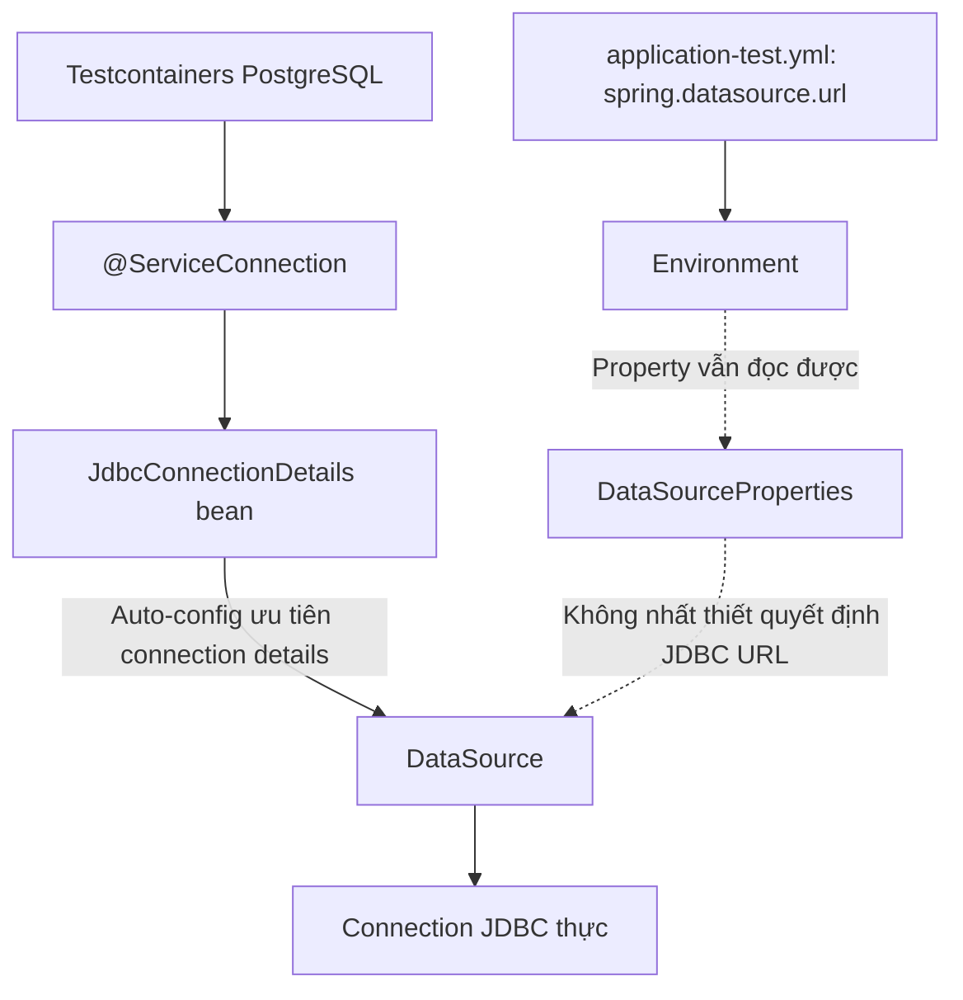
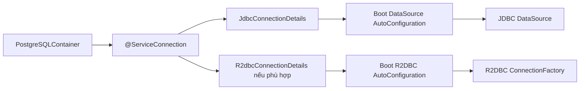
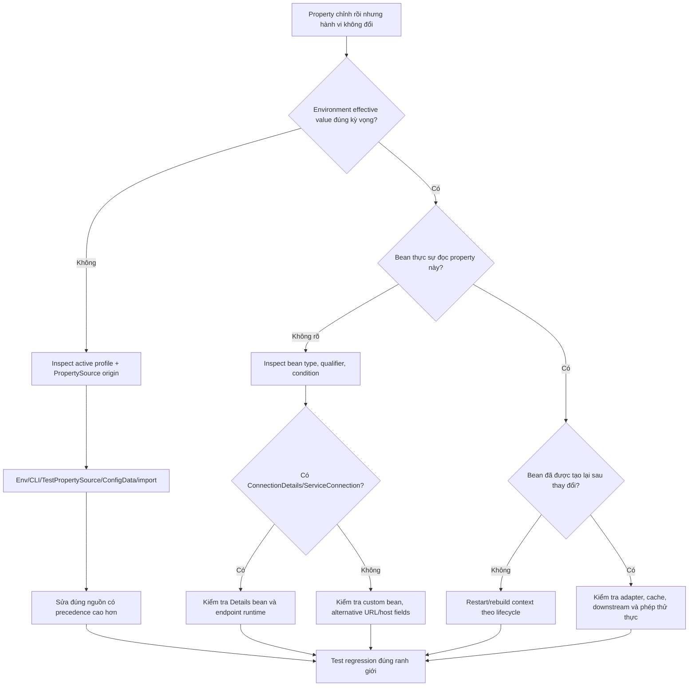

# Thuộc tính không có hiệu lực do ServiceConnection hoặc cấu hình ưu tiên cao hơn

## 1. Nhận diện đúng hiện tượng trước khi sửa cấu hình

Khi phát triển hoặc nâng cấp một ứng dụng Spring Boot, bạn chỉnh `spring.datasource.url` trong `application-test.yml` nhưng test vẫn kết nối PostgreSQL của Testcontainers; thay `spring.data.redis.host` nhưng ứng dụng lại dùng Redis từ Docker Compose; hoặc cập nhật `integration.inventory.base-url` mà HTTP client tiếp tục gọi endpoint cũ. Những triệu chứng này thường bị kết luận vội là “Spring Boot không đọc YAML”.

Thực tế, có ít nhất **hai lớp nguyên nhân khác nhau**:

1. **Giá trị property bị nguồn có ưu tiên cao hơn ghi đè.** `Environment` đã chọn một giá trị khác theo hệ thống `PropertySource`; `@ConfigurationProperties` hoặc `@Value` nhận giá trị hiệu lực đó.
2. **Property vẫn có giá trị như mong đợi, nhưng component tiêu thụ được tạo từ nguồn khác.** Với Spring Boot hiện đại, một bean `ConnectionDetails` từ `@ServiceConnection` hoặc Docker Compose có thể cung cấp endpoint/credential trực tiếp cho auto-configuration, khiến một số `spring.*` connection properties **không còn quyết định kết nối thực tế**.

Ngoài ra còn các nguyên nhân không phải precedence thuần túy: bean tự cấu hình thủ công, `@Primary`/`@Qualifier` chọn sai bean, profile chưa active, thay tên property khi nâng cấp, cấu hình URL và host/port xung đột hoặc context cache trong test tái sử dụng bean đã tạo.

Bài thuộc chương **Gỡ lỗi và nâng cấp** của module **SPRING_BOOT_INTEGRATION**. Module tổ chức tích hợp trong Spring Boot qua HTTP client, cơ sở dữ liệu, cache, broker thông điệp và các adapter Spring Integration, nhấn mạnh **quản lý cấu hình, hợp đồng dữ liệu, transaction, lỗi, xử lý trùng lặp, kiểm thử và quan sát** luồng thực tế. Vì vậy, mục tiêu của bài là điều tra **giá trị nào được nạp, nguồn nào thắng, bean nào được tạo và kết nối nào thực sự được sử dụng** trước khi thay cấu hình.

Sau bài này, bạn có thể:

- Phân biệt `Environment`, `PropertySource`, `@ConfigurationProperties`, `ConnectionDetails` và client/connection factory đã được tạo.
- Hiểu vì sao `@ServiceConnection` và một số cơ chế service discovery của Spring Boot có thể khiến `spring.datasource.url` hoặc `spring.r2dbc.url` không điều khiển kết nối.
- Lần theo property có ưu tiên cao hơn: profile, config import, môi trường, system property, command line, test properties và nguồn động.
- Chẩn đoán qua `Environment`, Actuator `/env`/`/configprops` (đã bảo vệ), condition evaluation report và kiểm tra connection thật.
- Sửa đúng tại lớp gây ra vấn đề, không hardcode credential, tắt TLS hoặc gỡ Testcontainers tùy tiện.
- Viết test chống hồi quy khi nâng cấp Spring Boot, Java, driver hoặc môi trường triển khai.

> **Phạm vi phiên bản:** Các ví dụ hướng đến Java 17+, **Spring Boot 3.2+** và Spring Framework 6.x. `@ServiceConnection` được Spring Boot giới thiệu từ dòng 3.1; một số `ConnectionDetails`/hành vi Docker Compose, auto-configuration và precedence test có thể khác theo phiên bản. Bài dùng mã minh họa, lược bỏ import phổ biến và không giả định đã chạy một database/broker cụ thể.

### 1.1. Ví dụ điển hình: property hiển thị đúng nhưng kết nối lại khác

```yaml
# src/test/resources/application-test.yml
spring:
  datasource:
    url: jdbc:postgresql://localhost:5432/orders_test
    username: test_user
    password: test_password
```

Test tạo container PostgreSQL:

```java
@SpringBootTest
@ActiveProfiles("test")
@Testcontainers
class OrderRepositoryIT {
    @Container
    @ServiceConnection
    static PostgreSQLContainer<?> postgres =
            new PostgreSQLContainer<>("postgres:16-alpine");
}
```

Trong môi trường có hỗ trợ đầy đủ, `@ServiceConnection` có thể tạo `JdbcConnectionDetails` từ container. Auto-configuration JDBC dùng các connection details đó để tạo `DataSource`. Vì thế **property `spring.datasource.url` trong Environment vẫn có thể là `localhost:5432/orders_test`**, nhưng JDBC connection thật đi tới **host/port được Testcontainers ánh xạ động**.

Đây **không phải** ví dụ chứng minh YAML bị một `PropertySource` khác ghi đè. Đó là ví dụ **nguồn cấu hình kết nối ở tầng bean** khác với giá trị property.



**Câu hỏi chẩn đoán nên đặt:** “Bean hoặc connection nào đang dùng endpoint nào, và ai tạo ra nó?”, thay vì chỉ hỏi “YAML có chứa URL đúng không?”.

## 2. Bốn lớp cấu hình cần phân biệt

| Lớp | Ví dụ | Câu hỏi cần trả lời |
|---|---|---|
| **Nguồn cấu hình** | `application.yml`, environment variable, `-D...`, command line, test properties | Giá trị đang đến từ nguồn nào? |
| **Giá trị đã được resolve/bind** | `Environment.getProperty(...)`, `DataSourceProperties`, custom `@ConfigurationProperties` | Giá trị hiệu lực và kiểu dữ liệu là gì? |
| **ConnectionDetails/bean lựa chọn** | `JdbcConnectionDetails`, `R2dbcConnectionDetails`, `RedisConnectionFactory`, custom `WebClient` | Auto-configuration đang lấy endpoint từ đâu, bean nào thắng? |
| **Kết nối thực tế** | JDBC metadata URL, Redis INFO/connection, HTTP request log ở fake server | Host/port/protocol/TLS nào đã được gọi khi runtime? |

Đừng đánh đồng bốn lớp này. `Environment` chỉ mô tả hệ thống property resolution. Một DataSource tự khai báo trong `@Configuration` hoàn toàn có thể dùng URL hardcode, không tham chiếu `spring.datasource.url`. Ngược lại, một `ConnectionDetails` bean có thể cung cấp URL từ Testcontainers mà **không viết lại** property trong `Environment`.

### 2.1. PropertySource: lấy giá trị theo mức ưu tiên

`Environment` có nhiều `PropertySource`. Khi tra một tên property, Spring tìm theo thứ tự ưu tiên đã xác định cho context đó; nguồn ưu tiên cao hơn có cùng key sẽ quyết định giá trị cuối cùng, trừ những trường hợp binder xử lý cấu trúc phức tạp theo quy tắc merge/replace riêng.

Ví dụ cùng tồn tại:

```yaml
# application.yml
integration:
  inventory:
    base-url: https://inventory-default.example.org
```

```yaml
# application-prod.yml
integration:
  inventory:
    base-url: https://inventory-prod.example.org
```

```text
INTEGRATION_INVENTORY_BASEURL=https://inventory-from-env.example.org
```

Nếu profile `prod` active và environment variable trên thực sự được process nhận/bind đúng, giá trị từ môi trường thường có ưu tiên cao hơn file config, nên client có thể dùng URL môi trường. Sửa `application-prod.yml` rồi restart vẫn không thay đổi kết quả khi deployment tiếp tục inject environment variable cũ.

### 2.2. ConfigurationProperties không phải nguồn cấu hình riêng

`@ConfigurationProperties(prefix="integration.inventory")` gom và bind các giá trị có hiệu lực vào một bean Java. Nó **không** tự tạo một mức ưu tiên mới cho `application.yml`. Cần phân biệt:

```java
@ConfigurationProperties(prefix = "integration.inventory")
public record InventoryProperties(
        URI baseUrl,
        Duration connectTimeout
) {}
```

Nếu `baseUrl` lấy từ environment variable, đây là kết quả binder chọn property từ môi trường. Nếu một `InventoryGateway` lại được tạo thủ công với URL khác và được inject theo `@Qualifier`, sửa `InventoryProperties` có thể không ảnh hưởng gateway thực sự được gọi.

### 2.3. ConnectionDetails là dữ liệu kết nối dạng bean, không chỉ là property

Spring Boot dùng các **connection details abstraction** cho một số auto-configuration. Ví dụ:

- `JdbcConnectionDetails` cho DataSource JDBC.
- `R2dbcConnectionDetails` cho R2DBC ConnectionFactory.
- `RedisConnectionDetails` cho Redis (khi được hỗ trợ bởi tích hợp/phụ thuộc cụ thể).
- `RabbitConnectionDetails` cho RabbitMQ AMQP.
- `KafkaConnectionDetails` cho Kafka.

Các type trên thuộc các package auto-configuration tương ứng của Spring Boot. Cơ chế này cho phép nguồn kết nối đến từ một service đang chạy hoặc container, thay vì bắt buộc phải xây lại cấu hình thành chuỗi `spring.datasource.url` hay `spring.rabbitmq.host`.

**Phạm vi cần nói chính xác:** `ConnectionDetails` chỉ ảnh hưởng đến những auto-configuration **biết tiêu thụ type đó**. Không nên tuyên bố mọi bean, mọi connector hoặc mọi property trong ứng dụng bị `@ServiceConnection` ghi đè. Một client HTTP `WebClient` tự định nghĩa với `baseUrl(...)` không tự động nhận `JdbcConnectionDetails`.

### 2.4. Kết nối thực tế là bằng chứng cuối

Một thuộc tính có thể hiển thị “đúng” nhưng được bỏ qua bởi bean đang dùng; một thuộc tính có thể bị override trước binding; một bean có thể tồn tại nhưng client chọn bean khác. Vì vậy cần kiểm tra bằng **bằng chứng runtime**: JDBC metadata, R2DBC query có hướng tới database test đúng không, Redis endpoint được kết nối, fake HTTP server nhận request, queue broker thật có message.

Khi điều tra production, tránh truy xuất/hiển thị credential hoặc host nội bộ công khai; chỉ thu metadata cần thiết vào log được kiểm soát quyền truy cập.

## 3. Các nguồn cấu hình thường làm property bị ghi đè

Spring Boot có quy tắc **externalized configuration**. Trong nhiều ứng dụng Boot 3.x, các nhóm nguồn có ý nghĩa thực tế như sau:

| Nguồn | Ví dụ | Điều dễ nhầm |
|---|---|---|
| Default application properties | `application.yml` | Chỉ là cấu hình nền, có thể bị ghi đè |
| Profile-specific config | `application-test.yml` hoặc `application-prod.yml` | Cần đúng `spring.profiles.active` và đúng cách kích hoạt |
| Imported config | `spring.config.import` | Một config import hoặc secret/config server có thể thay đổi giá trị cuối |
| Environment variables | `SPRING_DATASOURCE_URL` | Có thể thắng giá trị trong file mặc dù không thấy trong repository |
| Java system properties | `-Dspring.datasource.url=...` | Khác với environment variable và command-line option |
| `SPRING_APPLICATION_JSON` | JSON truyền từ môi trường hoặc process args | Thêm key có precedence riêng, khó nhận ra khi đọc YAML |
| Command-line arguments | `--spring.datasource.url=...` | Thường có ưu tiên cao hơn file/env |
| Test-specific config | `@SpringBootTest(properties=...)`, `@TestPropertySource` | Chỉ tác động trong test context tương ứng |
| Dynamic test properties | `@DynamicPropertySource` | Giá trị được cung cấp lúc runtime từ container hoặc test |
| Custom `PropertySource`/initializer | App hoặc framework tự thêm | Có thể thay đổi thứ tự ưu tiên; cần inspect context thực |

Không nên sao chép một **thứ tự ưu tiên duy nhất** cho mọi Spring Boot/Test combination mà bỏ qua các cơ chế thêm property source thủ công. Cách chẩn đoán đáng tin cậy là xem **effective value và nguồn của nó** trong context đang chạy. Khi nói về giá trị có ưu tiên cao hơn trong bài, ta xét **cùng một key** trong hệ thống PropertySource; ConnectionDetails là nhánh riêng.

### 3.1. Relaxed binding: tên giống nhau nhưng viết khác

Với `@ConfigurationProperties`, Spring Boot thường hỗ trợ **relaxed binding** giữa:

```text
spring.datasource.url
SPRING_DATASOURCE_URL
spring.datasource-url
```

Tuy nhiên, **quy tắc chuyển tên environment variable** có chi tiết quan trọng, nhất là khi key chứa dấu gạch ngang: với biến môi trường cho cấu hình ứng dụng, cách điển hình là chuyển dấu chấm thành dấu gạch dưới, bỏ dấu gạch ngang và viết hoa. Ví dụ:

```text
integration.inventory.base-url
        -> INTEGRATION_INVENTORY_BASEURL
```

Không dựa vào suy đoán rằng mọi biến như `INTEGRATION_INVENTORY_BASE_URL` chắc chắn map đến cùng một field với mọi API `@Value`, `Environment.getProperty` và `@ConfigurationProperties`. Dùng tên property dạng kebab-case chuẩn trong source, xem binder thực tế, hoặc đặt explicit configuration khi cần. Với `@Value`, cách viết placeholder cũng ảnh hưởng những alias relaxed binding được xét.

### 3.2. ConfigData và profile: file có tồn tại chưa đủ

`application-prod.yml` chỉ có tác dụng khi profile và ConfigData loading phù hợp. Những tình huống phổ biến:

- IDE active profile `dev` nhưng người phát triển đang sửa `application-prod.yml`.
- Kubernetes/CI dùng `SPRING_PROFILES_ACTIVE=test` và `SPRING_CONFIG_LOCATION` hoặc `SPRING_CONFIG_ADDITIONAL_LOCATION`, khiến tập file khác được đọc.
- Một `spring.config.import` kéo cấu hình từ Config Server, Vault hoặc file mount, có thể thêm nguồn giá trị khác.
- Cấu hình có `spring.config.activate.on-profile` chỉ được kích hoạt trong profile phù hợp.
- Thuộc tính dạng list/map có quy tắc bind/merge khác scalar, khiến người đọc tưởng “mỗi field” đều merge theo trực giác.

Để debug, trước tiên xác định active profiles và tập ConfigData được load; đừng sửa file trong repository rồi tin rằng container đang chạy đã nạp lại file đó. Nhiều thay đổi cần restart; config refresh động chỉ có khi ứng dụng tích hợp một cơ chế hỗ trợ riêng.

### 3.3. Một key khác có thể vô hiệu hóa key đang sửa

Không phải lúc nào cũng là **cùng key** bị override. Một số binder/connection setup có lựa chọn cấu hình thay thế, ví dụ Redis `spring.data.redis.url` so với `host/port` hoặc RabbitMQ `spring.rabbitmq.addresses` so với `host/port`, tùy thuộc phiên bản và quy tắc cấu hình.

Nếu bạn chỉnh `spring.data.redis.host` nhưng `spring.data.redis.url` vẫn được cấp, endpoint thực có thể được quyết định bởi URL. Hãy kiểm tra **tập thuộc tính kết nối liên quan**, không chỉ một trường đơn lẻ. Tương tự, `DataSource` có thể do pool-specific setting hoặc bean tự định nghĩa quyết định, thay vì `spring.datasource.url` theo đường Boot tự cấu hình mặc định.

## 4. ServiceConnection trong Spring Boot: nguyên nhân đặc biệt

### 4.1. `@ServiceConnection` là gì?

`@ServiceConnection` thuộc module `spring-boot-testcontainers`, cho phép Spring Boot xác định thông tin kết nối từ container Testcontainers đã được khai báo theo cách được hỗ trợ. Thay vì bạn tự điền host/port/credential vào `Environment`, Spring Boot có thể tạo các bean `ConnectionDetails` phù hợp.



Việc Boot tạo những `ConnectionDetails` nào phụ thuộc loại container, driver/test dependencies và cơ chế factory tương ứng. Không suy ra một annotation đơn lẻ luôn cấu hình **đồng thời** mọi JDBC/R2DBC connector trong classpath.

### 4.2. Phân biệt với `@DynamicPropertySource`

Hai cách sau đều có thể cấu hình JDBC test dùng PostgreSQL Testcontainers, nhưng **cơ chế khác nhau**:

**Cách A — ServiceConnection:**

```java
@Container
@ServiceConnection
static PostgreSQLContainer<?> postgres =
        new PostgreSQLContainer<>("postgres:16-alpine");
```

**Cách B — DynamicPropertySource:**

```java
@Container
static PostgreSQLContainer<?> postgres =
        new PostgreSQLContainer<>("postgres:16-alpine");

@DynamicPropertySource
static void databaseProps(DynamicPropertyRegistry registry) {
    registry.add(
            "spring.datasource.url", postgres::getJdbcUrl);
    registry.add(
            "spring.datasource.username", postgres::getUsername);
    registry.add(
            "spring.datasource.password", postgres::getPassword);
}
```

Ở **cách B**, `Environment.getProperty("spring.datasource.url")` có thể thể hiện URL container do dynamic property source cung cấp. Ở **cách A**, property đó vẫn có thể là giá trị từ YAML, trong khi JDBC auto-configuration sử dụng `JdbcConnectionDetails` của container.

**Không cần kết hợp hai cách cho cùng một connection trong bài test đơn giản.** Nếu dùng cả hai, có hai đường cấp giá trị, làm việc debug khó hơn và có thể che lỗi cấu hình. Chỉ dùng cả hai khi đã xác định chính xác type/consumer mà một cơ chế chưa hỗ trợ và viết test chứng minh lựa chọn đó.

### 4.3. Dependency và điều kiện tạo connection details

Với Maven, ví dụ cho test JDBC/PostgreSQL:

```xml
<dependencies>
    <dependency>
        <groupId>org.springframework.boot</groupId>
        <artifactId>spring-boot-starter-jdbc</artifactId>
    </dependency>
    <dependency>
        <groupId>org.postgresql</groupId>
        <artifactId>postgresql</artifactId>
        <scope>runtime</scope>
    </dependency>
    <dependency>
        <groupId>org.springframework.boot</groupId>
        <artifactId>spring-boot-starter-test</artifactId>
        <scope>test</scope>
    </dependency>
    <dependency>
        <groupId>org.springframework.boot</groupId>
        <artifactId>spring-boot-testcontainers</artifactId>
        <scope>test</scope>
    </dependency>
    <dependency>
        <groupId>org.testcontainers</groupId>
        <artifactId>junit-jupiter</artifactId>
        <scope>test</scope>
    </dependency>
    <dependency>
        <groupId>org.testcontainers</groupId>
        <artifactId>postgresql</artifactId>
        <scope>test</scope>
    </dependency>
</dependencies>
```

Với R2DBC, cần `spring-boot-starter-data-r2dbc` và đúng driver R2DBC cho PostgreSQL, không dùng JDBC driver để thay thế. Với Redis/RabbitMQ, cần starter/client và loại container được service-connection factory của Boot nhận diện; `GenericContainer<?>` có thể cần cung cấp `name` rõ trong annotation khi Boot không suy được service từ type. Kiểm tra support của phiên bản dùng thay vì khẳng định mọi image sẽ có ServiceConnection tự động.

### 4.4. Docker Compose cũng có thể cấp ConnectionDetails

Một ứng dụng có `spring-boot-docker-compose` và service Docker Compose được phát hiện có thể nhận connection details từ container đang chạy, tùy service type, version và chính sách lifecycle/config. Điều này giải thích tình huống **không có `@ServiceConnection` trong test**, nhưng development app vẫn kết nối tới container thay vì host/port ghi trong `application-local.yml`.

Hãy kiểm tra có bật Docker Compose support không, service nào được nhận diện, hostname/port mapping thực, profile dev đang dùng và liệu connection details được auto-configuration tiêu thụ. Không khuyến khích vô hiệu hóa Docker Compose integration một cách bừa bãi trên toàn dự án chỉ để sửa một integration test: có thể ảnh hưởng nhiều service đang cần nó.

## 5. Chứng minh ServiceConnection đang được sử dụng

### 5.1. Test có property cố tình sai nhưng JDBC vẫn kết nối được

Một cách xác minh nguyên nhân là viết test **cô lập** với PostgreSQL container, cung cấp một JDBC URL không thể kết nối qua `spring.datasource.url`, rồi kiểm tra `DataSource` đã thật sự kết nối container. Làm việc này chỉ trong **test**; tuyệt đối không cố tình đặt URL hỏng trong cấu hình chạy thật.

```java
// JdbcServiceConnectionIT.java — imports rút gọn
@SpringBootTest(
        classes = JdbcServiceConnectionIT.TestApplication.class,
        webEnvironment = SpringBootTest.WebEnvironment.NONE,
        properties = {
            "spring.datasource.url=jdbc:postgresql://127.0.0.1:1/not-used",
            "spring.datasource.username=wrong",
            "spring.datasource.password=wrong"
        }
)
@Testcontainers
class JdbcServiceConnectionIT {

    @Container
    @ServiceConnection
    static PostgreSQLContainer<?> postgres =
            new PostgreSQLContainer<>("postgres:16-alpine");

    @SpringBootConfiguration
    @EnableAutoConfiguration
    static class TestApplication {}

    @Autowired
    Environment environment;

    @Autowired
    DataSource dataSource;

    @Autowired
    JdbcConnectionDetails connectionDetails;

    @Test
    void usesContainerEvenWhenEnvironmentHasDifferentJdbcUrl()
            throws SQLException {
        assertEquals(
                "jdbc:postgresql://127.0.0.1:1/not-used",
                environment.getProperty("spring.datasource.url"));

        assertEquals(
                postgres.getJdbcUrl(),
                connectionDetails.getJdbcUrl());

        try (Connection connection = dataSource.getConnection()) {
            String actualUrl =
                    connection.getMetaData().getURL();

            assertEquals(postgres.getJdbcUrl(), actualUrl);
            assertNotEquals(
                    environment.getProperty("spring.datasource.url"),
                    actualUrl);
        }
    }
}
```

**Điều test chứng minh:** trong một context có Boot JDBC auto-configuration và `@ServiceConnection` được hỗ trợ, endpoint dùng để tạo `DataSource` là endpoint của container, **không phải** giá trị `spring.datasource.url` ở test properties. Kiểm tra `Connection.getMetaData().getURL()` là bằng chứng từ một kết nối JDBC thực.

**Giới hạn:** test phụ thuộc Docker/runtime container, driver PostgreSQL, phiên bản Boot và connection-details factory tương thích. Nếu ứng dụng thật có custom `DataSource` hoặc nhiều `JdbcConnectionDetails`, kết quả có thể khác; test cô lập được thiết kế để tránh những bean không liên quan. Không khẳng định mọi tên JDBC URL provider sẽ so khớp ký tự tuyệt đối trong mọi driver; trường hợp driver normalize URL, thay bằng phép kiểm tra host/database/query an toàn.

### 5.2. Vì sao không chỉ assert Environment?

Đoạn sau chỉ kiểm tra một lớp:

```java
assertEquals(
        "jdbc:postgresql://127.0.0.1:1/not-used",
        environment.getProperty("spring.datasource.url"));
```

Kết quả **PASS** không chứng minh ứng dụng gọi `127.0.0.1:1`. Khi có `JdbcConnectionDetails`, auto-configuration có thể bỏ qua URL này. Để debug, cần xem **ConnectionDetails bean** và **DataSource** (hoặc client/connection factory tương ứng).

### 5.3. Nếu trong context không có JdbcConnectionDetails thì sao?

Không phải mọi ứng dụng đều có `JdbcConnectionDetails`; ví dụ:

- Dự án Spring Boot cũ không có cơ chế ServiceConnection tương ứng.
- Không có `spring-boot-testcontainers` hoặc annotation/container không được nhận diện.
- JDBC auto-configuration bị exclude, không có driver JDBC hoặc dùng custom `DataSource`.
- Ứng dụng chỉ dùng R2DBC; khi đó type cần xem là `R2dbcConnectionDetails` và `ConnectionFactory`, **không phải** JDBC.
- Kết nối đến Redis/Kafka/RabbitMQ dùng loại connection details khác, nếu provider phù hợp có tạo chúng.

Do đó, đừng chèn `@Autowired JdbcConnectionDetails` vào mọi test rồi cho rằng thiếu bean là lỗi. Đầu tiên kiểm tra loại connector và auto-configuration đang hoạt động. Nếu chỉ muốn xác định bean có tồn tại trong một context, có thể dùng `ObjectProvider<JdbcConnectionDetails>` hoặc `ApplicationContext.getBeansOfType(...)` để quan sát mà không làm test fail ngay khi type không có.

## 6. Phương pháp gỡ lỗi theo năm bước

Đây là quy trình có thể áp dụng cho **JDBC, R2DBC, Redis, RabbitMQ, HTTP client, cache và adapter Spring Integration**, với điểm bắt đầu khác nhau cho mỗi connector.

### Bước 1 — Chốt đúng property và runtime context

Ghi lại:

- Service instance/pod/test class nào đang được kiểm tra.
- Phiên bản Spring Boot và connector quan trọng (JDBC/R2DBC driver, Lettuce, RabbitMQ client).
- Active profile, config location, `spring.config.import` và nguồn secret được inject.
- Property **canonical** và kỳ vọng: ví dụ `spring.datasource.url` hoặc `integration.pricing.base-url`.
- Thành phần thực sự tiêu thụ giá trị: `DataSource`, `ConnectionFactory`, `RedisConnectionFactory`, `RabbitTemplate` hay một bean `WebClient`.

**Ví dụ báo cáo sự cố có ích:**

```text
Symptom:
  OrderRepositoryIT đọc dữ liệu từ PostgreSQL Testcontainers
  thay vì localhost:5432/orders_test.
Expected property:
  spring.datasource.url=jdbc:postgresql://localhost:5432/orders_test
Actual Environment value:
  jdbc:postgresql://localhost:5432/orders_test
Actual JDBC endpoint:
  jdbc:postgresql://localhost:<dynamic-port>/test
ConnectionDetails beans:
  JdbcConnectionDetails from Testcontainers
Diagnosis:
  ServiceConnection dùng connection details ở lớp auto-configuration.
```

Đây là **mẫu minh họa**; host/port/database thực sẽ khác theo container. Không coi hostname `localhost` đồng nghĩa mọi connection đều tới cùng database khi port khác nhau.

### Bước 2 — Xem giá trị hiệu lực và nguồn PropertySource

Chỉ trong **môi trường debug/test được cấp quyền**, có thể inspect `ConfigurableEnvironment`:

```java
// Diagnostic helper: không đưa raw secret vào log.
static List<String> findPropertySources(
        ConfigurableEnvironment env,
        String key
) {
    List<String> matching = new ArrayList<>();
    for (PropertySource<?> source : env.getPropertySources()) {
        if (source.containsProperty(key)) {
            matching.add(source.getName());
        }
    }
    return matching;
}
```

Sử dụng:

```java
@Autowired
ConfigurableEnvironment environment;

@Test
void inspectDatasourceUrlSources() {
    String key = "spring.datasource.url";

    String effectiveValue = environment.getProperty(key);
    List<String> sources =
            findPropertySources(environment, key);

    assertNotNull(effectiveValue);
    assertFalse(sources.isEmpty());

    // Debug nội bộ: có thể kiểm tra tên nguồn theo thứ tự
    // nhưng không log credentials hoặc mọi property value.
}
```

**Lưu ý:** `PropertySource` đôi khi chỉ cung cấp giá trị thông qua cơ chế đặc thù, alias/relaxed binding hoặc property origin metadata; việc gọi `source.containsProperty(key)` với một spelling chưa chắc phát hiện mọi biến tương đương. Để xác định **origin** ở ConfigData, xem thông tin origin từ cơ chế Spring Boot/Actuator thay vì coi vòng lặp này là bằng chứng tuyệt đối cho mọi cách bind.

Nếu nhiều nguồn trả cùng key, phải xem thứ tự đã được resolve trong context. Cũng cần xem `spring.datasource.url` có thực sự là key mà bean đang tiêu thụ không.

### Bước 3 — Kiểm tra các bean và auto-configuration liên quan

```java
@Autowired
ApplicationContext context;

@Test
void inspectJdbcWiring() {
    Map<String, DataSource> sources =
            context.getBeansOfType(DataSource.class);
    Map<String, JdbcConnectionDetails> details =
            context.getBeansOfType(
                    JdbcConnectionDetails.class);

    assertFalse(sources.isEmpty());
    // Xem type/tên bean và @Qualifier trong test thực.
    // Nhiều DataSource thì không suy luận bean đầu tiên
    // là bean repository/JdbcTemplate đang sử dụng.
}
```

Với `DataSource`, kiểm tra có bao nhiêu bean, bean nào `@Primary`, bean nào được `JdbcTemplate`/JPA repository transaction manager dùng. Với R2DBC thì kiểm tra `ConnectionFactory`, `R2dbcEntityTemplate` và reactive transaction manager. Với Redis/RabbitMQ/Kafka xem connection details và client factory tương ứng.

**Một lưu ý về auto-configuration:** khi bạn định nghĩa `@Bean DataSource` tùy chỉnh, Spring Boot có thể **back off** khỏi auto-configuration của DataSource mặc định. Khi đó dù `spring.datasource.url` và `JdbcConnectionDetails` cùng tồn tại, bean thực có thể vẫn dùng thông tin do code tự tạo.

### Bước 4 — Kiểm tra endpoint thực và hành vi tích hợp

Phép đo phải đúng ranh giới:

| Connector | Bằng chứng runtime phù hợp |
|---|---|
| JDBC | `DataSource.getConnection()` → metadata URL/database, truy vấn `SELECT 1` |
| R2DBC | Subscription tới `ConnectionFactory` hoặc `DatabaseClient`, truy vấn có thể xác định DB/schema test |
| Redis | Test key có namespace riêng, `PING`/read-write qua đúng `RedisConnectionFactory` |
| RabbitMQ | Publish vào exchange test, xác minh queue/binding/vhost phù hợp |
| Kafka | Producer/consumer test với topic test, broker endpoint được chọn |
| HTTP client | Fake HTTP server nhận request, host/port/TLS hợp lệ |
| Spring Integration | Message đi qua flow + adapter thật/fake phù hợp, không chỉ bean tồn tại |

Không thử kết nối bằng thông tin production nếu không được phép. Trong test, dùng container hoặc server giả và chỉ ghi nhận metadata an toàn.

### Bước 5 — Thay đúng lớp và thêm test chống hồi quy

Sau khi biết nguyên nhân:

- Nếu **property source cao hơn** thắng: sửa/loại override ở môi trường, test, command line hoặc config import.
- Nếu **ServiceConnection** thắng: quyết định rõ test có nên dùng container không; nếu có, **đừng kiểm tra `spring.datasource.url` như bằng chứng kết nối**. Nếu không, loại cơ chế cấp connection details khỏi context cần sửa theo cấu hình có chủ đích.
- Nếu **bean custom** thắng: sửa bean factory/qualifier/conditional hoặc bỏ bean thừa.
- Nếu **property không còn được hỗ trợ** sau nâng cấp: dùng property chuẩn của phiên bản hiện tại, cập nhật documentation/migration.
- Nếu **config reload/context cache** là vấn đề: xác định khi nào bean được tạo và cơ chế refresh/restart phù hợp.

Chỉ sửa sau khi có test **fail trước, pass sau** cho hành vi cần bảo đảm; tránh tạo một file `application-test.yml` đầy các key đè trùng nhau mà không biết thành phần nào đọc chúng.

## 7. Các công cụ quan sát Spring Boot

### 7.1. Actuator `/env`: property nào thắng?

Khi có Spring Boot Actuator, các endpoint `env` và `configprops` có thể giúp xác định property/binding; endpoint `conditions` giúp xem quyết định auto-configuration.

```yaml
# Chỉ bật trên môi trường chẩn đoán nội bộ có bảo vệ.
management:
  endpoints:
    web:
      exposure:
        include: health,info,env,configprops,conditions
  endpoint:
    env:
      show-values: never
    configprops:
      show-values: never
```

Một số truy vấn chẩn đoán khi endpoint đã được bảo vệ:

```text
GET /actuator/env/spring.datasource.url
GET /actuator/env/spring.r2dbc.url
GET /actuator/env/integration.inventory.base-url
GET /actuator/configprops
GET /actuator/conditions
```

`/actuator/env/{name}` hữu ích để thấy giá trị được resolve, các nguồn/origin tùy phiên bản và quyền hiển thị. `/actuator/configprops` cho thấy bean configuration properties đã bind những gì. `/actuator/conditions` cho thấy auto-configuration được chấp nhận hay từ chối vì bean/class/property/condition nào.

**Cực kỳ quan trọng:** các endpoint này có thể tiết lộ endpoint nội bộ, tên bean, cấu hình hoặc secrets nếu bật hiện raw values. Không public trên Internet, không bỏ cơ chế security để debug và không log toàn bộ kết quả vào pipeline CI. Khi cần điều tra secret, kiểm tra **nguồn/hiện diện** và quyền riêng, không in password/token.

### 7.2. Condition evaluation report và startup debug

Tùy ứng dụng, có thể dùng startup argument `--debug` trong một phiên test/dev để Spring Boot xuất condition evaluation report. Hoặc xem `/actuator/conditions` trên môi trường đã bảo vệ.

Nếu DataSource auto-configuration không tạo bean mong muốn, tìm:

- Có JDBC driver/`DataSource` class cần thiết không?
- Đã có bean `DataSource` tự định nghĩa khiến auto-configuration back off chưa?
- `JdbcConnectionDetails` hoặc `R2dbcConnectionDetails` nào được tìm thấy?
- Có nhiều bean cùng type gây ambiguity hoặc thay đổi lựa chọn `@Primary`?
- Có profile/`@ConditionalOnProperty` loại trừ cấu hình cần thiết không?

Condition report giải thích **vì sao auto-configuration chạy hoặc không chạy**, nhưng không tự mô tả mọi kết nối đã thực sự tạo tới đâu. Cần kết hợp với phép test runtime ở bước 4.

### 7.3. `ApplicationContextRunner` để thu hẹp nguyên nhân

Khi cần kiểm tra bean selection/cấu hình riêng mà không boot toàn ứng dụng, `ApplicationContextRunner` của `spring-boot-test` có thể khởi tạo một context test nhỏ với property và auto-configuration bạn chỉ định. Điều này hữu ích để xác minh:

```text
Given: DataSourceAutoConfiguration + spring.datasource.url
When: Không có JdbcConnectionDetails tùy chỉnh
Then: Boot xây DataSource theo properties phù hợp

Given: Cùng auto-config + custom JdbcConnectionDetails bean
When: Có connection details hợp lệ
Then: DataSource dùng bean details theo contract auto-config
```

Để test được giả thuyết, phải khai báo rõ dependencies/auto-config và tránh những bean không liên quan. `ApplicationContextRunner` không thay cho integration test network hoặc Testcontainers, nhưng giúp thấy lựa chọn bean có thay đổi sau nâng cấp Boot hay không.

## 8. Các tình huống lỗi theo connector

| Triệu chứng | Giả thuyết cần kiểm tra | Bằng chứng quyết định |
|---|---|---|
| Sửa `spring.datasource.url` nhưng JPA vẫn dùng container | `JdbcConnectionDetails` từ `@ServiceConnection` | Bean details và URL JDBC của connection thực |
| Sửa `spring.r2dbc.url` nhưng R2DBC không đổi | `R2dbcConnectionDetails` hoặc custom `ConnectionFactory` | Query qua ConnectionFactory/repository reactive |
| Sửa `spring.data.redis.host` nhưng app dùng Redis khác | Redis connection details, `spring.data.redis.url`, custom factory | Bean factory và test key trên Redis fixture |
| Sửa `spring.rabbitmq.host` nhưng publisher đi broker khác | `RabbitConnectionDetails`, `addresses` hoặc custom factory | Endpoint/vhost và queue test |
| Sửa `spring.kafka.bootstrap-servers` nhưng app dùng test broker | `KafkaConnectionDetails`, dynamic property/client override | Bootstrap config và topic trên broker test |
| Sửa `integration.inventory.base-url` nhưng client gọi host cũ | Property override hoặc custom `WebClient` | Bean được inject và fake server nhận request |
| Cron hoặc timeout không đổi sau khi sửa YAML | Bean đã tạo, config bị override, job store giữ lịch cũ | Effective settings ở bean/runtime |
| Test khác nhau giữa IDE và CI | Profile, env vars, Docker/Testcontainers, cache context | So sánh effective value/origin và wiring của hai môi trường |

### 8.1. JDBC và JPA

Một ứng dụng JPA có `DataSource`, `EntityManagerFactory` và transaction manager. Trong test dùng `@ServiceConnection`, `JdbcConnectionDetails` có thể cung cấp URL/user/password để Boot tạo DataSource. `DataSourceProperties` hoặc `Environment` vẫn hiển thị giá trị từ YAML nhưng không quyết định kết nối.

Kiểm tra theo thứ tự: (1) có bean `JdbcConnectionDetails` không; (2) DataSource do auto-configuration hay bean custom tạo; (3) repository/`JdbcTemplate` chọn DataSource nào; (4) connection metadata trả gì; (5) với nhiều nguồn dữ liệu, kiểm tra `@Primary`, `@Qualifier` và transaction manager.

Nếu **muốn dùng container**, giữ `@ServiceConnection` và chứng minh DB/schema test đúng, bỏ URL trùng/giả mạo không cần thiết. Nếu **muốn dùng JDBC URL do test tự cấp**, xây context không có conflicting connection details, dùng properties rõ ràng và assert kết nối runtime.

### 8.2. R2DBC: phân biệt JDBC migration và reactive runtime

R2DBC dùng `io.r2dbc.spi.ConnectionFactory`, không dùng JDBC `DataSource`. Property thường gặp:

```yaml
spring:
  r2dbc:
    url: r2dbc:postgresql://localhost:5432/catalog
    username: catalog_user
    password: ${CATALOG_DB_PASSWORD}
```

Sửa `spring.datasource.url` không thay connection của một `R2dbcEntityTemplate`; sửa `spring.r2dbc.url` không tự thay connection JDBC của Flyway. Với Testcontainers và các starter/driver phù hợp, `R2dbcConnectionDetails` có thể cấp endpoint cho reactive runtime. Xác minh bằng `DatabaseClient`/repository reactive và subscription thực, không chỉ bằng `Environment.getProperty(...)`.

### 8.3. Redis: URL, factory, serializer và namespace

Redis có nhiều nguyên nhân nhìn giống “host bị bỏ qua”:

- `spring.data.redis.url` có thể quyết định kết nối thay cho bộ `host/port` theo semantics version đang dùng.
- Redis connection details từ service connection hoặc Compose có thể được dùng bởi Boot.
- Một `@Bean RedisConnectionFactory` thủ công có thể dùng `app.redis.host` hoặc cấu hình trực tiếp.
- RedisTemplate được inject sai factory, DB index, key namespace hoặc serializer khiến **cache miss** dù endpoint đúng.

Trong test, thao tác `PING` chỉ chứng minh có một Redis endpoint đang trả lời. Để xác nhận đúng fixture, ghi/đọc key test duy nhất qua template/factory và kiểm tra namespace/serializer. Tránh `FLUSHALL` trên Redis dùng chung.

### 8.4. RabbitMQ: endpoint và topology là hai vấn đề khác nhau

RabbitMQ có host/port, username/password, `spring.rabbitmq.addresses`, virtual host và TLS. `RabbitConnectionDetails` hoặc `CachingConnectionFactory` custom có thể quyết định endpoint thực.

Sau khi kiểm tra connection, xác minh exchange/queue/binding/routing key. Producer gửi vào **broker đúng** nhưng queue vẫn trống có thể do binding không khớp hoặc consumer đang ack nhanh, không phải thuộc tính host thiếu hiệu lực. Test bằng broker/vhost/queue riêng và xác nhận luồng publish → route → consume thật.

### 8.5. Kafka: bootstrap server và địa chỉ broker thực

Kafka client có thể dùng `spring.kafka.bootstrap-servers` hoặc connection details, hoặc config riêng của `ProducerFactory`/`ConsumerFactory`. Sau bootstrap, client lấy metadata gồm broker advertised endpoints; chúng có thể khác địa chỉ bootstrap trong log. Kiểm tra:

- `KafkaConnectionDetails` có được cấp/tiêu thụ không.
- Config hiệu lực của producer/consumer/admin, kể cả các override dưới `spring.kafka.producer.*` và `spring.kafka.consumer.*`.
- Topic, group ID, ACL và offset của consumer; không nhận event có thể do group/offset chứ không phải cấu hình endpoint.

Trong integration test, tạo topic riêng, gửi và nhận message trên Kafka test, không chỉ assert chuỗi bootstrap từ YAML.

### 8.6. HTTP client: không phải mọi base URL đều là ServiceConnection

`RestClient`, `WebClient` hoặc HTTP interface proxy thường đọc property ứng dụng **nếu code được viết để đọc**. Ví dụ bean hardcode URL:

```java
@Bean
WebClient pricingWebClient(WebClient.Builder builder) {
    return builder
            .baseUrl("https://pricing-fixed.example.org")
            .build();
}
```

Sửa `integration.pricing.base-url` sẽ **không tác dụng**. Cần tạo bean sử dụng giá trị đã bind:

```java
@Bean
WebClient pricingWebClient(
        WebClient.Builder builder,
        @Value("${integration.pricing.base-url}") URI baseUrl
) {
    return builder.baseUrl(baseUrl.toString()).build();
}
```

Nhưng vẫn phải xác minh caller inject bean đúng qua `@Qualifier`/interface. Một property đúng và một bean đúng chưa chứng minh request đi đến endpoint ấy; fake HTTP server mới xác nhận được đường đi thực.

### 8.7. Spring Integration adapter

Flow Spring Integration có thể chứa inbound HTTP adapter, JDBC polling adapter, AMQP/Kafka gateway hoặc outbound HTTP client. Nếu property đúng nhưng adapter đã được tạo với một factory khác hoặc không thuộc flow đang chạy, thay YAML không ảnh hưởng. Xem tên bean, channel, condition/profile, connection factory được inject và lifecycle của endpoint; gửi **message test** qua đúng flow. Không suy ra dữ liệu đã tích hợp thành công chỉ vì context khởi động.

## 9. Những bẫy riêng trong môi trường test

### 9.1. `@SpringBootTest(properties=...)` không phải luôn là điểm quyết định cuối

`@SpringBootTest(properties = "...")` thêm properties vào test context và thường có ưu tiên hơn ConfigData ở `application-test.yml`. `@TestPropertySource` và `@DynamicPropertySource` có các cơ chế/ưu tiên do Spring Test và Boot quản lý. Khi phối hợp nhiều annotation, phải xác minh **effective value trong context thật**, không quyết định bằng thứ tự annotation xuất hiện trong source code.

Quan trọng hơn, **dù giá trị test property thắng trong Environment, `ConnectionDetails` vẫn có thể quyết định connection thật**. Hai cơ chế này độc lập, nên `@SpringBootTest(properties="spring.datasource.url=...")` không nhất thiết vô hiệu hóa `@ServiceConnection`.

### 9.2. Dynamic property có giá trị khi port test là ngẫu nhiên

```java
@DynamicPropertySource
static void httpProps(DynamicPropertyRegistry registry) {
    registry.add(
            "integration.inventory.base-url",
            () -> mockServer.url("/").toString());
}
```

Trong ví dụ, `mockServer` phải được khai báo, khởi động và có lifecycle được quản lý bởi test. `@DynamicPropertySource` đặt property vào test `Environment` qua supplier tại runtime. Đây là lựa chọn hợp lý cho một **custom HTTP base URL** khi không có ConnectionDetails tương ứng. Nếu cùng key còn được đặt trong `@TestPropertySource`/`@SpringBootTest`, hãy chọn **một nguồn** hoặc viết test precedence có chủ đích.

### 9.3. Context cache và thời điểm tạo bean

Spring Test có cơ chế cache `ApplicationContext` để tái sử dụng giữa những test có cấu hình tương đương. Điều này tiết kiệm thời gian nhưng có thể gây cảm giác “YAML không đổi” nếu:

- Một singleton hoặc mutable bean đã lưu giá trị cấu hình và không được tạo lại.
- Test trước mutate `System.setProperty`, bean hoặc connection factory mà không dọn sau test.
- Dynamic property supplier tham chiếu server/container có lifecycle thay đổi nhưng context cache vẫn được tái sử dụng.
- Hai test chia sẻ Redis/DB/queue fixture và data state ảnh hưởng kết quả.

**Cách sửa đúng:** cô lập fixture và profile, reset dữ liệu/mock, tránh mutate global property ở runtime, xác định rõ context key/lifecycle. `@DirtiesContext` chỉ dùng khi thật sự cần tạo context mới; lạm dụng nó làm suite chậm và che nguyên nhân.

### 9.4. Mẫu test có quá nhiều nguồn cấu hình mâu thuẫn

```java
// Anti-pattern: ba nguồn connection không có contract rõ.
@SpringBootTest(properties =
        "spring.datasource.url=jdbc:postgresql://localhost:5432/a")
@TestPropertySource(properties =
        "spring.datasource.url=jdbc:postgresql://localhost:5432/b")
@Testcontainers
class ConfusingIT {
    @ServiceConnection
    @Container
    static PostgreSQLContainer<?> postgres =
            new PostgreSQLContainer<>("postgres:16-alpine");
}
```

Ở đây bạn vừa cấp hai URL property khác nhau, vừa cấp `JdbcConnectionDetails` từ Testcontainers. Nếu mục tiêu chỉ là test với PostgreSQL container, giữ **một con đường cấu hình**, thường `@ServiceConnection` hoặc `@DynamicPropertySource`. Một test precedence chuyên biệt có thể giữ nhiều nguồn **để chứng minh giả thuyết**, nhưng phải có assertion tách Environment và connection runtime.

### 9.5. Cổng cố định là một kỳ vọng sai

Testcontainers thường map cổng tự động. `localhost:5432` trong YAML không bắt buộc khớp cổng của `PostgreSQLContainer`. Việc container dùng cổng động cho phép test song song và tránh xung đột với PostgreSQL cài tại máy. Không ép mọi container vào host port cố định chỉ để “sửa” một assertion cấu hình: hãy đọc `postgres.getJdbcUrl()` hoặc connection details và kiểm tra đúng database.

## 10. Nâng cấp Spring Boot: khi nào property thật sự đổi nghĩa?

### 10.1. Thuộc tính bị đổi tên hoặc không còn bind vào type cũ

Một nguồn lỗi riêng sau nâng cấp là **property name migration**. Ví dụ, ở dòng Spring Boot 3.x, cấu hình Redis phổ biến nằm dưới `spring.data.redis.*`. Nếu dự án giữ cấu hình đời cũ `spring.redis.*` mà không kiểm tra metadata của phiên bản đang chạy, các property có thể không được bind như bạn nghĩ.

```yaml
# Cần dùng key phù hợp phiên bản hiện tại:
spring:
  data:
    redis:
      host: redis.internal.example.org
      port: 6379
```

Không chỉ “thêm cả key cũ lẫn key mới” để thử: có thể tạo xung đột và ẩn lỗi migration. Đọc configuration metadata/changelog **của đúng version** và chuyển key có kiểm thử. Spring Boot có công cụ `spring-boot-properties-migrator` giúp phát hiện một số property bị đổi tên; đây là **công cụ hỗ trợ nâng cấp tạm thời**, không phải dependency nên giữ vĩnh viễn trong production mà không đánh giá.

### 10.2. `@ServiceConnection` xuất hiện sau khi nâng cấp

Trước khi dùng ServiceConnection, nhiều dự án Testcontainers cấu hình thông qua:

```java
@DynamicPropertySource
static void props(DynamicPropertyRegistry registry) {
    registry.add(
            "spring.datasource.url", postgres::getJdbcUrl);
    registry.add(
            "spring.datasource.username", postgres::getUsername);
    registry.add(
            "spring.datasource.password", postgres::getPassword);
}
```

Sau khi chuyển sang `@ServiceConnection`, dynamic property callback có thể không còn cần thiết cho connection được Boot hỗ trợ. Nếu giữ cả callback và annotation, việc đọc `Environment` có thể khiến người debug kết luận sai rằng **chính dynamic property là nguồn dữ liệu đang điều khiển JDBC**, trong khi auto-configuration thực lấy từ `JdbcConnectionDetails`.

Khi nâng cấp:

1. Lập danh sách các test đã dùng `@DynamicPropertySource` cho DB, Redis, RabbitMQ và Kafka.
2. Xác minh version Boot hỗ trợ ServiceConnection/`ConnectionDetails` nào cho container tương ứng.
3. Chọn **một cơ chế** cho mỗi loại connection trong test, giữ lại dynamic properties cho custom integration chưa được hỗ trợ.
4. Assert kết nối thật và contract query/message trước khi xóa cấu hình cũ.
5. Chạy test trên local/CI với môi trường container được kiểm soát, không dựa vào port cứng.

### 10.3. Thay đổi auto-configuration hoặc bean condition

Một lần nâng cấp có thể làm một auto-configuration được tạo/không được tạo do thay đổi classpath, annotation, condition hoặc default. Ví dụ: trước đây Spring Boot tự tạo `RedisConnectionFactory`; sau nâng cấp dự án thêm custom configuration nên Boot back off; hoặc có hai `DataSource`/`ConnectionFactory` dẫn đến chọn bean khác.

Điều tra bằng `/actuator/conditions`, condition evaluation report và danh sách bean runtime. Đừng sửa hàng chục dòng YAML nếu nguyên nhân là một `@Bean` mới, `@Primary` đặt sai hoặc `@ConditionalOnMissingBean` làm hệ thống chuyển nhánh.

### 10.4. Context/lifecycle khác nhau giữa local, CI và production

Sự xuất hiện của module Docker Compose ở môi trường development, Testcontainers ở môi trường test và Config Server/Vault/Kubernetes secrets ở production khiến **cùng một repo có nhiều đường cấp config**. Điều này là bình thường nếu contract rõ ràng. Hãy ghi lại:

| Môi trường | Nguồn kết nối nên ưu tiên | Kiểm chứng |
|---|---|---|
| Unit test không cần network | Mock/fake bean rõ ràng | Không mở connection ngoài |
| Integration test PostgreSQL | Testcontainers + `@ServiceConnection` hoặc dynamic properties | Query trên đúng container/schema |
| Integration test Redis/AMQP | Container test/fixture riêng | Đúng key/queue/vhost và cleanup |
| Local development | Docker Compose connection details **hoặc** cấu hình thủ công | Đúng service, port, TLS theo local |
| Staging/production | Secret manager, env/config service, deployment config | Đúng endpoint/tài khoản, TLS, quyền và startup |

Không để test profile vô tình trỏ tới database production chỉ vì thiếu container integration hoặc fallback URL. Một phép thử phải fail sớm khi endpoint test không sẵn có, không âm thầm chuyển sang nguồn dữ liệu nhạy cảm.

## 11. Cách sửa có kiểm soát theo nguyên nhân

### 11.1. Khi một PropertySource cao hơn ghi đè

Ví dụ `application-prod.yml` đã đặt:

```yaml
integration:
  inventory:
    base-url: https://inventory-new.example.org
```

nhưng deployment còn:

```text
INTEGRATION_INVENTORY_BASEURL=https://inventory-old.example.org
```

Hướng sửa là cập nhật hoặc loại môi trường override theo quy trình deploy, **không** tạo một property khác có ưu tiên còn cao hơn chỉ để “đè ngược”. Sau khi redeploy/restart cần thiết, kiểm tra `Environment` và một HTTP request tới fake/staging endpoint an toàn.

### 11.2. Khi ServiceConnection đang được dùng đúng

Nếu integration test chủ đích kết nối container: **không coi việc YAML URL bị bỏ qua là lỗi**. Giữ ServiceConnection, loại property kết nối không cần thiết, đặt tên test rõ và assert runtime endpoint/DB name/queries. Với code application, tránh phụ thuộc `Environment.getProperty("spring.datasource.url")` để tự xây connection thứ hai vì có thể tách khỏi DataSource mà Boot đã cấu hình.

### 11.3. Khi ServiceConnection xuất hiện ngoài ý muốn

Xem dependency Testcontainers/Docker Compose, annotation, bean/service connection declarations và profile. Quyết định xem môi trường đó cần container nào:

- Nếu muốn dùng manual `spring.datasource.url` trong một test, bỏ annotation/service connection **ở test tương ứng** và cấu hình URL riêng; không gỡ mọi test infrastructure của dự án.
- Nếu muốn chạy ứng dụng local không thông qua Docker Compose service discovery, dùng cơ chế cấu hình/lifecycle Docker Compose của Spring Boot được hỗ trợ trong môi trường đó, có đánh giá ảnh hưởng tới Redis/broker khác.
- Nếu có nhiều `ConnectionDetails` cùng loại, thiết kế lại ownership/định danh, kiểm tra bean ambiguity và điều kiện tạo bean, không mặc định có một winner im lặng.

### 11.4. Khi bean thủ công bỏ qua properties

Nếu một `@Bean DataSource`/`WebClient`/`LettuceConnectionFactory` tự gọi constructor với host hardcode, fix **bean construction**, hoặc đưa nó về Boot auto-configuration thích hợp. Có thể dùng `@ConfigurationProperties` + validation, hoặc inject đúng `ConnectionDetails` khi kiến trúc cần container integration.

**Chú ý:** thay `@Primary` để một bean thắng chỉ là cách hợp lệ khi đã rõ chủ đích multi-bean. Dùng nó ngẫu nhiên có thể che cấu hình đang bị duplicate và làm một repository/service khác chuyển sang datasource sai.

### 11.5. Khi property đã đổi hoặc không được kích hoạt

Kiểm tra active profile, config import và metadata phiên bản, đổi key theo migration được hỗ trợ. Sau thay đổi, thêm test rằng bean được cấu hình đúng; tránh chỉ assert file YAML có chuỗi mới. Nếu ứng dụng không support hot reload, restart đúng process/container. Không dùng `System.setProperty` sau khi context đã tạo rồi mong một `@Bean` singleton tự bind lại.

## 12. Luồng ra quyết định để điều tra một property “không hiệu lực”



### 12.1. Ví dụ điều tra một sự cố theo thời gian

Giả sử sau khi nâng cấp Spring Boot, bài `InventoryRepositoryIT` bắt đầu thất bại trên CI vì dữ liệu truy vấn khác kỳ vọng.

**Điều tra có hệ thống:**

1. Đọc `@ActiveProfiles`, `@SpringBootTest` properties và cấu hình DB test; xác minh không phải CI dùng nhầm profile.
2. Đọc `Environment.getProperty("spring.datasource.url")`: hiển thị `jdbc:postgresql://localhost:5432/inventory_test`. Điều này chỉ xác minh một giá trị cấu hình.
3. Liệt kê bean `JdbcConnectionDetails`: thấy chi tiết từ `PostgreSQLContainer` có `@ServiceConnection`.
4. Kiểm tra JDBC metadata khi gọi `DataSource.getConnection()`: URL có mapped port Testcontainers, không phải `5432`.
5. Kiểm tra schema/fixture trên container: dữ liệu không giống database cục bộ vì **test đang cố ý được cô lập**.
6. Sửa fixture/migration và assertion trên **đúng database test**, không gỡ `@ServiceConnection` chỉ để kết nối lại PostgreSQL máy người phát triển.
7. Thêm test chứng minh behavior của repository và endpoint runtime, tránh test phụ thuộc vào cổng cố định.

Nếu ở bước 2 `Environment` đã hiển thị URL của một Config Server khác, nhánh điều tra sẽ đi về **PropertySource origin** trước, không nên đổ lỗi cho ServiceConnection khi chưa kiểm chứng.

### 12.2. Trường hợp tưởng “config lỗi” nhưng là dữ liệu tồn đọng

Giả sử đổi `spring.data.redis.host` rồi ứng dụng vẫn trả tồn kho cũ. Có thể factory đã kết nối đúng Redis mới, nhưng:

- Redis mới có key cache cũ do dữ liệu được restore;
- một process khác ghi key cùng namespace;
- service đang giữ local in-memory cache;
- RedisTemplate có serializer/key prefix khác;
- HTTP response được cache bởi gateway/CDN chứ không phải Redis.

Khi property và connection đều đúng, chuyển hướng sang **data flow/observability**, không tiếp tục sửa connection. Phép test hữu ích là tạo một key mới duy nhất, đọc qua template cùng type, xác minh serializer và TTL; sau đó truy vết service từng bước.

### 12.3. Khi một exception trông giống sai URL

| Exception/dấu hiệu | Có thể do | Đừng kết luận vội |
|---|---|---|
| `Connection refused` | Sai host/port, service chưa khởi động, network policy | “YAML chưa được đọc” |
| JDBC authentication failed | Credential của một nguồn khác, user sai, DB permissions | “Host sai” |
| TLS handshake failure | CA/SAN, protocol, endpoint TLS sai | “Phải tắt TLS” |
| Redis cache miss | Sai key/serializer/DB index hoặc dữ liệu chưa ghi | “ConnectionDetails ghi đè host” |
| RabbitMQ queue không có message | Binding, vhost, consumer ack, publish return | “Rabbit host không hiệu lực” |
| Kafka consumer không đọc | Offset/group/topic, listener startup, bootstrap/advertised endpoints | “Config bị ghi đè” |
| WebClient 404 | Path/version sai, base URL, route ở gateway | “Chắc chắn request tới sai host” |
| Bean không tồn tại | Component scan, profile, condition, thiếu dependency | “Properties có độ ưu tiên sai” |

Nhìn vào **hành vi xác nhận được** và quyết định kiểm thử tiếp theo, không dùng một exception ngắn để thay thế toàn bộ chẩn đoán.

## 13. Kiểm thử chống hồi quy cho cấu hình

### 13.1. Ma trận test theo lớp cấu hình

| Mục tiêu test | Thiết lập | Assertion đúng |
|---|---|---|
| Property từ file/profiles | Context có profile xác định | Effective value + bean properties đúng |
| Override từ environment/test properties | Hai nguồn cấp cùng key | Origin/effective value đúng theo context thực |
| ServiceConnection JDBC | PostgreSQLContainer + `@ServiceConnection` | DataSource dùng URL/container và truy vấn chạy |
| Dynamic property JDBC | PostgreSQLContainer + `@DynamicPropertySource` | Environment và connection cùng trỏ container |
| R2DBC | Container, R2DBC driver, repository reactive | SQL chạy với DB test, không chặn event loop |
| Redis | Container, Redis template/factory | Key test round-trip, namespace/TTL đúng |
| AMQP | RabbitMQ test broker | Message đi đúng exchange/queue/vhost |
| HTTP client | MockWebServer/WireMock trên port động | Request tới fake server, đúng path/header/status |
| Bean condition | `ApplicationContextRunner` | Auto-config back off hoặc tạo bean như kỳ vọng |
| Docker Compose dev | Service local được phát hiện có chủ đích | Endpoint thực, TLS/auth và lifecycle đúng |
| Upgrade boot | Test suite với version mới và migration | Không có property cũ âm thầm bị bỏ qua |

### 13.2. Thiết kế test với container mà không che xung đột

Một bộ test rõ ràng nên phân vai:

- **Test A — chỉ @ServiceConnection:** không khai báo URL tùy ý, assert connection đến container.
- **Test B — chỉ @DynamicPropertySource:** dùng supplier từ container, assert `Environment` và connection runtime.
- **Test C — property precedence:** không cần container; cấp hai nguồn cùng key và assert giá trị/binding đã chọn.
- **Test D — custom bean:** cố ý định nghĩa bean custom, dùng `ApplicationContextRunner` để chứng minh Boot auto-configure/back off phù hợp.
- **Test E — full integration:** dùng DB/broker/API fake và xác minh luồng nghiệp vụ/contract, không chỉ context loads.

Mỗi test trả lời **một câu hỏi**. Nếu test A đang kiểm tra ServiceConnection, một assertion yêu cầu `spring.datasource.url` phải giống container URL là **sai lớp**. Nếu test C đang kiểm tra precedence, đừng thêm ServiceConnection khiến bean vẫn làm việc dù test property sai.

### 13.3. Kiểm tra thay đổi khi chạy nhiều instance

Khi nhiều replicas được deploy, một số Pod có thể nhận env/secrets mới, số khác vẫn dùng phiên bản cũ hoặc chưa restart. Cùng một service name có thể kết nối nhiều broker/DB khác nhau trong một giai đoạn rollout.

Để nghiệm thu:

1. Gắn deployment version/config revision vào telemetry an toàn.
2. Xác minh **mỗi instance** có active profiles và connection details/bean chính xác.
3. Chạy health/readiness probe phản ánh dependency thiết yếu, nhưng không biến probe thành thao tác ghi dữ liệu production.
4. So sánh endpoint runtime theo metadata được phép, không in credentials.
5. Kiểm tra transaction boundary, idempotency và outbox khi nhiều instance cùng dùng queue/datasource khác nhau trong rollout.
6. Khi phát hiện lệch cấu hình, dừng rollout/rollback theo quy trình trước khi tạo dữ liệu bất nhất giữa hai backend.

### 13.4. Tính bảo mật của công cụ debug

Việc tìm hiểu precedence dễ dẫn đến thói quen log tất cả `System.getenv()`, `Environment` hay output `/actuator/env`. Điều đó có thể rò rỉ:

- `spring.datasource.password` và JDBC URLs có credential.
- Redis/RabbitMQ/Kafka username/password hoặc tokens.
- OAuth2 client secrets, API keys, keystore/truststore paths.
- Hostnames nội bộ, logical tenant names, config server metadata.

Nên ghi **tên property**, **nguồn cấu hình** và **kiểu bean**; các giá trị nhạy cảm được che hoặc chỉ so sánh trong assert/secure diagnostics. Actuator env/configprops/conditions phải có xác thực, phân quyền và hạn chế network. Không khắc phục lỗi chứng chỉ bằng cách bỏ hostname verification hoặc đưa secret sang file YAML public.

## 14. Checklist điều tra và thực hành

### 14.1. Checklist 15 câu hỏi

- [ ] Có đúng file/context/test class/service instance cần điều tra không?
- [ ] Active profiles và `spring.config.import` đã được xác minh?
- [ ] Tên property có đúng với **phiên bản Spring Boot đang chạy**?
- [ ] Có environment variable, `-D`, command-line hoặc `SPRING_APPLICATION_JSON` thắng file không?
- [ ] Có test properties, `@TestPropertySource` hoặc `@DynamicPropertySource` ghi cùng key không?
- [ ] `Environment.getProperty`/`@ConfigurationProperties` hiện ra giá trị gì, từ nguồn nào?
- [ ] Có `@ServiceConnection`/Docker Compose tạo `ConnectionDetails` không?
- [ ] Bean nào đang sử dụng connection details hoặc property?
- [ ] Có `@Bean` custom khiến Boot auto-configuration back off không?
- [ ] Có nhiều bean cùng type và `@Primary`/`@Qualifier` khác nhau không?
- [ ] Có alternative property như Redis `url`/`host` hoặc RabbitMQ `addresses`/`host` không?
- [ ] Kết nối thực tế tới endpoint/database/vhost/host nào?
- [ ] Context/bean có được tạo lại khi property thay đổi không?
- [ ] Quy trình sửa có làm test chạm tài nguyên production hoặc lộ credential không?
- [ ] Đã thêm integration test/condition test để phát hiện hồi quy sau nâng cấp?

### 14.2. Bài tập A — PropertySource ưu tiên hơn ConfigData

Cho:

```yaml
# application.yml
integration:
  inventory:
    base-url: https://inventory-one.example.org
```

và process có:

```text
INTEGRATION_INVENTORY_BASEURL=https://inventory-two.example.org
```

Hãy dự đoán giá trị bind vào `InventoryProperties` nếu application dùng relaxed binding đúng, kiểm tra origin/effective value qua `Environment` hoặc Actuator được bảo vệ và xác minh HTTP client thực dùng URL nào. Khi xóa environment override trong dev/staging, có cần restart để bean được tạo lại không?

### 14.3. Bài tập B — ConnectionDetails không sửa Environment

Tạo `@SpringBootTest` dùng PostgreSQL Testcontainers và `@ServiceConnection`; đồng thời đặt `spring.datasource.url` thành một URL test không dùng được. Kiểm tra hai giá trị:

```java
String configured =
        environment.getProperty("spring.datasource.url");
String actual =
        dataSource.getConnection().getMetaData().getURL();
```

Đoạn thứ hai phải quản lý/đóng `Connection` bằng try-with-resources trong test hoàn chỉnh. Giải thích vì sao hai chuỗi có thể khác nhau và điều đó **không chứng minh lỗi YAML**.

### 14.4. Bài tập C — Multi-datasource

Một service có `ordersDataSource` và `analyticsDataSource`. YAML đã đổi URL analytics nhưng báo cáo vẫn query orders DB. Hãy xác minh `@Qualifier` ở repository/service, transaction manager, bean selection và JDBC metadata của từng DataSource. Vì sao một `JdbcConnectionDetails` bean duy nhất không thay thế được thiết kế cấu hình cho **hai datasource có chủ đích**?

### 14.5. Bài tập D — Docker Compose + Redis

Ứng dụng development có `spring-boot-docker-compose` và Redis Compose service; `application-local.yml` còn ghi Redis host khác. Hãy xác định Boot tạo Redis connection details không, RedisConnectionFactory dùng endpoint nào và key test được ghi ở Redis nào. Đề xuất cách làm rõ nguồn kết nối mà không phá test PostgreSQL đang dùng Testcontainers.

### 14.6. Câu hỏi tự kiểm tra

1. Vì sao `Environment.getProperty("spring.datasource.url")` đúng chưa chắc DataSource đang dùng URL đó?
2. `@ServiceConnection` khác `@DynamicPropertySource` ở lớp nào trong kiến trúc?
3. `JdbcConnectionDetails` và `R2dbcConnectionDetails` phục vụ connector nào?
4. Spring Boot auto-configuration có thể làm gì khi đã có custom `@Bean DataSource`?
5. Vì sao khi debug cần kiểm tra cả active profile, imported config và environment variables?
6. `@SpringBootTest(properties=...)` có chắc vô hiệu hóa `@ServiceConnection` không? Vì sao?
7. Dấu hiệu nào cho thấy lỗi Redis nằm ở serializer/key prefix thay vì endpoint?
8. Sửa `spring.rabbitmq.host` mà queue vẫn không nhận message: ngoài connection còn cần kiểm tra gì?
9. `/actuator/env`, `/actuator/configprops` và `/actuator/conditions` trả lời ba câu hỏi khác nhau nào?
10. Vì sao thay property của một singleton bean có thể cần restart/context recreation?
11. Sau nâng cấp, làm sao xác định một property đã đổi tên hoặc không còn được hỗ trợ?
12. Test nào chứng minh được JDBC connection thực tới đúng Testcontainers PostgreSQL?
13. Tại sao không nên để cả `@DynamicPropertySource`, `@TestPropertySource` và `@ServiceConnection` cấp cùng một endpoint nếu không có chủ đích?
14. Khi có hai `DataSource`, `@Primary` và `@Qualifier` tác động đến lựa chọn bean thế nào?
15. Vì sao việc in toàn bộ `Environment` vào log là một cách gỡ lỗi không an toàn?

**Ghi nhớ:** Khi một thuộc tính Spring Boot có vẻ “không có hiệu lực”, hãy tách **ba câu hỏi**: (1) `Environment` đang resolve property từ nguồn nào? (2) Bean thực sự được tạo bởi **property, ConnectionDetails hay code custom**? (3) Kết nối/request thật đang đi tới đâu? `@ServiceConnection`/Docker Compose có thể cấp connection details mà **không ghi đè** giá trị trong `Environment`; trong khi environment variables, test properties và ConfigData lại tranh ưu tiên **ngay ở lớp property**. Chỉ thay đúng lớp nguyên nhân, xác minh bằng integration test và giữ cấu hình/secrets an toàn mới giúp sửa lỗi bền vững sau các lần nâng cấp.
