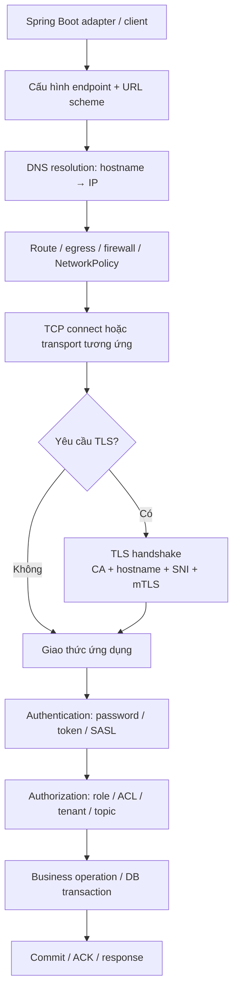
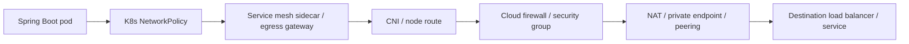
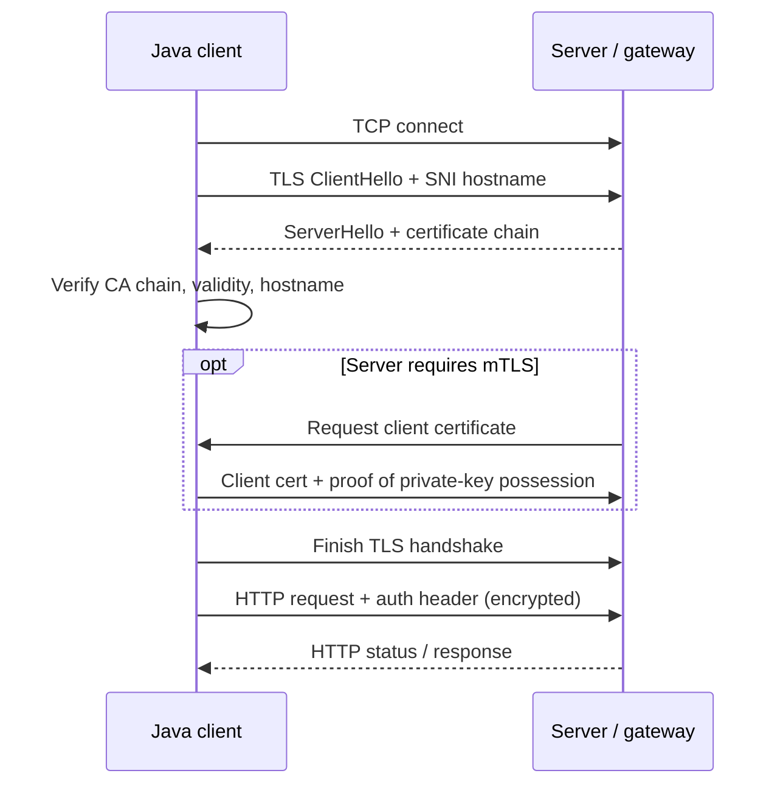
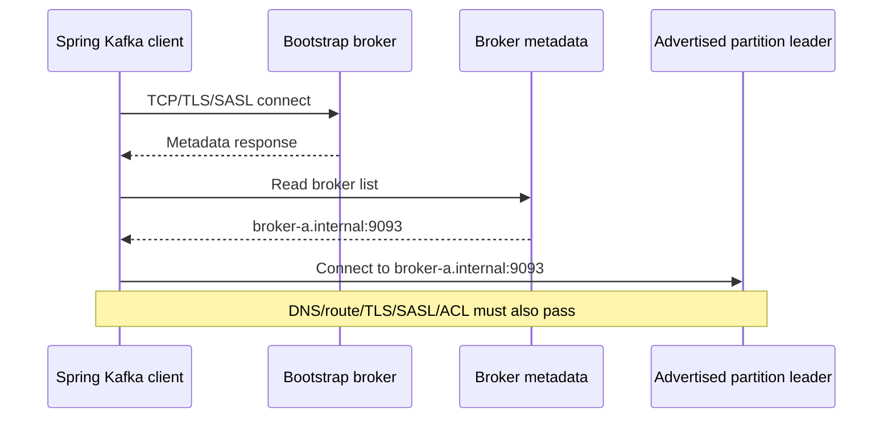
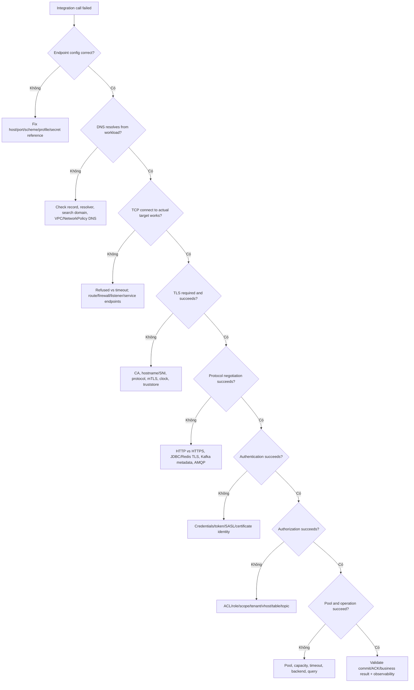

# Không kết nối được do DNS, cổng, TLS hoặc quyền truy cập

> **Chương:** Gỡ lỗi và nâng cấp  
> **Module:** `SPRING_BOOT_INTEGRATION` — tổ chức tích hợp hệ thống trong Spring Boot qua HTTP client, cơ sở dữ liệu, cache, broker thông điệp và các adapter của Spring Integration; trọng tâm là quản lý cấu hình, hợp đồng dữ liệu, giao dịch, lỗi, xử lý trùng lặp, kiểm thử và quan sát những luồng tích hợp thực tế.
>
> **Phạm vi:** Java 17+, Spring Boot 3.x, Spring Framework 6, các client HTTP/JDBC/Redis/Kafka/RabbitMQ/Pulsar phổ biến. Tên cấu hình và ngoại lệ có thể thay đổi giữa phiên bản driver, Spring Boot, nhà cung cấp cloud và broker. Ví dụ dùng endpoint giả định, **không phải thông số production**. Lệnh mạng chỉ chạy trong môi trường bạn được phép chẩn đoán; không sao chép thông tin xác thực, token hoặc dữ liệu khách hàng vào log/ticket.

## 1. Tình huống thực tế: ứng dụng chạy nhưng không giao tiếp được

Một ứng dụng Order Service nhận HTTP request rồi cần:

1. Gọi Payment API qua HTTPS.
2. Ghi đơn hàng vào PostgreSQL.
3. Xóa hoặc đọc Redis cache.
4. Phát `OrderCreated` vào Kafka.
5. Gửi thông báo qua SMTP hoặc một adapter Spring Integration.

Sau khi chuyển môi trường từ local lên Kubernetes, các log xuất hiện:

```text
java.net.UnknownHostException: payment.internal.example
java.net.ConnectException: Connection refused
java.net.SocketTimeoutException: Connect timed out
javax.net.ssl.SSLHandshakeException: PKIX path building failed
org.postgresql.util.PSQLException: FATAL: password authentication failed
org.apache.kafka.common.errors.TimeoutException:
  Topic ... not present in metadata after ...
```

Những lỗi này **không có cùng nguyên nhân**. Đổi password sẽ không sửa DNS; đổi DNS sẽ không sửa chứng chỉ hết hạn; tăng timeout không sửa server từ chối connection; thêm retry không sửa quyền ACL thiếu.

**Mục tiêu bài:** xây dựng quy trình chẩn đoán có bằng chứng, tìm chính xác tầng hỏng trước khi thay cấu hình, khôi phục an toàn và tránh tạo duplicate/lỗi dữ liệu trong luồng tích hợp.

### Kết quả mong đợi

Sau bài này, bạn có thể:

- Nhận diện khác biệt giữa resolve hostname, TCP connect, TLS handshake, giao thức, authentication và authorization.
- Thu thập hostname/port/protocol, environment và lỗi gốc mà không làm lộ secrets.
- Kiểm tra DNS từ **nơi tiến trình thực sự chạy**: pod/container/VM, không chỉ laptop.
- Phân biệt `Connection refused`, timeout, `UnknownHostException`, lỗi PKIX, hostname mismatch, HTTP 401/403 và “pool exhausted”.
- Chẩn đoán WebClient/RestClient, PostgreSQL JDBC, Redis, Kafka, RabbitMQ và Pulsar theo điểm đặc thù.
- Vận hành CA/truststore, mTLS, certificate rotation và secret rotation an toàn.
- Áp dụng timeout, retry, backoff, circuit breaker, idempotency, inbox/outbox và observability.
- Viết runbook, regression test và rollout/rollback checklist cho các thay đổi mạng/bảo mật.

## 2. Mô hình nhiều tầng: request đi qua các cổng nào?



Khi xảy ra lỗi, hãy đánh dấu **bước cuối cùng được xác nhận thành công**, không suy ra bước sau đã đúng. Ví dụ:

- DNS trả IP: chưa chứng minh có route hoặc cổng mở.
- TCP connection thành công: chưa chứng minh TLS handshake/hostname hợp lệ.
- TLS handshake thành công: chưa chứng minh HTTP endpoint tồn tại hoặc quyền truy cập đúng.
- HTTP 401/403: thường chứng minh đã tới một server/proxy, nhưng chưa chứng minh đúng upstream backend.
- Gửi Kafka thành công ở bootstrap host: chưa chứng minh client truy cập được **toàn bộ broker được trả về từ metadata**.
- PostgreSQL login thành công: chưa chứng minh được quyền `SELECT/INSERT` lên bảng hoặc có connection slot khi tải cao.
- Một message được broker ACK: chưa chứng minh downstream đã commit business operation.

### 2.1. Bảng nhận diện triệu chứng theo tầng

| Log/triệu chứng | Tầng nghi ngờ đầu tiên | Không nên kết luận vội |
|---|---|---|
| `UnknownHostException` / `Name or service not known` | DNS hoặc hostname sai | “Server chết” |
| `Connection refused` | IP reachable nhưng không có listener tại cổng hoặc bị reject | “Sai password” |
| `Connect timed out` | Routing, firewall, network policy, IP/port, network outage | “TLS certificate lỗi” |
| `SSLHandshakeException: PKIX path building failed` | Trust chain/CA | “Đổi DNS sẽ hết” |
| `No subject alternative DNS name matching` | TLS hostname verification | “Chỉ cần bật trust all” |
| TLS alert `bad_certificate` / `certificate_required` | mTLS hoặc certificate policy | “SMTP/HTTP token sai” |
| HTTP `401 Unauthorized` | Authentication ở server/proxy | “TCP chưa kết nối” |
| HTTP `403 Forbidden` | Authorization/policy hoặc gateway | “Bật retry là hết” |
| PostgreSQL `28P01` | Sai authentication credentials/policy | “Cổng 5432 bị chặn” |
| Kafka topic metadata timeout | Bootstrap, DNS advertised broker, TLS/SASL, ACL | “Không có dữ liệu topic” |
| Hikari `Connection is not available, request timed out` | Pool không cấp được connection | “DNS chắc chắn lỗi” |

Ngoại lệ tầng trên có thể **bọc** ngoại lệ tầng dưới. Khi triage, xem root cause và timing, không chỉ đọc lớp exception của framework như `ResourceAccessException` hay `DataAccessException`.

## 3. Đừng sửa trước khi nắm được endpoint thực tế

Trước khi thay bất kỳ cờ TLS hoặc timeout nào, thu thập:

| Thuộc tính | Câu hỏi |
|---|---|
| Service/instance | Ứng dụng, pod, node, container, profile nào lỗi? |
| Destination | Hostname, IP nếu đã resolve, port, scheme `http/https`, JDBC URL, broker service URL? |
| Client | RestClient, WebClient, Apache HttpClient, PostgreSQL JDBC, Lettuce, KafkaProducer, RabbitMQ, Pulsar client? |
| thời điểm | Lỗi từ deploy mới, certificate rotation, secret rotation, DNS change hay chỉ khi tăng tải? |
| Scope | Tất cả pod hay một pod/namespace/AZ? Một destination hay mọi destination? |
| Error stage | DNS, TCP, TLS, AUTH, ACL, pool, request/response hay broker metadata? |
| Timeout | Lỗi ngay lập tức hay chỉ sau 3, 5, 30 giây? |
| Recent changes | Endpoint, port, route, NetworkPolicy, proxy, truststore, credentials, driver? |
| Business impact | HTTP requests thất bại, message backlog tăng, outbox pending, duplicate xảy ra không? |

**Endpoint phải lấy từ cấu hình hiệu lực của instance lỗi**, không chỉ từ file `application.yml` ở repository. Spring Boot property có thể bị override qua environment variables, command-line arguments, config server, deployment manifests hoặc secrets.

Không in `spring.datasource.password`, `Authorization` header, SASL JAAS config, JWT, private key hoặc SMTP AUTH vào ticket. Ghi hostname/port/loại secret và *nguồn cấu hình*, không ghi secret value.

### 3.1. Bảng tình trạng để tránh kết luận dựa vào laptop

```text
Incident: order-service -> payment.internal.example:443
Environment: production, namespace=orders, pod=order-7c...
Client: Spring WebClient / Reactor Netty
Started: 2026-11-21 10:20 +07
Root cause: java.net.UnknownHostException: ...
From pod DNS test: FAIL
From developer laptop DNS test: PASS
After change: DNS resolved, TCP connect PASS, TLS PASS, HTTP 401
New active issue: service token expired
```

Một sự cố có thể có **nhiều tầng lỗi nối tiếp**. Đừng đánh dấu resolved chỉ vì exception đã đổi từ DNS sang 401.

## 4. Quy trình “đi từ ngoài vào trong” để giảm thời gian tìm lỗi

Làm theo thứ tự sau, tại đúng workload bị ảnh hưởng:

1. **Tên endpoint**: đúng DNS name/namespace/port/scheme? Có trailing space hoặc placeholder chưa được expand?
2. **DNS**: workload resolve được hostname tới IP/AAAA nào?
3. **Network**: IP và port reachable? Có egress deny, routing, firewall, NAT, proxy hoặc service mesh?
4. **TLS**: có handshake, đúng CA/truststore, hostname, SNI, thời hạn, mTLS?
5. **Giao thức**: HTTP path, PostgreSQL SSL negotiation, Kafka metadata, Redis TLS, AMQP, SMTP STARTTLS có khớp?
6. **Authentication**: token/password/client certificate/SASL mechanism còn đúng và được server chấp nhận?
7. **Authorization**: tài khoản có role/ACL/topic/database/schema/tenant/namespace thích hợp?
8. **Application**: connection pool, timeout, retry, thread blocking, parser và health/readiness.
9. **Kết quả nghiệp vụ**: transaction commit, broker ACK, side effect, backlog/outbox/inbox có đúng?

Chỉ chuyển sang bước sau khi có bằng chứng cho bước trước; nếu bước 2 lỗi, sửa token OAuth thường là thay đổi vô ích và gây nhiễu.

### 4.1. Quy tắc một biến mỗi lần

Khi cần sửa:

- Ghi nhận cấu hình cũ, giả thuyết và phép thử xác nhận.
- Thay **một** yếu tố liên quan, chẳng hạn DNS record hoặc truststore.
- Thử lại từ đúng pod/client.
- Thu thập số liệu sau thay đổi: error rate, p95, pool pending, backlog.
- Giữ rollback plan; tránh cùng lúc nâng driver, đổi TLS, proxy và credentials.

## 5. DNS: hostname được phân giải ở đâu?

DNS ánh xạ tên logic thành địa chỉ IP (A/AAAA) hoặc record khác; Kubernetes nội bộ còn có search domains và service discovery. Java có thể dùng resolver/caching của JVM/OS theo stack mạng.

Ví dụ ứng dụng kết nối:

```yaml
payment:
  client:
    base-url: https://payments.orders.svc.cluster.local
```

Nếu name sai, `WebClient` có thể ném lỗi tương ứng `UnknownHostException`. Nhưng **hostname vẫn có thể resolve ra IP sai**, ví dụ IP cũ, DNS split-horizon, vùng DNS private chưa được cấp hoặc VPN route khác.

### 5.1. Kiểm tra từ đúng namespace/pod

Trên Linux hoặc trong container có công cụ:

```bash
# Kiểm tra resolver và search domain của workload.
cat /etc/resolv.conf

# Những lệnh dưới đây có thể không có sẵn trong image tối giản:
getent hosts payments.orders.svc.cluster.local
nslookup payments.orders.svc.cluster.local
dig payments.orders.svc.cluster.local A
dig payments.orders.svc.cluster.local AAAA
```

Trong Kubernetes (người vận hành có quyền):

```bash
kubectl -n orders get pod
kubectl -n orders exec deploy/order-service -- cat /etc/resolv.conf
kubectl -n orders exec deploy/order-service -- \
  getent hosts payments.orders.svc.cluster.local
```

Nếu image không cài `getent`/`dig`, dùng debug container được phê duyệt hoặc một workload chẩn đoán **cùng namespace/network policy/security context**. Đừng sửa image production chỉ để cài tiện ích hoặc chạy debug pod với quyền mạng rộng hơn rồi kết luận nó phản ánh đúng app.

### 5.2. Những nguyên nhân DNS thường gặp

- Sai FQDN hoặc sai namespace (`payments.default.svc` thay vì `payments.orders.svc`).
- Kubernetes Service chưa tồn tại, không có endpoint hoặc CoreDNS đang lỗi.
- `ndots`/search domains làm thay đổi thứ tự truy vấn, gây latency.
- Split-horizon DNS: trong VPC khác hoặc laptop kết quả khác pod.
- Vùng private DNS chưa gắn đúng VPC/virtual network.
- Cấu hình IPv6/AAAA trả IP mà route IPv6 không hoạt động.
- Record thay đổi nhưng JVM/OS/client còn cache kết quả cũ.
- Egress tới DNS resolver (thường UDP/TCP 53) bị NetworkPolicy/firewall chặn.
- Hệ thống không xử lý đúng CNAME chain/TTL hoặc stub resolver gặp lỗi.
- Service mesh/proxy intercept hoặc custom DNS policy không được áp đúng.

**DNS PASS chỉ có nghĩa resolver đã trả địa chỉ**, không nói server tại IP ấy đang lắng nghe port.

## 6. DNS caching của JVM và tác động khi đổi endpoint

Một lỗi sau khi failover Redis/PostgreSQL có thể do **DNS record đã đổi nhưng tiến trình Java vẫn dùng địa chỉ cũ**.

Các tầng cache có thể gồm:

1. Authoritative DNS TTL.
2. Recursive resolver/NodeLocal DNS cache.
3. OS/stub resolver cache.
4. Java `InetAddress` address cache hoặc DNS cache riêng của client library.
5. Connection pool đang giữ socket tới IP cũ.

Các security properties Java như `networkaddress.cache.ttl` và `networkaddress.cache.negative.ttl` kiểm soát TTL của positive/negative address caching trong những JDK/provider tương ứng. **Không đặt một giá trị toàn cục trong production chỉ vì một hướng dẫn trên Internet**; lựa chọn phụ thuộc JDK, security manager lịch sử, resolver và yêu cầu failover.

### 6.1. Triệu chứng DNS cache khác lỗi DNS hiện tại

```text
dig db.internal.example -> IP_NEW
Spring application still connects -> IP_OLD
Restart pod -> application connects -> IP_NEW
```

Điều này **gợi ý** cache hoặc connection reuse, không tự chứng minh chính xác tầng nào giữ IP. Nên:

- So sánh address được client log/telemetry an toàn với DNS hiện tại.
- Kiểm tra connection pool lifetime, stale connections và Java/client DNS settings.
- Xem TTL thực tế của record và cơ chế failover database/proxy.
- Test rolling restart/cấu hình refresh trong staging.
- Không disable DNS cache toàn hệ thống mà chưa đánh giá tăng tải resolver.

### 6.2. Negative caching

Nếu lần đầu hostname chưa tồn tại, resolver/JVM có thể cache kết quả lỗi trong một khoảng thời gian; tạo record ngay sau đó không chắc client hết lỗi lập tức. Đo thời gian từ khi DNS record xuất hiện đến khi Java lookup thành công và xem `negative.ttl`/client DNS cache theo version.

## 7. Docker và Kubernetes: localhost không phải dịch vụ bên cạnh

Trong Docker/Kubernetes, `localhost` **trỏ về chính network namespace của container/pod**, không tự là host machine hoặc một pod khác.

| Từ đâu gọi | `localhost:5432` trỏ tới đâu? |
|---|---|
| Java app chạy trên laptop | Laptop |
| Java container riêng trên Docker network | Container Java |
| Kubernetes pod | Network namespace của pod đó |
| Hai container trong cùng Kubernetes pod | Có thể chia sẻ pod network namespace |
| App trên VM khác | VM đó |

Ví dụ sai thường gặp:

```yaml
spring:
  datasource:
    url: jdbc:postgresql://localhost:5432/orders
```

Cấu hình có thể đúng khi PostgreSQL chạy trên laptop, nhưng sai khi app chuyển lên pod và Postgres là Kubernetes Service riêng.

Ví dụ theo service discovery:

```yaml
spring:
  datasource:
    url: jdbc:postgresql://postgres.orders.svc.cluster.local:5432/orders
```

Hostname này chỉ là ví dụ; phải xác minh Kubernetes Service thật, namespace, EndpointSlice, selector, readiness và policy network.

### 7.1. Service tồn tại nhưng không có endpoint

Kubernetes Service có `ClusterIP` không đồng nghĩa có backend Ready. Kiểm tra:

```bash
kubectl -n orders get svc postgres
kubectl -n orders get endpointslice -l kubernetes.io/service-name=postgres
kubectl -n orders describe svc postgres
```

Nếu label selector sai hoặc pods không Ready, DNS vẫn có thể trả ClusterIP nhưng kết nối timeout/refused tùy hệ thống. Tập trung vào selector, ports `port/targetPort` và pod readiness, không sửa Java code trước khi xác nhận route.

### 7.2. Port mapping trong Docker

`-p 15432:5432` ánh xạ **host port 15432** tới **container port 5432**. Container trên cùng Docker network thường kết nối qua **container/service name + internal port**, không dùng host port mapping như một quy tắc chung.

Cần ghi rõ source → destination và nơi port translation xảy ra, tránh test đúng host port từ laptop rồi suy rằng pod có thể gọi cùng URL.

## 8. TCP connect: phân biệt refused và timeout

Sau DNS, client cần tạo kết nối tới IP/port. Hai lỗi thường gặp:

### 8.1. Connection refused

`java.net.ConnectException: Connection refused` thường xảy ra khi địa chỉ đích từ chối TCP connect (ví dụ nhận RST) hoặc một thiết bị mạng chủ động reject. Nguyên nhân:

- Server process không chạy hoặc chưa bind cổng.
- Server chỉ listen ở `127.0.0.1` thay vì interface cần.
- Cấu hình port sai.
- Kubernetes Service targetPort/endpoint sai.
- Firewall trả reject.
- TLS port và plaintext port bị đảo, đôi khi server đóng ngay sau connect thay vì refused.

**Chẩn đoán:** Có listener thực sự trên destination IP/port không? Ở server có thể kiểm tra `ss -ltn` hoặc công cụ tương đương nếu được cấp quyền.

### 8.2. Connect timed out

Kết nối không được thiết lập trong thời hạn. Nguyên nhân có thể là:

- Egress/ingress firewall drop.
- Kubernetes NetworkPolicy cấm.
- Routing, NAT, security group, NACL hoặc service mesh.
- IP đích không còn sống, DNS trả địa chỉ cũ.
- Server/network quá tải hoặc TCP SYN backlog/packet loss.
- Đường IPv6 hỏng trong khi client thử IPv6 trước.

Timeout không chứng minh “TLS handshake lỗi”, vì ở bước TCP kết nối chưa hoàn tất. Tăng timeout đôi khi giúp mạng chậm tạm thời, nhưng **không phải cách sửa deny policy hoặc route sai**.

### 8.3. TCP connection reset sau khi đã connect

`Connection reset by peer` có thể xảy ra khi server/proxy đóng socket trong handshake hoặc protocol exchange, hoặc khi idle connection bị đóng và pool dùng lại. Không kết luận ngay “server down”; cần xem mốc thời gian, trạng thái TLS, proxy, keep-alive, idle timeout và logs server.

## 9. Lệnh chẩn đoán TCP: đúng host, đúng port, đúng nguồn

Ví dụ Linux/macOS debug environment:

```bash
# Kiểm tra TCP reachability, không kiểm tra TLS/auth.
nc -vz -w 3 payments.internal.example 443
nc -vz -w 3 postgres.orders.svc.cluster.local 5432

# HTTP(S) protocol-level check, có timeout:
curl --connect-timeout 3 --max-time 10 -v \
  https://payments.internal.example/health
```

`nc`/`curl` có thể không được cài trên image, và `-w` có khác biệt giữa các implementation; test từ debug container phù hợp. `curl -v` có thể ghi headers, proxy details và auth metadata: chỉ dùng URL/headers đã loại secrets, lưu kết quả an toàn.

Trên Windows khi người vận hành test một host được phép:

```powershell
Test-NetConnection payments.internal.example -Port 443
Resolve-DnsName payments.internal.example
```

**Không dùng một TCP connect thành công để kết luận authentication hoặc mTLS thành công.** Nó chỉ thu hẹp lỗi tới tầng sau TCP.

### 9.1. Đừng thử từ sai network path

- Laptop qua VPN có route khác pod production.
- Bastion có security group khác workload.
- Debug pod `hostNetwork: true` có đường đi khác pod thường.
- Node network có quyền egress khác pod chịu NetworkPolicy.
- Kubernetes ingress chiều **vào** khác outbound egress chiều **ra**.

Phép thử tốt nhất tái hiện cả namespace, service account, proxy settings, network policy và endpoint của instance bị lỗi.

## 10. Route, NAT, firewall, Security Group và NetworkPolicy

Đường đi từ pod đến service có thể gồm:



Các lỗi thường gặp:

- NetworkPolicy mới chặn egress tới DNS hoặc destination port.
- Egress được phép TCP/443 nhưng service thật dùng 5432 hoặc 9093.
- Security group cho phép subnet cũ nhưng pod/node/NAT IP mới nằm ngoài allowlist.
- Cloud NAT hết địa chỉ/port allocation ở tải lớn.
- VPC peering/PrivateLink/Private Endpoint bị thay route hoặc DNS.
- Service mesh yêu cầu mTLS/authorization policy khác với client mong đợi.
- Egress proxy bắt buộc nhưng client không cấu hình `HTTPS_PROXY`/connector proxy.
- Một IPv6 address được trả về nhưng đường IPv6 chưa được enable toàn tuyến.

### 10.1. Phân biệt “DNS trả IP private” với “route tới IP private”

Nếu `db.internal.example` resolve thành `10.x.x.x`, ứng dụng chỉ gọi được khi có route và chính sách egress vào mạng đó. Không đổi sang public IP để chữa lỗi tạm khi dữ liệu quan trọng: có thể phá kiến trúc private access và compliance.

### 10.2. Chính sách least privilege

Không giải quyết lỗi bằng cách mở `0.0.0.0/0` inbound trên database/broker hoặc tắt toàn bộ NetworkPolicy. Xác định chính xác **source workload identity/subnet → destination hostname/IP/port/protocol**, cấp quyền tối thiểu và ghi audit thay đổi.

## 11. HTTPS/TLS handshake: bước sau TCP

TLS là giao thức bảo vệ kênh truyền. Với HTTPS, trình tự cơ bản:



Một `SSLHandshakeException` có thể do:

- Certificate chain không tin cậy.
- Hostname verification không khớp SAN.
- Chứng chỉ hết hạn/chưa có hiệu lực.
- TLS protocol/cipher không có giao nhau.
- Server yêu cầu client certificate nhưng client chưa có/sai.
- SNI không đúng nên load balancer trả chứng chỉ của vhost khác.
- Truststore/keystore sai password/type, không đọc được hoặc được load từ đường dẫn sai.
- TLS interception proxy với CA riêng chưa được tin cậy.
- Đồng hồ hệ thống sai làm xác định hiệu lực certificate sai.

Lỗi TLS là **lỗi bảo mật hoặc cấu hình**, không nên tự chuyển sang HTTP plaintext để “thử tiếp”.

## 12. Phân biệt truststore và keystore

| Thành phần | Đựng gì | Dùng khi nào? |
|---|---|---|
| **Truststore** | CA/certificate được phép tin cậy | Client xác minh server certificate |
| **Keystore** | Client certificate và private key (tùy loại) | Server yêu cầu mTLS |
| **Server certificate** | Public certificate gắn danh tính DNS/IP | Server chứng minh identity với client |
| **Private key** | Bí mật mật mã | Phải được giữ kín, không đưa vào truststore công khai |
| **Certificate chain** | Leaf → intermediate → trusted root | Validator xây trust path |
| **SAN** | Subject Alternative Name DNS/IP | Hostname verification |

**Một HTTPS URL và đúng CA chưa đủ khi server yêu cầu mTLS.** Client cần xuất trình chứng chỉ được cấp quyền và chứng minh có private key hợp lệ.

### 12.1. PKIX path building failed

Ví dụ:

```text
javax.net.ssl.SSLHandshakeException:
  PKIX path building failed:
  sun.security.provider.certpath.SunCertPathBuilderException:
  unable to find valid certification path to requested target
```

Thường là client không thể xây chain tin cậy tới trust anchor. Kiểm tra:

1. Server trả đủ intermediate certificates?
2. CA mới đã được đưa vào JDK/truststore dùng bởi **đúng tiến trình**?
3. Ứng dụng có đang dùng một custom truststore bỏ sót CA hệ thống không?
4. Proxy có thay certificate bằng CA nội bộ không?
5. Truststore path/type/password có đúng môi trường container?
6. Có certificate rotation nhưng pods chưa reload truststore không?

Không “sửa” bằng `trustAll`, `ssl.trust=*` hoặc disable hostname verification.

## 13. Hostname verification, SAN và SNI

Một chứng chỉ có SAN `api.partner.example` có thể hợp lệ khi client gọi:

```text
https://api.partner.example
```

nhưng **không** hợp lệ khi client đổi URL thành:

```text
https://10.30.2.15
```

trừ khi chứng chỉ chứa đúng IP SAN hoặc có cơ chế identity khác phù hợp. Việc IP có route không thay thế kiểm tra danh tính DNS.

**SNI** (*Server Name Indication*) cho phép client chỉ rõ hostname trong TLS ClientHello. Một load balancer phục vụ nhiều domain có thể trả chứng chỉ sai nếu client không gửi SNI đúng.

### 13.1. Kiểm tra server certificate bằng OpenSSL

Ở môi trường được phép và có OpenSSL phù hợp:

```bash
openssl s_client \
  -connect api.partner.example:443 \
  -servername api.partner.example \
  -verify_hostname api.partner.example \
  -verify_return_error
```

Quan sát:

- Certificate subject/SAN và validity.
- Intermediate chain.
- TLS protocol/cipher được thương lượng.
- Verification result và exit status.
- SNI hostname đúng với URL production.

**`openssl s_client` chỉ chứng minh TLS tại endpoint được kiểm tra**, không xác nhận HTTP authentication, business API hoặc Java truststore. OpenSSL thường dùng CA bundle khác Java; “OpenSSL PASS, Java FAIL” vẫn có thể xảy ra nếu JDK truststore không chứa cùng CA.

### 13.2. Không bỏ hostname để test bằng IP

Nếu cần cô lập sự cố DNS, một phép thử HTTP có thể **giữ nguyên hostname URL và SNI** nhưng ép một địa chỉ IP tạm thời bằng `curl --resolve`:

```bash
curl --resolve api.partner.example:443:10.30.2.15 \
  --connect-timeout 3 --max-time 10 \
  https://api.partner.example/health
```

Chỉ thử địa chỉ thuộc hạ tầng được phép. Điều này giữ tên logic cho Host/SNI và vẫn kiểm tra certificate hostname, trong khi bỏ qua bước DNS resolution ở client. Không dùng `curl -k`/`--insecure` để “làm test PASS” và đưa cấu hình insecure vào ứng dụng.

## 14. TLS protocol/cipher, clock và certificate rotation

Khi nâng JDK, Spring Boot, OS image hoặc load balancer, cấu hình TLS có thể thay đổi:

- JDK mới disable protocol/cipher cũ.
- Server loại TLS 1.0/1.1 và chỉ chấp nhận TLS 1.2/1.3.
- Bộ CA trong JDK/container image thay đổi.
- Chứng chỉ server rotate sang CA/intermediate mới.
- Client certificate mTLS bị hết hạn hoặc secret mount đổi nội dung.
- Load balancer trả chứng chỉ khác theo SNI.
- Thiết bị mạng/proxy TLS inspection thay đổi chain.

Đừng tự hạ TLS xuống giao thức yếu khi handshake lỗi. Đối chiếu security baseline, JDK enabled protocols và server capabilities; nếu không có giao nhau, cần nâng cấp endpoint/client đúng cách.

### 14.1. Quy trình xoay CA an toàn

Một chiến lược được kiểm soát:

1. Chuẩn bị truststore tin cả **CA cũ và CA mới** trong giai đoạn chuyển tiếp nếu policy cho phép.
2. Triển khai truststore tới client trước khi server đổi chứng chỉ.
3. Xoay server certificate và kiểm tra SNI/hostname/mTLS.
4. Xác minh traffic từ mọi pod/AZ/cụm.
5. Sau thời gian chuyển tiếp, gỡ CA cũ theo quy trình bảo mật.

Nếu xoay client certificate mTLS, chuẩn bị keypair/certificate mới, cập nhật identity mapping/ACL và xác nhận reload. Một số client/connection pool **chỉ đọc key/truststore lúc khởi tạo**, nên thay file secret chưa chắc đã thay certificate trên socket mới; cần test reload/restart/rotation riêng.

## 15. mTLS và client certificate: khác password/token

Mutual TLS yêu cầu cả hai phía xác thực nhau qua chứng chỉ. Khi mTLS:

- Client xác minh server certificate/hostname.
- Server yêu cầu client certificate.
- Client cung cấp certificate chain và chứng minh sở hữu private key.
- Server kiểm tra CA, certificate validity, danh tính và mapping quyền.

Một số hệ còn yêu cầu OAuth token/HTTP header **sau khi mTLS thành công**. mTLS authentication và application authorization vẫn là hai lớp khác nhau.

### 15.1. Triệu chứng hay gặp

```text
Received fatal alert: bad_certificate
Received fatal alert: certificate_required
Keystore was tampered with, or password was incorrect
Cannot recover key
No available authentication scheme
```

Những lỗi này có thể liên quan keystore type/password, chain client, thuật toán chữ ký, CA phía server hoặc server request policy. Đừng chia sẻ private key và password để chẩn đoán qua chat/log.

### 15.2. Identity mapping không phải hostname matching

Server có thể nhận certificate hợp lệ nhưng từ chối request vì subject/SAN/URI identity không có quyền với tenant/topic. Lúc đó TLS handshake thành công nhưng **authorization vẫn fail**. Cần kiểm tra role/ACL mapping, không tiếp tục sửa CA khi đã xác minh TLS PASS.

## 16. Java truststore, SSLContext và Spring Boot configuration

Với Java client, certificate chain thường được xác minh qua trust material của JVM hoặc SSLContext cụ thể của client. Một số ứng dụng dùng:

- JDK default truststore.
- Custom PKCS#12/JKS truststore.
- Spring Boot SSL bundle, nếu **client tương ứng hỗ trợ tích hợp bundle** trên phiên bản đó.
- Netty/Reactor Netty `SslContext` riêng.
- Apache HttpClient, Kafka, Lettuce, PostgreSQL JDBC hoặc broker client SSL configuration riêng.

Không suy ra cấu hình TLS cho embedded Tomcat server (`server.ssl.*`) sẽ tự áp dụng cho outbound WebClient, JDBC hoặc Kafka. **Inbound TLS** và **outbound TLS** là các hướng riêng.

### 16.1. JVM system properties: chỉ dùng khi phù hợp phạm vi

Một JVM chạy trên máy ảo có thể có:

```text
-Djavax.net.ssl.trustStore=/secure/trust/app-truststore.p12
-Djavax.net.ssl.trustStoreType=PKCS12
-Djavax.net.ssl.trustStorePassword=<provided-as-secret>
```

Đây là **minh họa các property**, không phải lệnh khuyến nghị paste mật khẩu vào process command line vì có thể lộ qua process listings/logs. Ưu tiên secret injection và cấu hình TLS **theo từng client** khi có nhiều đối tác/CA khác nhau.

Một JVM-wide custom truststore có thể khiến outbound calls tới domain công cộng mất CA mặc định nếu truststore thiếu các CA đó. Khi đổi truststore, phải regression test **mọi integration endpoint** đang dùng JSSE mặc định.

### 16.2. Spring Boot SSL bundles

Spring Boot phiên bản hỗ trợ có `spring.ssl.bundle.*` để tập trung khai báo truststore/keystore. Tuy nhiên **không phải tất cả các client tự áp một bundle** chỉ vì bundle được đặt trong YAML. Cần kiểm tra driver/library và chỉ ra nơi bean HTTP client, Redis, message broker, JDBC hoặc mail sender **được gắn bundle**.

Mô hình đúng:

```text
Managed trust/key material
   -> SSL bundle / SSLContext
   -> supported client-specific configuration
   -> actual outbound connection + integration test
```

Đọc property thành công mà client không sử dụng SSLContext đó **không phải đã bật TLS**.

## 17. Phân biệt TLS failure và HTTP 401/403/407

Khi HTTPS handshake thành công, HTTP request có thể nhận:

| HTTP status | Ý nghĩa thường gặp | Gợi ý |
|---|---|---|
| `200/204` | Endpoint xử lý thành công theo API | Chưa chứng minh mọi downstream hoàn tất |
| `301/302/307/308` | Redirect | Kiểm tra host đích, auth header và TLS mới |
| `400` | Request sai contract | Kiểm tra body/schema/content type |
| `401` | Chưa có hoặc không hợp lệ authentication | Token, scope, expiry, clock skew |
| `403` | Authenticated nhưng không đủ quyền, hoặc policy chặn | Role/ACL/tenant/IP allowlist/WAF |
| `404` | Path/resource không tồn tại hoặc bị che | Base URL/context path, API version |
| `407` | Proxy authentication required | Cấu hình outbound HTTP proxy |
| `429` | Rate limited | Backoff/Retry-After, capacity |
| `502/503/504` | Gateway/upstream unavailable hoặc timeout | Xác định proxy/gateway hay backend lỗi |

HTTP 401/403 có thể do **proxy/API gateway**, không nhất thiết từ application backend. Kiểm tra `Server`/`Via`/request ID/log của gateway theo policy.

### 17.1. Token sai và DNS sai là hai lỗi khác tầng

Nếu server trả HTTP 401, đừng tiếp tục chẩn đoán `UnknownHostException` ở request **đó**: ít nhất đường HTTP đã trả response từ một endpoint. Nhưng ở hệ thống nhiều host/redirect, vẫn cần chắc chắn response đến từ đúng server/service mong đợi.

### 17.2. Quyền truy cập còn phụ thuộc tenant và resource

Một token hợp lệ có thể không có quyền `orders:write`, hoặc tài khoản có quyền trên `shop-a` nhưng request dùng tenant `shop-b`. Đây là lỗi authorization/domain policy, không phải TLS. Không thêm quyền admin để sửa tạm rồi quên rút lại.

## 18. Proxy, NO_PROXY, service mesh và TLS interception

Một HTTP client có thể đi:

```text
WebClient -> corporate proxy -> HTTPS target
          hoặc
WebClient -> service mesh sidecar -> egress gateway -> target
```

Những lỗi thường bị nhầm:

- Shell `curl` dùng `HTTPS_PROXY` nhưng Java client không dùng proxy đó.
- Java client dùng proxy global trong khi internal `*.svc.cluster.local` cần đi trực tiếp.
- `NO_PROXY` được shell hiểu nhưng client library có quy tắc proxy bypass khác.
- Proxy yêu cầu 407 authentication.
- TLS inspection proxy trả certificate do CA nội bộ ký nhưng JDK không tin.
- Mesh yêu cầu mTLS giữa sidecar và gateway, không phải mTLS trực tiếp giữa Java và upstream.
- IP allowlist upstream thấy **NAT/proxy IP**, không phải pod IP.

### 18.1. Kiểm tra cấu hình hiệu lực theo HTTP client

`RestClient`, `WebClient`, `java.net.http.HttpClient`, Apache HttpClient và OkHttp có API proxy/SSL khác nhau. Đừng nghĩ `-Dhttps.proxyHost` hoặc `HTTPS_PROXY` luôn được mọi client tự hiểu giống nhau.

Khi debug, ghi rõ:

- Client implementation/connector nào?
- Có explicit proxy configuration không?
- Proxy bypass rule nằm ở đâu?
- Server certificate nhìn thấy có phải do proxy ký?
- Requests tới internal service có vô tình đi qua external proxy không?

### 18.2. Không tắt xác minh TLS để “cho qua proxy”

Nếu enterprise proxy được phép inspect TLS, cấu hình trust anchor cụ thể của tổ chức trong truststore đã quản trị và áp policy dữ liệu nhạy cảm; không dùng `TrustAllStrategy`. Nếu proxy không được phép đọc traffic tới payment/DB, phải thay network path/exception policy, không tự cho nó giải mã.

## 19. Spring Boot HTTP clients: cấu hình rõ URL, timeout và TLS

Ví dụ `WebClient` với base URL và timeout của Reactor Netty:

```java
import io.netty.channel.ChannelOption;
import java.time.Duration;
import org.springframework.context.annotation.Bean;
import org.springframework.context.annotation.Configuration;
import org.springframework.http.client.reactive.ReactorClientHttpConnector;
import org.springframework.web.reactive.function.client.WebClient;
import reactor.netty.http.client.HttpClient;

@Configuration(proxyBeanMethods = false)
class PaymentHttpClientConfiguration {

    @Bean
    WebClient paymentWebClient(WebClient.Builder builder) {
        HttpClient client = HttpClient.create()
            .option(ChannelOption.CONNECT_TIMEOUT_MILLIS, 3000)
            .responseTimeout(Duration.ofSeconds(8));

        return builder
            .baseUrl("https://payments.internal.example")
            .clientConnector(new ReactorClientHttpConnector(client))
            .build();
    }
}
```

Cấu hình này chỉ minh họa **connect timeout và response timeout**, dùng TLS mặc định của connector đã xây. Nó không cung cấp mTLS/CA riêng hoặc retry, và không chứng minh mọi DNS step có một timeout riêng. Nếu cần SSLContext, hãy cấu hình explicit SSL cho đúng Reactor Netty API và trust/key material do platform quản lý.

### 19.1. Thế nào là timeout đủ?

- **Connect timeout**: giới hạn chờ TCP connect.
- **TLS handshake timeout**: có thể có cấu hình riêng theo client.
- **Response/read timeout**: chờ HTTP response hoặc I/O.
- **Total request deadline**: có thể rộng hơn/tổng hợp nhiều bước, cần quản lý ở application.
- **Connection pool acquire timeout**: chờ lấy connection có sẵn từ pool.
- **DNS resolution timeout**: tùy resolver/client, có thể khác connect timeout.

Không chỉ tăng `responseTimeout` để sửa kết nối bị từ chối ngay lập tức. Nếu dùng resilience/retry, phải tính **tổng budget** qua mọi attempts, tránh một request giữ worker hàng phút.

### 19.2. RestClient vs WebClient

`RestClient` cho API đồng bộ, `WebClient` cho reactive pipeline. Dù dùng API nào, DNS/TCP/TLS/auth có cùng ranh giới logic nhưng **client factory và exception wrapper** khác nhau.

- `RestClient` có thể ném/wrap `ResourceAccessException` khi I/O, `HttpClientErrorException` khi 4xx nếu gọi `retrieve()`.
- `WebClient` có thể báo `WebClientRequestException` cho lỗi request I/O và `WebClientResponseException` cho response lỗi khi dùng `retrieve()`.
- Root cause bên dưới có thể là `UnknownHostException`, `ConnectException` hoặc `SSLHandshakeException`.

Đừng bỏ root-cause exception khi log, nhưng phải redact URL query/headers có secrets.

### 19.3. Test HTTPS để xác nhận đúng lớp

```bash
# Không kèm Authorization hoặc secrets trong lệnh/log minh họa.
curl --connect-timeout 3 --max-time 10 \
  --cacert /secure/trust/partner-ca.pem \
  -v https://payments.internal.example/health
```

Một câu trả 401 từ endpoint riêng có thể chứng minh TLS hoạt động, nhưng **không chứng minh service credentials** đúng. Muốn xác minh auth, dùng test identity được cấp phép và tránh in raw bearer token.

## 20. PostgreSQL JDBC: kết nối được tới cổng chưa chắc đăng nhập được

Khi Spring Boot dùng HikariCP và PostgreSQL JDBC driver, một URL thường có dạng:

```text
jdbc:postgresql://postgres.orders.svc.cluster.local:5432/orders
```

Các tầng lỗi:

1. Host `postgres.orders.svc.cluster.local` không resolve được.
2. Pod không có route/permission tới TCP 5432.
3. PostgreSQL chưa listen trên địa chỉ/port tương ứng hoặc Kubernetes Service không có endpoint.
4. SSL/TLS negotiation sai `sslmode` hoặc CA/hostname không hợp lệ.
5. Server từ chối authentication: username/password, `pg_hba.conf`, cơ chế SCRAM/certificate.
6. Role đăng nhập được nhưng không có quyền database/schema/table.
7. Hikari không cấp connection vì pool bị giữ hết, leak hoặc DB giới hạn connections.
8. SQL chạy được nhưng transaction rollback, lock wait hoặc query timeout.

### 20.1. Ví dụ cấu hình JDBC với xác minh TLS

```yaml
spring:
  datasource:
    url: "jdbc:postgresql://postgres.orders.svc.cluster.local:5432/orders?sslmode=verify-full&sslrootcert=/etc/certs/postgres-ca.crt&connectTimeout=3&socketTimeout=10"
    username: ${DB_USERNAME}
    password: ${DB_PASSWORD}
    hikari:
      maximum-pool-size: 12
      connection-timeout: 5000
      validation-timeout: 2000
```

Các lưu ý:

- `sslmode=verify-full` yêu cầu kiểm tra certificate chain và hostname theo khả năng của driver.
- `sslrootcert` chỉ đường dẫn CA certificate mà **container đang chạy** phải đọc được.
- `connectTimeout` và `socketTimeout` trong PostgreSQL JDBC URL thường tính **giây**; `Hikari connection-timeout` tính **mili giây**. Không nhầm đơn vị.
- `connection-timeout` của Hikari là giới hạn **chờ mượn connection từ pool**, không thay thế mọi DNS/TCP/TLS deadline.
- `maximum-pool-size` phải tính theo **tổng replicas** và PostgreSQL connection limit; không tăng vô hạn.
- Một số managed database dùng TLS/CA bundle hoặc endpoint proxy riêng; dùng đúng hostname và root CA theo nhà cung cấp.

Không cho password vào JDBC URL nếu có thể cấu hình qua secret property, vì URL dễ xuất hiện trong logs, metrics và exception text.

### 20.2. SQLSTATE giúp tách authentication khỏi network

| Dấu hiệu PostgreSQL | Nhóm lỗi cần kiểm tra |
|---|---|
| `08001`/`08006` (tùy driver) | Kết nối/transport bị lỗi |
| `28P01` | Password authentication failed |
| `28000` | Invalid authorization specification/`pg_hba.conf` hoặc policy liên quan |
| `42501` | Insufficient privilege khi truy cập đối tượng |
| `3D000` | Database không tồn tại |
| `53300` | Too many connections |
| Hikari connection acquisition timeout | Pool không cấp được connection đúng hạn |

SQLSTATE hiển thị cụ thể phụ thuộc phía server và driver. Đừng chỉ phân loại theo message string. Khi `SQLSTATE=42501`, sửa hostname hoặc mở firewall là không đúng hướng; cần xét role/grants/row-level security.

### 20.3. Chỉ kiểm tra `pg_isready` chưa đủ

`pg_isready` kiểm tra mức sẵn sàng của PostgreSQL server, **không chứng minh** đúng user/password, quyền trên database hay certificate hostname. Để kiểm tra đủ, dùng một connection có credentials test được quản lý an toàn, thực hiện câu `SELECT 1` và nếu cần test phép đọc/ghi trên schema phù hợp quyền.

Không gửi password trong command line dễ lưu vào shell history. Không dùng tài khoản superuser cho health checks.

## 21. Redis/Lettuce: DNS, TLS, AUTH, ACL và Redis topology

Redis có thể được triển khai standalone, Sentinel, Cluster hoặc managed cloud. Một kết nối từ Spring Boot có thể thất bại ở:

- Hostname/port của master/replica/cluster endpoint không đúng.
- Security group/NetworkPolicy không cho phép TCP.
- Redis yêu cầu TLS nhưng client gửi RESP plaintext.
- Client bật TLS tới endpoint không hỗ trợ TLS.
- CA/hostname verification không hợp lệ.
- Username/password Redis ACL bị sai hoặc quyền command/key pattern bị từ chối.
- Cluster trả địa chỉ các nodes mà pod không resolve/reach được.
- Sentinel trả master address private nằm ngoài route của workload.
- Pool/connection command timeout khi Redis hoặc network quá tải.

### 21.1. Ví dụ Spring Boot kết nối Redis TLS

```yaml
spring:
  data:
    redis:
      host: ${REDIS_HOST}
      port: 6380
      username: ${REDIS_USERNAME}
      password: ${REDIS_PASSWORD}
      timeout: 2s
      ssl:
        enabled: true
```

Port `6380` chỉ là một lựa chọn phổ biến ở một số nhà cung cấp; **không phải mọi Redis TLS endpoint đều dùng 6380**. Lấy port và TLS mode chính xác từ deployment. Một số provider dùng `6379` với TLS, hoặc routing qua endpoint đặc thù.

Cấu hình truststore/SSL bundle phụ thuộc Spring Boot và Lettuce version. `ssl.enabled=true` không có nghĩa bạn đã chốt trust anchor/hostname policy phù hợp khi dùng CA riêng; cần integration test bằng connection **từ đúng pod**.

### 21.2. TLS thành công nhưng Redis trả NOAUTH/NOPERM

| Redis response | Ý nghĩa điển hình |
|---|---|
| `NOAUTH Authentication required` | Chưa xác thực đúng cơ chế |
| `WRONGPASS invalid username-password pair` | Credentials không hợp lệ |
| `NOPERM this user has no permissions` | ACL không cho command/key |
| `MOVED`/`ASK` | Cluster topology/routing; client cần cluster-aware |
| Timeout kết nối node mới | Node advertisement/DNS/network |
| `READONLY You can't write against a read only replica` | Sai role hoặc failover/topology |

`PING` trả `PONG` không chứng minh application có quyền `GET`/`SET` trên keyspace nghiệp vụ. Nếu Redis ACL giới hạn key pattern, cần test một key **thuộc namespace được phép**, với data test an toàn và cleanup.

### 21.3. Reactivity không chữa lỗi mạng

`ReactiveRedisTemplate`/Lettuce có I/O bất đồng bộ, nhưng DNS/TCP/TLS/auth vẫn phải đúng. Redis bị timeout có thể làm nhiều `Mono` chờ và tải hệ thống tăng. Dùng timeout/fallback cho cache-aside, nhưng không chuyển `WRONGPASS`/`NOPERM` thành cache miss im lặng khi đó là lỗi cấu hình/quyền cần cảnh báo.

## 22. Kafka: bootstrap thành công nhưng không tới được advertised broker

Kafka có điểm khác biệt quan trọng so với HTTP: client trước tiên kết nối `bootstrap.servers`, sau đó nhận **cluster metadata** có địa chỉ brokers, partitions và leaders. Các brokers này quảng bá endpoint qua `advertised.listeners` phía Kafka cluster.



Một lệnh TCP tới bootstrap hostname thành công **không chứng minh** các địa chỉ advertised đều hoạt động từ pod.

### 22.1. Các nhóm lỗi Kafka

| Triệu chứng | Nghi ngờ |
|---|---|
| `Bootstrap broker disconnected` | TCP/TLS/SASL/broker down |
| `Timed out waiting for a node assignment` | Metadata/controller/broker reachability |
| `Topic ... not present in metadata after ...` | Topic/ACL/metadata, DNS advertised brokers hoặc broker không sẵn |
| `SaslAuthenticationException` | JAAS, mechanism, token/password |
| `TopicAuthorizationException` | ACL topic/group |
| `SSLHandshakeException` | CA/cert/SNI/mTLS/protocol |
| Metadata trả internal names không resolve | `advertised.listeners` sai theo network client |
| Producer send timeout dưới tải | Broker quota, partitions, network, `acks`, buffer/pool |

### 22.2. Cấu hình SASL_SSL ví dụ

```yaml
spring:
  kafka:
    bootstrap-servers: ${KAFKA_BOOTSTRAP_SERVERS}
    properties:
      "[security.protocol]": SASL_SSL
      "[sasl.mechanism]": SCRAM-SHA-512
      "[sasl.jaas.config]": ${KAFKA_SASL_JAAS_CONFIG}
```

`KAFKA_SASL_JAAS_CONFIG` chứa secret, phải được cung cấp qua secret manager theo policy và **không được in trong diagnostics**. Tùy cluster, client có thể dùng `SSL`, `SASL_SSL`, OAuth, mTLS hoặc cơ chế riêng. Không áp dụng SCRAM cho mọi cluster khi security configuration thực tế khác.

Đối với TLS có custom CA, Kafka clients có truststore/keystore settings riêng (ví dụ `ssl.truststore.location` và type/password theo security baseline). Không suy ra Spring Boot `server.ssl.*` áp dụng cho Kafka producer.

### 22.3. Vì sao tăng request.timeout.ms không sửa metadata?

Nếu `advertised.listeners` công bố `broker-1.private:9093` nhưng pod chỉ resolve được bootstrap LB, client sẽ **không tới được partition leader** dù timeout đặt một phút. Cách sửa là cấu hình advertised broker addresses phù hợp **mạng của consumer/producer**, route/DNS/TLS và thử truy cập **mọi broker cần thiết**.

Nếu có NAT/ingress Kafka, việc publish ra một public TCP listener đơn lẻ đôi khi không đủ, vì protocol phụ thuộc broker metadata. Đây là lỗi topology cần sửa ở hạ tầng Kafka, không phải refactor business listener.

## 23. RabbitMQ/AMQP: host, vhost, login và quyền queue

RabbitMQ thường dùng AMQP trên port `5672` (plaintext) hoặc `5671` (TLS), tùy cấu hình broker/provider. Một client có thể kết nối TCP/TLS thành công nhưng không mở được AMQP connection/channel.

```yaml
spring:
  rabbitmq:
    host: ${RABBITMQ_HOST}
    port: 5671
    username: ${RABBITMQ_USERNAME}
    password: ${RABBITMQ_PASSWORD}
    virtual-host: orders
    ssl:
      enabled: true
```

Đây là ví dụ chọn TLS; cần kiểm tra truststore/hostname verification bằng API/configuration thực tế của Spring AMQP client và version. Nếu broker dùng CA riêng/mTLS, cấp đúng trust/key material theo hướng dẫn nhà cung cấp.

### 23.1. RabbitMQ thường bị lỗi vhost và permissions

| Dấu hiệu | Giả thuyết |
|---|---|
| `ACCESS_REFUSED - Login was refused` | User/password, auth backend hoặc vhost access |
| `NOT_ALLOWED - vhost ... not found` | Sai hoặc chưa provision virtual host |
| Channel exception `ACCESS_REFUSED` khi declare/bind | Quyền configure/read/write thiếu trên queue/exchange |
| Listener container khởi động nhưng thiếu queue | Queue chưa tồn tại, policy declaration/topology sai |
| TLS socket closes | CA, hostname, client cert hoặc protocol |
| Network timeout | Route/firewall/broker overloaded |

RabbitMQ phân quyền theo virtual host và resource pattern. Một tài khoản đăng nhập được vẫn có thể thiếu quyền `read` trên queue hoặc `write` trên exchange. Không dùng tài khoản administrator chỉ để giải quyết một lỗi binding.

### 23.2. TCP test không kiểm tra AMQP negotiation

`nc host 5671` thành công chỉ chứng minh có TCP listener. Để xác minh toàn đường, dùng một Spring AMQP integration test hoặc tool AMQP đã được cấp quyền, thử connection/channel/queue operation đúng vhost và ACL với test resource.

## 24. Apache Pulsar: service URL, TLS và subscription permission

Pulsar thường dùng binary protocol trên `pulsar://...:6650` và TLS endpoint `pulsar+ssl://...:6651` khi cluster được cấu hình tương ứng. Đây là **convention thường gặp**, không phải quy tắc cho mọi managed service.

```yaml
spring:
  pulsar:
    client:
      service-url: ${PULSAR_SERVICE_URL:pulsar+ssl://pulsar.internal.example:6651}
```

Những điểm phân biệt:

- `PulsarClient service-url` là **binary broker protocol**, không phải URL của Pulsar Admin REST API.
- Admin API có thể chạy HTTP/HTTPS trên cổng khác và dùng authentication/authorization riêng.
- Client có thể nhận lookup/redirect tới broker thực; DNS/route/TLS phải hoạt động cho các broker đó.
- Token hoặc client certificate có thể xác thực nhưng tài khoản **không có quyền consume/produce** trên tenant/namespace/topic.
- Subscription type, subscription name và namespace ownership ảnh hưởng business flow nhưng **không sửa được lỗi TLS**.

Nếu client thấy `NotAuthorizedException` cho một topic, xác minh ACL tenant/namespace/topic và token principal. Nếu handshake TLS fail trước khi có response protocol, không thêm quyền namespace để giải quyết.

### 24.1. Tên topic và URL có thể khác DNS

Một topic đầy đủ:

```text
persistent://shop/integration/order-events-v1
```

Đây là tên **topic** trong Pulsar, không phải URL mạng cho Java client. Đừng bỏ topic name vào vị trí `spring.pulsar.client.service-url` hoặc thay `pulsar+ssl://` bằng `https://` để “bật TLS”; hai protocol có handshake riêng.

## 25. SMTP, SOAP, RSocket, SFTP và adapter khác: cùng mô hình, khác giao thức

Một module Spring Boot Integration có thể còn kết nối:

| Adapter/protocol | Endpoint thường dùng | Chỗ dễ nhầm |
|---|---|---|
| SMTP submission | `587` STARTTLS, `465` implicit TLS | `AUTH` không tự bật TLS, port không tự bảo mật |
| SOAP over HTTPS | `https://host/path` | HTTP 404/401, WSDL endpoint khác service endpoint, TLS/SNI |
| RSocket TCP/TLS | Host và port do server định nghĩa | Setup/route/auth sau TLS, không phải HTTP GET |
| SFTP | SSH protocol trên `22` thông dụng | Host key verification, user key/password, server path/permission |
| FTPS | FTP + TLS | Active/passive data ports/firewall và TLS |
| LDAP/LDAPS | `ldap://` hoặc `ldaps://` | STARTTLS vs implicit TLS, bind DN/ACL |
| JDBC SQL Server/MySQL | DB-specific JDBC URL/port/TLS options | TLS verification khác PostgreSQL |
| Spring Integration HTTP/Kafka adapters | Được cấu hình theo underlying client | Channel lỗi không tự là lỗi transport |

### 25.1. SMTP STARTTLS và implicit TLS

`mail.smtp.starttls.enable=true` chỉ bật khả năng nâng cấp kết nối. Nếu policy yêu cầu TLS, cấu hình thêm `mail.smtp.starttls.required=true` và certificate hostname verification. Với implicit TLS thường dùng `mail.smtp.ssl.enable=true`; **không trộn hai chế độ theo thói quen**.

### 25.2. SFTP dùng SSH host key, không phải X.509 CA

Một lỗi `Host key verification failed` trong SFTP là vấn đề tin cậy **SSH host key**, khác với `PKIX path building failed` của HTTPS. Không tắt StrictHostKeyChecking trong production; xác minh fingerprint host key qua kênh đáng tin cậy và cập nhật `known_hosts`/host key policy.

### 25.3. Spring Integration không che lỗi mạng bên dưới

`IntegrationFlow` có thể đi qua `MessageChannel` và service activator rồi gọi outbound adapter. Khi outbound adapter lỗi DNS/TLS/auth:

- Với `DirectChannel` đồng bộ, caller có thể thấy exception.
- Với `QueueChannel`/poller, lỗi xảy ra sau đó trên thread khác và cần error/retry infrastructure.
- Với async executor, lỗi có thể đến error channel khi caller đã trả về.
- Một channel in-memory không tự là durable retry queue sau restart.

Vì vậy, trong runbook phải ghi rõ **adapter nào** sở hữu kết nối và **ai** sở hữu ACK/retry của message đầu vào.

## 26. Quyền truy cập sau khi kết nối: authentication khác authorization

| Thành phần | Authentication | Authorization |
|---|---|---|
| HTTP API | Bearer token, API key, mTLS identity | Role, scope, tenant, endpoint policy |
| PostgreSQL | DB username/password, certificate, IAM auth | Database/schema/table privilege, RLS |
| Redis | AUTH/ACL username-password | Command, key pattern, pub/sub channel permissions |
| Kafka | SASL/mTLS principal | Topic/group ACL, transactional ID |
| RabbitMQ | User/password/certificate principal | Vhost, configure/read/write trên queue/exchange |
| Pulsar | Token/cert role | Tenant/namespace/topic consume/produce permission |
| SMTP | AUTH account/token/IP policy | Sender/domain/recipient/relay permission |

Phân biệt:

1. **Authentication fail:** server chưa nhận danh tính client.
2. **Authorization fail:** danh tính đã được nhận nhưng action/resource không được phép.
3. **Network/TLS fail:** chưa tới bước auth theo giao thức.
4. **Business authorization fail:** tenant, trạng thái nghiệp vụ hoặc resource ownership không hợp lệ dù ACL hạ tầng đã PASS.

### 26.1. Nguyên tắc cấp quyền

Đừng chữa `403`, `NOPERM` hoặc `TopicAuthorizationException` bằng quyền cluster admin. Lấy **principal thực sự** của ứng dụng, resource bị truy cập và action cụ thể; cấp scope tối thiểu, lưu lý do thay đổi và kiểm tra lại sau deploy.

### 26.2. Không đăng tải credentials làm “bằng chứng”

Có thể ghi `principal=inventory-service` hoặc `credential_version=2026-11` nếu cho phép; không log Bearer token, SASL JAAS, private key, connection URL chứa password, cookie hoặc SMTP AUTH dialogue.

## 27. Connection pool và thread exhaustion: mạng vẫn khỏe mà client vẫn thất bại

Có thể DNS/TCP/TLS đều PASS nhưng request không đi được vì ứng dụng hết connection/worker:

- **HikariCP**: connections đang bị giữ lâu vì transaction/slow SQL, pool chờ mượn connection.
- **Reactor Netty/HTTP pool**: pending acquire quá nhiều, idle connections cũ, target quá tải.
- **Lettuce/Redis**: command queue tăng vì Redis chậm, pool timeout theo configuration.
- **Kafka**: buffers và request-in-flight quá tải, metadata refresh bị chậm.
- **RabbitMQ**: connection/channel limits, blocked connection từ memory/disk alarms.
- **SMTP**: worker threads bị giữ bởi network read timeout hoặc retry storm.

### 27.1. Hikari timeout không luôn là TCP timeout

`Connection is not available, request timed out after 3000ms` thường nghĩa thread **không mượn được connection từ pool đúng hạn**. Nguyên nhân gốc có thể là:

- Pool có 12 connections, cả 12 bị giữ bởi SQL chậm.
- DB không cấp connection mới do quá tải hoặc limit.
- Lỗi DNS/TLS khiến pool không refill được.
- Connection leak hoặc transaction mở qua HTTP call chậm.
- Thread pool có lượng yêu cầu vượt DB capacity.

Kiểm tra Hikari metrics active/idle/pending, SQL latency, DB connection count và thread dumps trước khi tăng `maximumPoolSize`.

### 27.2. Stale pooled connections sau failover

Một pooled connection được tạo trước khi load balancer/DB failover có thể trỏ tới backend cũ; connection reuse gây `Connection reset` hoặc query failure. Cần eviction/lifetime/validation và retry chính xác theo transaction safety. Không retry mù một SQL write khi không biết transaction đã commit hay chưa.

## 28. Timeout, retry và circuit breaker: phân loại trước khi retry

| Lỗi | Retry tự động? | Vì sao |
|---|---|---|
| `UnknownHostException` do hostname sai cấu hình | Thường **không**, cần sửa cấu hình | Retry không tạo DNS record đúng |
| DNS transient resolver failure | Có giới hạn tùy SLA | Có thể phục hồi nhanh |
| `Connection refused` do service chưa start | Có backoff/budget trong startup hoặc outage | Tránh thundering herd |
| `Connect timed out` | Có giới hạn nếu operation idempotent | Nguồn không chắc chắn; kiểm tra mạng |
| TLS certificate expired/hostname mismatch | **Không** retry dồn dập | Cần sửa trust/identity |
| HTTP 401 invalid credentials | Không retry cùng token | Refresh/rotate theo policy |
| HTTP 403 thiếu quyền | Không retry, cần sửa ACL | Permission là lỗi bền vững |
| HTTP 429/503 | Retry có backoff, theo `Retry-After` khi phù hợp | Rate limit/outage |
| JDBC SELECT tạm lỗi mạng | Có thể retry có giới hạn | Read-only idempotent |
| JDBC INSERT/COMMIT timeout | Cần xác định outcome | Có thể đã commit |
| Kafka publish timeout | Có thể publish đã thành công | Stable event ID + downstream dedup |
| SMTP timeout sau DATA | Có thể mail đã được nhận | Gửi lại có thể tạo duplicate |

### 28.1. Retry budget và timeout toàn tuyến

Giả sử:

```text
HTTP request deadline = 2s
HTTP client timeout = 5s
Retry 3 lần, mỗi lần backoff = 2s
```

Cấu hình này không phù hợp: chỉ một attempt có thể vượt ngân sách caller. Cần một budget tổng và stop condition; có timeout riêng cho DNS/connect/handshake/read và pool acquire theo client.

### 28.2. Lỗi cấu hình cần fail-fast hoặc degraded mode rõ

Một service chỉ có nhiệm vụ consume Kafka mà SASL credential sai nên báo unhealthy/readiness false phù hợp, thay vì startup xanh nhưng không xử lý event. Với một API còn có thể ghi inbox/outbox trong DB khi broker down, có thể cho hoạt động degraded **nếu durable recovery được thiết kế**. Không đồng nhất mọi dependency failure với việc toàn bộ ứng dụng phải ngừng.

### 28.3. Retry có thể tạo side effect lặp

```text
Client gửi POST payment confirm
Gateway mất response
Client tự retry POST
Server có thể đã charge lần đầu
```

Dùng `Idempotency-Key`/business request ID ổn định với API hỗ trợ, unique constraint/inbox, trạng thái thanh toán và reconciliation. Với broker, dùng event ID và outbox/consumer dedup. **Tăng retry mà không có idempotency có thể biến outage mạng thành sự cố dữ liệu.**

## 29. Error taxonomy: ghi nhận failure stage thay vì chỉ log stack trace

Một mô hình phân loại có thể gồm:

```java
public enum IntegrationFailureStage {
    CONFIGURATION,
    DNS,
    ROUTING_OR_FIREWALL,
    TCP_CONNECT,
    TLS_HANDSHAKE,
    AUTHENTICATION,
    AUTHORIZATION,
    PROTOCOL_NEGOTIATION,
    CONNECTION_POOL,
    REQUEST_OR_OPERATION,
    UNKNOWN_OUTCOME
}
```

Áp dụng ở adapter/observability layer để hỗ trợ dashboard và runbook, nhưng **đừng chỉ dựa vào class name của ngoại lệ**. `SocketTimeoutException` có thể là connect/read, `SSLException` có thể xuất hiện trong nhiều handshake stage; framework thường bọc nhiều lớp exception.

### 29.1. Log đúng thông tin, tránh tiết lộ secrets

Ví dụ log có cấu trúc:

```text
integration=payment-api
operation=authorize
destinationHost=payments.internal.example
destinationPort=443
protocol=https
failureStage=TLS_HANDSHAKE
exceptionClass=SSLHandshakeException
instance=order-7c...
attempt=1
elapsedMs=238
correlationId=checkout-1024
```

Không log full URL nếu query string chứa token, không log TLS private key/secret, không dump HTTP body có PII. Không biến `orderId`/`eventId` thành metric label có cardinality cao.

### 29.2. Error classifier không thay root-cause analysis

Một lỗi như `PKIX path building failed` có thể do truststore thiếu CA **hoặc** proxy mới thay certificate. Classifier giúp đưa tới playbook đúng, còn bằng chứng certificate chain/network topology xác định sửa gì.

## 30. Spring Boot Actuator, metrics và tracing cho kết nối outbound

Cần xem ít nhất ba nhóm tín hiệu:

| Lớp | Metrics/logs gợi ý | Cách dùng |
|---|---|---|
| HTTP client | Connection errors, pending acquire, request latency, status 401/403/5xx | Tách network/auth/downstream |
| JDBC/Hikari | Active/idle/pending connections, pool timeout, SQL latency | Phân biệt pool nghẽn vs host unreachable |
| Redis | Command latency, connection failures, timeout, hit/miss | Phân biệt cache outage vs cache miss |
| Kafka | Producer errors, metadata age, connection/auth failures, buffer wait | Phát hiện advertised listener/ACL |
| RabbitMQ/Pulsar | Listener state, reconnect, backlog, unacked, auth errors | Tách broker availability vs consumer progress |
| TLS/certificate | Certificate expiry, handshake error rate, CA rollout version | Cảnh báo trước khi hết hạn |
| DNS | Resolution error rate/time, resolver health nếu có | Phân biệt DNS vs TCP |
| Business | Outbox pending age, duplicate counts, retries exhausted | Tác động thực tới dữ liệu |

Spring Boot Actuator/Micrometer có thể cung cấp một số instrumentation tùy starter/client/version; không tự giả định mọi metric đều bật sẵn. Với mọi dependency quan trọng, nên có **business progress metric** bên cạnh “TCP ping healthy”.

### 30.1. Không expose Actuator công khai

`/actuator/health` và `/actuator/metrics` có thể tiết lộ endpoint, trạng thái infra hoặc cấu hình nếu phân quyền sai. Bảo vệ management port/path, hạn chế thông tin chi tiết và không đưa secrets vào metric tags.

### 30.2. Trace ID phải xuyên qua adapter đúng hợp đồng

Một HTTP request có thể gọi DB và publish event; trace/span context qua executor hoặc message headers cần instrumentation/context propagation phù hợp. TLS/DNS errors xảy ra **trước HTTP response**, nhưng vẫn nên ghi correlation ID và destination identity trong logs.

## 31. Debug TLS và Java networking có kiểm soát

JSSE hỗ trợ debug TLS qua JVM system property, ví dụ:

```text
-Djavax.net.debug=ssl,handshake
```

Dùng trong môi trường kiểm soát, thời gian ngắn và theo security policy:

- Output có thể rất nhiều, ảnh hưởng performance.
- Có thể tiết lộ certificate metadata, hostnames và chi tiết phiên kết nối.
- Một số mức debug khác còn nhạy cảm hơn; không bật bừa trên production.
- Thu thập vừa đủ để xác nhận negotiated protocol, SNI, CA chain và lỗi handshake.
- Tắt debug sau khi giải quyết; bảo vệ log storage/retention.

Để kiểm tra certificate truststore (khi được cấp quyền):

```bash
keytool -list -keystore /secure/trust/app-truststore.p12 \
  -storetype PKCS12
```

Công cụ có thể yêu cầu password tương tác. **Không thêm password vào lệnh hay chia sẻ toàn bộ keystore** qua ticket. `keytool -list` chứng minh tệp/trust entries nhưng không chứng minh **đúng client đang dùng** keystore ấy; kiểm tra wiring SSLContext và test kết nối.

## 32. Kiểm thử tự động: từ unit đến hạ tầng thật

### 32.1. Unit test error classification

Có thể test một function/classifier độc lập:

```java
import java.net.UnknownHostException;
import java.util.function.Function;
import org.junit.jupiter.api.Test;
import static org.assertj.core.api.Assertions.assertThat;

class ConnectionFailureClassifierTest {
    private final Function<Throwable, IntegrationFailureStage> classifier =
        error -> {
            Throwable current = error;
            while (current != null) {
                if (current instanceof UnknownHostException) {
                    return IntegrationFailureStage.DNS;
                }
                current = current.getCause();
            }
            return IntegrationFailureStage.UNKNOWN_OUTCOME;
        };

    @Test
    void detectsNestedDnsError() {
        Throwable wrapper = new IllegalStateException(
            "HTTP client failed",
            new UnknownHostException("payments.internal.example"));

        assertThat(classifier.apply(wrapper))
            .isEqualTo(IntegrationFailureStage.DNS);
    }
}
```

Đây chỉ là unit test cho **một nhánh** trong classifier demo, không chứng minh mọi `SSLException`/`ConnectTimeoutException` sẽ được phân loại đúng. Production classifier cần exception map theo driver/version, stage/timing và test cases có root causes thực.

### 32.2. Integration test network/TLS/auth

| Test | Mục đích |
|---|---|
| Fake HTTPS server với CA được tin | Client kết nối và kiểm hostname |
| HTTPS server với CA không tin | Handshake fail closed |
| HTTPS server có hostname mismatch | Hostname verification chặn |
| Test mTLS server yêu cầu client cert | Thiếu cert fail, cert đúng pass |
| HTTP 401/403 từ test gateway | Phân loại auth vs authorization |
| PostgreSQL Testcontainers + SSL phù hợp | JDBC URL/cert/credential/SQL permissions |
| Redis TLS test server | Lettuce trust/ACL/command permissions |
| Kafka cluster nhiều broker | Advertised listeners reachable, SASL_SSL và topic ACL |
| RabbitMQ test vhost/user/ACL | Connect/channel permission rõ |
| Pulsar test TLS/token/subscription | Service URL vs Admin URL và permission |
| Proxy test environment | Proxy authentication/bypass/SNI đúng |
| DNS/endpoint failover simulation | TTL, stale pool connections và recovery |

Không nhất thiết chạy mọi hạ tầng trong cùng một test class. Tách test suites theo client và chạy các kịch bản khó trong môi trường staging được cô lập.

### 32.3. Kiểm thử từ pod mới là bằng chứng production-like

Một unit test chạy trên laptop không có Kubernetes NetworkPolicy hay VPC routing. Với lỗi chỉ xảy ra production, cần reproducible smoke test chạy từ **namespace/workload identity** tương đương, có quyền giới hạn, sử dụng test data và endpoint do platform team cấp.

## 33. Failure injection: thử mất kết nối mà không mất dữ liệu

Một luồng tích hợp quan trọng nên kiểm thử ít nhất:

1. DNS trả NXDOMAIN tạm thời hoặc resolver unavailable.
2. Destination port bị đóng/refused.
3. Firewall drop khiến connect timeout.
4. TLS certificate chain không tin hoặc hostname sai.
5. mTLS client certificate expired/missing.
6. Credentials/token hết hạn.
7. ACL chặn resource sau auth thành công.
8. DB pool bị chiếm hết và acquire timeout.
9. Redis TLS/ACL fail trong cache-aside.
10. Kafka bootstrap OK nhưng advertised broker unreachable.
11. Broker ACK/publish response mất sau khi server xử lý.
12. App crash sau DB commit nhưng trước broker ACK.
13. Outbox relay publish thành công rồi crash trước đánh dấu `PUBLISHED`.
14. Network phục hồi sau outage; retry backlog không tạo storm.

### 33.1. Kết quả mong đợi không chỉ là “không ném lỗi”

Mỗi kịch bản phải assert:

- Loại lỗi và stage được phân loại đúng.
- Không lộ secrets trong logs.
- Response/health/readiness đúng theo policy.
- Không ACK message trước khi có kết quả bền vững nếu cần.
- Retry có giới hạn, timeout và backoff.
- Business idempotency không nhân đôi side effects.
- Outbox/job có thể phục hồi sau restart.
- Cảnh báo và metrics phản ánh tác động end-to-end.

## 34. Case study 1: DNS lỗi, sửa xong lại gặp TLS và 403

### 34.1. Bối cảnh

Sau một đợt deploy mới, `Order Service` gọi `https://payments.internal.example` và toàn bộ thanh toán thất bại.

Ban đầu:

```text
WebClientRequestException:
  java.net.UnknownHostException: payments.internal.example
```

**Giả thuyết 1 — DNS:** hostname không resolve từ namespace `orders`.

### 34.2. Điều tra theo bằng chứng

1. Từ laptop, DNS trả IP private; nhưng test từ pod `orders` lỗi.
2. Kiểm tra CoreDNS/search domain và private DNS zone gắn với network.
3. Xác minh zone đã được link đúng VPC/namespace, rồi sửa cấu hình DNS có owner.
4. Sau sửa, pod resolve và TCP/443 connect được.

Nhưng lỗi mới:

```text
javax.net.ssl.SSLHandshakeException:
  PKIX path building failed
```

**Giả thuyết 2 — trust chain:** certificate server được ký bởi CA nội bộ mới chưa có trong truststore Java của pod.

5. Dùng OpenSSL kiểm tra server certificate/SNI trên endpoint được phép.
6. Kiểm tra JDK truststore/SSLContext của `WebClient`, không chỉ truststore laptop.
7. Triển khai CA đúng qua secret/truststore đã được quản trị, rolling restart nếu client không reload.

Lỗi tiếp theo:

```text
HTTP 403 Forbidden
```

**Giả thuyết 3 — quyền:** TLS đã thành công; service principal không có scope/tenant permission mới.

8. Kiểm tra token issuer, audience, scope, resource tenant và gateway policy.
9. Cấp đúng quyền tối thiểu, không dùng admin token.
10. Test một request dùng test order, xác minh payment response và outbox/DB consistency.

### 34.3. Bài học

Đây là **ba nguyên nhân ở ba tầng**, xuất hiện liên tiếp. Nếu chỉ sửa một lỗi rồi ngừng điều tra khi message đổi, incident chưa kết thúc. Cần đánh giá business side effects và retries trong khoảng outage: có thanh toán nào bị submit lại sau timeout nhưng đã charge hay không?

## 35. Case study 2: Kafka bootstrap reachable nhưng producer timeout

### 35.1. Bối cảnh

`spring.kafka.bootstrap-servers=bootstrap.kafka.internal:9093`, TLS/SASL đã được cấu hình; TCP check từ pod PASS, nhưng producer báo metadata timeout hoặc không gửi được record.

```text
Topic order-events-v1 not present in metadata after 60000 ms
Bootstrap connection succeeds
Follow-up broker connection fails
```

### 35.2. Tìm nguyên nhân

1. Xác minh bootstrap handshake/auth và list metadata bằng công cụ đã cấp quyền.
2. Nhìn broker endpoints trong metadata, ví dụ `broker-a.private:9093` và `broker-b.private:9093`.
3. Từ cùng pod, test DNS/TCP/TLS tới từng hostname advertised.
4. Một broker trả DNS name chỉ resolve được trong mạng Kafka, **không resolve từ Kubernetes network của ứng dụng**.
5. Sửa Kafka `advertised.listeners`/internal listener routing hoặc kết nối VPC/PrivateLink theo thiết kế cluster, không đổi ngẫu nhiên producer timeout.
6. Test publish tới các partitions có leaders trên nhiều brokers; kiểm tra topic ACL.
7. Quan sát producer retry, outbox backlog và duplicate consumer events sau khi network phục hồi.

### 35.3. Bài học

**Bootstrap PASS không bằng metadata/broker topology PASS.** Đây là mẫu lỗi đặc thù của hệ phân tán; với Pulsar cluster lookup/redirect hoặc Redis Cluster/Sentinel cũng có rủi ro tương tự khi server trả node addresses không accessible.

## 36. Runbook ra quyết định trong thời gian incident



### 36.1. Quy trình 10 phút đầu, không sửa mù

1. Xác định tác động, thời điểm bắt đầu và thay đổi gần nhất.
2. Khoanh vùng một **destination/operation** đại diện.
3. Lấy root cause, stage và timeout từ application logs.
4. Kiểm tra DNS/TCP/TLS từ đúng workload.
5. Kiểm tra protocol/auth/ACL với identity test tối thiểu.
6. Nếu là pool/load, xem active/pending, latency, saturation.
7. Đánh giá dữ liệu nghiệp vụ: outbox pending, broker ACK, duplicate, unknown outcome.
8. Đưa ra một giả thuyết sửa chữa, đo kết quả.
9. Ghi lại nguyên nhân và rollback path.
10. Khi hệ thống phục hồi, đối soát backlog/retry và đóng incident theo business state, không chỉ health xanh.

## 37. Checklist trước khi thay DNS, TLS, driver hoặc credentials

1. **Endpoint inventory:** có danh sách URL/host/port/protocol của mọi integration quan trọng?
2. **Effective config:** đã đối chiếu config của pod lỗi, profile, env override và secret version?
3. **DNS:** public/private zone, A/AAAA, TTL, resolver, Kubernetes search domain đã kiểm tra?
4. **Network:** egress/ingress, firewall, SG/NACL, NAT, VPC route, NetworkPolicy và proxy có quyền tối thiểu?
5. **Port/protocol:** HTTPS vs HTTP, PostgreSQL 5432, Redis TLS port, Kafka SASL_SSL, AMQP TLS, Pulsar service URL đúng?
6. **Certificate:** SAN, validity, SNI, chain, CA rotation và truststore đang dùng?
7. **mTLS:** client certificate/keystore, private key, identity mapping và rotation?
8. **Auth:** token/password/SASL mechanism, expiry, permissions và secret management?
9. **ACL:** database/schema/table, Redis key/command, topic/group, vhost/queue, tenant/namespace?
10. **Pool:** connection pool capacity, acquired/idle/pending, stale connection và DB/broker limits?
11. **Timeout:** DNS/connect/TLS/read/pool deadlines và total operation budget?
12. **Retry:** phân loại permanent/transient/unknown outcome, backoff và max attempts?
13. **Idempotency:** API keys, DB unique constraints, inbox/outbox, business version checks?
14. **Security:** không tắt TLS verification, không mở firewall toàn mạng, không log credentials?
15. **Deployment:** rolling update, startup/readiness policy, dual-CA transition và rollback?
16. **Testing:** DNS failover, TLS mismatch, auth reject, ACL deny, reconnect, broker topology và crash-before-ACK?
17. **Observability:** alert theo stage, p95/p99, pool pending, outbox age, consumer lag và duplicate count?
18. **Runbook:** owner từng hệ thống (network, platform, security, DB, broker, app) và đường escalation rõ?
19. **Data reconciliation:** sự cố đã khôi phục nhưng event/payment/email nào có outcome chưa chắc chắn?
20. **Postmortem:** nguyên nhân, detection gap, blast radius và phòng ngừa lần tái diễn?

## 38. Tự kiểm tra kiến thức

**Câu 1:** `UnknownHostException` có chứng minh server đã ngừng chạy không?  
**Đáp án:** Không. Nó nói hostname không resolve được trong resolver/client context đó. Cần kiểm tra DNS từ đúng workload trước khi kết luận server.

**Câu 2:** `Connection refused` khác `Connect timed out` thế nào?  
**Đáp án:** Refused thường có từ chối kết nối nhanh; timeout nghĩa kết nối không hoàn tất trước deadline. Cần kiểm tra listener/port và route/firewall khác nhau.

**Câu 3:** Tại sao TCP/443 thành công chưa chứng minh HTTPS hoạt động?  
**Đáp án:** TCP chỉ là lớp transport. TLS certificate/hostname/SNI, HTTP protocol, authentication và authorization còn có thể lỗi.

**Câu 4:** `PKIX path building failed` có nên sửa bằng `trustAll` không?  
**Đáp án:** Không. Phải tìm CA/intermediate/truststore hoặc TLS interception sai và bảo đảm xác minh server thật.

**Câu 5:** Gọi HTTPS bằng IP thay hostname có thể gây lỗi gì?  
**Đáp án:** Hostname verification/SNI không khớp certificate SAN. Nếu test IP, giữ hostname logic/SNI qua cơ chế được hỗ trợ thay vì tắt TLS verification.

**Câu 6:** HTTP 403 là DNS error hay authorization error?  
**Đáp án:** Thường là authorization/policy hoặc gateway, sau khi đã có HTTP response. Phải xác định server/proxy nào trả lỗi.

**Câu 7:** PostgreSQL báo `28P01` thì có nên mở TCP 5432 ra Internet?  
**Đáp án:** Không. Đây là lỗi xác thực, cần kiểm tra user/password/auth policy; mở port rộng gây rủi ro.

**Câu 8:** Redis `PING` PASS có nghĩa ứng dụng có quyền `SET` mọi key không?  
**Đáp án:** Không. Redis ACL có quyền theo command và key pattern; test operation/key đúng scope.

**Câu 9:** Kafka bootstrap broker reachable nhưng producer vẫn timeout có thể do đâu?  
**Đáp án:** Địa chỉ brokers trong metadata/`advertised.listeners` không resolve/reach được, TLS/SASL/ACL hoặc broker/topic không sẵn. Cần kiểm tra broker addresses thật.

**Câu 10:** RabbitMQ login thành công nhưng không declare queue được thì kiểm tra gì?  
**Đáp án:** Virtual host, permission configure/read/write trên resource và channel exceptions.

**Câu 11:** `@Transactional` JDBC có tự rollback Kafka publish khi network mất ACK không?  
**Đáp án:** Không. Cần outbox, stable event ID, consumer idempotency và đối soát unknown outcome.

**Câu 12:** Tại sao Hikari pool timeout không nên sửa ngay bằng tăng maximumPoolSize?  
**Đáp án:** Có thể pool đang giữ connections do SQL chậm/leak/DB limit, hoặc không refill được vì network. Tăng pool có thể làm DB quá tải.

**Câu 13:** Sau khi xoay CA mới nhưng sửa file truststore rồi vẫn lỗi, có thể do gì?  
**Đáp án:** Client chưa reload SSLContext, dùng truststore khác, socket pool cũ hoặc một replica chưa nhận secret mới.

**Câu 14:** Vì sao không retry vô hạn một POST sau timeout?  
**Đáp án:** Server có thể đã commit side effect; gửi lại có thể nhân đôi thanh toán/đơn hàng nếu không có idempotency key và reconciliation.

**Câu 15:** Một debug pod kết nối được chứng minh application pod cũng kết nối được chưa?  
**Đáp án:** Chưa, nếu khác namespace, identity, NetworkPolicy, mesh, DNS hoặc proxy settings.

**Câu 16:** Spring Integration `errorChannel` có thay một broker DLQ bền vững không?  
**Đáp án:** Không. Cần adapter/store/recoverer thực sự lưu lỗi và xác nhận recovery, đồng thời xác định ACK boundary.

### Tài liệu chính thức để đối chiếu theo phiên bản

- [Spring Boot — Externalized Configuration](https://docs.spring.io/spring-boot/reference/features/external-config.html).
- [Spring Boot — SSL Bundles](https://docs.spring.io/spring-boot/reference/features/ssl.html).
- [Spring Boot — Calling REST Services](https://docs.spring.io/spring-boot/reference/io/rest-client.html).
- [Spring Boot — SQL Databases](https://docs.spring.io/spring-boot/reference/data/sql.html).
- [Spring Boot — Redis](https://docs.spring.io/spring-boot/reference/data/nosql.html#data.nosql.redis).
- [Spring Kafka — Reference](https://docs.spring.io/spring-kafka/reference/).
- [Spring AMQP — Reference](https://docs.spring.io/spring-amqp/reference/).
- [Spring for Apache Pulsar — Reference](https://docs.spring.io/spring-pulsar/reference/).
- [Spring Integration — Reference](https://docs.spring.io/spring-integration/reference/).
- [PostgreSQL JDBC — SSL](https://jdbc.postgresql.org/documentation/ssl/).
- [Apache Kafka — Security](https://kafka.apache.org/documentation/#security).
- [Kubernetes — DNS for Services and Pods](https://kubernetes.io/docs/concepts/services-networking/dns-pod-service/).
- [Kubernetes — Network Policies](https://kubernetes.io/docs/concepts/services-networking/network-policies/).

Các tài liệu có phiên bản khác nhau; pin theo Spring Boot/driver/broker/Kubernetes đang triển khai. Không suy rằng một cấu hình trong tài liệu đã áp dụng nếu chưa xác minh **actual client, actual effective configuration và actual network path**.

---

Trong chương **Gỡ lỗi và nâng cấp** của `SPRING_BOOT_INTEGRATION`, hãy nhớ: **DNS xác định địa chỉ, TCP/route mở đường, TLS xác minh và bảo vệ kênh, authentication xác nhận danh tính, authorization cấp quyền, còn connection pool và application logic quyết định thao tác có hoàn tất hay không**. Chẩn đoán theo thứ tự bằng bằng chứng từ đúng workload; không tắt bảo mật hoặc retry mù. Khi mạng phục hồi, vẫn phải đối soát **transaction, ACK, inbox/outbox, idempotency và các kết quả không chắc chắn**, vì “kết nối được” chưa đồng nghĩa “nghiệp vụ đã đúng”.
