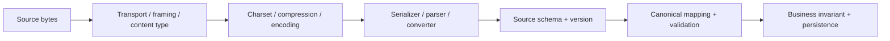
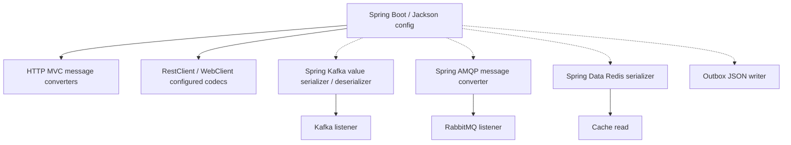
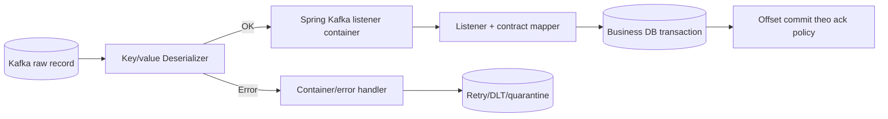
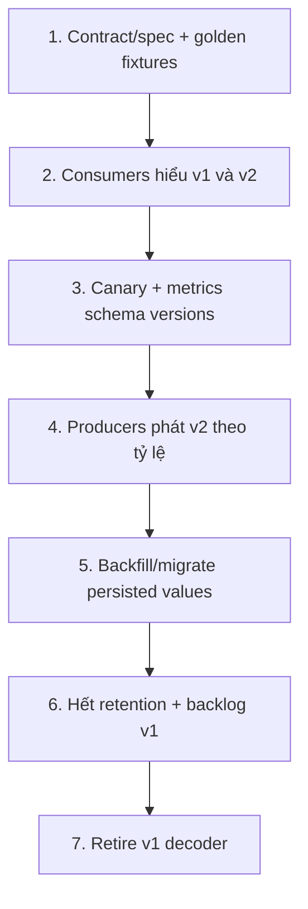
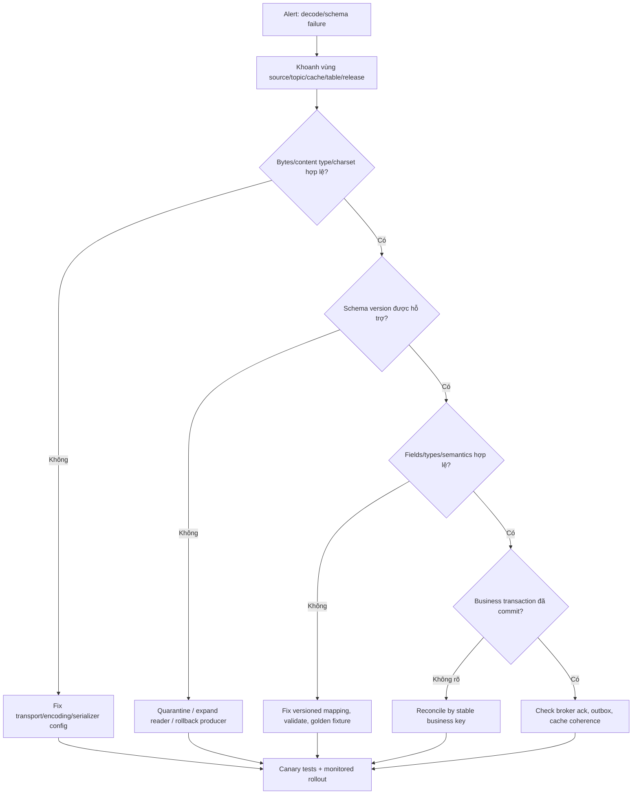

# Lỗi serializer, sai schema và không tương thích hợp đồng dữ liệu

Một bản phát hành Spring Boot có thể khởi động thành công, health check xanh và vẫn gây lỗi khi đọc dữ liệu do phiên bản trước ghi ra. REST controller bắt đầu trả HTTP 400 vì một trường JSON mới; Redis cache tồn tại nhưng `@Cacheable` không đọc được; Kafka consumer dừng ở một offset vì message cũ chứa tên Java class không còn tồn tại; hay một cột PostgreSQL đổi kiểu làm Hibernate mapping thất bại. Các biểu hiện có vẻ độc lập, nhưng thường cùng xuất phát từ **hợp đồng dữ liệu giữa bên ghi và bên đọc đã thay đổi mà chưa có kế hoạch tương thích**.

Bài này thuộc chương **Gỡ lỗi và nâng cấp** của **SPRING_BOOT_INTEGRATION**. Trong một hệ thống tích hợp qua HTTP client, cơ sở dữ liệu, cache, broker thông điệp và các adapter Spring Integration, ta cần phân biệt chính xác **bytes/encoding, serializer, schema, validation và ngữ nghĩa nghiệp vụ**, sau đó xử lý lỗi tại đúng boundary. Trọng tâm không phải “bật ignore unknown fields cho chạy lại”, mà là bảo vệ dữ liệu, transaction, idempotency, khả năng replay và quy trình rollout/rollback khi nhiều phiên bản ứng dụng cùng hoạt động.

> Ví dụ dùng Java 17+, Spring Boot 3.x, Spring Framework 6.x, Jackson 2.x, Spring Kafka/AMQP, Spring Data Redis và Jakarta Bean Validation. Cấu hình/API chi tiết phụ thuộc phiên bản BOM và adapter đang chạy; không sao chép tên property của một thư viện sang adapter khác mà chưa kiểm tra. Tên đối tác, ID và payload dưới đây là **dữ liệu minh họa**, không phải hợp đồng production có sẵn.

## 1. Mục tiêu học tập và câu hỏi phải trả lời khi có sự cố

Sau bài này, bạn có thể:

1. Phân biệt lỗi **transport, framing, encoding, deserialization, schema, validation, semantic mapping và persistence** thay vì gộp tất cả là “JSON sai”.
2. Xác định **producer, consumer, topic/cache/table, schema version và thời điểm triển khai** để khoanh vùng lỗi giữa các service Spring Boot.
3. Chẩn đoán các lỗi thường gặp của Jackson: `MismatchedInputException`, `UnrecognizedPropertyException`, module Java Time, enum, `BigDecimal`, polymorphic typing và thay đổi DTO.
4. Nhận diện lỗi schema/serializer của XML/SOAP, CSV, Kafka/RabbitMQ, Redis, JDBC/JPA/MongoDB và Spring Integration message converters.
5. Thiết kế **versioned contract, strict validation, upcaster và fallback** cho dữ liệu v1/v2 mà không tự đoán giá trị hoặc gây silent corruption.
6. Phân loại lỗi nào **retry được**, lỗi nào phải đưa tới dead-letter/quarantine, và thời điểm nào được ack hoặc commit offset.
7. Áp dụng quy trình **expand → migrate → contract**, rolling deployment, canary, rollback và đối soát khi producers/consumers nâng cấp lệch nhịp.
8. Viết golden contract tests, integration/fault-injection tests và runbook có metric, trace, alert cùng cách cô lập dữ liệu nhạy cảm.

## 2. Năm tầng tương thích cần kiểm tra trước khi sửa code

“Có thể đọc được” là kết quả của nhiều tầng, không phải tính chất duy nhất của JSON hoặc Java class.



| Tầng | Ví dụ lỗi | Phương pháp kiểm chứng |
| --- | --- | --- |
| Transport/framing | HTTP gửi `Content-Type: application/xml` nhưng body JSON; Kafka record bị nén sai; file CSV đọc thiếu chunk | Kiểm tra protocol headers, content length, compression, media type và raw byte length. |
| Encoding/bytes | UTF-8 đọc bằng charset khác; gzip bytes bị coi là JSON; Redis key được JDK serialize thay vì UTF-8 | So bytes/hex ở môi trường bảo mật, charset/BOM, serializer và Redis type. |
| Cú pháp/parser | JSON thiếu dấu ngoặc; XML malformed; CSV quote không đóng | Parser exception và vị trí offset/line/column; kiểm tra golden fixture. |
| Schema/kiểu | Field đổi tên, string → object, enum mới, Avro reader/writer schema không tương thích | Schema version, field type, validation và compatibility policy. |
| Ngữ nghĩa nghiệp vụ | `amount` đổi từ decimal major units sang integer minor units; `SETTLED` nay có nghĩa khác; timestamp thiếu timezone | So contract/spec nguồn, rule version và invariant, không chỉ so JSON syntax. |

**Lưu ý:** một object được Jackson deserialize không có exception **chưa chắc hợp lệ**. Chẳng hạn DTO v2 có `status=null` vì payload v1 còn tên `state`. Nếu service coi `null` là `NEW` hoặc phát event “đã thanh toán” với số tiền sai đơn vị, hệ thống có thể gây lỗi nghiêm trọng hơn HTTP 400.

### 2.1. Chẩn đoán từ đầu ra trước, không từ giả thuyết

```text
HTTP request 400?
  -> kiểm tra Content-Type -> bytes/charset -> JSON/XML parser
  -> DTO mapping -> Bean Validation -> domain validation

Kafka consumer retry mãi cùng record?
  -> serializer/header/schema registry -> deserializer trước listener?
  -> listener mapping -> DB transaction -> ack/offset/error handler

Redis GET trả null dù CLI thấy key?
  -> cùng Redis logical DB/topology?
  -> key bytes/key serializer đúng?
  -> TTL/expiration/eviction? -> value deserializer?

JPA sau nâng cấp báo "column/type mismatch"?
  -> DB migration thật -> schema/driver/dialect
  -> entity mapping/converter -> historical rows/nullability
```

Một quan sát đơn lẻ như `HttpMessageNotReadableException` chưa đủ kết luận producer sai. Có thể là consumer đang dùng schema cũ, ObjectMapper đổi module/cấu hình hoặc reverse proxy đã đổi `Content-Type`. Luôn lưu **bằng chứng tối thiểu** trước khi áp “fix” toàn cục.

## 3. Phân loại lỗi theo dấu hiệu: tránh xử lý sai tầng

| Triệu chứng | Lớp lỗi thường gặp | Không nên làm |
| --- | --- | --- |
| `JsonParseException` hoặc `JsonEOFException` | JSON cú pháp/truncated bytes | Retry vô hạn cùng payload độc hại/bị cắt. |
| `MismatchedInputException` | JSON token type không khớp Java type | Bật mọi coercion để biến object/array thành string. |
| `UnrecognizedPropertyException` | Producer thêm field, consumer strict | Bỏ strict toàn hệ không kiểm soát contract. |
| `InvalidFormatException` cho enum/time | Giá trị không nằm trong vocabulary/format được chấp nhận | Map mọi unknown status thành `PAID`/`NEW`. |
| `InvalidDefinitionException` | Java DTO/module/creator không phù hợp | Đổ lỗi hết cho producer khi app thiếu Jackson module. |
| `ClassCastException`/`LinkedHashMap cannot be cast` | Deserializer mất type hoặc dùng generic map | Cast tùy tiện, không validate field/identity. |
| `InvalidClassException`/`ClassNotFoundException` khi đọc Redis | Legacy Java serialization gắn class/package/serialVersionUID | Bật Java deserialization cho bytes không tin cậy. |
| Kafka `SerializationException`/`RecordDeserializationException` | Failure trước khi listener nhận payload | Chỉ thêm `try/catch` trong `@KafkaListener` rồi hy vọng bắt được. |
| Rabbit message conversion failure | Content type/type header/JSON mapper khác producer | Requeue poison message mãi. |
| Redis `WRONGTYPE` | Key dùng String nhưng command áp Hash/List/Stream | Ép bytes qua JSON parser. |
| SQL `DataIntegrityViolationException` | Constraint/column/schema drift hoặc business conflict | Retry như lỗi transient không xem constraint name. |
| Consumer chạy mà dữ liệu sai tiền | Semantic contract mismatch dù parse thành công | Chỉ kiểm tra “deserialize returns non-null”. |
| Cache hit giảm đột biến sau rollout | Key prefix/serializer thay đổi, cache v2 lạnh | Dọn toàn Redis hoặc tăng pool ngay. |

**Vị trí ném exception ảnh hưởng cách phục hồi.** Nếu lỗi xảy ra **trước Kafka listener**, listener `try/catch` không giúp gì; nếu lỗi xảy ra **sau SQL commit nhưng trước offset commit**, retry sẽ chạy lại nghiệp vụ và cần idempotency. Nếu lỗi chỉ là “không đọc được cache cũ”, policy có thể là bounded refetch từ database — không nhất thiết dừng cả HTTP endpoint.

## 4. Tình huống xuyên suốt: một đơn hàng qua ba phiên bản

Giả sử ứng dụng nhận event từ đối tác và chuẩn hóa trước khi ghi PostgreSQL, Redis và broker.

**JSON producer v1:**

```json
{
  "eventId": "evt-42",
  "orderId": "ORD-42",
  "state": "PAID",
  "total": "125.00",
  "currency": "USD",
  "occurredAt": "2026-11-20T10:30:00Z"
}
```

**JSON producer v2:**

```json
{
  "schemaVersion": 2,
  "eventId": "evt-42",
  "orderId": "ORD-42",
  "status": "PAID",
  "amount": "125.00",
  "currency": "USD",
  "occurredAt": "2026-11-20T17:30:00+07:00"
}
```

**JSON producer v3 — thay đổi ngữ nghĩa:**

```json
{
  "schemaVersion": 3,
  "eventId": "evt-42",
  "orderId": "ORD-42",
  "status": "PAID",
  "amountMinor": 12500,
  "currency": "USD",
  "occurredAtEpochMillis": 1795170600000
}
```

Trong v1 và v2, `125.00 USD` có cùng giá trị và hai ISO-8601 timestamps **cùng một thời điểm**. Trong v3, `amountMinor=12500` có thể là 125 USD nếu **hợp đồng nguồn chính thức quy định minor units**. Tuy vậy không được chỉ đổi tên `amountMinor` thành `amount`: nếu nhầm đơn vị, hệ thống có thể nhân số tiền 100 lần. Tương tự, `occurredAtEpochMillis` chỉ được parse khi biết chắc đây là **milliseconds**, không phải seconds hoặc local time.

### 4.1. Ma trận tương thích theo phía đọc và phía ghi

| Writer | Reader | Khả năng đọc | Nguy cơ |
| --- | --- | --- | --- |
| v1 | v1 | Có, nếu cùng serializer | Không có trường `schemaVersion`, cần phân biệt legacy key/topic. |
| v1 | v2 | Chỉ khi v2 có legacy parser/upcaster | `state`/`total` có thể thành null nếu map thẳng vào v2 DTO. |
| v2 | v1 | Không mặc định | v1 không biết `status`/`amount` và field mới. |
| v2 | v2 | Có nếu schema/semantic được giữ | Phải validate money/time/ID. |
| v3 | v2 | **Không** theo ví dụ | Unit/time format đã đổi. |
| v3 | v3 | Có theo contract v3 | Vẫn cần kiểm tra version, currency fraction và timestamp range. |

**Trường hợp v1 không mang version** chỉ được xác định là v1 khi có bằng chứng từ topic, endpoint, Redis key prefix hoặc producer contract **đáng tin cậy**. Không cho mọi JSON thiếu version tự động vào v1 mapper trên một kênh có nhiều loại message.

### 4.2. Một lỗi kỹ thuật và một lỗi semantic khác nhau

```java
public record OrderV2(
        int schemaVersion,
        String eventId,
        String orderId,
        String status,
        java.math.BigDecimal amount,
        String currency,
        java.time.Instant occurredAt) {}
```

Nếu deserialize JSON v1 thẳng vào `OrderV2` trong một cấu hình cho phép unknown fields và missing fields, Java có thể tạo object với `schemaVersion=0`, `status=null`, `amount=null`. Không có exception nghĩa là **parse/mapping cho phép default values**, không nghĩa là event đúng. Phải kiểm tra version và required fields, không chỉ dựa vào constructor của record.

## 5. Thu thập bằng chứng an toàn trước khi khắc phục

Với production incident, bước đầu tiên là giữ thông tin đủ để tái tạo lỗi nhưng **không đổ payload nhạy cảm vào log công khai**.

### 5.1. Bộ bằng chứng tối thiểu

| Thông tin | Ví dụ | Vì sao cần |
| --- | --- | --- |
| Nguồn và kênh | `partner-A/http-orders`, Kafka topic, Redis keyspace | Xác định đúng producer/serializer owner. |
| Producer/consumer release | `orders-ingestor 2.4` → `orders-projection 3.1` | Tìm lần deploy gây đổi contract. |
| Contract/schema version | `orders-v2`, schema registry ID, XSD version | Chọn parser/upcaster đúng. |
| Content type/encoding | `application/json; charset=UTF-8`, gzip, Avro header | Loại trừ lỗi bytes/transport. |
| Lỗi và pha xảy ra | `DECODE`, `VALIDATE`, `DB_COMMIT`, `PUBLISH` | Retry/ack phụ thuộc điểm lỗi. |
| Vị trí message | Kafka partition/offset, Rabbit delivery tag, file ID/line | Phục vụ replay/quarantine theo nguồn. |
| Correlation/business event ID | `trace-123`, `evt-42` đã redacted theo policy | Đối soát retry và duplicate. |
| Hash/checksum + secure payload reference | `sha256(...)`, kho kiểm soát quyền | Tái hiện bytes mà không log raw PII. |

Khi có HTTP webhook ký HMAC, cần giữ **raw body bytes để verify chữ ký trước mọi normalization**; đừng trim whitespace, đổi charset hoặc sắp xếp JSON fields trước verify vì có thể làm chữ ký sai. Còn checksum semantic dùng cho idempotency có thể dựa trên canonical representation đã version hóa — **hai loại hash không thay thế nhau**.

### 5.2. Log có cấu trúc, không lộ dữ liệu

```text
component=orders_ingestor
boundary=kafka_value_deserializer
source=partner-a
contract_version=2
error_category=SCHEMA_MISMATCH
error_code=EXPECTED_DECIMAL_STRING
topic=orders.inbound
partition=3
offset=9182
consumer_release=3.1
correlation_id=trace-123
payload_ref=secure-quarantine-item-392
```

Tránh log raw JWT, password, số thẻ, email, toàn request/XML/CSV hoặc Kafka headers chứa token. Trong metrics, **không dùng offset, order ID hay event ID làm label** vì cardinality cao. Với một payload cần lưu để debug, dùng kho quarantine giới hạn quyền, mã hóa, TTL/retention, audit và quy trình redrive.

### 5.3. Những câu hỏi cần hỏi producer trước khi đổi mapper

- Producer đã công bố **schema/version** chưa? Có contract tests hay sample thực tế?
- Field mới là optional hay required? Default có ý nghĩa gì?
- Đổi type có đồng nghĩa đổi đơn vị/precision/timezone?
- Có khoảng thời gian **hai phiên bản được gửi đồng thời** không?
- Dữ liệu lịch sử có còn trong Redis, Kafka retention, outbox hoặc file archive?
- Producer và consumer có thể rollback độc lập không?
- Có trường nào được ký hoặc dùng tính idempotency hash không, nên không được normalize trước khi xác thực?

Đừng “chữa” một bên chỉ bằng cách ép consumer chấp nhận tất cả field và enum mới. Có thể producer đang thực sự vi phạm hợp đồng đã ký hoặc môi trường đã route nhầm traffic.

## 6. Jackson trong Spring Boot: một serializer hay nhiều đường đi khác nhau?

Spring Boot quản lý nhiều thành phần dựa trên Jackson, nhưng **không phải mọi adapter đều dùng cùng `ObjectMapper`**. `MappingJackson2HttpMessageConverter` trong Spring MVC, `RestClient`, `WebClient` codec, Kafka `JsonDeserializer`, RabbitMQ `Jackson2JsonMessageConverter`, Redis `RedisSerializer` và một `new ObjectMapper()` do lập trình viên tạo có thể khác **module, naming strategy, date format, unknown-field và polymorphic typing policy**.

### 6.1. Biết chính xác ai serialize và ai deserialize



Các nét đứt nhắc rằng sự thừa hưởng cấu hình **có điều kiện theo Boot version và bean wiring**, không nên tuyên bố mọi Kafka/AMQP/Redis converter tự dùng Jackson MVC mapper. Nếu một code path tạo `new ObjectMapper()`, module `JavaTimeModule` do Boot quản lý có thể không được sử dụng. Ngược lại, nếu toàn hệ cố đổi global mapper để chữa một nguồn, những nơi khác có thể bị thay đổi ngoài dự định.

### 6.2. Bốn lỗi hay nhầm trong JSON

**A. Field đổi tên**

```json
{"state":"PAID","total":"125.00"}
```

DTO v2 trông chờ `status` và `amount`. Nếu unknown-field bị ignore, `state`/`total` bị bỏ, required fields có thể thành null. Giải pháp là **version-aware mapping** hoặc `@JsonAlias` **chỉ khi** hai names có cùng semantics và caller/schema version rõ, không phải thay tên tùy tiện.

**B. JSON token đổi kiểu**

```json
{"amount":{"value":"125.00","currency":"USD"}}
```

DTO mong `String amount`. `MismatchedInputException` thể hiện schema thay đổi, không phải cứ “dùng ObjectMapper lenient hơn” là sửa được ý nghĩa.

**C. Java Time module/format**

```java
public record ScheduledOrder(
        String orderId,
        java.time.Instant occurredAt) {}
```

`Instant` cần Jackson module/config phù hợp khi dùng Jackson 2.x. JSON timestamps có thể được serialize thành ISO-8601 string hoặc numeric timestamps theo feature/settings. Nếu một producer bắt đầu gửi numeric seconds nhưng consumer hiểu milliseconds, parser có thể **không ném lỗi nhưng lệch thời gian nghiêm trọng**.

**D. Enum mới**

```json
{"status":"PARTIALLY_PAID"}
```

Một switch Java chỉ biết `NEW/PAID/CANCELLED` sẽ thất bại. Không map mọi unknown enum thành `PAID` hoặc `NEW`. Tùy hợp đồng: nâng consumer trước producer, dùng state `UNSUPPORTED`/quarantine với business behavior rõ hoặc tạo event v2.

### 6.3. Jackson annotations không thay versioned contract

| Cơ chế | Dùng cho | Cần cảnh giác |
| --- | --- | --- |
| `@JsonProperty("order_id")` | Tên field cố định theo contract | Đổi annotation là đổi JSON wire format. |
| `@JsonAlias({"order_id","orderId"})` | Nhận **aliases tương đương** trong một policy | Không giải quyết đổi đơn vị/semantic. |
| `@JsonIgnoreProperties(ignoreUnknown = true)` | Cho phép additive fields được chấp nhận | Có thể che producer gửi field quan trọng mới hoặc typo. |
| `@JsonFormat` | Format ngày/giờ/cấu trúc theo field | Không tự giải quyết timezone thiếu/DST ambiguity. |
| `@JsonCreator`/record constructor | Khởi tạo immutable DTO | Không thay Bean Validation, không tự reject mọi missing/null. |
| `@JsonTypeInfo` | Polymorphic contract đã kiểm soát | Không cho input tự chọn arbitrary Java class. |

### 6.4. Cấu hình lỗi theo boundary, không “sửa cả thế giới”

Ví dụ Boot configuration:

```yaml
spring:
  jackson:
    deserialization:
      fail-on-unknown-properties: true
    serialization:
      write-dates-as-timestamps: false
```

Đây là **chính sách minh họa** cho ứng dụng muốn strict unknown fields. Nó ảnh hưởng những Jackson components dùng mapper do Boot cấu hình, không phải mọi adapter tùy biến. Nếu một partner cho phép additive fields, dùng **source-scoped DTO/ObjectReader** hoặc schema validation của endpoint đó, thay vì tắt strict toàn bộ ứng dụng.

Với Spring Boot 3.x, Jackson integration và feature keys cần kiểm tra bằng metadata/documentation của bản đang chạy; không mặc định cấu hình tương đương giữa Spring MVC, WebFlux, Kafka và Redis. Các phiên bản thư viện mới có thể đổi constructor/serializer APIs hoặc mặc định, nên cần regression tests với **wire bytes thực**.

## 7. Thiết kế version-aware decoder để sửa tận gốc lỗi schema

Ta dùng một **canonical model** tách khỏi source JSON v1/v2. Source event chỉ có thể được đọc bởi decoder khi adapter **đã xác định version từ contract metadata đáng tin**; không thử parse nhiều lớp Java cho đến khi một lớp “có vẻ hợp”.

### 7.1. Mô hình chuẩn và lỗi contract

```java
import java.math.BigDecimal;
import java.time.Instant;

public record CanonicalOrderEvent(
        String eventId,
        String orderId,
        String status,
        BigDecimal amount,
        String currency,
        Instant occurredAt
) {}
```

```java
public final class DataContractException
        extends RuntimeException {
    public DataContractException(String message) {
        super(message);
    }

    public DataContractException(
            String message, Throwable cause) {
        super(message, cause);
    }
}
```

Mỗi top-level `public` class/record được đặt trong file Java riêng. `DataContractException` chỉ truyền **error code hoặc message an toàn**, không chứa raw JSON/XML/CSV, email, card data hoặc token. Một hệ lớn có thể thêm enum `ErrorCode`/`SourceContext` để phân biệt lỗi schema với lỗi semantic.

### 7.2. Decoder nhận v1/v2, từ chối v3 và dữ liệu sai

```java
import com.fasterxml.jackson.core.JsonProcessingException;
import com.fasterxml.jackson.databind.JsonNode;
import com.fasterxml.jackson.databind.ObjectMapper;
import java.math.BigDecimal;
import java.math.RoundingMode;
import java.time.OffsetDateTime;
import java.time.format.DateTimeParseException;
import java.util.Set;
import java.util.regex.Pattern;
import org.springframework.stereotype.Component;

@Component
public final class OrderEventDecoder {
    private static final Pattern ID =
            Pattern.compile("[A-Za-z0-9._:-]{1,128}");
    private static final Pattern AMOUNT =
            Pattern.compile("[0-9]{1,16}(?:\\.[0-9]{1,6})?");
    private static final Set<String> STATUSES =
            Set.of("NEW", "PAID", "CANCELLED");

    private final ObjectMapper mapper;

    public OrderEventDecoder(ObjectMapper mapper) {
        this.mapper = mapper;
    }

    public CanonicalOrderEvent decode(
            String json, int trustedContractVersion) {

        try {
            JsonNode root = mapper.readTree(json);
            if (root == null || !root.isObject()) {
                throw new DataContractException("ORDER_NOT_OBJECT");
            }

            String statusField;
            String amountField;
            switch (trustedContractVersion) {
                case 1 -> {
                    // Đây là legacy v1 chỉ trên kênh đã xác nhận.
                    if (root.has("schemaVersion")) {
                        throw new DataContractException(
                                "UNEXPECTED_V1_VERSION_FIELD");
                    }
                    statusField = "state";
                    amountField = "total";
                }
                case 2 -> {
                    JsonNode version = root.get("schemaVersion");
                    if (version == null || !version.isInt()
                            || version.intValue() != 2) {
                        throw new DataContractException(
                                "SCHEMA_VERSION_CONFLICT");
                    }
                    statusField = "status";
                    amountField = "amount";
                }
                default -> throw new DataContractException(
                        "UNSUPPORTED_CONTRACT_VERSION");
            }

            String status = requiredText(root, statusField);
            if (!STATUSES.contains(status)) {
                throw new DataContractException("UNKNOWN_ORDER_STATE");
            }

            String currency = requiredText(root, "currency");
            if (!"USD".equals(currency)) {
                // Bài chỉ minh họa contract USD; sản phẩm khác
                // cần bảng policy scale theo currency và use case.
                throw new DataContractException("UNSUPPORTED_CURRENCY");
            }

            String moneyText = requiredText(root, amountField);
            if (!AMOUNT.matcher(moneyText).matches()) {
                throw new DataContractException("INVALID_MONEY_FORMAT");
            }
            BigDecimal money = new BigDecimal(moneyText)
                    .setScale(2, RoundingMode.UNNECESSARY);
            if (money.signum() <= 0) {
                throw new DataContractException("INVALID_MONEY_VALUE");
            }

            var occurredAt = OffsetDateTime
                    .parse(requiredText(root, "occurredAt"))
                    .toInstant();

            return new CanonicalOrderEvent(
                    requiredId(root, "eventId"),
                    requiredId(root, "orderId"),
                    status, money, currency, occurredAt);

        } catch (JsonProcessingException
                | DateTimeParseException
                | ArithmeticException error) {
            throw new DataContractException(
                    "MALFORMED_ORDER_CONTRACT", error);
        }
    }

    private static String requiredText(JsonNode root, String field) {
        JsonNode node = root.get(field);
        if (node == null || !node.isTextual()
                || node.textValue().isBlank()) {
            throw new DataContractException(
                    "MISSING_OR_WRONG_TYPE_" + field);
        }
        return node.textValue();
    }

    private static String requiredId(JsonNode root, String field) {
        String value = requiredText(root, field);
        if (!ID.matcher(value).matches()) {
            throw new DataContractException(
                    "INVALID_ID_" + field);
        }
        return value;
    }
}
```

**Những nguyên tắc được minh họa:**

- Version là **hợp đồng nguồn**, không chỉ một trường JSON có thể tự khai báo. Với v1 thiếu version, chỉ route vào `trustedContractVersion=1` khi topic/endpoint/key-prefix/provenance được tin cậy.
- `state` → `status`, `total` → `amount` chỉ vì **v1/v2 có cùng ngữ nghĩa**; không có code đọc v3 vì v3 dùng minor units và epoch milliseconds.
- `BigDecimal` được tạo trực tiếp từ **decimal text** đã kiểm tra, không qua `double` hoặc `DoubleNode` có thể làm mất precision.
- Parser kiểm tra đúng token type, required fields, enum, currency và timestamp có offset. Nó không gán `Instant.now()` cho timestamp bị thiếu hoặc mặc định `null` thành `NEW`.
- ObjectMapper được **inject**, không sửa global mapper trong lúc hệ thống đang chạy. Các Jackson modules/config của Boot được tái sử dụng theo đúng bean.

**Giới hạn ví dụ:** decoder kiểm tra các fields bắt buộc nhưng chưa cấm field lạ/duplicate JSON keys, chưa có max-body/nesting limit và chưa dùng JSON Schema formal. Production cần thêm source-specific strict set-of-fields (nếu hợp đồng yêu cầu), duplicate-key parser setting, payload size/time limits, authentication và validation integration tests. Không coi `readTree` là cơ chế chống mọi malformed/untrusted payload.

### 7.3. Upcaster không phải phiên bản DTO cũ sống mãi trong domain

Ta có thể đặt decoder trong tầng integration adapter, trả **một** `CanonicalOrderEvent` cho business service. Khi v1 hết trong broker retention/Redis TTL và các producers cũ đã ngừng:

1. Đo tỷ lệ v1 messages và các nơi còn phát v1.
2. Xác nhận không còn lịch replay nguồn cũ cần hỗ trợ v1 (hoặc có job migration riêng).
3. Dọn v1 decoder theo plan/deprecation, giữ golden fixture để đối soát lịch sử.
4. Không xóa v1 support chỉ vì “đã deploy v2 hôm qua” nếu backlog/quarantine vẫn có payload cũ.

Nếu hai versions khác ngữ nghĩa đến mức không có phép upcast mất mát bằng 0, hãy **chấp nhận cả hai commands có type khác nhau** ở application boundary hoặc enrichment có kiểm soát, không cố ép giả một canonical event với các trường mặc định sai.

## 8. Validation sau deserialize: phân biệt null, missing, default và sai nghĩa

Java record không tự đảm bảo các trường non-null. Jackson có thể chấp nhận field missing/null theo ObjectMapper policy và tạo object không hợp lệ. `@NotNull`/`@NotBlank` là **Bean Validation**, không phải lúc nào cũng được tự kích hoạt khi gọi `ObjectMapper.readValue`.

```java
import jakarta.validation.constraints.NotBlank;
import jakarta.validation.constraints.NotNull;
import jakarta.validation.constraints.Positive;
import java.math.BigDecimal;
import java.time.Instant;

public record ValidatedOrderCommand(
        @NotBlank String eventId,
        @NotBlank String orderId,
        @NotNull @Positive BigDecimal amount,
        @NotNull Instant occurredAt
) {}
```

Ví dụ gọi validation khi tiêu thụ một message:

```java
import jakarta.validation.ConstraintViolation;
import jakarta.validation.Validator;
import java.util.Set;
import org.springframework.stereotype.Service;

@Service
public final class OrderCommandValidator {
    private final Validator validator;

    public OrderCommandValidator(Validator validator) {
        this.validator = validator;
    }

    public void requireValid(ValidatedOrderCommand command) {
        Set<ConstraintViolation<ValidatedOrderCommand>> errors =
                validator.validate(command);
        if (!errors.isEmpty()) {
            // Log field names/error codes có kiểm soát,
            // không trả toàn invalid values chứa PII.
            throw new DataContractException("BEAN_VALIDATION_FAILED");
        }
    }
}
```

Với Spring MVC, `@Valid @RequestBody` chạy validation khi endpoint được cấu hình phù hợp; trong Kafka listener/Redis cache/file poller, framework **không tự chạy MVC validation**. Phải gọi tại đúng boundary hoặc qua cơ chế method validation/validator được cấu hình. Đừng chỉ đặt annotations lên DTO rồi tin mọi adapter đã an toàn.

### 8.1. Missing khác explicit null trong PATCH

```json
{}
```

```json
{"shippingAddress":null}
```

Nếu endpoint là PATCH, trường **không xuất hiện** có thể nghĩa “giữ nguyên”, còn `null` nghĩa “xóa”. Một `record Patch(String shippingAddress)` có thể không giữ được khác biệt nếu parser map cả hai thành `null`. Dùng JSON field-presence model/`JsonNode`/wrapper có trạng thái **ABSENT/PRESENT_NULL/PRESENT_VALUE** và test từng trường hợp; đừng xử lý null như missing ở mọi API.

### 8.2. Silent coercion đặc biệt nguy hiểm với tiền và thời gian

```text
amount="125.00"   -> decimal major units USD
amount=12500      -> có thể là minor units, KHÔNG tương đương
occurredAt=1795170600     -> có thể epoch seconds
occurredAt=1795170600000  -> có thể epoch milliseconds
occurredAt="2026-11-20 10:30" -> thiếu timezone
```

Không suy unit từ độ dài số nếu protocol chưa quy định; nhiều giá trị epoch plausible ở cả hai scales và một hệ thống có thể có timestamps ngoài dải thông thường. Parse theo **source contract**, dùng `Instant`/`OffsetDateTime` với timezone/offset rõ, kiểm tra khoảng hợp lệ và quy tắc DST nếu nguồn gửi local time.

### 8.3. Giá trị unknown enum: reject hay hỗ trợ?

Nếu hợp đồng cho phép consumer mới bỏ qua events không ảnh hưởng logic, có thể đưa vào **UNSUPPORTED/quarantine** hoặc dùng một `UNKNOWN` state mang nghĩa riêng. Nhưng với order payment, không được dùng `UNKNOWN` như `PAID` để tiếp tục ship hàng. Khi producer thêm trạng thái `PARTIALLY_PAID`, cần kiểm tra mọi consumer (analytics, order orchestration, refund, cache) trước khi bật producer. Enum là một phần **ngữ nghĩa hợp đồng**, không chỉ cú pháp JSON.

## 9. XML/SOAP: namespace, XSD, parser security và lỗi chuyển đổi

Một SOAP integration có thể có HTTP 200 nhưng body chứa **SOAP Fault**, hoặc HTTP 500 với một Fault cấu trúc chuẩn. Không thể coi mỗi XML document parse được là một business response thành công.

### 9.1. Lỗi XML thường gặp khi nâng cấp

| Triệu chứng | Nguyên nhân | Chẩn đoán đúng |
| --- | --- | --- |
| JAXB/Jackson XML field `null` dù element có giá trị | Namespace URI/prefix hoặc element local name thay đổi | So namespace URI/XSD, không chỉ đọc tên tag trên console. |
| `UnmarshalException` | XSD/schema/class binding lệch | So SOAP/WSDL/XSD version và XML thực của đối tác. |
| SOAP Fault bị coi như success | Chỉ parse body payload, không nhận biết Fault | SOAP Fault handling riêng; phân loại business/system fault. |
| XML entity/DTD lạ làm parser truy cập URL/file | DTD/external entity resolution chưa khóa | Disable XXE, validate parser provider, test payload độc hại. |
| Ký số WS-Security sai sau middleware | Raw XML/namespace/canonicalization bị sửa | Verify signature theo WS-Security trước khi chấp nhận payload. |
| Nâng JDK khiến XML parser khác behavior | XMLInputFactory/JAXB impl hoặc default limits đổi | Pin library/provider phù hợp, regression tests. |

Ví dụ cùng tên `OrderId` nhưng namespace khác:

```xml
<a:OrderId xmlns:a="urn:partner:order:v1">ORD-42</a:OrderId>
```

```xml
<b:OrderId xmlns:b="urn:partner:order:v2">ORD-42</b:OrderId>
```

Đây là **hai qualified names khác nhau** trong XML; tên prefix `a` hay `b` tự nó không quan trọng, nhưng **namespace URI** có thể là một breaking contract change. Không bỏ namespace validation chỉ để “đọc được mọi tài liệu”: điều đó có thể dẫn đến nhận nhầm nội dung ở vùng XML không mong muốn.

### 9.2. XML parser phải chống external entities/DTD

Khi nhận XML chưa tin cậy, StAX factory cần được cấu hình an toàn trước khi parser đọc bytes:

```java
import javax.xml.stream.XMLInputFactory;

XMLInputFactory factory = XMLInputFactory.newFactory();
factory.setProperty(XMLInputFactory.SUPPORT_DTD, false);
factory.setProperty(
        XMLInputFactory.IS_SUPPORTING_EXTERNAL_ENTITIES, false);
```

Với provider cụ thể, cần **kiểm tra properties thực được hỗ trợ**; nếu policy bảo mật không thể thực thi, fail closed và dùng parser/provider phù hợp. Còn cần giới hạn bytes, depth, entity expansion, number of nodes và thời gian parse. Dùng thư viện SOAP/Spring Web Services đúng để xác thực envelope, namespace, SOAP Header, Fault và WS-Security; `XmlMapper` của Jackson chỉ làm mapping XML, **không tự verify chữ ký SOAP**.

### 9.3. Khi thay XSD/WSDL

Quy trình an toàn:

1. Lưu fixtures của WSDL/XSD cũ và mới, đối chiếu namespaces, required/optional elements, `nillable`, enumeration và type restrictions.
2. Tạo/generated bindings theo version riêng nếu thay đổi breaking; không ghi đè generated class cũ khi backlog vẫn chứa payload v1.
3. Kiểm thử `xsi:nil="true"`, missing element và empty element — ba tình huống có thể mang nghĩa khác nhau.
4. Verify security/trust/signature trước khi normalize nội dung đã ký.
5. Phân loại SOAP Fault (business reject vs transient service unavailable), không retry tất cả.
6. Duy trì compatibility window theo đối tác và dừng support version cũ sau khi xác nhận đã hết các message cần replay.

## 10. CSV và file import: schema còn gồm header, thứ tự, charset và quoting

Một file CSV có thể hoàn toàn hợp lệ về cú pháp nhưng **sai hợp đồng dữ liệu**. Ví dụ hệ thống cũ:

```csv
event_id,order_no,amount,currency,state
evt-42,ORD-42,125.00,USD,S
```

Sau upgrade, producer đổi thứ tự:

```csv
order_no,event_id,currency,amount,state
ORD-42,evt-42,USD,125.00,S
```

Nếu consumer đọc cột theo **vị trí cứng** thay vì validate header, việc chuyển thứ tự có thể khiến orderId nhận giá trị event ID mà parser không báo lỗi. Nếu header có ý nghĩa theo tên, parser cần map theo tên và kiểm tra duplicate/missing/unknown header theo chính sách.

### 10.1. Không dùng `split(",")` làm CSV parser

```csv
event_id,order_no,customer_name,amount
evt-42,"ORD,42","Nguyễn Văn A",125.00
```

`"ORD,42"` là một field. Một tên chứa dấu phẩy hoặc newline trong quoted field cũng hợp lệ theo nhiều dialect CSV. Sử dụng Jackson CSV/Apache Commons CSV/parser phù hợp, khai báo delimiter/quote/escape/header/charset. Nguồn không công bố delimiter hoặc decimal separator thì phải **xác minh hợp đồng**, không tự đoán từ locale server.

### 10.2. Các lỗi file rất dễ biến thành silent corruption

| Thay đổi | Failure mode | Phòng vệ |
| --- | --- | --- |
| UTF-8 → encoding legacy | Chữ tiếng Việt bị biến dạng hoặc parser thay bằng replacement char | Charset quy định theo nguồn, reject invalid bytes khi cần. |
| Decimal dot → comma | `125,50` có thể bị split hoặc parse sai | Contract locale, parser decimal text tường minh. |
| Thêm cột `discount` | Đọc positional columns bị lệch | Header schema/version, contract tests. |
| Header trùng tên | Map bị overwrite hoặc giữ field sai | Reject duplicate headers. |
| Bỏ leading zeros | `00042` thành `42` | Giữ identifier là text, không parse số. |
| File upload lại | Row được xử lý hai lần | File ID/checksum + per-record inbox/business key. |
| Thêm newline/quote trong field | `split` chia nhầm record | CSV parser thực và test multiline. |
| Spreadsheet export có formula | Cell bắt đầu `=`/`+`/`-`/`@` chạy như công thức khi mở | Export-specific formula escaping, không làm biến dạng canonical input. |

Đối với import file lớn, dùng streaming/chunking, giới hạn file/record/field sizes và checkpoint gắn với **transaction đã commit**. Nếu parser fail ở dòng 42, ghi quarantine context (file ID, schema version, record number) thay vì chỉ ném “IndexOutOfBoundsException”; nếu crash sau dòng 41, hệ thống phải replay chịu được duplicate. Không sửa lỗi file bằng `Files.readAllLines`/`collectList()` cho file hàng GB.

## 11. Avro, Protobuf và schema registry: binary hợp lệ vẫn có thể không đọc được

Không phải mọi message là JSON text. Kafka/RabbitMQ hoặc lưu trữ file có thể dùng **Avro, Protobuf, JSON Schema, CBOR hoặc format riêng**. Với binary schema, thông tin **writer schema**, **reader schema**, schema ID và framing bytes của serializer phải được phối hợp.

### 11.1. Tình huống với Avro

Producer v1:

```json
{
  "type": "record",
  "name": "OrderPaid",
  "namespace": "example.contracts",
  "fields": [
    {"name": "eventId", "type": "string"},
    {"name": "amount", "type": "string"}
  ]
}
```

Producer v2 thêm một field:

```json
{"name":"currency","type":"string","default":"USD"}
```

Avro schema resolution/defaults có thể cho phép một số thay đổi theo hướng đọc/ghi, **nhưng chiều tương thích phải được kiểm tra trên reader/writer versions thực**. Nếu v1 data không có currency, default `USD` chỉ an toàn khi business contract cũ bảo đảm *mọi* order v1 đều bằng USD. Nếu không, schema kỹ thuật có thể tương thích nhưng **ngữ nghĩa sai**.

### 11.2. Protobuf: field numbers là một phần hợp đồng

```protobuf
syntax = "proto3";

message OrderPaidV1 {
  string event_id = 1;
  string order_id = 2;
  string amount_decimal = 3;
}
```

Không tái sử dụng field number 3 cho kiểu/ý nghĩa khác chỉ vì đổi tên property trong Java. Khi bỏ field, cân nhắc **reserve field number/name** theo quy tắc Protobuf; khi thêm enum giá trị mới, kiểm tra consumer cũ xử lý giá trị không biết ra sao. Các yêu cầu về field presence/default trong proto3 khác JSON null/missing và thay đổi qua các tính năng/version; cần golden binary fixtures, không chỉ test object equality.

### 11.3. Registry compatibility không thay business review

| Chính sách/đối tượng | Đảm bảo được phần nào | Không bảo đảm |
| --- | --- | --- |
| Backward schema compatibility | New reader có thể đọc một số older writer payloads | Money/time semantic không đổi. |
| Forward schema compatibility | Older readers có thể đọc một số new writer payloads | Unknown enum không kích hoạt logic nguy hiểm. |
| Full compatibility | Các kiểm tra cả hai hướng theo registry policy | Tất cả historical data và downstream side effects đúng. |
| Schema ID trong message | Consumer tìm được writer schema nếu registry/wire protocol đúng | Producer đã xác thực hoặc nội dung được cấp quyền. |
| Semantic version trong business event | Gợi ý hợp đồng ngữ nghĩa | Không tự áp validation/upcasting. |

Các registry dùng khái niệm compatibility/transitive/subject naming khác nhau. Kiểm tra đúng provider, framing protocol, serializer config và subject/version policy. **Không tự map schema ID thành Java class tùy ý từ untrusted header**, và không nghĩ một broker gửi bytes thành công nghĩa consumer đã hiểu bytes.

## 12. Redis: lỗi key serializer, value serializer và cache schema cũ

Redis giữ **raw bytes**, còn Java object cần key/value codec. Khi nâng Spring Boot/Spring Data Redis, một app có thể chuyển từ `JdkSerializationRedisSerializer` sang JSON typed serializer; Redis không tự đổi những bytes đã lưu. Một `RedisTemplate` config mới **không** làm key cũ được mã hóa lại.

### 12.1. Triệu chứng cần phân biệt

| Triệu chứng | Nguyên nhân khả dĩ | Cách xác minh |
| --- | --- | --- |
| `GET` từ app trả `null`, CLI vẫn thấy dữ liệu | Key serializer khác; prefix/version/DB index thay đổi; key đã expire | So key bytes và Redis database/topology/TTL. |
| Key tìm thấy nhưng `SerializationException` | Value v1 JDK bytes, v2 JSON; schema version lạ | So raw value format ở môi trường an toàn, codec version. |
| `InvalidClassException` | Java native serialization gắn class/`serialVersionUID` | Chỉ migration trong môi trường tin cậy, không bật deserialize bừa. |
| `ClassCastException LinkedHashMap` | Generic JSON type info không đúng | Typed DTO serializer/explicit mapping, test round trip. |
| `WRONGTYPE Operation against a key` | Redis key đang là Hash/List/Stream, code gọi String ops | Redis `TYPE`, key namespace/version. |
| `@Cacheable` ghi JSON khác `RedisTemplate` | Cache manager có serialization config riêng | Kiểm tra `RedisCacheManager` và raw bytes. |
| Redis `INCR` thất bại | Counter bị ghi như JSON/JDK object, không phải numeric string | Tách keyspace/serializer cho counter. |

### 12.2. Mỗi Redis API có thể sở hữu codec khác nhau

Một DTO cache chỉ chứa các trường được công bố:

```java
import java.math.BigDecimal;
import java.time.Instant;

public record OrderCacheV2(
        int schemaVersion,
        String orderId,
        String status,
        BigDecimal amount,
        String currency,
        Instant updatedAt
) {}
```

DTO cần nằm trong file `OrderCacheV2.java`, tách khỏi persistence entity và HTTP response DTO.

```java
import org.springframework.data.redis.connection.RedisConnectionFactory;
import org.springframework.data.redis.core.RedisTemplate;
import org.springframework.data.redis.serializer.StringRedisSerializer;
import org.springframework.data.redis.serializer.Jackson2JsonRedisSerializer;
import org.springframework.context.annotation.Bean;
import org.springframework.context.annotation.Configuration;

@Configuration(proxyBeanMethods = false)
public class OrderRedisConfig {
    @Bean("orderV2Template")
    RedisTemplate<String, OrderCacheV2> orderV2Template(
            RedisConnectionFactory factory,
            com.fasterxml.jackson.databind.ObjectMapper mapper) {

        var text = new StringRedisSerializer();
        var json = new Jackson2JsonRedisSerializer<>(
                mapper, OrderCacheV2.class);

        RedisTemplate<String, OrderCacheV2> template =
                new RedisTemplate<>();
        template.setConnectionFactory(factory);
        template.setKeySerializer(text);
        template.setValueSerializer(json);
        template.setHashKeySerializer(text);
        template.setHashValueSerializer(json);
        template.afterPropertiesSet();
        return template;
    }
}
```

`OrderCacheV2` là **DTO cache ứng dụng**, cần thêm validation cho `schemaVersion`/ID/status/amount/currency khi đọc. Spring quản lý `OrderRedisConfig` như một configuration bean; các top-level public types cần đặt ở file Java riêng. Với Redis Hash, field name và field value có serializer riêng; với `@Cacheable`, `RedisCacheManager` cần cấu hình **`RedisCacheConfiguration`**, không tự lấy serializer từ template ở trên.

### 12.3. Phục hồi cache cũ an toàn

Ba phương án:

1. **Key namespace versioned**: `cache:order:v1:...` và `cache:order:v2:...`. App v2 đọc v2, miss thì refill từ database; an toàn khi cache **tái tạo được**, nhưng cần kiểm soát stampede.
2. **Dual-read + upcast**: v2 đọc key v2, miss mới đọc v1 bằng legacy codec có giới hạn, map sang v2. Nếu v1 key gần hết TTL, không copy value cũ sang v2 với TTL dài hơn một cách mù quáng.
3. **Offline migration**: chạy process riêng cho legacy binary/JDK serialization trong môi trường tin cậy, chuyển sang format mới, quan sát kết quả rồi retire reader cũ.

Không xóa mọi Redis key bằng `FLUSHDB`/`FLUSHALL` chỉ để chữa serializer mismatch, vì Redis có thể đang chứa lock, session, rate limiter hoặc integration state của dịch vụ khác. Với Redis Cluster, `SCAN`/migration đa key phải xét shards/hash slots và không coi cross-slot Lua/transaction là atomic.

**Cache không phải DB transaction log.** Khi consumer bị replay, không dùng Redis `processed=true` có TTL ngắn làm bằng chứng duy nhất rằng payment/order update đã commit. Dùng durable inbox/unique key ở database nguồn sự thật để chống duplicate.

## 13. Kafka: khi lỗi deserialize xảy ra trước `@KafkaListener`

Một tình huống nguy hiểm: producer đổi `type header`, JSON schema hoặc Avro serializer; Kafka record đã được broker nhận thành công, nhưng consumer không deserialize được value. Listener có thể **chưa hề được gọi**, nên một `try/catch` trong method annotated `@KafkaListener` không đủ xử lý.

### 13.1. Pipeline và điểm commit offset



Những khái niệm thường bị lẫn:

- **Kafka broker serialization:** broker lưu bytes; nó không biết Java DTO hoặc business JSON schema có đúng không.
- **Consumer deserializer:** có thể đọc bytes thành một object, nhưng object vẫn cần version/semantic validation.
- **Listener adapter/message converter:** có thể có thêm một bước conversion/validation sau Kafka `Deserializer`.
- **Business transaction:** nơi update DB/inbox/outbox; không tự atomic với Kafka offset commit.
- **Ack/offset:** thể hiện vị trí consumer đã xác nhận, không tự đảm bảo downstream Redis/cache/HTTP completed.

### 13.2. `ErrorHandlingDeserializer` và lỗi poison record

Spring Kafka cung cấp `ErrorHandlingDeserializer` để chuyển deserialization failure vào đường xử lý của listener container/error handler phù hợp. Một cấu hình minh họa cho Kafka value JSON:

```yaml
spring:
  kafka:
    consumer:
      key-deserializer: org.apache.kafka.common.serialization.StringDeserializer
      value-deserializer: org.springframework.kafka.support.serializer.ErrorHandlingDeserializer
      properties:
        spring.deserializer.value.delegate.class: org.springframework.kafka.support.serializer.JsonDeserializer
        spring.json.trusted.packages: com.example.integration.contracts
        spring.json.value.default.type: com.example.integration.contracts.OrderInboundEnvelopeV1
```

Các class/type names trong ví dụ là **placeholder package của một dự án** và cần thay bằng DTO thực, kèm BOM/Kafka version tương thích. `trusted.packages` là **giới hạn type resolution**, không thay consumer authentication/topic ACL, và không nên dùng `*` như một cách chữa lỗi type header không hợp lệ. Với nhiều event types/schema versions, đừng ép một default Java type lên mọi record; hãy xác định envelope/header discriminator được kiểm soát hoặc chọn một value deserializer theo topic/contract.

**Quan trọng:** `ErrorHandlingDeserializer` chỉ xử lý những lỗi ở **delegate deserializer** theo semantics Spring Kafka; nó không tự đánh dấu mọi Bean Validation/domain violation là non-retryable. Tùy Spring Kafka version, listener container, record/batch mode và error handler config, failed value có thể được đại diện bằng exception header và payload raw, cần được gửi DLT với serializer phù hợp. **Test bằng một record thật có bytes hỏng**, không chỉ mock listener ném exception.

### 13.3. DLT khi deserialization failure và KafkaTemplate serializer

Nếu record gốc là một `byte[]` không deserialize được, DLT publisher phải biết **serialize bytes theo đúng ý định**. Một producer mặc định chỉ nhận JSON DTO có thể không publish lại raw corrupt bytes. Khi dùng `DeadLetterPublishingRecoverer`, cấu hình producer cho DLT (hoặc routing template theo type) phù hợp với failed raw value; đồng thời quản lý headers/error details không lộ bí mật.

Pseudo-workflow:

```text
Record bytes -> EHD(delegate JSON) failure
  -> Container error handler
     -> classify: corrupt schema / transient downstream / unknown
     -> publish to DLT safely + wait for required confirmation
     -> commit/skips source offset only under configured success policy
```

Không commit source offset rồi mới “cố” publish DLT theo fire-and-forget nếu SLA yêu cầu không mất dữ liệu. Ngược lại, nếu DLT không khả dụng, một poison record có thể chặn partition: cần vận hành alert, retry budget và điều kiện dừng/parking lot rõ ràng.

### 13.4. Business consumer và idempotency

Giả sử listener nhận event hợp lệ, ghi PostgreSQL thành công nhưng crash **trước Kafka offset commit**. Kafka có thể giao lại record. Vì vậy:

```text
eventId = evt-42
consumerScope = order-projection-v2
inbox key = (consumerScope, eventId)

BEGIN DB TRANSACTION
  INSERT inbox key ON CONFLICT DO NOTHING
  IF claim successful:
      validate state transition / version
      UPSERT projection
      INSERT outbox event if needed
COMMIT

Only then follow the configured ack/offset policy.
```

Kafka `exactly_once_v2`/producer transactions (nếu bật) có semantics cụ thể **trong hệ Kafka**, không tự biến transaction PostgreSQL và Redis SET thành một commit nguyên tử. Nếu duplicate event ID có **payload khác**, đó là identity contract conflict cần audit/quarantine, không chỉ bỏ qua như replay hợp lệ.

### 13.5. Schema Registry migration

Khi đổi Avro/Protobuf serializer hoặc subject naming strategy, consumer phải hiểu **framing bytes + schema ID resolution + compatibility policy**. Có thể xảy ra lỗi “unknown schema ID” chỉ vì consumer trỏ tới **registry cluster/credentials khác**, dù Avro record format đúng. Kiểm tra endpoint/auth/network của registry và producer serializer version trước khi quyết định downgrade event schema.

## 14. RabbitMQ/AMQP: content type, type headers và vòng lặp requeue

Trong Spring AMQP, message đi qua `MessageConverter` hoặc listener adapter trước khi tới method `@RabbitListener`. Một producer có thể gửi JSON UTF-8 nhưng đặt `contentType` không phù hợp, hoặc converter dựa trên `__TypeId__` chỉ tới Java class đã đổi package.

### 14.1. Những failure modes tiêu biểu

| Triệu chứng | Nguồn lỗi | Cách xử lý |
| --- | --- | --- |
| `MessageConversionException` trước listener | Converter không nhận bytes/content type/type metadata | Kiểm tra producer headers, converter class và trusted type mappings. |
| Listener parameter không map được | DTO v1/v2 schema drift | Versioned DTO/mapper, validation, listener adapter settings. |
| Poison message requeue vô hạn | Broker/container `requeueRejected` policy không phù hợp | Reject không requeue đối với lỗi permanent, DLX/parking lot. |
| Ack rồi business DB rollback | Ack quá sớm hoặc asynchronous handoff không bền vững | Ack sau durable business commit theo container/ack mode. |
| Message redelivered sau DB commit | Crash/network failure trước ack | Consumer inbox/idempotent writes. |
| Event schema mới nằm trong queue cũ | Producer rollout trước consumer | Expand reader trước, versioned contract/DLX. |

### 14.2. Định nghĩa converter và trách nhiệm mapping

Một Spring AMQP app có thể dùng Jackson JSON converter:

```java
import org.springframework.amqp.support.converter.Jackson2JsonMessageConverter;
import org.springframework.context.annotation.Bean;
import org.springframework.context.annotation.Configuration;

@Configuration(proxyBeanMethods = false)
public class AmqpContractConfiguration {
    @Bean
    Jackson2JsonMessageConverter orderMessageConverter() {
        // Spring AMQP version quyết định các constructor/
        // type mapper và cách tích hợp ObjectMapper.
        return new Jackson2JsonMessageConverter();
    }
}
```

Đoạn trên **chỉ minh họa một converter bean**, chưa đủ cho production. Phải xác minh listener container/rabbit template dùng bean nào, package/type-header mapping có an toàn không, và wire JSON schema nào được chấp nhận. Không bật generic type mapping cho mọi Java class hoặc dựa vào header tùy ý từ một producer không tin cậy để instantiate bất kỳ object.

Nếu cần tính tương thích ổn định, consumer có thể đọc envelope/version trước khi map vào DTO tường minh. Với queue chứa các versions khác nhau, cân nhắc convert message thành bytes/JSON tree ở adapter layer, xác thực type/contract version, rồi gọi `OrderEventDecoder` hoặc mapper theo schema.

### 14.3. Không nhầm ack broker với xử lý hoàn tất

Một container có thể ack/nack/requeue theo `AcknowledgeMode` và error/retry configuration; không tự assume Java method return success đồng nghĩa external side effect đã commit nếu listener gọi reactive `subscribe()` hoặc `CompletableFuture` rồi return trước khi xử lý xong.

Với lỗi permanent (invalid contract/unknown enum), **không requeue tight loop**; chuyển sang quarantine/DLX theo policy nếu message được giữ lại an toàn. Với Redis unavailable hoặc PostgreSQL timeout, có thể retry có giới hạn/backoff. Với kết quả HTTP partner **UNKNOWN**, đối soát/idempotency key trước khi phát lại POST.

## 15. Cơ sở dữ liệu và ORM: schema drift khác serializer mismatch

Một hệ tích hợp thường lưu DTO từ HTTP/broker vào PostgreSQL/JPA hoặc MongoDB. Một thay đổi database schema có thể phá mapper **dù JSON đến hoàn toàn hợp lệ**.

### 15.1. SQL/JPA/JDBC — bảng lỗi nâng cấp

| Thay đổi | Dấu hiệu | Rủi ro |
| --- | --- | --- |
| Đổi column `total_amount` → `amount` | SQL column not found, JDBC mapper null | Old pods và SQL jobs vẫn query tên cũ. |
| `VARCHAR` → `NUMERIC` | SQL conversion/`DataIntegrityViolationException` | Dữ liệu lịch sử không chuyển đổi được, money precision thay đổi. |
| Thêm `NOT NULL` column | Insert fail ở consumer cũ | Old writer không cung cấp field mới. |
| Đổi enum storage `ORDINAL` ↔ `STRING` | Enum bị map nhầm số/chuỗi | Cùng DB value có thể mang nghĩa khác. |
| Dùng `@Enumerated(EnumType.ORDINAL)` rồi reorder enum | **Silent corruption** | Dữ liệu 0/1/2 đọc thành trạng thái khác dù không có exception. |
| Chuyển `TIMESTAMP` ↔ `TIMESTAMPTZ` | Lệch timezone/offset khi mapping | Event time business bị thay đổi. |
| Thêm converter `AttributeConverter` | Cột cũ và mới có format khác nhau | Update/rollback/rolling read có thể hỏng. |

Một migration kiểu **expand → backfill → contract** cho cột rename:

```sql
-- Phase A: Expand. Giữ cột cũ cho old readers/writers.
ALTER TABLE order_projection
    ADD COLUMN amount NUMERIC(19, 2);

-- Phase B: Backfill có điều kiện, sau khi đã xác minh total_amount
-- có nghĩa decimal major units phù hợp.
UPDATE order_projection
   SET amount = total_amount
 WHERE amount IS NULL;

-- Phase C: Sau khi writers/readers cũ đã nghỉ và dữ liệu đối soát,
-- mới enforce constraint và remove total_amount bằng migration riêng.
```

Đây là **SQL phác thảo**: giả định bảng đã có `total_amount` kiểu numeric và conversion semantically exact. Production cần lập kế hoạch transaction/lock trên bảng lớn, batch backfill, kiểm tra null/range/precision, dual-write hoặc trigger synchronization tạm thời, rollback window và metrics. Không chạy một UPDATE toàn bảng lớn trong giờ cao điểm mà chưa đánh giá lock/IO.

### 15.2. JPA schema validation không thay migration

Trong production, thường ưu tiên schema migrations được quản lý (Flyway/Liquibase) và Hibernate validate theo quy trình:

```yaml
spring:
  jpa:
    hibernate:
      ddl-auto: validate
```

`validate` giúp phát hiện một số entity/schema mismatch ở startup, **không tạo/tự sửa schema** và không chứng minh lịch sử dữ liệu semantic đúng. Chú ý các adapters ngoài JPA như `JdbcTemplate`/jOOQ/SQL native queries có thể chịu schema changes khác với entity mappings.

Nếu DB migration chạy thành công nhưng Spring Boot startup fail, kiểm tra **schema/user/search_path/environment**, thứ tự migration, transaction support và actual schema của database mà app kết nối. Không tắt validation để chạy tạm nếu mapper có thể ghi dữ liệu sai.

### 15.3. MongoDB/document stores và schema-less illusion

MongoDB cho phép nhiều document shapes tồn tại trong một collection. Một Spring Data MongoDB document class đổi `@Field("state")` sang `@Field("status")` có thể đọc field mới `null` ở những documents lịch sử, ngay cả khi app start bình thường.

```json
{"_id":"ORD-42","state":"PAID","total":"125.00"}
```

```json
{"_id":"ORD-42","status":"PAID","amount":"125.00","schemaVersion":2}
```

Đối với document schema evolution: thêm `schemaVersion`/upcaster hoặc migration job, validate BSON types, xử lý field missing/explicit null, kiểm thử query/index paths, concurrent writes/optimistic locking. **Không** giả định “NoSQL không cần migration”. Với Neo4j graph projection, thay label/relationship/property names cũng cần xử lý lịch sử graph và index/constraint.

### 15.4. Transaction outbox có phiên bản riêng

Outbox payload được serialize lúc **business DB transaction commit**, nhưng có thể được publisher đọc sau deploy. Nếu outbox v1 đang chờ mà service publisher v2 chỉ hiểu new Java DTO, job có thể không publish dù business transaction đã thành công. Vì vậy outbox row nên chứa **eventType, schemaVersion, stable eventId và payload serialized theo contract**; publisher và consumers phải giữ decoder cho các versions còn pending. Không xóa old class/codec khi backlog chưa hết.

## 16. HTTP client/server và Spring Integration: chuyển lỗi về đúng boundary

Một service tích hợp thường có hai mặt HTTP:

- **Inbound** `@RestController` nhận JSON/XML từ caller/partner, qua Spring MVC/WebFlux converters.
- **Outbound** `RestClient`/`WebClient` gửi request và đọc response schema của downstream API.

Hai bên có thể có hợp đồng **khác nhau**. Đừng dùng một DTO cho inbound partner webhook, HTTP response nội bộ, JPA entity và Kafka event, vì mỗi lần chỉnh annotation Jackson có thể phá nhiều kênh.

### 16.1. HTTP 400, 415, 422 và 5xx có ý nghĩa khác nhau

| HTTP tình huống | Lỗi tiêu biểu | Hành vi gợi ý |
| --- | --- | --- |
| Unsupported media type | Caller gửi XML tới endpoint chỉ nhận JSON | `415 Unsupported Media Type`, không tự đoán content type. |
| Malformed JSON/XML | Không parse được request body | `400 Bad Request` và mã lỗi ổn định. |
| DTO type mismatch | `"amount":{}` thay vì decimal string | `400` cho request không khớp contract. |
| Parse được nhưng semantic invalid | Unknown state, currency không hỗ trợ | `422 Unprocessable Content` (nếu API policy chọn) hoặc `400` nhất quán; tránh 500. |
| Conflict business ID/payload | Cùng idempotency key nhưng payload khác | `409 Conflict` theo API contract. |
| Downstream timeout/unavailable | HTTP partner/DB/Redis lỗi transient | `502/503/504` tùy vị trí lỗi/gateway semantics, có retry budget. |
| Operation commit outcome UNKNOWN | Timeout sau request ghi dữ liệu | Trả trạng thái phù hợp + operation ID/tra cứu, không hứa chắc “chưa ghi”. |

Các status trên là **một chính sách API hợp lý**, không phải luật bắt buộc cho mọi contract. Lỗi từ inbound caller không nên bị phân loại thành 500 chỉ vì code ném `IllegalArgumentException`. Ngược lại, một JSON response từ partner có schema sai là **downstream contract failure** của server với client hiện tại; không thể đổ lỗi thành HTTP 400 của người gọi ban đầu nếu họ gửi request hợp lệ.

### 16.2. Error mapping có mã ổn định bằng `ProblemDetail`

```java
import org.springframework.http.HttpStatus;
import org.springframework.http.ProblemDetail;
import org.springframework.http.converter.HttpMessageNotReadableException;
import org.springframework.web.bind.annotation.ExceptionHandler;
import org.springframework.web.bind.annotation.RestControllerAdvice;

@RestControllerAdvice
public final class ContractErrorAdvice {

    @ExceptionHandler(HttpMessageNotReadableException.class)
    public ProblemDetail malformedBody(
            HttpMessageNotReadableException error) {
        ProblemDetail detail = ProblemDetail.forStatusAndDetail(
                HttpStatus.BAD_REQUEST, "Invalid request body");
        detail.setTitle("Malformed request contract");
        detail.setProperty("code", "REQUEST_DECODE_ERROR");
        return detail;
    }

    @ExceptionHandler(DataContractException.class)
    public ProblemDetail invalidContract(
            DataContractException error) {
        ProblemDetail detail = ProblemDetail.forStatusAndDetail(
                HttpStatus.UNPROCESSABLE_ENTITY,
                "Request contract failed validation");
        detail.setTitle("Invalid data contract");
        detail.setProperty("code", "REQUEST_CONTRACT_VIOLATION");
        return detail;
    }
}
```

Đây là ví dụ **inbound REST-only**; nếu `DataContractException` cũng được dùng cho lỗi **response từ partner**, không đưa tất cả exception đó qua advice thành 422 của caller. Nên có exception types tách biệt: `InboundContractException` (4xx), `DownstreamContractException` (5xx/alert), `PersistenceConflictException` (409) và `TransientIntegrationException` (retry policy). **Không trả raw exception message/stack trace/payload** ra public `ProblemDetail`; thêm correlation ID đã được tạo/validate từ request context.

### 16.3. Outbound deserialization failure không phải lúc nào retry được

`RestClient` hoặc `WebClient` có thể nhận HTTP 200 từ partner nhưng deserialize lỗi vì partner đã triển khai schema mới. Nếu lặp lại cùng GET với payload cùng version, retry thường không chữa được lỗi. Với POST có side effect, retry còn nguy hiểm hơn vì outcome có thể đã commit.

Một client adapter cần tách:

```text
HTTP_STATUS_FAILURE
  401/403 -> credential/authorization; không retry tight loop
  429/503 -> transient theo Retry-After/backoff/deadline
  4xx contract reject -> xử lý business/permanent theo hợp đồng

HTTP_BODY_DECODE_FAILURE
  malformed JSON / unsupported schema -> alert contract drift;
  quarantine sample theo policy; không retry vô hạn

HTTP_BODY_VALIDATION_FAILURE
  parse OK nhưng thiếu required semantic field -> reject/alert

UNKNOWN_COMMIT_OUTCOME
  POST timeout sau gửi -> tra operation status/idempotency key
```

Đừng dùng một catch `Exception` rồi tự động trả `Collections.emptyList()`: “đối tác không có đơn hàng” và “không thể deserialize response” là hai kết quả khác nhau, ảnh hưởng nguy cơ xóa nhầm dữ liệu trong đồng bộ full snapshot.

### 16.4. Spring Integration transformer và error channel

Trong Spring Integration, việc biến message từ raw source thành canonical model có thể diễn ra tại `@Transformer`:

```java
import org.springframework.integration.annotation.Transformer;
import org.springframework.stereotype.Component;

public record InboundOrderEnvelope(
        String rawJson,
        int verifiedContractVersion,
        String sourceSystem
) {}

@Component
public final class OrderContractTransformer {
    private final OrderEventDecoder decoder;

    public OrderContractTransformer(OrderEventDecoder decoder) {
        this.decoder = decoder;
    }

    @Transformer(
        inputChannel = "orders.raw",
        outputChannel = "orders.canonical")
    public CanonicalOrderEvent normalize(
            InboundOrderEnvelope envelope) {
        // Envelope do trusted adapter tạo sau authentication.
        return decoder.decode(
                envelope.rawJson(),
                envelope.verifiedContractVersion());
    }
}
```

`InboundOrderEnvelope` và `OrderContractTransformer` là hai top-level public types, đặt trong file Java riêng. Ngoài ra cần cấu hình channels `orders.raw`/`orders.canonical` và endpoint phía sau, cùng error handling phù hợp; chỉ copy annotation chưa tạo thành một flow chạy hoàn chỉnh.

**Chọn channel ảnh hưởng cách lỗi truyền ngược:**

| Kiểu channel/adapter | Tác động khi transformer lỗi |
| --- | --- |
| `DirectChannel` đồng bộ | Exception có thể truyền về caller trong cùng thread, ảnh hưởng transaction/ack ở adapter theo cấu hình. |
| `ExecutorChannel` asynchronous | Lỗi có thể được gửi tới `errorChannel`/error flow, caller có thể đã return; cần durable handoff để không mất message. |
| Queue/PollableChannel | Có thể buffer message; độ bền tùy MessageStore/poller/transaction, không tự persistent. |
| Kafka/Rabbit inbound adapters | Chế độ ack/offset, retries/DLT do adapter/container và flow quyết định; không đồng nhất với HTTP status. |

Đừng chuyển một flow đồng bộ sang async chỉ để “tăng hiệu năng” mà không định nghĩa điểm ack và nơi lưu bền vững. Nếu input broker được ack **trước** transformer/DB transaction mà process chết sau đó, dữ liệu có thể bị mất dù mọi schema mapping đúng.

### 16.5. Message headers và schema identity

Header `contentType`, schema version hoặc type identifier có thể được producer ghi, nhưng không đồng nghĩa chúng là **dữ liệu được xác thực**. Kafka type header từ nguồn không tin cậy không nên điều khiển Java class loading; Spring Integration inbound HTTP header `X-Source-System` không được dùng làm quyền chọn SQL tenant/database hoặc internal URL. Map headers qua **allowlist + authenticated channel configuration**, giữ event ID và correlation ID có nhiệm vụ khác nhau, không serialize toàn bộ headers ra downstream.

## 17. Lỗi nào retry, lỗi nào DLT/quarantine và lúc nào ack?

Sau khi xác định chính xác failure phase, bước tiếp theo là quyết định **không làm mất dữ liệu và không tạo thêm side effect trùng**. Không có một “retry count = 3” phù hợp cho mọi kiểu lỗi.

### 17.1. Ma trận quyết định theo loại lỗi

| Phân loại | Ví dụ | Retry? | Hướng xử lý |
| --- | --- | --- | --- |
| `TRANSPORT_TRANSIENT` | TCP reset, HTTP 503, broker unavailable | Có giới hạn, backoff/jitter nếu operation an toàn | Circuit breaker/bulkhead/timeout; giữ durable work. |
| `DECODE_PERMANENT` | Bytes không phải JSON hợp lệ, CSV broken quote | Không lặp vô hạn | DLT/quarantine kèm source/version/error code. |
| `SCHEMA_UNSUPPORTED` | Consumer v2 nhận event v3 chưa hỗ trợ | Thường không, cho đến khi consumer được nâng | Parking lot/quarantine hoặc giữ durable backlog để replay. |
| `SEMANTIC_INVALID` | Unknown payment state, currency/amount sai | Không lặp y nguyên | Reject contract, alert producer, manual/controlled redrive. |
| `AUTH_FAILURE` | 401/403, secret sai/role thiếu | Không tight loop | Sửa credential/grant/rotation theo runbook. |
| `DB_TRANSIENT` | Deadlock, connection unavailable | Có giới hạn nếu transaction/idempotency đúng | Retry unit of work/transaction, không nhân external side effect. |
| `IDENTITY_CONFLICT` | Same eventId nhưng payload khác | Không coi là duplicate hợp lệ | Conflict/quarantine/audit. |
| `COMMIT_OUTCOME_UNKNOWN` | Connection lost trong/đúng lúc DB/HTTP commit | Không blind retry | Đối soát theo operation ID, unique key/status endpoint. |
| `DUPLICATE_CONFIRMED` | Same (source,eventId) và cùng payload đã commit | Không cần chạy side effect | Idempotent success/ack theo hợp đồng. |

**Sự khác biệt cốt lõi:** retry có thể khắc phục **tài nguyên tạm thời không khả dụng**, nhưng không làm một payload sai version trở nên đúng. Ngay cả khi có lỗi transient, callback trong `executeWrite`/`@Transactional` có thể chạy lại; không đặt email/payment/Kafka publish không rollback được vào retry callback.

### 17.2. Lưu quarantine record an toàn

Một record lỗi có cấu trúc:

```json
{
  "sourceSystem": "partner-a",
  "sourceContract": "order-paid-v3",
  "errorCategory": "SCHEMA_UNSUPPORTED",
  "errorCode": "UNKNOWN_CONTRACT_VERSION",
  "firstSeenAt": "2026-11-21T10:30:00Z",
  "location": {
    "topic": "orders.inbound",
    "partition": 3,
    "offset": 9182
  },
  "payloadRef": "secure-quarantine-item-392",
  "retryable": false
}
```

Quarantine cần **raw payload reference/checksum**, source identity, schema version, adapter/container version, error code và vị trí message để có thể replay đúng. Không log nguyên bytes nhạy cảm vào metric labels hoặc headers DLT không hạn chế. Dữ liệu quarantine cũng cần retention, encryption, access control, audit/redrive approvals.

### 17.3. Redrive sau sửa decoder

Quy trình chuẩn:

1. Xác định contract/schema root cause; cập nhật mapper/upcaster hoặc khôi phục producer hợp lệ.
2. Viết regression test với **đúng bytes/quarantine fixture** đã gây lỗi, có loại bỏ/redact PII theo quy trình.
3. Deploy consumer có decoder tương thích, xác minh canary metric và lỗi mới không tăng.
4. Đối soát inbox/DB/outbox theo **stable event/business ID** trước khi re-drive.
5. Re-drive một nhóm nhỏ với rate limit và audit, xác minh domain invariant.
6. Mới mở rộng replay; duy trì khả năng dừng nếu conflict/duplicate tăng.

Đừng “sửa” bằng cách reset Kafka offsets hoặc xóa Redis inbox flags hàng loạt. Có thể khiến hàng nghìn side effects đã commit được phát lại mà không còn kiểm soát.

### 17.4. DLT không mặc nhiên đảm bảo durable delivery

Nếu Kafka error handler định gửi failed record sang DLT nhưng producer DLT cũng lỗi, **source offset chưa được xem là đã xử lý an toàn** trừ khi có một điểm lưu khác được xác nhận. Với RabbitMQ, DLX routing/publisher confirms và broker durability cần xem theo hệ thống; một queue “có tên -dlq” không tự chứng minh message sẽ không mất trong mọi failure mode.

Với Spring Integration `errorChannel`, channel có thể là synchronous/async/in-memory; **một ErrorMessage đã được phát** chưa đồng nghĩa có durable quarantine. Thiết kế cần xác minh transaction/ack ở từng adapter.

## 18. Nâng cấp hợp đồng theo hướng expand → migrate → contract

Hầu hết sự cố schema xảy ra vì producer và consumer được triển khai độc lập. **Rolling deployment** có thể khiến v1 và v2 cùng tồn tại nhiều phút, trong khi Redis/Kafka/outbox lưu payload lâu hơn vài ngày. Điều đó yêu cầu kế hoạch tương thích **cả khi đọc dữ liệu cũ và khi rollback app mới**.

### 18.1. Bốn nhóm thay đổi

| Thay đổi | Đánh giá | Hành động |
| --- | --- | --- |
| Thêm optional field không đổi nghĩa | Có thể additive | Kiểm tra strict unknown-field/consumer forward tolerance. |
| Đổi field name nhưng giữ semantics | Breaking về wire name nếu consumer cũ không có alias | Upcaster/dual-read, version/schema rules. |
| Đổi field type/units/enum | Thường breaking về semantics | Event v2/v3 mới, migration có chứng minh, không ép kiểu. |
| Xóa field / làm required field mới | Breaking với old writer/reader | Expand readers/writers theo thứ tự và plan backfill. |

Không kết luận “backward-compatible” chỉ vì JSON Schema/Avro registry cho phép một thay đổi. Registry kiểm tra **khả năng đọc theo schema**, không biết `12500` có phải 125 USD hay 12,500 USD.

### 18.2. Thứ tự rollout an toàn cho JSON v1 → v2



**Bước 1 — Contract:** Chốt field names, types, currency units, timestamp offsets, unknown enum behavior, schema version và ID identity. Định nghĩa *không tương thích* rõ trong tài liệu.

**Bước 2 — Expand readers:** Deploy consumer có thể đọc v1/v2, cùng tồn tại với producer v1. Đừng đẩy producer v2 trước khi consumers sẵn sàng nếu message sẽ vào cùng topic/cache/queue.

**Bước 3 — Canary/metrics:** Một nhóm consumer đọc cả v1/v2, đo `decode_error_count`, `unsupported_schema_count`, `payload_validation_rate` và business outcome; có thể dùng shadow parsing **không thực hiện side effect** để đối chiếu.

**Bước 4 — Switch writers:** Producer phát v2; nếu rolling old producers vẫn phát v1, consumer vẫn giữ legacy path. Không gửi payload v2 vào Redis key v1 hoặc “giả v1” nếu semantic downcast không chính xác.

**Bước 5 — Migrate data-at-rest:** Redis key prefix v2 với lazy refill/dual-read, outbox rows có schema version, SQL columns expand/backfill, Mongo documents upcast hoặc migration.

**Bước 6 — Kiểm tra dữ liệu cũ đã hết:** Broker retention, backlog, DLT/quarantine, file archives, scheduled replays, Redis TTL và old application pods. Đừng chỉ dùng thời gian từ lúc release làm bằng chứng.

**Bước 7 — Contract:** Xóa paths v1 sau khi có bằng chứng đủ; giữ migration/recovery tools nếu legal/audit requires archived replay.

### 18.3. Rollback không giống chạy lại release cũ

Nếu consumer v2 đã ghi payload schema v2 vào **cùng key/table/topic** mà app v1 không hiểu, rollback binary về v1 có thể thất bại. Vì thế phải định nghĩa **rollback compatibility**:

- Versioned Redis keyspaces để app v1 không đọc nhầm bytes v2.
- SQL expand migrations (giữ cột cũ trong compatibility window) thay vì drop field ngay.
- Events mang schemaVersion và reader backward compatibility.
- Có thể **tạm dừng producer v2** trước khi rollback consumer, hoặc khôi phục compatible reader.
- Không chạy “down migration” làm mất dữ liệu business để rollback dễ hơn.
- Duy trì schema registry/backfill/reader fixture test cho các loại dữ liệu hiện còn.

Với thay đổi ngữ nghĩa không thể downcast, rollback có thể yêu cầu **chặn writes của chức năng đó, giữ v2 consumer tiếp tục chạy hoặc reconcile/migrate dữ liệu có chủ đích**, chứ không thể chỉ redeploy v1.

### 18.4. Contract ownership và compatibility budget

Mỗi event/DTO nên có:

| Thuộc tính | Ví dụ |
| --- | --- |
| Producer owner | Order ingestion team |
| Consumer inventory | Order projection, risk service, analytics, cache writer |
| Schema source | JSON Schema/Avro ID/XSD/Proto descriptor hoặc versioned doc |
| Backward/forward policy | Consumers đọc v1/v2 trong N ngày theo dữ liệu retention thật |
| Normalization rules | Money scale/currency/timezone/ID/enum |
| Failure policy | Reject/quarantine, retry categories, DLT/ack |
| Rollout order | Consumer first, producer second, data migration third |
| Rollback | Không ghi v2 vào v1 key; giữ DB columns cũ tới checkpoint |
| Golden fixtures | Byte-for-byte samples v1/v2/v3, positive và negative |

Khoảng hỗ trợ “N ngày” chỉ là ví dụ; chọn theo **retention/backlog/replay SLA, legal requirements và khả năng rollback**. Một consumer đọc Kafka retention 7 ngày nhưng phải replay CSV từ năm trước không thể chỉ giữ decoder 7 ngày nếu CSV share cùng logic và không có migration path.

## 19. Kiểm thử hồi quy: golden bytes, contract tests và integration failures

Một test `ObjectMapper.readValue` đơn lẻ không đủ chứng minh dữ liệu giữa các phiên bản tương thích. Cần kiểm tra **wire representation**, cách framework thực sự chọn serializer và những failure modes khi data-at-rest đã được ghi bởi release cũ.

### 19.1. Golden fixtures v1/v2 và negative fixtures

Tối thiểu nên giữ:

```text
fixtures/
  order-paid-v1.json                  # missing schemaVersion, state/total
  order-paid-v2.json                  # schemaVersion=2, status/amount
  order-paid-v3-unsupported.json      # amountMinor, epoch millis
  order-paid-v2-missing-status.json
  order-paid-v2-unknown-status.json
  order-paid-v2-wrong-amount-type.json
  order-paid-v2-invalid-timestamp.json
  order-paid-v2-duplicate-key.json
  partner-soap-v1.xml
  partner-soap-v2-namespace.xml
  orders-csv-v1-with-quoted-comma.csv
  orders-csv-v2-broken-header.csv
```

Đây là một **danh mục đề xuất**, không phải yêu cầu Worker tạo các tệp fixture ngoài Markdown được giao. Trong project thật, fixtures thuộc test resources với quyền/retention phù hợp; tránh commit payload thực chứa PII/secret. Lưu binary golden fixtures cho Avro/Protobuf, Redis legacy JDK bytes trong môi trường tin cậy và Kafka framing khi protocol quan trọng.

### 19.2. Test Java/Jackson decoder theo từng contract

Đây là JUnit 5 + Spring Boot `@JsonTest` dùng cùng Jackson configuration của test context:

```java
import static org.junit.jupiter.api.Assertions.*;

import java.math.BigDecimal;
import java.time.Instant;
import org.junit.jupiter.api.Test;
import org.springframework.boot.test.autoconfigure.json.JsonTest;
import org.springframework.beans.factory.annotation.Autowired;
import org.springframework.context.annotation.Import;

@JsonTest
@Import(OrderEventDecoder.class)
class OrderEventDecoderJsonTest {

    @Autowired
    OrderEventDecoder decoder;

    @Test
    void v1AndV2AreSemanticallyEquivalentUnderContract() {
        String oldJson = """
                {
                  "eventId": "evt-42",
                  "orderId": "ORD-42",
                  "state": "PAID",
                  "total": "125.00",
                  "currency": "USD",
                  "occurredAt": "2026-11-20T10:30:00Z"
                }
                """;

        String newJson = """
                {
                  "schemaVersion": 2,
                  "eventId": "evt-42",
                  "orderId": "ORD-42",
                  "status": "PAID",
                  "amount": "125.00",
                  "currency": "USD",
                  "occurredAt": "2026-11-20T17:30:00+07:00"
                }
                """;

        CanonicalOrderEvent oldValue = decoder.decode(oldJson, 1);
        CanonicalOrderEvent newValue = decoder.decode(newJson, 2);

        assertEquals(oldValue, newValue);
        assertEquals(new BigDecimal("125.00"), newValue.amount());
        assertEquals(
                Instant.parse("2026-11-20T10:30:00Z"),
                newValue.occurredAt());
    }

    @Test
    void versionMismatchIsNotSilentlyDefaulted() {
        String payload = """
                {
                  "schemaVersion": 3,
                  "eventId": "evt-42",
                  "orderId": "ORD-42",
                  "status": "PAID",
                  "amountMinor": 12500
                }
                """;
        assertThrows(DataContractException.class,
                () -> decoder.decode(payload, 2));
    }

    @Test
    void wrongAmountTypeDoesNotBecomeDecimal() {
        String payload = """
                {
                  "schemaVersion": 2,
                  "eventId": "evt-42",
                  "orderId": "ORD-42",
                  "status": "PAID",
                  "amount": {"value":"125.00"},
                  "currency": "USD",
                  "occurredAt": "2026-11-20T10:30:00Z"
                }
                """;
        assertThrows(DataContractException.class,
                () -> decoder.decode(payload, 2));
    }

    @Test
    void unknownStateIsNeverTreatedAsPaid() {
        String payload = """
                {
                  "schemaVersion": 2,
                  "eventId": "evt-42",
                  "orderId": "ORD-42",
                  "status": "PARTIALLY_PAID",
                  "amount": "125.00",
                  "currency": "USD",
                  "occurredAt": "2026-11-20T10:30:00Z"
                }
                """;
        assertThrows(DataContractException.class,
                () -> decoder.decode(payload, 2));
    }

    @Test
    void missingTimestampIsNotReplacedWithCurrentTime() {
        String payload = """
                {
                  "schemaVersion": 2,
                  "eventId": "evt-42",
                  "orderId": "ORD-42",
                  "status": "PAID",
                  "amount": "125.00",
                  "currency": "USD"
                }
                """;
        assertThrows(DataContractException.class,
                () -> decoder.decode(payload, 2));
    }
}
```

Với JSON v1/v2, `assertEquals(oldValue, newValue)` kiểm tra fields canonical có cùng semantics. Nếu hai sources khác nhau về tenant, event ID namespace hoặc policy, **không** coi hai events là cùng một business event chỉ vì fields trông giống.

### 19.3. Nâng cấp mapper phải test *actual* wire bytes

Ví dụ test serializer/deserializer qua ObjectMapper thật:

```java
import static org.junit.jupiter.api.Assertions.*;
import com.fasterxml.jackson.databind.ObjectMapper;
import java.time.Instant;
import org.junit.jupiter.api.Test;
import org.springframework.beans.factory.annotation.Autowired;
import org.springframework.boot.test.autoconfigure.json.JsonTest;

@JsonTest
class OrderWireFormatTest {
    @Autowired
    ObjectMapper mapper;

    @Test
    void serializesExpectedWireNames() throws Exception {
        var order = new OrderV2(
                2, "evt-42", "ORD-42", "PAID",
                new java.math.BigDecimal("125.00"),
                "USD",
                Instant.parse("2026-11-20T10:30:00Z"));

        String json = mapper.writeValueAsString(order);
        assertTrue(json.contains("\"status\":\"PAID\""));
        assertTrue(json.contains("\"schemaVersion\":2"));
    }
}
```

**Lưu ý:** Test sử dụng `@JsonTest` và `@Autowired` để lấy ObjectMapper từ Spring test context; JUnit không tự inject một tham số `ObjectMapper` vào mọi `@Test` nếu không có parameter resolver phù hợp. Với dự án có custom Jackson configuration, kiểm tra các modules/configurations cần thiết thực sự được import vào slice test; thêm integration test khi serializer trên Kafka/Redis không dùng chung mapper MVC.

### 19.4. Bộ kiểm thử liên hệ các adapter

| Boundary | Test nên có | Bằng chứng cần xác minh |
| --- | --- | --- |
| HTTP JSON | `MockMvc`/`WebTestClient` gửi v1/v2 và invalid content type | 400/415/422/5xx theo policy, `ProblemDetail` không lộ raw payload. |
| Outbound HTTP | MockWebServer/WireMock gửi JSON v2/v3, 429, timeout | Contract drift không bị nuốt thành empty data; retry có giới hạn. |
| Jackson mapping | `@JsonTest` với Boot ObjectMapper | Date/time modules, BigDecimal, unknown fields, explicit null/missing. |
| XML/SOAP | WSDL/XSD fixtures và parser security tests | Namespace, SOAP Fault, XXE bị chặn, WS-Security khi dùng. |
| CSV | Quoted comma/newline, charset/BOM, header reorder | Không đọc lệch cột và có line number khi fail. |
| Kafka | Embedded Kafka/Testcontainers và schema registry mock/test | Lỗi **trước listener** đi error handler/DLT, offset policy đúng. |
| RabbitMQ | RabbitMQ Testcontainers, redelivery/DLX scenario | Poison message không requeue hot loop, ack sau durable commit. |
| Redis | Redis Testcontainers, raw key bytes/value v1/v2, TTL | Key serializer, CacheManager, legacy fallback, no stale extension. |
| PostgreSQL/JPA | PostgreSQL Testcontainers với migration cũ/mới | Backfill, NOT NULL, Decimal, enum mapping, rollback/rolling reads. |
| MongoDB/document | Legacy v1 documents + v2 reader/writer | Field aliases, missing/null, schemaVersion, index/query compatibility. |
| Spring Integration | IntegrationFlow/transformer/errorChannel test | Sync/async exception propagation, durable error flow, ack boundary. |
| Inbox/outbox | Duplicate delivery sau DB commit/before ack | Chỉ một business effect; replay cùng event ID không phát side effect trùng. |

### 19.5. Kiểm thử hậu quả của rollback

Một test quan trọng thường bị bỏ:

```text
1. Boot v1 ghi payload vào Redis/outbox/JDBC schema cũ.
2. Boot v2 đọc được v1 và ghi schema v2.
3. Một consumer v1 được chạy lại trong compatibility window.
4. Verify v1 không đọc nhầm schema2 ở namespace v1,
   hoặc có logic fail-safe/migration rõ.
5. Verify durable work vẫn replay được,
   không có duplicate business effect.
```

Không được cho phép test chỉ chạy trên **database hoàn toàn trống** hoặc Redis vừa flush sạch; hệ thống production luôn có historical data. Cần chạy canary/compatibility tests với dữ liệu đã redacted hoặc synthetic fixtures mô phỏng thực tế phiên bản cũ, bao gồm backup/restore khi schema migration làm mất compatibility.

### 19.6. CI gates và test thất bại có ý nghĩa

Một pipeline nâng cấp hợp lý:

1. Build/test source contract DTOs.
2. Kiểm tra schema compatibility ở registry/JSON Schema/XSD/Protobuf theo owner.
3. Chạy golden fixtures từ các supported versions.
4. Chạy negative tests để **bảo đảm không chấp nhận dữ liệu sai nghĩa**.
5. Chạy persistence/Redis/broker integration tests theo changeset.
6. Chạy migration test từ **schema + data phiên bản trước**, không chỉ database trống.
7. Chạy test rollback/dual-running cho những thay đổi breaking.
8. Chỉ rollout canary producer khi consumer readiness/telemetry đã PASS.

**Không xem test chỉ kiểm tra “không ném exception” là đủ.** Cần assert giá trị đã chuẩn hóa, event ID, SQL state transition, number of outbox rows, TTL/freshness và privacy boundary. Với payment, kiểm tra số tiền chính xác ở `BigDecimal` và đơn vị theo currency; với event time, so `Instant` đúng UTC; với Kafka, kiểm tra commit/ack và redelivery chứ không chỉ listener method invocation.

## 20. Quan sát vận hành, runbook và checklist trước khi nâng cấp

Khi có lỗi serializer/schema, đội vận hành cần phân biệt **giao thức không đọc được, dữ liệu sai schema, ngữ nghĩa sai** và **sự cố downstream tạm thời**. Nếu chỉ dựa vào HTTP 500 count và CPU, một silent corruption có thể đi qua lâu mà không bị phát hiện.

### 20.1. Các metric và tín hiệu nên có

| Metric/trace | Nhãn hữu hạn có ích | Điều cần cảnh báo |
| --- | --- | --- |
| Decode failures | `source`, `format`, `contractVersion`, `errorCode` | Tăng đột ngột ngay sau producer/consumer deploy. |
| Unsupported schema versions | `consumer`, `eventType`, `observedVersion` | Producer phát version chưa được hỗ trợ. |
| Validation rejects | `fieldName` trong allowlist, `reason` | Số tiền/ngày giờ/enum sai hoặc input poisoning. |
| Legacy upcast usage | `source`, `oldVersion` | V1 còn lâu hơn retention/rollback window. |
| Redis cache deserialization errors | `cacheName`, `codecVersion` | Key/value serializer đổi ngoài ý muốn. |
| Cache miss + source fallback | `cacheName`, `downstream` | Rollout v2 tạo stampede vào DB/HTTP API. |
| Kafka DLT/backlog/consumer lag | `topic`, `group`, `errorCategory` | Poison record chặn partition hoặc redrive chưa xong. |
| Rabbit DLQ/requeue/retry | `queue`, `errorCategory` | Vòng requeue không có backoff, message đang bị bỏ quên. |
| Outbox/inbox age/duplicates | `eventType`, `consumerScope` | Schema drift làm publisher đứng hoặc phát lại quá nhiều. |
| DB constraint/migration errors | `tableGroup`, `errorCode` | Migration thiếu, old writer ghi sai schema. |
| Canonical invariant mismatch | `operation`, `reason` | Parse được nhưng business values không còn hợp lệ. |
| Replay/redrive success rate | `source`, `runId` nội bộ có cardinality kiểm soát | Sửa codec chưa giải quyết root cause. |

Không dùng `eventId`, Kafka offset, raw customer ID hoặc toàn URL làm metric tags; chúng tạo **high cardinality** và có thể lộ dữ liệu nhạy cảm. Ở logs/traces có quyền, giữ correlation ID và secure payload reference có retention. Nếu lỗi chứa PII, áp redaction cho cả `cause`/stack trace trong những thư viện có thể nhúng payload vào exception message.

### 20.2. Một runbook có thứ tự



1. **Xác định sự cố:** kênh lỗi (HTTP/broker/Redis/DB), tỷ lệ lỗi, deployments và schema versions trong khoảng thời gian tương ứng. Nếu là rollout mới, cân nhắc pause producer v2 hoặc giữ traffic ở consumer compatible.
2. **Định vị pha lỗi:** body transport, decoder trước listener, canonical mapper, Bean Validation, SQL transaction, outbox publisher hay downstream event consumer.
3. **Giữ bằng chứng an toàn:** release IDs, schema ID, error category, secure payload reference/checksum và broker location; không đăng raw PII lên Slack/log.
4. **So bytes và hợp đồng:** content type, charset, serializers/key prefix/headers, Java DTO annotations, schema registry, DB migration thực tế.
5. **Tái hiện bằng golden fixture:** test cùng config ObjectMapper/MessageConverter/RedisTemplate/DB schema như production; chưa đủ nếu chỉ mock mapper.
6. **Phân loại retry:** malformed/unsupported → quarantine; transient resource → bounded retry; commit UNKNOWN → reconcile, không blind repeat.
7. **Chọn cách sửa có rủi ro thấp:** expand reader/upcaster, restore compatible writer, migrate keyspace/data, invalidate cache có chọn lọc; không đổi global JSON defaults bừa.
8. **Canary và đối soát:** so số accepted/rejected/duplicate, giá trị money/time, SQL/business state, DLT/outbox lag và cache freshness.
9. **Redrive có kiểm soát:** chỉ reprocess sau khi kiểm tra idempotency/inbox/side effects; giữ same event/operation IDs.
10. **Bảo vệ rollback:** xác minh old reader không đọc new data sai, DB schema tương thích, jobs đang chạy và message backlog.

### 20.3. Checklist kỹ thuật trước khi bật producer/schema mới

- [ ] Hợp đồng có **source owner**, schema/version, field types, enum, timezone, decimal units/precision và compatibility policy rõ.
- [ ] Producer/consumer inventory đầy đủ cho HTTP, Kafka/RabbitMQ, Redis, SQL/NoSQL, outbox và Spring Integration.
- [ ] Decoder/serializer được chọn tường minh cho từng boundary; không ngầm lấy ObjectMapper MVC áp cho mọi nơi.
- [ ] Supported v1/v2/v3 paths và hành vi unknown version được test với **bytes/fixtures thật**.
- [ ] Dữ liệu missing/null/empty, wrong type, duplicate fields, unknown enum và Java Time đều được kiểm tra.
- [ ] JSON/XML/CSV parsing có giới hạn size/depth/charset và bảo vệ XXE/polymorphic typing.
- [ ] DTO public, canonical event, persistence entity, Redis cache projection và broker event được tách hợp đồng.
- [ ] DB migrations theo expand/backfill/contract, kiểm chứng old/new writer coexist; không chỉ dùng `ddl-auto=update` trong production.
- [ ] Redis key/value/cache manager serializer và TTL/versioning có migration/fallback riêng, không `FLUSHALL` để khắc phục.
- [ ] Kafka `ErrorHandlingDeserializer`/DLT và RabbitMQ converter/requeue policy thực sự bắt lỗi xảy ra **trước listener**.
- [ ] Poison payload không retry hot loop; data quarantine giữ metadata/redrive an toàn và không lộ secrets.
- [ ] Business idempotency unique key/inbox/outbox chịu được crash **sau DB commit nhưng trước ack**.
- [ ] Retry/backoff/deadline phân biệt permanent/transient/UNKNOWN commit; không nhân external side effect.
- [ ] Canary + contract metrics cho source/version, decode rate, validation, legacy usage, backlog và stale cache.
- [ ] Có test schema migration trên historical rows/Redis bytes/outbox payload, test rollback và producer/consumer lệch version.
- [ ] Runbook quy định ai pause producer, ai sửa consumer, ai phê duyệt redrive và ai đối soát business outcomes.

### 20.4. Những điều **không** được coi là bản sửa

| “Fix” vội vàng | Vì sao có thể nguy hiểm | Hướng tốt hơn |
| --- | --- | --- |
| Tắt `FAIL_ON_UNKNOWN_PROPERTIES` cho toàn hệ | Che field mới quan trọng hoặc typo ở kênh strict | Boundary-specific compatibility policy + tests. |
| Map unknown payment enum thành `PAID` | Trả kết quả kinh doanh sai | Reject/quarantine, consumer-first upgrade. |
| Parse số tiền qua `double` | Mất precision hoặc nhầm minor units | Decimal string → `BigDecimal` và currency/scale policy. |
| Xóa Redis toàn bộ | Mất cache/lock/session/rate-limit và gây DB stampede | Versioned keys, TTL, targeted invalidation. |
| Reset toàn bộ Kafka offsets | Replay side effects đã commit | Inbox idempotency + bounded redrive theo record key. |
| Tăng retry lên vô hạn | Poison event chặn partition, tăng tải downstream | Error taxonomy, DLT/parking lot, backoff budget. |
| Tắt JPA schema validation | App vẫn có thể đọc/ghi sai cột/enum | Migrate schema, kiểm tra entity và historical rows. |
| Enable Java polymorphic/default typing từ raw JSON | Rủi ro deserialization bảo mật và class coupling | Typed DTO/allowlisted versioned decoder. |
| Redeploy binary cũ để rollback mọi thứ | Old app có thể không hiểu Redis/DB/event v2 đã ghi | Compatibility window + staged rollback/migration. |

**Ghi nhớ:** một lỗi tích hợp sau nâng cấp không tự động là “lỗi Jackson”. Phải xác định **bytes, serializer, schema, nguồn phiên bản, validation và ý nghĩa nghiệp vụ** ở đúng ranh giới. Một hệ Spring Boot có thể đọc được JSON mới mà vẫn xử lý sai số tiền, và một Kafka record có thể hợp lệ trên broker nhưng không vào được listener. Cách khắc phục bền vững là **versioned contracts, canonical mapping có validation, golden fixtures, expand–migrate–contract rollout, DLT/quarantine, idempotency theo business key và quan sát cả lỗi parser lẫn silent corruption**. Trong luồng phối hợp HTTP, PostgreSQL/JPA, MongoDB, Redis, Kafka/RabbitMQ và Spring Integration, mục tiêu của troubleshooting không chỉ là “làm exception biến mất”, mà là **khôi phục đúng dữ liệu, đúng giao dịch và khả năng replay/rollback có kiểm soát**.
