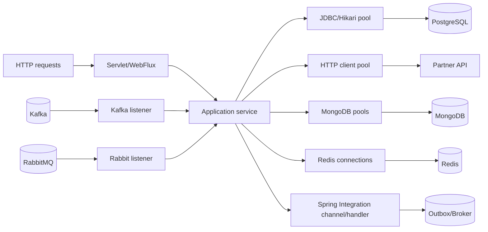
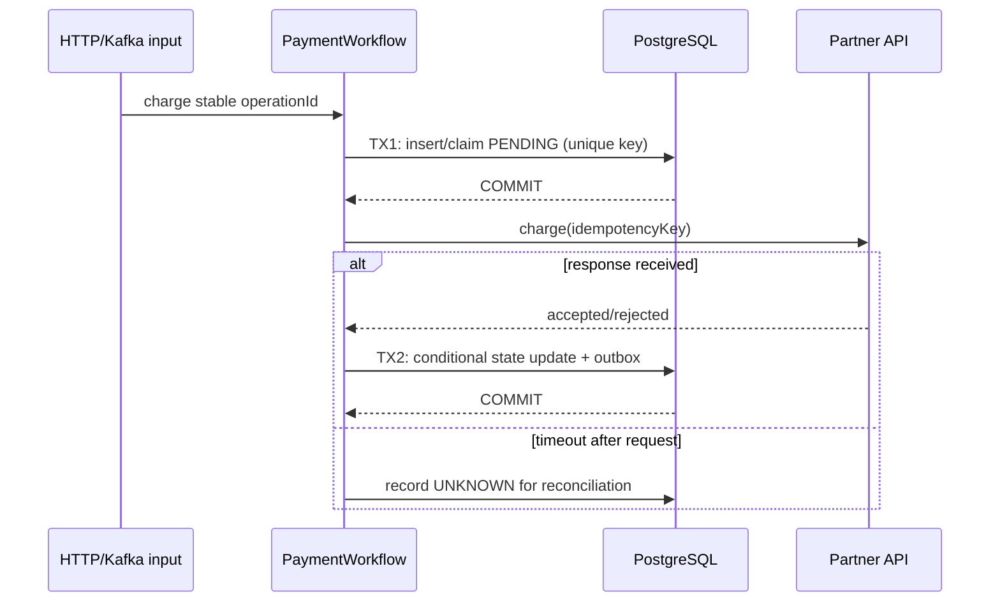
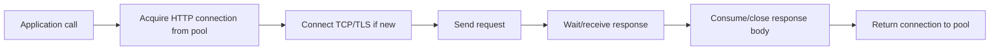
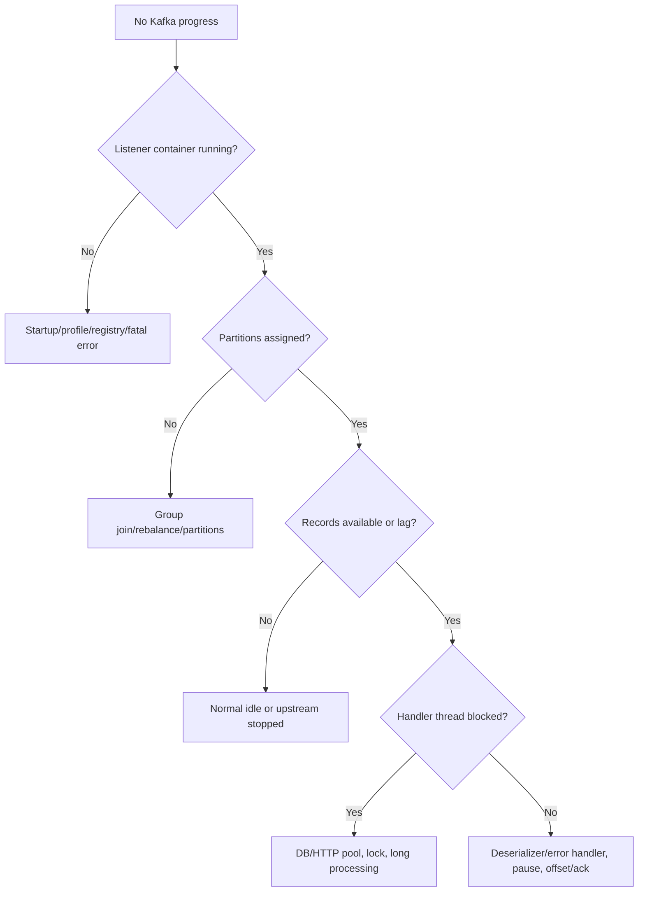
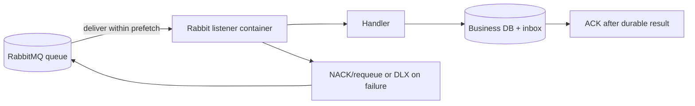
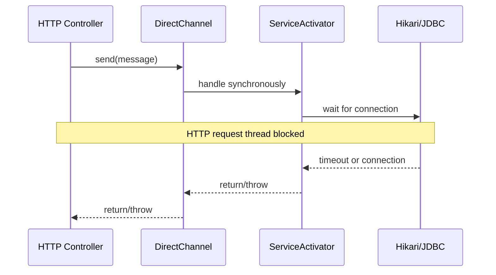
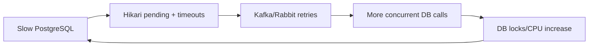
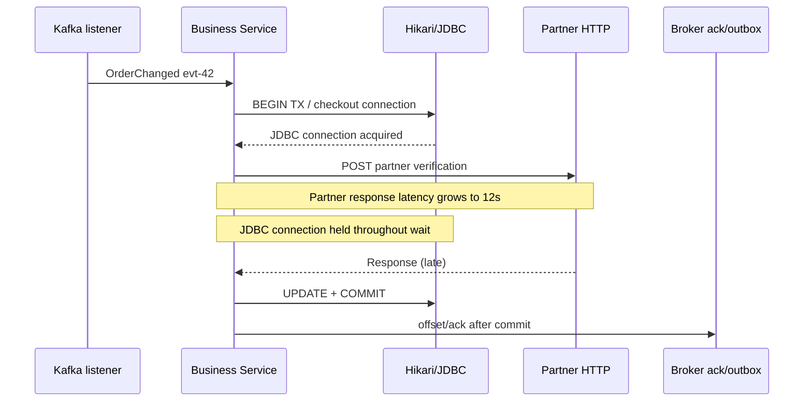
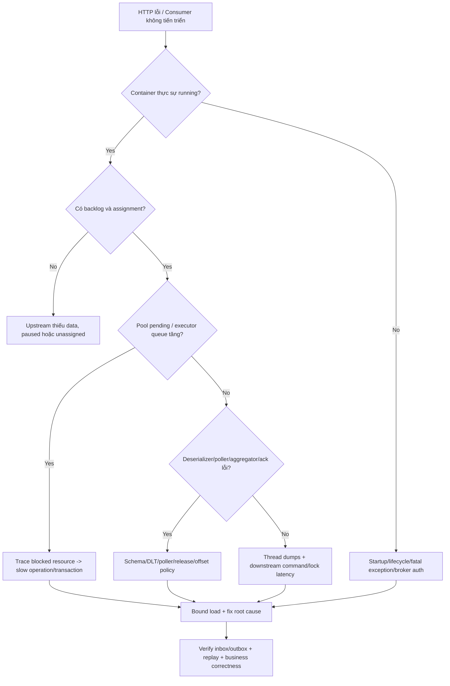
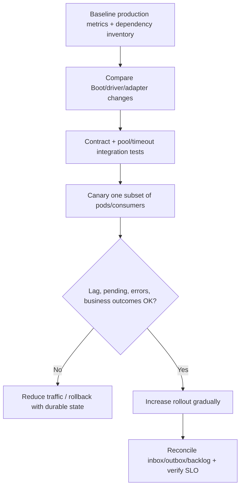

# Cạn pool, listener ngừng chạy và luồng bị chặn

Ứng dụng **SPRING_BOOT_INTEGRATION** có thể trả HTTP 503, Kafka consumer lag tăng, RabbitMQ queue dồn hàng hoặc Spring Integration flow không phát ra output, dù JVM vẫn còn sống và health check báo `UP`. Ba biểu hiện thường gặp là **cạn tài nguyên trong pool**, **listener không còn nhận hoặc xử lý message**, và **luồng bị chặn tại một bước đồng bộ/bất đồng bộ**. Chúng có thể liên quan nhân quả: truy vấn SQL giữ connection quá lâu → HTTP worker phải chờ HikariCP → Kafka listener xử lý quá chậm → mất quyền sở hữu partition sau rebalance → message được giao lại → retry làm tải database tăng thêm.

Bài thuộc chương **Gỡ lỗi và nâng cấp**, hướng đến một phương pháp phân tích **từ nguồn vào đến tác động nghiệp vụ**, áp dụng cho Spring Boot HTTP client, JDBC/JPA, Redis/MongoDB, Kafka/RabbitMQ và Spring Integration. Thay vì giải quyết mọi sự cố bằng cách tăng `maximumPoolSize`, `concurrency` hoặc `timeout`, ta sẽ đo **queue, active/in-use, thời gian chờ, thời gian phục vụ, timeout, ack và transaction boundaries** trước khi điều chỉnh. Các ví dụ dùng **Java 17+, Spring Boot 3.x, Spring Framework 6.x** và adapters theo BOM của dự án; tên properties/API phụ thuộc phiên bản cụ thể nên phải chạy integration tests trước production.

## 1. Mục tiêu học tập

Sau bài này, bạn có thể:

1. Nhận diện **pool exhausted**, **thread starvation**, **consumer stopped**, **consumer alive but stalled**, **backpressure** và **deadlock** bằng bằng chứng thay vì suy từ một exception.
2. Xác định pool nào đang cạn: Hikari JDBC, HTTP client, MongoDB, Redis/Jedis hoặc application executor; không nhầm **Kafka consumer group** với JDBC connection pool.
3. Đọc các tín hiệu `active`, `idle`, `pending`, `max`, `in-flight`, `queue depth`, `lag` và thời gian checkout để tìm nút thắt.
4. Chẩn đoán Kafka listener dừng do deserializer/error handler, rebalance, `max.poll.interval.ms`, lifecycle hoặc network; phân biệt với một partition không có record.
5. Chẩn đoán RabbitMQ consumer ngừng nhận/không ack, channel shutdown, `prefetch`, poison message requeue và DLQ.
6. Xác định Spring Integration `DirectChannel`, `ExecutorChannel`, `QueueChannel`, poller, message store hoặc aggregator đang chặn ở đâu.
7. Sửa an toàn bằng query/index optimization, giới hạn concurrency, bounded queues, time budgets, circuit breaker, idempotency và durable handoff.
8. Thiết kế kiểm thử tải/fault-injection, cảnh báo, runbook, phương án rollback mà **không làm mất message hoặc nhân đôi side effects**.

## 2. Chẩn đoán đầu tiên: “không chạy” là trạng thái nào?

Một lời báo “listener không chạy” thường che giấu nhiều tình huống có cách xử lý khác nhau.

| Hiện tượng | Câu hỏi cần hỏi | Ví dụ bằng chứng |
| --- | --- | --- |
| **Không được start** | Container/poller có được tạo và `start()` chưa? | Lifecycle state, bean condition, config profile, `autoStartup=false`. |
| **Đã stop có chủ đích** | Có operator pause/stop hoặc shutdown sequence? | Audit, deployment rollout, registry state. |
| **Failed rồi stop** | Exception nào làm container/adapter dừng? | Error handler/container event, broker auth/network failure. |
| **Vẫn running nhưng không poll/receive** | Có phân vùng/queue assignment, credit/prefetch, pending tasks? | Kafka assigned partitions, Rabbit consumers/unacked, thread dump. |
| **Đã nhận nhưng block trước side effect** | Thread đang chờ connection, lock, HTTP response hay Future? | Thread states, Hikari pending, Mongo checkout, HTTP pending acquire. |
| **Đã xử lý nhưng không ack/commit** | DB commit, broker ack, transaction và async completion ở đâu? | Inbox/outbox, Kafka offset, Rabbit unacked, retry logs. |
| **Không có message** | Có record/queue backlog thật không? | Kafka end offset vs committed offset; Rabbit ready/unacked. |
| **Luồng bị nghẽn sau listener** | Handler/transformer/router/aggregator đang chờ điều kiện nào? | Spring Integration message history, channel metrics, group store. |

**Đừng restart ngay trước khi thu thập dấu vết.** Restart có thể làm mất thread dump, queue states, counters và khiến Kafka/Rabbit redeliver một operation đã commit nhưng chưa ack. Nếu cần restart vì SLA, ít nhất lưu snapshot metrics/logs và đối soát bằng business key.

### 2.1. “Đã chạy nhưng chưa có kết quả” không đồng nghĩa “đã ngừng”

Ví dụ Kafka listener nhận event rồi gọi HTTP đối tác 40 giây. Trong khoảng đó, log `Received event` có thể tồn tại, thread đang blocked tại socket read và không có `Completed`. Listener container chưa chắc đã dừng; một partition có thể không có tiến triển vì thread xử lý hiện tại bị giữ. Nếu `max.poll.interval.ms` bị vượt, consumer có thể bị rebalance và message được xử lý lại ở node khác. Cần phân biệt **liveness** của container, **progress** của message và **kết quả nghiệp vụ đã commit**.

### 2.2. Sơ đồ nút thắt điển hình



Trong hệ thống này, **một dependency bị chậm có thể giữ đồng thời nhiều loại tài nguyên**. Nếu mở `@Transactional` JDBC rồi gọi partner HTTP trong transaction, một yêu cầu có thể chiếm **một JDBC connection và một HTTP connection** cùng lúc. Khi đủ nhiều yêu cầu như thế, cả hai pools cạn và tạo vòng chờ lan truyền.

## 3. Mô hình tài nguyên: pool, queue, worker và deadline

Mỗi tầng thường có cấu trúc:

```text
incoming requests/messages
       |
       v
bounded/unbounded work queue
       |
       v
workers / reactor callbacks
       |
       v
connection checkout -> remote operation
       |
       v
release connection -> commit/ack/result
```

| Thành phần | Đơn vị giới hạn | Đơn vị chờ |
| --- | --- | --- |
| HikariCP | JDBC connections | Threads chờ `getConnection()` tối đa `connectionTimeout`. |
| Apache HttpClient pooled manager | HTTP connections theo route và tổng | Threads chờ pool lease/connection request timeout. |
| Reactor Netty `ConnectionProvider` | Channel/connections và pending acquisitions | Subscribers chờ pending acquire trước khi có connection. |
| MongoDB Java driver | Connections theo **server/pool/MongoClient** | Operations chờ checkout; có server-selection riêng. |
| Redis Lettuce | Tùy sync/async/pooled connection model | Không mặc định mọi command cần một socket riêng. |
| Kafka listener | Consumer instances/partitions/processing threads | Consumer lag và xử lý record; không dùng JDBC pool của Kafka. |
| Rabbit listener | Consumers, channels, prefetch/unacked | Broker phát theo credit và consumer ack. |
| Spring `ThreadPoolTaskExecutor` | Threads và task queue | Task chờ thread; queue lớn có thể che overload. |
| Spring Integration channel | Tùy `Direct/Executor/Queue/PublishSubscribe` | Sender block hay message đợi poller/consumer. |

### 3.1. Dùng định luật Little để có giả thuyết ban đầu

\[
L \approx \lambda W
\]

Trong điều kiện ổn định, `L` là số công việc đồng thời trung bình, `λ` là throughput/giây và `W` là thời gian mỗi công việc chiếm tài nguyên tính bằng giây. Ví dụ **một pod** xử lý 200 SQL operations/giây và mỗi operation giữ JDBC connection trung bình 50 ms:

```text
L = 200 × 0.050 = 10 active connections trung bình
```

Nếu query latency tăng lên 500 ms trong cùng tải, nhu cầu trung bình thành **100 connections**, dù lưu lượng không đổi. `maximumPoolSize=20` sẽ khiến pending checkout tăng nhanh. Đây là mô hình sơ bộ, **không phải phép chọn pool size cuối cùng**: p99, bursts, transactions, nhiều lệnh/operation, multi-pod và server capacity còn quyết định.

### 3.2. Một hàng đợi không giới hạn không tạo thêm throughput

Queue rộng giúp hút burst ngắn; nếu tốc độ vào liên tục cao hơn tốc độ xử lý, queue sẽ lớn mãi. Khi một `ThreadPoolTaskExecutor` có queueCapacity rất lớn, số threads có thể giữ nguyên trong khi pending tasks tăng; ứng dụng trông còn sống nhưng latency cuối hàng vượt SLA. Dùng **bounded admission**, timeout và cơ chế retry/durable queue có backpressure thay vì đẩy vô hạn vào RAM.

### 3.3. Phân biệt số lượng connections và năng lực DB

Ví dụ 12 pods × Hikari maximum 40 = **tối đa 480 application JDBC connections** chỉ riêng pool này, chưa tính administrative connections và các ứng dụng khác. Database có thể không phục vụ hiệu quả 480 queries song song. Khi tăng pool, phải kiểm tra **CPU, I/O, lock waits, query plan và số connections thực của database**; một connection là phương tiện truyền request, không phải capacity guarantee.

## 4. HikariCP cạn pool: triệu chứng và cấu hình Spring Boot

Một lỗi thường thấy:

```text
java.sql.SQLTransientConnectionException:
HikariPool-1 - Connection is not available,
request timed out after 30000ms
```

Thông điệp này thường nghĩa **thread không checkout được JDBC connection trước thời hạn**. Nó chưa chứng minh database hỏng; connection có thể đang bị giữ bởi query chậm, transaction dài, stream chưa đóng hoặc workload tăng đột ngột.

### 4.1. Thuộc tính liên quan

```yaml
spring:
  datasource:
    url: ${APP_JDBC_URL:jdbc:postgresql://localhost:5432/integration}
    username: ${APP_DB_USER}
    password: ${APP_DB_PASSWORD}
    hikari:
      pool-name: business-postgres
      maximum-pool-size: 20
      minimum-idle: 4
      connection-timeout: 1500
      validation-timeout: 500
      idle-timeout: 600000
      max-lifetime: 1800000
      leak-detection-threshold: 0
```

Các Hikari timeout properties trên dùng **milliseconds** khi bind trực tiếp với Hikari setters qua Boot trong cấu hình minh họa; kiểm tra configuration metadata của Boot version thực. `leak-detection-threshold=0` là **tắt leak detection**, phù hợp để không có stack trace ồn ào liên tục. Bật tạm thời với ngưỡng có ý nghĩa trong incident, không suy bất kỳ stack trace từ leak detector nào cũng là leak thật: một transaction hợp lệ nhưng dài cũng có thể bị báo.

| Property | Vai trò | Không phải |
| --- | --- | --- |
| `maximum-pool-size` | Giới hạn JDBC connections của một `HikariDataSource` | Giới hạn tổng connections toàn Kubernetes deployment. |
| `minimum-idle` | Mục tiêu số connections rảnh được giữ | Bảo đảm luôn có chừng ấy connections trong mọi tình huống. |
| `connection-timeout` | Checkout wait tối đa | JDBC statement execution timeout. |
| `validation-timeout` | Kiểm tra connection health | HTTP timeout hoặc query SLA. |
| `idle-timeout` | Loại bỏ connections rảnh theo chính sách | Cắt transaction đang hoạt động. |
| `max-lifetime` | Vòng đời connection tối đa trước khi retire | Deadline của request hay transaction. |
| `leak-detection-threshold` | Cảnh báo connection bị giữ lâu qua stack trace | Tự giải phóng connection bị giữ. |

### 4.2. Phân tích `active/idle/pending/total`

Ví dụ snapshot:

```text
hikaricp_connections_active{pool="business-postgres"}=20
hikaricp_connections_idle{pool="business-postgres"}=0
hikaricp_connections_pending{pool="business-postgres"}=37
hikaricp_connections_max{pool="business-postgres"}=20
```

**Active=max + idle=0 + pending tăng** là dấu hiệu pool đang chịu áp lực. Hãy tìm **vì sao connections bị giữ**: đọc thread dumps ở thời điểm incident, DB active queries/locks, thời gian transaction, SQL statements chậm và các dependencies bị gọi *bên trong* transaction. Nếu active thấp mà checkout vẫn lỗi, cần kiểm tra pool init, connection validation, DB connectivity, pool bị đóng/đang suspend hoặc metrics đang nhìn nhầm instance.

### 4.3. Phân biệt exhaustion với connection leak

`Connection leak` nghĩa connection bị checkout nhưng không được trả lại theo lifecycle. Nguyên nhân:

- Code dùng `DataSource.getConnection()` thủ công nhưng không `close()` trong `finally`/try-with-resources.
- JDBC `ResultSet`/`Statement` bị giữ khi stream dài; connection liên quan chưa trả.
- Transaction mở nhưng không kết thúc vì thread block chờ external HTTP/Future.
- API streaming response gắn với SQL cursor quá lâu.

Với Spring `JdbcTemplate`/Spring Data JPA và `@Transactional` đúng cách, resource binding/release thường do Spring quản lý; **không mặc định mọi pool saturation là leak**. Pool có thể đầy đơn giản vì 20 queries đang chạy mất 10 giây.

## 5. JDBC pool hết connection: tìm lỗi giữ transaction trước khi tăng pool

Giả sử một application service vừa ghi PostgreSQL vừa gọi REST API đối tác:

```java
import org.springframework.stereotype.Service;
import org.springframework.transaction.annotation.Transactional;

@Service
public class PaymentServiceBad {
    private final PaymentRepository repository;
    private final PartnerPaymentClient partner;

    public PaymentServiceBad(
            PaymentRepository repository,
            PartnerPaymentClient partner) {
        this.repository = repository;
        this.partner = partner;
    }

    @Transactional
    public void charge(PaymentCommand command) {
        repository.insertPending(command);
        // Anti-pattern: gọi network trong transaction mở.
        partner.charge(command); // có thể chờ nhiều giây
        repository.markAccepted(command.operationId());
    }
}
```

Các interface `PaymentRepository`, `PartnerPaymentClient` và `PaymentCommand` là types ứng dụng minh họa, không phải Spring classes. Nếu Spring transaction đang sở hữu JDBC connection trong lúc `partner.charge` chậm, 20 concurrent requests có thể giữ hết `maximumPoolSize=20`. Khi partner treo, pool Hikari cũng đầy, dù database PostgreSQL **không có lỗi riêng**.

### 5.1. Thiết kế lại bằng operation state và transaction ngắn



Nguyên tắc:

1. Claim operation ID bền vững ở database, dùng **unique constraint** trên `(partner, operationId)`.
2. **Kết thúc transaction 1** trước khi gọi partner HTTP.
3. Dùng cùng idempotency key theo hợp đồng partner qua retries; không tạo key mới cho cùng operation.
4. Xử lý `ACCEPTED/REJECTED/UNKNOWN` bằng **transaction ngắn** và state transition có điều kiện.
5. Ghi transactional outbox khi cần phát Kafka/Rabbit event; publisher thực hiện riêng.
6. Nếu crash sau partner commit nhưng trước local state update, reconciliation phải tra remote status, không tự gọi lại một charge khác.

Với Spring `@Transactional`, lưu ý **self-invocation** có thể bỏ qua AOP proxy: gọi `this.beginTransaction()` từ cùng object không nhất thiết áp annotation. Tách transactional writer sang Spring bean khác, hoặc dùng `TransactionTemplate` với manager được chọn rõ. Nếu dự án có cả Mongo/JPA/R2DBC transaction managers, đừng bỏ qua qualifier làm Spring chọn sai manager.

### 5.2. JDBC connection không được giữ trong stream vô thời hạn

Khi tự dùng JDBC:

```java
import java.sql.Connection;
import java.sql.PreparedStatement;
import java.sql.ResultSet;
import javax.sql.DataSource;

public final class SafeJdbcReader {
    private final DataSource source;

    public SafeJdbcReader(DataSource source) {
        this.source = source;
    }

    public long countUnsent() throws Exception {
        try (Connection conn = source.getConnection();
             PreparedStatement ps = conn.prepareStatement("""
                     SELECT COUNT(*)
                     FROM integration_outbox
                     WHERE state = 'PENDING'
                     """);
             ResultSet rs = ps.executeQuery()) {
            rs.next();
            return rs.getLong(1);
        }
    }
}
```

Đây là một ví dụ đọc nhỏ, không phải polling pattern cho outbox; production cần index và transactional claim/dispatch riêng. `try-with-resources` giúp trả connection qua `close()` cho Hikari pool. Với `JdbcTemplate`, framework thường đóng resource thích hợp; với `Stream<T>`/cursor dài (JPA/JDBC), cần đóng stream theo API và không gửi qua HTTP streaming không có deadline.

### 5.3. Server-side dấu vết: active query, locks, connection count

Nếu dùng PostgreSQL, công cụ/SQL ở phạm vi quyền DBA có thể giúp:

```sql
SELECT pid, state, wait_event_type, wait_event,
       clock_timestamp() - query_start AS running_for,
       left(query, 200) AS query_preview
FROM pg_stat_activity
WHERE datname = current_database()
ORDER BY running_for DESC NULLS LAST;
```

Đây là lệnh **đọc diagnostics**, cần quyền thích hợp và giới hạn hiển thị vì SQL text có thể chứa thông tin nhạy cảm. `state = 'idle in transaction'` kéo dài là tín hiệu cần xem transaction ownership; lock waits có thể giữ connections dù CPU DB không cao. Không chạy `pg_terminate_backend` bừa bãi để “giải phóng pool” vì có thể rollback nghiệp vụ đang thực thi; nếu phải can thiệp, cần owner/incident runbook và kiểm tra side effects.

### 5.4. Khi nào tăng `maximum-pool-size` hợp lý?

Chỉ sau khi quan sát:

- Checkout wait/pending cao, **command duration không tăng nhiều** và server còn CPU/I/O/connection headroom.
- Pool đủ để hấp thụ peak concurrency đã biết, không mở quá nhiều sockets do autoscale.
- Có giới hạn upstream concurrency và queue, không để request storm nhân lên vô hạn.
- Load test chứng minh tăng pool cải thiện **throughput và p95/p99**, không làm query locks/DB latency xấu hơn.

Nếu database đã 100% CPU hoặc có lock contention, tăng pool thường làm hàng chờ **dịch từ app sang DB**. Điều chỉnh đúng có thể là index, query plan, transaction size, DB capacity hoặc giảm admission.

## 6. HTTP client pool: hết connection hay chỉ chờ đối tác?

Spring Boot có nhiều HTTP client options: `RestClient`/`RestTemplate` với request factory (JDK, Apache HttpClient 5, Reactor Netty tùy setup), `WebClient` với Reactor Netty hoặc connector khác. **Không có một pool chuẩn chung** áp cho mọi HTTP client. Cần xác định **actual client implementation** trong application context và mỗi endpoint đang dùng pool nào.

### 6.1. Pool lease vs connect vs response timeout



| Timeout/limit | Phạm vi | Lỗi cấu hình phổ biến |
| --- | --- | --- |
| Connection lease/request timeout | Chờ được mượn connection từ pool | Nhầm với timeout kết nối TCP. |
| Connect timeout | Thiết lập TCP socket | Không giới hạn thời gian partner xử lý response. |
| TLS handshake timeout | Bắt tay TLS, tùy transport/provider | Không thay certificate validation. |
| Response/read timeout | Đợi response hoặc network I/O theo client semantics | Không phải end-to-end deadline cho toàn workflow/retries. |
| Pool max total/per route | Số HTTP sockets và phân bổ theo target | Dồn toàn bộ traffic vào một route nhỏ hơn tổng pool. |
| Idle/TTL/eviction | Tái sử dụng/chấm dứt idle sockets | Không cắt business call hiện tại. |

### 6.2. Apache HttpClient 5 với Spring `RestClient`

Một cấu hình **tường minh** cho đồng bộ HTTP:

```java
import org.apache.hc.client5.http.config.RequestConfig;
import org.apache.hc.client5.http.impl.classic.CloseableHttpClient;
import org.apache.hc.client5.http.impl.classic.HttpClients;
import org.apache.hc.client5.http.impl.io.PoolingHttpClientConnectionManager;
import org.apache.hc.core5.util.Timeout;
import org.springframework.context.annotation.Bean;
import org.springframework.context.annotation.Configuration;
import org.springframework.http.client.HttpComponentsClientHttpRequestFactory;
import org.springframework.web.client.RestClient;

@Configuration(proxyBeanMethods = false)
public class PartnerHttpClientConfiguration {
    @Bean(destroyMethod = "close")
    CloseableHttpClient partnerApacheClient() {
        var manager = new PoolingHttpClientConnectionManager();
        manager.setMaxTotal(40);
        manager.setDefaultMaxPerRoute(15);

        RequestConfig config = RequestConfig.custom()
                .setConnectionRequestTimeout(Timeout.ofMilliseconds(300))
                .setResponseTimeout(Timeout.ofSeconds(3))
                .build();

        return HttpClients.custom()
                .setConnectionManager(manager)
                .setDefaultRequestConfig(config)
                .build();
    }

    @Bean
    RestClient partnerRestClient(CloseableHttpClient partnerApacheClient) {
        var factory =
                new HttpComponentsClientHttpRequestFactory(
                        partnerApacheClient);
        factory.setConnectTimeout(2_000); // milliseconds
        return RestClient.builder()
                .requestFactory(factory)
                .baseUrl("https://partner.example.invalid")
                .build();
    }
}
```

Ví dụ minh họa Apache HttpClient 5 + Spring 6.x; **không chạy URL `example.invalid`**. Kiểm tra `HttpComponentsClientHttpRequestFactory`/Apache HttpClient overload và timeout ownership ở Spring Framework/BOM thực tế: một số tùy chọn client-side đã thay cách biểu diễn `Timeout`/`TimeValue` giữa versions. Nếu HTTP clients có proxy/TLS custom config, cần xác minh actual connection manager/sockets và lifecycle. Đừng tưởng `RestClient` luôn dùng Apache pool chỉ vì có dependency trên classpath.

**Quan trọng:** `maxTotal=40` nhưng `defaultMaxPerRoute=15` nghĩa **một partner host/route** có thể bị giới hạn 15 connections, dù tổng pool còn 25 sockets cho routes khác. Khi chỉ một partner chậm, queue lease theo route có thể tăng.

### 6.3. Response body và connection release

Với HTTP client được dùng đúng, khi response body đã được đọc/đóng, connection có thể tái sử dụng. Nếu code streaming giữ `InputStream`/response chưa được close, pool lease có thể bị giữ:

```java
// Sơ đồ trách nhiệm khi dùng streaming HTTP API:
// acquire response
// try-with-resources / consume body with bounded size and deadline
// close response and stream
// connection becomes reusable under client policy
```

Không tải toàn bộ response hàng GB vào RAM chỉ để trả connection nhanh: dùng **bounded streaming/chunking**, kiểm soát backpressure/timeout và đóng resources cả ở đường exception. Một HTTP adapter cấp connection cho mỗi request mà không đóng response body có thể tạo triệu chứng “pool cạn” dù partner API trả 200 rất nhanh.

### 6.4. Reactor Netty `ConnectionProvider` cho `WebClient`

`WebClient` với Reactor Netty có thể dùng:

```java
import java.time.Duration;
import reactor.netty.http.client.HttpClient;
import reactor.netty.resources.ConnectionProvider;
import org.springframework.context.annotation.Bean;
import org.springframework.context.annotation.Configuration;
import org.springframework.http.client.reactive.ReactorClientHttpConnector;
import org.springframework.web.reactive.function.client.WebClient;

@Configuration(proxyBeanMethods = false)
public class ReactivePartnerClientConfiguration {
    @Bean(destroyMethod = "dispose")
    ConnectionProvider partnerConnectionProvider() {
        return ConnectionProvider.builder("partner-api")
                .maxConnections(40)
                .pendingAcquireMaxCount(80)
                .pendingAcquireTimeout(Duration.ofMillis(350))
                .build();
    }

    @Bean
    WebClient partnerWebClient(ConnectionProvider pool) {
        HttpClient httpClient = HttpClient.create(pool)
                .responseTimeout(Duration.ofSeconds(3));
        return WebClient.builder()
                .baseUrl("https://partner.example.invalid")
                .clientConnector(
                        new ReactorClientHttpConnector(httpClient))
                .build();
    }
}
```

Các APIs là ví dụ Reactor Netty trong hệ Spring Boot 3.x; pool `partner-api` được đặt tên để quan sát rõ. Đây là **pending acquire limit**, không phải giới hạn số Reactor worker threads; cấu hình HTTP TCP connect timeout/TLS nên thêm theo transport version khi cần. Với ứng dụng nhiều WebClients, kiểm tra chúng có thật sự dùng cùng/different `ConnectionProvider` để tránh nhân pools.

Nếu code chỉ tạo `WebClient.builder()` mới mà không tạo `HttpClient.create(...)` tùy biến, có thể đang dùng shared Reactor Netty resources/pool do framework quản lý. **Không đếm “một WebClient object = một pool độc lập”** khi chưa xác minh connector/runtime.

### 6.5. Lỗi pool HTTP cần phân biệt với kết quả không rõ

`PendingAcquireTimeoutException` hoặc lỗi chờ Apache pool lease thường chỉ cho thấy **request chưa lấy được connection để gửi**. Nhưng **read timeout sau khi đã gửi HTTP POST** có thể xảy ra sau khi đối tác **đã commit**. Quy tắc retry:

- Chờ pool lease thất bại trước gửi: có thể retry bounded nếu còn deadline.
- Lỗi connect rõ trước request body: đánh giá retry theo operation và transport.
- Response/read timeout sau gửi: **UNKNOWN outcome**, dùng idempotency key hoặc query status.
- HTTP 429/503: retry theo `Retry-After`/backoff nếu request an toàn.
- HTTP 400/contract reject: thường permanent, không retry y nguyên.

**Tăng HTTP pool không giải quyết partner SLA** khi partner chậm hoặc rate limit. Có thể khiến gửi nhiều requests hơn, làm downstream quá tải và kéo Hikari pool xuống theo.

## 7. MongoDB, Redis và những pool dễ bị chẩn đoán nhầm

HikariCP là JDBC pool; các clients khác có cơ chế riêng. Một dashboard hiển thị `hikaricp.connections.active=5` không có nghĩa **MongoDB connection checkout** hoặc **Redis client** đang khỏe.

### 7.1. MongoDB Java driver: pool theo server

Một `MongoClient` có thể quản lý **pool riêng theo server** trong replica set/sharded topology. `maxPoolSize=40` thường là **tối đa 40 application connections cho từng server pool**, không phải 40 cho toàn MongoDB cluster hoặc toàn deployment.

```text
pod A: MongoClient -> primary pool maxSize 40
pod B: MongoClient -> primary pool maxSize 40
pod C: MongoClient -> primary pool maxSize 40

Primary có thể nhận tối đa khoảng 120 application pooled
connections từ ba pods, cộng monitoring/clients khác.
```

Các timeout cần tách:

| MongoDB setting | Khi nào liên quan |
| --- | --- |
| `serverSelectionTimeoutMS` | Không tìm thấy server phù hợp read preference/primary. |
| `waitQueueTimeoutMS` | Chờ MongoDB connection checkout quá lâu. |
| `connectTimeoutMS` | Không kết nối được TCP socket. |
| `socketTimeoutMS` | Socket I/O chờ quá lâu, tùy sync driver semantics. |
| `maxTimeMS` trên query | MongoDB server xử lý command quá giới hạn. |
| Client-side operation timeout | Deadline rộng hơn nếu driver/version hỗ trợ. |

**Không kết luận pool cạn chỉ vì có `MongoTimeoutException`.** Primary election có thể làm server selection timeout trong khi các pools vẫn còn available connections. Dùng MongoDB driver `ConnectionPoolListener` + command monitoring và topology state để xác nhận.

### 7.2. Redis Lettuce vs Jedis không có cùng pool model

Spring Data Redis có thể dùng Lettuce hoặc Jedis theo starter/version/config. **Lettuce** hỗ trợ multiplexed/shared native connections cho nhiều operations; không nên áp trực tiếp mô hình “mỗi GET giữ một socket từ pool” vào mọi lệnh Lettuce. Redis **transactions, blocking commands, pub/sub hoặc dedicated connections** có thể có nhu cầu khác, tùy framework/client configuration.

Với **Jedis** hoặc một thiết lập Lettuce pooling riêng, metrics borrowed/idle/wait có thể quan trọng, nhưng phải xác nhận classpath/`RedisConnectionFactory` và pool thực:

```yaml
# Chỉ minh họa khi ứng dụng thực sự bật pooling phù hợp:
spring:
  data:
    redis:
      host: localhost
      port: 6379
      timeout: 2s
      connect-timeout: 1s
      lettuce:
        pool:
          enabled: true
          max-active: 20
          max-idle: 10
          min-idle: 2
          max-wait: 300ms
```

Trong Boot 3.x, property `spring.data.redis.lettuce.pool.enabled`/pool config có điều kiện theo client/dependencies, có thể cần Commons Pool 2; hãy kiểm tra metadata/version và bean thực tế. Bật pool cho Lettuce **không mặc định tăng throughput**: nếu Redis server đang CPU-bound, network latency cao hoặc lệnh `BLPOP` giữ connections, cần giải quyết command pattern/concurrency.

### 7.3. Blocking Redis commands và Spring Integration

Một adapter dùng Redis List làm queue và gọi blocking pop với timeout dài có thể khiến một thread luôn chờ trong Redis; đây có thể là **hành vi chủ đích của consumer**, không phải pool leak. Tuy vậy nếu dùng cùng pool quá nhỏ cho cả blocking consumers và cache commands, cache GET/SET có thể phải đợi. Tách resource pool/connection strategy hoặc giới hạn blocking consumers theo nhu cầu, tránh để số consumers vượt năng lực Redis.

Redis Pub/Sub **không phải durable queue mặc định**. Nếu listener ngừng khi connection lost, các messages đã publish trong khoảng downtime có thể bị mất theo semantics Pub/Sub; không khắc phục bằng cách tăng `max-active`. Với yêu cầu replay/durability, cân nhắc Redis Streams, Kafka/RabbitMQ hoặc database outbox/inbox với ack/checkpoint policy.

### 7.4. Cross-pool exhaustion

Ví dụ một Kafka listener giữ JDBC transaction rồi:

```text
1. Checkout Hikari JDBC connection
2. HTTP GET partner (waits for Apache HTTP pool)
3. Write MongoDB projection (waits for Mongo pool)
4. Update Redis cache (waits on Redis blocking command)
5. JDBC COMMIT
6. Kafka offset commit
```

Nếu bước 2/3/4 block, JDBC connection được giữ trong lúc chờ **một pool khác**. Các pending queues liên kết với nhau; tăng riêng Hikari pool có thể làm tăng số HTTP requests/Mongo operations chờ, rồi hệ thống nặng hơn. Sửa bằng **transaction ngắn, durable workflow, bounded external concurrency** và timeout phân tầng.

## 8. Kafka listener “ngừng chạy”: stopped, rebalance, paused hay blocked?

Với `@KafkaListener`, broker chứa records trong partitions; consumer phải được assign partitions, poll records, xử lý và commit offsets theo cấu hình. **Một listener container running không bảo đảm có tiến triển**. Ngược lại, một consumer có log ít vì topic không có record không nhất thiết hỏng.

### 8.1. Kiểm tra trạng thái có thứ tự

1. **Bean/container có tồn tại?** `@EnableKafka`/Boot auto-configuration, component scanning, `@KafkaListener` ID, container factory, profiles.
2. **Có start không?** `autoStartup`, `KafkaListenerEndpointRegistry`, operator pause, ứng dụng shutdown.
3. **Có broker connection và authorization không?** Bootstrap DNS/TLS/SASL/ACL, topic metadata, group membership.
4. **Có assignment không?** Consumer group partitions đang được assign cho node nào? Nếu `concurrency` nhiều hơn partitions, một số consumers có thể idle bình thường.
5. **Có records/lag không?** End offsets, committed offsets và consumer lag, không chỉ nhìn application log.
6. **Có poll và xử lý tiến triển không?** Lịch sử poll, handler duration, `max.poll.interval.ms`, thread dumps, downstream pool waits.
7. **Có offset commit không?** Ack mode/transactions, errors, retry/DLT, listener container lifecycle.



### 8.2. `max.poll.interval.ms` khác `session.timeout.ms`

Kafka `max.poll.interval.ms` là giới hạn liên quan **tần suất `poll()` của consumer**, nhằm phát hiện consumer không tiến triển theo consumer protocol. Nếu listener xử lý quá lâu mà container không poll tiếp đúng điều kiện, consumer có thể mất assignment/rebalance; log thường có dấu hiệu max poll interval exceeded, partitions revoked hoặc commit failed. `session.timeout.ms` liên quan heartbeat/group membership, không phải timeout xử lý riêng một SQL statement.

| Thuộc tính | Ý nghĩa khái quát | Nguy cơ khi chỉnh sai |
| --- | --- | --- |
| `max.poll.records` | Giới hạn số records được trả về mỗi poll | Batch quá lớn × thời gian xử lý có thể vượt poll interval. |
| `max.poll.interval.ms` | Giới hạn thời gian giữa các lần poll | Tăng quá lớn làm phát hiện consumer kẹt chậm hơn. |
| `session.timeout.ms` | Timeout group membership dựa trên heartbeat theo protocol | Không trực tiếp sửa downstream JDBC/HTTP đang chậm. |
| `heartbeat.interval.ms` | Nhịp heartbeat ở classic group protocol; semantics phụ thuộc client/protocol | Tuning bừa có thể gây rebalance/không cải thiện throughput. |
| Listener concurrency | Consumer instances/threads ở ứng dụng | Không tạo thêm Kafka partitions; có thể tăng DB/HTTP pressure. |
| `AckMode` | Offset được ack/commit ở giai đoạn nào | Ack trước durable processing gây mất công việc. |

**Không đưa toàn bộ Kafka polling semantics về một công thức đơn giản `max.poll.records × p99`**: Spring Kafka có thể pause, error-handler retries/backoffs hoặc container behavior khác theo phiên bản/mode. Dù vậy đây là một **ước lượng rủi ro** hữu ích: batch 500 records × 300 ms/record đã là 150 giây nếu xử lý tuần tự, chưa tính jitter, retries và commits.

### 8.3. Cấu hình giới hạn để bắt đầu khảo sát

```yaml
spring:
  kafka:
    bootstrap-servers: ${KAFKA_BOOTSTRAP_SERVERS:localhost:9092}
    consumer:
      group-id: order-projection-v1
      auto-offset-reset: earliest
      enable-auto-commit: false
      max-poll-records: 100
      properties:
        max.poll.interval.ms: 300000
    listener:
      concurrency: 3
      ack-mode: record
```

Đây là **cấu hình tham khảo**, không phải công thức cho exactly-once. `ack-mode: record` xác nhận xử lý record theo container behavior; khi dùng async handler/ack, DB transactions hoặc Kafka transactions, chọn mode phù hợp và **test offset commit khi crash**. `auto-offset-reset: earliest` chỉ áp dụng khi không có committed offset hợp lệ theo policy; nó không “tự phát lại mọi record” của một group đã commit.

**Dấu hiệu sai logic nghiêm trọng:**

```java
@KafkaListener(topics = "orders.inbound")
public void receiveBad(OrderEvent event) {
    processAsync(event).subscribe(); // returns BEFORE completion
}
```

Trong nhiều container configurations, listener return có thể được coi là xử lý xong và tiến tới commit/ack trong khi reactive pipeline mới bắt đầu. Nếu process chết trước async completion, message có thể mất theo policy. Hãy dùng listener async return/ack mechanism **được Spring Kafka version hỗ trợ** hoặc một durable handoff, và kiểm tra end-to-end semantics. Không chọn `subscribe()` trong listener như cách “fix blocked thread”.

### 8.4. Deserializer lỗi trước listener

JSON/Avro/Protobuf bytes có thể lỗi **trước khi method `@KafkaListener` được gọi**. Khi đó không thể khắc phục chỉ bằng:

```java
try {
    handle(event);
} catch (Exception ex) {
    // never reached for a failure in the Kafka value deserializer
}
```

Spring Kafka có `ErrorHandlingDeserializer` giúp đưa lỗi delegate deserializer vào container/error-handler path thích hợp. Kết hợp `DefaultErrorHandler`/`DeadLetterPublishingRecoverer` theo phiên bản, retry **transient** có giới hạn và đẩy **poison record** sang DLT/quarantine có serializer cho raw bytes. Một record lỗi schema vĩnh viễn không nên bị retry tight loop đến mức partition không tiến.

**DLT không chứng minh dữ liệu bền vững nếu publish DLT thất bại nhưng source offset đã được commit**. Test thất bại của DLT producer, callback/ack policy và các headers/error details (tránh nhúng raw PII vào metric/log).

### 8.5. Kiểm tra container qua `KafkaListenerEndpointRegistry`

```java
import org.springframework.kafka.config.KafkaListenerEndpointRegistry;
import org.springframework.stereotype.Component;

@Component
public final class KafkaListenerStateInspector {
    private final KafkaListenerEndpointRegistry registry;

    public KafkaListenerStateInspector(
            KafkaListenerEndpointRegistry registry) {
        this.registry = registry;
    }

    public String describe(String listenerId) {
        var container = registry.getListenerContainer(listenerId);
        if (container == null) {
            return "NOT_REGISTERED";
        }
        return "running=" + container.isRunning()
                + ", pauseRequested=" + container.isPauseRequested()
                + ", paused=" + container.isContainerPaused();
    }
}
```

Đây là diagnostics **nội bộ**, không phải HTTP management API công khai cho bất kỳ caller chọn listener ID. `isPauseRequested()` khác `isContainerPaused()` vì pause có thể được áp tại poll boundary; các APIs tương ứng cần kiểm tra theo Spring Kafka BOM. Running/paused **không** báo handler progress hoặc partitions assigned; cần thêm consumer lag, thread dumps và registry/container event telemetry.

### 8.6. Khi nào restart consumer?

Restart có thể hữu ích sau khi sửa credentials/cert/config hoặc container fatal state, nhưng:

- Trước restart, ghi nhận group partitions, committed offsets và in-flight business operations.
- Xác minh DB inbox/outbox/unique keys chịu được record redelivery.
- Không reset offsets để “làm sạch lag” nếu message chưa được xử lý.
- Nếu do DB pool exhaustion, restart mà không giảm concurrency/slow query thường tái diễn.
- Nếu do poison record, cần sửa decoder/error handler/DLT, không phụ thuộc restart để skip.

## 9. RabbitMQ listener: stopped, unacked, prefetch và requeue storm

RabbitMQ có những tín hiệu khác Kafka: **queue ready** (chờ giao), **messages unacknowledged** (đã giao nhưng chưa được ack) và **consumer count**. Một queue có ready=0 nhưng unacked=500 không có nghĩa công việc đã xử lý xong: consumers có thể đang giữ messages và block trong JDBC/HTTP.

### 9.1. Sơ đồ credit/prefetch



Khi manual ack, mỗi consumer có thể nhận tối đa một số messages chưa ack được khống chế bởi **prefetch** theo RabbitMQ/client semantics. Ví dụ 4 consumers × prefetch 25 có thể tạo **tối đa khoảng 100 unacked deliveries** trong phạm vi phù hợp, chưa tính các yếu tố broker/adapter. Nếu handler chờ Hikari pool, broker giảm/không giao thêm vì prefetch đã dùng hết; nhìn app “listener ngừng chạy” nhưng thực tế nó **đã nhận trước quá nhiều**.

### 9.2. Cấu hình container để kiểm soát concurrency/prefetch

```yaml
spring:
  rabbitmq:
    host: ${RABBIT_HOST:localhost}
    port: 5672
    listener:
      simple:
        concurrency: 2
        max-concurrency: 4
        prefetch: 10
        acknowledge-mode: auto
        default-requeue-rejected: false
```

Đây là một ví dụ **SimpleRabbitListenerContainerFactory** theo Spring Boot/Spring AMQP phổ biến. Nếu ứng dụng dùng **DirectRabbitListenerContainerFactory**, tên properties khác (ví dụ `spring.rabbitmq.listener.direct.*`) và một số concurrency semantics khác. `acknowledge-mode: auto` ở đây **không có nghĩa RabbitMQ auto-ack**: Spring listener container quyết định ack/nack dựa trên method success/failure, khác broker `AcknowledgeMode.NONE`. Hãy kiểm tra type của container thực tế.

**Không lấy `default-requeue-rejected=false` làm “DLT chắc chắn hoạt động”**: cần cấu hình queue dead-letter exchange/routing hoặc chính sách broker tương ứng, và kiểm tra reject/dead-letter thật trong integration test. Nếu DLX không có route, message có thể không được giữ lại theo kỳ vọng.

### 9.3. Một `@RabbitListener` không block trong callback nhưng vẫn mất dữ liệu

```java
@RabbitListener(queues = "order.requests")
public void receiveBad(OrderEvent value) {
    CompletableFuture.runAsync(() -> saveToDatabase(value));
    // Method returns before DB commit.
}
```

Ở AUTO ack mode, return sớm có thể khiến container xác nhận message **trước khi write hoàn tất** nếu không dùng async listener completion support phù hợp với Spring AMQP version. Dùng đường xử lý đồng bộ có bounded timeout, hoặc **durable handoff** sang DB/broker rồi ack. Khi dùng `CompletableFuture`/`Mono` làm return type có hỗ trợ async completion, phải kiểm chứng container factory/ack behavior trên phiên bản thư viện thật.

### 9.4. Consumer count bằng 0 không có nghĩa queue trống

Kiểm tra tuần tự:

1. Listener container có start không, `autoStartup`/endpoint IDs/config?
2. Queue/exchange/binding đã có, tên đúng vhost, permission đủ?
3. TLS/auth/channel/connection có bị đóng do broker policy hoặc heartbeat?
4. Consumer count có tăng lại sau reconnect; container recovery logs thế nào?
5. Message converter có lỗi `MessageConversionException` trước listener không?
6. Prefetch/unacked/handler threads có đang block ở pool/lock?
7. Requeue có đang lặp nhanh cùng poison message?
8. DLX/quarantine routing có hoạt động và có quyền publish/consume?

Một channel bị broker đóng vì **PRECONDITION_FAILED** (queue declaration mismatch, ví dụ durability/arguments khác nhau) sẽ không được sửa bằng tăng JDBC pool. Cần đối chiếu topology được quản lý ở broker và application declarations, migration có kiểm soát thay vì xóa queue đang có data.

### 9.5. Manual ack và thời điểm xác nhận

Manual ack cho quyền kiểm soát khi xử lý đã durable, nhưng yêu cầu cẩn trọng:

```text
Receive deliveryTag=42
Validate payload and business key
BEGIN DB TX
  Claim unique inbox key
  Apply state transition
  Insert outbox if needed
COMMIT
basicAck(deliveryTag)   // only on the same channel/valid context
```

Nếu crash **sau commit nhưng trước ack**, broker redeliver; inbox/idempotency phải coi đây là replay. Nếu DB fail **trước commit**, ứng dụng có thể nack/requeue hoặc chuyển retry queue theo phân loại transient. Nếu payload sai contract vĩnh viễn, requeue vô hạn tạo **poison loop**; chuyển quarantine/DLX. Nếu channel đã closed, ack có thể thất bại: không suy một lần `basicAck` gọi thành công ở Java là broker đã xác nhận trong mọi network failure scenario.

### 9.6. Stop/restart listener đúng phạm vi

Spring AMQP có listener endpoint registry/container lifecycle APIs; quản trị trong ứng dụng cần **authentication + audit** và biết factory/container type. Stop một Rabbit listener không tự làm messages mất nếu queue là durable và producer delivery/persistence được thiết kế đúng, nhưng **in-flight unacked** có thể được requeue. Không tự xóa queue để giải phóng unacked, không tuyên bố `consumerCount=0` nghĩa mọi nghiệp vụ chưa hoàn thành đều đã được đưa về ready ngay trong mọi trạng thái network.

## 10. Spring Integration flow bị chặn ở channel, poller hay handler?

Spring Integration truyền `Message<?>` qua message channels/handlers/adapters. Một flow có thể bị chặn **trước khi gọi handler**, đang chờ downstream I/O trong handler, hoặc đã xử lý nhưng chưa phát output vì aggregator/barrier chưa thỏa điều kiện.

### 10.1. Các kiểu channel và điểm chờ khác nhau

| Thành phần | Thực thi | Khi nào giống “đứng”? |
| --- | --- | --- |
| `DirectChannel` | Gọi subscriber trong **thread của sender** theo dispatch semantics | Handler chậm/block → sender HTTP/Kafka/Rabbit cũng bị giữ. |
| `ExecutorChannel` | Dispatch qua `TaskExecutor` | Task queue lớn/full, executor bị starvation/rejected; sender có thể return sớm. |
| `QueueChannel` | Buffer messages trong bộ nhớ hoặc MessageStore tùy cấu hình | Không có poller/consumer, queue đầy hoặc poller quá chậm. |
| `PublishSubscribeChannel` | Phát tới subscribers theo sync/async executor config | Một subscriber chậm ảnh hưởng đường đồng bộ hoặc lỗi xử lý async khác. |
| Polling consumer / `SourcePollingChannelAdapter` | Poll theo trigger/scheduler, `maxMessagesPerPoll` | Poller stopped, scheduler pool bận, transaction/handler chiếm thread. |
| `Aggregator`/`Resequencer` | Chờ correlation group/sequence/release strategy | Thiếu message cuối, group timeout/lock/MessageStore bị lỗi. |
| `ServiceActivator`/`Transformer` | Chạy logic business/mapping | Block JDBC/HTTP, mất output do exception/filter/router hoặc async boundary. |
| `errorChannel` | Kênh báo lỗi theo message flow | Có ErrorMessage không nghĩa đã durable hay đã recover. |

### 10.2. DirectChannel có thể giữ connection của caller



Nếu HTTP thread gọi `send()` vào `DirectChannel`, handler xử lý cùng call stack. Khi DB cạn pool, endpoint HTTP có thể timeout trước khi `send()` trả về. Thêm `ExecutorChannel` có thể giải phóng HTTP thread nhanh hơn, nhưng **chỉ an toàn khi đã xác định durable handoff**. Nếu executor queue ở RAM và controller trả 202 Accepted, process crash có thể làm mất message sau khi client đã tin công việc được nhận.

### 10.3. ExecutorChannel và thread pool starvation

```java
import org.springframework.context.annotation.Bean;
import org.springframework.context.annotation.Configuration;
import org.springframework.integration.channel.ExecutorChannel;
import org.springframework.messaging.MessageChannel;
import org.springframework.scheduling.concurrent.ThreadPoolTaskExecutor;

@Configuration(proxyBeanMethods = false)
public class IntegrationExecutorConfiguration {
    @Bean("integrationWorkers")
    ThreadPoolTaskExecutor integrationWorkers() {
        var executor = new ThreadPoolTaskExecutor();
        executor.setCorePoolSize(4);
        executor.setMaxPoolSize(8);
        executor.setQueueCapacity(50);
        executor.setThreadNamePrefix("integration-worker-");
        executor.initialize();
        return executor;
    }

    @Bean("integrationAsyncChannel")
    MessageChannel integrationAsyncChannel(
            ThreadPoolTaskExecutor integrationWorkers) {
        return new ExecutorChannel(integrationWorkers);
    }
}
```

Đây là ví dụ **bounded executor** dành cho một flow. Để dùng bean `integrationWorkers` cho tham số, dự án nhiều `ThreadPoolTaskExecutor` beans nên dùng `@Qualifier("integrationWorkers")`; tránh inject nhầm executor default. Phải kiểm tra exception handling và rejection policy: khi task queue đầy, sender có thể gặp `TaskRejectedException` hoặc behavior khác theo executor configuration. **Đừng chọn unbounded queue** để làm biến mất lỗi rejection: nó đổi lỗi tức thời thành memory/latency thảm họa.

### 10.4. Poller không chạy vì scheduler threads bận

Một `SourcePollingChannelAdapter` với fixedDelay 1 giây không nhất thiết poll mỗi giây nếu **task scheduler** chỉ có một thread và một poller khác đang chờ HTTP read timeout 60 giây. Pollers có thể chậm dây chuyền.

```java
import org.springframework.context.annotation.Bean;
import org.springframework.context.annotation.Configuration;
import org.springframework.scheduling.concurrent.ThreadPoolTaskScheduler;

@Configuration(proxyBeanMethods = false)
public class IntegrationPollerSchedulerConfiguration {
    @Bean("integrationTaskScheduler")
    ThreadPoolTaskScheduler integrationTaskScheduler() {
        var scheduler = new ThreadPoolTaskScheduler();
        scheduler.setPoolSize(4);
        scheduler.setThreadNamePrefix("integration-poller-");
        scheduler.initialize();
        return scheduler;
    }
}
```

**Lưu ý:** tạo bean `ThreadPoolTaskScheduler` không bảo đảm mọi poller/scheduled task dùng nó; cần wiring qua poller/spec/qualifier hoặc Spring Integration task scheduler infrastructure phù hợp. Có thể có **nhiều** schedulers (Spring `@Scheduled`, Quartz, Spring Integration poller), nên thread dump và bean names mới chỉ ra scheduler nào đang bị giữ. Tăng số threads không sửa được một poller bị deadlock với DB lock hoặc chờ aggregator group vô hạn.

### 10.5. Aggregator/resequencer đang chờ có chủ đích

Ví dụ yêu cầu tổng hợp 10 fragments trước khi gửi batch. Nếu fragment thứ 10 không đến vì upstream lọc hoặc chuyển DLT, aggregator có thể giữ 9 messages. Kiểm tra:

- `correlationKey` và `sequenceNumber/sequenceSize` có đúng?
- `releaseStrategy` và `groupTimeout` có định nghĩa trường hợp thiếu fragment?
- MessageStore là **in-memory hay JDBC/Redis** và có transaction/locking?
- Có dead-letter/replay message thuộc group mà aggregator chưa biết?
- Khi process restart, group có cần khôi phục không?

Đừng tăng JDBC connection pool để sửa một aggregator **đang chờ release condition**. Nếu group timeout giải phóng partial result, semantics phải được nghiệp vụ cho phép; không nên trả một kết quả thiếu 10% dữ liệu như success nếu contract yêu cầu đầy đủ.

### 10.6. `errorChannel` không là retry queue mặc định

Khi async handler lỗi, Spring Integration có thể route `ErrorMessage` vào `errorChannel`. Nhưng nếu channel là in-memory và error handler chỉ log, message có thể đã bị mất sau khi upstream ack. Cần:

1. Chỉ ra nguồn message và điểm durable acknowledgement.
2. Định nghĩa error flow với retryability taxonomy, DLT/quarantine hoặc DB work item.
3. Giữ original message identity/correlation ID trong audit an toàn.
4. Không để một exception handler bắt mọi lỗi rồi `return null` như thể đã xử lý thành công.
5. Test crash sau commit nhưng trước ack để chứng minh inbox/outbox bảo vệ duplicates.

## 11. Thread starvation, deadlock và executors “đang chạy nhưng đứng”

Connection pool chỉ là một loại tài nguyên. Một executor có thể **hết threads** dù database pool còn nhiều connections rảnh. Ngược lại, application thread có thể block trong `HikariDataSource.getConnection()` khiến executor hết worker; xét riêng mỗi biểu đồ sẽ bỏ sót quan hệ nhân quả.

### 11.1. Ba mẫu lỗi cần phân biệt

| Mẫu | Thread dump/metric | Hướng giải quyết |
| --- | --- | --- |
| **Pool starvation** | Workers `WAITING/TIMED_WAITING` ở Hikari/Apache pool lease/lock | Xem connection in-use, slow query/response và timeout. |
| **Executor starvation** | All workers occupied, queue depth tăng, completion gần 0 | Bounded tasks, loại bỏ chờ đồng bộ trong cùng executor, giảm concurrency hoặc bổ sung threads có kiểm chứng. |
| **Deadlock** | Các threads giữ locks và chờ nhau theo chu trình; JVM deadlock detector có thể phát hiện monitor locks | Sửa lock order, tránh chờ Future trong cùng resource pool, giảm đồng bộ hóa. |

Không phải mọi `WAITING` là lỗi: Kafka poll loop, Rabbit consumer, scheduler idle threads, Reactor selector và pool housekeeping có thể chờ có chủ đích. Phải so **stack traces + queue metrics + progress** qua nhiều mẫu thời điểm.

### 11.2. Self-starvation khi task chờ child task trên cùng executor

Ví dụ 2 worker threads đang chạy `outer()`, mỗi task tạo một child task trên **chính executor** rồi `join()`:

```java
import java.util.concurrent.CompletableFuture;
import java.util.concurrent.Executor;

public final class NestedExecutorWait {
    private final Executor sameExecutor;

    public NestedExecutorWait(Executor sameExecutor) {
        this.sameExecutor = sameExecutor;
    }

    public String bad() {
        CompletableFuture<String> child =
                CompletableFuture.supplyAsync(
                        () -> "result", sameExecutor);
        // Nếu tất cả workers bị giữ trong bad(), không còn
        // worker nào để thực thi child.
        return child.join();
    }
}
```

Nếu executor có đúng 2 workers, cả hai chạy `bad()` và `child` chỉ được queue, chuỗi chờ có thể vô hạn **dù không có Java monitor deadlock truyền thống**. Chữa bằng thiết kế **composition không block** (`thenCompose`/async completion, không gọi `join` trong worker), tách pool cho workloads blocking với giới hạn hợp lý, hoặc bỏ nested submit khi cùng một execution context đủ.

### 11.3. Một scheduler thread phục vụ quá nhiều nhiệm vụ

Trong Spring Boot có thể tồn tại `TaskScheduler` dùng cho Spring `@Scheduled`, pollers, heartbeat, retry timers và application tasks. Nếu một scheduled task làm HTTP sync chậm, các tasks khác cùng scheduler pool có thể bị delay. **Đừng suy “Kafka listener ngừng” chỉ vì scheduled poller khác không chạy**: xác minh **thread-name prefix và bean wiring** của từng scheduler.

```yaml
spring:
  task:
    scheduling:
      pool:
        size: 4
      thread-name-prefix: app-scheduler-
    execution:
      pool:
        core-size: 8
        max-size: 16
        queue-capacity: 100
      thread-name-prefix: app-worker-
```

Các thuộc tính `spring.task.scheduling.*` và `spring.task.execution.*` thuộc Boot task auto-configuration trong cấu hình phù hợp; chúng **không nhất thiết thay** thread pool của Kafka listener container, Quartz, RabbitMQ hoặc Apache HTTP client. Nếu ứng dụng tự tạo executor/scheduler beans, phải kiểm tra chúng có làm Boot back off và những components đang dùng bean nào.

### 11.4. Thread dump: xem ở nhiều thời điểm

Một thread dump đơn cho biết **ảnh chụp trạng thái**, không chứng minh hệ “deadlock” nếu thấy `WAITING`. Lấy 2–3 snapshots cách nhau có chủ đích khi incident, đối chiếu:

```text
thread: http-nio-8080-exec-17
  at com.zaxxer.hikari.pool.HikariPool.getConnection(...)
  at ...PaymentRepository...

thread: integration-worker-3
  at java.util.concurrent.CompletableFuture.join(...)
  at ...NestedExecutorWait.bad(...)

thread: kafka-listener-0-C-1
  at ...SocketInputStream.read(...)
  at ...PartnerHttpClient.call(...)
```

Đây là **stack mô phỏng**, không phải những frame chính xác của mọi JVM/library version. Phân loại:

- HTTP thread block lấy JDBC connection.
- Executor worker chờ child task/lock.
- Kafka listener block network read.

Sau đó xem **connections active/pending, HTTP pool wait, CPU, consumer lag, queue length** cùng mốc thời gian. Nếu chỉ nâng số JVM threads, có thể tăng áp lực lên pool đang cạn.

### 11.5. Virtual threads không tự giải quyết giới hạn tài nguyên

Khi chạy virtual threads trong môi trường có hỗ trợ, việc block I/O có thể nhẹ hơn về carrier threads trong một số tình huống. Tuy nhiên **JDBC connections, HTTP sockets, MongoDB connections và database lock capacity vẫn có giới hạn vật lý**. Nếu 5.000 virtual threads cùng chờ pool 20 connections, vẫn có 4.980 công việc pending; cần bounded admission, timeouts và server-side capacity. Một số thư viện/locking patterns có thể gây pinning hoặc behavior khác theo JDK/framework version, nên phải đo thực tế.

## 12. Reactor/WebFlux: event-loop blocking khác connection exhaustion

Spring WebFlux và Reactor Netty dùng event loops để điều phối nhiều I/O operations. Một blocking call trên event-loop có thể làm hàng loạt request bị trễ **dù connection pool không đầy**.

### 12.1. Anti-pattern `block()` trong reactive request path

```java
import org.springframework.web.reactive.function.client.WebClient;
import org.springframework.web.bind.annotation.GetMapping;
import org.springframework.web.bind.annotation.RestController;

@RestController
public class BlockingOrderControllerBad {
    private final WebClient partnerClient;

    public BlockingOrderControllerBad(WebClient partnerClient) {
        this.partnerClient = partnerClient;
    }

    @GetMapping("/bad/orders")
    public String getOrderBad() {
        return partnerClient.get()
                .uri("/orders/ORD-42")
                .retrieve()
                .bodyToMono(String.class)
                .block(); // blocks caller, may fail on non-blocking thread
    }
}
```

Trên WebFlux non-blocking threads, Reactor có thể báo việc `block()` không được phép; khi không báo, nó vẫn có nguy cơ giữ thread đang phục vụ nhiều requests. Nếu handler còn gọi JDBC `JdbcTemplate` đồng bộ, đó cũng là blocking code.

### 12.2. Trả publisher thay vì chờ đồng bộ

```java
import reactor.core.publisher.Mono;
import org.springframework.web.bind.annotation.GetMapping;
import org.springframework.web.bind.annotation.RestController;
import org.springframework.web.reactive.function.client.WebClient;

@RestController
public class ReactiveOrderController {
    private final WebClient partnerClient;

    public ReactiveOrderController(WebClient partnerClient) {
        this.partnerClient = partnerClient;
    }

    @GetMapping("/orders/current")
    public Mono<String> getCurrent() {
        return partnerClient.get()
                .uri("/orders/ORD-42")
                .retrieve()
                .bodyToMono(String.class)
                .timeout(java.time.Duration.ofSeconds(2));
    }
}
```

`Mono.timeout` giới hạn thời gian chờ subscription ở tầng Reactor, **không bảo đảm một side effect ở remote service bị rollback khi cancel**. Nếu nghiệp vụ là POST payment, timeout có thể để lại **UNKNOWN outcome**, vẫn cần stable idempotency key.

### 12.3. Offload blocking adapter khi chưa thể chuyển toàn bộ sang reactive

```java
import reactor.core.publisher.Mono;
import reactor.core.scheduler.Schedulers;
import org.springframework.jdbc.core.JdbcTemplate;

public final class ReactiveJdbcBridge {
    private final JdbcTemplate jdbc;

    public ReactiveJdbcBridge(JdbcTemplate jdbc) {
        this.jdbc = jdbc;
    }

    public Mono<Long> countPending() {
        return Mono.fromCallable(() ->
                jdbc.queryForObject(
                        "SELECT COUNT(*) FROM integration_outbox WHERE state = ?",
                        Long.class, "PENDING"))
                .subscribeOn(Schedulers.boundedElastic());
    }
}
```

`boundedElastic()` cung cấp một scheduler cho blocking workloads với giới hạn theo Reactor configuration, **không biến JDBC thành reactive**. JDBC pool vẫn cần capacity/timeouts, và số blocking tasks đang queue trong boundedElastic có thể tăng nếu không giới hạn request concurrency. Có thể dùng một dedicated scheduler/executor cho adapters có tài nguyên riêng, áp bulkhead để tránh HTTP user traffic chiếm hết năng lực của broker consumers.

### 12.4. `flatMap` có thể tạo unbounded in-flight nếu cấu hình sai

Trong reactive Kafka/HTTP aggregation:

```java
Flux<OrderEvent> events = inboundEvents;

return events.flatMap(
        event -> mongoWriter.apply(event),
        8 // at most 8 concurrent inner publishers here
);
```

`inboundEvents` và `mongoWriter` là types/beans minh họa; code trên là một đoạn Reactor composition, không phải Java method đầy đủ. Giới hạn `flatMap(..., 8)` hữu ích **tại đoạn pipeline này**, nhưng còn những subscribers/pods/flows khác có thể chạy song song. Đừng lầm backpressure của Reactor với broker acknowledgement: ack/offset phải được nối vào signal hoàn tất của durable processing.

### 12.5. Khi kiểm tra WebFlux incident

1. Có `reactor-http-nio-*` threads bị block trong JDBC/socket/file/lock hay không?
2. Event loop CPU có 100% do JSON/XML parse hoặc crypto nặng?
3. Reactor Netty connection pool pending acquire có tăng, hay HTTP response latency tăng?
4. Có `publishOn`/`subscribeOn` dùng đúng cho blocking operations?
5. Có `subscribe()` trong handler khiến completion/ack xảy ra quá sớm?
6. Có giữ response body streaming/cursors hoặc `collectList` lượng dữ liệu không giới hạn?
7. Reactor `timeout/retryWhen` có nhân remote side effects hay không?

**Luồng bị chặn ở event-loop** không thể chữa bằng tăng Hikari pool nếu không có JDBC wait; và **pool bị cạn** không thể chữa bằng thêm Reactor event-loop threads nếu MongoDB/HTTP server đã quá tải.

## 13. Time budget: phối hợp timeout giữa pools, listener và broker

Một luồng tích hợp đi qua nhiều giới hạn:

```text
HTTP request timeout        2s
  -> Hikari checkout        1s
  -> SQL statement          1s
  -> partner HTTP checkout  1s
  -> partner response       5s
  -> Redis command          2s
  -> write outbox           1s
```

Đây là cấu hình **mâu thuẫn với deadline 2 giây** nếu các bước được thực thi nối tiếp. Một timeout từng tầng không phải tổng của cả workflow. Nếu từng step có thể retry 3 lần, tail latency còn cao hơn.

### 13.1. Chia budget cho từng bước và để margin

Ví dụ một operation có tổng ngân sách 3 giây:

| Bước | Budget ví dụ | Công cụ |
| --- | --- | --- |
| Authenticate + validate | 150 ms | Input size/schema/CPU limits |
| JDBC claim/checkpoint | 400 ms | Pool checkout + statement timeouts |
| HTTP partner call | 1.400 ms | Connection acquire + connect/response timeout |
| DB state update/outbox | 400 ms | Short transaction |
| Serialization/ack margin | 250 ms | Broker/network/response |
| Buffer cho jitter | 400 ms | Overall deadline controller |

Tổng **3.000 ms**, chỉ minh họa; không có bộ số chung cho mọi SLA. Nếu business operation thật sự cần 15 giây partner call, có thể đổi API thành **202 Accepted + durable async workflow**, có endpoint tra trạng thái thay vì giữ HTTP thread và JDBC transaction chờ. Một HTTP request hết hạn không tự dừng mọi công việc đã gửi sang DB/broker.

### 13.2. Phân loại timeout theo pha

| Timeout | Có thể kết luận request đã tới downstream? | Hướng phục hồi |
| --- | --- | --- |
| HTTP/JDBC/Mongo pool checkout timeout trước acquire | Chưa gửi *lệnh tương ứng* qua connection đang chờ | Bounded retry nếu còn budget, giảm load. |
| TCP connect failure rõ trước request | Thường chưa gửi business payload | Kiểm tra network/secret và bounded retry. |
| Socket read timeout sau gửi | **Không chắc**; downstream có thể đã commit | Reconcile theo stable business ID. |
| SQL statement timeout | SQL có thể bị cancel/rollback theo DB/transaction semantics | Xác định transaction outcome, không suy từ Java exception duy nhất. |
| Mongo write concern timeout | Write có thể đã được áp dụng nhưng acknowledgement chưa đạt | Read back/transaction labels/idempotency. |
| Kafka `max.poll.interval.ms` exceeded | Consumer mất tiến triển/assignment; DB có thể đã commit | Inbox + offset reconciliation, giảm processing latency. |
| Rabbit consumer ack timeout/channel closure | Message có thể đã xử lý nhưng không ack | Idempotent replay; kiểm tra broker policy. |

**Không cho một listener xử lý Kafka record lâu hơn consumer protocol cho phép mà không kiểm soát.** Nếu operation phải kéo dài, nên chia work thành durable jobs/DB outbox và để Kafka listener chỉ thực hiện durable enqueue nhanh; khi đã commit handoff thì offset có thể được xác nhận theo contract.

### 13.3. Circuit breaker, bulkhead, retry không thay nhau

- **Timeout**: giới hạn thời gian chờ một operation; không tự rollback remote commit.
- **Bulkhead/concurrency limit**: giữ một dependency chậm không chiếm hết threads/connections của các workloads khác.
- **Circuit breaker**: tạm ngăn calls đến dependency đang lỗi, fail fast theo trạng thái.
- **Retry**: thử lại transient failure có giới hạn **khi operation idempotent hoặc có reconciliation**.
- **Rate limiter**: kiểm soát tốc độ trung bình/burst gửi đến partner/database.
- **Backpressure**: downstream truyền thông tin không nhận thêm dữ liệu; broker consumers có cơ chế pause/credit riêng.
- **Durable queue/outbox**: giữ công việc qua restart; không phải chỉ thêm một `ArrayBlockingQueue` trong JVM.

Khi một dependency đã cạn connection, retry đồng loạt thường **gia tăng queue và kéo dài incident**. Dùng backoff+jitter, retry budget, circuit breaker và giới hạn concurrency, không “retry mãi cho đến khi thành công”.

## 14. Lỗi permanent, transient và UNKNOWN: quyết định retry/ack

Cạn pool có thể là transient; nhưng một message sai schema thì **đợi pool lâu hơn không giúp gì**. Ngược lại, xử lý một lỗi SQL connection timeout như invalid payload rồi commit broker offset có thể làm mất dữ liệu.

### 14.1. Bảng phân loại lỗi xuyên hệ thống

| Loại | Ví dụ | Có retry không? | Quy tắc ack/commit |
| --- | --- | --- | --- |
| `POOL_EXHAUSTED` | Hikari checkout timeout, Apache lease timeout | Có giới hạn sau giảm tải, nếu deadline/capacity cho phép | Giữ durable record/pause/retry; không ack khi business work chưa durable. |
| `DOWNSTREAM_TRANSIENT` | HTTP 503, Redis/Mongo temporary unavailable | Bounded backoff/jitter + circuit breaker | Ack khi success hoặc durable handoff theo contract. |
| `SCHEMA_PERMANENT` | Kafka deserializer sai schema version, JSON/XML malformed | Không retry y nguyên vô hạn | DLT/quarantine **đã được ghi bền vững** trước khi bỏ source record. |
| `AUTH_CONFIG` | Rabbit channel 403, TLS trust failure | Không tight loop | Sửa config/secret, giữ backlog ở nguồn bền vững. |
| `BUSINESS_CONFLICT` | Cùng eventId nhưng payload hash khác | Không coi là duplicate hợp lệ | Audit/quarantine; không ghi đè data cũ. |
| `DUPLICATE_CONFIRMED` | Same stable eventId + same canonical payload đã commit | Không cần làm lại side effect | Idempotent ack/success. |
| `UNKNOWN_COMMIT_OUTCOME` | Timeout sau HTTP POST/DB commit request | Không blind replay | Query/checkpoint theo stable operationId; reconcile rồi quyết định. |
| `PROCESSING_CANCELLED` | Container shutdown, executor interruption | Tùy durable state thực | Không assume rollback của external I/O chỉ vì Java thread interrupted. |

**Một error code có thể có cách xử lý khác nhau tùy thời điểm:** Hikari timeout **trước** insert thường nghĩa SQL chưa thực hiện; network mất sau SQL statement/commit có thể là UNKNOWN. Cần biết **transaction boundary**, không chỉ exception class.

### 14.2. Inbox/outbox để chịu redelivery

Một SQL schema mẫu:

```sql
CREATE TABLE integration_inbox (
    source_system VARCHAR(64) NOT NULL,
    event_id VARCHAR(128) NOT NULL,
    payload_hash CHAR(64) NOT NULL,
    processed_at TIMESTAMPTZ NOT NULL,
    PRIMARY KEY (source_system, event_id)
);

CREATE TABLE integration_outbox (
    event_id VARCHAR(128) PRIMARY KEY,
    event_type VARCHAR(64) NOT NULL,
    schema_version INT NOT NULL,
    payload JSONB NOT NULL,
    state VARCHAR(20) NOT NULL,
    created_at TIMESTAMPTZ NOT NULL
);
```

Trong business transaction ngắn:

```text
BEGIN
  INSERT inbox(source,eventId,payloadHash)
    ON CONFLICT DO NOTHING;
  if newly claimed:
      validate business transition
      update order/projection with version check
      insert outbox with stable event ID
COMMIT

Only then acknowledge the consumed broker record
according to Kafka/Rabbit container policy.
```

Nếu duplicate key đã tồn tại, đọc `payload_hash`: **cùng hash** có thể là replay hợp lệ; **khác hash** là identity conflict. Đừng nuốt một unique index violation trên bảng khác như “đã xử lý”. Cùng `eventId` từ hai nguồn phải được scope đúng, và hash phải dựa trên một **canonical representation/contract version** ổn định.

### 14.3. Một asynchronous callback thành công không đồng nghĩa business durable

Ví dụ:

```text
Kafka Listener returns
  -> async executor queue accepted (in RAM)
  -> Kafka offset commits
  -> process crashes
  -> queued task disappears
```

Nếu đã acknowledge trước khi durable handoff, **không có Hikari pool size nào cứu được message bị mất**. Khi chuyển flow từ synchronous sang ExecutorChannel để giảm block, phải chứng minh **khi nào message được ghi vào database/broker có confirm**, rồi mới xác nhận nguồn. Với `QueueChannel` in-memory, enqueue là **RAM acceptance**, không phải durable commit.

### 14.4. Retry storm có thể trở thành feedback loop



Khi cả broker và HTTP đều gọi cùng service/DB, một policy retry 5 lần ở **mỗi tầng** có thể nhân số attempts. Cần một retry owner, budget end-to-end và mốc không retry (quarantine/alert). Điều này đặc biệt quan trọng khi network failures gây **unknown commit outcome**: mỗi retry không nhất thiết là lần thử mới vô hại.

## 15. Case study: listener còn chạy nhưng đơn hàng dừng cập nhật

Một hệ thống nhận `OrderChanged` từ Kafka, cập nhật PostgreSQL, gọi đối tác xác thực và phát outbox event. Các pods đồng thời phục vụ HTTP GET/POST. Sau một release, tỷ lệ HTTP 503 tăng, Kafka consumer lag tăng và queue RabbitMQ chứa nhiều unacked messages.

### 15.1. Triệu chứng và telemetry

Giả sử 4 pods, mỗi pod:

```text
Hikari maxPoolSize=20
Hikari active=20 / idle=0 / pending=50
SQL query p95: 40ms (không tăng nhiều)
Partner HTTP response p95: 12s (trước release: 250ms)
Kafka concurrency: 12 per pod
Kafka consumer lag: rising
Rabbit prefetch: 50 per consumer, unacked rising
HTTP p99: >15s, errors=503
```

Đây là **số giả định** để phân tích, không phải thông số cần sao chép. Một nghi vấn ban đầu: app giữ JDBC connections **trong khi chờ HTTP partner**, không phải PostgreSQL tự nhiên xử lý SQL chậm hơn.

### 15.2. Timeline có quan hệ nhân quả



Với 12 Kafka listeners/pod và HTTP traffic đồng thời, mỗi pod dễ đạt 20 active JDBC connections khi partner chậm. Request mới không checkout được và ném timeout. Kafka listener có thể vẫn `running=true` nhưng threads đang chờ HTTP/JDBC; lag tăng và `max.poll.interval.ms` có thể bị vượt trong kịch bản xấu. RabbitMQ unacked tăng vì prefetch đã cấp messages nhưng handler chưa ack.

**Dấu hiệu xác nhận:** JDBC connection hold time/transaction duration tăng cùng với partner response time, trong khi **SQL statement latency** không tăng tương ứng. Thread dump có stack `PartnerHttpClient.exchange` trong `@Transactional` call path. Chỉ dựa vào Hikari active=20 chưa đủ khẳng định nguyên nhân.

### 15.3. “Fix” sai và hậu quả

| Hành động vội | Vì sao thất bại |
| --- | --- |
| Tăng Hikari 20 → 100/pod | Tạo thêm 320 potential connections trên 4 pods; partner vẫn chậm và DB có thể quá tải. |
| Tăng Kafka concurrency 12 → 30 | Tăng concurrent partner calls/DB transactions, làm pending queue tăng. |
| Tăng HTTP read timeout 15s → 120s | Giữ DB connection lâu hơn và tăng tail latency. |
| Bật retry mọi exception 10 lần | Khuếch đại tải và có thể gọi partner POST trùng. |
| Restart mọi pods ngay | Làm mất diagnostics, kích hoạt broker redelivery sau DB commit. |
| Tắt Kafka lag alert | Che kết quả nghiệp vụ chưa tiến triển. |

### 15.4. Cách khắc phục an toàn

1. **Giảm nhận work mới** theo tenant/operation và giới hạn outbound concurrency, ưu tiên bảo vệ database.
2. Thu Hikari pool/HTTP metrics, thread dumps và partner latency, xác nhận external call nằm **trong** JDBC transaction.
3. Tách transaction: **durable claim → COMMIT → partner HTTP → short result transaction + outbox**.
4. Dùng **stable operation ID**/partner idempotency key và reconciliation cho timeout sau gửi.
5. Tối ưu timeout/bulkhead/circuit breaker của partner theo deadline; không giữ worker vô hạn.
6. Giới hạn Kafka listener concurrency và Rabbit prefetch theo downstream capacity, dùng pause/backpressure thay vì ack sớm.
7. Giữ inbox/outbox để redeliver an toàn; xác minh duplicate/conflict và không replay những side effects đã hoàn thành.
8. Canary load test và triển khai từng nhóm pods, so Hikari pending, partner p95, Kafka lag slope, Rabbit unacked và business completed count.

Nếu partner đang unavailable, có thể lưu durable `PENDING` operation và trả HTTP 202 theo API contract, thay vì giữ HTTP/JDBC thread. Nếu operation đòi đồng bộ, trả error/unknown status có operation ID để caller tra cứu; không bịa success.

### 15.5. Kết quả cần chứng minh sau sửa

| Tiêu chí | Kiểm tra |
| --- | --- |
| Hikari pending ổn định/giảm | Gauge + checkout p95 dưới load tương đương. |
| JDBC transaction duration ngắn | Trace spans từ transaction start/commit không bao partner HTTP call. |
| Partner HTTP queue bounded | In-flight/pending acquires không vượt limit đã thiết kế. |
| Kafka lag hồi phục | End offset − committed offset giảm bền vững, không vì reset offsets. |
| Rabbit unacked giảm | Ack sau durable result, DLQ được xử lý riêng. |
| Không xử lý trùng | Inbox unique keys, partner operation IDs và outbox stable events. |
| Không mất dữ liệu khi kill pod | Fault-injection crash sau DB commit trước ack. |
| Không silent corruption | Đối soát số orders accepted/rejected/unknown với nguồn sự thật. |

Một dashboard “mọi pods `UP`” không thay thế các tiêu chí trên. **Sự phục hồi có nghĩa business progress chính xác**, không phải chỉ thông số pool trở lại thấp.

## 16. Observability: đo tiến triển nghiệp vụ cùng tài nguyên kỹ thuật

Một hệ tích hợp cần ít nhất ba lớp telemetry:

1. **Resource usage:** pool in-use/idle/pending, thread pool busy/queue, JVM heap/GC, DB wait events.
2. **Message progress:** Kafka consumer lag/offset commits, RabbitMQ ready/unacked/consumers, Spring Integration channel/poller/aggregator state.
3. **Business completion:** số operation đã commit, số trạng thái UNKNOWN, inbox duplicates/conflicts, outbox pending/age và kết quả partner reconciliation.

Chỉ đo lớp 1 có thể báo “pool bình thường” vì listener đã **ngừng nhận toàn bộ messages**; chỉ đo lớp 2 có thể báo “lag=0” vì offset bị commit sớm dù work bị mất; chỉ đo lớp 3 giúp phát hiện kết quả nhưng không đủ tìm root cause nhanh.

### 16.1. Những metric nên đặt cùng một dashboard

| Metric/tín hiệu | Tags/nhóm hữu hạn | Diễn giải |
| --- | --- | --- |
| Hikari active/idle/pending/max | `pool`, `application` | Connection checkout pressure. |
| Hikari acquisition time/error | `pool`, `outcome` | Chờ connection bao lâu, timeout bao nhiêu. |
| HTTP client pool leased/available/pending | `clientName`, `routeGroup` | Hết kết nối HTTP hay remote response chậm. |
| HTTP outbound p95/p99/status | `dependency`, `operation`, `statusFamily` | Partner latency/circuit breaker. |
| MongoDB connection checked-out/checkout wait | `clientName`, `serverRole` | Mongo pool starvation vs server selection. |
| Redis commands latency/pool borrow wait | `operation`, `clientType` | Redis blocking commands vs shared connection path. |
| ThreadPoolTaskExecutor active/queue/rejections | `executorName` | Executor starvation/backpressure. |
| Kafka consumer lag/assigned partitions | `group`, `topic` | Group có đọc/commit tiến triển không? |
| Kafka listener processing duration | `listenerId`, `result` | Handler chậm hoặc bị block. |
| Rabbit ready/unacked/consumer count | `queue` | Chưa giao, đang giữ, hoặc không có consumer. |
| Rabbit DLT/requeue/error count | `queue`, `reason` | Poison message hoặc retry storm. |
| Spring Integration sent/received/error count | `flowName`, `componentType` | Message dừng trước/sau handler/channel nào. |
| Spring Integration QueueChannel depth/group age | `channelName` | Poller không tiêu thụ hoặc aggregator không release. |
| Inbox/outbox committed/age | `eventType`, `consumerScope` | Durable business progress sau broker handling. |
| Unknown outcome age | `workflowName` | Cần reconciliation hay operator intervention. |

Các tên metric cụ thể phụ thuộc Spring Boot Actuator/Micrometer binder, Mongo driver, Reactor Netty, Kafka client và phiên bản adapter. Bảng trên là **các đại lượng cần đo**, không khẳng định mọi metric đã tự tồn tại. Với Hibernate/JDBC metrics, phân biệt pool stats và server-side SQL latency; với Kafka client metrics cần cấu hình/tính toán lag đúng consumer group.

### 16.2. Spring Boot Actuator có ích nhưng không tự đảm bảo bảo mật

```groovy
dependencies {
    implementation 'org.springframework.boot:spring-boot-starter-actuator'
}
```

```yaml
management:
  endpoints:
    web:
      exposure:
        include: health,info,metrics,prometheus
  endpoint:
    health:
      probes:
        enabled: true
```

Đây là **một cấu hình minh họa**, `prometheus` còn cần registry dependency phù hợp và network/security/routing. Không public `/actuator/metrics`, `/actuator/prometheus`, `/actuator/threaddump` hoặc JMX qua internet không bảo vệ. Trong incident, thread dumps và Hikari leak traces có thể lộ tên SQL classes/stack/correlation fields; cần access control và retention.

**Liveness và readiness khác business progress.** Liveness thất bại khiến orchestrator restart pod; readiness thất bại có thể ngừng nhận HTTP traffic, nhưng Kafka listener vẫn có thể đang chạy tùy lifecycle. Không đặt “Kafka lag > 0” thành liveness failure để Kubernetes restart liên tục. Một outage DB ngắn thường cần readiness/admission policy hơn là restart storm; quyết định cụ thể theo ứng dụng và hạ tầng.

### 16.3. Thread dump và timeline phải được đối chiếu

Khi incident trên JVM có quyền vận hành, có thể lấy snapshot bằng những công cụ JDK như:

```bash
jcmd <PID> Thread.print -l
```

`<PID>` là vị trí cần thay bằng process ID, không phải một shell command nguyên văn để copy-paste. Nếu môi trường là container/Kubernetes, lấy PID trong **đúng process namespace**, kiểm soát quyền truy cập và tránh áp dụng lệnh nặng nhiều lần dưới tải. Hai hoặc ba snapshots cách nhau giúp phân biệt thread chờ tạm với thread **không tiến triển**.

Tìm các dấu vết:

```text
HikariPool.getConnection          -> JDBC checkout wait
Apache/HttpClient pool lease     -> HTTP pool wait
SocketInputStream/read           -> remote I/O wait
CompletableFuture.join/get       -> nested wait / starvation
LockSupport.park / AQS           -> queue/condition wait; cần stack context
MongoDB connection checkout      -> Mongo pool wait
Reactor event-loop + blocking    -> event-loop interference
Kafka listener + partner call    -> handler occupied, poll interval risk
Rabbit listener + DB transaction -> unacked held until commit/ack
```

Đây là **nhãn hướng dẫn đọc stack**, không phải stack frames chính xác mọi JDK/client version. Một thread ở `LockSupport.park` có thể hoàn toàn idle bình thường; chỉ kết luận starvation khi có pending work + không có progress + workers đang bận/chờ lẫn nhau.

### 16.4. Log event có cấu trúc, tránh label cardinality cao

```text
component=order-projection
boundary=kafka-listener
listener_id=orders-v2
operation=apply_order_event
outcome=retryable_failure
error_category=JDBC_POOL_CHECKOUT_TIMEOUT
dependency=business-postgres
elapsed_ms=1560
db_pool_active=20
db_pool_pending=37
correlation_id=trace-123
event_ref=redacted
```

`eventId`, customer ID, order ID, raw partner URL, SQL parameters, JWT và Kafka offset không nên trở thành **metric tags** với cardinality vô hạn. Offset/trace ID có thể được lưu trong **structured log/tracing có quyền** khi cần, tuân thủ privacy/retention; không log raw Kafka/Rabbit payload, full HTTP response, database credential hoặc Redis keys chứa PII.

### 16.5. Cảnh báo theo xu hướng, không chỉ một ngưỡng tuyệt đối

Ví dụ các cảnh báo có ý nghĩa:

- Hikari pending > 0 **kéo dài** và checkout p95 tăng, không chỉ một spike 50 ms.
- Kafka lag tăng liên tục **trong khi input rate ổn định** và business completed count giảm.
- RabbitMQ unacked tăng gần giới hạn prefetch × consumers, queue ready không giảm.
- Executor queue depth tăng, completion throughput phẳng và tasks bị rejected.
- HTTP pending acquires tăng + partner p95 tăng, kèm circuit breaker opens.
- Spring Integration QueueChannel depth tăng mà poller successful receives gần 0.
- Outbox oldest pending age tăng dù Kafka consumer lag vẫn 0.
- Số business operations `UNKNOWN` tăng sau timeout có side effect.

Ngưỡng, thời gian giữ điều kiện và cách routing alerts cần hiệu chỉnh theo baseline, release schedules và SLO; **không chọn một giá trị magic chung** cho mọi môi trường.

## 17. Runbook khắc phục: điều tra theo thứ tự để tránh mất dữ liệu

### 17.1. Triage trong những phút đầu

1. **Xác nhận phạm vi:** bao nhiêu pods/instances, region, release, service/tenant/operation nào bị ảnh hưởng? Thời điểm bắt đầu liên quan deploy, traffic burst hay dependency outage?
2. **Xác nhận user-visible symptom:** HTTP timeout/503, Kafka lag, Rabbit ready/unacked, Spring Integration flow output count, business completed count.
3. **Xác định tiến trình còn chạy:** process alive, readiness/liveness, Kafka/Rabbit listener registry/container states, poller status.
4. **Thu snapshot telemetry:** active/idle/pending pool, HTTP pending acquires, executor queue, thread dumps, downstream latency và DB waits.
5. **Tìm đoạn chờ đầu tiên:** thread blocked checkout hay command/HTTP read? Có lock/transaction giữ resource đi kèm?
6. **Phân loại dữ liệu in-flight:** operation nào đã commit, message nào chưa ack, có outcome UNKNOWN hoặc poison record không?
7. **Giới hạn blast radius:** giảm admission, pause consumers có kiểm soát, circuit breaker/rate limit, bảo vệ resource nguồn sự thật.
8. **Sửa root cause:** query/index, transaction boundaries, pool/timeout, schema decoder, broker auth hoặc scheduler wiring.
9. **Phục hồi có thứ tự:** đưa consumers/pollers lên theo rate budget, redrive quarantine đúng business IDs, đo lag/duplicates.
10. **Hậu kiểm:** so committed business operations với input records, outbox/ACK/offset; ghi lại regression test và alert.

### 17.2. Cây quyết định



Đừng tự động kết luận rằng **pending=0 nghĩa không có lỗi pool**: pool có thể bị chặn từ xa trước khi metric được cập nhật, exporter có thể đang nhìn pool khác hoặc application vừa ngừng nhận requests. Đừng kết luận **consumer lag=0 nghĩa không mất message** nếu offset đã commit trước durable handoff.

### 17.3. Khi nào được tạm pause consumer?

Pause Kafka/Rabbit inbound có thể giảm tải DB khi database đang cạn pool, nhưng cần:

- Broker/queue retention và storage còn đủ để giữ backlog.
- Xác định listener nào đang xử lý và những records đã fetch/unacked.
- Không ack/commit những operations chưa đạt durable success.
- Có điểm resume và tiêu chí mở lại dựa trên latency/queue capacity.
- Giữ heartbeat/group membership theo cơ chế pause của client/container; không tự chèn `Thread.sleep(10m)` vào Kafka listener như một kiểu pause.

**Không nhất thiết stop toàn bộ service HTTP** nếu chỉ một partner/flow đang lỗi. Dùng bulkhead để cô lập adapter, ưu tiên các operations đọc nguồn sự thật khi chúng còn healthy. Tuy nhiên nếu cần bảo vệ DB integrity, readiness/admission controls có thể phải áp rộng hơn — quyết định theo incident severity.

### 17.4. Recovery: không dùng restart như phép reset nghiệp vụ

Sau một lần pod bị kill/redeploy:

```text
Kafka       -> may redeliver uncommitted offsets
RabbitMQ    -> may redeliver unacked deliveries
Outbox      -> pending events may be republished
Spring QueueChannel in RAM -> queued tasks may disappear
Redis Pub/Sub -> missed messages not automatically replayed
SQL/Mongo DB -> committed writes may remain
Partner HTTP POST -> remote side effect may already exist
```

Do đó runbook phải có **source-of-truth và idempotency/reconciliation key**. Không “fix” bằng cách xóa inbox rows, reset Kafka consumer group offset hoặc xóa Rabbit queues để dashboard trở về xanh. Nếu một operation có trạng thái UNKNOWN, tra partner operation status/durable DB key trước khi chạy lại.

### 17.5. Bảng hành động sau khi đã có bằng chứng

| Root cause xác nhận | Hành động ưu tiên | Hành động cần tránh |
| --- | --- | --- |
| Query missing index | Index/migration được kiểm soát, tối ưu query | Nâng Hikari trước khi đo DB. |
| Transaction giữ connection khi gọi HTTP | Tách transaction, saga/outbox/idempotency | Chỉ tăng `connectionTimeout`. |
| HTTP client pool per-route quá nhỏ, server còn capacity | Tune per-route/total + load test | Tạo một HttpClient mới mỗi request. |
| Partner API chậm/rate limit | Bulkhead/circuit breaker/backoff/rate limit | Tăng concurrency/retries vô hạn. |
| Kafka deserializer poison | Versioned codec + error handler + DLT | Bắt exception chỉ trong listener/skip offset mù. |
| Kafka `max.poll.interval` do handler block | Rút thời gian xử lý/durable handoff, giảm poll batch | Tăng interval thật lớn và giữ transaction dài. |
| Rabbit unacked gần prefetch | Giảm prefetch/concurrency, sửa downstream stall | Requeue cùng message ngay không backoff. |
| Spring Integration poller bị giữ | Tách scheduler, rút ngắn handler, inspect MessageStore | Chỉ thêm QueueChannel in-memory. |
| Executor self-starvation | Không `join` trên chính pool, async composition | Tăng queue vô hạn. |
| Redis blocking consumers dùng chung pool | Tách connection strategy/cap blocking consumers | Coi mọi Lettuce command cần connection pool riêng. |
| Mongo primary election | Topology/network/failover + bounded retries | Nâng `maxPoolSize` để “tạo primary”. |

## 18. Kiểm thử có chủ đích: tái hiện cạn pool và luồng bị chặn

Một integration test chỉ gọi HTTP 200 hoặc nhận Kafka message thành công chưa chứng minh system chịu được **pool exhaustion, broker redelivery, executor queue full** và **container stop/restart**. Cần chia tests thành các mức:

1. **Unit/contract tests** cho retry classifier, timeout budget, idempotency keys và poison message.
2. **Resource tests** với pool thật bị giới hạn nhỏ để tạo checkout timeout có kiểm soát.
3. **Integration tests** với PostgreSQL, Kafka/RabbitMQ, MongoDB/Redis/HTTP stub phù hợp từng adapter.
4. **Fault-injection tests**: kill process sau DB commit trước ack, network reset sau HTTP POST, chặn DB query, listener stop/restart.
5. **Canary load tests**: traffic tương đương và quan sát active/pending/lag/business progress, không chỉ thông báo “tests green”.

### 18.1. Test Hikari checkout timeout thật bằng PostgreSQL Testcontainers

Đây là **test chủ động giữ một JDBC connection** trong pool chỉ có một slot, rồi yêu cầu connection thứ hai. Nó chứng minh `connectionTimeout` là **thời gian chờ checkout**, không phải query timeout.

```java
import static org.junit.jupiter.api.Assertions.*;

import com.zaxxer.hikari.HikariConfig;
import com.zaxxer.hikari.HikariDataSource;
import java.sql.Connection;
import java.sql.SQLTransientConnectionException;
import org.junit.jupiter.api.Test;
import org.testcontainers.containers.PostgreSQLContainer;
import org.testcontainers.junit.jupiter.Container;
import org.testcontainers.junit.jupiter.Testcontainers;

@Testcontainers
class HikariCheckoutTimeoutIT {
    @Container
    static final PostgreSQLContainer<?> postgres =
            new PostgreSQLContainer<>("postgres:16-alpine");

    @Test
    void secondCheckoutTimesOutWhileOnlyConnectionIsHeld()
            throws Exception {
        var config = new HikariConfig();
        config.setJdbcUrl(postgres.getJdbcUrl());
        config.setUsername(postgres.getUsername());
        config.setPassword(postgres.getPassword());
        config.setMaximumPoolSize(1);
        config.setMinimumIdle(0);
        config.setConnectionTimeout(300); // ms: Hikari min >= 250 ms
        config.setPoolName("test-one-slot");

        try (HikariDataSource source = new HikariDataSource(config);
             Connection first = source.getConnection()) {

            assertEquals(1, source.getHikariPoolMXBean()
                    .getActiveConnections());

            assertThrows(SQLTransientConnectionException.class,
                    source::getConnection);
            // After this block closes first, a new checkout can succeed.
        }
    }
}
```

Dependencies: Spring Boot test, PostgreSQL driver, HikariCP và Testcontainers `postgresql`/`junit-jupiter`. Test dùng **database container tạm**, không chỉnh pool toàn ứng dụng hay giữ lock trong production. HikariCP có min `connectionTimeout` và exception subclasses theo version; assert class/message cần khớp BOM thực. Test này cố tình giữ connection trong Java, chưa chứng minh hệ thống production bị leak — nó chỉ tái hiện **checkout wait failure** một cách quyết định.

**Nên có test tiếp theo:** sau khi trả `first.close()`, gọi `getConnection()` lại và assert success; nếu không, có thể là pool đã broken/DB unavailable chứ không chỉ saturation. Khi làm load test với nhiều threads, giữ tất cả waits **bounded** và thu Hikari active/pending gauges để tránh test treo.

### 18.2. Test `DirectChannel` chặn thread gửi

Với Spring Integration, có thể kiểm tra trực tiếp behavior của `DirectChannel`:

```java
import static org.junit.jupiter.api.Assertions.*;

import java.util.concurrent.CountDownLatch;
import java.util.concurrent.Executors;
import java.util.concurrent.TimeUnit;
import org.junit.jupiter.api.Test;
import org.springframework.integration.channel.DirectChannel;
import org.springframework.messaging.support.MessageBuilder;

class IntegrationDirectChannelBlockingTest {
    @Test
    void senderWaitsForSynchronousHandler() throws Exception {
        var entered = new CountDownLatch(1);
        var release = new CountDownLatch(1);
        var channel = new DirectChannel();

        channel.subscribe(message -> {
            entered.countDown();
            try {
                if (!release.await(5, TimeUnit.SECONDS)) {
                    throw new IllegalStateException("Test handler timeout");
                }
            } catch (InterruptedException interrupted) {
                Thread.currentThread().interrupt();
                throw new IllegalStateException(interrupted);
            }
        });

        var worker = Executors.newSingleThreadExecutor();
        try {
            var sending = worker.submit(() ->
                    channel.send(MessageBuilder
                            .withPayload("evt-42").build()));

            assertTrue(entered.await(2, TimeUnit.SECONDS));
            assertFalse(sending.isDone(),
                    "DirectChannel sender is blocked by handler");

            release.countDown();
            assertTrue(sending.get(2, TimeUnit.SECONDS));
        } finally {
            release.countDown();
            worker.shutdownNow();
        }
    }
}
```

Đây là **test semantics của DirectChannel**, không phải test broker durability. Nếu thay bằng `ExecutorChannel`, sender có thể return trước handler completion nhưng **RAM task queue** vẫn chưa bền vững. Test tiếp tình huống crash/restart và durable handoff trước khi cho HTTP endpoint trả `202 Accepted`.

### 18.3. Test Kafka listener thực dừng hoặc không tiến triển

Với Kafka Testcontainers/Embedded Kafka:

```text
Given: listener group G, topic with partitions, valid records
And: downstream fake DB/client can block with a bounded latch

Case A:
  Send record -> listener processes -> inbox committed
  -> offset eventually committed per ack policy

Case B:
  Block handler beyond a controlled threshold
  -> observe processing lag + poll/rebalance behavior
  -> unblock, verify no duplicate business effect

Case C:
  Inject invalid JSON/Avro bytes before listener
  -> ErrorHandlingDeserializer + configured handler/DLT
  -> listener body is NOT expected to catch raw deserialize error

Case D:
  Stop/pause via registry under test control
  -> verify progress stops without losing committed data
  -> resume and verify backlog is processed exactly once at business level
```

Đừng bắt test phụ thuộc vào việc Kafka rebalance phải xảy ra sau **đúng** một số milliseconds cứng khi CI quá tải. Điều khiển latches, giảm batch size, đặt test-specific consumer intervals, quan sát container events/assigned partitions và dùng bounded eventual assertions. Kafka broker semantics thường **at-least-once** với external DB, nên assert **unique business outcome**, không assert listener method chỉ bị gọi một lần.

### 18.4. Test RabbitMQ prefetch, unacked và requeue

Với RabbitMQ Testcontainers, khai báo queue/exchange/DLX tạm:

```text
Given: one consumer, prefetch=1, durable queue
1. Publish two messages.
2. Handler nhận message 1, bị chặn có kiểm soát trước ack.
3. Assert broker unacked=1, message 2 vẫn ready
   trong điều kiện topology/ack mode của test.
4. Release handler, commit DB, then ack message 1.
5. Assert message 2 được giao và xử lý.
6. Ném permanent schema error:
   assert no hot-loop requeue; message route tới DLQ/parking lot.
7. Kill/restart consumer sau DB commit trước ack:
   verify redelivery + inbox chống xử lý trùng.
```

Test phải dùng **acknowledgement mode thực**, listener container factory và broker topology giống production. `queueDepth` ở broker có thể biến động giữa những assertions vì delivery/recovery asynchronous; dùng eventual checks có timeout thay vì `Thread.sleep` dài và may rủi. Nếu không cấu hình DLX, reject có thể loại bỏ message, **không** được assert nó chắc chắn nằm trong DLQ.

### 18.5. Test HTTP pool riêng với server giả lập chậm

Dùng WireMock/MockWebServer hoặc một HTTP stub có điều khiển:

| Tình huống | Cần chứng minh |
| --- | --- |
| Per-route max = 1, một response streaming chưa kết thúc | Request thứ hai chờ pool lease hoặc timeout đúng budget. |
| Partner response chậm nhưng pool còn connection | Phân biệt remote latency với pool pending acquire. |
| HTTP 429/503 + Retry-After | Backoff/rate limit và retry budget không tạo storm. |
| HTTP POST server commit rồi đóng socket | Client chuyển UNKNOWN, query bằng stable ID thay vì POST id mới. |
| Response body bị bỏ chưa close | Pool lease không trả, test và sửa resource lifecycle. |
| TLS/cert failure | Không retry vô hạn và không disable verification. |

Một mocked `RestClient` method ném `SocketTimeoutException` **không chứng minh pool lease timeout thật**. Muốn test Apache/Reactor Netty connection management cần actual client + transport mock server và kiểm tra metrics/events.

### 18.6. Test MongoDB/Redis và resource-multiplication

MongoDB Testcontainers kiểm tra `ConnectionPoolListener`/checkout timeout với test-only `maxPoolSize=1`, cùng `serverSelectionTimeout` khi topology không phù hợp; không gọi một **single-node Mongo container** là đã kiểm tra replica-set primary election HA. Với Redis, kiểm tra client mode:

- Lettuce nonpooled multiplexing khác Jedis pooled borrow behavior.
- Blocking Redis commands có giữ dedicated connection không?
- Cache connection pool/starvation có chia chung với Redis Streams/BLPOP consumers không?
- Redis unavailable có dẫn tới vô hạn requeue Rabbit/Kafka, hay có bounded error flow?

Nếu release tạo thêm một `MongoClient`/`DataSource`/`ConnectionProvider` **cho mỗi handler**, load test sẽ cho thấy số sockets tăng theo workloads. Dùng metrics + bean/lifecycle inventory thay vì chỉ xem `maximumPoolSize` của **một** client.

### 18.7. Fault injection theo thứ tự commit

```text
INPUT MESSAGE
  -> claim inbox/work item (business DB)
  -> partner HTTP call (maybe commits remotely)
  -> business DB commit + outbox
  -> broker offset/ACK
```

Thử kill/restart tại từng mốc:

1. Trước claim: message redeliver, không có side effect.
2. Sau claim/PENDING trước partner call: workflow có thể resume.
3. Sau partner commit trước response: **UNKNOWN**, reconcile.
4. Sau DB commit trước ack: redelivery phải idempotent.
5. Sau ack trước outbox publish: outbox phải còn pending để publisher gửi.
6. Sau publish trước outbox mark sent: duplicate broker event có thể xảy ra; consumer downstream phải idempotent.

Đây là phần kiểm thử **tính đúng của dữ liệu** khi pool/listener bị gián đoạn, không chỉ kiểm tra exception handling.

## 19. Nâng cấp Spring Boot, drivers và adapters mà không tạo bottleneck mới

Một upgrade có thể thay **transport implementation, auto-configuration condition, property namespace, thread/connection pool defaults, exception type hoặc lifecycle**. Không cần thay code business vẫn có thể xuất hiện lỗi “listener ngừng” nếu consumer/client implementation được dựng khác trước.

### 19.1. Kiểm kê effective configuration trước và sau

| Thành phần | Những thay đổi cần so | Cách xác minh |
| --- | --- | --- |
| Spring Boot/DataSource/HikariCP | `maximumPoolSize`, `minimumIdle`, timeout, bean count, lifecycle | Actuator metrics, effective bean `HikariConfigMXBean`/pool MXBean, load test. |
| Spring HTTP client | Request factory/connector, pooled implementation, max per route, timeouts | Dependency tree, bean wiring, connection provider metrics, transport test. |
| Reactor Netty | Shared vs dedicated connection resources, pending acquire and event-loop settings | Actual `ConnectionProvider`/metrics, blocked-loop checks. |
| Kafka client/Spring Kafka | Consumer group protocol/settings, listener ack mode, error handler, concurrency/autoStartup | Broker group state, registry/container state, DLT/rebalance tests. |
| Spring AMQP/RabbitMQ | Simple vs Direct listener factory, prefetch, requeue defaults, async ack behavior | Broker consumer count/unacked, container factory bean, redelivery tests. |
| Spring Integration | Channel/endpoint auto-startup, poller scheduler, executor, errorChannel | Flow component registry, channel/queue metrics, handler lifecycle tests. |
| Spring Data MongoDB | sync/reactive client count, pool and timeout semantics | Driver client/command/pool listener, Testcontainers. |
| Spring Data Redis | Lettuce/Jedis client and pooling, Redis Streams/PubSub adapter lifecycle | Connection factory inventory, client metrics, reconnect tests. |
| JDK/virtual threads | Thread scheduling and blocking/cancellation behavior | Thread dumps, load tests, executor/config review. |

**Chú ý:** một release mới có thể có cùng YAML nhưng khác dependency autoconfiguration do classpath đổi. `spring-boot-starter-webflux` xuất hiện có thể thay available HTTP connectors, hoặc việc thêm custom `DataSource` bean làm Boot không còn tạo DataSource mặc định. Không dựa vào “trước đây cứ có starter là dùng cùng pool” mà không kiểm tra runtime thực.

### 19.2. Quy trình nâng cấp có kiểm chứng



1. **Baseline:** lưu p50/p95/p99 của JDBC checkout, HTTP response, Mongo commands, Kafka lag, Rabbit unacked, executor queue và business completion trước upgrade.
2. **Inventory:** liệt kê thực tế pool/consumer container/executor beans theo chức năng; đếm bao nhiêu instances × maximum connections.
3. **Compatibility:** so các timeout/pool properties, exception taxonomy, ack/error handlers và wire serializers theo BOM mới.
4. **Regression tests:** chạy Hikari/HTTP/Mongo/Redis resource tests, Kafka/Rabbit redelivery, Spring Integration sync/async channel semantics.
5. **Canary:** rollout giới hạn, theo dõi **tỷ lệ lỗi và tiến triển**, không chỉ startup.
6. **Scale slowly:** nếu canary ổn, tăng traffic/replicas để thấy total DB connections và concurrency toàn deployment.
7. **Rollback plan:** giữ khả năng đọc dữ liệu phiên bản trước/sau, kiểm tra in-flight transactions/offsets và outstanding partner operations.
8. **Post-deploy reconciliation:** kiểm tra queue backlog/oldest outbox, duplicates/conflicts, UNKNOWN operations, throughput business thực.

### 19.3. Rolling deployment có thể làm nhân đôi tài nguyên

Giả sử 8 pods cũ và 8 pods mới cùng active trong một khoảng rollout. Nếu mỗi pod `maximumPoolSize=30`, **tổng theoretical application connections có thể tăng từ 240 lên 480** trong cửa sổ đó. Nếu Kafka consumer group rebalance khi pods thay đổi, còn có temporary in-flight/replay pressure. Capacity planning phải tính **peak overlap**, không chỉ steady-state replica count.

Tương tự, nếu cả scheduler cũ và mới cùng chạy một Quartz/Spring Integration polling job mà không có coordination, một batch có thể được tạo hai lần. Spring `@Scheduled` không tự tạo distributed lock; dùng durable work unique keys/leader control hoặc Quartz JDBC cluster đúng topology và test concurrency.

### 19.4. Rollback với message in-flight và data-at-rest

Rollback binary **không** luôn rollback durable state:

```text
new pods may have:
  - committed Kafka offsets
  - acknowledged Rabbit deliveries
  - written Mongo/JDBC schema v2
  - inserted outbox rows
  - triggered partner HTTP side effects
  - created Redis keys with new serializer

old pods must be able to:
  - read/replay compatible data
  - avoid duplicate business effects
  - resume listeners/pollers without losing work
```

Vì vậy không coi xóa pod hoặc rollback Helm release là toàn bộ kế hoạch phục hồi. Nếu bản mới đã commit order/partner operation, phải dùng stable IDs và reconciliation, không khởi chạy lại một “lệnh mới” chỉ vì app version trở về trước.

### 19.5. Đặt điều kiện dừng rollout rõ ràng

Một release nên bị chặn/mở rollback khi có các tín hiệu được định nghĩa trước:

- Hikari pending/checkout error tăng liên tục cùng throughput business giảm.
- HTTP connection pending acquire tăng hoặc partner p99 vượt operation deadline.
- Kafka lag slope tăng, rebalance frequency bất thường, listener containers stop ngoài kế hoạch.
- Rabbit unacked/ready tăng không khớp peak traffic; DLT spike/poison loop.
- Spring Integration QueueChannel/aggregator group age tăng; poller next-fire/progress biến mất.
- Inbox duplicate conflict tăng, outbox publish age tăng, `UNKNOWN` partner operations không được reconcile.

**Đừng dùng một sự kiện lẻ làm rollback ngay** nếu baseline có burst bình thường, nhưng cũng đừng đợi tới khi queues đầy hoặc DB hết connections mới dừng rollout. Chọn **error budget, duration và business correctness gates** phù hợp SLO và loại tác vụ.

## 20. Checklist ngăn cạn pool, listener dừng và flow bị chặn

Trước khi đưa một Spring Boot integration workload vào production hoặc nâng cấp:

1. **Nguồn vào:** xác định HTTP/Kafka/Rabbit/Quartz/Spring Integration poller nào tạo work, lưu lượng peak và ack/deadline.
2. **Pool inventory:** liệt kê chính xác `HikariDataSource`, Apache/Reactor HTTP pools, MongoClients, Redis connection factories, per-route/per-server limits.
3. **Pod multiplication:** tính tổng connections/threads khi autoscaling và rolling deployment có old/new pods chạy đồng thời.
4. **Độ đo đúng:** có active/idle/pending/max và acquire latency theo **từng pool**, không chỉ aggregate của một JVM?
5. **JDBC lifecycle:** connection/result/cursor/stream có đóng đúng, `@Transactional` qua proxy và không giữ transaction dài qua HTTP?
6. **Database capacity:** query/index/lock/CPU/I/O có được kiểm tra trước khi tăng JDBC pool?
7. **HTTP client:** xác định actual request factory/connector, max per route, pending acquire, connect/read/response timeouts, response body release.
8. **MongoDB:** phân biệt server selection, pool checkout, connect/socket/maxTime; biết pool theo server/client/pod và primary election.
9. **Redis:** biết Lettuce multiplexing hay Jedis pooling; blocking consumers/Streams/PubSub có connections/ack/retention riêng?
10. **Executor:** `ThreadPoolTaskExecutor` và task scheduler có queue bounded, rejection/backpressure, tên threads và không có nested `join` self-starvation?
11. **Reactive:** không block Reactor event loop; blocking adapters được offload/bulkhead; `subscribe()` không khiến broker ack sớm?
12. **Kafka lifecycle:** listener registry running/paused, partition assignment, consumer lag, max poll interval, processing duration và offset commit policy được đo?
13. **Kafka errors:** errors **trước listener** có `ErrorHandlingDeserializer`/error handler/DLT và raw-byte serializer phù hợp, không poison retry vô hạn?
14. **Rabbit lifecycle:** consumer count/ready/unacked/prefetch/channel errors được đo; biết Simple/Direct factory và AUTO/MANUAL ack semantics?
15. **Rabbit failures:** requeue/DLX topology thật đã test, không ack trước durable business completion, duplicate delivery an toàn?
16. **Spring Integration:** biết flow/channel types, poller scheduler, errorChannel, QueueChannel storage và aggregator group release/timeout?
17. **Durable handoff:** HTTP 202/broker ack chỉ sau khi work được lưu bền vững theo contract, không sau enqueue vào RAM?
18. **Timeouts:** pool checkout, TCP/TLS connect, response/socket read, DB statements, broker poll, overall deadline được phân biệt và cân đối?
19. **Admission control:** bulkhead, bounded queues, concurrency cap, circuit breaker/rate limiter, retry budget có giảm tải khi dependency chậm?
20. **Transaction:** operation claim, partner HTTP call và result update được tách ngắn; không giả định DB và HTTP/Kafka/Redis transaction atomic?
21. **Idempotency:** unique business keys, inbox/outbox, stable partner request IDs, same ID/different payload conflict và out-of-order revisions có kiểm thử?
22. **Unknown outcome:** mất mạng sau write/POST có reconcile theo stable ID, không tự retry mù với identifier mới?
23. **Testing:** Hikari 1-slot checkout test, HTTP pool lease/slow server test, Kafka container pause/poison/rebalance, Rabbit prefetch/DLQ, Spring Integration Direct/Executor/Queue tests?
24. **Fault injection:** kill sau DB commit trước ack, partner commit trước timeout, pool starvation và restart/rollout overlap đã chạy bằng fixtures an toàn?
25. **Observability:** thread dumps, metrics per pool/client/listener/flow, logs có cấu trúc/redaction và business completed/inbox/outbox/UNKNOWN counters?
26. **Alerts:** có cảnh báo dựa trên pending+latency+business progress, không chỉ liveness `UP` hoặc lag tức thời?
27. **Security:** Actuator/JMX/thread dump endpoints có authorization, secrets/payload không bị log vào metrics, debug data có retention?
28. **Incident runbook:** biết ai pause/resume consumers, ai thay pool/DB capacity, ai đối soát partner và ai duyệt redrive?
29. **Upgrade gates:** so defaults/bean ownership giữa BOM versions, canary gradual rollout và quy tắc dừng khi backlog/pending tăng?
30. **Rollback:** bảo vệ committed offsets, queues, outbox, data/schema/cache versions và remote side effects sau khi rollback binary?

### 20.1. Ba quy tắc ưu tiên

**Quy tắc 1 — Xác định điểm chờ đầu tiên.** Pool pending không tự chứng minh cần tăng pool; hãy xem ai đang giữ connections, thread nào bị block và downstream có thực sự đủ capacity hay không.

**Quy tắc 2 — Phân biệt lifecycle với progress.** Listener `running=true` vẫn có thể kẹt; một queue `ready=0` vẫn có thể có nhiều `unacked`; Kafka lag nhỏ vẫn có thể che offset commit quá sớm. Đo **business commit và ack** bên cạnh các chỉ số kỹ thuật.

**Quy tắc 3 — Phục hồi phải bảo toàn dữ liệu.** Timeout, restart, pause/resume hoặc rollback có thể kích hoạt redelivery. Giữ **idempotent operation IDs, unique inbox keys, transactional outbox và reconciliation** trước khi retry những side effects không rollback được.

**Ghi nhớ:** **cạn pool, listener ngừng chạy và flow bị chặn** là ba triệu chứng có thể nối thành một vòng phản hồi. Cách sửa không phải luôn tăng connections/threads hoặc tăng timeout: phải tìm **nút thắt thực**, giới hạn concurrency, rút ngắn transaction, đóng resources, chọn ack/retry đúng boundary và kiểm chứng bằng metrics, thread dumps cùng fault-injection tests. Trong Spring Boot Integration, tính sẵn sàng của HTTP clients, PostgreSQL/MongoDB/Redis, Kafka/RabbitMQ và Spring Integration chỉ có ý nghĩa khi **công việc nghiệp vụ tiếp tục tiến triển chính xác, có thể phục hồi và không bị xử lý trùng ngoài ý muốn**.
