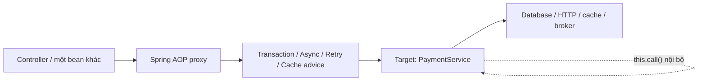
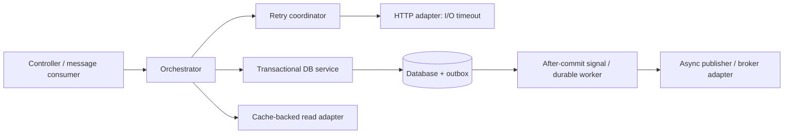

# Lỗi proxy AOP khi dùng @Transactional, @Async, @Retryable hoặc @Cacheable

Trong Spring Boot, bốn annotation `@Transactional`, `@Async`, `@Retryable` và `@Cacheable` xuất hiện thường xuyên trong các luồng tích hợp HTTP, database, cache, broker và adapter của Spring Integration. Điểm dễ gây hiểu nhầm là annotation nằm trên một phương thức **không đồng nghĩa** hành vi của nó sẽ luôn được áp dụng. Với cơ chế Spring AOP mặc định theo **proxy**, lời gọi phải đi qua đối tượng proxy đã được Spring tạo và đúng advice cần thiết mới được thực thi.

Một phương thức có thể compile, trả kết quả đúng trong trường hợp bình thường nhưng âm thầm **không mở transaction**, **không chuyển sang thread nền**, **không retry** hoặc **không tra cache**. Lỗi chỉ lộ ra khi database rollback, upstream timeout, một message bị giao lại hoặc tải tăng cao. Bài này cung cấp mô hình chẩn đoán, ví dụ sửa lỗi và phương án kiểm thử cho hệ thống **SPRING_BOOT_INTEGRATION**.

## 1. Mục tiêu và một lỗi mẫu

Sau bài học, bạn có thể:

- Giải thích proxy, target, advisor và cách Spring AOP chặn lời gọi phương thức.
- Nhận diện self-invocation, phương thức `private`/`final`, bean không do Spring quản lý, proxy JDK và proxy CGLIB.
- Kiểm tra điều kiện kích hoạt riêng cho transaction, async, retry và caching.
- Phân tích ảnh hưởng của thread boundary, rollback, advice order, cache timing và idempotency.
- Tách service theo trách nhiệm để tạo ranh giới transaction/retry/async rõ ràng.
- Thiết kế kiểm thử thực sự xác minh advice có hiệu lực, gồm các flow Spring Integration và HTTP/message consumer.
- Điều tra vấn đề thường xuất hiện sau khi nâng cấp Spring Boot, Spring Framework hoặc Spring Retry.

Xét đoạn mã sau:

```java
@Service
public class PaymentService {

    public void process(String paymentId) {
        saveStatus(paymentId);
        sendToPartner(paymentId);
    }

    @Transactional
    public void saveStatus(String paymentId) {
        // Ghi PostgreSQL.
    }

    @Retryable(retryFor = TemporaryPartnerException.class)
    public void sendToPartner(String paymentId) {
        // HTTP call; có thể timeout hoặc gặp lỗi 503.
    }
}
```

Khi một controller gọi `paymentService.process(id)`, cả `saveStatus()` và `sendToPartner()` đều được gọi **từ chính đối tượng target** thông qua `this`. Nếu Spring dùng proxy AOP thông thường, hai lời gọi nội bộ này **không đi qua proxy**, do đó `@Transactional` và `@Retryable` trên hai phương thức có thể không có tác dụng. Việc có annotation trong source không cung cấp bằng chứng về hành vi runtime.

## 2. Mô hình proxy của Spring AOP

Khi Spring phát hiện bean cần áp dụng advice, nó có thể tạo một đối tượng proxy bao quanh bean thật:



Lời gọi đi qua proxy có cơ hội được advice can thiệp. Ngược lại, lời gọi từ một phương thức của target tới phương thức khác của **cùng target** thường không quay lại proxy.

Các khái niệm:

| Thành phần | Ý nghĩa | Cách nhận biết |
|---|---|---|
| **Target** | Đối tượng chứa logic nghiệp vụ thật | Class do ứng dụng định nghĩa, ví dụ `OrderService` |
| **Proxy** | Đối tượng đại diện do Spring tạo, chặn các phương thức đủ điều kiện | Bean được inject có thể là JDK dynamic proxy hoặc CGLIB subclass |
| **Advisor/advice** | Logic chạy quanh lời gọi: bắt đầu/commit transaction, scheduling async, retry, cache lookup | Spring transaction interceptor, retry interceptor, cache interceptor... |
| **Pointcut/điều kiện áp dụng** | Quy tắc chọn phương thức cần advice | Annotation, cấu hình AOP, loại proxy và tính chất phương thức |
| **Invocation boundary** | Ranh giới lời gọi đi qua proxy | Controller → service bean, bean A → bean B |
| **Self-invocation** | Method trong target gọi method khác của chính target | `this.save()`, hoặc gọi trực tiếp `save()` |

Đây là mô hình **proxy-based AOP**, không phải sửa bytecode mọi lời gọi bên trong một class. AspectJ weaving là cơ chế khác, có thể can thiệp self-invocation khi được cấu hình đúng; không nên ngầm coi hành vi của AspectJ giống proxy mặc định của Spring Boot.

### 2.1. Điều kiện chung để annotation có hiệu lực

1. Đối tượng được Spring quản lý và điểm gọi sử dụng bean/proxy đã inject. Một object tạo bằng `new` ngoài container không tự có các advice.
2. Có đúng infrastructure của annotation: transaction manager, async processing, retry aspect hoặc cache manager.
3. Lời gọi thực sự đi qua proxy; không bị self-invocation.
4. Phương thức có thể được proxy/advised theo chiến lược proxy đang dùng.
5. Nếu có nhiều advice, thứ tự chúng được kết hợp phải phù hợp với semantics nghiệp vụ.

**Quan trọng:** một annotation thất bại có thể do nhiều điều kiện cùng lúc. Sửa self-invocation nhưng chưa bật `@EnableCaching` chẳng hạn vẫn không có caching.

## 3. Điều kiện kích hoạt của bốn annotation

| Annotation | Điều kiện cần ngoài annotation | Hành vi mong muốn | Triệu chứng khi advice không chạy |
|---|---|---|---|
| `@Transactional` | Spring transaction infrastructure và `PlatformTransactionManager` hoặc reactive transaction manager phù hợp | Mở/join transaction, commit/rollback | DB ghi dở, không rollback, `TransactionSynchronizationManager` báo không có transaction |
| `@Async` | `@EnableAsync` hoặc cấu hình tương đương, executor thích hợp | Chuyển lời gọi đủ điều kiện sang executor/thread khác | Phương thức chạy đồng bộ trên thread của caller |
| `@Retryable` | Thư viện Spring Retry, `@EnableRetry` và các thành phần AOP tương ứng | Thử lại khi gặp exception được chọn | Lỗi đầu tiên trả ngay, counter chỉ có một attempt |
| `@Cacheable` | `@EnableCaching` hoặc cơ chế caching annotation tương đương, `CacheManager` và resolver/key generator thích hợp | Tra cache trước khi chạy phương thức, lưu kết quả theo policy | Mỗi lần gọi lại đều thực hiện truy vấn hoặc gọi upstream |

Các module cần tương thích với BOM của phiên bản Spring Boot đang chạy. Đối với ứng dụng Spring Boot 3.x dùng Spring Framework 6, có thể khai báo phụ thuộc tiêu biểu:

```groovy
dependencies {
    implementation 'org.springframework.boot:spring-boot-starter-aop'
    implementation 'org.springframework.boot:spring-boot-starter-cache'
    implementation 'org.springframework.retry:spring-retry'

    // Chọn một starter truy cập dữ liệu phù hợp với ứng dụng:
    implementation 'org.springframework.boot:spring-boot-starter-data-jpa'
    // Hoặc JDBC/MongoDB/... theo transaction manager thực tế.
}
```

`@Transactional` nằm trong Spring transaction infrastructure; với một starter truy cập dữ liệu phù hợp, Boot thường cấu hình transaction management khi điều kiện thỏa mãn. `@Async` và `@Cacheable` thường cần kích hoạt annotation processing tường minh; Spring Retry cần cơ chế kích hoạt retry riêng. Không suy luận từ việc đã thêm `spring-boot-starter-aop` rằng mọi annotation tự hoạt động.

Cấu hình infrastructure minh họa:

```java
import org.springframework.cache.annotation.EnableCaching;
import org.springframework.context.annotation.Configuration;
import org.springframework.retry.annotation.EnableRetry;
import org.springframework.scheduling.annotation.EnableAsync;
import org.springframework.transaction.annotation.EnableTransactionManagement;

@Configuration
@EnableTransactionManagement
@EnableAsync
@EnableRetry
@EnableCaching
public class IntegrationAopConfiguration {
}
```

Cấu hình này chỉ kích hoạt các cơ chế; dự án vẫn cần **transaction manager**, `CacheManager`, executor và các bean khác phù hợp. Với nhiều transaction manager hoặc cache manager, phải chọn đúng cái cần dùng, không dựa vào mặc định không rõ ràng.

## 4. Self-invocation: nguyên nhân phổ biến nhất

Hai đoạn mã sau nhìn tương đương nhưng hành vi khác nhau.

### 4.1. Sai: gọi nội bộ cùng bean

```java
@Service
class OrderService {

    public void placeOrder(String orderId) {
        persistOrder(orderId);        // this.persistOrder(...)
    }

    @Transactional
    public void persistOrder(String orderId) {
        // Repository save và xử lý dữ liệu.
    }
}
```

Nếu `placeOrder()` không mở transaction, lời gọi nội bộ thường không chạy transactional advice của `persistOrder()`. Tương tự:

```java
public void refresh(String id) {
    loadCached(id);                  // @Cacheable có thể bị bỏ qua
    notifyAsync(id);                // @Async có thể bị bỏ qua
    callWithRetry(id);              // @Retryable có thể bị bỏ qua
}
```

### 4.2. Đúng: tách bean để đi qua proxy

```java
@Service
class OrderWorkflow {

    private final OrderPersistence persistence;

    OrderWorkflow(OrderPersistence persistence) {
        this.persistence = persistence;
    }

    public void placeOrder(String orderId) {
        persistence.persistOrder(orderId);
    }
}

@Service
class OrderPersistence {

    private final OrderRepository repository;

    OrderPersistence(OrderRepository repository) {
        this.repository = repository;
    }

    @Transactional
    public void persistOrder(String orderId) {
        repository.save(new OrderEntity(orderId));
    }
}
```

`OrderEntity` và `OrderRepository` là các thành phần nghiệp vụ của dự án. Điểm quan trọng là `OrderWorkflow` gọi sang **một Spring bean khác**, nơi Spring có thể trả về proxy của `OrderPersistence`.

Một lựa chọn khác là đặt `@Transactional` lên **phương thức entry point** của bean được gọi từ bên ngoài (`placeOrder()`). Việc này phù hợp khi toàn bộ xử lý cần chung một transaction và không có HTTP/broker side effect kéo dài. Không nên tách bean máy móc nếu ý nghĩa transaction không đổi; hãy chọn ranh giới nghiệp vụ đúng.

### 4.3. Không lạm dụng self-injection

Các mẹo như inject chính bean vào nó, gọi `AopContext.currentProxy()` hoặc bật `exposeProxy=true` có thể làm lời gọi nội bộ đi qua proxy, nhưng tạo phụ thuộc chặt vào AOP runtime và phức tạp hóa vòng đời bean. Khi sửa một luồng tích hợp, tách orchestration khỏi các adapter/transactional service thường dễ kiểm thử và bảo trì hơn.

Nếu dự án dùng AspectJ weaving có chủ đích, self-invocation có thể được advice xử lý. Khi đó phải xác nhận cấu hình weaving, thư viện AspectJ và kết quả runtime; không áp dụng các kết luận của proxy thông thường một cách tuyệt đối.

## 5. Proxy JDK, CGLIB, visibility và `final`

Spring có thể tạo proxy theo hai hướng:

| Thuộc tính | JDK dynamic proxy | CGLIB class-based proxy |
|---|---|---|
| Cơ chế | Proxy triển khai interface | Tạo subclass của class |
| Phương thức được expose | Chủ yếu qua interface được proxy | Phương thức có thể override trên class |
| Class `final` | Có thể proxy theo interface nếu phù hợp | Không thể tạo subclass class `final` |
| Method `final` | Tùy lời gọi qua interface và target/advice | Không thể override method `final` để advice |
| Self-invocation | Vẫn bị bỏ qua | Vẫn bị bỏ qua |
| Injection type | Inject bằng interface thường phù hợp | Có thể inject bằng concrete class |

Không nên cố khắc phục self-invocation bằng cách chuyển từ JDK sang CGLIB: cả hai vẫn có cùng hạn chế khi gọi nội bộ.

### 5.1. Chọn interface hay class injection

Với JDK proxy, bean có thể **không assign được** sang concrete class nếu injection point yêu cầu implementation. Ví dụ:

```java
public interface PartnerClient {
    PartnerResult fetch(String id);
}

@Service
public class PartnerClientImpl implements PartnerClient {
    // Phương thức implementation và các annotation.
}
```

Khi dùng JDK dynamic proxy, các consumer nên inject `PartnerClient` thay vì `PartnerClientImpl`. Nếu cấu hình bắt buộc class-based proxy, cần đảm bảo class và phương thức đủ điều kiện để proxy tạo subclass.

Spring Boot có các cấu hình liên quan tới chiến lược proxy như `spring.aop.proxy-target-class`, nhưng mức mặc định và tương tác giữa các annotation infrastructure cần xác nhận theo phiên bản Boot/Spring thực tế.

### 5.2. Visibility: không khái quát mọi annotation như nhau

- `private` không thể được override, vì vậy phương thức private không phải điểm gọi có thể advice bằng proxy class-based thông thường.
- `final` trên method/class là vấn đề với subclass proxy. Với Kotlin, cần kiểm tra plugin `kotlin-spring`/`all-open` để class/method đủ điều kiện mở khi dùng Spring proxy.
- `@Transactional` ở Spring Framework 6 có hỗ trợ rộng hơn cho method `protected` hoặc package-private khi dùng **class-based proxy**, tùy cấu hình; với interface proxy, những method đó không được expose giống public interface methods.
- `@Async`, `@Retryable` và `@Cacheable` có các yêu cầu/giới hạn riêng theo cơ chế proxy; để giảm biến số trong bài thực hành, nên dùng **phương thức public, non-final, trên Spring bean**, được gọi từ bean khác.

Nếu một phương thức dường như bị bỏ qua, hãy kiểm tra **loại proxy và đường gọi thực tế** trước khi kết luận đơn giản rằng Spring “không nhận annotation”.

## 6. `@Transactional`: transaction boundary và rollback bị hiểu sai

Ngoài self-invocation, ba nhóm lỗi thường gặp là phương thức không được advice, chọn sai transaction manager, và kỳ vọng sai về rollback.

### 6.1. Kiểm tra transaction có đang hoạt động

Trong mã chẩn đoán giới hạn ở môi trường kiểm thử:

```java
import org.springframework.transaction.support.TransactionSynchronizationManager;

boolean actualTx =
        TransactionSynchronizationManager.isActualTransactionActive();
boolean syncActive =
        TransactionSynchronizationManager.isSynchronizationActive();
```

`isActualTransactionActive()` cho biết có transaction thực sự gắn với context imperative của thread hiện tại. `isSynchronizationActive()` phản ánh cơ chế synchronization, không thay thế toàn bộ bằng chứng về việc một database operation đã tham gia đúng transaction.

Nếu log cho thấy `actualTx=false` tại nơi bạn nghĩ transaction phải mở, hãy kiểm tra lời gọi qua proxy, transaction manager, exception/rollback rules và thread boundary.

### 6.2. Rollback rules không phụ thuộc hoàn toàn vào proxy

Với Spring transaction declarative thông thường, mặc định rollback khi phương thức ném unchecked exception (`RuntimeException`) hoặc `Error`; checked exception không mặc định buộc rollback nếu không cấu hình. Ví dụ:

```java
@Transactional(rollbackFor = IOException.class)
public void importFile(Path file) throws IOException {
    // Ghi database và có thể ném IOException.
}
```

Annotation đúng, lời gọi qua proxy đúng, nhưng code bắt exception rồi trả kết quả bình thường **có thể khiến transaction commit** vì interceptor không nhìn thấy lỗi. Nếu muốn rollback, cần truyền lỗi theo hợp đồng, đặt rollback-only có chủ đích hoặc thiết kế một trạng thái lỗi đã được lưu đúng transaction.

Với `@Transactional(propagation = REQUIRES_NEW)`, nếu self-invocation bỏ qua proxy thì transaction mới cũng **không được tạo**. Điều này đặc biệt nguy hiểm trong outbox worker hoặc xử lý file sau commit, khi ứng dụng tưởng mỗi lần cập nhật trạng thái dùng transaction riêng.

### 6.3. Transaction không đi xuyên mọi resource

Transaction JDBC/JPA không bao trùm tự động HTTP call, Redis, gửi Kafka/JMS, filesystem hay object storage. Khi HTTP upstream thành công nhưng database rollback, không có Spring AOP proxy nào có thể tự “undo” side effect phía upstream.

Với luồng “lưu DB → phát event”, nên cân nhắc transactional outbox và consumer idempotent. Khi cần side effect sau commit, có thể dùng `@TransactionalEventListener(phase = AFTER_COMMIT)` để kích hoạt nhanh, nhưng event nội bộ không bền vững khi JVM chết; outbox/job reconciliation mới giúp phục hồi.

## 7. `@Async`: thread khác, context và thời điểm commit

`@Async` lên một phương thức thường có ý nghĩa yêu cầu Spring chuyển lời gọi qua executor, không phải bảo đảm nghiệp vụ đã “xử lý xong” khi phương thức trả về.

### 7.1. Ví dụ cấu hình executor

```java
import java.util.concurrent.ThreadPoolExecutor;
import org.springframework.context.annotation.Bean;
import org.springframework.context.annotation.Configuration;
import org.springframework.scheduling.annotation.EnableAsync;
import org.springframework.scheduling.concurrent.ThreadPoolTaskExecutor;

@Configuration
@EnableAsync
class AsyncConfiguration {

    @Bean("integrationExecutor")
    ThreadPoolTaskExecutor integrationExecutor() {
        ThreadPoolTaskExecutor executor = new ThreadPoolTaskExecutor();
        executor.setCorePoolSize(4);
        executor.setMaxPoolSize(8);
        executor.setQueueCapacity(100);
        executor.setThreadNamePrefix("integration-");
        executor.setRejectedExecutionHandler(
                new ThreadPoolExecutor.AbortPolicy()
        );
        return executor;
    }
}
```

Cần quyết định về pool size, queue capacity, rejection policy và shutdown theo tải thực tế. Nếu queue đầy, lời gọi async có thể bị từ chối; đó là lỗi phải được xử lý, không được xem như tác vụ đã chắc chắn được thực hiện.

### 7.2. Tách bean async và bean transaction

```java
import java.util.concurrent.CompletableFuture;
import org.springframework.scheduling.annotation.Async;
import org.springframework.stereotype.Service;
import org.springframework.transaction.annotation.Transactional;

@Service
class AsyncDispatchService {

    private final DispatchStateService stateService;

    AsyncDispatchService(DispatchStateService stateService) {
        this.stateService = stateService;
    }

    @Async("integrationExecutor")
    public CompletableFuture<Void> dispatch(String eventId) {
        stateService.recordStarted(eventId);
        // Thực hiện bước tích hợp đã được phép chạy sau khi dữ liệu sẵn sàng.
        return CompletableFuture.completedFuture(null);
    }
}

@Service
class DispatchStateService {

    private final DispatchRepository repository;

    DispatchStateService(DispatchRepository repository) {
        this.repository = repository;
    }

    @Transactional
    public void recordStarted(String eventId) {
        repository.markStarted(eventId);
    }
}
```

`DispatchRepository` là repository nghiệp vụ minh họa. Khi một bean khác gọi `AsyncDispatchService.dispatch()` qua proxy, task có thể chạy trên executor; trong task đó lời gọi sang `DispatchStateService` lại đi qua transactional proxy và mở transaction ở **thread worker**.

**Không kỳ vọng transaction thread-local của controller được mang sang `@Async`.** Nếu controller đang trong transaction chưa commit và khởi chạy async, worker có thể chạy trước khi dữ liệu được commit, không nhìn thấy record cần xử lý, hoặc gặp race condition.

Một mẫu an toàn hơn là **commit trạng thái và outbox trước**, rồi cho async worker đọc những job đã commit. `@TransactionalEventListener(AFTER_COMMIT)` có thể kích hoạt xử lý sớm, kết hợp quét job bền vững để phục hồi khi process crash.

### 7.3. `@Async` cùng `@Transactional` trên một phương thức

Việc đặt cả hai annotation trên cùng phương thức có thể khiến semantics phụ thuộc cấu hình proxy, thứ tự advice và nơi invocation thực sự được thực thi. Không suy đoán rằng “transaction của caller tự chảy sang thread mới”. Với các luồng cần tính đúng đắn, **tách async orchestration và transactional persistence thành hai Spring bean**, kiểm thử thread và transaction thực tế.

Kết quả async nên dùng kiểu hỗ trợ như `CompletableFuture<T>` hoặc `Future<T>` khi cần quan sát kết quả. Với `void`, exception thường không được trả về caller; cần cấu hình `AsyncUncaughtExceptionHandler` hoặc xử lý/log/ghi trạng thái lỗi ở worker, tránh mất tác vụ âm thầm. `ThreadLocal`, MDC/correlation ID và security context không tự bảo đảm lan truyền xuyên executor; cấu hình propagation có chủ đích, không truyền access token vào log/baggage.

## 8. `@Retryable`: retry phải bao trùm đúng lời gọi

Spring Retry thường được kích hoạt bằng `@EnableRetry` và retry advice. Nếu chỉ annotation một phương thức được gọi nội bộ hoặc bean chưa được Spring proxy, lỗi sẽ không được retry.

```java
import org.springframework.retry.annotation.Backoff;
import org.springframework.retry.annotation.Retryable;
import org.springframework.stereotype.Service;

@Service
class PartnerAdapter {

    @Retryable(
            retryFor = TemporaryPartnerException.class,
            maxAttempts = 3,
            backoff = @Backoff(delay = 200, multiplier = 2)
    )
    public PartnerResponse fetch(String id) {
        return callHttpPartnerOnce(id);
    }
}
```

Đoạn này giả định `TemporaryPartnerException` và phương thức gọi HTTP được dự án định nghĩa. Những điều kiện cần xác minh:

- Client gọi `PartnerAdapter.fetch()` qua bean được inject, không gọi `this.fetch()`.
- Exception thực tế thuộc loại được retry; nếu client wrap thành một loại exception khác, rule có thể không khớp.
- `maxAttempts` tính cả lần thử ban đầu theo cách dùng phổ biến của Spring Retry.
- Các tầng phía dưới không tự retry thêm nhiều lần mà không được tính vào ngân sách tổng.
- Mỗi lần thử có timeout mạng rõ ràng, và hành động ghi/phát event chịu được kết quả không xác định.

### 8.1. Retry cùng transaction: vấn đề rollback-only

Một transaction JDBC/JPA đã bị đánh dấu rollback-only không thể được “làm sạch” đơn giản bằng cách bắt exception rồi gọi lại repository trong chính transaction đó. Nếu retry advice bao quanh phần còn **bên trong cùng một transaction đã mở**, các attempt sau có thể tiếp tục gặp trạng thái rollback-only, hoặc lần commit cuối ném `UnexpectedRollbackException`.

Với lỗi transient của database, thường cần **retry một thao tác transactional hoàn chỉnh**, trong đó **mỗi attempt mở transaction riêng**. Điều này đòi hỏi sắp thứ tự advice phù hợp hoặc tách bean rõ ràng:

```java
@Service
class OrderRetryCoordinator {

    private final OrderTransactionalWriter writer;

    OrderRetryCoordinator(OrderTransactionalWriter writer) {
        this.writer = writer;
    }

    @Retryable(
            retryFor = TransientOrderDatabaseException.class,
            maxAttempts = 3
    )
    public void writeWithRetry(OrderCommand command) {
        writer.write(command); // Lời gọi qua bean/proxy khác.
    }
}

@Service
class OrderTransactionalWriter {

    @Transactional
    public void write(OrderCommand command) {
        // Mỗi lần retry của coordinator đi qua transactional proxy.
        // Phần ghi dữ liệu cần idempotent theo khóa nghiệp vụ.
    }
}
```

Kiểu `OrderCommand` và ngoại lệ transient là minh họa. Trong môi trường thật, lỗi database có thể được Spring dịch sang các nhóm `TransientDataAccessException`; nên xác định những lỗi thực sự an toàn để retry, không biến toàn bộ `DataAccessException` thành retry vô hạn.

### 8.2. Khi dùng `@Recover`

`@Recover` cho phép trả fallback hoặc phân loại lỗi sau khi retry hết. Fallback không nên che mất lỗi thành kết quả thành công giả, nhất là trong thanh toán, đặt hàng hoặc xác nhận đã publish message.

Nếu broker redeliver cả message sau khi handler thất bại và handler lại có `@Retryable`, số lần side effect có thể nhân lên. Cần một chủ sở hữu retry rõ cho mỗi đường I/O và một idempotency key bền vững qua các lần giao lại.

## 9. `@Cacheable`: cache lookup bị bỏ qua hoặc dùng sai thời điểm

`@Cacheable` yêu cầu cache advice hoạt động quanh lời gọi. Mặc định cần cơ chế caching annotation đã kích hoạt, `CacheManager` phù hợp và một cache name đúng.

```java
import org.springframework.cache.annotation.Cacheable;
import org.springframework.stereotype.Service;

@Service
class ProductCatalogAdapter {

    private final CatalogHttpClient client;

    ProductCatalogAdapter(CatalogHttpClient client) {
        this.client = client;
    }

    @Cacheable(cacheNames = "productCatalog", key = "#sku")
    public ProductDetails load(String sku) {
        return client.fetch(sku);
    }
}
```

`CatalogHttpClient` và `ProductDetails` là kiểu minh họa. Nếu code khác gọi bean qua proxy hai lần với cùng `sku` và cache cấu hình đúng, lần thứ hai có thể dùng entry đã lưu. Nếu một phương thức trong chính `ProductCatalogAdapter` gọi `load(sku)`, cache advice có thể bị bỏ qua.

### 9.1. Kiểm tra các lỗi ngoài proxy

- **Key sai:** dùng key thiếu tenant/locale/version, làm trả dữ liệu của nhóm người dùng khác hoặc kết quả cũ.
- **Cache manager sai:** có bean cache manager nhưng không phải cache backend ứng dụng mong muốn, ví dụ local `ConcurrentMapCacheManager` thay cho Redis.
- **TTL và invalidation thiếu:** entry cũ tiếp tục được trả về dù database đã đổi.
- **Giá trị null/exception:** policy có lưu null hay không và lúc lỗi có cache lỗi không cần xác định rõ theo provider/cách cấu hình.
- **Không đồng nhất nhiều pod:** cache local ở từng instance không tự đồng bộ, chỉ Redis hoặc backend chung mới tạo shared entries theo key namespace.
- **Nhiều advice cùng một method:** thứ tự cache và retry quyết định cache hit có bỏ qua logic retry/circuit breaker hay không; cần kiểm tra thật bằng integration test.

### 9.2. Cache và transaction commit

Giả sử một phương thức `@Transactional` cập nhật giá sản phẩm rồi gọi `@CacheEvict`. Nếu cache bị xóa **trước** database commit và một request khác lập tức nạp lại từ trạng thái cũ, cache có thể chứa dữ liệu sai sau commit. Tương tự, đặt `@CachePut` cho dữ liệu chưa commit có thể làm lộ trạng thái chưa hoàn tất.

Một số cấu hình như `TransactionAwareCacheManagerProxy` hoặc transaction-aware cache decorator có thể trì hoãn những thao tác cache phù hợp đến after-commit khi transaction synchronization đang hoạt động. **Không mặc định mọi provider, cache operation hoặc dạng annotation đều có hành vi sau commit**; cần xác minh bằng integration test. Việc đánh dấu cache transaction-aware cũng không biến cache và database thành transaction phân tán.

Với cập nhật nghiệp vụ quan trọng, hãy thiết kế invalidation/refresh sau commit và cơ chế đối soát hoặc event-driven invalidation khi tác vụ có thể bị mất. Với message consumer, idempotency nên đặt tại database/ràng buộc bền vững, không dựa vào một cache entry có thể hết TTL hoặc bị evict.

## 10. Kết hợp annotation: thứ tự advice quyết định kết quả

Khi cùng một method có nhiều annotation:

```java
@Retryable(retryFor = TransientPartnerException.class)
@CircuitBreaker(name = "partner")
@Transactional
@Cacheable(cacheNames = "partnerData", key = "#id")
public PartnerData read(String id) { /* ... */ }
```

Một lời gọi có thể đi qua nhiều interceptor, nhưng **không xác định thứ tự chỉ bằng thứ tự viết annotation trong source**. Thứ tự phụ thuộc `Ordered`, thứ tự advisor và cấu hình infrastructure của Spring, Spring Retry/Resilience4j cùng các phiên bản thư viện.

Ví dụ hai cấu trúc:

```text
Cấu trúc A:
Retry (outer)
  -> Transaction (inner)
      -> business method

Mỗi attempt đi vào một transaction invocation riêng.

Cấu trúc B:
Transaction (outer)
  -> Retry (inner)
      -> business method

Nhiều attempt có thể nằm trong một transaction;
lỗi database ở attempt đầu có thể làm transaction rollback-only.
```

Với `@Async`, câu hỏi còn là **method chạy trên thread nào** trước khi transaction interceptor bắt đầu. Với `@Cacheable`, cache hit có thể khiến phần còn lại của chuỗi interceptor không đi đến target method theo thứ tự thực tế.

### Hướng thiết kế dễ dự đoán

Tách những trách nhiệm có lifecycle khác nhau:



Ở cấu trúc này, đường gọi qua các bean rõ ràng, có thể đo đếm retry attempts, điểm bắt đầu/kết thúc transaction, thời điểm cache được nạp và thời điểm message được publish. Không cần “nhồi” cả bốn annotation lên cùng một method nghiệp vụ.

## 11. Spring Integration: proxy boundary còn gặp thread và message boundary

Một flow Spring Integration có thể đi từ inbound HTTP/JMS/Kafka vào message channel, transformer, service activator, filter, router, splitter và outbound adapter. Annotation AOP trên service được gọi bởi flow vẫn tuân theo luật proxy.

### 11.1. `DirectChannel` và `ExecutorChannel`

- Với `DirectChannel`, handler thường thực thi trên thread của sender; thread-bound transaction có thể còn hiệu lực khi handler được gọi đồng bộ đúng ranh giới.
- Với `ExecutorChannel` hoặc cơ chế async channel, message được dispatch sang executor; transaction thread-local của sender **không tự được truyền sang thread mới**.
- Với inbound broker listener, transaction/ack thường gắn với container listener; lời gọi sang một bean async có thể return trước khi xử lý xong, ảnh hưởng thời điểm ack/commit.
- Advice trên handler hoặc poller (ví dụ retry advice) khác với `@Retryable` ở service. Nếu cả hai được cấu hình, số lần thử có thể nhân lên.
- Exception bị gửi vào `errorChannel` nhưng không propagate tới transaction boundary có thể khiến transaction commit thay vì rollback như mong muốn.

Ví dụ một flow:

```text
JMS inbound adapter
   -> DirectChannel
   -> @ServiceActivator bean
        -> @Transactional DB writer

JMS inbound adapter
   -> ExecutorChannel
   -> @ServiceActivator bean
        -> @Transactional DB writer
```

Trong nhánh thứ hai, transaction của container listener không thể mặc định bảo vệ DB writer trên thread executor. DB writer có thể mở transaction **riêng** qua Spring proxy; việc ack JMS và commit database lúc này là hai thời điểm khác nhau.

Nếu yêu cầu “DB commit xong mới coi message xử lý hoàn tất”, phải thiết kế ranh giới callback/ack theo cơ chế broker và channel phù hợp. Dùng outbox hoặc consumer idempotent khi không thể tạo một transaction nguyên tử xuyên broker và database.

### 11.2. Rủi ro với `@Async` ở consumer

```java
@JmsListener(destination = "orders.events")
public void receive(OrderEvent event) {
    asyncProcessor.process(event); // @Async trả về rất sớm.
    // Listener có thể kết thúc trước khi worker ghi DB thành công.
}
```

Nếu container coi listener return là xử lý thành công và commit/ack, một lỗi trong worker có thể xảy ra **sau khi message đã được xác nhận**, làm mất cơ hội redelivery tự nhiên. Khi muốn xử lý bất đồng bộ bền vững, hãy persist job/outbox trước khi ack, hoặc dùng cơ chế queue/worker có xác nhận và retry độc lập. Không dùng `@Async` như một cách thay thế broker delivery semantics.

### 11.3. Cache trong integration flow

Một cache-backed adapter dùng `@Cacheable` có thể giảm số HTTP request, nhưng phải xác định namespace tenant, TTL, invalidation và phạm vi local/distributed. Lời gọi nội bộ từ transformer sang helper trong cùng bean cũng không kích hoạt cache advice. Khi xử lý message có dữ liệu cá nhân, tránh cache nguyên access token hoặc payload nhạy cảm mà không có chính sách bảo vệ.

## 12. Quy trình chẩn đoán proxy AOP theo triệu chứng

Khi tính năng không hoạt động, tránh sửa cấu hình mò mẫm. Theo thứ tự:

1. **Xác định điểm gọi thật.** Ai gọi method? Qua bean Spring hay `new`? Có self-invocation, static helper, private/final method không?
2. **Kiểm tra cơ chế kích hoạt.** Đã có `@EnableAsync`, `@EnableCaching`, `@EnableRetry`, transaction manager/executor/cache manager phù hợp chưa?
3. **Xác minh loại proxy.** JDK hay CGLIB? Injection point là interface hay implementation? Method có thể được advise không?
4. **Kiểm tra runtime thay vì chỉ annotation.** Ghi lại số attempts, thread, transaction-active, cache hit/miss bằng phép đo an toàn.
5. **Xác định thứ tự advice và ranh giới transaction.** Retry nằm ngoài hay trong transaction? Async thực thi ở thread nào? Cache đọc/trả kết quả khi nào?
6. **Kiểm tra downstream và external semantics.** HTTP timeout, broker ack, database rollback, Redis TTL hoặc DLQ có thể gây hiện tượng giống lỗi AOP.
7. **Khóa lại bằng test hồi quy.** Dựng tình huống lỗi thật, assert kết quả và ranh giới side effect.

### 12.1. Kiểm tra một bean có phải proxy

Đoạn kiểm tra dành cho môi trường test/chẩn đoán:

```java
import org.springframework.aop.support.AopUtils;

Object bean = applicationContext.getBean("orderPersistence");

boolean isProxy = AopUtils.isAopProxy(bean);
boolean jdkProxy = AopUtils.isJdkDynamicProxy(bean);
boolean cglibProxy = AopUtils.isCglibProxy(bean);
```

Bean là proxy **chưa đủ** để kết luận một method cụ thể đã được advice. Nó có thể được proxy vì một annotation khác; nên kiểm tra advisor/method invocation khi cần. Không in `bean.toString()` hoặc tất cả method arguments vào log nếu có dữ liệu nhạy cảm.

Có thể tạm bật mức log chẩn đoán trên môi trường test với các package transaction/AOP/cache/retry phù hợp, nhưng phải giới hạn thời gian và lọc dữ liệu. Log SQL bind values, HTTP payload hoặc exception upstream có thể chứa token và thông tin cá nhân.

### 12.2. Bảng tra cứu nhanh

| Triệu chứng | Nguyên nhân AOP thường gặp | Cách xác minh |
|---|---|---|
| `@Transactional` nhưng rollback không xảy ra | Self-invocation, không qua proxy, transaction manager khác, checked exception hoặc lỗi bị nuốt | Assert DB state sau exception; kiểm tra actual transaction và rollback rule |
| `@Async` nhưng caller vẫn bị chặn | Self-invocation, thiếu `@EnableAsync`, method không proxy được, executor bị nghẽn | Kiểm tra thread/caller latency và executor metrics |
| `@Retryable` chỉ gọi một lần | Không qua proxy, thiếu retry infrastructure, exception không match | Đếm attempts thật dưới lỗi cố định |
| `@Cacheable` luôn gọi repository | Self-invocation, sai cache name/key/manager, caching chưa enabled | Đếm downstream calls, kiểm tra key và cache contents |
| Method `final` không nhận advice | CGLIB không override được | Kiểm tra class/method final và loại proxy |
| Injection bean lỗi khi bật proxy | JDK proxy không assign vào concrete class | Inject qua interface hoặc sửa chiến lược proxy |
| Retry chạy nhưng commit cuối báo rollback-only | Retry nằm trong transaction hoặc bắt exception sai | Kiểm tra order và transaction ở từng attempt |
| Worker async không thấy dữ liệu mới | Chạy trước commit hoặc không mang transaction | Dùng after-commit signal/outbox; assert trạng thái commit |
| JMS ack trước khi DB write xong | Listener gọi async rồi return | Kiểm tra ack boundary và job persistence |
| Cache chứa giá trị cũ sau commit | Eviction/put sai thời điểm, nhiều pod, thiếu invalidation | Test song song và kiểm tra TTL/refresh |

## 13. Kiểm thử có khả năng phát hiện lỗi proxy thật

Các test chỉ kiểm tra phương thức trả kết quả đúng thường bỏ sót lỗi AOP. Hãy thiết kế assertion cho hành vi cốt lõi.

### 13.1. Transaction: rollback qua proxy

Tạo một service test gọi bean thực từ Spring context, insert hai record rồi cố tình ném `RuntimeException`:

```java
@SpringBootTest
class OrderTransactionIT {

    @Autowired OrderPersistence persistence;
    @Autowired OrderRepository repository;

    @Test
    void rollsBackWhenServiceFails() {
        String id = UUID.randomUUID().toString();

        assertThatThrownBy(() -> persistence.saveThenFail(id))
                .isInstanceOf(IllegalStateException.class);

        assertThat(repository.findById(id)).isEmpty();
    }
}
```

`saveThenFail()` là method nghiệp vụ minh họa có `@Transactional` và ném `IllegalStateException` **sau khi ghi**. Không đặt `@Transactional` mặc định trên chính test rồi suy luận rằng rollback là do proxy của service; với Spring Test, transaction test có thể rollback sau test và che bug service không mở transaction.

### 13.2. Retry: đếm số lần thử thực tế

Dùng fake HTTP adapter ghi lại số lần gọi và ném exception transient ở hai lần đầu. Gọi service retry bằng bean được inject; assert số calls và kết quả cuối. Test cả lỗi không retryable để chứng minh filter exception đúng. Nếu dùng retry đồng thời ở Spring Integration và broker, thêm test về số attempts end-to-end.

### 13.3. Async: không dựa vào `Thread.sleep`

Để xác minh async, dùng `CountDownLatch`/`CompletableFuture` hoặc một executor được kiểm soát. Assert method được chạy trên thread khác khi được thiết kế như vậy, và worker hoàn thành trước thời hạn test. Tránh kiểm thử chỉ bằng thời gian chạy vì scheduler có thể khiến bài test lúc xanh lúc đỏ.

### 13.4. Cache: đếm truy vấn và kiểm tra invalidation

Gọi service `@Cacheable` hai lần với cùng key, assert repository/HTTP adapter chỉ thực hiện một lần trong điều kiện tuần tự và cache hợp lệ; đổi key rồi assert có lần gọi mới. Khi có update nghiệp vụ, assert dữ liệu cache thay đổi **sau thời điểm commit mong muốn**. Với Redis distributed cache, cần test hai application contexts/instances dùng cùng Redis thay vì chỉ một `ConcurrentMapCacheManager`.

### 13.5. Kiểm tra tổ hợp advice

Với retry quanh transaction: làm database attempt đầu thất bại và attempt sau thành công, assert attempt sau có transaction hợp lệ mới, không dùng lại rollback-only transaction. Với async và broker: chứng minh ack/commit không xuất hiện trước khi trạng thái đã bền vững theo contract. Test này có giá trị hơn assertion đếm annotation.

## 14. Khi nâng cấp Spring Boot, Spring Framework và thư viện AOP

Lỗi proxy có thể xuất hiện hoặc trở nên rõ ràng sau khi nâng major version. Các vùng cần rà soát:

- **Jakarta namespace:** Spring Boot 3.x dùng nhiều API `jakarta.*` thay cho `javax.*` (ví dụ Servlet/JPA/JMS), nhưng đổi package không tự khắc phục vấn đề proxy/self-invocation.
- **Khả năng proxy method:** Spring Framework 6 có những thay đổi trong hỗ trợ method visibility của `@Transactional` trên class-based proxy; cùng annotation có thể có semantics khác với cấu hình trước đó.
- **Spring Retry:** kiểm tra API và cách enable retry, starter/module version, transaction advice order và tính tương thích với Spring Framework đang dùng.
- **Proxy strategy:** nếu chuyển giữa JDK proxy và CGLIB, rà soát interface injection, final classes và Kotlin classes.
- **Async executor:** default executor và thread pool có thể đổi theo cấu hình, task rejection/observability gây khác biệt runtime.
- **Cache manager:** thay auto-configuration hoặc backend local/Redis khiến cache key, serialization và TTL thay đổi.
- **Spring Integration:** thay đổi channel executor/poller có thể chuyển transaction boundary và thay hành vi error channel/redelivery.

### 14.1. Cách xác minh dependency và cấu hình

Với dự án Gradle:

```bash
./gradlew dependencies --configuration runtimeClasspath
./gradlew dependencyInsight --dependency spring-aop --configuration runtimeClasspath
./gradlew dependencyInsight --dependency spring-tx --configuration runtimeClasspath
./gradlew dependencyInsight --dependency spring-retry --configuration runtimeClasspath
./gradlew dependencyInsight --dependency spring-context --configuration runtimeClasspath
```

Với Maven:

```bash
mvn dependency:tree
```

Các lệnh là gợi ý khi điều tra, không cần chạy nếu nhiệm vụ chỉ là soạn bài. BOM phải đồng bộ Spring Boot/Spring Framework/Spring Cloud/Resilience4j/Spring Retry; không tùy tiện ép một module Spring lên phiên bản khác phần còn lại của framework.

Sau nâng cấp, chạy smoke test qua **bean Spring thật**, assert actual behavior của transaction, async, retry và caching, cùng lỗi proxy type hoặc method visibility nếu có. Tránh tin rằng compile thành công hoặc bean xuất hiện trong ApplicationContext là đủ.

## 15. Bài tập thực hành

### Bài tập A: Sửa self-invocation

Cho `OrderFacade.create()` gọi `this.save()` được annotate `@Transactional`. Hãy tách `save()` sang `OrderPersistenceService` và viết test ném exception giữa hai lần insert, xác minh không có bản ghi nào còn lại sau rollback.

**Điểm cần giải thích:** tại sao việc đổi sang `proxyTargetClass=true` không tự sửa self-invocation.

### Bài tập B: Retry bên ngoài transaction

Một service dùng `@Retryable` và `@Transactional` trên cùng method, gặp `UnexpectedRollbackException` khi database deadlock. Hãy tách `RetryCoordinator` và `TransactionalWriter`; mỗi attempt phải gọi qua transactional proxy và dùng cùng business idempotency key. Viết test failure-once rồi success.

**Điểm cần giải thích:** vì sao retry cùng một transaction rollback-only không tương đương mở transaction mới.

### Bài tập C: JMS + `@Async`

Một `@JmsListener` gọi `@Async` để lưu database rồi trả về. Thiết kế lại để listener chỉ ack sau khi thông tin đầu vào đã được lưu bền vững, worker xử lý theo job hoặc outbox và bảo đảm consumer idempotent khi message bị phát lại.

**Điểm cần giải thích:** Spring proxy có thể kích hoạt async đúng, nhưng vẫn tạo ra lỗi nghiệp vụ nếu ack xảy ra trước commit DB.

### Bài tập D: Cache và dữ liệu đa tenant

Một method `@Cacheable(cacheNames="prices", key="#productId")` phục vụ nhiều tenant. Hãy sửa key có tenant ID được xác thực, thiết kế eviction sau commit và test hai tenant dùng cùng productId không nhìn thấy dữ liệu của nhau.

**Điểm cần giải thích:** cache advice hoạt động đúng về kỹ thuật vẫn có thể phá hợp đồng dữ liệu nếu key/invalidation sai.

## 16. Checklist trước khi phát hành

- [ ] Bean có annotation được Spring quản lý và caller sử dụng Spring proxy, không tạo object bằng `new` tùy tiện.
- [ ] Lời gọi cần advice không phải self-invocation; có kế hoạch riêng nếu dùng AspectJ weaving.
- [ ] Class/method có visibility và tính kế thừa phù hợp với JDK/CGLIB proxy và Java/Kotlin.
- [ ] `@Transactional` có đúng transaction manager, rollback rule và ranh giới bên ngoài proxy.
- [ ] `@Async` có enable/executor phù hợp, xử lý rejection và exception, không giả định transaction/MDC tự truyền thread.
- [ ] `@Retryable` có enable/AOP và policy exception/backoff/attempts đúng; không retry lồng nhau vô hạn.
- [ ] `@Cacheable` có enable/cache manager/key/TTL/invalidation đúng, bao gồm tenant boundary.
- [ ] Thứ tự advice retry/transaction/cache/async được xác nhận bằng test, không suy từ thứ tự annotation.
- [ ] HTTP/database/broker side effect có timeout và idempotency; transaction DB không được hiểu nhầm là transaction phân tán.
- [ ] Spring Integration channel/poller/listener/error channel giữ đúng semantics transaction và ack khi có async.
- [ ] Có test rollback, attempt count, async completion, cache hit/miss và multi-tenant invalidation trên bean thực.
- [ ] Sau nâng cấp Spring Boot hoặc thư viện AOP, đã rà soát BOM, proxy strategy, visibility, executor và transaction boundary.

**Ghi nhớ:** khi một annotation Spring “không có tác dụng”, hãy truy từ **đường lời gọi thực tế qua proxy**, điều kiện kích hoạt infrastructure, loại proxy, thread và thứ tự advice. Sửa bằng ranh giới service rõ ràng và test hành vi thực sẽ đáng tin cậy hơn chỉ đổi annotation hoặc tăng log level. Trong luồng tích hợp, transaction, retry, async và cache cần phối hợp với **idempotency, trạng thái bền vững và cơ chế phục hồi**, vì một proxy hoạt động đúng chưa tự bảo đảm tính đúng đắn khi nhiều hệ thống cùng tham gia.

