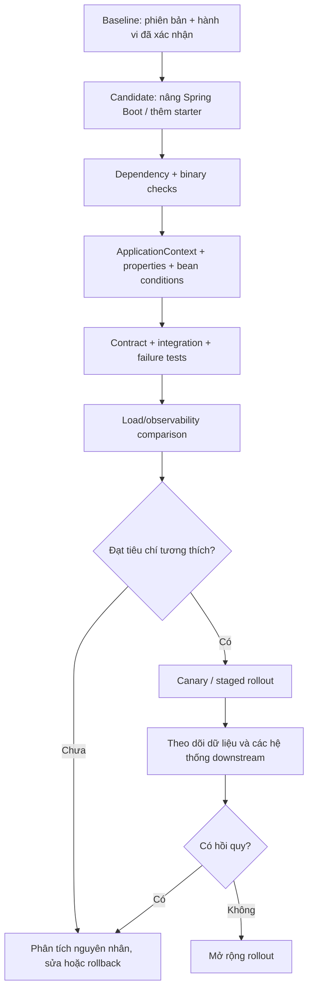

# Kiểm thử tương thích khi nâng Spring Boot hoặc thêm starter bên thứ ba

## 1. Vì sao ứng dụng khởi động thành công vẫn có thể không tương thích?

Trong module **SPRING_BOOT_INTEGRATION**, một ứng dụng Spring Boot có thể nhận HTTP, gọi hệ thống đối tác, ghi cơ sở dữ liệu hoặc cache, phát thông điệp qua broker và dùng các adapter của Spring Integration. Nâng phiên bản Spring Boot hoặc thêm một *starter bên thứ ba* có thể làm thay đổi dependency, bean được tự cấu hình, cách xử lý lỗi, timeout, chuyển đổi dữ liệu hay cơ chế giao dịch mà không cần sửa một dòng nghiệp vụ nào.

Ví dụ một nhóm thêm starter của nhà cung cấp để tích hợp broker. Build thành công, `ApplicationContext` khởi động bình thường, health endpoint trả `UP`. Nhưng starter đó tạo thêm một message converter, khiến trường ngày tháng được serialize khác; downstream không còn đọc được sự kiện. Hoặc một auto-configuration tạo HTTP client mới với timeout/pool khác, làm retry tăng đột biến khi đối tác chậm.

Vì vậy, **tương thích** phải được kiểm chứng theo nhiều lớp, từ khả năng resolve dependency đến kết quả thực sự của luồng tích hợp. Đây cũng là lý do quy trình nâng cấp cần baseline, kiểm thử hồi quy có mục tiêu, bằng chứng quan sát và kế hoạch rollback.

Sau bài này, người học có thể:

- Phân biệt tương thích **build/binary**, **auto-configuration**, **hợp đồng dữ liệu**, **hạ tầng/giao thức** và **hành vi vận hành**.
- Phát hiện thay đổi do Spring Boot BOM, Spring Framework, Spring Data, Spring Integration, driver/SDK và transitive dependency của starter mới.
- Kiểm chứng bean, thứ tự auto-configuration, property binding, client thật và các điều kiện `@Conditional...`.
- Thiết kế bộ test HTTP, database/cache, broker, Spring Integration, lỗi, retry, idempotency và transaction phù hợp.
- Quyết định nâng cấp, rollout từng phần hoặc rollback dựa trên bằng chứng kỹ thuật và chỉ số nghiệp vụ.

## 2. Năm lớp tương thích cần phân biệt

| Lớp | Câu hỏi kiểm chứng | Dấu hiệu lỗi |
|---|---|---|
| **1. Build và binary** | Java/Gradle/Maven có hỗ trợ? Class, method, annotation, module và thư viện có tương thích? | Lỗi compile, `ClassNotFoundException`, `NoSuchMethodError`, `NoClassDefFoundError`, `LinkageError` khi chạy. |
| **2. Bean và cấu hình** | Bean nào được tạo, bean nào bị thay thế? Property cũ còn hiệu lực? Factory/client nào thực sự được dùng? | `NoSuchBeanDefinitionException`, trùng bean, circular dependency, property bị bỏ qua hoặc dùng default ngoài ý muốn. |
| **3. Hợp đồng tích hợp** | Payload, header, encoding, schema, endpoint, HTTP status và event format có giữ tương thích? | Consumer lỗi deserialize; thay đổi null/enum/date; HTTP retry nhầm vì status khác. |
| **4. Hạ tầng và semantics** | Driver, giao thức, transaction, broker ack, ordering, timeout và idempotency có giữ hành vi? | Commit một phần, mất thông điệp, xử lý trùng, pool cạn, retry vô hạn. |
| **5. Vận hành và quan sát** | Latency, throughput, queue lag, error rate, memory và traces có ổn định? | Ứng dụng `UP` nhưng backlog tăng, p99 xấu, DLQ hoặc số duplicate tăng. |

Không có một bài `@SpringBootTest` chỉ xác nhận context load nào chứng minh được cả năm lớp trên. Nó là một **smoke test hữu ích**, còn kiểm thử tương thích cần chọn các quan sát đúng với rủi ro thay đổi.



## 3. Chốt baseline trước khi thay đổi dependency

Baseline không chỉ là số phiên bản đang chạy. Nó gồm **đồ thị thư viện**, **cấu hình có hiệu lực**, **đường đi dữ liệu** và **những hành vi được chấp nhận**.

Một biểu mẫu baseline cho ứng dụng tích hợp có thể chứa:

| Thành phần | Cần ghi nhận |
|---|---|
| JDK / toolchain | Phiên bản Java runtime/compiler, Gradle wrapper hoặc Maven, tùy chọn compiler. |
| Spring ecosystem | Spring Boot plugin/BOM, Spring Framework, Spring Data, Spring Integration, Spring Security, Micrometer, Spring Cloud nếu dùng. |
| HTTP | `RestClient`, `RestTemplate`, `WebClient` hoặc adapter nào được dùng; request factory/connector, TLS, timeout, pool, error mapping. |
| Database / cache | JDBC/NoSQL driver, transaction manager, serialization, schema/migration, Redis client và TTL semantics. |
| Broker | Spring Kafka/AMQP/JMS, Kafka/RabbitMQ/client version, message converter, listener ack, retry/DLQ, transactional producer nếu dùng. |
| Spring Integration | Channel/endpoint IDs, converter, gateway timeout, error channel, retry advice, polling và lifecycle. |
| Starter bên ngoài | Tọa độ artifact, version, tác giả, tài liệu tương thích, auto-configuration/bean/property mà nó đưa vào. |
| Hợp đồng và vận hành | JSON/Avro/Protobuf schema, API status, idempotency key, event headers, p95/p99, consumer lag, tỷ lệ lỗi và baseline throughput. |

Nếu có thể, giữ dependency lock hoặc báo cáo resolved dependency cho baseline và candidate. **Khác version khai báo** không đảm bảo **khác resolved version**: BOM, dependency constraints và quy tắc conflict resolution có thể chọn bản khác với bản trong file build.

### Lệnh điều tra dependency

Với Gradle, ví dụ:

```powershell
./gradlew dependencies --configuration runtimeClasspath
./gradlew dependencyInsight --dependency spring-integration-core --configuration runtimeClasspath
./gradlew dependencyInsight --dependency jackson-databind --configuration runtimeClasspath
./gradlew dependencyInsight --dependency httpclient5 --configuration runtimeClasspath
```

Với Maven:

```bash
./mvnw dependency:tree
./mvnw dependency:tree -Dincludes=org.springframework.integration
./mvnw dependency:tree -Dincludes=com.fasterxml.jackson.core
```

Đây là lệnh minh họa cho người học tự thực hiện trong dự án, **không phải kết quả đã chạy**. Tên artifact và group ID phụ thuộc dependency thực tế. Lưu báo cáo cùng cấu hình candidate để khi có lỗi `NoSuchMethodError` hoặc đổi hành vi JSON có thể truy được thư viện nào đã thay đổi.

## 4. Thay đổi Spring Boot tác động đến những gì?

Spring Boot BOM quản lý phiên bản của nhiều thư viện nền tảng. Khi nâng Boot, dù không sửa dependency trực tiếp, các thành phần liên quan có thể đổi:

- Spring Framework và các API web, lifecycle, conversion, transactions.
- Spring Data, driver database hoặc client Redis, cách mapping/serialization và transaction boundary.
- Spring Integration, các adapter/channel/handler và điều kiện auto-configuration.
- Spring Kafka, AMQP, JMS, HTTP clients, Micrometer, logging, actuator và những library do BOM quản lý.
- Cấu hình security, validation, Jakarta APIs và yêu cầu Java/toolchain khi chuyển major version.

**Đừng giả định tất cả dependency đều được BOM của Boot quản lý.** Nhiều SDK, starter bên thứ ba, các thư viện HTTP hoặc integration đặc thù cần BOM/version riêng. Nếu kết hợp Spring Cloud, phải kiểm tra **compatibility matrix của release train** với phiên bản Boot dự kiến.

Một nâng cấp major có thể yêu cầu đổi package hoặc API nguồn. Ví dụ khi chuyển từ **Spring Boot 2.x sang 3.x**, nhiều API Java EE chuyển sang namespace **`jakarta.*`** và mức Java tối thiểu thay đổi. Đây là loại thay đổi cần kiểm tra trực tiếp theo đường nâng cấp được chọn; không được áp dụng máy móc cho mọi phiên bản Boot tương lai.

Đối với từng cặp version cụ thể, sử dụng release notes, migration guide và dependency management của **chính phiên bản đích**. Một code snippet chạy với Boot 3.x không tự chứng minh đúng với bản cũ hơn hay major mới hơn.

## 5. Thêm starter bên thứ ba có thể thay đổi context như thế nào?

Starter thường là artifact gom dependency và auto-configuration. Khi được đưa lên classpath, auto-configuration có thể tạo client, connection factory, serializer, scheduler, listener, health indicator hoặc customizer.

Các annotation điều kiện thường gặp:

| Điều kiện/cơ chế | Ý nghĩa cần kiểm tra | Rủi ro khi thêm starter |
|---|---|---|
| `@ConditionalOnClass` | Chỉ kích hoạt nếu loại/thư viện tương ứng có trên classpath. | Dependency mới khiến một auto-configuration **trước đây không chạy** nay được bật. |
| `@ConditionalOnMissingBean` | Thường nhường quyền cho bean do ứng dụng đã khai báo; phạm vi/tên/type của điều kiện quan trọng. | Bean custom khiến starter lùi lại, hoặc starter tạo bean trước khi một cấu hình khác kịp áp dụng. |
| `@ConditionalOnBean` | Yêu cầu bean nhất định đã hiện diện tại thời điểm xử lý điều kiện. | Thứ tự khai báo/auto-configuration làm một module không được khởi tạo như mong muốn. |
| `@ConditionalOnProperty` | Chọn hành vi theo property và giá trị, có thể có `matchIfMissing`. | Thay default của starter hoặc sửa tên property có thể tự bật chức năng. |
| `@AutoConfiguration` / thứ tự auto-config | Tổ chức các bean auto-config cùng điều kiện và quy tắc thứ tự. | Thêm bean/initializer, đổi nguồn cấu hình, gây vòng phụ thuộc hoặc override không mong muốn. |
| `BeanPostProcessor`, `Customizer`, interceptor | Can thiệp vào object đã được khởi tạo. | Không xuất hiện như bean client mới nhưng thay serializer, HTTP header, retry, observation. |

Trong các thế hệ Spring Boot, cơ chế khai báo auto-configuration cũng thay đổi. Với Boot 3.x, thư viện thường đăng ký auto-configuration qua `META-INF/spring/org.springframework.boot.autoconfigure.AutoConfiguration.imports`; những thư viện cũ có thể dựa vào cách đăng ký dành cho phiên bản Boot trước. Không sao chép cơ chế đăng ký cũ mà bỏ qua tài liệu compatibility của starter.

### Ví dụ: hai client cùng tồn tại không có nghĩa chọn đúng client

Giả sử ứng dụng có `RestClient` dành cho đối tác với mTLS và pool riêng. Starter mới tạo `RestTemplateBuilder` customizer, interceptor hoặc bean `RestClient` mặc định. Ứng dụng vẫn khởi động, nhưng adapter vô tình inject bean khác, dẫn đến:

- Mất custom header xác thực hoặc TLS client certificate.
- Timeout, proxy, connection pool, retry và tracing khác với baseline.
- Header truyền cho downstream thay đổi khiến contract test thất bại.

Do đó, kiểm tra **bean cuối cùng được inject tại caller**, không chỉ kiểm tra “có bean kiểu RestClient trong context”.

## 6. Xác minh auto-configuration và property binding

Với một candidate, cần quan sát các điều kiện tạo bean trong runtime. Các công cụ thường dùng:

1. Chạy ứng dụng trong môi trường phát triển với tùy chọn `--debug` để xem **Condition Evaluation Report**.
2. Nếu sử dụng Spring Boot Actuator, xem `/actuator/conditions`, `/actuator/beans` và `/actuator/configprops` khi endpoint được cấu hình và cấp quyền phù hợp. Tránh công khai thông tin cấu hình và bean nội bộ trên Internet.
3. So sánh bean/type/qualifier, auto-configuration matched/unmatched, nguồn property và bean custom trước/sau thay đổi.
4. Kiểm tra property còn được bind đúng không, nhất là property đã đổi tên hoặc bị loại bỏ, mặc định mới, profile và biến môi trường.
5. Xem thứ tự áp dụng `Customizer`, `BeanPostProcessor`, mapping/converter và listener container factory nếu đây là các thành phần starter can thiệp.

Ví dụ cấu hình của ứng dụng:

```yaml
integration:
  partner:
    enabled: true
    base-url: https://api.partner.example
    connect-timeout: 2s
    read-timeout: 3s
    retry:
      max-attempts: 2
```

Khi nâng starter, hãy xác định property nào do **ứng dụng tự định nghĩa** và property nào được starter hỗ trợ. Nếu starter đổi từ `integration.partner.read-timeout` sang tên khác nhưng vẫn chấp nhận bind các trường còn lại, ứng dụng có thể dùng **default timeout** mà không báo lỗi. Nên có kiểm thử xác minh giá trị runtime thật và cân nhắc validation cấu hình bắt buộc.

### Test điều kiện của một auto-configuration

`ApplicationContextRunner` trong `spring-boot-test` giúp tạo context nhỏ để kiểm tra tự cấu hình mà không khởi động toàn bộ hệ thống. Ví dụ **minh họa** với các lớp `PartnerClient` và `PartnerClientAutoConfiguration` do dự án hoặc starter đang được kiểm thử cung cấp:

```java
import org.junit.jupiter.api.Test;
import org.springframework.boot.autoconfigure.AutoConfigurations;
import org.springframework.boot.test.context.runner.ApplicationContextRunner;

import static org.assertj.core.api.Assertions.assertThat;

class PartnerAutoConfigurationTest {

    private final ApplicationContextRunner runner =
            new ApplicationContextRunner()
                    .withConfiguration(AutoConfigurations.of(
                            PartnerClientAutoConfiguration.class));

    @Test
    void createsClientOnlyWhenEnabled() {
        runner.withPropertyValues(
                        "integration.partner.enabled=true",
                        "integration.partner.base-url=https://api.partner.example")
                .run(context -> {
                    assertThat(context).hasSingleBean(PartnerClient.class);
                    PartnerClient client = context.getBean(PartnerClient.class);
                    assertThat(client.baseUrl())
                            .isEqualTo("https://api.partner.example");
                });
    }

    @Test
    void backsOffWhenDisabled() {
        runner.withPropertyValues("integration.partner.enabled=false")
                .run(context ->
                        assertThat(context).doesNotHaveBean(PartnerClient.class));
    }
}
```

Test này chỉ có ý nghĩa khi auto-configuration của starter **thực sự** quy định điều kiện bật/tắt như ví dụ; tên class và accessor phải thay bằng API thật của dự án. Đừng đoán rằng starter nào cũng có property `enabled`. Nếu starter hỗ trợ `@ConditionalOnMissingBean`, thêm test bean custom được giữ nguyên và không sinh client thứ hai; nếu có `@ConditionalOnClass`, thêm test classpath bị loại bỏ ở test runner.

**Giới hạn của `ApplicationContextRunner`:** nó kiểm tra điều kiện, wiring và binding trong context nhỏ. Nó **không** xác minh server thật, TLS, retry khi mất mạng, giao dịch hay event schema của downstream. Những việc đó cần integration test.

## 7. Thiết kế ma trận tương thích trước khi code

Không cần chạy mọi tổ hợp vô hạn. Chọn baseline và candidate có rủi ro thực tế, đồng thời kiểm thử các đường đi nghiệp vụ quan trọng.

| Ma trận | Cấu hình | Điều phải chứng minh |
|---|---|---|
| **A. Baseline** | Boot hiện tại + starter hiện tại + hạ tầng đã kiểm chứng. | Test và metric hiện có làm mốc; lỗi cũ phải được ghi nhận rõ. |
| **B. Nâng Boot** | Boot mục tiêu + dependency theo BOM mục tiêu, chưa thêm starter mới. | Xác định hồi quy do nâng Boot và những thư viện đồng bộ. |
| **C. Thêm starter** | Boot hiện tại + starter mới nếu hỗ trợ. | Phát hiện bean/property/converter/retry bị thay đổi chỉ bởi starter. |
| **D. Kết hợp** | Boot mục tiêu + starter mới và các phiên bản tương thích. | Kiểm chứng cấu hình cuối định triển khai, không suy từ kết quả B hoặc C. |
| **E. Hệ thống hỗn hợp** | Producer và consumer chạy các version khác nhau trong thời gian rollout. | Message/API tương thích tiến/lùi; không bắt buộc deploy đồng thời toàn hệ thống. |
| **F. Fallback/rollback** | Candidate ghi dữ liệu rồi quay về phiên bản cũ. | Schema, event và migration còn cho phép bản cũ đọc/ghi đúng trong phạm vi cam kết. |

Với ứng dụng lớn, thêm trục **JDK**, **profile**, **database/broker server version**, **platform OS/CPU architecture** và **số instance** nếu chúng liên quan đến thay đổi. Không cần test mọi combination; đặt một bộ “must-pass” cho mỗi nhóm rủi ro, giữ phiên bản và fixture có thể tái tạo.

Trong ma trận, dùng từ **“version cụ thể”** ở báo cáo thực tế: chẳng hạn `Boot 3.x.y → 3.x.z` và `starter 1.a → 1.b`. Các ký hiệu ở đây chỉ minh họa, không phải khuyến nghị một bản phát hành hiện hành.

## 8. Kiểm thử hợp đồng dữ liệu: tương thích vượt khỏi Spring context

Hãy coi HTTP request/response, database schema và message trên broker như các **hợp đồng giữa các thành phần độc lập**. Hành vi serialize của Jackson, Spring Messaging converter hoặc thư viện schema registry có thể đổi cùng phiên bản dependency.

Ví dụ sự kiện mà hai service cùng tiêu thụ:

```json
{
  "eventId": "evt-203",
  "eventType": "ORDER_ACCEPTED",
  "schemaVersion": 2,
  "occurredAt": "2026-11-21T08:00:00Z",
  "order": {
    "id": "ord-203",
    "amountMinor": 125000,
    "currency": "VND"
  }
}
```

Khi nâng Boot hoặc starter, test không chỉ so JSON string theo byte nếu thứ tự property không thuộc hợp đồng; nên kiểm tra:

- Tên và kiểu field, trường bắt buộc, enum/unknown values, null và default.
- Định dạng thời gian, timezone, precision, decimal/money và xử lý giá trị lớn.
- Content-Type, charset, header tracing/correlation và schema/version header khi có.
- Hành vi với field mới, field bị loại bỏ và message trễ từ version cũ.
- Quy tắc validation và cách ánh xạ lỗi khi đầu vào sai hợp đồng.

### Tương thích tiến/lùi

| Tình huống triển khai | Cần kiểm tra |
|---|---|
| Consumer mới đọc message cũ | Schema reader vẫn chấp nhận dữ liệu đã lưu trong topic/DLQ. |
| Consumer cũ đọc message mới | Producer mới không phát field/type làm consumer cũ thất bại trong giai đoạn rollout hỗn hợp. |
| API client cũ gọi server mới | HTTP endpoint, status, authentication, media type và lỗi tương thích với client đang triển khai. |
| App cũ chạy sau rollback | Database migration không khiến ứng dụng cũ mất khả năng đọc/ghi, trừ khi đã có kế hoạch rollback dữ liệu rõ ràng. |

Không phải mọi thay đổi schema đều tương thích. Với Avro/Protobuf/JSON Schema, khả năng tương thích còn tùy luật của schema registry và format; phải kiểm tra bằng contract test thực tế, không suy luận chỉ từ việc đổi thứ tự field.

### Contract test cho HTTP

Với HTTP adapter, dùng một server giả lập có hành vi điều khiển được, ví dụ MockWebServer hoặc WireMock. Kiểm tra cả request thật phát ra từ client lẫn response/error handler:

```text
Given downstream trả HTTP 429 + Retry-After
When  order adapter gọi API bằng client của candidate
Then  adapter phân loại "rate_limited"
And   retry tuân theo chính sách giới hạn/thời hạn
And   không tạo order thứ hai từ cùng idempotency key

Given downstream nhận request nhưng đóng connection trước response
When  client retry
Then  hệ thống ghi trạng thái kết quả chưa chắc chắn
And   không mặc định thao tác POST đầu tiên chưa xảy ra
```

Test nên ghi lại các request/headers mà mock server nhận. Một mock chỉ trả về DTO từ repository/service không kiểm chứng được transport, serializer, interceptor và timeout mà starter mới có thể đã thay đổi.

## 9. Integration test với database, cache và broker

Các lớp này cần dịch vụ đủ thực để kiểm tra protocol, transaction và redelivery. Testcontainers hoặc môi trường kiểm thử cô lập là lựa chọn phổ biến; cấu hình qua `@ServiceConnection` hoặc `@DynamicPropertySource` tùy phiên bản và cách khai báo container.

| Chặng | Happy path | Negative/failure path | Dữ liệu cần quan sát |
|---|---|---|---|
| **HTTP client** | Mã status, request body/header và timeout đúng cấu hình. | DNS/TLS/auth, 429/503, connect/response timeout, pool exhaustion. | Request thật, latency, số retry, idempotency header. |
| **JDBC/JPA** | Read/write, commit, mapper và migration đúng. | Constraint conflict, rollback, deadlock/timeout, pool cạn. | Row cuối cùng, transaction boundary, số connection. |
| **NoSQL** | Document/key mapping, TTL và truy vấn tương thích. | Conditional write conflict, codec lỗi, server reconnect, consistency khác. | Document thật, dedup key, retry/timeout. |
| **Redis cache** | Key/value/serializer, TTL, invalidation. | Redis restart, cache miss storm, stale data, serializer cũ không đọc được. | Byte format, TTL, cache hit/miss, fallback correctness. |
| **Kafka/RabbitMQ/JMS** | Producer publish, consumer deserialize/ack, ordering trong phạm vi bảo đảm. | Consumer throw, retry/redelivery, DLQ, broker mất kết nối, rebalance. | Event cuối, offset/ack, DLQ, số side effect. |
| **Spring Integration flow** | Gateway → channel → handler → adapter đúng nhánh. | Error channel, async exception, poller restart, duplicate message. | Message history, endpoint ID, completion state, correlation. |

**Test nhấn mạnh kết quả nghiệp vụ:** nếu một message được publish hai lần nhưng consumer thiết kế at-least-once, kiểm thử phải chứng minh **side effect được kiểm soát**, không chỉ đếm hai lượt gọi handler. Các transaction giữa database và broker không tự nguyên tử chỉ vì nằm trong cùng method `@Transactional`.

### Ví dụ kiểm thử idempotency sau redelivery

Pseudo-test ở mức hành vi (phụ thuộc API test harness của dự án):

```java
@Test
void redeliveryDoesNotDuplicateOrderEffect() {
    String eventId = "evt-203";
    OrderAccepted event = new OrderAccepted(eventId, "ord-203");

    testBroker.publish("orders.accepted", event);
    testBroker.publish("orders.accepted", event); // Cố ý gửi lặp

    await().untilAsserted(() -> {
        assertThat(orderRepository.countByEventId(eventId)).isEqualTo(1);
        assertThat(paymentGatewayTestDouble.countCharges(eventId)).isEqualTo(1);
    });
}
```

`testBroker`, `orderRepository` và `paymentGatewayTestDouble` là fixture/adapter minh họa, cần thay bằng API của test harness thật. Bản thân một test double không chứng minh hành vi của gateway thanh toán ngoài hệ thống; test ở đây xác nhận **quy tắc chống trùng của ứng dụng** trước khi gọi side effect. Nếu không có idempotency key hoặc constraint phù hợp, chỉ dựa vào việc message ID khác nhau có thể dẫn đến xử lý hai lần.

### Migration dữ liệu và rollback

Khi nâng driver hoặc Spring Data, ngoài test “đọc bản ghi mới”, phải test đọc bản ghi được tạo bởi **phiên bản cũ**. Trong rollout tuần tự, cân nhắc migration theo hướng *expand–migrate–contract*: thêm cấu trúc mới còn tương thích, chuyển dữ liệu/traffic, chỉ bỏ phần cũ sau khi hết nhu cầu rollback. Không mặc định một migration đã chạy có thể đảo ngược mà không mất dữ liệu.

## 10. Kiểm thử cấu hình và lifecycle trong các profile

Một candidate có thể chạy đúng với `dev` nhưng lỗi ở `test` hoặc `prod` vì profile, secret, discovery và cơ chế cấp `ConnectionDetails` khác nhau.

Ví dụ:

| Khác biệt môi trường | Nguy cơ |
|---|---|
| Local dùng Docker Compose/Testcontainers, production dùng managed database. | URL/credentials/TLS/client timeout và connection pool khác. |
| Dev dùng broker một node, production nhiều partition/consumer instances. | Ordering, rebalance, consumer concurrency, duplicate và DLQ khác. |
| Test tự động tạo schema, production dùng Flyway/Liquibase. | Migration thiếu hoặc ứng dụng truy vấn index chưa được tạo. |
| Production có proxy/mTLS, dev gọi trực tiếp. | Starter tạo client mặc định không mang proxy/TLS configuration. |
| Nhiều instance chạy hỗn hợp version trong rollout. | Producer/consumer schema và cache key chưa tương thích. |

Cần kiểm tra:

1. **Resolved configuration:** property từ env, YAML, secret manager và override có thực sự đến bean cần dùng? Không log password hoặc token.
2. **Bean lifecycle:** listener, poller, scheduler, HTTP client và connection pool có được khởi tạo/đóng đúng không?
3. **Readiness:** context refreshed hoặc liveness `UP` không đủ để bảo đảm listener đã tiêu thụ, DB schema sẵn sàng hay broker topic tồn tại.
4. **Graceful shutdown:** khi rolling update, message đang xử lý được ack/commit lúc nào, worker có cơ chế hoàn tất hoặc retry an toàn không?
5. **Resource ownership:** container dev/test do Docker Compose, Testcontainers hoặc process khác quản lý? Đóng context không mặc định đồng nghĩa dọn toàn bộ database/broker state.

Với test context cache, có thể xảy ra hiện tượng context được reuse sau khi container do JUnit dừng. Khi đó lỗi connection refused không chứng minh candidate Boot/driver không tương thích. Cần phân biệt lỗi **test harness lifecycle** với hồi quy thật.

## 11. Đo lỗi, latency và độ trễ hàng đợi khi nâng cấp

Một bộ test “xanh” vẫn có thể che giấu thay đổi dưới tải. Hãy so baseline và candidate trong điều kiện tương tự nhau:

| Tín hiệu | Cách dùng | Hồi quy có thể phát hiện |
|---|---|---|
| p50/p95/p99 của outbound HTTP, DB, broker | Đo theo downstream/operation, tải và payload tương đương. | Client transport/pool hoặc retry khác sau nâng cấp. |
| Số connection active/idle/pending | Đối chiếu kích thước pool và số instance. | Pool cạn, response không đóng, giới hạn route bị thay đổi. |
| Error rate theo loại | Tách validation, 4xx/5xx, timeout, broker nack, serialization, transaction conflict. | Starter thay exception mapping hoặc error handler. |
| Consumer lag/queue age/DLQ | Đo tốc độ tiếp nhận và hoàn thành xử lý. | Listener concurrency/ack khác; message rơi vào DLQ nhiều. |
| Retry count, duplicate/conflict | Đo cả attempt và kết quả nghiệp vụ. | Retry không idempotent hoặc policy mặc định thay đổi. |
| Heap, thread, CPU, GC | So ở tải tương tự, đủ thời gian ổn định. | Memory leak, thread tăng, serialization nặng. |
| Completion latency / outbox backlog | Từ lúc nhận business event đến khi tác động cuối được xác nhận. | Hệ thống nhận đầu vào nhanh nhưng chưa hoàn thành downstream. |

Spring Boot Actuator/Micrometer/Observation có thể cung cấp một phần telemetry tự động, nhưng **tên meter, tag và mức instrumentation phụ thuộc version, dependency, cấu hình**. Khi nâng cấp, test/so sánh dashboard phải xác nhận meter còn tồn tại và có cùng ngữ nghĩa; không chỉ dựa trên tên cũ.

Để so sánh có ý nghĩa, giữ tương đương:

- Số request/giây, tỷ lệ đọc/ghi, kích thước payload, tỷ lệ lỗi downstream.
- Số instance/thread, database connection limit và broker partition/consumer group.
- Dữ liệu ban đầu, cache warm-up, thời gian đo, cách lấy percentile.

Không so p99 ở baseline tải thấp với candidate tải cao rồi kết luận hồi quy do Spring Boot.

## 12. Case study: thêm starter gây thay đổi message converter

Giả sử ứng dụng hiện gửi một event `OrderAccepted` qua Kafka:

```json
{
  "eventId": "evt-203",
  "occurredAt": "2026-11-21T08:00:00Z",
  "orderId": "ord-203"
}
```

Sau khi thêm starter hỗ trợ tracing/serialization của bên thứ ba, consumer của một dịch vụ cũ bắt đầu báo deserialize error. Cách điều tra có thứ tự:

1. **Xác nhận triệu chứng bằng bằng chứng:** bắt một message thực ở broker thử nghiệm; so byte payload, content type/type headers và schema version với baseline.
2. **So dependency graph:** kiểm tra Jackson, Spring Kafka/Spring Messaging và thư viện serializer mới được resolve.
3. **So ApplicationContext:** kiểm tra `KafkaTemplate`, `ProducerFactory`, `ConsumerFactory`, `RecordMessageConverter` hoặc customizer đang thực sự được inject.
4. **Xem conditions:** starter mới đã bật auto-configuration nào? Bean converter do ứng dụng khai báo có còn tác dụng không?
5. **Chạy contract test hai chiều:** producer mới → consumer cũ, producer cũ → consumer mới, kể cả message tồn trong topic/DLQ.
6. **Sửa đúng lớp:** giữ converter/header schema theo hợp đồng hoặc cấu hình starter rõ ràng, không thay đổi consumer một cách không phối hợp.
7. **Kiểm thử failure path:** invalid payload, message thiếu field, retry/DLQ và redelivery không gây duplicate.

Lỗi gốc ở đây **không nhất thiết là Kafka broker**; broker có thể chuyển đúng những byte mà producer đã gửi. Đổi serializer ở client có thể là thay đổi hoàn toàn trong ApplicationContext, dù mạng và broker không đổi.

### Vì sao rollback starter cũng cần test?

Nếu candidate đã phát event ở format mới hoặc ghi database bằng schema mới, chỉ rollback code của producer **không xóa các event đã tồn tại**. Consumer cũ vẫn có thể nhận message “mới” từ topic khi khởi động lại. Do đó cần giữ backward compatibility hoặc kế hoạch xử lý dữ liệu sau rollback.

## 13. Case study: nâng Boot gây khác biệt HTTP retry và timeout

Một service gọi API thanh toán qua `RestClient`. Sau nâng Boot và dependency HTTP client, p99 tăng mạnh, nhưng HTTP response success rate gần như không đổi. Quy trình:

1. Xác định **request factory/connector thực sự đang dùng** và có thay đổi giữa baseline/candidate không.
2. So connection request timeout, connect timeout, response/read timeout, pool max/per-route và keep-alive.
3. Dùng downstream stub trả `429`, `503`, trì hoãn response và ngắt kết nối sau khi nhận body.
4. Ghi request mà mock server nhận; đếm các lần thử và header `Idempotency-Key`.
5. Với timeout sau khi POST đã được gửi, không giả định server chưa xử lý. Phải có cơ chế đối soát/idempotency.
6. Đo pool leased/available/pending và executor queue khi tạo tải vượt mức concurrency.
7. Điều chỉnh client factory/timeouts/retry có chủ đích; chạy lại test với đúng phiên bản và dependency graph.

**Đừng sửa một lỗi chờ connection trong pool bằng cách chỉ tăng connect timeout.** Acquisition timeout, connect timeout và read/response timeout là các giai đoạn khác nhau; cách cấu hình chi tiết tùy HTTP transport/version.

## 14. Xử lý test thất bại: lần theo nguyên nhân theo lớp

| Triệu chứng | Kiểm tra đầu tiên | Giả thuyết tiếp theo |
|---|---|---|
| Build lỗi `cannot find symbol` | API/namespace đổi, source compatibility, Java toolchain. | Starter được biên dịch cho Spring version khác. |
| Runtime `NoSuchMethodError` | Resolved version của jar chứa class/phương thức. | BOM xung đột hoặc thư viện bị ép phiên bản. |
| Context lỗi trùng bean | Condition report, `@Primary`/`@Qualifier`, bean name/type. | Starter tạo bean mới hoặc custom bean không còn back off. |
| Context chạy nhưng property không tác dụng | Property name, source precedence, validation, actuator configprops. | Starter bỏ/đổi property hoặc cấu hình nằm sai profile. |
| HTTP 401/403 hoặc TLS lỗi | Credential, request factory, proxy/mTLS, headers. | Starter/new client bỏ customizer. |
| JSON/Avro/Protobuf lỗi | Payload/header thật; schema và converter. | Jackson/serialization version hoặc default thay đổi. |
| Database đọc/ghi sai | Migration, transaction manager, dialect, timezone, mapping. | Spring Data/driver/server behavior khác. |
| Broker lag/DLQ tăng | Consumer ack, retry, listener lifecycle, converter. | Starter thay container factory hoặc concurrency. |
| Test chạy riêng pass, chạy suite fail | Context cache, static container lifecycle, shared data/port. | Hạ tầng test bị dùng chung ngoài ý muốn. |
| Chỉ lỗi khi rolling update | Mixed-version contract, cache schema, DB migration. | Producer mới/consumer cũ chưa tương thích. |

Một quy tắc điều tra hữu ích là thay đổi **một trục chính tại một thời điểm**, nếu chi phí cho phép. So baseline → chỉ nâng Boot → chỉ thêm starter → kết hợp giúp khoanh vùng. Nhưng phải kết thúc bằng bài test trên **tổ hợp thực tế sắp deploy**, vì các thành phần vẫn có thể tương tác theo cách không xuất hiện ở từng bước riêng.

## 15. Tiêu chí “đủ tương thích” trước khi rollout

Đặt tiêu chí chấp nhận **trước** khi xem kết quả, tránh bỏ qua lỗi khó tái hiện chỉ vì deadline gần:

| Nhóm | Ví dụ điều kiện đạt |
|---|---|
| Build và dependency | Compile/test runtime không lỗi linkage; dependency tree/BOM đã được rà; đúng Java/toolchain mục tiêu. |
| Wiring | Những bean quan trọng và cấu hình runtime khớp thiết kế; không có bean/converter/transaction manager ngoài ý muốn. |
| API/event | Contract tests tiến/lùi qua version cũ/mới đạt; không có thay đổi format bất ngờ. |
| Transaction/idempotency | Retry, crash, redelivery, duplicate và rollback test đạt với tác động nghiệp vụ đúng. |
| Hạ tầng | Test với DB/cache/broker và HTTP stub thực; có negative tests cho timeout, reject, restart. |
| Vận hành | p95/p99, error rate, retry, pool, lag, DLQ và resource usage nằm trong ngưỡng đã thống nhất. |
| Rollback | Có cách đưa ứng dụng trở lại phiên bản trước, kiểm chứng với schema/event đã được candidate tạo. |

Trong triển khai thực tế, ghi con số rõ ràng như “p99 ở tải X không vượt Y ms”, “không phát sinh thanh toán trùng với cùng event ID”, “lag phục hồi về dưới N sau khi bỏ lỗi downstream” thay cho nhãn chung chung “performance tốt”.

### Rollout và quan sát sau triển khai

1. Đóng băng candidate versions và cấu hình đã test; dùng cùng build artifact lên các môi trường.
2. Triển khai canary hoặc theo từng nhóm instance/service khi kiến trúc cho phép.
3. Quan sát cả ingress lẫn **completion**: số event được nhận, số commit/publish, queue lag, DLQ, retry và outcome.
4. Theo dõi mixed-version compatibility trong thời gian còn bản cũ chạy.
5. Nếu xuất hiện hồi quy, dừng mở rộng và rollback theo runbook; kiểm tra dữ liệu/schema/message đã phát trước khi cho bản cũ xử lý.
6. Chỉ hoàn tất khi độ trễ và lỗi ổn định đủ lâu so với chu kỳ tải phù hợp.

Không dùng chỉ số `/actuator/health = UP` để thay cho bằng chứng toàn luồng hoạt động. ApplicationContext khỏe nhưng outbox pending tăng liên tục vẫn là một sự cố nghiệp vụ.

## 16. Những sai lầm thường gặp

| Sai lầm | Hệ quả | Cách làm đúng |
|---|---|---|
| “Build và context load đều xanh nên nâng cấp an toàn.” | Bỏ sót schema, timeout, transaction, error path và lag. | Kiểm thử nhiều lớp, gồm contract và integration/failure tests. |
| Ép riêng một dependency mới hơn BOM mà không kiểm tra hệ quả. | Lỗi binary hoặc behavior do version skew. | Kiểm tra compatibility, resolved graph và test theo artifact thực tế. |
| Thêm starter nhưng không xem auto-configuration report. | Bean hoặc customizer không mong muốn được bật. | Kiểm tra điều kiện, bean, property và client được inject cuối cùng. |
| Chỉ chạy happy path với mock repository. | Không phát hiện lỗi protocol, codec, SQL, broker ack hoặc TLS. | Testcontainers/stub thực cùng negative-path tests. |
| Test chỉ dùng version mới cả hai đầu. | Không phát hiện lỗi khi producer/consumer rollout lệch version. | Contract tests tiến/lùi và dữ liệu tạo bởi bản cũ. |
| Đổi schema dữ liệu không có kế hoạch rollback. | Bản cũ không đọc được dữ liệu do candidate tạo. | Expand–migrate–contract và test rollback thật. |
| Thấy retry có trong thư viện thì bỏ idempotency. | Side effect trùng sau timeout/redelivery. | Khóa nghiệp vụ, constraint/conditional write và phân loại lỗi. |
| Chỉ nhìn throughput đầu vào. | Queue tăng dù API nhận request thành công. | Đo completion latency, backlog, lag và DLQ. |
| Test suite dùng chung dữ liệu/container không kiểm soát. | Flaky test, lỗi tùy thứ tự hoặc kết quả pass sai. | Cô lập fixture, quản lý lifecycle container/context và cleanup. |
| So metric giữa hai profile/tải khác nhau. | Kết luận sai về hiệu năng. | Cố định workload, môi trường, warm-up và định nghĩa metric. |
| Rollback code mà bỏ qua event mới đã publish. | Consumer cũ tiếp tục lỗi trên dữ liệu đã phát. | Kết hợp rollback với kế hoạch schema/event compatibility. |

## 17. Checklist cho mỗi pull request nâng cấp

- [ ] Ghi rõ baseline/candidate: phiên bản Spring Boot, Java, plugin, BOM, starter và dependency resolution.
- [ ] Xem release notes/migration guide/compatibility matrix của đúng phiên bản đích và starter bên thứ ba.
- [ ] Phân tích transitive dependency; loại bỏ version override dư thừa hoặc không tương thích.
- [ ] Kiểm tra auto-configuration conditions, bean cuối cùng được inject, property binding, profile, default và customizers.
- [ ] Có test context/wiring cho các điều kiện bật/tắt, bean custom và cấu hình thiếu.
- [ ] Chạy HTTP contract test với status, headers, JSON, timeout, retry và kết quả không chắc chắn.
- [ ] Chạy database/cache/broker integration test với schema, migration, serialization, ack, redelivery và DLQ.
- [ ] Kiểm thử Spring Integration error channel, lifecycle, message correlation và completion state khi flow async.
- [ ] Kiểm chứng idempotency, transaction boundary, rollback và trạng thái khi crash/restart.
- [ ] Kiểm tra compatibility của producer/consumer và ứng dụng với dữ liệu/event của phiên bản cũ.
- [ ] Chạy load/latency check ở workload xác định, so p95/p99, pool, retry, lag, resource và metric nghiệp vụ.
- [ ] Bảo đảm không công khai actuator/configuration/secrets qua endpoints hoặc log khi debug.
- [ ] Có kế hoạch canary, tín hiệu dừng rollout và runbook rollback xét cả dữ liệu/schema đã tạo.
- [ ] Lưu bằng chứng test, phiên bản/cấu hình và các giới hạn chưa được kiểm tra để reviewer đưa ra quyết định.

**Ghi nhớ:** Nâng Spring Boot hoặc thêm starter có thể thay đổi **cái gì được nạp**, **bean nào được tạo**, **client nào đang chạy** và **cách các hệ thống trao đổi dữ liệu**. Tương thích chỉ được chứng minh khi cùng phiên bản đích thực thi đúng hợp đồng, xử lý lỗi/transaction/idempotency an toàn và giữ các chỉ số hoàn thành nghiệp vụ trong giới hạn chấp nhận được.
