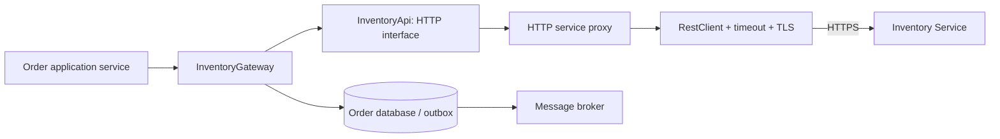
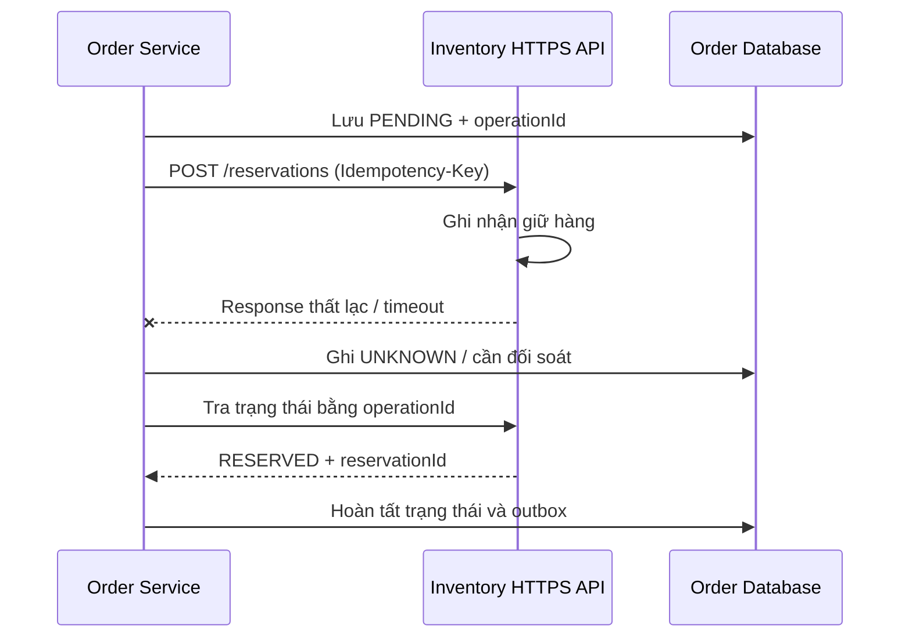
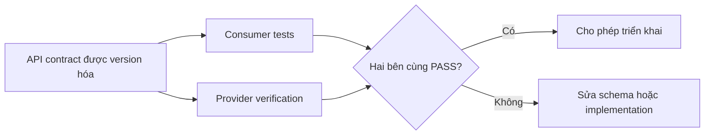

# Xây dựng client HTTP khai báo với timeout, TLS và kiểm thử hợp đồng

## 1. Mục tiêu và bài toán thực hành

Trong các ứng dụng Spring Boot, lời gọi HTTP tới dịch vụ khác thường xuất hiện ở nhiều nghiệp vụ: kiểm tra tồn kho, lấy tỷ giá, xác nhận thanh toán, đồng bộ hồ sơ khách hàng hoặc gửi lệnh đến hệ thống đối tác. Nếu tự ghép URL, xây request, xử lý status và cấu hình bảo mật ở từng service, những khác biệt nhỏ giữa các điểm gọi rất dễ gây lỗi khó phát hiện.

Bài thực hành này thuộc phần **Thực hành tổng hợp** của module **SPRING_BOOT_INTEGRATION**. Module tập trung tổ chức tích hợp hệ thống qua HTTP client, cơ sở dữ liệu, cache, broker thông điệp và adapter của Spring Integration; chú trọng **quản lý cấu hình, hợp đồng dữ liệu, giao dịch, lỗi, xử lý trùng lặp, kiểm thử và quan sát**. Ở đây, chúng ta xây dựng một client HTTP **khai báo**: mô tả endpoint bằng giao diện Java, còn framework tạo mã gửi request.

**Kết quả mong đợi:**

- Khai báo API từ xa bằng `@HttpExchange`, `@GetExchange`, `@PostExchange`; tạo proxy qua `HttpServiceProxyFactory`.
- Thiết lập endpoint, timeout, TLS và truststore trong cấu hình môi trường; tái sử dụng transport và HTTP client.
- Phân tách hợp đồng HTTP với cổng tích hợp nghiệp vụ, kiểm tra dữ liệu trả về và phân loại lỗi.
- Viết consumer contract test cho URI, HTTP method, header, JSON, status; xác định những phần cần provider verification.
- Lập kế hoạch kiểm thử thực sự cho TLS, timeout, retry và tình huống kết quả không rõ sau một yêu cầu ghi.

> **Phạm vi phiên bản:** Ví dụ dùng **Java 17+, Spring Boot 3.2+ và Spring Framework 6.1+**, với mô hình đồng bộ trên Spring MVC và `RestClient`. Spring Framework đã có HTTP interface từ 6.0; `RestClient` và adapter tương ứng xuất hiện trong 6.1. API và cấu hình có thể thay đổi ở các dòng phiên bản khác. Những ví dụ mã tách theo tệp và lược bỏ các `import` thông dụng để tập trung vào phần tích hợp.

### 1.1. Tình huống: Order Service gọi Inventory Service

Order Service cần kiểm tra số lượng tồn kho và yêu cầu Inventory Service giữ hàng khi khách xác nhận đơn. Inventory là một HTTPS API nội bộ dùng chứng chỉ do CA riêng của tổ chức cấp.

| Hợp đồng | Request | Response thành công | Tình huống lỗi |
|---|---|---|---|
| Tra cứu tồn kho | `GET /v1/stocks/{sku}` | `200`, JSON `{"sku":"SKU-42","available":8,"version":17}` | `404` SKU không tồn tại, `429` quá nhiều yêu cầu, `503` tạm lỗi |
| Giữ hàng | `POST /v1/reservations` với JSON và header `Idempotency-Key` | `201`, JSON `{"reservationId":"R-99","status":"RESERVED"}` | `409` xung đột, `422` dữ liệu không hợp lệ, `503` tạm lỗi |

Payload tạo giữ hàng:

```json
{
  "orderId": "O-1001",
  "sku": "SKU-42",
  "quantity": 2
}
```

Các yêu cầu vận hành:

1. Chỉ gọi đúng hostname của Inventory qua **HTTPS có xác minh chứng chỉ và hostname**.
2. Không chờ kết nối hoặc phản hồi vô hạn; thời gian chờ được cấu hình theo môi trường.
3. Ánh xạ lỗi HTTP và lỗi mạng thành kết quả tích hợp có ý nghĩa, không âm thầm trả dữ liệu mặc định.
4. Với lệnh giữ hàng, dùng **idempotency key** do Order Service quản lý; không gửi lại yêu cầu một cách mù quáng sau timeout.
5. Consumer và provider cần thống nhất URL, header, schema JSON, mã trạng thái và ngữ nghĩa lỗi bằng kiểm thử hợp đồng.



## 2. Hiểu đúng về HTTP client khai báo

Ở cách viết imperative, ta gọi `restClient.get().uri(...).retrieve().body(...)` cho mỗi endpoint. Với **Spring HTTP Interface**, giao diện Java mang metadata của request; một proxy chuyển lời gọi phương thức thành request HTTP.

```java
@HttpExchange(accept = MediaType.APPLICATION_JSON_VALUE)
public interface InventoryApi {

    @GetExchange("/v1/stocks/{sku}")
    StockView getStock(@PathVariable("sku") String sku);

    @PostExchange(
            url = "/v1/reservations",
            contentType = MediaType.APPLICATION_JSON_VALUE
    )
    ReservationView reserve(
            @RequestHeader("Idempotency-Key") String operationId,
            @RequestBody ReservationRequest request
    );
}
```

Đây là **hợp đồng phía client**, chưa tự bảo đảm API server triển khai đúng. Các annotation mô tả đường dẫn, HTTP method, cách gửi biến URL, header và body. Framework không cần lớp `InventoryApiImpl` được viết tay.

| Thành phần | Vai trò |
|---|---|
| `@HttpExchange` | Các thuộc tính HTTP chung cho interface, ví dụ `Accept` |
| `@GetExchange` / `@PostExchange` | Method và URL của từng endpoint |
| `@PathVariable` | Gắn biến từ Java vào URI template, tránh tự nối chuỗi URL |
| `@RequestHeader` | Khai báo header theo contract |
| `@RequestBody` | Serialize DTO thành request body |
| `HttpServiceProxyFactory` | Tạo đối tượng triển khai giao diện tại runtime |
| `RestClientAdapter` | Cho proxy dùng `RestClient` làm HTTP transport |

Có thể dùng `WebClientAdapter` nếu dự án dùng WebFlux và muốn trả về `Mono`/`Flux`. Bài này chọn `RestClient` vì Order Service sử dụng luồng đồng bộ; chuyển sang proxy khai báo không biến một request thành non-blocking.

## 3. Chuẩn bị dependency và cấu hình

### 3.1. Maven

Với Spring Boot và dependency management từ parent/BOM tương ứng, phần chính có thể dùng:

```xml
<dependencies>
    <dependency>
        <groupId>org.springframework.boot</groupId>
        <artifactId>spring-boot-starter-web</artifactId>
    </dependency>
    <dependency>
        <groupId>org.springframework.boot</groupId>
        <artifactId>spring-boot-starter-actuator</artifactId>
    </dependency>
    <dependency>
        <groupId>org.springframework.boot</groupId>
        <artifactId>spring-boot-starter-test</artifactId>
        <scope>test</scope>
    </dependency>
</dependencies>
```

`spring-boot-starter-web` cung cấp Spring Web, HTTP client và JSON serialization cần dùng khi Jackson hiện diện. `spring-boot-starter-test` cung cấp Spring Test và JUnit. `spring-boot-starter-actuator` hữu ích để quan sát health/metrics; cấu hình xuất metric/tracing thực tế tùy hệ thống.

### 3.2. Tách cấu hình ứng dụng khỏi mã Java

```yaml
# application.yml
integration:
  inventory:
    base-url: ${INVENTORY_BASE_URL}
    connect-timeout: ${INVENTORY_CONNECT_TIMEOUT:2s}
    read-timeout: ${INVENTORY_READ_TIMEOUT:3s}

spring:
  ssl:
    bundle:
      jks:
        inventory:
          truststore:
            location: ${INVENTORY_TRUSTSTORE_LOCATION}
            password: ${INVENTORY_TRUSTSTORE_PASSWORD}
            type: PKCS12
```

Trong môi trường thực, `INVENTORY_BASE_URL` phải là URL HTTPS hợp lệ, chẳng hạn `https://inventory.internal.example`; file truststore PKCS#12 phải chứa chứng chỉ CA hoặc chuỗi chứng chỉ được tin cậy của Inventory. **Không commit mật khẩu truststore vào repository**. Vị trí và cách cung cấp secret có thể đến từ secret store hoặc cơ chế triển khai của tổ chức.

Định nghĩa typed properties:

```java
// InventoryClientProperties.java
@ConfigurationProperties(prefix = "integration.inventory")
public record InventoryClientProperties(
        URI baseUrl,
        Duration connectTimeout,
        Duration readTimeout
) {}
```

Ví dụ trên dùng `java.net.URI` và `java.time.Duration`. Nên bổ sung validation lúc khởi động: các field không được null, thời gian chờ phải dương, base URL phải có scheme `https` và hostname được phép gọi. Với nhiều downstream, dùng namespace riêng cho từng client để không vô tình áp dụng timeout và truststore giống nhau.

### 3.3. Chuẩn bị truststore TLS

Truststore xác định **server certificate/CA nào được client tin cậy**. Truststore khác keystore chứa private key và client certificate dùng cho **mutual TLS (mTLS)**.

Ví dụ tạo truststore từ chứng chỉ CA đã được cấp và xác minh bởi quản trị viên:

```bash
keytool -importcert \
  -alias inventory-ca \
  -file inventory-ca.pem \
  -keystore inventory-truststore.p12 \
  -storetype PKCS12
```

Lệnh sẽ yêu cầu đặt/nhập mật khẩu khi cần. Chỉ thêm CA đáng tin cậy; không tải đại một chứng chỉ từ lỗi kết nối rồi tin tưởng ngay. Kiểm tra hostname của URL khớp Subject Alternative Name (SAN) trên chứng chỉ máy chủ. Với mTLS, cần cấu hình thêm `spring.ssl.bundle.jks.inventory.keystore` và thông tin khóa/certificate phù hợp, đồng thời phía server phải tin cậy CA cấp client certificate.

## 4. Triển khai declarative client

### 4.1. DTO độc lập với mô hình database

```java
// StockView.java
public record StockView(String sku, int available, long version) {}

// ReservationRequest.java
public record ReservationRequest(String orderId, String sku, int quantity) {}

// ReservationView.java
public record ReservationView(String reservationId, String status) {}
```

DTO phản ánh **hợp đồng truyền qua HTTP**. Nếu Order Service có JPA entity `Order` hay `OrderLine`, không truyền trực tiếp entity sang Inventory. Điều đó tránh làm thay đổi schema database gây thay đổi ngoài ý muốn ở API, đồng thời có chỗ để kiểm tra dữ liệu trả về.

Trong dự án thật, cần kiểm tra `sku` không rỗng, `quantity` dương và các trường của response theo contract. Với status có thể mở rộng, cân nhắc kiểu liệt kê/enum có phương án xử lý giá trị mới để tránh làm ứng dụng lỗi bất ngờ.

### 4.2. Dùng TLS bundle để cấu hình HTTP transport

Ví dụ sau xây một `RestClient` từ `RestClient.Builder` do Spring Boot cấp; dùng `SslBundles` để tạo `SSLContext`, rồi gắn nó vào JDK `HttpClient`. Cách này giữ rõ mối liên hệ giữa truststore và transport thực sự sử dụng trong lời gọi.

```java
// InventoryClientConfiguration.java (imports rút gọn)
@Configuration(proxyBeanMethods = false)
@EnableConfigurationProperties(InventoryClientProperties.class)
public class InventoryClientConfiguration {

    @Bean
    InventoryApi inventoryApi(
            RestClient.Builder builder,
            InventoryClientProperties properties,
            SslBundles sslBundles
    ) {
        if (properties.baseUrl() == null
                || !"https".equalsIgnoreCase(properties.baseUrl().getScheme())) {
            throw new IllegalArgumentException(
                    "Inventory base-url phải sử dụng HTTPS");
        }
        if (properties.connectTimeout() == null
                || properties.connectTimeout().isZero()
                || properties.connectTimeout().isNegative()
                || properties.readTimeout() == null
                || properties.readTimeout().isZero()
                || properties.readTimeout().isNegative()) {
            throw new IllegalArgumentException(
                    "Timeout của Inventory phải dương");
        }

        SSLContext sslContext = sslBundles.getBundle("inventory")
                .createSslContext();

        java.net.http.HttpClient jdkHttpClient =
                java.net.http.HttpClient.newBuilder()
                        .sslContext(sslContext)
                        .connectTimeout(properties.connectTimeout())
                        .followRedirects(
                                java.net.http.HttpClient.Redirect.NEVER)
                        .build();

        JdkClientHttpRequestFactory requestFactory =
                new JdkClientHttpRequestFactory(jdkHttpClient);
        requestFactory.setReadTimeout(properties.readTimeout());

        RestClient restClient = builder
                .baseUrl(properties.baseUrl().toString())
                .requestFactory(requestFactory)
                .defaultHeader(
                        HttpHeaders.ACCEPT,
                        MediaType.APPLICATION_JSON_VALUE)
                .build();

        HttpServiceProxyFactory proxyFactory =
                HttpServiceProxyFactory
                        .builderFor(RestClientAdapter.create(restClient))
                        .build();

        return proxyFactory.createClient(InventoryApi.class);
    }
}
```

Các lớp chính thuộc các package sau:

| Type | Package |
|---|---|
| `@ConfigurationProperties`, `@EnableConfigurationProperties` | `org.springframework.boot.context.properties` |
| `SslBundles` | `org.springframework.boot.ssl` |
| `RestClient` | `org.springframework.web.client` |
| `JdkClientHttpRequestFactory` | `org.springframework.http.client` |
| `HttpServiceProxyFactory` | `org.springframework.web.service.invoker` |
| `RestClientAdapter` | `org.springframework.web.client.support` |
| `@HttpExchange`, `@GetExchange`, `@PostExchange` | `org.springframework.web.service.annotation` |

Ở Spring Boot, việc dùng builder do container cấp giúp nhận các tùy chỉnh được đăng ký, chẳng hạn observation khi đã thiết lập hạ tầng quan sát. Vì request factory được **chủ động chỉ định** trong ví dụ, cấu hình TLS/timeout của ứng dụng nằm ở transport JDK này; không nên trông chờ một request factory khác tự động ghi đè để bảo mật thay mình.

**Tại sao không tạo client trong mỗi lần gọi?** `HttpClient` và `RestClient` được tái sử dụng qua bean; việc tạo mới transport liên tục tốn kết nối và có thể làm khó kiểm soát tài nguyên. Khi sản lượng request lớn, cần đánh giá giới hạn kết nối, backpressure/thread pool và SLA downstream. JDK HttpClient có cơ chế quản lý kết nối riêng; nếu cần cấu hình pooling chi tiết, có thể chọn transport khác nhưng phải gắn TLS/timeout và kiểm thử lại đầy đủ.

### 4.3. Gọi HTTP qua interface đã khai báo

Ứng dụng chỉ cần inject `InventoryApi`:

```java
@Service
public class InventoryGateway {
    private final InventoryApi api;

    public InventoryGateway(InventoryApi api) {
        this.api = api;
    }

    public StockView getStock(String sku) {
        try {
            StockView stock = api.getStock(sku);
            if (stock == null || stock.sku() == null
                    || !stock.sku().equals(sku)
                    || stock.available() < 0) {
                throw new IllegalStateException(
                        "Inventory trả về dữ liệu tồn kho không hợp lệ");
            }
            return stock;
        } catch (HttpClientErrorException.NotFound ex) {
            throw new UnknownSkuException(sku, ex);
        } catch (RestClientResponseException ex) {
            throw new InventoryIntegrationException(
                    "Inventory trả HTTP " + ex.getStatusCode().value(), ex);
        } catch (ResourceAccessException ex) {
            throw new InventoryIntegrationException(
                    "Inventory không truy cập được hoặc quá thời gian chờ",
                    ex);
        }
    }

    public ReservationView reserve(
            String operationId,
            ReservationRequest request
    ) {
        if (operationId == null || operationId.isBlank()) {
            throw new IllegalArgumentException(
                    "Thiếu idempotency key");
        }
        try {
            ReservationView response = api.reserve(operationId, request);
            if (response == null || response.reservationId() == null) {
                throw new IllegalStateException(
                        "Inventory trả phản hồi giữ hàng thiếu dữ liệu");
            }
            return response;
        } catch (ResourceAccessException ex) {
            throw new ReservationOutcomeUnknownException(
                    "Không xác định Inventory đã giữ hàng hay chưa", ex);
        }
    }
}
```

Các exception ứng dụng có thể đặt trong lớp riêng:

```java
public class UnknownSkuException extends RuntimeException {
    public UnknownSkuException(String sku, Throwable cause) {
        super("SKU không tồn tại: " + sku, cause);
    }
}

public class InventoryIntegrationException extends RuntimeException {
    public InventoryIntegrationException(String message, Throwable cause) {
        super(message, cause);
    }
}

public class ReservationOutcomeUnknownException extends RuntimeException {
    public ReservationOutcomeUnknownException(
            String message, Throwable cause) {
        super(message, cause);
    }
}
```

Trong trường hợp xử lý `POST`, HTTP `409`, `422`, `429` và `5xx` cũng cần được phân loại theo hợp đồng riêng. Ví dụ chỉ nêu rõ nhánh **timeout không biết kết quả**; một ứng dụng production cần lớp mapping đầy đủ (kể cả status và error code), không trả nguyên exception chứa body nhạy cảm ra API công khai.

### 4.4. Vai trò của Spring Security và xác thực outbound

TLS xác thực danh tính endpoint và bảo vệ dữ liệu khi truyền, nhưng không mặc nhiên cấp quyền gọi API. Inventory có thể yêu cầu OAuth2 client credentials, token ngắn hạn, API key, mTLS hoặc kết hợp các cơ chế. Gắn credential bằng interceptor/filter hoặc cấu hình riêng của outbound client; tránh nhúng token vào interface hoặc ghi vào log.

Nếu có nhiều outbound client, cần cô lập credential và truststore của từng hệ thống. Việc xác thực **request đến Order Service** và xác thực **Order Service khi gọi Inventory** là hai hướng độc lập.

## 5. Thiết kế timeout và lỗi dựa trên ngân sách thời gian

Timeout không phải một con số duy nhất. Ý nghĩa chính xác phụ thuộc transport và giai đoạn xử lý:

| Giới hạn | Bảo vệ điều gì | Áp dụng trong ví dụ |
|---|---|---|
| Connect timeout | Chờ mở kết nối đến endpoint | `HttpClient.Builder.connectTimeout` |
| Read/request timeout | Giới hạn thời gian chờ phản hồi theo request factory và transport | `JdkClientHttpRequestFactory.setReadTimeout` |
| Overall deadline | Thời gian tối đa cho cả nghiệp vụ, gồm DNS, chờ tài nguyên, nhiều request/retry | Cần thiết kế ở tầng gọi/điều phối, không chỉ từ hai thuộc tính trên |
| Resource limits | Số kết nối, số request đang chờ, thread và bộ nhớ | Cấu hình/đo tại transport và hạ tầng |

Ở JDK HTTP client, cách ánh xạ read timeout có thể phụ thuộc triển khai request factory và phiên bản; không suy diễn rằng mọi transport đều đếm thời gian giống nhau. Cần kiểm thử timeout với **HTTP server thực** gửi chậm hoặc ngắt kết nối. Đặt connect timeout `2s` và read timeout `3s` cũng **không** chứng minh toàn bộ nghiệp vụ hoàn tất trong `5s`, đặc biệt khi có retry, DNS, lock database hoặc nhiều downstream.

Ví dụ một request API của khách chỉ có ngân sách `4s`, Order Service có thể cần dành khoảng `2s` cho Inventory và phần còn lại cho database/response. Nếu cộng nhiều retry kéo dài quá deadline, hệ thống vẫn thất bại dù từng lần gọi được cấu hình timeout.

### 5.1. Phân loại status

| Kết quả | Nhận định | Chính sách tham khảo |
|---|---|---|
| `200` kèm JSON hợp lệ | Tra cứu thành công | Validate và ánh xạ vào domain |
| `201` kèm reservation ID | Giữ hàng thành công | Lưu kết quả gắn với operation ID |
| `404` cho SKU | Không tìm thấy tài nguyên | Lỗi nghiệp vụ, thường không retry |
| `400` / `422` | Request không hợp lệ | Sửa dữ liệu/contract, không retry nguyên request |
| `401` / `403` | Authn/authz thất bại | Xem lại token/quyền, cảnh báo phù hợp |
| `409` | Xung đột nghiệp vụ | Theo contract: đối soát hoặc thông báo, không retry vô hạn |
| `429` | Rate limit | Tôn trọng `Retry-After` khi có, giới hạn retry/backoff |
| `502` / `503` / `504` | Lỗi phụ thuộc có thể tạm thời | Cân nhắc retry có giới hạn đối với thao tác an toàn |
| Timeout hoặc connection reset | Có thể chưa biết server đã xử lý hay chưa | Với lệnh ghi, đối soát trạng thái/idempotency trước khi retry |
| `2xx` nhưng body rỗng/sai | Vi phạm hợp đồng dữ liệu | Báo lỗi tích hợp, không tự coi là thành công |

Không nên catch mọi exception rồi trả `null`, `0` hoặc một response `200` giả. Làm vậy che giấu sự cố và có thể khiến Order Service bán quá số tồn kho thực tế.

### 5.2. Retry, idempotency và giao dịch

Tra cứu tồn kho bằng `GET` thường có thể retry ít lần khi gặp lỗi I/O tạm thời hoặc `503`, có backoff và jitter. Với `POST /v1/reservations`, nếu Inventory đã ghi giữ hàng nhưng phản hồi thất lạc, client timeout không chứng minh thao tác thất bại.

**Quy trình an toàn hơn:**

1. Order Service tạo một `operationId` ổn định cho **một lệnh giữ hàng logic** và lưu nó cùng đơn ở trạng thái `PENDING`.
2. Khi gọi Inventory, gửi cùng `Idempotency-Key` cho mọi lần thử lại của lệnh đó.
3. Inventory **phải cam kết** xử lý idempotency key theo contract: kiểm tra trùng, trả lại kết quả trước đó hoặc cung cấp API tra cứu trạng thái.
4. Nếu timeout, ghi nhận `UNKNOWN`/`PENDING_RECONCILIATION`; đối soát thay vì tạo mã mới rồi gọi lặp.
5. Sau khi xác định kết quả, cập nhật trạng thái đơn và phát sự kiện qua outbox/broker theo thiết kế ứng dụng.



Hợp đồng hiện tại chưa định nghĩa endpoint tra theo `operationId`; sơ đồ mô tả **một khả năng cần thỏa thuận thêm với provider**, không phải endpoint sẵn có. Nếu provider không hỗ trợ tra cứu/idempotency, không tự kết luận thao tác ghi có thể retry an toàn.

Một `@Transactional` của database Order Service không làm request HTTP tham gia cùng giao dịch ACID. Tránh giữ transaction SQL và khóa lâu trong khi chờ mạng; với quy trình đa hệ thống, cân nhắc trạng thái trung gian, compensation, outbox và consumer xử lý message lặp. Spring Integration có thể điều phối flow, còn client HTTP vẫn phải tuân thủ hợp đồng lỗi và deadline.

## 6. Viết kiểm thử hợp đồng phía consumer

Kiểm thử ở đây phải bắt được trường hợp Java interface bị sửa sai URL, method, header hoặc DTO, ngay cả khi unit test nghiệp vụ vẫn xanh. `MockRestServiceServer` của Spring Test có thể gắn với `RestClient.Builder` để kiểm tra request và mô phỏng response, **không mở kết nối mạng thực**.

### 6.1. Fixture dựng proxy trong test

```java
// InventoryApiContractTest.java (imports và static imports rút gọn)
class InventoryApiContractTest {
    private MockRestServiceServer server;
    private InventoryApi api;

    @BeforeEach
    void setUp() {
        RestClient.Builder builder = RestClient.builder()
                .baseUrl("https://inventory.test");
        server = MockRestServiceServer.bindTo(builder).build();

        api = HttpServiceProxyFactory
                .builderFor(RestClientAdapter.create(builder.build()))
                .build()
                .createClient(InventoryApi.class);
    }

    @AfterEach
    void verifyRequests() {
        server.verify();
    }

    @Test
    void getStockMapsSuccessfulJsonResponse() {
        server.expect(requestTo(
                        "https://inventory.test/v1/stocks/SKU-42"))
                .andExpect(method(HttpMethod.GET))
                .andExpect(header(HttpHeaders.ACCEPT,
                        MediaType.APPLICATION_JSON_VALUE))
                .andRespond(withSuccess(
                        "{\"sku\":\"SKU-42\",\"available\":8,\"version\":17}",
                        MediaType.APPLICATION_JSON));

        StockView response = api.getStock("SKU-42");

        assertEquals("SKU-42", response.sku());
        assertEquals(8, response.available());
        assertEquals(17L, response.version());
    }

    @Test
    void reserveSendsIdempotencyKeyAndJsonBody() {
        server.expect(requestTo(
                        "https://inventory.test/v1/reservations"))
                .andExpect(method(HttpMethod.POST))
                .andExpect(header("Idempotency-Key",
                        "reserve-O-1001"))
                .andExpect(content().json(
                        "{\"orderId\":\"O-1001\","
                        + "\"sku\":\"SKU-42\",\"quantity\":2}"))
                .andRespond(withStatus(HttpStatus.CREATED)
                        .contentType(MediaType.APPLICATION_JSON)
                        .body("{\"reservationId\":\"R-99\","
                                + "\"status\":\"RESERVED\"}"));

        ReservationView response = api.reserve(
                "reserve-O-1001",
                new ReservationRequest("O-1001", "SKU-42", 2));

        assertEquals("R-99", response.reservationId());
        assertEquals("RESERVED", response.status());
    }

    @Test
    void missingSkuProducesHttp404Error() {
        server.expect(requestTo(
                        "https://inventory.test/v1/stocks/UNKNOWN"))
                .andRespond(withStatus(HttpStatus.NOT_FOUND)
                        .contentType(MediaType.APPLICATION_JSON)
                        .body("{\"code\":\"SKU_NOT_FOUND\"}"));

        assertThrows(
                HttpClientErrorException.NotFound.class,
                () -> api.getStock("UNKNOWN"));
    }
}
```

Các static import thường dùng: `MockRestRequestMatchers.requestTo`, `method`, `header`, `content`; `MockRestResponseCreators.withSuccess`, `withStatus`; và `Assertions.assertEquals`/`assertThrows` của JUnit 5. Test JSON dùng so sánh ngữ nghĩa để không phụ thuộc thứ tự field.

Ba ca trên chứng minh **client phát request đúng với expectation của consumer** và giải mã response định dạng đã thống nhất. Chúng không chứng minh Inventory server thật đã nhận các contract đó. Test cũng chưa kiểm tra `InventoryGateway` chuyển `404` thành `UnknownSkuException`; việc đó cần thêm unit/integration test ở lớp gateway.

### 6.2. Đưa hợp đồng thành tài sản được chia sẻ

Để consumer test không chỉ kiểm tra kỳ vọng do một nhóm tự đặt ra, cần chốt contract với đội Inventory. Tối thiểu contract ghi rõ:

| Mục | Cần thống nhất |
|---|---|
| URL, method | Phiên bản `/v1`, dấu slash, path variable, query encoding |
| Header | `Accept`, `Content-Type`, `Idempotency-Key`, authentication |
| Schema | Required/optional, kiểu dữ liệu, nullable, unknown field, enum, giới hạn giá trị |
| Trạng thái | `200`, `201`, `404`, `409`, `422`, `429`, `5xx` và body lỗi |
| Ngữ nghĩa | Khi nào giữ hàng thành công, giữ hàng trùng, hết hàng, timeout |
| Bảo mật | CA/truststore, hostname, TLS version, token hoặc mTLS |
| Thay đổi | Versioning, tương thích ngược, quy trình thông báo breaking change |

Có thể dùng **OpenAPI** làm nguồn mô tả contract với validator/provider test, hoặc **Pact/Spring Cloud Contract** để chạy consumer-driven contract: consumer xuất kỳ vọng, provider kiểm chứng kỳ vọng trên implementation thật trong CI. Cần pin phiên bản công cụ tương thích với phiên bản Spring Boot của dự án; không coi việc chạy mock consumer một phía là provider verification.

Một pipeline hợp đồng hợp lý:



### 6.3. Ma trận kiểm thử hợp đồng đề xuất

| Case | Dữ liệu mô phỏng | Assert chính |
|---|---|---|
| Stock hợp lệ | `200` + JSON đủ field | Đúng URI, `Accept`, deserialization |
| Stock không tìm thấy | `404` + error code | Ném lỗi HTTP đúng và gateway ánh xạ đúng |
| Giữ hàng thành công | `201` + JSON | `POST`, `Content-Type`, idempotency key, body |
| Giữ hàng lặp cùng key | Provider trả cùng reservation theo contract | Không tạo bản ghi giữ hàng trùng |
| Giữ hàng xung đột | `409` + error code | Caller phân biệt nghiệp vụ và lỗi mạng |
| Dữ liệu đầu vào lỗi | `422` | Không retry request sai nguyên trạng |
| Rate limit | `429` + `Retry-After` | Retry có ngân sách/giới hạn nếu được bật |
| Lỗi tạm thời | `503` | Truyền lỗi có trạng thái, không trả stock = 0 |
| Body rỗng hoặc sai kiểu | `200` nhưng response không hợp lệ | Gateway phát hiện vi phạm contract |
| Giá trị mới | Thêm field không bắt buộc | Đánh giá chính sách backward compatibility |

Một test provider có thể khẳng định cùng key và cùng payload trả kết quả nhất quán; nếu key trùng nhưng payload khác, hành vi phải do Inventory định nghĩa (ví dụ trả `409`). Không tự áp giả định chỉ vì client có header.

## 7. Kiểm thử TLS và timeout bằng kết nối thật

`MockRestServiceServer` hoạt động trước tầng mạng nên **không kiểm tra TLS handshake, chứng chỉ, hostname, DNS, connection pool hay timeout socket**. Với các đặc tính này, cần một HTTPS test server thật có thể điều khiển chứng chỉ và thời gian phản hồi, chẳng hạn WireMock/MockWebServer chạy với TLS hoặc môi trường kiểm thử do đội hạ tầng cung cấp.

| Thử nghiệm | Thiết lập | Kết quả mong đợi |
|---|---|---|
| CA đáng tin cậy | Server dùng cert hợp lệ cho hostname test, truststore chứa CA | Kết nối HTTPS thành công |
| CA không được tin | Server dùng cert từ CA khác | Handshake thất bại, không gửi dữ liệu ứng dụng |
| Hostname sai | SAN không khớp hostname của URL | Client từ chối certificate |
| Chứng chỉ hết hạn | Cert nằm ngoài thời hạn hợp lệ | Client từ chối kết nối |
| mTLS thiếu client cert | Server yêu cầu client authentication | Handshake/bước xác thực thất bại |
| Kết nối chậm | Server/đường mạng làm chậm thiết lập kết nối | Connect timeout phát huy hiệu lực |
| Phản hồi chậm | Server chấp nhận kết nối rồi giữ phản hồi | Request/read timeout phát huy hiệu lực |
| Body bị ngắt giữa chừng | Server gửi một phần rồi ngắt | Lỗi I/O/giải mã được truyền ra rõ ràng |
| Dịch vụ tạm lỗi | Server trả `503` rồi phục hồi | Retry tuân thủ điều kiện, deadline và số lần tối đa |

**Quy trình thực hành kiểm tra TLS:**

1. Chuẩn bị HTTPS server test với certificate SAN đúng tên máy chủ giả lập (ví dụ tên nội bộ được ánh xạ trong môi trường test); phát hành bằng CA test riêng.
2. Tạo truststore chỉ chứa CA test, đặt đường dẫn/mật khẩu qua biến môi trường và chạy đúng cấu hình client production tương ứng.
3. Xác nhận request thật thành công với truststore đúng.
4. Thay bằng CA sai và hostname sai lần lượt, xác nhận **client từ chối kết nối**; tuyệt đối không tắt hostname verification hay dùng trust-all để làm test xanh.
5. Chạy test phản hồi chậm và timeout, đo thời gian thực tế và trạng thái trả về cho caller.

Các ca TLS thất bại nên kiểm thử trong môi trường cô lập với chứng chỉ test, không thao tác trên CA/truststore production. Nếu `SslBundles` báo không tìm thấy bundle hoặc truststore, ứng dụng nên lỗi lúc khởi động thay vì ngầm chuyển sang kết nối không xác minh TLS.

**Điểm thực tế về test:** URL `https://inventory.test` ở `MockRestServiceServer` không tự thực hiện TLS; tên miền chỉ được dùng để so khớp request. Vì thế không được lấy việc test mock xanh làm bằng chứng rằng certificate production được cấu hình đúng.

## 8. Bảo đảm luồng tích hợp phù hợp với database, cache và broker

Ở mức module **SPRING_BOOT_INTEGRATION**, HTTP client là một adapter của toàn bộ luồng nghiệp vụ. Quyết định quan trọng thường nằm ở ranh giới giữa các hệ thống:

### 8.1. Cơ sở dữ liệu và outbox

Khi đặt hàng, có thể lưu `PENDING` cùng operation ID trước, gọi Inventory ngoài transaction dài, sau đó cập nhật trạng thái và ghi outbox event trong cùng transaction database. Worker outbox phát event lên broker, consumer phải xử lý trùng. Nếu thay đổi giữa Inventory và Order DB không đồng bộ, dùng trạng thái đối soát/compensation thay vì kỳ vọng `@Transactional` bao trùm cả HTTP.

### 8.2. Cache tồn kho

Cache giúp giảm tải các request tra cứu, nhưng tồn kho biến động nhanh. Không dùng cache stale để bảo đảm đặt hàng thành công. Dùng cache cho màn hình ước lượng với TTL nhỏ có thể hợp lý; quyết định giữ hàng cần dựa vào lệnh có kiểm soát đồng thời từ Inventory. Trong failover, không tự coi timeout là `available = 0` hoặc `available = ∞`.

### 8.3. Broker và retry nhiều tầng

Order Service có thể được gọi trực tiếp bằng HTTP hoặc từ event broker. Nếu consumer broker đã retry, service lại retry, HTTP adapter cũng retry, số request thực tế có thể nhân lên. Xác định **một chính sách phối hợp** về số lần thử, backoff, idempotency và deadline trên toàn bộ đường xử lý. Đảm bảo cùng operation ID qua các lần redelivery.

### 8.4. Khả năng quan sát

Với Spring Boot Actuator/Micrometer và tracing được cấu hình đúng, theo dõi:

- Tốc độ gọi, thời gian phản hồi (p95/p99), lỗi theo HTTP status và tên downstream.
- Timeout/connection failure, `429`, `503`, retry, circuit breaker, tải trên thread/connection pool.
- Số lần tạo reservation và số lần đối soát trạng thái không rõ sau timeout.
- Correlation ID/trace ID xuyên các bước; nếu thêm request ID header thì cần thống nhất với provider.

Đừng dùng SKU, order ID, idempotency key hoặc URL động làm metric tag: cardinality sẽ tăng không kiểm soát và có thể lộ dữ liệu. Log chỉ nên có loại operation, template endpoint, status, duration và mã tương quan; không log bearer token, private key, truststore password, cookie hay toàn bộ payload nhạy cảm.

## 9. Checklist nghiệm thu bài thực hành

| Nhóm | Điều kiện đạt |
|---|---|
| Khai báo API | `InventoryApi` có typed method, đúng path/method/header/body |
| Quản lý cấu hình | URL, connect timeout, read timeout và TLS bundle lấy từ cấu hình môi trường |
| TLS | Server certificate/hostname được xác minh; ca CA sai và hostname sai thất bại như dự kiến |
| Timeout | Có kiểm thử kết nối và phản hồi chậm trên transport thật; không treo vô hạn |
| Hợp đồng | Consumer test kiểm tra serialization/deserialization, status và header; provider verification được thống nhất trong CI |
| Lỗi | `404`, `409`, `429`, `503`, I/O và malformed body có hành vi rõ ràng |
| Trùng lặp | `POST` dùng key ổn định; provider có chính sách idempotency/đối soát |
| Giao dịch | Không giả định rollback SQL hoàn tác HTTP; có trạng thái bù/đối soát |
| Quan sát | Có đo latency/error/timeout và correlation phù hợp, không log secret |

### Các lỗi phổ biến cần tránh

1. **Đặt timeout cho socket nhưng không kiểm tra thời gian toàn bộ nghiệp vụ:** retry có thể kéo dài vượt SLA.
2. **Dùng trust-all SSLContext hoặc bỏ hostname verification:** che lỗi certificate và đánh mất bảo vệ TLS.
3. **Kiểm thử mock rồi tuyên bố TLS đã được kiểm chứng:** mock HTTP không tạo handshake thật.
4. **Đọc `404` như lỗi mạng hoặc trả stock = 0 cho mọi lỗi:** làm mất ngữ nghĩa và gây quyết định nghiệp vụ sai.
5. **Tạo idempotency key mới ở mỗi lần retry:** có thể tạo nhiều reservation sau timeout.
6. **Lấy DTO HTTP làm JPA entity:** làm schema API và domain/database phụ thuộc nhau ngoài ý muốn.
7. **Chỉ kiểm tra consumer contract, bỏ provider verification:** test vẫn có thể xanh trong khi hai hệ thống không tương thích.
8. **Gọi outbound HTTP bên trong transaction SQL kéo dài:** tăng thời gian giữ lock và không cung cấp giao dịch phân tán.

### Câu hỏi tự kiểm tra

1. `HttpServiceProxyFactory` làm gì? Vì sao interface chỉ có annotation vẫn thực thi được lời gọi HTTP?
2. `@GetExchange` khác gì `@PostExchange`, và vì sao `Idempotency-Key` cần xuất hiện trong contract ghi?
3. Truststore và keystore khác nhau như thế nào? Khi nào cần mTLS?
4. Connect timeout và request/read timeout có tự bảo đảm overall deadline không? Vì sao?
5. Tại sao `MockRestServiceServer` chưa đủ để chứng minh TLS handshake và timeout hoạt động?
6. Consumer contract test và provider verification giải quyết những rủi ro khác nhau nào?
7. Khi `POST /v1/reservations` bị timeout, trạng thái nào nên lưu để bảo toàn khả năng đối soát?
8. Làm sao tránh retry nhiều tầng giữa broker, service và HTTP client?
9. Vì sao một `@Transactional` trong Order Service không bảo đảm rollback giữ hàng ở Inventory?
10. Những dữ liệu nào không được đưa vào log hoặc metric tag của outbound HTTP client?

**Tổng kết:** HTTP client khai báo giúp gom contract vào giao diện, làm mã gọi downstream rõ ràng và dễ kiểm thử hơn. Một tích hợp Spring Boot đáng tin cậy phải đi cùng **TLS được xác minh, timeout có ngân sách, xử lý lỗi đúng ngữ nghĩa, kiểm thử contract ở cả consumer và provider, idempotency cho thao tác ghi, đối soát giao dịch và quan sát vận hành**.
