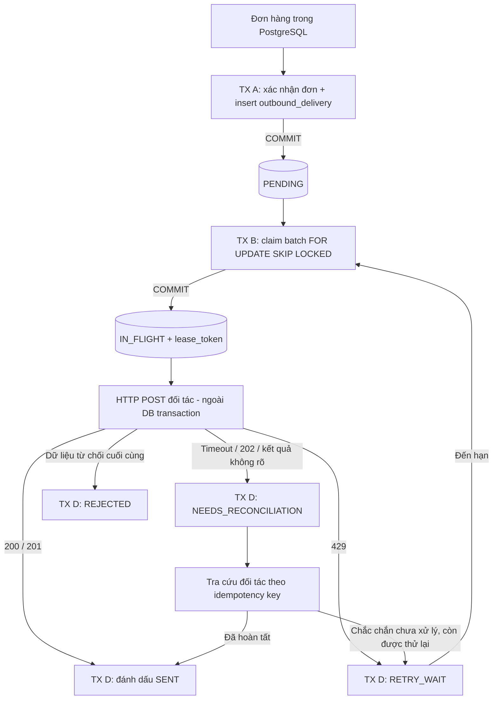
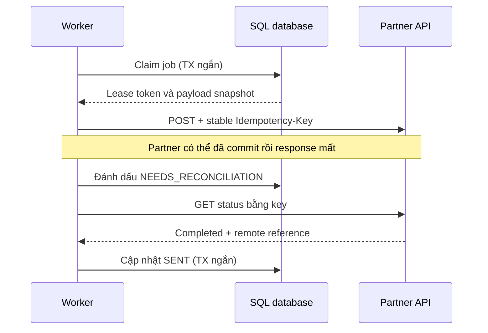

# Đọc dữ liệu từ SQL và gửi tới dịch vụ ngoài với ranh giới giao dịch rõ ràng

> **Chương:** Thực hành tổng hợp  
> **Bối cảnh:** Module **SPRING_BOOT_INTEGRATION** tổ chức kết nối hệ thống trong Spring Boot qua HTTP client, cơ sở dữ liệu, cache, broker thông điệp và các adapter Spring Integration. Bài thực hành kết hợp **đọc dữ liệu từ PostgreSQL**, xây một bản ghi gửi đi bền vững, **gọi HTTP API đối tác** và cập nhật trạng thái bằng các giao dịch ngắn. Trọng tâm là hợp đồng dữ liệu, giao dịch, lỗi, xử lý trùng lặp, kiểm thử và quan sát.

## 1. Bài toán và kết quả cần đạt

Một dịch vụ quản lý đơn hàng lưu dữ liệu ở PostgreSQL. Khi đơn được xác nhận, hệ thống phải gửi thông tin đơn tới API của đối tác:

```http
POST /v1/orders HTTP/1.1
Content-Type: application/json
Idempotency-Key: 4a7598e6-c4d6-4d11-9acc-17237f61c8cf

{"orderId":"b47a765b-a870-4d36-b243-4eae42fcd405","amountMinor":125000,"currency":"VND"}
```

Đối tác quy định `200 OK` hoặc `201 Created` là kết quả hoàn tất; `202 Accepted` có nghĩa mới **nhận yêu cầu để xử lý sau**. Đối tác cũng hỗ trợ tra cứu trạng thái theo khóa idempotency để đối chiếu sau khi mất kết nối. Đây là **giả định hợp đồng của bài thực hành**, cần thay bằng thông số thực của hệ thống tích hợp.

Ứng dụng phải đáp ứng:

1. Không mất lệnh gửi nếu ứng dụng chết sau khi xác nhận đơn trong SQL.
2. Không giữ transaction hoặc khóa DB trong suốt cuộc gọi HTTP.
3. Hai worker chạy đồng thời không cùng claim một bản ghi tại một thời điểm bình thường.
4. Retry dùng cùng định danh và cùng payload; không tạo đơn thứ hai ở phía đối tác.
5. Nếu không biết kết quả ở đối tác (timeout, mất response, `202`), không tự đánh dấu đã thành công.
6. Có thể theo dõi, thử lại, đối chiếu hoặc điều tra từng bản ghi.

**Không có một transaction ACID chung** bao trùm PostgreSQL và HTTP API đối tác. Bài này dùng **bảng công việc gửi đi bền vững** (một dạng transactional outbox cho HTTP delivery) để thu hẹp rủi ro mất dữ liệu.

## 2. Hai cách tổ chức và lý do chọn cách có bảng công việc

### 2.1. Cách dễ viết nhưng có vấn đề

```java
@Transactional
public void exportOrders() {
    List<Order> orders = repository.findByStatus("CONFIRMED");
    for (Order order : orders) {
        restClient.post()
                .uri("/v1/orders")
                .body(toPartnerDto(order))
                .retrieve()
                .toBodilessEntity();
        order.markExported();
    }
}
```

Mã trên chỉ minh họa **một thiết kế cần tránh**. Nếu HTTP chậm, transaction DB giữ tài nguyên lâu. Nếu đối tác đã xử lý một đơn nhưng lệnh cập nhật `EXPORTED` rollback, lần chạy sau có thể gửi lại cùng đơn. Nếu hai instance cùng đọc `CONFIRMED` mà không claim nguyên tử, cả hai đều có thể gọi HTTP.

### 2.2. Thiết kế đề xuất

Tách thành ba ranh giới có trách nhiệm riêng:

| Ranh giới | Trong transaction SQL? | Việc làm |
| --- | --- | --- |
| **A. Xác nhận đơn và enqueue** | **Có** | Cập nhật đơn và insert bản ghi outbound delivery cùng transaction |
| **B. Claim bản ghi chờ gửi** | **Có, rất ngắn** | Chọn công việc có khóa, gắn lease token và commit |
| **C. Gọi HTTP API** | **Không** | Gửi payload snapshot với idempotency key cố định |
| **D. Ghi nhận kết quả** | **Có, rất ngắn** | Chuyển trạng thái sau HTTP; dùng lease token để tránh worker cũ ghi đè |



**Điểm học quan trọng:** việc đọc dữ liệu từ SQL và gửi đi **không bắt buộc** phải diễn ra trong cùng transaction. Điều cần đảm bảo là mỗi **quyết định thay đổi trạng thái SQL** được lưu nguyên tử, còn kết quả từ bên ngoài được đối chiếu khi không chắc chắn.

## 3. Công nghệ và cấu hình tối thiểu

Bài minh họa dành cho **Spring Boot 3.2+**, Java 17+, PostgreSQL, Spring JDBC và `RestClient` của Spring Framework. Dùng version đã được Spring Boot parent/BOM quản lý; ví dụ dependency Maven:

```xml
<dependencies>
    <dependency>
        <groupId>org.springframework.boot</groupId>
        <artifactId>spring-boot-starter-jdbc</artifactId>
    </dependency>
    <dependency>
        <groupId>org.springframework.boot</groupId>
        <artifactId>spring-boot-starter-web</artifactId>
    </dependency>
    <dependency>
        <groupId>org.postgresql</groupId>
        <artifactId>postgresql</artifactId>
        <scope>runtime</scope>
    </dependency>
</dependencies>
```

Ví dụ `application.yml`:

```yaml
spring:
  datasource:
    url: ${DB_URL:jdbc:postgresql://localhost:5432/integration}
    username: ${DB_USER:integration}
    password: ${DB_PASSWORD}
    hikari:
      maximum-pool-size: 10

partner:
  base-url: ${PARTNER_BASE_URL:http://localhost:8089}

integration:
  delivery:
    poll-delay-ms: 3000
```

**Không đưa credential thật** vào Git; ví dụ trên dựa vào biến môi trường. Dùng Flyway/Liquibase hay một công cụ migration có phiên bản để tạo schema. Số connection và độ trễ poll cần được điều chỉnh từ số liệu thực, không dựa vào giá trị ví dụ.

### 3.1. Giới hạn HTTP call và tạo RestClient

Để không treo worker vô hạn, đặt connect/read timeout. `SimpleClientHttpRequestFactory` dưới đây đủ minh họa; trong production có thể dùng HTTP client có connection pooling, TLS, proxy, authentication và metric phù hợp.

```java
package com.example.integration.delivery;

import org.springframework.beans.factory.annotation.Value;
import org.springframework.context.annotation.Bean;
import org.springframework.context.annotation.Configuration;
import org.springframework.http.client.SimpleClientHttpRequestFactory;
import org.springframework.scheduling.annotation.EnableScheduling;
import org.springframework.web.client.RestClient;

@Configuration
@EnableScheduling
public class DeliveryConfiguration {
    @Bean
    RestClient partnerRestClient(
            RestClient.Builder builder,
            @Value("${partner.base-url}") String baseUrl) {
        SimpleClientHttpRequestFactory factory =
                new SimpleClientHttpRequestFactory();
        factory.setConnectTimeout(2_000);
        factory.setReadTimeout(5_000);

        return builder
                .baseUrl(baseUrl)
                .requestFactory(factory)
                .build();
    }
}
```

**Timeout của client không xác nhận giao dịch bên đối tác đã rollback.** Có thể server đối tác đã commit nhưng response bị mất. Vì vậy quy trình recovery cần idempotency key ổn định và API tra cứu trạng thái.

## 4. Thiết kế schema SQL

Bảng `orders` chứa dữ liệu nguồn. Bảng `outbound_delivery` lưu một **snapshot payload** cần gửi, cùng trạng thái vận hành và lease token:

```sql
CREATE TABLE orders (
    id UUID PRIMARY KEY,
    tenant_id VARCHAR(64) NOT NULL,
    amount_minor BIGINT NOT NULL CHECK (amount_minor >= 0),
    currency VARCHAR(3) NOT NULL,
    status VARCHAR(20) NOT NULL
        CHECK (status IN ('NEW', 'CONFIRMED'))
);

CREATE TABLE outbound_delivery (
    id UUID PRIMARY KEY,
    tenant_id VARCHAR(64) NOT NULL,
    order_id UUID NOT NULL REFERENCES orders(id),
    destination VARCHAR(80) NOT NULL,
    payload_json JSONB NOT NULL,
    status VARCHAR(32) NOT NULL DEFAULT 'PENDING'
        CHECK (status IN (
            'PENDING', 'IN_FLIGHT', 'RETRY_WAIT',
            'SENT', 'NEEDS_RECONCILIATION',
            'REJECTED', 'FAILED_REVIEW'
        )),
    attempt_count INTEGER NOT NULL DEFAULT 0
        CHECK (attempt_count >= 0),
    next_attempt_at TIMESTAMPTZ NOT NULL DEFAULT CURRENT_TIMESTAMP,
    lease_token UUID,
    leased_until TIMESTAMPTZ,
    last_error_code VARCHAR(80),
    sent_at TIMESTAMPTZ,
    created_at TIMESTAMPTZ NOT NULL DEFAULT CURRENT_TIMESTAMP,
    updated_at TIMESTAMPTZ NOT NULL DEFAULT CURRENT_TIMESTAMP,
    CONSTRAINT uk_delivery_order_target
        UNIQUE (tenant_id, order_id, destination)
);

CREATE INDEX idx_delivery_poll
    ON outbound_delivery (status, next_attempt_at, created_at);
```

| Cột | Ý nghĩa |
| --- | --- |
| `id` | **Delivery ID ổn định**, đồng thời là idempotency key gửi cho đối tác |
| `payload_json` | Snapshot nội dung đã chuẩn hóa, không đổi giữa các lần retry |
| `tenant_id, order_id, destination` | Khóa tự nhiên ngăn tạo nhiều job cho cùng đích và đơn |
| `status` | Tiến trình gửi, kết quả hoàn tất hoặc trạng thái cần đối chiếu |
| `attempt_count` | Số lần worker nhận quyền thử gửi; hỗ trợ giới hạn retry |
| `lease_token, leased_until` | Nhận diện worker đang giữ claim và thời hạn lease |
| `next_attempt_at` | Điều phối retry mà không ngủ chờ trong DB transaction |
| `last_error_code` | Phân loại lỗi an toàn, phục vụ vận hành |

Vì `payload_json` là snapshot, nếu đơn được sửa sau khi xác nhận thì delivery cũ **vẫn mang nội dung đã chốt**. Nếu nghiệp vụ yêu cầu phát phiên bản mới, phải dùng operation/event version mới có định danh riêng; không sửa payload của một delivery đang được retry dưới cùng idempotency key.

### 4.1. Trạng thái không phải giao dịch phân tán

- `PENDING`: đã commit vào SQL, chưa gửi.
- `IN_FLIGHT`: worker claim; một lệnh HTTP có thể đã chạy hoặc chưa.
- `RETRY_WAIT`: có thể retry theo chính sách đã thỏa thuận.
- `SENT`: đã nhận kết quả hoàn tất theo contract đối tác.
- `NEEDS_RECONCILIATION`: chưa rõ đối tác đã thực hiện hay chưa; cần tra cứu, không retry mù.
- `REJECTED`: đối tác từ chối dữ liệu cuối cùng (ví dụ hợp đồng định nghĩa 400/422 là lỗi không phục hồi).
- `FAILED_REVIEW`: vượt ngưỡng retry hoặc cần người vận hành can thiệp.

Đây là **trạng thái do ứng dụng thiết kế**, Spring Boot không tự sinh các trạng thái này.

## 5. Giao dịch A: đọc đơn SQL và tạo job gửi đi

Khi đơn chuyển từ `NEW` sang `CONFIRMED`, phải ghi cả trạng thái đơn và bản ghi gửi đi **trong cùng transaction SQL**. Không gọi đối tác trong method này.

```java
package com.example.integration.delivery;

import java.util.UUID;
import org.springframework.jdbc.core.JdbcTemplate;
import org.springframework.stereotype.Service;
import org.springframework.transaction.annotation.Transactional;

@Service
public class OrderConfirmationService {
    private final JdbcTemplate jdbc;

    public OrderConfirmationService(JdbcTemplate jdbc) {
        this.jdbc = jdbc;
    }

    @Transactional
    public void confirmAndEnqueue(UUID orderId) {
        int confirmed = jdbc.update("""
            UPDATE orders SET status = 'CONFIRMED'
             WHERE id = ? AND status = 'NEW'
            """, orderId);

        if (confirmed != 1) {
            throw new IllegalStateException(
                    "Order missing or no longer NEW"
            );
        }

        int enqueued = jdbc.update("""
            INSERT INTO outbound_delivery (
                id, tenant_id, order_id,
                destination, payload_json
            )
            SELECT ?, o.tenant_id, o.id,
                   'partner-orders',
                   jsonb_build_object(
                       'orderId', o.id::text,
                       'amountMinor', o.amount_minor,
                       'currency', o.currency
                   )
              FROM orders o
             WHERE o.id = ? AND o.status = 'CONFIRMED'
            ON CONFLICT (tenant_id, order_id, destination)
            DO NOTHING
            """,
            UUID.randomUUID(), orderId
        );

        if (enqueued != 1) {
            throw new IllegalStateException(
                    "Delivery job was not inserted"
            );
        }
    }
}
```

Hai lệnh được thực hiện trên **cùng DataSource/transaction manager**. Nếu insert delivery lỗi hoặc exception thoát khỏi phương thức, transaction rollback cả thay đổi `orders`. Việc gọi phải đi qua Spring proxy để `@Transactional` có hiệu lực; self-invocation trong cùng object có thể không mở transaction như mong đợi.

`UNIQUE (tenant_id, order_id, destination)` giúp chống enqueue trùng trong trường hợp hai tiến trình cạnh tranh. Không thay thế ràng buộc business key nếu cùng một đơn được tạo với hai `orderId` khác nhau ở bước trước.

### 5.1. Nạp dữ liệu SQL đã tồn tại

Nếu bảng `orders` đã chứa các đơn `CONFIRMED` trước khi triển khai outbox, có thể chạy một đợt backfill có kiểm soát:

```sql
INSERT INTO outbound_delivery (
    id, tenant_id, order_id, destination, payload_json
)
SELECT gen_random_uuid(), o.tenant_id, o.id,
       'partner-orders',
       jsonb_build_object(
           'orderId', o.id::text,
           'amountMinor', o.amount_minor,
           'currency', o.currency
       )
  FROM orders o
 WHERE o.status = 'CONFIRMED'
ON CONFLICT (tenant_id, order_id, destination)
DO NOTHING;
```

Ví dụ dùng `gen_random_uuid()` trên PostgreSQL hỗ trợ hàm này; ở hệ thống khác có thể sinh UUID ở ứng dụng. Với dữ liệu lớn, cần backfill theo batch, lập mốc quét, đo row count và đảm bảo các đơn mới vẫn được enqueue bằng **transaction A**. Chỉ quét SQL định kỳ mà không có outbox atomic có thể bỏ sót trạng thái hoặc tạo khoảng trống khi worker và transaction cập nhật cùng lúc.

## 6. Giao dịch B: claim SQL trong một lệnh nguyên tử

Nếu worker chỉ thực hiện:

```text
SELECT * FROM outbound_delivery WHERE status = 'PENDING';
-- Sau đó từng worker mới UPDATE status = 'IN_FLIGHT'
```

hai instance có thể cùng đọc một job trước khi ai cập nhật. Cần **claim atomically**. PostgreSQL cung cấp `FOR UPDATE SKIP LOCKED` để mỗi worker chọn những hàng chưa bị worker khác khóa trong transaction claim.

### 6.1. Một câu lệnh claim và commit ngắn

```sql
WITH picked AS (
    SELECT id
      FROM outbound_delivery
     WHERE (
               status IN ('PENDING', 'RETRY_WAIT')
               AND next_attempt_at <= CURRENT_TIMESTAMP
           )
        OR (
               status = 'IN_FLIGHT'
               AND leased_until < CURRENT_TIMESTAMP
           )
     ORDER BY created_at, id
     FOR UPDATE SKIP LOCKED
     LIMIT :batch_size
)
UPDATE outbound_delivery d
   SET status = 'IN_FLIGHT',
       lease_token = :token,
       leased_until = CURRENT_TIMESTAMP + INTERVAL '2 minutes',
       attempt_count = attempt_count + 1,
       updated_at = CURRENT_TIMESTAMP
  FROM picked
 WHERE d.id = picked.id
RETURNING d.id, d.payload_json::text AS payload_json,
          d.lease_token, d.attempt_count;
```

`:batch_size` và `:token` trong SQL trên là **ký hiệu tham số minh họa**. `JdbcTemplate` bên dưới dùng placeholder JDBC `?`. Câu lệnh claim chỉ làm việc với DB; worker **commit ngay sau khi claim** rồi mới gọi HTTP.

Nếu lease hết hạn khi worker vẫn còn xử lý, một worker khác có thể claim lại. Đây là lý do phải dùng:

- **Idempotency key ổn định** ở phía đối tác để tránh side effect trùng.
- **Lease token** khi finalize để worker cũ không ghi đè kết quả worker mới.
- Timeout, batch size và thời hạn lease được đo và chọn phù hợp; bài minh họa dùng batch nhỏ.

### 6.2. Repository đọc và cập nhật trạng thái

```java
package com.example.integration.delivery;

import java.util.List;
import java.util.UUID;
import org.springframework.jdbc.core.JdbcTemplate;
import org.springframework.stereotype.Repository;

record DeliveryJob(
        UUID id,
        String payloadJson,
        UUID leaseToken,
        int attemptCount) {}

@Repository
public class DeliveryStore {
    private final JdbcTemplate jdbc;

    public DeliveryStore(JdbcTemplate jdbc) {
        this.jdbc = jdbc;
    }

    public List<DeliveryJob> claim(int batchSize) {
        UUID token = UUID.randomUUID();
        return jdbc.query("""
            WITH picked AS (
                SELECT id FROM outbound_delivery
                 WHERE (
                           status IN ('PENDING', 'RETRY_WAIT')
                           AND next_attempt_at <= CURRENT_TIMESTAMP
                       )
                    OR (
                           status = 'IN_FLIGHT'
                           AND leased_until < CURRENT_TIMESTAMP
                       )
                 ORDER BY created_at, id
                 FOR UPDATE SKIP LOCKED
                 LIMIT ?
            )
            UPDATE outbound_delivery d
               SET status = 'IN_FLIGHT',
                   lease_token = ?,
                   leased_until = CURRENT_TIMESTAMP + INTERVAL '2 minutes',
                   attempt_count = attempt_count + 1,
                   updated_at = CURRENT_TIMESTAMP
              FROM picked
             WHERE d.id = picked.id
            RETURNING d.id, d.payload_json::text AS payload_json,
                      d.lease_token, d.attempt_count
            """,
            (rs, row) -> new DeliveryJob(
                    rs.getObject("id", UUID.class),
                    rs.getString("payload_json"),
                    rs.getObject("lease_token", UUID.class),
                    rs.getInt("attempt_count")
            ),
            batchSize, token
        );
    }

    public boolean transition(
            DeliveryJob job, String nextStatus, String errorCode) {
        // nextStatus chỉ nhận giá trị do code ứng dụng chọn,
        // không truyền nguyên chuỗi từ request bên ngoài.
        int changed = jdbc.update("""
            UPDATE outbound_delivery
               SET status = ?,
                   last_error_code = ?,
                   lease_token = NULL,
                   leased_until = NULL,
                   next_attempt_at = CASE
                       WHEN ? = 'RETRY_WAIT'
                       THEN CURRENT_TIMESTAMP + INTERVAL '2 minutes'
                       ELSE next_attempt_at END,
                   sent_at = CASE
                       WHEN ? = 'SENT'
                       THEN CURRENT_TIMESTAMP
                       ELSE sent_at END,
                   updated_at = CURRENT_TIMESTAMP
             WHERE id = ?
               AND status = 'IN_FLIGHT'
               AND lease_token = ?
               AND leased_until > CURRENT_TIMESTAMP
            """,
            nextStatus, errorCode, nextStatus, nextStatus,
            job.id(), job.leaseToken()
        );
        return changed == 1;
    }
}
```

**Vì sao cần `WHERE lease_token = ?` và kiểm tra thời hạn?** Nếu worker A quá chậm làm lease hết hạn và worker B claim lại, A không được ghi `SENT` hoặc `RETRY_WAIT` đè lên trạng thái của B. Khi `transition()` trả `false`, phải ghi metric/cảnh báo; nó không có nghĩa có thể tự cập nhật bỏ qua điều kiện. Remote request của A vẫn có thể đã xảy ra, do đó idempotency ở đối tác là lớp bảo vệ còn lại.

Ở đây `claim()` chỉ là **một lệnh SQL nguyên tử** và không mang annotation `@Transactional` bao quanh HTTP. Khi mỗi phương thức JDBC dùng một statement trong chế độ autocommit thông thường, lệnh claim kết thúc và commit trước khi `claim()` trả về. Nếu caller hoặc service bên ngoài mở transaction bao quanh `claim()` và HTTP, thiết kế sẽ mất ranh giới mong muốn; cần tránh.

## 7. Gọi dịch vụ ngoài rồi finalize bằng transaction ngắn

Worker phải lấy `payload_json` đã lưu trong SQL, gửi **cùng payload** và **cùng idempotency key** qua mọi lần thử. Phía đối tác được giả định hỗ trợ key này và định nghĩa trạng thái phản hồi như mục 1.

```java
package com.example.integration.delivery;

import org.slf4j.Logger;
import org.slf4j.LoggerFactory;
import org.springframework.beans.factory.annotation.Qualifier;
import org.springframework.scheduling.annotation.Scheduled;
import org.springframework.stereotype.Component;
import org.springframework.http.MediaType;
import org.springframework.web.client.ResourceAccessException;
import org.springframework.web.client.RestClient;
import org.springframework.web.client.RestClientResponseException;

@Component
public class DeliveryWorker {
    private static final Logger log =
            LoggerFactory.getLogger(DeliveryWorker.class);
    private final DeliveryStore store;
    private final RestClient client;

    public DeliveryWorker(
            DeliveryStore store,
            @Qualifier("partnerRestClient") RestClient client) {
        this.store = store;
        this.client = client;
    }

    @Scheduled(
        fixedDelayString = "${integration.delivery.poll-delay-ms:3000}")
    public void poll() {
        for (DeliveryJob job : store.claim(5)) {
            deliver(job);
        }
    }

    private void deliver(DeliveryJob job) {
        String nextStatus;
        String errorCode = null;

        try {
            var response = client.post()
                    .uri("/v1/orders")
                    .contentType(MediaType.APPLICATION_JSON)
                    .header("Idempotency-Key", job.id().toString())
                    .body(job.payloadJson())
                    .retrieve()
                    .toBodilessEntity();

            int status = response.getStatusCode().value();
            if (status == 200 || status == 201) {
                nextStatus = "SENT";
            } else {
                // 202 hoặc code chưa được hợp đồng xác định
                // chưa chứng minh thao tác đã hoàn tất.
                nextStatus = "NEEDS_RECONCILIATION";
                errorCode = "PARTNER_STATUS_" + status;
            }
        } catch (RestClientResponseException ex) {
            int code = ex.getStatusCode().value();
            errorCode = "HTTP_" + code;

            if (code == 429 && job.attemptCount() < 5) {
                nextStatus = "RETRY_WAIT";
            } else if (code == 400 || code == 422) {
                nextStatus = "REJECTED";
            } else if (code == 429) {
                nextStatus = "FAILED_REVIEW";
            } else {
                // 401/403/409/5xx... cần điều tra hoặc đối chiếu
                // theo hợp đồng đối tác trước khi gửi lại.
                nextStatus = "NEEDS_RECONCILIATION";
            }
        } catch (ResourceAccessException ex) {
            // Timeout/mất kết nối: có thể phía đối tác đã commit.
            nextStatus = "NEEDS_RECONCILIATION";
            errorCode = "TRANSPORT_UNCERTAIN";
        }

        boolean updated =
                store.transition(job, nextStatus, errorCode);
        if (!updated) {
            log.warn("Could not finalize deliveryId={} (lease changed)",
                    job.id());
        }
    }
}
```

Mã ví dụ dùng `String` chứa JSON snapshot do PostgreSQL tạo. Với client/message converter mặc định, chuỗi body có thể được truyền như JSON text dưới Content-Type đã khai báo; ở hệ thống thật cần **kiểm thử bytes gửi đi** bằng mock HTTP server để tránh double-encoding hoặc thay đổi format khi đổi thư viện/codec.

### 7.1. Đừng đánh dấu `SENT` chỉ vì không có exception

`202 Accepted` thường có nghĩa đối tác mới ghi nhận tác vụ; không nên coi là giao dịch đã hoàn tất khi hợp đồng không cam kết điều đó. Với 202, luồng nên lưu ID tra cứu/`Location` nếu được cung cấp và chuyển sang `NEEDS_RECONCILIATION` hoặc trạng thái chờ xác nhận khác.

Nếu đối tác dùng `204 No Content` để biểu diễn **hoàn tất**, cần bổ sung mã đó vào nhánh thành công **sau khi xác nhận contract**. Trong bài này, chỉ 200/201 là hoàn tất.

`RestClient.retrieve()` mặc định ném `RestClientResponseException` cho response 4xx/5xx. `429` được retry có giới hạn và theo chính sách delay; production nên đọc `Retry-After`, thêm backoff/jitter và circuit breaker theo nhu cầu. Các lỗi 5xx hoặc 409 có thể mơ hồ về side effect, nên bài thực hành chuyển sang đối chiếu. Các lỗi ứng dụng/codec khác cũng cần error boundary ngoài cùng để không làm scheduler dừng hoặc bỏ mất tín hiệu; xem phần kiểm thử và vận hành.

### 7.2. Thời gian lease và giới hạn lô

Ví dụ claim tối đa 5 job/lần, mỗi HTTP request có read timeout 5 giây và lease 2 phút. Đây chỉ là **giá trị minh họa**. Nếu batch lớn hoặc xử lý song song, cần thiết kế lease renewal, ownership token, giới hạn concurrency và timeout phù hợp. Khi lease mất, worker có thể đã gửi HTTP nhưng không còn quyền finalize; kết quả phải được đối chiếu hoặc gửi lại cùng key theo cam kết idempotency của đối tác.

## 8. Recovery: trường hợp không biết đối tác đã nhận hay chưa

`NEEDS_RECONCILIATION` là trạng thái có chủ đích, vì một lời gọi HTTP có thể thất bại **sau khi phía đối tác đã thực thi**.

Một reconciler hoặc thao tác vận hành cần:

1. Đọc delivery còn chưa rõ kết quả từ SQL.
2. Tra cứu API đối tác bằng **idempotency key `outbound_delivery.id`** hoặc `orderId` nếu hợp đồng tra cứu của đối tác cho phép.
3. Nếu đối tác xác nhận đã xử lý thành công, cập nhật `SENT` và lưu remote reference trong transaction ngắn.
4. Nếu xác nhận **chưa xử lý** và việc gửi lại được cho phép, chuyển `RETRY_WAIT` với cùng key/payload.
5. Nếu trạng thái vẫn không xác định, giữ `NEEDS_RECONCILIATION`, cảnh báo và lên lịch đối chiếu sau. Không xóa job để “cho retry lại từ đầu”.



Nếu đối tác **không cung cấp idempotency** hoặc khả năng tra cứu trạng thái, hệ thống không thể bảo đảm chống trùng tuyệt đối khi response bị mất. Cần thống nhất một business key có unique constraint ở phía đối tác, quy trình điều tra thủ công hoặc sửa hợp đồng trước khi bật retry tự động cho thao tác có side effect.

### 8.1. Phân loại lỗi và chính sách

| Tình huống | Cách xử lý |
| --- | --- |
| 200/201 theo hợp đồng | `SENT`, lưu remote reference nếu có |
| 202 xử lý bất đồng bộ | Chờ/tra cứu trạng thái; không đánh dấu `SENT` ngay |
| 400/422 lỗi hợp đồng cuối cùng | `REJECTED`; sửa payload ở một **thao tác mới** có version/key đúng nếu cần |
| 429 rate limit | `RETRY_WAIT` có giới hạn, backoff và `Retry-After` nếu được hỗ trợ |
| 401/403 credentials hoặc quyền | Cảnh báo vận hành và đối chiếu; không retry dồn dập |
| 409 conflict | Diễn giải theo contract đối tác; có thể là duplicate hợp lệ hoặc payload mismatch |
| 5xx, timeout, reset connection | Trạng thái có thể không rõ; tra cứu trước khi retry side effect |
| Crash sau DB claim trước HTTP | Lease hết hạn và job lại được claim; vẫn cùng key/payload |
| Crash sau remote success trước cập nhật `SENT` | Replay sau lease hoặc reconciliation; remote idempotency bảo vệ side effect |

**Lưu ý về retry vượt giới hạn:** Không cho một lỗi lặp vô hạn vì có thể tạo áp lực lên hệ thống đối tác và làm đầy queue. Đặt số lần thử tối đa, đường xử lý `FAILED_REVIEW` và thao tác phục hồi có quyền truy cập phù hợp.

## 9. Ranh giới giao dịch khi dùng Spring Integration, JPA hoặc broker

Mẫu này không bắt buộc dùng Spring Integration; `@Scheduled` + Spring JDBC đủ cho một worker đơn giản. Nếu hệ thống đã dùng Integration flow, có thể thay scheduler bằng **JDBC polling inbound adapter** hay message flow để tổ chức bước đọc và biến đổi. Nhưng ranh giới giao dịch vẫn phải rõ:

- Poll/claim DB commit xong rồi mới gọi HTTP outbound gateway.
- Bước HTTP phải có timeout và quy tắc xác nhận kết quả riêng.
- Bước cập nhật trạng thái phải là một giao dịch SQL độc lập, kiểm tra lease token.
- `errorChannel` nhận lỗi xử lý ở những endpoint có cơ chế error publishing; **không tự thay thế** durable job, retry table hoặc broker DLQ.
- Với `ExecutorChannel`/thread khác, transaction context ở thread trước không tự truyền; đặt `@Transactional` trên service ở thread thực thi DB update.

Nếu dùng JPA thay JDBC, tránh mở `@Transactional` bao trùm cả method “đọc entities → gọi HTTP → đánh dấu”. Tách thành service claim và service finalize với transaction ngắn. Query locking tương đương có thể phụ thuộc database và JPA provider; cần integration test trên PostgreSQL thực để xác minh `SKIP LOCKED` hoặc chiến lược claim khác.

### 9.1. Nếu nguồn là message broker thay vì lịch quét SQL

Một consumer Kafka/RabbitMQ có thể nhận event “order confirmed” và enqueue delivery vào SQL. Khi đã có bản ghi bền vững, worker xử lý HTTP độc lập. **Ack/redelivery của broker là một ranh giới khác**: nếu broker message có thể đến lặp, thao tác insert delivery cần unique constraint hoặc inbox keyed theo `producerId + eventId` để không enqueue trùng.

Nếu cả dữ liệu nguồn và outbox nằm trong cùng database, ghi trong cùng DB transaction giúp tránh mất lệnh giữa “đổi trạng thái đơn” và “tạo delivery”. Nếu hai DB riêng hoặc một DB + broker, không có cùng atomic commit mặc định; cần bổ sung idempotency, replay hoặc quy trình reconciliation.

## 10. Quan sát và vận hành

Một worker đáng tin phải trả lời được: **có bao nhiêu đơn đang chờ, đơn nào đã gửi, đơn nào chưa rõ kết quả và vì sao?**

| Metric/Log nên có | Ý nghĩa |
| --- | --- |
| `delivery_pending_count` và `delivery_oldest_pending_age` | Queue SQL có bị dồn không? |
| `delivery_claim_total` và `delivery_claim_conflict_total` | Worker có claim được job và có tranh chấp không? |
| `delivery_send_latency` theo destination/result | Độ trễ HTTP và phân loại kết quả |
| `delivery_retry_total` / `delivery_reconciliation_count` | Mức độ lỗi và backlog cần điều tra |
| `delivery_lease_expired_total` | Timeout/worker pause có làm job bị reclaim không? |
| `delivery_finalize_stale_total` | Có worker không còn quyền cập nhật trạng thái không? |
| `delivery_rejected_total` / `delivery_failed_review_total` | Lỗi hợp đồng hoặc công việc cần sửa |

Các tên trên là **đề xuất metric tùy biến**, không phải những metric Spring Boot mặc định tạo ra. Có thể xuất qua Micrometer/Actuator. Tag theo `destination`, `resultType`, `errorClass` đã chuẩn hóa; không đưa `orderId`, `deliveryId` hoặc payload chứa PII vào metric tag do cardinality rất cao.

Log dạng cấu trúc nên có `deliveryId`, `correlationId`, `tenantGroup`, attempt, status và latency, nhưng không log toàn bộ JSON chứa dữ liệu nhạy cảm, token hoặc credential. TLS và authentication đối tác phải được cấu hình an toàn; riêng idempotency key không phải thông tin xác thực.

### 10.1. Câu SQL hỗ trợ vận hành

Tìm những công việc đang tồn:

```sql
SELECT status,
       COUNT(*) AS total,
       MIN(created_at) AS oldest_created_at
  FROM outbound_delivery
 GROUP BY status
 ORDER BY status;

SELECT id, order_id, attempt_count, last_error_code,
       next_attempt_at, leased_until, updated_at
  FROM outbound_delivery
 WHERE status IN ('RETRY_WAIT', 'NEEDS_RECONCILIATION', 'FAILED_REVIEW')
 ORDER BY updated_at
 LIMIT 100;
```

Trước khi “reset” một job ở production, phải xác minh trạng thái ở đối tác. Việc đổi `SENT` về `PENDING` hoặc xóa delivery ID có thể tạo side effect mới nếu hệ thống đối tác không giữ kết quả idempotency đủ lâu.

## 11. Kiểm thử tích hợp và tình huống lỗi

Không cần chỉ unit test riêng hàm `deliver()`: phần rủi ro nằm ở **transaction boundary, concurrency, uniqueness, timeout và mất response**.

| Ca kiểm thử | Kết quả cần chứng minh |
| --- | --- |
| Xác nhận đơn thành công | `orders.status=CONFIRMED` và một outbound delivery `PENDING` cùng commit |
| Insert delivery thất bại | Cả trạng thái đơn và job rollback |
| Hai worker claim cùng lúc | Không có hai worker giữ cùng job ở cùng thời điểm claim hợp lệ |
| HTTP trả 201 | Job chuyển `SENT` đúng một lần |
| HTTP trả 202 | Chuyển đối chiếu; không ghi `SENT` |
| HTTP trả 429 | Retry có giới hạn và chờ đủ thời gian |
| HTTP timeout sau khi đối tác đã commit | Job không bị coi thất bại vĩnh viễn; dùng tra cứu/stable key để xác nhận |
| Worker crash sau claim | Hết lease thì job được claim lại; cùng delivery ID/payload |
| Worker A xử lý chậm, worker B lấy lease mới | Update của A bị chặn bằng token/lease check |
| Broker gửi lại sự kiện xác nhận đơn | Unique delivery/inbox chặn tạo job trùng |
| Đơn được sửa sau khi snapshot gửi | Retry giữ nguyên nội dung đã thỏa thuận hoặc phát operation/version mới |
| Database hoặc đối tác down | Metric và trạng thái cho phép phục hồi, không mất job |
| Payload chứa thông tin nhạy cảm | Không ghi nguyên payload vào log/DLQ không kiểm soát |

Khuyến nghị dùng **PostgreSQL thật qua Testcontainers** để kiểm tra `FOR UPDATE SKIP LOCKED`, unique constraint, transaction commit/rollback và lease. Dùng một HTTP mock server như WireMock/MockWebServer để điều khiển mã response, delay, mất kết nối và kiểm tra **Idempotency-Key** giữa các lần gửi. Test transaction phải có bước commit/rollback thật; mock JDBC không chứng minh tính nguyên tử.

### 11.1. Thực hành đo ranh giới giao dịch

Có thể đặt metric/tracing span cho `confirmAndEnqueue()`, `claim()`, HTTP call và `transition()` rồi kiểm tra bằng log:

```text
delivery=abc  phase=enqueue    db_tx=commit    duration_ms=12
delivery=abc  phase=claim      db_tx=commit    duration_ms=8
delivery=abc  phase=http      db_tx=none      duration_ms=190
delivery=abc  phase=finalize  db_tx=commit    duration_ms=6
```

Các số ở đây chỉ minh họa, không phải benchmark. Điều cần xác nhận là **HTTP call không nằm trong khoảng giữ transaction DB**, và bản ghi delivery luôn đủ thông tin phục hồi khi process chết.

## 12. Bài tập mở rộng

1. **Thêm status lookup:** hiện thực reconciler gọi API tra cứu với `outbound_delivery.id` rồi đưa `NEEDS_RECONCILIATION` về `SENT` hoặc `RETRY_WAIT` sau khi có bằng chứng.
2. **Backoff thực tế:** thay retry cố định hai phút bằng exponential backoff + jitter, tôn trọng `Retry-After` và số lần thử tối đa; tránh giữ thread chờ.
3. **Đa đích:** cùng một order được gửi tới hai hệ thống độc lập. Giải thích vì sao `(tenant_id, order_id, destination)` và một delivery ID cho mỗi đích là cần thiết.
4. **Schema version:** bổ sung `payload_version` và cách chuyển đổi khi đối tác nâng hợp đồng. Một delivery đã claim không đổi nội dung dưới cùng idempotency key.
5. **Dọn dữ liệu:** xác định thời hạn giữ `SENT` và `REJECTED` theo SLA replay, yêu cầu đối chiếu, PII và chính sách dữ liệu. Không xóa key sớm hơn thời gian đối tác có thể nhận retry cũ.
6. **Làm mạnh worker:** bao bọc lỗi bất ngờ trong mỗi job, báo metric, gia hạn lease khi xử lý dài và giới hạn concurrency/queue depth.

### Câu hỏi tự kiểm tra

1. Tại sao không nên gọi HTTP API trong một method `@Transactional` đang cập nhật SQL?
2. Vì sao lệnh `SELECT` rồi `UPDATE` đơn giản dễ làm hai worker gửi trùng?
3. `FOR UPDATE SKIP LOCKED` giúp gì, và vì sao vẫn cần idempotency key ở đối tác?
4. Nếu đối tác đã tạo đơn nhưng response bị mất, trạng thái nào hợp lý hơn `SENT` hoặc `REJECTED`?
5. Vì sao snapshot payload phải giữ ổn định qua retry của cùng delivery ID?
6. Khi nào phải thay một lệnh gửi đi cũ bằng operation/version mới?
7. `lease_token` bảo vệ điều gì khi worker A chậm và worker B đã claim lại?
8. Vì sao việc đánh dấu job `SENT` ở SQL và việc đối tác xử lý HTTP không thể commit nguyên tử trong một transaction JDBC thông thường?
9. Nếu nguồn phát là Kafka, cần chính sách inbox/unique constraint nào để không enqueue hai job cho một event?
10. Những phép thử nào chứng minh transaction thực sự ngắn và luồng có thể phục hồi sau crash?

**Ghi nhớ:** Với bài toán **đọc SQL rồi gửi HTTP**, ranh giới tin cậy thường là **transaction ghi nguồn + delivery job**, **claim DB ngắn**, **HTTP ở ngoài transaction**, và **finalize DB ngắn**. Cần giữ payload/idempotency key ổn định, xử lý lease và trạng thái chưa rõ bằng reconciliation, đồng thời kiểm thử các điểm chết sau commit và sau side effect. Bảng delivery giúp không mất ý định gửi; độ đúng đắn cuối cùng vẫn phụ thuộc vào hợp đồng idempotency của đối tác và việc quan sát, phục hồi có kiểm soát.
